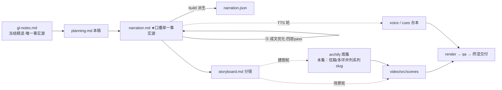

# 策划案：新系列 ep15《Agent Teams：文件收件箱与持久队友》（v1 · 文案轮待用户审批 · C 型信源 = gl-notes）

> 状态：系列 claude-code-chapters 第 15 集（s15_agent_teams 单章，2026-10-31 开工）。本轮为**文案轮**（Stage ①–⑤）：逐字稿与全部文案交用户审批，审批通过才进入制作（⑥ 分镜 → ⑩ 交付），故本稿不做建图与场景设计。事实源 = `research/gl-notes.md`（冻结自现行 175 精读，2026-10-31；取材范围 s15 单章——冻结正文 §4 主线 + §10 数字表两行 + §11 实验 E3 + §12 规律 4，钉站点轨 `67a9126c`）。

成本档位: 正集（单语 + story 档已配音系 + 约 5 分钟常规动画复杂度；文案轮无生产层开销，制作期成本量级 = 常规单集）

## 0. 标题候选（待审批；series.json 现为工作题《Agent Teams：文件收件箱与持久队友》，审批后落定）

| 候选 | 一句话理由 |
|---|---|
| A《Agent Teams：文件收件箱与持久队友》 | 直取冻结正文 §4 节题与站点章题「Agent Teams」，机制名零翻译损耗，与 ep1/ep2「英文机制名+中文副题」命名式一致 |
| B《Agent Teams：加队友，不加循环》 | 承系列母题「机制很多，循环一个」：组队加的是信箱与队友线程，主代理从头到尾没有第二个循环（§2/§4），与 ep2《多加一个工具，只加一行》同构成对 |
| C《Agent Teams：队友不共享对话，只收信》 | 本集最大认知增量——「多开几个」直觉的工程破绽：上下文互染逼出收件箱，一句话点破（§4 开篇论证） |
| D《Agent Teams：信取走，箱就空》 | 认知增量型（消融向）：以核心消融 E3 的「取出即清空」语义为题眼（§11/§12 规律 4），题目即机制、成片即验证 |

## 一、定位表

| 项 | 值 |
|---|---|
| 平台 | B 站 / YouTube 中长视频 |
| 时长目标 | 4.4–5.6 分钟（pipeline.toml 硬约束窗，含系列片头 ~23.5s 口径；正文 1305 字预算 @254 字/分，实稿 1280） |
| 形态 | AI 配音（story 档）+ Remotion 代码动画，无真人 |
| 受众 | 不预设工程背景的普通人：见过「AI 能组队干活」的传闻、没想过队伍内部怎么传话的任何观众 |
| 核心内容范围 | gl-notes §4 全节（共享对话为何崩 / 文件收件箱三段语义 / spawn 持久队友与精简工具集 / Lead 收件箱注入与每秒轮询 / 子 Agent 与队友之别 / 权限冒泡）+ §1 问题场景（重构后端、子 Agent 一次性，= s15「问题」节）+ §2 收束句（同款循环、没有第二个循环）+ §10 两行（Lead 工具 14 段、轮询节奏行）+ §11 实验 E3（本集核心消融正例，本集复算【一】）+ §12 规律 4（读即消费，单点入口）；任务板（§3）属 ep12、协议（§5）属 ep16、自治认领（§6）属 ep17、worktree（§7）属 ep18、MCP（§8）属 ep19、综合回合（§9）属 ep20——本集只作邻集坐标一笔带过、不重讲 |
| 系列位置 | 多 Agent 组第一集（五大组第 5 组）：在「并发」之后回答「一个干不完怎么办」——系列母题「循环不变、机制挂在周围」的又一次实证；视觉母题（恒定环体）首次出现**多枚同款环体并列**的形态 |

**Logline**：一群代理不能共用一段对话——改成一人一只文件信箱，发信追加一行、取信整摞清空；主代理与队友各跑同款循环，谁影响谁，全落在信箱和下一轮（gl-notes §4 + §2）。

## 二、叙事策略

**主线是一问一答的闭环**：开场抛问题「多开几个，为什么偏偏出事」→ P1 回答「对话不能共享，只能递信」（收件箱三段语义）→ P2 回答「队友是什么、怎么拉、干完怎么回信」（spawn 三件套 + 走查）→ P3 追问「信到了门口，怎么被看见」并实测「为什么读取只能有一个口」（注入 + 轮询 + E3 消融）→ P4 对照生产版「真实的队伍什么样」（文件信箱 + 锁 + 权限冒泡 + 实验开关）→ P5 收束「队友不是另一个大脑，是又一条同款循环」+ 下期钩子（会递信 ≠ 会商量）。

**开篇钩子候选矩阵（★ 待人工挑选——本集文案审批人即挑选人）**：

| # | 型 | 钩子文本（p0-01） | 吸引力留存逻辑 | 核心主干关联锚点 | 抛出的核心引子 |
|---|---|---|---|---|---|
| H1 | 反直觉颠覆型 ★ | 「这是一个代理干不完的活——多开几个就好？麻烦，恰恰出在这个直觉上。」 | 直觉承诺与麻烦警告同句对撞，认知反差 3 秒锁注意力；并直接承接前集留钩意象（一个 Agent 干不完的活） | §1（大项目单代理装不下）+ §4 开篇（「多开几个」直觉的工程破绽）；P0 当幕展开、P1 首拍兑现 | 为什么「多开几个」会出事？组队的真难点在哪？ |
| H2 | 痛点型 | 「这是一扇装不下四个模块的窗口——细节，边干边漏。」 | 场景痛点即时认领（谁都见过越干越忘的助手），具象可感 | §1 重构后端场景；P0 问题现场即钩子展开 | 装不下怎么办？现成帮手为什么不够？ |
| H3 | 新范式揭示型 | 「这是一支不共享对话的队伍——各过各的，只互相递信。」 | 反直觉设计直接揭底（队伍居然不共享记忆？），制造「凭什么可行」的好奇 | §4 第一条设计决定；P1 主线即其论证 | 不共享对话，怎么协作？ |
| H4 | 反差机制型 | 「这是一只取走即空的信箱——一条消息，恰好被处理一次。」 | 以最反直觉的机制语义开场，题目即钩子 | §4 消费式收信 + §12 规律 4；P3 主线 | 为什么必须取走即空？该谁来取？ |
| H5 | 悬念冲突型 | 「这是一条被读走的回音——关机这件事，永远停在了待处理。」 | 冲突 + 悬置后果（谁读走的？为什么卡死？） | §11 实验 E3；P3 消融正例 | 消息怎么被读走的？坑埋在哪？ |

★ 选定 H1（自动选定，待人工复核）。理由：misconception-first 与认知曲线对齐（先陈述朴素直觉、P1 首拍演示其崩掉、正确机制作修补引入）；且「一个代理干不完的活」零成本兑现前集留钩的承接义务，P0 当幕展开不欠债；H2 痛点并入 P0 问题现场（p0-02/03）；H3 本质句改写进 P1 收束（「对话不共享，各过各的」）；H4 机制语义押 P3 幕点；H5 悬念对前半程是负债、押 P3 消融拍。

**视觉母题统摄全片，局部类比点到即止**：连续感只由视觉母题承担（恒定循环环体〔M-001〕首次以**多枚同款环体并列**出场——主代理橙环居中、队友品红环体两侧，系列色彩契约 + 本集「信箱文件」装置视觉），严禁把局部类比升格为贯穿剧场。口播类比只准入 gl-notes 附录 A 承袭表「递话口」行登记的三段机制语义：**追加一行 = 发信 / 整摞取走清空 = 消费式收信 / 只看不取 = 探测**（P1、P3 各 1–3 句点亮即切回机制画面）；不带楼域叙事与称谓（楼 / 师傅 / 环形走廊一律不进口播与画面文案）。冻结正文 §4 自带「快递柜」喻未入登记表——按「未登记类比不进口播」纪律不启用（本集信箱语义已由承袭条目承载，防一物双喻）；其余未登记新喻零引入。

**记忆点约每 60–90 秒一个**（全部取自 gl-notes §1/§2/§4/§10/§11，数字必带基线标尺）：
P0「修到接口，认证的细节早被挤出了记忆——它叫上下文窗口」（§1 痛点）→ P1「对话不共享，只递信；一条消息恰好被处理一次」（§4 + §12 规律 4）→ P2「一次性的管互不干扰，一直活着的管随时递话的协作；主代理工具从十一件长到十四件」（§4 对照 + s15 变更表【一】）→ P3「回音被读走，关机永远停在待处理；再查信箱，零条」（§11 实验 E3 本集复算【一】）→ P4「真队伍也是一人一只文件信箱；审批统一出现在主代理的会话」（s15 CC 附录【三】+ 官方文档）→ P5 收束金句「队友不是另一个大脑，是又一条同款循环」（§2）。

**收尾不贩卖焦虑，悬念只留给下期**：P5 护栏句并入片尾署源块（生产细节来自原作者单方核查、未锁版本、计数会漂移——gl-notes B.3 口径，随署源句交代，与 ep1/ep2 同款）；悬念留在下期钩子（会递信不等于会商量：关机谁说了算、审批找谁拍板——只点问题、不预告机制），官方「实验特性默认关闭」按「谨慎默认」平实呈现，不渲染风险焦虑。

## 三、视觉语言

**色彩语义沿用系列契约**（深色底 `#0E1116`；警示红 `#FF5C5C` = 反例/退化路径；确认绿 `#7ED321` = 机制在位/办成落定；金句卡衬线体；公式/方法名只进角标）：

| 概念 | 专属色 | 语义 |
|---|---|---|
| 循环环体（全系列恒定锚〔M-001〕） | 陶土橙 `#D97757`（系列恒定，承 ep1） | 主代理的环体继续居中出场；本集首次出现多枚**同款**环体并列（队友品红环体），恒定锚表达「循环没换、只是多了几条」 |
| 队友线程 / 并行身份 | 品红 `#D946EF`（本集主题色，theme.core 本集新增语义） | 队友执行流、同款环体副本、并行身份牌、权限冒泡回路；对同日兄弟集的雾紫族（#8B7CF6 系）主动拉大色相距离（品红相 vs 蓝紫相，系列层撞色对账前先拉开） |
| 收件箱 / 消息流 | 湛蓝 `#3EB6E8`（本集主题色） | 信箱文件、追加一行 / 整摞取走动画、每秒探测脉冲、消息注入流；偏青的蓝相与 ep1 青碧 `#64C4C0`、兄弟集天蓝族拉开距离 |
| 互染反例 / 双入口扑空 / E3 退化帧 | 警示红 `#FF5C5C`（系列保留） | 共用对话的渗染帧、慢一步抓空帧、「永远停在待处理」卡死帧 |
| 机制在位 / 办成落定 | 确认绿 `#7ED321`（系列保留） | 入口统一侧、两单关机办成落定帧 |

构图纪律：消融对比一律左红右绿同屏（E3：入口统一·两单全办成 ↔ 放工具直读·卡待处理 + 二读零条）；「两种组法」对比一律左共用对话（红色渗染）右递信（湛蓝信箱）（同题并列，等高裁决）；数字一律动态增长条 + 工况角标（主代理工具 11→14、队友 10 轮上限）；走查 beat 用消息条 + 工具卡 + 信箱文件三件堆叠动画（Animated State Trace）；信箱装置视觉 = 一只带文件名角标的信箱文件，追加一行逐字落格、整摞取走即清空（全片反复出场、逐幕生长）；多环并列母题严格同款（同尺寸同转速，仅描边色区分主/队友），表达「循环没换」；视觉母题禁旧版隐喻系意象（车间 / 作坊 / 传送带 / 工序卡 / 叫号器 / 插线口 / 师傅及同族），楼域词系（楼 / 递话口称谓 / 环形走廊）同样不进画面文案，一律工程直陈：信箱、队友、线程、注入、入口。

**景别走 `WS→CU→MS`，张力峰值在 P3**：P0 全景（一张四模块大任务卡压向单枚环体、目标卡被挤出）→ P1 急推信箱文件特写（追加一行 / 整摞清空双动作）→ P2 中景走查（多环并列 + 双队友并行双轨）→ P3 双特写（探测脉冲节律 ↔ 消融左右屏对撞）→ P4 拉远（真实队伍拓扑全景 + 权限冒泡回路）→ P5 环体群定格收束。运镜密度：P3 紧张段每镜 ≤1 次推近；重音镜每 20–40s 一个 1–2s punch（与记忆点 60–90s 咬合）；张力曲线在 P3 消融对撞到达峰值、P4 用拉远降压、P5 平收。

## 四、分幕结构表

| 幕 | 目标时间 | 字数预算 | 主题 | 叙事要点（回溯 gl-notes） | 视觉锚点 | 前置概念 |
|---|---|---|---|---|---|---|
| P0 干不完的活 | 0:00–0:45 | ≈190 | 钩子 + 问题现场 | H1 钩子落 p0-01（承接前集留钩意象：一个代理干不完的活）；课上的例子：重构整个后端——认证、数据库、接口、测试四个模块（§1，= s15「问题」节）；一个代理顺着做，修到接口时认证的细节早被挤出了记忆——这份记忆叫上下文窗口，一次装得下的对话额度（§1，术语与白话同句首现）；现成帮手有一款：子代理，一次性的，干完一件事、回一句结论就走，中途不能问、不能改、也不能等（§1/§4）；这里的活要的是一直在线、能随时说话的队友（§1）；幕尾钩：最容易想到的组法恰恰是错的 | 单枚橙环体被四模块大任务卡压住，消息条堆高、目标卡挤出顶边；子代理小卡弹出即缩回；队友剪影一枚点亮（品红预告） | 子代理（ep6 已释，本幕半句白话自释）；上下文窗口（本幕一句白话自释） |
| P1 一人一只信箱 | 0:45–1:50 | ≈250 | misconception 崩掉 + 机制一 | 朴素直觉：几个代理共用同一段对话记录、谁都看得见全部（§4 开篇）；当场崩：建数据库的队友吐出一串中间结果，灌进写接口那个队友的推理里，互相污染（§4）；第一件事：对话不共享、各过各的，要传话递信（§4）；每个代理一只信箱、主代理也有——信箱就是磁盘上一个普通文件（§4，`.mailboxes/{name}.jsonl` 进角标）；发消息 = 往对方文件里追加一行；读消息 = 整摞取走、文件即删（§4，消费式）；取走即空，这叫消费式收信：一条消息恰好被处理一次（§4 + §12 规律 4）；幕尾钩：信箱立好了，就差会用它的人（「为什么用文件不用内存：直观、可检查」〔§4【二】〕落画面角标层，不进口播） | 共用消息列渗染帧（红）→ 拆成四段独立对话；湛蓝信箱文件特写：追加一行逐字落格、整摞取走即清空（装置视觉首亮） | —（共享对话直觉在本幕先抛即崩） |
| P2 拉起队友 | 1:50–2:50 | ≈255 | 机制二/三 + Worked Example | 第二件事：主代理调一件工具拉起队友（§4，spawn_teammate 进角标）；队友 = 程序里另起的一条并行执行流，和主程序同时跑（§4 后台线程白话）；自带三样：角色设定、消息历史、一小套工具（§4）；工具只有四件：跑命令、读文件、写文件、发消息（§4，【一】钉选 code.py 可数）；教学版限十轮，怕它停不下来（§4，【一】）；对照：一次性的管互不干扰、一直活着的管随时递话的协作（§4 课程原话白话化，【二】）；主代理添三件工具：拉队友、发消息、查信箱——十一件长到十四件（s15 变更表，【一】）；**Worked Example**：主代理接大活搭后端——组队；拉第一个队友交代建数据库、再拉一个交代写接口客户端（README「合起来跑」，alice/bob 名牌进视觉层）；两人同时开工：一个跑建表命令、一个写客户端文件；干完把总结发进主代理信箱（§4）；幕尾钩：信到了门口，主代理怎么看见它 | 主代理橙环两侧并行亮起两枚品红同款环体（三小卡：角色/历史/四件工具）；对照条左子代理右队友；工具计数条 11→14；走查舞台双环并行转动、两条总结信飞入中央信箱 | 信箱（P1 已释）；并行执行流（本幕白话先释：和主程序同时跑的一条执行流） |
| P3 取走即空 | 2:50–4:00 | ≈295 | 机制三 + 铁律 + 消融 | 第三件事：主循环每转完一轮看一眼信箱，有信就把队友消息注入对话历史、模型才能接着反应（§4，inbox 注入）；旁边每秒一拍的探测：只看有没有信、不取（§4 + 钉选 code.py peek/inbox_poller，【一】）；一有动静立刻唤醒新一轮，不必干等用户再开口（§4）；铁律：取走即空，读取只能有一个口（§12 规律 4）；可教学版自己埋着两个口：查信箱的工具能读、主循环也能读，谁先读信归谁、慢一步扑空（钉选 code.py 双消费入口 run_check_inbox :740 / wake :958，【一】）；**消融实测**（本集复算【一】，数字用附录 B.2 复算值）：演到关机——队友要停工、主代理等回音；拆掉统一入口放工具直读：回音被读走、关机永远停在待处理、再查信箱零条；对照入口统一时：两个队友、两单关机，全部办成、落定；教训一句话：消费式信箱必须配单点入口（§12 规律 4；统一入口的修复属下期正源，本集只演示坑） | 橙环特写转完一轮停顿切信箱；每秒探测脉冲（湛蓝）扫过；双入口示意（两只手伸向同一信箱、先后到者抓空·红）；左红右绿消融同屏（右：两单关机对号落定·绿 / 左：回音被抱走、状态格卡「待处理」、信箱清零·红） | 消费式收信（P1 已挂标签，p3-12 作「消费式信箱」）；主循环（ep1 已释，画面层承环体） |
| P4 真实的队伍 | 4:00–4:45 | ≈185 | 生产对照（【三】+ 官方） | 那真实的 Claude Code 呢？归属句：拆解过 Claude Code 源码的同学们应该知道——真队伍也是一人一只文件信箱（s15「深入 CC 源码」附录，【三】）；写信加文件锁：撞上了就重试、最多十次（【三】）；还有一件教学版整个省掉的：权限冒泡（【二】教学版自认省略）——队友碰到要批的动作，比如删个文件：请求像气泡冒进主代理信箱、用户批完、结果发回去（【三】四步）；所以审批提示统一出现在主代理的会话——官方文档也这么写（官方语义①）；官方还交代：这套团队机制还是实验特性、默认不开（官方语义②，谨慎默认平实呈现） | 拉远：真实产品拓扑全景（橙环居中、多枚品红环体环绕、每环一只带锁扣的湛蓝信箱）；一条审批请求从队友信箱冒泡升向主代理再落回（品红→橙→品红回路）；「实验特性·默认关」开关卡收尾 | 信箱 / 队友（本集已释）；文件锁（本幕口播白话：撞上了就重试，最多十次） |
| P5 收束与下期 | 4:45–5:15 | ≈130 | 收束 + 钩子 + 署源 | 收束金句：队友不是另一个大脑，是又一条同款循环（§2）；组队没换循环：几条同款循环靠信箱递话，谁影响谁全落在下一轮（§2，队友靠写收件箱影响主代理的下一轮）；下期钩子（只点问题不预告机制）：会递信不等于会商量——关机谁说了算？审批找谁拍板？下期来算这本账（指向 Team Protocols 的问题面）；片尾署源块（系列既定尾位）：这套视频改编自开源课程 Learn Claude Code + 生产细节来自原作者单方核查、未锁版本、计数会漂移（B.3 口径；本集含【三】级内容，第二句必带） | 环体群定格收束 + 金句卡（衬线体）；主代理橙环居中、队友品红环体两侧、湛蓝信箱串联 → 下期卡（视觉层）→ 片尾署源卡（信源名 + 仓库地址） | — |

> 正文合计 ≈1305 字预算上限：六幕预算 190+250+255+295+185+130 = 1305（幕预算为上限分配；P5 署源块为固定开销，由 P1–P3 幕回吐吸收）。实稿 53 句 / 1280 字（预算 1305 内、目标窗内），句均 ≈24 字。

## 五、生产管线图

本轮产物止于 C（含 ④⑤ 修缮；虚线节点为制作期，审批通过后启动）。

## 六、边界与不做的事

**系列递进边界（照抄口径，本集不进入）**：任务板（ep12）、协议与关机握手（ep16）、空闲自认领（ep17）、worktree 隔离（ep18）、MCP（ep19）、综合回合（ep20）——本集只作邻集坐标、下期钩子只点问题；统一消费入口的**修复**（共用一个先路由协议再返回剩余消息的函数）属下期正源，本集只演示坑的存在（gl-notes B.2 章属锚点）；main 轨真增量（锁 + 条件变量 / 运行时投递 / result 与 idle 两事件 / 先提案等确认 / 认领两步化 / worktree 加固）默认不进主线——引用须带「课程 main 版」归属，本集零引用（防提前吞并 ep16–18 正源）。

**称谓口径（本集新增决定，回溯 ep6 先例）**：Lead 口播层作「主代理」（承同系列 ep6「主代理 / 子代理」称谓系 + 口播英文例外清单不含 Lead），Teammate 口播层作「队友」；英文 Lead / spawn_teammate / check_inbox 等一律进角标。gl-notes 头部「Lead 保留原文」口径系笔记层措辞，与系列口播英文例外清单冲突时以例外清单为准（两层口径不传导）。

**片头沿用系列资产（制作期）**：系列片头资产沿用 ep1 制作期孪生登记（~23.5s，预算已计入）；本集挂载件登记随制作期处理，本轮只占预算。

**口播红线不可越**：观众层信源标识只许出现在首尾既定署源位——片头署源角标（p0-01 beat 视觉层）+ 片尾署源句（尾幕），豁免白名单登记在工作区 `vibe-video.toml [check_series.source_credit]`（RSI I-080），其余位置零课程/站点/章号痕迹；【三】级断言归属由片尾署源位承接，正文归属句只用「拆解过 Claude Code 源码的同学们应该知道」句式（ep1 审批口径），官方文档语义以「官方文档」归属；活数据（章节数 / star）不进口播；「多 Agent 更快 / 更省」的收益结论不进口播（材料与官方均无实测，官方仅定性「token 消耗显著更高」）；禁顺序词（上一集 / 上集 / 上期 / 下一集 / 下集 / 第 N 集 / 本系列 / 这一系列——署源句用「这套视频」），收尾预告只许「下期」；口播英文例外清单 = Claude Code + bash（作为工具名随系列已立例外）+ 署源专名 Learn Claude Code，其余英文方法名与命令（Agent Teams / MessageBus / spawn_teammate / check_inbox / peek / inbox_poller / read_inbox / jsonl 等）进角标不口播，「Agent」一词不进口播（以「代理」白话代替，承系列十集零 Agent 口播先例）；禁旧版隐喻系词汇及同族意象（车间 / 作坊 / 传送带 / 工序卡 / 叫号器 / 插线口 / 师傅），楼域词系（楼 / 递话口称谓 / 环形走廊）不进口播与画面文案。

**素材取舍，弃用而非遗漏**：15 种消息类型（含计数）不进口播——消息类型丰富度偏向协议域（下期主线），P4 角标层保留 teammateMailbox.ts 一枚提示即可；§12 争议 2（组队要不要先过人工闸门）不进本集口播——闸门之争是课程 main 版与官方现状的真实分歧（B.3：main 增量默认不进主线，官方现状是 Lead 直接开），本集不站队；官方「建议 3–5 个队友」属使用指引、与机制主线无关，不进口播；team config 注册表与队友禁嵌套、tmux 窗格、`<teammate-message>` XML 包裹、useSwarmPermissionPoller 行号级细节属【三】可选面，P4 只取权限冒泡四步与两处官方稳定语义；E1 / E2 / E4 / E5 邻集消融不铺（分属 ep12/ep16/ep17/ep19）；s15「试一下」操作指引与 prompt 示例（教学操作向）不进口播；走查例（搭后端组队）按课程「合起来跑」口径呈现、alice/bob 名牌只进视觉层不进口播。

**文案轮边界**：文案轮不跑 TTS、不动场景代码与 Main.tsx、不建 archify 图（storyboard 属制作期首轮）；series.json 登记为文案轮工作题，标题随审批落定；BGM 留空轨；信源外观点不进口播。制作期（⑥–⑩）审批通过后逐项启动。
