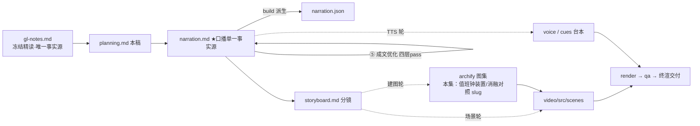

# 策划案：新系列 ep17《Autonomous Agents：自己看板，自己认领》（v2 · 已过双重校验与成文优化 · 文案轮待用户审批 · C 型信源 = gl-notes）

> 状态：系列 claude-code-chapters 第 17 集（s17_autonomous_agents 单章，2026-10-31 开工）。本轮为**文案轮**（Stage ②③ 策划案 + 逐字稿；④ 三镜头校验已清零、⑤ 成文优化四层 pass 已完成，逐字稿至 v2）：逐字稿与全部文案交用户审批，审批通过才进入制作（⑥ 分镜 → ⑩ 交付），故本稿不做建图与场景设计。事实源 = `research/gl-notes.md`（冻结自现行 175「多 Agent 平台」精读 §6 自治单章主线，钉选站点轨 67a9126c、main 轨 7226f555 对照；取材范围与证据分级见其头部登记）。

成本档位: 正集（单语 + story 档已配音系 + 约 5 分钟常规动画复杂度；文案轮无生产层开销，制作期成本量级 = 常规单集）

## 0. 标题候选（待审批；series.json 现为工作题《Autonomous Agents：自己看板，自己认领》，审批后落定）

| 候选 | 一句话理由 |
|---|---|
| A《Autonomous Agents：自己看板，自己认领》 | 直取课程 s17 章题记原句（「自己看板，自己认领」——空闲时轮询，有活就干），信源零损耗且双关本集两机制面（看板=扫描三条件、认领=claim 原子性） |
| B《Autonomous Agents：看见不等于抢到》 | 冻结正文 §6 原句、并发认领深水区的反直觉命题——实验四消融（双方都以为成功、终值归后写者）把「看见」与「抢到」的裂缝演给观众，认知增量最大 |
| C《Autonomous Agents：空闲了，自己去领下一件》 | 承接系列机制单点句式（如 ep2《多加一个工具，只加一行》），把自治的日常语感立住、覆盖三阶段生命周期主线 |
| D《Autonomous Agents：认领这步，一口气做完》 | 规律 3「先查后写必须原子上锁」口语化，直指 main 轨补齐的双重锁 / TOCTOU 叙事与两轨分歧的落点 |

## 一、定位表

| 项 | 值 |
|---|---|
| 平台 | B 站 / YouTube 中长视频 |
| 时长目标 | 4.4–5.6 分钟（pipeline.toml 硬约束窗，含系列片头 ~23.5s 口径；正文 1305 字预算 @254 字/分，实稿 v2 1343 字 ≈5.3 分落窗——④⑤ 修稿净增 29 字、评审修正轮净减 5 字，机器窗上限 1422 字、余 79 字） |
| 形态 | AI 配音（story 档）+ Remotion 代码动画，无真人 |
| 受众 | 不预设工程背景的普通人：见过「AI 组队干活」、没想过没人派活时活怎么分下去、抢活为什么还会撞车的任何观众 |
| 核心内容范围 | gl-notes §6 全节（WORK/IDLE/SHUTDOWN 三阶段生命周期、收件箱优先于任务板、扫描三条件、认领原子性与 TOCTOU、身份重注入、60s/12 拍超时纪律）+ §12 规律 3（先查后写必须原子上锁——收束金句）+ §12 争议 1（空闲队友超时退出还是长驻等待——两难对照收口）+ §10 数字两行（认领锁最多重试 30 次 / 退避 5–100 ms【三】；轮询节奏四口径取教学版 5s/60s 与真实版约 500ms 两口径）+ §11 实验 E4（去掉认领原子性＝本集消融正例，B.2 已复算升【一】级）；§3 任务板属同系列第 12 讲、§4 收件箱属第 15 讲、§5 协议属第 16 讲、§7 worktree 属第 18 讲——本集只作开场承接与机制依赖带过，不重讲 |
| 系列位置 | 系列第 17 讲、多 Agent 组的自治机制集：一句兑现前集「没有领导派活，活怎么分」钩子；系列视觉母题（恒定环体）延续，新增「值班钟」装置视觉与「临界区窗口」排他色 |

**Logline**：没人派活的队伍，靠一座每五秒一拍的值班钟自己分活；可「看见」不等于「抢到」——查与写之间那道窗口，要用一把锁焊死（gl-notes §6 + §12 规律 3）。

## 二、叙事策略

**主线是一问一答的闭环**：开场承接「没有领导派活，活怎么分」→ P1 用「三状态 + 先信后墙 + 三条件」立起值班钟机制 → P2 走查证明「一个空闲拍真能把活分下去」→ P3 反问「两个队友同一拍看上同一张卡呢」——实验四消融回答「无锁即双写假成功、终值归后写者」→ P4 对照补齐「两步化 + 双重锁 + 真实版文件锁」→ P5 收束「看见不等于抢到」+ 下期钩子（同改一处踩脚）。

**开篇钩子候选矩阵（★ 待人工挑选——本集文案审批人即挑选人）**：

| # | 型 | 钩子文本（p0-01） | 吸引力留存逻辑 | 核心主干关联锚点 | 抛出的核心引子 |
|---|---|---|---|---|---|
| H1 | 承接反差型 ★ | 「这是一支没人派活、也从不停工的队伍。」 | 「没人管」对「不停工」的直接反差，且一句兑现前集「没有领导派活，活怎么分」的悬念——承接语即钩子首句、零顺序词零他集标题 | gl-notes §6 自治全节（idle 生命周期即答案主体）；P0 当幕展开 | 没人派活，活怎么落到每个人头上？ |
| H2 | 反直觉颠覆型 | 「两个队友同时抢一个任务，双双以为到手——卡上却只留一个名字。」 | 双赢假象 + 悬置结果（为什么都成功反而是坏事？） | §6 深水区 + §11 实验 4 + §12 规律 3；P3 主场 | 「都以为成功」错在哪一步？ |
| H3 | 一句话本质型 | 「这是一座每五秒敲一拍的值班钟：先看信，再看板，有活就领。」 | 机制本身即钩子（一台小装置管完一支队伍的分工），节律感强 | §6 IDLE 细则；P1 首拍即拆 | 三拍之后，还藏着什么门道？ |
| H4 | 数字纪律型 | 「六十秒、十二次查看，等不来一个活就收工——闲，也有纪律。」 | 反差数字（闲着也要掐表）+「纪律」悬念 | §6 超时纪律 + §10 轮询节奏；P1 尾拍兑现 | 为什么闲着也要定闹钟？ |
| H5 | 悬念冲突型 | 「任务墙上明明一个空位，两人同时伸手——最后写下的名字，才算数。」 | 冲突现场 + 「后写算数」的反常裁决悬置 | §6 深水区 + 实验 4（终值归后写者）；P3 主场 | 「后写算数」意味着什么？ |

★ 选定 H1（自动选定，待人工复核）。理由：单章集时长紧，承接反差钩 3 秒认领、一句同时承接前集钩子意象并抛出本集问题（零顺序词），P0 当幕即拆解兑现不欠债；H2/H5 撞车悬念押 P3 消融幕（对前半程是负债）；H3 本质句改写进 P0 尾拍与 P1 展开（钟装置 P0 落锚、P1 细拆）；H4 数字纪律押 P1 超时拍。

**视觉母题统摄全片，局部类比点到即止**：连续感只由视觉母题承担（恒定循环环体〔M-001〕+ 系列色彩契约 + 本集「值班钟」装置视觉与「临界区窗口」排他色），严禁把局部类比升格为贯穿剧场。口播类比只准入 gl-notes 附录 A 登记条目：本集实引 **#4 值班钟**（P0 落锚、P1 展开、P5 回扣——空闲轮询主喻；允许携带语义＝每拍先口后墙、认领三条件、六十秒十二拍超时收工留结论、身份重注入；失配拦截「钟不调度别人，只决定自己何时再看一眼、何时收工；五秒是教学取值不是性能参数」随行——正文不把五秒当性能参数外推）与**补登条目 电影院线上选座**（P3 并发认领原子性核心喻，配实验四实测；失配拦截「教学版恰恰没有这把锁——不是下单失败，而是双方都成功的假象」随行 p3-06）；任务墙（第 12 讲主喻）/递话口（第 15 讲）/回执簿（第 16 讲）仅作机制依赖承接语沿用（扫描三条件落在任务墙、IDLE 先看收件箱、关机走握手），不计新喻；门牌房/认证插座/环形走廊属第 18/19/20 讲，本集不进口播（下期钩子只点「同改一处踩脚」问题、不点名其喻体）。每处 1–3 句点亮即切回机制画面；未登记类比不进口播。

**记忆点约每 60–90 秒一个**（全部取自 gl-notes §6/§10/§11/§12，数字必带基线标尺）：
P0「没人派活、从不停工」承接承诺 + 值班钟落锚（~0:10）→ P1「先看信，再看板：点名的晚一步耽误全局，公共的晚一轮没关系」（§6【二】，~1:00）→ P1「六十秒、十二拍，等不来就收工留结论」（§6，60//5 推导【一】，~1:45）→ P2「陷阱卡：依赖写着不存在的编号——按被挡算，永远不许开工」（§11 基线【一】，~2:25）→ P3「两边都写下了自己；卡上终值归后写者」+ 金句「看见不等于抢到」（实验四【一】复算，~3:20）→ P5 收束金句回扣（规律 3，~4:50）。

**收尾不贩卖焦虑，悬念只留给下期**：P4 把「闲多久」收成两版选择不同的对照、不裁决（争议一：闲置成本对重建成本的选址，随任务到达率与冷启动成本变化、无普适答案——理性收尾）；P5 护栏句并入片尾署源块（生产细节来自原作者单方核查、未锁 CC 版本号、计数随时点漂移——随署源句交代，与首集同款；本集含【三】级内容，第二句必带）；悬念留在下期钩子（两个队友同改一个文件踩脚），只点问题不预告机制。

## 三、视觉语言

**色彩语义沿用系列契约**（深色底 `#0E1116`；警示红 `#FF5C5C` = 反例/退化路径；确认绿 `#7ED321` = 机制在位/拦截成功；金句卡衬线体；公式/方法名只进角标）：

| 概念 | 专属色 | 语义 |
|---|---|---|
| 循环环体（全系列恒定锚〔M-001〕） | 陶土橙 `#D97757`（系列恒定，承首集） | 同一环体继续出场——本集退居背景节拍器：队友身后同构环体随 WORK/IDLE 变速，认领回 WORK 时高亮一小段 |
| 值班钟/空闲轮询节律 | 天蓝 `#38BDF8`（本集主题色，theme.core 本集新增语义；承 Stage ① 紫罗兰提案微调换轨——同日 18 集并行撰稿紫簇已密，色相取偏青侧拉开与钢蓝族距离） | 值班钟装置、五秒钟摆两落点、十二拍计数环、IDLE 呼吸态、身份说明卡——「等待的节律」 |
| 认领临界区/锁窗口 | 洋红 `#E879F9`（本集主题色 2；承 Stage ① 天蓝提案换轨——洋红带（≈291°）全系未占，「排他窗口」闪断语义最强、与警示红族色相拉开） | 一次只许一个人进的代码段、双重锁两道闩、锁内重读提示牌、五步一口气括弧——窗口内外的排他对照 |
| 消融反例/被挡路径 | 警示红 `#FF5C5C`（保留语义色，与主题色并用不占用） | 撤锁双写帧、终值被后写覆盖、陷阱卡红灯常亮、天平「怕空转」计价器 |
| 机制在位/单成功 | 确认绿 `#7ED321`（保留语义色，与主题色并用不占用） | 装回锁仅一人成功、四卡全部落地、按被挡算的拦截灯 |

构图纪律：消融对比一律左红右绿同屏（撤锁：两边都写下自己、终值归后写者 ↔ 装回锁：同场景仅一人成功）；「先信后墙」一律钟摆两落点分镜（点名信封置顶 vs 公共卡墙）；三条件一律三灯齐亮才放行写名；数字一律计数环+表盘（十二拍/六十秒、三十次/五到一百毫秒）；走查 beat 用卡面翻态动画（灰→写名亮→完成绿）；视觉母题禁旧版隐喻系意象（车间/作坊/传送带/工序卡/叫号器/插线口/师傅及同族），一律工程直陈：值班钟、任务墙、收件箱、临界区、文件锁。

**景别走 `WS→CU→MS`，张力峰值在 P3**：P0 任务墙全景（队长忙转派活、队友立正待命）→ P1 急推值班钟特写（钟摆两落点）与三条件卡面 → P2 走查中景（卡面逐张翻态）→ P3 双写交错特写（窗口裂开、两条写名箭头互刺——全片峰值）→ P4 拉远（锁结构两房间剖视 + 五步括弧全景 + 天平两端）→ P5 定格收束。运镜密度：P3 紧张段每镜 ≤1 次推近；重音镜每 20–40s 一个 1–2s punch（与记忆点 60–90s 咬合）；张力曲线 P3 到峰、P4 用拉远与天平降压、P5 平收。

## 四、分幕结构表

| 幕 | 目标时间 | 字数预算 | 主题 | 叙事要点（回溯 gl-notes） | 视觉锚点 | 前置概念 |
|---|---|---|---|---|---|---|
| P0 没人派活的队伍 | 0:00–0:40 | ≈150 | 钩子 + 问题现场 | H1 钩子落 p0-01（一句承接前集「没有领导派活」钩子意象，零顺序词零他集标题）；老办法：干完站着等队长派下一件——墙上十个任务得手动派十次，队伍撑不大（§6：等分配不能扩展）；答案朴素得出奇：自己看板，自己认领（s17 章题记原句）；值班钟落锚（A#4：每五秒一拍、先看信再看板、能干的写名领走）；悬念：偏偏「认领」这一步，藏着最深的坑（§6 深水区预告） | 冷启动：任务墙全景 + 队长忙转派活；值班钟装置首次亮出（天蓝钟摆两落点）；右下角署源角标（信源名，首部署源位，随画面淡入） | — |
| P1 先看信，再看板 | 0:40–1:40 | ≈250 | 机制解构 | 三阶段全貌：干活/空闲/关机（§6【二】）；干活＝收信、想、调工具；空闲不退出也不干等，钟开始敲（§6）；每拍动作固定：先看收件箱、再看任务墙（§6/A#4「每拍先口后墙」）；顺序理由：关机和点名是点名道姓的控制消息、晚一步耽误全局；墙上的活是公共资源、晚一轮没关系（§6【二】）；扫描三条件：没人做、没归属、依赖全完成——缺一条跳过（§6【二】）；找到写名认领回干活，找不到睡到下一拍；身份重注入：攒下的消息记录短得反常＝长对话被压成摘要，把「我是谁、干什么活」重写一遍再开工（§6【二】）；六十秒十二拍超时：发一条总结、收摊走人（§6，60//5 推导【一】）；幕尾悬念钩：规矩几条，灵不灵走一遍 | 三状态指示环（暖白高频/天蓝呼吸/暗灰收束）；钟摆两落点分镜（点名信封置顶 vs 公共卡墙、两枚标签对照）；三条件三灯卡面 + 缺一条跳过动效；清单压缩成摘要 + 身份说明卡重注入；十二拍计数环 + 六十秒表到点收拢 | 收件箱（第 15 讲已建锚，承接一句）；任务墙（第 12 讲已建锚，承接一句） |
| P2 走查：一个空闲拍 | 1:40–2:25 | ≈205 | Worked Example | 走查场景：内容工厂四件活——初稿、配图、排版（依赖前两件）、发布（依赖排版）（§11 场景 A）；队友一交完初稿的空闲拍穿完整链：先看信（空）→ 再看墙：配图刚被队友二写名（有主，不动）→ 陷阱卡：没主没人做、依赖写着不存在的编号——按被挡算、不许开工（§3 口径 + §11 基线：ghost 任务保持 pending【一】）；下一拍队友二交完配图：排版三条件齐——写名认领回干活；收尾：四件活全部落地、陷阱卡纹丝不动，没人指挥过一句（§11 selftest：四任务全完成【一】）；幕尾悬念钩：两个队友同一拍看上同一张卡呢（§6 深水区入口） | 走查舞台卡面翻态动画（灰 → 写名亮 → 完成绿）；陷阱卡红灯常亮 + 依赖栏幽灵编号；全景拉远收束；「同一拍同一张卡」阴影从边缘渗入 | 依赖（第 12 讲任务墙已释；走查只用作判据，不重讲机制） |
| P3 看见不等于抢到 | 2:25–3:35 | ≈280 | 判据 + 消融 | 最要命的巧合：同一拍两人扫到同一张空卡（§6 深水区）；认领三步：读卡、查归属、写名字——扫描只是快照，查完到写入隔着一道窗口（§6，TOCTOU 口语层）；电影院线上选座：两人同时看到同一个空座，真实系统把锁座下单做成一步——看见不等于抢到；失配拦截：教学版恰恰没有这把锁（A 补登条目）；实验四消融（教学原型实测【一】，数字用附录 B.2 复算值）：撤掉锁交错认领——日志两边各写下自己、双方都以为到手、卡上终值归后写者；同一件活干两遍、另一边蒙在鼓里；把锁装回去重跑——同场景仅一人成功；感知对比：被挡就当没领到不可怕（认领失败不当成成功、继续等下一轮），无锁交错连这点感知都没有（§6）；金句：看见不等于抢到、查与写一口气做完（§12 规律 3）；幕尾悬念钩：这把锁谁来上 | 双镜分屏视线同落一卡；认领三步流水条在第二、三步间裂开窗口；选座界面双光标同悬一座；左红右绿消融同屏（撤锁双写终值后写覆盖 ↔ 装锁仅一人成功）；金句卡压屏 + 锁形问号 | 快照（本幕先释：某一时刻的快照——p3-03 口播已落；英文 snapshot 进角标） |
| P4 补上一把锁 | 3:35–4:40 | ≈255 | 生产对照 | 另一版做得更完整：发现和认领拆成两步——扫描只负责把卡挑出来，写名字锁进一次只许一个人进的代码段（main 轨两步化【一】）；门两道闩：进程里一把锁、磁盘上一把文件锁（双重临界区【一】）；进门先重读一遍卡，掐死查与写之间的窗口（锁内重读防 TOCTOU【一】）；真实版【三】（归属句「拆解过 Claude Code 源码的同学们应该知道」）：认领也包在文件锁里——重读/查归属/查完成/查依赖/写名字五步一口气锁完；抢不到锁退避重试：最多三十次、五到一百毫秒（§10【三】）；空闲节奏约五百毫秒一轮、不设固定超时（§6/§10【三】）；官方文档佐证：认领靠文件锁、防的就是同时抢任务（§6【二】文档讲法）；两难对照收口：闲多久，两版选得不一样——六十秒收工怕空转、长驻等待怕队友记忆从头重建（§12 争议一：闲置成本对重建成本的选址、无普适答案） | 锁结构剖视图（扫描间/写名间两房间 + 两道闩洋红描边 + 门内重读提示牌）；五步流程条被洋红括弧一口气框住；退避重试时钟（三十次上限、五到一百毫秒刻度）；官方文档页角标；天平两端不打摆（计价器 vs 积木堆） | 一次只许一个人进的代码段（即临界区，笔记层词；英文 critical section 进角标） |
| P5 收束与下期 | 4:40–5:20 | ≈165 | 收束 + 钩子 + 署源 | 收束金句：看见不等于抢到——查与写一口气锁完（§12 规律 3 白话）；回扣：自己看板、自己认领的自由，全靠这把锁兜底；转下期问题：谁干活说清了、在哪干活还没说——两个队友同改一个文件，你写的下一行正踩在别人的改动上（只点问题不预告机制，禁顺序词）；下期，接着说这个踩脚的问题；片尾署源块（系列既定尾位）：这套视频改编自开源课程 Learn Claude Code + 今天的生产细节来自原作者的单方核查、没锁版本、计数会漂移（本集含【三】级内容，第二句必带） | 值班钟定格收束 + 金句卡（衬线体）；任务墙四绿卡与陷阱卡同框 → 双光标阴影压入 → 下期卡（视觉层）→ 片尾署源卡（信源名 + 仓库地址） | — |

> 正文合计 ≈1305 字预算上限：六幕预算 150+250+205+280+255+165 = 1305，写作目标压在 1150–1220（幕预算为上限分配，允许 P0/P1/P2 各回吐 20–40 字）。v2 实稿 1343 字（v1 1319 + ④⑤ 修稿净增 29 − 评审修正轮净减 5：p1-08 补先释锚点 +14、p4-01 锚定「另一版」+6、p4-02 去术语降密度 +5、p3-03 补先释 +5、p4-10 补宾语 +6、p1-05 去未登记俗语 −4、p4-06 归属句去重 −3；评审轮 p4-01 删「标准答案是」宣示 −6、p4-10 悬案框架改两难对照 +1）、56 句、句均约 24.0 字；估算 5.3 分 + 片头 23.5s ≈ 5.68 分，机器门口径 1343 ÷ 254 = 5.3 分落窗 [4.4, 5.6]（窗上限 1422 字、余 79 字；幕际 P0/P1/P2 = 145/257/199、P3/P4/P5 = 291/274/177，超预算集中在修稿增收的 P1/P4）。

## 五、生产管线图

本轮产物止于 B/C（②③；虚线节点为 ④⑤ 校验成文与制作期，审批通过后续跑）。

## 六、边界与不做的事

**系列递进边界（照抄口径，本集不进入）**：任务墙机制（第 12 讲）、收件箱（第 15 讲）、协议握手（第 16 讲）只作开场承接与机制依赖带过，不重讲；worktree 隔离（第 18 讲）只在下期钩子点「同改一处踩脚」问题引子、不预告机制；结果与 IDLE 双事件、收件箱锁与条件变量、组队先过人工闸门（争议二）、计划审批拦在哪层（争议三）属团队整合章与协议章口径，本集不展开；MCP / 综合挂点不沾。

**片头沿用《一个循环》（制作期）**：系列片头资产首集制作期已挂载孪生登记，本集沿用同款（~23.5s，预算已计入）；本集挂载件与孪生门登记随制作期处理，本轮只占预算。

**口播红线不可越**：观众层信源标识只许出现在首尾既定署源位——片头署源角标（p0-01 beat 视觉层）+ 片尾署源句（尾幕），豁免白名单登记在工作区 `vibe-video.toml [check_series.source_credit]`（RSI I-080；本集 narration_ids 拟 p0-01 + p5-06，随系列层登记），其余位置零课程/站点/章号痕迹（不出现课程/站点名/「第 N 章」——按章拆集只是编导结构）；【三】级断言归属由片尾署源位承接，正文归属句只用「拆解过 Claude Code 源码的同学们应该知道」句式（首集审批口径）；活数据（章节数/star）不进口播；禁顺序词（上一集/上集/上期/下一集/下集/第 N 集/前一集/本系列——署源句用「这套视频」），收尾预告只许「下期」；Harness 不翻译（口播英文例外清单 = Claude Code + bash（作为工具名随首集已口播例外）+ 署源专名 Learn Claude Code），其余英文方法名与参数（WORK / IDLE / SHUTDOWN / idle_poll / claim_task / can_start / task_store_lock / RLock / flock / proper-lockfile / claimTaskWithBusyCheck / TOCTOU / blockedBy / owner / task_999 等）进角标不口播；TOCTOU 口播恒用「查与写之间的窗口」、临界区口播恒用「一次只许一个人进的代码段」（gl-notes 术语两层口径，两层不传导）；「教学版没有这把锁」须带「教学版」口径、实验数字带「教学原型实测」口径（只证明机制逻辑，不构成对真实 Claude Code 并发行为的复现）；五秒/六十秒/十二拍为教学参数（值班钟失配拦截：不是性能参数，不外推真实产品节奏）；CC 内部行号与文件路径（utils/tasks.ts:541-612 等）止于笔记层，不进口播；「多 Agent 更费钱」「建议三到五个队友」不进口播（与主线无关）；禁旧版隐喻系词汇及同族意象（车间/作坊/传送带/工序卡/叫号器/插线口/师傅——附录 A 楼域旧喻不进口播）。

**素材取舍，弃用而非遗漏**：实验 1（坏依赖放行）不整段重讲——陷阱卡被挡为基线行为【一】，其反例形态属任务墙集；main 轨 IDLE_SCAN_INTERVAL=2.0（实测补充，叙事增量低）弃用；CC 空闲四机制组合（idle_notification 事件唤醒 / task watcher 一秒防抖 / 等待期间主动 claim）只取「约五百毫秒、不设固定超时」口径，另三件不逐件展开——【三】级带宽所限，弃用而非遗漏（材料留档 gl-notes §6/§10）；「先提方案等确认再开队友」（争议二）与「计划审批拦在哪层」（争议三）本集不展开；star/章节数等活数据不进口播。

**文案轮边界**：文案轮（②③撰稿，④⑤ 校验成文已续跑完毕至 v2）不跑 TTS、不动场景代码与 Main.tsx、不建 archify 图（storyboard 属制作期首轮）；series.json 登记为文案轮工作题，标题随审批落定；本稿与逐字稿标题行已带「已过双重校验与成文优化」声明；BGM 留空轨；信源外观点不进口播。制作期（⑥–⑩）审批通过后逐项启动。
