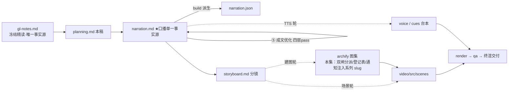

# 策划案：新系列 ep13《Background Tasks：慢命令丢后台，结果走通知》（v1 · 文案轮待用户审批 · C 型信源 = gl-notes）

> 状态：系列 claude-code-chapters 第 13 集（s13 Background Tasks 单章，2026-10-31 开工）。本轮为**文案轮**（Stage ①–⑤）：逐字稿与全部文案交用户审批，审批通过才进入制作（⑥ 分镜 → ⑩ 交付），故本稿不做建图与场景设计。事实源 = `research/gl-notes.md`（冻结自现行 176 精读，钉站点轨 67a9126c；取材范围 s13 单章：§3 机制一＋§5 durable 前提＋关联圈定条目）。

成本档位: 正集（单语 + story 档已配音系 + 约 5 分钟常规动画复杂度；文案轮无生产层开销，制作期成本量级 = 常规单集）

## 0. 标题候选（待审批；series.json 现为工作题《Background Tasks：慢命令丢后台，结果走通知》，审批后落定）

| 候选 | 一句话理由 |
|---|---|
| A《Background Tasks：慢命令丢后台，结果走通知》 | 机制直陈：双闸门分派与通知回注一句话立住全片骨架，承 ep2《多加一个工具，只加一行》同款句式 |
| B《Background Tasks：把「等」赶出主循环》 | 直取 176 一句话定位（把「等」从主循环里赶出去），承接 ep1 铺垫的「主循环不变」系列母题，把「等」立成本集要消灭的敌人 |
| C《Background Tasks：一次调用，只有一个应答名额》 | 配对协议硬规矩是全片反直觉支点：占位回执与独立通知的全部设计由这一条推出，认知增量最锐 |
| D《Background Tasks：迟到的结果，走新通道进场》 | 规律一（异步回注律）直取成题：把「不能补写旧账」升为可迁移到任何异步系统的通用判断 |

## 一、定位表

| 项 | 值 |
|---|---|
| 平台 | B 站 / YouTube 中长视频 |
| 时长目标 | 4.4–5.6 分钟（pipeline.toml 硬约束窗，含系列片头 ~23.5s 口径；正文 1305 字预算 @254 字/分，实稿 1308＝⑤ 修正后 53 句） |
| 形态 | AI 配音（story 档）+ Remotion 代码动画，无真人 |
| 受众 | 不预设工程背景的普通人：见过「AI 帮忙跑命令要干等」、没想过等待为什么贵、结果怎么合法回来的任何观众 |
| 核心内容范围 | gl-notes §3 机制一全节（3.1 快慢命令下场与配对协议 / 3.2 分派双闸门 / 3.3 占位回执与后台执行 / 3.4 通知注入与两回合走查）＋§5 机制三 durable「进程内」前提（【二】级课程讲法，深化取证归下期开工）＋关联圈定：§7 前两行（后台复用 120 秒超时／通知摘要 200 字）＋§8 基线限制与实验 e5（拔掉启发式兜底，本集核心消融【一】）＋§9.1 规律一（异步回注律，收束金句）＋§9.2 争议一（谁该决定去后台）；§4 机制二（cron 四层解耦）与 §8 实验 e1–e4、§7 官方 cron 数字（50 个 / 7 天 / 抖动）属下期（s14 章），本集只在下期钩子一笔带过；§6 第三类「官方有、课程没讲」的「跑满超时自动转后台」（官方文档 [5][7] 在册）一条入 P4，按【二】级直陈、不带归属句式；s13「深入 CC 源码」附录【三】级条目（Haiku 摘要 / 45 秒看门狗 / 七种后台任务类型 / 线程模型 / 通知命令队列）全部不进口播——本集无【三】级口播内容 |
| 系列位置 | 系列第 13 讲：在「循环＋工具」骨架上解决第一个结构性代价——等待被塞进了主循环；「核心不变」母题延续（环体还是那个环体），新增「登记表」装置视觉；承接前集收尾钩子（慢命令卡住整个循环）开场兑现 |

**Logline**：一条慢命令卡住整个循环；先回一张占位回执守住协议名额，真结果以独立通知走新通道进场——十分钟的任务，主循环零秒陪等（gl-notes §3.1–§3.4＋§9.1 规律一）。

## 二、叙事策略

**主线是一问一答的闭环**：开场承接前集钩子「一条慢命令卡住整个循环」→ P1 拆两难：协议名额只有一个（等＝干等 / 补＝违规），再答「谁去后台」——双闸门分派＋消融证明兜底不可少 → P2/P3 答机制主体：占位回执当场闭合问答、真结果以独立通知进场，两回合走查兑现「一分钟没干等」→ P4 对照生产版（同一个两分钟的两条命）并留真争议（谁说了算）→ P5 durable 前托（写下≠会跑）＋收束金句（异步回注律）＋下期钩子（定时靠人提醒）。

**开篇钩子候选矩阵（★ 待人工挑选——本集文案审批人即挑选人）**：

| # | 型 | 钩子文本（p0-01） | 吸引力留存逻辑 | 核心主干关联锚点 | 抛出的核心引子 |
|---|---|---|---|---|---|
| H1 | 痛点承接型 ★ | 「这是一条能把整个循环，卡在原地干等的命令。」 | 直接兑现前集收尾钩子意象（慢命令卡住循环）＋「装依赖十分钟」人人认领，3 秒锁注意力 | gl-notes §1/SCQA（慢命令阻塞）；P0 问题现场即钩子展开 | 为什么一条命令能卡住整个循环？怎么把「等」赶出去还不违规？ |
| H2 | 反直觉颠覆型 | 「这是一份永远不会兑现成答案的回执——真结果回来时，名额已经用掉了。」 | 「回执≠结果」制造认知反差并悬置机制（名额是什么？） | §3.1（一次调用只配一个结果）＋§3.4；P1 首拍兑现 | 名额为什么只有一个？真结果走哪条路回来？ |
| H3 | 一句话本质型 | 「这是把『等』赶出主循环的全部机关：先回一张占位回执，真结果走新消息进场。」 | 把全片机制折叠成一句，制造「就这么简单？」落差 | 176 一句话定位＋§3.3/§3.4；P2/P3 逐层兑现 | 两步为什么就不违规？ |
| H4 | 悬念冲突型 | 「这是同一个两分钟的两条命：一边是超时错误，一边是转后台的开关。」 | 同一数字两种命运的冲突悬置（怎么会？） | §6/§8（120 秒超时双口径）；P4 兑现 | 为什么教学版拿它当上限、生产版拿它当开关？ |
| H5 | 生活直觉型 | 「这是一台不用盯着等的洗衣机——按下启动就走人，好了它自己提醒。」 | 课程自有引子（你不会站在洗衣机前干等三十分钟），零门槛认领 | §1（课程引子）＋A#1；P0 第二拍即展开 | 循环怎么学会「不等」？通知怎么自己回来？ |

★ 选定 H1（自动选定，待人工复核）。理由：反串线纪律下承接前集钩子只能靠意象复现、不能靠顺序词——H1 的「循环卡在原地干等」正是前集收尾钩子的直接兑现，P0 当幕展开不欠债；H5 洗衣机降为 P0 第二拍支撑（A#1 本就是课程开场引子）；H2 的名额反差改写进 P1 首拍；H3 本质句改写进 P5 收束金句；H4 数字双命押 P4 幕点（对前半程是负债）。

**视觉母题统摄全片，局部类比点到即止**：连续感只由视觉母题承担（恒定循环环体〔M-001〕＋系列色彩契约＋本集「登记表」装置视觉），严禁把局部类比升格为贯穿剧场。口播类比只准入 gl-notes 附录 A 登记条目：本集实引 #1 洗衣机（P0 开场承接位，课程自有比喻、框架层——失配边界「滚筒一次一桶 / 后台可并行多条」不进口播、由画面备注承载）、#3 点单取餐小票（P2 机制位：占位回执＋通知注入，失配边界句随行 p2-07）、#6 纸质日程本（P5 durable 机制位，失配边界句随行 p5-04）；176 正文 §3.1 自带的「网购 / 订单号 / 到货短信」为未登记表述不进口播（该机制画面由 #3 承担）。未登记类比不进口播；旧版隐喻系（车间/作坊/传送带/工序卡/叫号器/插线口/师傅及同族，含「流水线」）全片禁用——线程一律工程直陈「另开的一条并行执行线」。

**记忆点约每 60–90 秒一个**（全部取自 gl-notes §3/§7/§8/§9.1，数字必带基线标尺）：
P0「读文件眨眼完，装依赖十分钟能跑满；空转也在花钱」（§1 课程举例【二】）→ P1「名额就一个：等它再回是干等，先回再补是违规」（§3.1【二】，官方 API 依据）→ P1 末「拔掉兜底：主循环从零秒一路卡到六百秒，＝十分钟全程」（§8 e5 本集复算【一】）→ P2「占位回执：任务已启动，结果完成后可得」（§3.3 code.py 可数【一】）→ P3「安装通知和配置内容同框出现，一分钟没干等」（§3.4 两回合剧本【二】）→ P4「同一个两分钟：错误上限 vs 转后台触发线」（§6 第三类【二】＋§8【一】）→ P5 收束金句「慢操作不能赊账——占位先闭合问答，真结果走新消息进场」（§9.1 规律一）。

**收尾不贩卖焦虑，悬念只留给下期**：P5 先拆 durable 误会（写下≠会跑，边界讲清：重启后自动拾起、停机节拍不回补），再收束金句与环体母题回扣；下期钩子只点问题（九点该跑的测试还得人提醒），不预告调度机制；护栏句并入片尾署源块（生产细节没锁版本、口径会漂移——本集生产细节为官方文档在册口径、不指认单方解读，§11 精神）。

## 三、视觉语言

**色彩语义沿用系列契约**（深色底 `#0E1116`；警示红 `#FF5C5C` = 反例/退化路径；确认绿 `#7ED321` = 机制在位/拦截成功；金句卡衬线体；公式/方法名只进角标）：

| 概念 | 专属色 | 语义 |
|---|---|---|
| 循环环体（全系列恒定锚〔M-001〕） | 陶土橙 `#D97757`（系列恒定，承 ep1/ep2） | 同一环体出场：P0 被「等待」砖压停 → P2/P3 解放后照常转 → P5 定格收束（母题：循环还是那个循环） |
| 后台执行线（线程 / 登记表 / 编号） | 雾蓝 `#7C9EFF`（本集主题色 1，承 Stage ① 提案） | 凡「正在后台跑」的元素：后台线程轨、bg_0001 编号、登记表装置、并行执行线 |
| 通知注入流 | 兰紫 `#C084FC`（本集主题色 2，承 Stage ① 提案） | 独立任务通知卡、通知注入进对话的新消息事件——与后台蓝构成「发出→回注」的时间轴对照 |
| 反例/退化路径 | 警示红 `#FF5C5C`（系列语义色） | 消融帧（阻塞 600 秒）、教学版超时错误收场帧 |
| 机制在位/拦截成功 | 确认绿 `#7ED321`（系列语义色） | 兜底在位的分派帧、通知同框兑现帧、durable 重启拾起帧 |

（撞色说明：两支主题色与 #D97757/#64C4C0/#EFB13C/#EF6461 及语义色无撞车；同日 18 集并行撰稿，系列层交付前统一撞色对账时若与兄弟集色相过近，微调优先拉 hue 差、不动语义分工。）

构图纪律：消融对比一律左红右绿同屏（兜底在位 阻塞 0 秒 ↔ 拔掉兜底 阻塞 600 秒——分派路径互斥、代价现形，600 秒处标「＝十分钟全程」基线标尺）；「同一个两分钟」对比上下双联（教学版超时错误帧 / 生产版转后台触发帧，等高裁决）；两回合走查用消息条＋通知卡时间轴动画（Animated State Trace）；数字一律动态增长条＋工况角标（0→600 秒）；「登记表」装置视觉 = 编号×状态×摘要三列对照表，通知注入即表上一行被点亮成独立通知卡（全片反复出场、逐幕生长）；视觉母题禁旧版隐喻系意象（含「流水线」），一律工程直陈：装置、登记表、闸门、通道、触发线。

**景别走 `WS→CU→MS`，张力峰值在 P1 末与 P3**：P0 环体全景（被等待压停）→ P1 急推双闸门特写（分派判定＋消融双联）→ P2 登记表中景（三件事逐一点火）→ P3 走查时间轴中近景（两回合消息条＋通知卡点亮）→ P4 拉远（两分钟双联＋三层信息全景）→ P5 环体定格收束。运镜密度：P1 消融段每镜 ≤1 次推近；重音镜每 20–40s 一个 1–2s punch（与记忆点 60–90s 咬合）；张力曲线在 P1 末（六百秒）与 P3（同框兑现）双峰、P4 用拉远降压、P5 平收。

## 四、分幕结构表

| 幕 | 目标时间 | 字数预算 | 主题 | 叙事要点（回溯 gl-notes） | 视觉锚点 | 前置概念 |
|---|---|---|---|---|---|---|
| P0 卡住的十分钟 | 0:00–0:40 | ≈155 | 钩子＋问题现场 | H1 承接前集钩子（慢命令卡循环）落 p0-01；快慢命令两档：读文件眨眼完、装依赖十分钟能跑满（§1 课程举例【二】）；模型一步动不了、按文字量计费空转花钱（§1/SCQA【二】，不量化）；洗衣机引子（A#1 课程自有比喻，框架层、边界入画面备注）；循环也该这样：丢出去、结果自己回来——只差对话规矩答应（幕尾钩接 P1） | 环体〔M-001〕被「等待」砖压停；快慢命令双色对比条；洗衣机三拍示意；右下角署源角标（首部署源位） | — |
| P1 名额与闸门 | 0:40–1:35 | ≈240 | 协议约束＋分派机制＋消融 | 对话协议硬规矩：一次调用只配一个结果（§3.1，官方 API 依据【二】）；名额就一个——等它跑完是干等、先回再补是违规（§3.1 两难）；解法丢后台，谁说了算（§3.2）；两道闸门：显式参数放行＋关键词兜底（§3.2，run_in_background / slow_keywords 十一关键词进角标）；细节：明说「不要后台」拦不住兜底（§3.2【一】）；消融：拔掉兜底——同条安装命令落回原地干等、主循环从零秒卡到六百秒＝十分钟全程（§8 e5 本集复算【一】）；幕尾钩：进了后台，真结果怎么进对话 | 双闸门装置特写（第一道绿放行 / 第二道关键词扫描）；左红右绿消融同屏（0 秒 ↔ 600 秒）；十一关键词表角标 | 调用（ep1/ep2 已释，开场承接一句）；结果（ep1 已释） |
| P2 占位回执 | 1:35–2:15 | ≈180 | 机制解构 | 后台化三件事：交后台线程（程序里另开的一条并行执行线，§3.3）；发编号记登记表（从零零零一递增【一】，§3.3）；马上回占位回执「任务已启动，结果完成后可得」（§3.3【一】）；小票类比（A#3：先递小票闭合订单、餐好叫号广播是新事件）＋失配边界（名额用掉就是用掉了）；模型拿占位转头干下一件（§3.3）；幕尾钩：真结果正在后台赶路 | 登记表装置视觉首次亮出（雾蓝）：编号×状态×摘要三列；占位回执卡弹出；小票→叫号广播→新事件卡三拍示意 | 后台线程（本幕先释：程序里另开的一条并行执行线） |
| P3 迟到的通知 | 2:15–3:10 | ≈245 | 通知注入＋Worked Example | 不补旧账：真结果包成独立任务通知（任务号、状态、原命令、摘要≤两百字，§3.4【一】）；送通知的是主循环自己：每轮交结果前顺手查登记表、与当轮结果合入同一条消息（§3.4）；两回合走查：回合一安装命令带后台参数→占位回执→预告读配置；回合二读配置快命令当场拿内容→安装通知与配置内容同框出现（§3.4 剧本【二】，npm install / package.json / bg_0001 进角标）；从发起到收尾一分钟没干等（§3.4）；幕尾钩：路通了，坎还在后头 | 通知卡结构展开（兰紫）；主循环每轮过表收集的转动动画；两回合时间轴走查（Animated State Trace）＋「同框」定格 | 占位回执（P2 已释）；快命令（ep2 查表已释，此处一句带过） |
| P4 生产版：谁说了算 | 3:10–4:00 | ≈230 | 教学版限制＋生产对照＋争议 | 教学版坎：丢进后台的命令最多只给两分钟——开篇十分钟安装例子两分钟超时收场（§8 基线本集复算【一】）；生产版【二】直陈（官方文档在册）：命令跑满超时自动转后台——同一个两分钟，教学版当错误上限、生产版当转后台触发线（§6 第三类，[5][7]）；争议：谁该决定去后台——模型知道意图、命令文本里露出线索、系统握实际耗时（§9.2）；新版教学代码删掉兜底：不再猜、只认明确决定（main 轨对照【一】）；拔兜底的代价＝那六百秒（回扣 e5）；幕尾钩：更深的误会藏在「保存」里 | 上下双联「同一个两分钟」；三层信息示意（模型 / 命令文本 / 系统）；关键词表被打叉淡出；回闪 600 秒阻塞条 | 超时（本幕先释：后台命令的等待上限） |
| P5 写下不等于会跑 | 4:00–5:00 | ≈255 | durable 前提＋收束＋钩子＋署源 | durable 误会：还有一类到点才跑的任务——定义写进磁盘、调度活在程序进程里，进程一关停摆、保住定义保不住「到点会发生」（§5【二】，教学细节源出下期章、深化取证归下期）；日程本类比（A#6）＋失配边界（纸本永远等人翻；任务重启后自动被拾起、下次到点照常触发——停摆错过的节拍不补跑）；收束金句：慢操作不能赊账——占位先闭合问答，真结果走新消息进场（§9.1 规律一）；环体母题回扣：循环还是那个循环，只是不再傻等；下期钩子：九点该跑的测试还得人提醒——把「到点」从人手里拿走（只点问题，§1 周期任务靠人推）；片尾署源块两句（本集无【三】级内容；护栏句为口径漂移护栏、不指认单方解读） | 日程本示意卡→进程关闭静置→重启拾起（确认绿）；环体定格＋金句卡（衬线体）；下期卡（视觉层，只点问题）→ 片尾署源卡（信源名＋仓库地址） | 定义写进磁盘（本幕先释：任务定义长期保存那一档） |

> 正文合计 ≈1305 字预算上限：六幕预算 155+240+180+245+230+255 = 1305（写作目标压 1150–1220，终稿允许 +20 溢出）。实稿 1308 字 / 53 句、句均 24.7、≈5.1 分落窗（build 口径）：④ 修稿净增 17 字为评审必修项（P1 闸门口播锚＋消融白话化 +13、P3 时态消歧 +3、P5 定位帧＋停摆不回补半句 +10；P4 归属改【二】级直陈 −9），⑤ 成文评审 Z9 破折号簇修正 −6（p0-03/p2-02/p2-06/p2-08/p3-05/p3-09 各 −1，纯标点替换），⑤ 改动句复核 p4-01/p4-02 范围回收再修 −4（超时上限口径回锚后台路径），各幕实字 150/252/177/240/221/268——P1 超幕预算 12 字、P5 超幕预算 13 字，总字数仍 ≤1305+20 溢出上限。

## 五、生产管线图

本轮产物止于 C（含 ④⑤ 修缮；虚线节点为制作期，审批通过后启动）。

## 六、边界与不做的事

**系列递进边界（照抄口径，本集不进入）**：cron 四层解耦、官方定时数字（50 个上限 / 7 天过期 / 抖动口径）与桌面端唤醒补跑全归下期（s14 章），本集只在下期钩子点一笔问题（定时靠人提醒），不预告调度器/时间表/队列意象；§8 实验 e1–e4（cron 侧）不消费；多 Agent 并行协作（课程再下一章主题）不沾；前各集机制（循环五步 / 查表分发 / 权限 / 记忆等）不回头展开，仅开场承接前集钩子一句。

**片头沿用《一个循环》（制作期）**：系列片头资产 ep1 制作期已挂载孪生登记，本集沿用同款（~23.5s，预算已计入）；本集挂载件与孪生门登记随制作期处理，本轮只占预算。

**口播红线不可越**：观众层信源标识只许出现在首尾既定署源位——片头署源角标（p0-01 beat 视觉层）＋片尾署源句（p5-08/p5-09，豁免白名单登记工作区 `vibe-video.toml [check_series.source_credit]`，RSI I-080），其余位置零课程/站点/章号痕迹；本集无【三】级口播内容——「跑满超时自动转后台」为官方文档在册【二】级直陈（【三】级归属句式为系列通用口径，本集未动用）；活数据（章节数/star）不进口播；禁顺序词（上一集/上集/上期/下一集/下集/第 N 集/本系列——署源句用「这套视频」），收尾预告只许「下期」；口播英文例外清单 = Claude Code＋bash（工具名，承系列例外）＋署源专名 Learn Claude Code（本集口播实际只动用 Claude Code 与署源专名），其余英文方法名与命令（run_in_background / should_run_background / slow_keywords / bg_0001 / task_notification / npm install / package.json / heuristic / sync 等）进角标不口播；数字全部预写汉字读法（零秒/六百秒/两分钟/十分钟/三十分钟/两百字/零零零一），规避归一化陷阱（连字符区间/三段版本号等写法禁用）；禁旧版隐喻系词汇及同族意象（车间/作坊/传送带/工序卡/叫号器/插线口/师傅——「流水线」同族不用，线程工程直陈）。

**素材取舍，弃用而非遗漏**：§3.1「网购/订单号/到货短信」未登记表述不进口播（该机制画面由 A#3 小票承担）；§3.4 生产版「通知队列」差异（教学版每轮顺手收集 ↔ 生产版队列送进后续回合）不进口播——教学版口径已够讲清主线，留制作期视情况进画面备注；s13「深入 CC 源码」六段附录仅取「跑满超时自动转后台」（§6 对照官方文档成文），Haiku 摘要 / 45 秒停滞看门狗 / 七种后台任务类型 / 线程模型（「没有真正的线程」）/ 并发限制等【三】级条目不进口播（留档 gl-notes §6/B.3）；§7 四例分派基线（heuristic/sync/heuristic/explicit 各一）不逐例口播——e5 消融两组数（分派落回同步、阻塞 0→600 秒）已承载数字证据；Routines 最小间隔一小时不进口播（B.1 分歧处置：现行官方页已无此表述）；「生产版把输出写进文件、任务可中途停掉」课程讲法（B.3 建议归【三】档统一署源）本集不取；登记表加锁细节不进口播（角标承载）；三道生产版后手（显式/按键 Ctrl+B/超时）只口播超时一路，另两路不展开。

**文案轮边界**：文案轮不跑 TTS、不动场景代码与 Main.tsx、不建 archify 图（storyboard 属制作期首轮）；series.json 登记为文案轮工作题，标题随审批落定；BGM 留空轨；信源外观点不进口播。制作期（⑥–⑩）审批通过后逐项启动。
