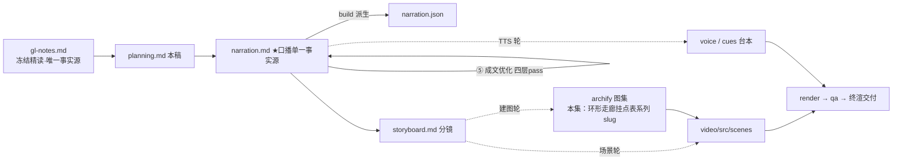

# 策划案：claude-code-chapters ep20《综合回合：机制很多，循环一个》（v2 · 文案轮待用户审批 · C 型信源 = gl-notes）

> 状态：系列 claude-code-chapters 第 20 集（s20_comprehensive 单章 · **系列终章**，2026-10-31 开工）。本轮为**文案轮**（Stage ②③ 策划案 + 逐字稿，④ 双重校验与 ⑤ 成文优化已于 2026-10-31 在文案轮内完成——三镜头修稿 + 四层 pass，改动表见 `.temp/prose-changelog.md`），逐字稿与全部文案交用户审批，审批通过才进入制作（⑥ 分镜 → ⑩ 交付），故本稿不做建图与场景设计。事实源 = `research/gl-notes.md`（冻结自现行 175《Learn Claude Code 多 Agent 平台》精读，2026-10-31 冻结；取材范围 s20 单章 = §9 主线 + §10/§11/§12/§13 按头部「取材范围」行圈定）。钉选轨 = 站点轨 `67a9126c`（终章叙事件——「结束亦是开始」收束节与 11 行全量回归表——仅此轨在册，B.1 详证）。

成本档位: 正集（单语 + story 档已配音系 + 约 5 分钟常规动画复杂度；文案轮无生产层开销，制作期成本量级 = 常规单集）

## 0. 标题候选（待审批；series.json 现为工作题《综合回合：机制很多，循环一个》，审批后落定）

| 候选 | 一句话理由 |
|---|---|
| A《综合回合：机制很多，循环一个》 | 直取冻结源 §9 章题与课程结语双原句（钉选 README 在册），终章身份与全片主线一句话自明 |
| B《全部机制，归到一个循环》 | 站点章副题原文，把收束动作（归位）放进题面，天然配挂点表归位动画 |
| C《循环没改：给全部机制找位置》 | 母题承接型——以「循环没改」回敲系列开篇的循环主线，挂点表即「找位置」的清单 |
| D《复杂的是外壳，不是大脑》 | 认知增量型——直拆「更聪明的大脑」直觉（课程结语论点：复杂的是成熟 Harness，不是另一个 Agent 大脑） |

## 一、定位表

| 项 | 值 |
|---|---|
| 平台 | B 站 / YouTube 中长视频 |
| 时长目标 | 4.4–5.6 分钟（pipeline.toml 硬约束窗，含系列片头 ~23.5s 口径；正文 1305 字预算 @254 字/分，实稿见 pipeline.toml 注释） |
| 形态 | AI 配音（story 档）+ Remotion 代码动画，无真人 |
| 受众 | 不预设工程背景的普通人：跟完前面各讲的观众在此收束，新观众也能靠「四句复述」当场入门 |
| 核心内容范围 | gl-notes §9 全节（挂点表 / 两层计划 / 两种委派 / 工具池 27+动态外部 / 结语「机制很多，循环一个」）+ §10 数字表本集口径（27 件内置工具【一】可数；8→14→18→27 演进链；26 对照经 B.2 复算校正**弃用不引**）+ §11 实验 E5（连接后不重建工具池——本集核心消融、本集复算升【一】）与 selftest 总点验（18 条断言全绿）+ §12 规律 5（池变缓存作废——E5 教训承接；规律 1 经时长修剪不进口播，弃用而非遗漏）+ §9 末段课程结语（「成熟 Harness 的复杂性」「机制很多，循环一个」）；§3–§8 六类设施属本系列 ep12 / ep15–ep19 各集，本集只作挂点回指、不重讲机制本体；§13 适用边界（并行加速比无实测、教学参数非设计依据）不进口播，由片尾护栏与署源句兜底 |
| 系列位置 | 系列第 20 讲 · **终章**：把前十九讲长出的全部机制放回同一个循环，回扣系列开篇的「一个循环」主线；系列视觉母题（恒定环体〔M-001〕）最后一次出场并收束为全片主视觉 |

**Logline**：十八般机制都到齐，芯子还是那四句——沿环形走廊走一整圈，把每件东西送回它固定的挂点；机制很多，循环一个（gl-notes §9 + §10 + 结语）。

## 二、叙事策略

**主线是一问一答的闭环**：开场承接前集「都到齐了，合在一起什么样」的引子抛问题「一整圈设施怎么塞回同一个循环」→ P1+P2 沿挂点表走完上下半圈（出门前一道钩子、三道准备与一层恢复垫 / 单岔口判据与执行段关卡），答「每站都是往循环周围加东西——周围变厚，循环没变」→ P3 塞一句真输入穿全链（三圈走廊实跑）证位置感 → P4 拆「两对易混 + 活名册」并以 E5 消融证「池是每轮重组的」→ P5 总点验收官（18 条自检全绿）+ 金句「机制很多，循环一个」+ 终章回环（回扣开篇心跳，无下期）。

**开篇钩子候选矩阵（★ 待人工挑选——本集文案审批人即挑选人）**：

| # | 型 | 钩子文本（p0-01） | 吸引力留存逻辑 | 核心主干关联锚点 | 抛出的核心引子 |
|---|---|---|---|---|---|
| H1 | 总点验/收束反差型 ★ | 「这是一场合体后的总点验：十八般机制都到齐，芯子还是那四句。」 | 「都到齐 vs 芯子没变」的验收反差 3 秒立住；对追更观众是兑现（承接前集「合在一起什么样」），对新观众是悬念（哪四句？） | gl-notes §9 结语 + 挂点表；P0 当幕即兑现（p0-02 四句复述） | 一整圈设施怎么全部塞回同一个循环？每件东西挂在哪？ |
| H2 | 数字反差型 | 「这是一个没换过的芯子：外围家什从八件长到二十七件，它还是那四句。」 | 极小不变量对持续膨胀的数字反差，自带「凭什么」追问 | §10 演进链（8→14→18→27【一】）；P4 兑现数字 | 家什翻了三倍多，芯子凭什么不动？ |
| H3 | 反直觉型 | 「这是一句容易读反的结语：复杂了这么久，复杂的从来不是大脑，是外壳。」 | 「复杂 ≠ 大脑变聪明」颠覆直觉，逼观众重想复杂性长在哪 | §9 课程结语（成熟 Harness 的复杂性）；P5 兑现 | 复杂性到底长在哪？ |
| H4 | 冲突型 | 「这是一次当场的翻车：新工具刚连上就调用，程序说，不认识它。」 | 冷开场即事故（明明刚连上？），悬置到 P4 才揭底 | §11 实验 E5（B.2 复算【一】）；P4 兑现 | 为什么连上了还调不到？ |
| H5 | 母题承接型 | 「这是一条走不完的环形走廊：设施一间间开张，岔口始终只有一个。」 | 走廊意象即全片主视觉，先立空间再装机制 | 附录 A #7 环形走廊（§9 单循环）；P1–P3 兑现 | 走廊一圈到底有几个岔口？ |

★ 选定 H1（自动选定，待人工复核）。理由：终章身份 + 一句兑现前集「合体」引子（反串线承接约定）+ 反差自含且 p0 当幕展开不欠债；H2 数字承诺押 P4（演进链）、H3 论点押 P5（结语）、H4 冲突押 P4（E5）各自留作幕点不作钩子（冷开场偏题——本集核心是合体收束不是翻车）；H5 意象先行对新观众抽象门槛略高，走廊改由 P1 画面层立起。

**视觉母题统摄全片，局部类比点到即止**：连续感只由视觉母题承担（恒定循环环体〔M-001〕+ 系列色彩契约 + 本集「环形走廊 × 挂点表」装置视觉——走廊即循环本体的可走形态，设施格逐站滑入环边挂点槽），严禁把局部类比升格为贯穿剧场。口播类比只准入 gl-notes 附录 A 登记条目：本集实引 **#7 环形走廊**（P0–P3 主画面骨架与全片主线框架，口播自 P1「输入口」起以走廊语汇行文；失配边界句随行 p2-04「没人推着谁走、岔口也只此一个」）；其余六条（任务墙 / 递话口 / 回执簿 / 值班钟 / 门牌房 / 认证插座）属兄弟集（ep12 / ep15–ep19）——**本集专属使用裁决**（承 Stage ① risk #3：环形走廊登记行为本集承袭，兄弟集不借喻，挂点回指一律只用机制名，不展开楼域画面）；每处 1–3 句点亮即切回机制画面；未登记类比不进口播。

**记忆点约每 60–90 秒一个**（全部取自 gl-notes §9/§10/§11·B.2，数字必带基线标尺）：
P0「十八般机制都到齐，芯子还是那四句」+ 四句复述（§9，【二】）→ P1「门口一道、准备三道，裹一层恢复垫，模型才开口」（§9 挂点表上半圈，【二】）→ P2「周围变厚，循环没变」+「全走廊唯一的岔口」（§9，【二】）→ P3「一句输入，三圈走廊，每步都有人接住」+ 判据归属句（§9 + B.1 L55，【三】）→ P4「沿用旧名册，调用报错『不认识这个工具』↔ 重组后结果到手」（E5 成对实测，B.2【一】）+「一批家什：内置二十七件」（【一】）→ P5「十八条自检全绿」总点验 + 金句「机制很多，循环一个」（§9 结语，【二】）。

**收尾不贩卖焦虑，终章无悬念预告**：P5 不设下期钩子——收束回扣系列开篇的循环主线（「最初那声心跳，一路没停」：单字意象回扣，不引他集题面、无集号顺序词），开放感留在「没有下期了——工具还会再长，循环还是那一个」；护栏句并入片尾署源块（本集含【三】级内容，署源两句齐备——计数漂移警示随行，与 ep1/ep2 同款）。

## 三、视觉语言

**色彩语义沿用系列契约**（深色底 `#0E1116`；警示红 `#FF5C5C` = 拦截/报错/退化路径；确认绿 `#7ED321` = 放行/恢复/自检全绿；金句卡衬线体；公式/方法名只进角标）：

| 概念 | 专属色 | 语义 |
|---|---|---|
| 循环环体（全系列恒定锚〔M-001〕） | 陶土橙 `#D97757`（系列恒定，承 ep1） | 同一环体最后一次全片出场：P0 汇流中心、P5 收束定格——「循环一个」的物本身 |
| 循环恒定蓝 | 靛蓝 `#5B8DEF`（本集主题色①，承 Stage ① 提案原值） | 循环**不变性**的常驻标色：环形走廊本体描边、四句收束块（while True 卡）、单岔口判据高亮、每圈节拍——常驻低亮、punch 提亮，与环体并用不替换 |
| 终章合流紫 | 深空紫 `#8260E8`（本集主题色②，承 Stage ① 提案 `#8B7CF6` 深化微调：色相 247°→255° 落兄弟集浅紫族（≈247°–248°）与兰紫族（≈262°–270°）之间空段中点，明度压深一档） | 汇入的机制设施格、挂点表行、归位动画、终幕主视觉——「多机制汇聚一环」的合流高亮与收束语义 |
| 保留语义色（不占用） | 警示红 `#FF5C5C` / 确认绿 `#7ED321` | 权限拦截帧、E5 报错帧（红）；放行、E5 恢复帧、18 条自检全绿（绿） |

主题色撞色对账（系列内）：合流紫 255° / 恒定蓝 220°——恒定蓝落兄弟集蓝簇 216°/225° 两簇间空段中点（提案原值），合流紫主动避开四兄弟集逐字沿用的浅紫 `#8B7CF6`（247°）明度带；两色与系列已用四色（陶土橙 ≈20°、青碧 ≈176°、琥珀 ≈40°、珊瑚红 ≈2°）色相全部错开；同日 18 集并行撰稿，系列层交付前另有统一撞色对账（承 Stage ① 色板纪律）。

构图纪律：消融对比一律左红右绿同屏（E5：沿用旧名册→调用报错「不认识这个工具」↔ 每轮重组→结果到手）；挂点归位一律「设施格滑入环边挂点槽」统一动效（合流紫），挂点表逐幕生长；数字一律计数动画 + 工况角标（8→14→18→27 演进链、27 件家什、18 条自检、三圈走廊计数器）；判据正反同帧（有调用块→直行绿 ↔ 无调用块→收尾蓝）；走廊失配边界全片守法——无人推送意象、岔口恒单；禁旧版隐喻系词汇及同族意象（车间/作坊/传送带/工序卡/叫号器/插线口/师傅及同族），一律工程直陈：走廊、挂点、名册、闸、占位卡、归位。

**景别走 `WS→CU→MS`，张力峰值在 P4 消融对冲**：P0 汇流全景（十八枚机制卡四面汇入环体）→ P1 急推走廊入口岗亭 + 三间准备室特写 → P2 中景岔口与执行三车道 → P3 走查中景（消息条 + 三车道实跑 + 三圈计数）→ P4 拉远名册全景后左右消融分屏（对冲峰值）→ P5 长镜头平收（环体定格→四拍字卡→金句卡→收成一点脉冲）。运镜密度：P3 走查段节奏最快、P4 消融段每镜 ≤1 次推近；重音镜每 20–40s 一个 1–2s punch（与记忆点 60–90s 咬合）；张力曲线 P3 渐升、P4 对冲到峰、P5 平收长镜头降压。

## 四、分幕结构表

| 幕 | 目标时间 | 字数预算 | 主题 | 叙事要点（回溯 gl-notes） | 视觉锚点 | 前置概念 |
|---|---|---|---|---|---|---|
| P0 合体总点验 | 0:00–0:35 | ≈150 | 钩子 + 四句复锚 | H1 钩子落 p0-01（承接前集「十八般机制都到齐」引子，一句兑现）；四句复述锚定：调模型、看响应里有没有工具调用、有就执行、结果回填（§9 循环四句，【二】）；外围一整圈设施白话点名不重讲（管记性的/管门禁的/管外接的——挂点回指，机制属各兄弟集）；引子：每件东西都得在循环上有一个固定的挂点（§9 挂点表题眼） | 冷启动：十八枚机制小卡自四面汇入恒定环体〔M-001 陶土橙〕，环体只呼吸不变形；右下角署源角标（首部署源位，视觉层） | — |
| P1 调模型之前 | 0:35–1:20 | ≈200 | 挂点表·上半圈 | 输入口第一道：输入钩子先看一眼，门口的事不占循环（§9 UserPromptSubmit，【二】，英文进角标）；调前三道准备：到点该跑的检查、后台干完的活先一步塞进对话（§9 cron 队列+后台任务通知，注入白话承载）、压缩管线先压大输出再裁历史（§9）、记忆/技能清单/已连服务拼进系统提示词这块底座（§9）；调用裹一层错误恢复：限流就退一步再试、超载换备用、超长提额续写、实在太长现场再压一道（§9 恢复梯子，反应式压缩口径）；「到这里，模型才开口」——位置感第一次点题 | 环形走廊主视觉亮出（恒定蓝描边）：入口岗亭亮灯 → 三间准备室依次亮（注入滑槽/压缩打捆/系统提示词底座拼装）→ 调用舱外恢复垫包裹（四枚小徽章） | 四句芯子（P0 已释）；压缩管线/系统提示词（本幕白话先释：打捆压短再裁历史 / 底座） |
| P2 岔口与关卡 | 1:20–2:10 | ≈220 | 挂点表·下半圈 | 单岔口判据：响应里有没有工具调用块——有走执行、无则本轮收尾（§9，正反双分支同帧）；走廊失配边界句随行（附录 A #7：没人推着谁走、岔口也只此一个）；执行前权限闸：一条删掉整个项目的命令、一个越界路径，一律拦下问过（§9 PreToolUse+权限，危险类目举例化承载）；执行时慢活转后台、先回占位卡（§9，设计走查例口径）；执行后事后钩看一眼、输出太大提个醒（§9 PostToolUse）；无调用轮收尾钩做统计（§9 Stop）；「周围变厚，循环没变」+「位置感」点题（§9，挂点表指称） | 单岔口特写（正反双路：调用块高亮→直行绿 / 无调用块→收尾蓝）；执行段三车道（拦下红 / 直行绿 / 滑入后台轨恒定蓝+占位卡）；拉远全景——环外一圈设施格全亮、环体仍是细线四拍 | 工具调用块（P0 p0-02 已释）；后台（本幕白话先释：滑进去慢慢跑） |
| P3 一句真输入 | 2:10–3:10 | ≈250 | Worked Example | 具体输入穿完整链：「查一下测试为什么挂了，顺手修掉」（设计走查例口径：机制演示呈现，不作实测断言）；钩子与三道准备照跑→第一圈回答带两个调用（一条跑测试的慢命令+一处修改）→岔口判据→权限放行→慢活后台占位→测试回来一处失败指向登录模块→回填再转一圈补修复→再一圈全绿、无调用块就地收官——三圈走廊计数（§9 挂点表全链，【二】）；判据【三】级断言-归属配对（p3-05 断言 + p3-06 归属句「拆解过 Claude Code 源码的同学们应该知道：不认收尾字段，『本轮说完了』的记号，只认调用块」——B.1 钉选 README L55 口径，承系列首讲「认内容块」） | 走查舞台：输入条落下、钩子与三道准备快闪复演、消息条+三车道实跑、判据放大镜（调用块高亮/收尾字段灰转）、失败日志回填、三圈计数器走完 | 权限闸/占位卡（P2 已释）；回填（系列开篇已释，本幕复用） |
| P4 清单、门与名册 | 3:10–4:10 | ≈250 | 两对易混 + 工具池 + 消融 | 两层计划：会话内轻量清单管单个人不跑偏 vs 跨会话任务图管依赖和认领——一张草稿、一张契约（§9）；两种委派两扇门：要结论用一次性子代理只回一份摘要、要并肩拉持久队友能收发消息空闲自领（§9，机制名进角标）；家什全集：内置二十七件+外部随连随挂（§9/§10，27 为钉选 code.py 逐项可数【一】；26 对照经 B.2 复算校正弃用不引）；家什名册不是写死的——每一轮重新组装（§9 assemble_tool_pool，家什先行词由 p4-06「一批家什」承接）；演进链：从八件长到十四、十八，再到二十七（§10，机制逐层加挂）；E5 消融（B.2 本集复算【一】，口播带「本地原型实测」口径）：连上新服务沿用旧名册→调用直接报错「不认识这个工具」↔ 名册重组后再调→结果立刻到手；教训承规律 5：册是活的，旧名册就得作废（§12 规律 5，缓存白话承载）；规律 1「共享状态长在循环外的文件上」经时长修剪不进口播（弃用而非遗漏，画面层由设施格/名册在环外承载） | 左右对照卡（轻量清单勾选项 ↔ 任务图节点+依赖连线，草稿/契约标签）；两扇委派门（子代理进摘要出 / 队友常驻消息往来）；27 格名册展开+动态外接槽位、演进链计数 8→14→18→27；左红右绿消融同屏（旧名册报错帧 ↔ 重组恢复帧） | 一次性子代理/持久队友（本幕白话先释：干完只回摘要 / 常驻并肩、空闲自领） |
| P5 收束：循环一个 | 4:10–5:05 | ≈235 | 总点验收官 + 金句 + 终章 + 署源 | 总点验收官：本地原型全量自检，十八条全绿（B.2 selftest 复算【一】，本地原型实测口径）；收束金句「一句话收束：机制很多，循环一个」+「一路加到全套设施，芯子始终是那四句」（§9 课程结语原话口径，承 ep2「一句话收束」语式）；论点：复杂的不是另一个大脑，是外围那圈设施——成熟 Harness 的复杂——模型管判断、它管组织（§9 结语+全篇一句话定位，Harness 首现以 P0「外围一圈设施」意象就地锚定）；终章回环：「最初那声心跳，一路没停」（回扣系列开篇循环主线：单字意象回扣，不引他集题面）；无下期收束：工具还会再长，循环还是那一个（不预告任何后续）；片尾署源块两句（本集含【三】级内容，第二句必带：生产细节归属+计数漂移警示） | 自检跑条 18 格逐格全绿定格 → 环体四拍字卡（调模型·看调用·执行·回填）→ 金句卡（衬线体）→ 环收成一点脉冲一次（开篇心跳回扣）→ 片尾署源卡（信源名+仓库地址，视觉层） | — |

> 正文合计 ≈1305 字预算上限：六幕预算 150+200+220+250+250+235 = 1305（幕预算为上限分配，允许各幕小幅回吐）；句均 20–24 字 → 约 50–56 句。实稿 56 句（v2，④⑤ 修稿＋⑤ 修正轮 1·2·3 后 1334 字）超幕预算 29 字、硬窗内（1334 字 ÷254 ≈5.3 分，机器门 4.4–5.6 窗内零 FAIL、距窗顶余 88 字，含片头 ≈5.64 分贴窗顶）——增量来自 ④ 三镜头修复（具象化/口径对齐/白话微注）、⑤ 修正轮 1（幕间钩子承接＋朗读断歧＋标点降密）、⑤ 修正轮 2（Z9 漏网冒号降逗＋P4 话题切换承接路标）与 ⑤ 修正轮 3（Z9 承接位破折号降逗，改动表见 `.temp/prose-changelog.md`），承 ep2 先例 1325 字落窗（+9 字）。

## 五、生产管线图

本轮产物止于 C（文案轮；虚线节点为制作期，审批通过后启动）。

## 六、边界与不做的事

**系列递进边界（照抄口径，本集不进入）**：§3–§8 六类设施（任务系统/团队/协议/自治/worktree/外部工具接入）属本系列 ep12 / ep15–ep19 各集，本集只作挂点回指——机制名点名即止、不重讲机制本体（P0「管记性的、管门禁的、管外接的」白话带过）；多 Agent 细节（组队闸门、空闲超时、认领锁、消息类型数）一律不沾；错误恢复四档只作「恢复垫」一枚徽章带过（属 errorrecovery 集面）；压缩管线只挂点不展开（属 contextcompact 集面）；规划、记忆、技能各一句话点名（属 todowrite / memory / skillloading 集面）。

**「十八般机制」口径账（系列层登记待办）**：20 讲 − 循环芯子（s01）− 终章合体（s20）= 18 个机制集，即 p0-01「十八般机制都到齐」的计数口径；系列层（series.json 登记本集时）须同步在 source-map §三登记此账，防 20−18 的算术悬空与 P4 家什演进链「18 件工具」（s19 节数）撞数误读——本集文案轮已在 P0 画面备注落地口径字幕（十八般机制＝全部外围机制，芯子与终章不计入），钩子句 p0-01 为 ★ 锁定不改。

**片头沿用《一个循环》（制作期）**：系列片头资产沿用同款（~23.5s，预算已计入）；本集挂载件与孪生门登记随制作期处理，本轮只占预算。

**口播红线不可越**：观众层信源标识只许出现在首尾既定署源位——片头署源角标（p0-01 beat 视觉层）+ 片尾署源句（p5-08/p5-09），豁免白名单登记在工作区 `vibe-video.toml [check_series.source_credit]`（RSI I-080）——**本集 slug 尚未登记**，系列层登记 ep20 入 series.json 时须同步补 `narration_ids = ["p0-01", "p5-08"]`（scene_stems 制作期补），其余位置零课程/站点名/章号痕迹（「课程」一词全稿只在署源句出现；不出现「第 N 章」——按章拆集只是编导结构）；【三】级断言本集仅 p3-06 一处（判据），归属句只用「拆解过 Claude Code 源码的同学们应该知道」句式（ep1 审批口径），计数漂移警示由片尾署源句兜底；活数据（章节数/star）不进口播；禁顺序词（上一集/上集/上期/下一集/下集/第 N 集/前一集/本系列——署源句用「这套视频」），终章无下期、收尾不预告任何后续、只回扣开篇主线；Harness 不翻译（口播英文例外清单 = Claude Code + Harness + bash（随系列已立例外，本集 bash 未口播）+ 署源专名 Learn Claude Code），其余英文方法名与命令（UserPromptSubmit / cron / compact / system prompt / PreToolUse / PostToolUse / Stop hooks / while True / tool_use block / stop_reason / todo_write / task / spawn_teammate / assemble_tool_pool / Unknown tool: mcp__docs__search 等）进角标不口播，MCP 不口播（说「外部服务/外接」）；数字口径纪律：27 件与演进链 8→14→18→27、E5 报错-恢复对、18 条自检全绿均为【一】级可直断言（B.2 复算/可数），**main 集成版 26 对照弃用不引**（B.2 复算校正：冻结正文 §9 括注理由与名称级实测差集不吻合，禁引二手转述）；产品侧数字（认领锁参数/15 种消息/轮询节奏/实验特性默认关）默认不引（B.3 圈定）；并行加速比无实测不进口播（§13）；教学参数（空闲 5s/超时 60s）不展开；「2130 行」与站点页头 1708 两口径均不进口播；禁旧版隐喻系词汇及同族意象（车间/作坊/传送带/工序卡/叫号器/插线口/师傅及同族）——失配边界句以「没人推着谁走、岔口也只此一个」落法承载，不点名被禁喻体。

**素材取舍，弃用而非遗漏**：s20 README「试一下」运行指引与 prompt 示例（教学操作向）不进口播；「相对 s19 的变化」11 行全量回归表只作挂点表结构的证据形态呈现（P1–P2 挂点巡礼即其叙事化），不逐行照读；五行 while True 收束代码块作 P5 四拍字卡的视觉素材（代码不口播）；§11 E1–E4 四组实验属任务系统/协议/自治各集叙事面，本集只用 E5（工具池）；§12 规律 1「共享状态出内存入文件」经时长修剪不进口播（画面层由「设施格/名册长在环外」承载）；规律 2–4 与三个争议（空闲超时/组队闸门/审批拦截层）属 teamprotocols / agentteams / autonomousagents 集面，本集不展开；§14 自测题不进口播。

**文案轮边界**：文案轮不跑 TTS、不动场景代码与 Main.tsx、不建 archify 图（storyboard 属制作期首轮）；series.json 登记为文案轮工作题，标题随审批落定；narration.cues.toml 台本随首次 story 配音补写；BGM 留空轨；信源外观点不进口播。制作期（④ 校验后续轮–⑩）审批通过后逐项启动。
