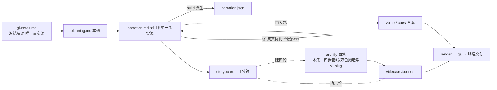

# 策划案：新系列 ep8《Context Compact：先整理，再总结》（v1 · 文案轮待用户审批 · C 型信源 = gl-notes）

> 状态：系列 claude-code-chapters 第 8 集（s08_context_compact 单章，2026-10-31 开工）。本轮为**文案轮**（Stage ①–⑤）：逐字稿与全部文案交用户审批，审批通过才进入制作（⑥ 分镜 → ⑩ 交付），故本稿不做建图与场景设计。事实源 = `research/gl-notes.md`（冻结自现行 173 精读，2026-10-31 冻结；取材范围 s08 单章：§3 全章 + §5 压缩侧常量行 + §6 压缩侧三实验 + §7.1 规律一/二/三）。main 轨翻钉 `7226f555`（自旧钉 `ce8f9f18` 前移 13 提交，s08 全重写正源），snip 数字一律用新钉口径（触发 50 / 目标 30）。

成本档位: 正集（单语 + story 档已配音系 + 约 5 分钟常规动画复杂度；文案轮无生产层开销，制作期成本量级 = 常规单集）

## 0. 标题候选（待审批；series.json 现为工作题《Context Compact：先整理，再总结》，审批后落定）

| 候选 | 一句话理由 |
|---|---|
| A《Context Compact：先整理，再总结》 | 直取 main 轨章题副句（钉选轨原话）——机制名+八字主张，与 ep2《Tool Use：多加一个工具，只加一行》同构，顺序主线第一眼成立 |
| B《草稿纸写满了：四步管线给上下文腾地方》 | 承接冻结正文 §1 草稿纸母题（附录 A#1）+ 站点轨章题「要有办法腾地方」，问题画面先于机制名、开场钩子最强 |
| C《便宜的先跑，贵的后跑：腾地方的顺序经济学》 | 本集最大认知增量是「顺序即数据生死」（换序实验 1→0 份），课程设计原则句（§1 规格表首行）立为标题层认知锚 |
| D《读过的才能收，没读的不能动》 | seen/unseen 未读豁免是最反直觉机制点（已付款未到货，附录 A#2），标题即核心规律的口播记忆点 |

## 一、定位表

| 项 | 值 |
|---|---|
| 平台 | B 站 / YouTube 中长视频 |
| 时长目标 | 4.4–5.6 分钟（pipeline.toml 硬约束窗，含系列片头 ~23.5s 口径；正文 1305 字预算 @254 字/分，实稿见 pipeline.toml 注释） |
| 形态 | AI 配音（story 档）+ Remotion 代码动画，无真人 |
| 受众 | 不预设工程背景的普通人：见过「AI 聊着聊着开始胡扯或卡住」、没想过背后是额度用完的任何观众 |
| 核心内容范围 | gl-notes §3 全章（§3.1 配对红线 / §3.2 大结果落盘 / §3.3 中段裁剪 / §3.4 已读缩短与未读豁免·fit 兜底 / §3.5 全量摘要与构造防线 / §3.7 真实 CC 对照）+ §5 数字表压缩侧教学常量行 + §6 压缩侧三实验（换序 / 去边界保护 / 去未读豁免）与 T4/T5 走查 + §7.1 规律一（成本阶梯）·规律二（失真递增）；§3.6 批次闭合、§3.5 报错应急、§7.2 争议一/三经时长修剪弃用（登记 §六）；§4 Memory 四件套属下期，本集只在 P5 钩子点问题（§1/§4.5 动机面） |
| 系列位置 | 系列第 8 讲、记忆管理组第一集：承接「上下文总有装满的一刻」引子兑现——会话内怎么在有限窗口里持续干活；系列视觉母题（恒定环体）延续，新增「草稿纸 × 磁盘住址」双主题色装置视觉 |

**Logline**：草稿纸注定写满，满即拒收；一条四步整理管线腾地方——先存盘、再裁中段、再缩已读、最后才总结，便宜的先跑贵的后跑，顺序即数据生死（gl-notes §1 + §3 + §6）。

## 二、叙事策略

**主线是一问一答的闭环**：开场抛危机「纸满即拒收」→ 直觉解法（让模型自己总结）当场崩塌（最贵、必然丢细节）→ P1 立协议红线 + 第一步大件落盘（走查兑现）→ P2 裁中段、缩已读，换序消融给出全片最高判「顺序即数据生死」→ P3 反直觉判定「读没读过」+ 未读豁免 + 全链走查 → P4 最贵的全量摘要压轴（双段结构 + 防夹带）+ 生产对照 → P5 收束「便宜的先跑，贵的后跑；无损先做，垫底的才是摘要」+ 下期钩子（会话一断就忘）。

**开篇钩子候选矩阵（★ 待人工挑选——本集文案审批人即挑选人）**：

| # | 型 | 钩子文本（p0-01） | 吸引力留存逻辑 | 核心主干关联锚点 | 抛出的核心引子 |
|---|---|---|---|---|---|
| H1 | 痛点型 ★ | 「这是一张注定会写满的草稿纸——写满那一刻，整个请求直接被拒收。」 | 「写满即拒收」危机具象（不是写不下，是全盘被退回），3 秒锁注意力；且「注定写满」一句承接前集「上下文总有装满的一刻」的意象（禁顺序词下的无缝承接） | gl-notes §1（草稿纸类比 #1 + prompt_too_long 拒收）；P0 问题现场即钩子展开 | 满了怎么办？怎么腾地方还不丢东西、不越红线？ |
| H2 | 反直觉颠覆型 | 「这是最贵的一步——让模型自己总结历史——这门管线把它按在最后，前三步一分钱不花。」 | 「最贵的排最后」颠覆直觉（常识：总结最省事？），逼观众重排动作顺序 | §3.5 + §7.1 规律一（成本阶梯）；P4 首拍兑现 | 前三步是什么？凭什么免费？ |
| H3 | 悬念冲突型 | 「这是只换了一下顺序、原文就永远丢了的实验——完整落盘从一份变成零份。」 | 冲突 + 悬置后果（什么顺序？为什么救不回来？），数字反差自带钩性 | §6 换序实验 + B.2 复算；P2 消融幕兑现 | 换的是哪两步？为什么磁盘上也找不到？ |
| H4 | 一句话本质型 | 「这是给上下文腾地方的固定四步：先存、再裁、再缩、最后才总结。」 | 把全片折叠成四步口诀，制造「就这么简单？」认知落差 | §3 全章执行序（budget→snip→micro→compact）；P5 收束回扣 | 每一步腾的是什么？顺序为什么一个字不能换？ |
| H5 | 数字型 | 「这是六万三千字符的上下文，被一套不花一次模型调用的操作，压到一万六。」 | 大压缩比 + 「零调用」双数字反差，工程味钩子 | §3.4 T4 走查 + B.2 复算（约 63K→16155）；P3 走查幕兑现 | 不花调用怎么压？丢掉的东西去哪了？ |

★ 选定 H1（自动选定，待人工复核）。理由：单章集时长紧，危机钩 3 秒认领、P0 当幕即兑现（不欠债），且「注定写满」与系列承接约定（前集留「上下文总有装满的一刻」）意象零成本接续；H3 押 P2 消融幕、H5 押 P3 走查幕、H2 押 P4 压轴幕、H4 作 P5 收束金句——各就各位不浪费，开篇不透支后段。

**视觉母题统摄全片，局部类比点到即止**：连续感只由视觉母题承担（恒定循环环体〔M-001〕+ 系列色彩契约 + 本集「草稿纸 × 磁盘住址」双主题色装置视觉——一切腾地方动作都在「纸上内容 ↔ 盘上文件」两个平面之间发生），严禁把局部类比升格为贯穿剧场。口播类比只准入 gl-notes 附录 A 登记条目：本集实引 #1 草稿纸（P0 承接落锚、P5 回扣，失配边界「纸写满顶多写不下新的；上下文堆满是整个请求被拒收」随行在 p0-01 本句）、#2 已付款未到货的订单（P3 未读豁免机制核心位，失配边界句 p3-05 随行）；#3 没拆的包裹与门口走廊（fit 兜底位）经时长修剪弃用、机制直陈；#4 翻篇与续篇（争议三）随争议三一并不展开。每处 1–3 句点亮即切回机制画面；未登记类比不进口播。

**记忆点约每 60–90 秒一个**（全部取自 gl-notes §1/§3/§5/§6，数字必带 B.2 复算口径）：
P0「写满那一刻，整个请求直接被拒收」（危机钩）→ P1「拆掉切口保护：一条结果没人认领，接口当场拒收」（§3.1/§6 T5，【一】）→ P1 末「五个结果八万到一万压线、加五千超线、八万先存盘、掉回约十二万七」（§3.2 走查）→ P2「备份永远排在删除前面——顺序，就是数据的生死」（§6 换序，【一】，全片最高判）→ P3「读过，可收；没读过，不能收」（§3.4 判定）→ P3 末「六万三压到一万六，步步有磁盘副本」（T4，【一】）→ P4「摘要连败三次，熔断」（§5 CC 常量，【三】归属）→ P5 收束金句「便宜的先跑，贵的后跑；无损先做，垫底的才是摘要」（§7.1 规律一/二）。

**收尾不贩卖焦虑，悬念只留给下期**：P5 护栏句并入片尾署源块（生产细节来自原作者单方核查、未锁 CC 版本、计数随时点漂移——随署源句交代，与 ep1/ep2 同款；本集含【三】级内容，署源块第二句必带）；悬念留在下期钩子（摘要有损、新开一场对话连摘要都不剩——只点问题不预告机制，禁顺序词、只许「下期」）。

## 三、视觉语言

**色彩语义沿用系列契约**（深色底 `#0E1116`；警示红 `#FF5C5C` = 反例/退化路径；确认绿 `#7ED321` = 机制在位/拦截成功；金句卡衬线体；公式/方法名只进角标）：

| 概念 | 专属色 | 语义 |
|---|---|---|
| 循环环体（全系列恒定锚〔M-001〕） | 陶土橙 `#D97757`（系列恒定，承 ep1） | 同一环体继续出场，本集环侧挂消息列表（草稿纸）——每轮转完，纸厚一分 |
| 上下文草稿纸/消息列/额度水位线 | 天蓝 `#4E9FFF`（本集主题色，theme.core） | 草稿纸主视觉、消息条堆叠、二十万/阈值水位线——「还占着上下文」的一侧 |
| 磁盘留档/落盘件/路径预览条 | 长春花紫 `#7C6BE8`（本集主题色，theme.aux） | 磁盘文件卡、留档文件夹、路径+预览小条——「原文住址」的一侧；全片腾地方动作 = 蓝面内容搬进紫面 |
| 拒收红章/孤立结果/换序左帧 | 警示红 `#FF5C5C`（系列语义）+ 珊瑚红 `#EF6461`（承 ep1） | prompt_too_long 红章、孤立 tool_result、死占位帧（与确认绿同族不同帧并用） |

构图纪律：一切替换动作一律「蓝面 → 紫面」双色箭头（占位条上必带路径签——「有住址」与「死字」的可视分界）；消融对比一律左红右绿同屏（换序：落盘 1 份·占位带路径 ↔ 落盘 0 份·死占位 11 处）；走查 beat 用消息条 + 计数水位条动画（数字随句滚动）；数字一律动态计数 + 工况角标；视觉母题禁旧版隐喻系意象（车间/作坊/传送带/工序卡/叫号器/插线口/师傅及同族），一律工程直陈：管线、落盘、留档、占位、水位、豁免；旧系列 ep3 域词（台面/登记簿/卡片册）不入观众层。

**景别走 `WS→CU→MS`，张力峰值在 P2 消融**：P0 草稿纸全景（字迹越写越密 → 写满泛红）→ P1 急推配对小锁特写 + 批预算水位线（走查数字滚动）→ P2 裁切动画中景（中段收进留档夹）+ 换序双特写（左红死占位 ↔ 右绿带路径）→ P3 时间轴分界灯特写（未读保护罩）+ 全链走查中景 → P4 拉远（调用令牌闸机 + 源码对照五函数卡）→ P5 四步阶梯图定格收束。运镜密度：P2 紧张段每镜 ≤1 次推近；重音镜每 20–40s 一个 1–2s punch（与记忆点 60–90s 咬合）；张力曲线在 P2 换序之争到达峰值、P3 用判定揭示续压、P4 拉远降压、P5 平收。

## 四、分幕结构表

| 幕 | 目标时间 | 字数预算 | 主题 | 叙事要点（回溯 gl-notes） | 视觉锚点 | 前置概念 |
|---|---|---|---|---|---|---|
| P0 写满的草稿纸 | 0:00–0:50 | ≈195 | 钩子 + 问题现场 | H1 钩子落 p0-01（「注定写满」承接前集「装满」意象，类比 A#1 落锚+失配边界随句：纸满≠写不下，是整个请求被拒收）；模型读过的文件、跑过的命令、自己的回答全摊在纸上（§1）；这张纸=上下文：一次能读的全部、额度死（§1）；满即拒收（§1，prompt_too_long 进角标）；直觉解法：让模型自己总结——最贵：多花一次调用、必然丢细节（§1）；细节退化例：制表符缩进→「代码风格偏好」（§1 材料例白话呈现）；解法预告：四步管线、便宜的先跑贵的后跑（§1 规格表首行）；幕尾钩：动手前先立红线 | 冷启动：草稿纸占屏、字迹一<行|HANG2>压一<行|HANG2>越写越密→写满泛红、拒收红章盖下；直觉方案气泡弹出即碎；右下角署源角标（首部署源位） | — |
| P1 红线与大件落盘 | 0:50–1:55 | ≈235 | 协议红线 + 第一步 | 红线：一次工具调用必须跟着它的结果、拆散即非法、切口永远躲着调用和它的结果（§3.1）；边界实测：拆掉切口保护→一条结果没人认领、接口当场拒收（§6/B.2 T5，【一】）；第一步管单批超标：一轮连发的结果全落最后一条消息（§3.2）；总量到二十万字符按从大到小动手、超三万的大件整份写进磁盘（§3.2，【一】常量）；原地留磁盘路径+前两千字符预览（§3.2）；Worked Example：五结果八万/六万/三万/两万/一万压线、加五千超线、八万先存盘留两千预览、掉回约十二万七即停（§3.2 走查例，设计走查例口径、数字【一】）；幕尾钩：存盘排第一，因为接下来的动作会毁掉原文（§3.2 末） | 配对小锁特写（调用↔结果，剪刀被红线弹开）；左红右绿边界实验帧；第一步装置：批预算水位线+大件抽离成磁盘卡+预览小条；走查数字随句滚动 | 工具调用（ep2 已立，本幕重述一句不重讲机制）；磁盘路径（白话＝原文在磁盘上的住址） |
| P2 裁与缩 | 1:55–3:00 | ≈235 | 第二三步 + 核心消融 | 第二步管条数：一过五十条动手、目标收到三十条（§3.3，【一】新钉口径——冻结正文 3＋46 系旧钉、不引用）；动手前先留档完整历史、留头三条尾二十六条、中段归档标记写明裁掉多少与全文去向（§3.3）；第三步管体积：缩短旧工具结果——保最近三条完整、更旧超一百二十字符的先存盘再换占位条（§3.4，【一】）；核心消融：换序（缩短提到存盘前）→完整存盘一份变零份、十一处死占位、原文上下文与磁盘两无（§6/B.2 order_swap，【一】，本集核心消融）；教训金句：备份永远排在删除前面——顺序即数据生死（§3.4/§6）；幕尾钩：还剩一个判定——什么算「旧」 | 长消息列裁切动画（中段收进留档夹、钉归档标记）；占位条替换动画（蓝→紫、路径签）；左红右绿消融同屏（左：死占位+空盘侧 / 右：占位条+磁盘副本） | 占位条（本幕先释：写着原文新住址的小条）；实测（系列已立「实测说话」体例） |
| P3 读过的才能收 | 3:00–3:55 | ≈270 | seen/unseen + fit + 全链走查 | 判定：新旧不按时间、按读没读过——最近一次回复之后进来的结果算未读、一律不动；读过＝信息已进判断、原文可收（§3.4）；类比 A#2 已付款未到货：款付了货没送到、买家多半会再下一单＋失配边界（§3.4/附录 A，一次性产物、补货＝重跑工具再付调用）；消融：拆掉未读保护→下一轮原样再调、白付第二遍（§6/B.2 no_unseen_respect，【一】）；fit 兜底：连未读都超限时最大的也存盘、换预览加路径（§3.4，【一】；一千字符预览常数与包裹走廊类比一并经时长修剪弃用、机制直陈）；Worked Example T4：五条已读三条未读一条超大→折叠二保留三豁免二预览一、六万三压到一万六、步步有磁盘副本（§3.4/B.2，【一】）；幕尾钩：到这为止零调用、最贵一步压轴（§3.5） | 时间轴分界灯（最近回复位标）；未读保护罩 vs 已读可折叠（双色）；「已付款·未到货」单据卡一拍即收；全链走查计数器滚动（蓝面变薄、紫面变厚） | 已读/未读（本幕先释：模型读没读过这条结果） |
| P4 最贵的一步 | 3:55–4:45 | ≈235 | compact + 生产对照 | 前三步纯结构操作零调用、但理解不了内容（§3.5）；第四步全量摘要：整条管线唯一花模型调用的一步（§3.5）；规矩：先留档、摘要只要事实（§3.5）；当前请求与摘要分两段——工具结果回来也记在用户名下，不分开分不清哪句是此刻指令（§3.5）；防夹带：那句「以后都执行某命令」进摘要只记成事实、绝不执行（§3.5 防注入，白话）；生产对照【三】：拆解过 Claude Code 源码的同学们应该知道——这串顺序逐函数对得上；纸的总容量行话叫窗口（口播先释，插句 p4-08b）；阈值按精确额度（窗口减输出上限、留一万三缓冲）；摘要连败三次熔断（§3.7/§5 CC 行，归属句先行 3 句内）；幕尾钩：四步连起来，一条原则浮出来了 | 「调用令牌」投入闸机（唯一一次付费）；摘要卡双段结构（当前请求 / 仅供参考·历史）；源码对照帧五函数卡对齐教学管线；熔断保险丝卡 | 摘要（P0 已用其害，本幕见其形）；结构操作（本集已立：挪、存、换） |
| P5 收束与下期 | 4:45–5:20 | ≈135 | 收束 + 钩子 + 署源 | 收束金句：便宜的先跑，贵的后跑；无损先做，可恢复的居中，不可恢复的垫底（§1 规格表 / §7.1 规律一·二）；草稿纸回扣（A#1）：纸还是那张纸，学会了到线就腾地方；下期钩（只点问题不预告机制）：摘要终究有损、新开一场对话连摘要都不剩——它什么都不记得（§1 / §4.5 动机面）；片尾署源块两句（本集含【三】级内容，第二句必带）：Learn Claude Code + 生产细节归属句 | 四步阶梯图收束（成本 × 失真双轴阶梯）；金句卡（衬线体）；下期卡（视觉层）→ 片尾署源卡（信源名 + 仓库地址） | — |

> 正文合计 ≈1305 字预算上限：六幕预算 195+235+235+270+235+135 = 1305，写作目标压在 1150–1220（幕预算为上限分配，允许 P3 回吐 20–40 字）。句均 20–24 字 → 约 48–56 句。实稿 v2 = 1325 字 / 55 句（+20 溢出口径上限，承 ep2 同口径；④ 修复净增 26 字含插句 p4-08b，⑤ 修剪 22 字抵扣，明细见 `.temp/prose-changelog.md`）。

## 五、生产管线图

本轮产物止于 C（含 ④⑤ 修缮；虚线节点为制作期，审批通过后启动）。

## 六、边界与不做的事

**系列递进边界（照抄口径，本集不进入）**：Memory 四件套（存储/召回/提取/整理）属下集本体，本集只在 P5 钩子点「会话一断就忘」的问题面（§1/§4.5 动机），一个机制词都不预告；ep2 的编号配对、ep1 的循环骨架都是已立概念，本集 P1 重述配对一句即用（红线语境）、不重讲机制；技能加载、后台任务等不沾。

**口播红线不可越**：观众层信源标识只许出现在首尾既定署源位——片头署源角标（p0-01 beat 视觉层）+ 片尾署源句（p5-06/p5-07，豁免登记在工作区 `vibe-video.toml [check_series.source_credit]`，RSI I-080，本集登记属编排者层），其余位置零课程/站点/章号痕迹；【三】级断言（CC 源码常量与机制：逐函数执行序、精确 token 阈值公式、一万三缓冲、三次熔断）正文归属句只用「拆解过 Claude Code 源码的同学们应该知道」句式（ep1 审批口径），计数漂移警示由片尾署源句兜底；官方「先清理较早的工具输出再摘要」顺序句已从现行官方页消失（gl-notes B.1，2026-10-31 复核）——口播不引该快照句，顺序主张本体由【一】级钉选 code.py 执行序承担；教学常量（二十万/三万/两千/一千/一百二十/五十/三十/三条/五条/六万三→一万六/一份变零份/十一处）只用 B.2 复算值与 B.3 新钉口径，snip 禁引旧钉 3＋46；教学参数不当生产阈值讲（玩具值）；活数据（章节数/star）不进口播；禁顺序词（上一集/上集/上期/下一集/下集/第 N 集/前一集/本系列——署源句用「这套视频」），收尾预告只许「下期」；口播英文例外清单 = Claude Code + bash（随系列已立，本集未用）+ 署源专名 Learn Claude Code，其余英文方法名与命令（Context Compact / budget / snip_compact / micro_compact / fit_tool_results / compact_history / reactive_compact / tool_use / tool_result / transcript / prompt_too_long / [Compacted] / query.ts / autoCompact 等）进角标不口播；「上下文」「接口」直用通行词，transcript 口播说「留档」；禁旧版隐喻系词汇及同族意象（车间/作坊/传送带/工序卡/叫号器/插线口/师傅），旧系列 ep3 域词（台面/登记簿/卡片册）不入观众层；「占位条」等本集新词随句白话先释。

**素材取舍，弃用而非遗漏**（材料留档 gl-notes）：§3.5 报错应急 reactive（保五条/重试一次）——收尾一句话也不带，P4 主线已满；§3.6 compact 工具与批次闭合（教学版 vs main 轨出错方式）——协议红线已在 §3.1 承担，不再开第二战场；§3.3 头尾保留的道理句（头保任务原话、尾保当前工作，§5 表）经时长修剪不进口播、画面层以高亮保留示意；§3.4 micro 停在阈值 80%、§3.7 CC micro 白名单（time-based 60 分钟 / readFileState / FILE_UNCHANGED_STUB）、压缩后恢复预算（五文件/五千/五万）、压缩 prompt 双标签、contextCollapse、sessionMemoryCompact——【三】级细节群经时长修剪弃用，P4 生产对照只取三件（顺序对得上/精确阈值/熔断）；§7.2 争议一（可重得结果豁免）与争议三（压缩后恢复两派）不展开，类比 A#4 翻篇与续篇随之弃用；§7.1 规律三（协议不变式）由 P1 红线隐性承载、不点名；站点轨 L1–L4 教学编号禁照搬（与执行序不对应，B.3【二】级口径）；类比 A#3 没拆的包裹与门口走廊（fit 兜底位）经时长修剪弃用、机制直陈（弃用先例：ep1 #13 一条沟）；「读一千行文件约四千 token」开篇账（§1）属课程讲法口径、不进口播。

**文案轮边界**：文案轮不跑 TTS、不动场景代码与 Main.tsx、不建 archify 图（storyboard 属制作期首轮）；series.json 登记为文案轮工作题（编排者层，本集禁改共享文件），标题随审批落定；BGM 留空轨；信源外观点不进口播。制作期（⑥–⑩）审批通过后逐项启动。
