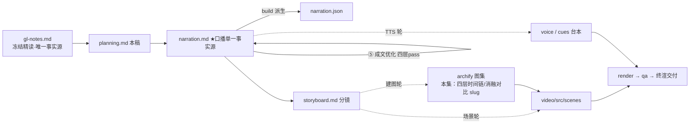

# 策划案：系列 ep14《Cron Scheduler：按时间表生产工作》（v2 · 文案轮待用户审批 · C 型信源 = gl-notes）

> 状态：系列 claude-code-chapters 第 14 集（s14 Cron Scheduler 单章，2026-10-31 开工）。本轮为**文案轮**（Stage ①–⑤）：逐字稿与全部文案交用户审批，审批通过才进入制作（⑥ 分镜 → ⑩ 交付），故本稿不做建图与场景设计。事实源 = `research/gl-notes.md`（冻结自现行 176 精读，2026-10-31；取材范围 s14 单章：§4 机制二四层解耦 + §5 机制三 durable，四档口径圈定见其头部「取材范围」与附录 B.3）。

成本档位: 正集（单语 + story 档已配音系 + 约 5 分钟常规动画复杂度；文案轮无生产层开销，制作期成本量级 = 常规单集）

## 0. 标题候选（待审批；工程 README 现为脚手架占位题《Cron Scheduler：到点与有空分家》，审批落定后由审批轮统一同步，本稿工作题取 A 候选）

| 候选 | 一句话理由 |
|---|---|
| A《Cron Scheduler：按时间表生产工作》 | 直取课程 s14 章副题，零翻译损耗；与系列《Agent Loop》《Tool Use》机制名+副题句式同构（本稿工作题） |
| B《Cron 调度：多一层时间感，判时全在循环外》 | 承系列母题（ep2《多加一个工具，只加一行》同款「核心不动、能力正交叠加」句式）：调度线程与队列全在循环外另起一层 |
| C《到点了，还得等你有空》 | 四层解耦核心洞见直给——「到点」（判时）与「有空」（交付）是两个正交条件、互不阻塞，标题即反直觉点 |
| D《写进磁盘的任务，不会自己跑》 | §5 durable 最易误解前提（定义保留≠自动执行、重启不回补）作题眼，收束段天然回扣 |

## 一、定位表

| 项 | 值 |
|---|---|
| 平台 | B 站 / YouTube 中长视频 |
| 时长目标 | 4.4–5.6 分钟（pipeline.toml 硬约束窗，含系列片头 ~23.5s 口径；正文 1305 字预算 @254 字/分，实稿 1324） |
| 形态 | AI 配音（story 档）+ Remotion 代码动画，无真人 |
| 受众 | 不预设工程背景的普通人：设过手机闹钟、听说过「定时任务」，没想过一个聊天程序怎么自己看表 |
| 核心内容范围 | gl-notes §4 全节（4.1 四层解耦 / 4.2 cron 表达式与日·星期 OR / 4.4 非阻塞交付与端到端走查）+ §5 机制三（durable 两档·进程内前提·重启不回补）+ §7 数字表（五十上限·七天过期）+ §8 实验 e3/e4（OR 改且、无视忙锁——本集复算【一】）+ §9.1 规律三（队列缓冲律，收束用）+ §9.2 争议二（七天过期防烧钱，P4 引证）；§4.3 判时三保险与实验 e1/e2 属鲁棒性内幕，单章集时长紧、整块弃用（§六）；§3 机制一（后台任务）属本系列 ep13，本集开场承接钩子一句、不重讲 |
| 系列位置 | 系列第 14 讲：在循环与工具之后补上「时间感」——「到点」与「有空」两条正交条件首次同屏；系列视觉母题（恒定环体）延续，新增「四层时间链」视觉 |

**Logline**：程序没有时间感，定时名存实亡——把「到点」和「有空」拆给四个角色，判时的只管看表、干活的只管干活，中间一条队列吸收时间差（gl-notes §4.1 + §9.1 规律三）。

## 二、叙事策略

**主线是一问一答的闭环**：开场抛问题「到点了它为什么不动」→ P1 摆答案「定时拆给四个角色，到点与有空分家」→ P2 用一个具体任务走全程、并撞上表达式层的反直觉（或不是且）→ P3 反问「那到点了就直接塞进去行不行」——核心消融 e4 回答「两个条件焊死就互相打架」→ P4 追问「重启之后还在吗」——durable 前提与生产边界 → P5 收束「判时的只管看表，干活的只管干活」+ 下期钩子（一个 Agent 干不完）。

**开篇钩子候选矩阵（★ 待人工挑选——本集文案审批人即挑选人）**：

| # | 型 | 钩子文本（p0-01） | 吸引力留存逻辑 | 核心主干关联锚点 | 抛出的核心引子 |
|---|---|---|---|---|---|
| H1 | 痛点承接型 ★ | 「这是一个到点不会自己动的程序：你说九点跑测试，九点一到，它还在等你开口。」 | 「说好的定时助手居然不会自己动」的即时认领（承接前集「九点跑测试靠人提醒」意象，一句兑现），3 秒锁注意力 | gl-notes §1/SCQA（周期任务靠人推、会话一断就丢）；P0 问题现场即钩子展开 | 怎么让程序自己长出时间感？到点之后由谁、在什么时候干活？ |
| H2 | 反直觉型 | 「这是一台到点了也不一定干活的钟——到点是一件事，有空是另一件事。」 | 颠覆「定时=到点就跑」的朴素直觉，制造「凭什么不定」的认知落差 | §4.1/§4.4（判时与交付解耦）；P3 幕点兑现 | 为什么到点了还要等？两个条件怎么拆？ |
| H3 | 本质结构型 | 「这是一套四层的定时机关：看表的、记账的、探空的、干活的。」 | 整套机制折叠成四个角色，好奇各自是谁、缺一不可在哪 | §4.1（四角色表）；P1 首拍即拆解兑现 | 四个角色怎么配合，才能不打架？ |
| H4 | 历史数字型 | 「这是一行用了五十年的定时写法——五个字段，就能让程序在夜里自己爬起来干活。」 | 五十年纵深 + 「夜里自己干活」的时间反差 | §4.2（Unix 五十年的定时写法）；P2 表达式幕兑现 | 五个字段的写法里还藏着什么反直觉？ |
| H5 | 悬念冲突型 | 「这是一次撞进对话中途的定时注入——它一硬塞，两边就都乱了。」 | 冲突前置（谁在硬塞？怎么乱？），悬置后果 | §4.4/§8 实验 e4；P3 消融 beat 兑现 | 为什么硬塞会乱？正确的交付姿势是什么？ |

★ 选定 H1（自动选定，待人工复核）。理由：单章集时长紧，痛点钩 3 秒认领、承接前集「九点跑测试」意象一句兑现且 P0 当幕展开不欠债（承接方向为编排既定）；H2 反直觉押 P3 幕点（对前半程是负债）；H3 四层句改写进 P1 首拍；H4 五十年押 P2 表达式出场；H5 冲突押 P3 消融 beat。

**视觉母题统摄全片，局部类比点到即止**：连续感只由视觉母题承担（恒定循环环体〔M-001〕+ 系列色彩契约 + 本集「四层时间链」视觉——环体右侧纵列四卡：判时/队列/交付/执行），严禁把局部类比升格为贯穿剧场。口播类比只准入 gl-notes 附录 A 登记条目：本集实引 #2 闹钟（P0 落锚、P3 失配边界回扣）、#5 快递驿站（P1 四层主画面喻面；176 正文「医院叫号」喻面因「叫号」词族邻禁喻词不进口播）、#4 会员日规则的 176 正文同位喻面「家规」（P2 OR 语义——stage-a 初判取家规喻面、按 #4 失配边界句式配边界，防一物双喻）、#6 纸质日程本（P4 durable 前提收束）；#1 洗衣机、#3 点单取餐小票属 ep13 素材面，本集不进口播。每处 1–3 句点亮即切回机制画面，失配边界句随行。未登记类比不进口播。

**记忆点约每 60–90 秒一个**（全部取自 gl-notes §4/§5/§8，数字必带基线标尺）：
P0「九点一到，它还在等你开口」（白话开场）→ P1「到点是一件事，有空是另一件事——四个角色各管一摊」（§4.1）→ P2「同一个周一：写或，响；改成且，哑」（§8 实验 e3，本集复算【一】）→ P3「五个来回一次没走——注入撞进正在进行的一轮」（§8 实验 e4 核心消融，本集复算【一】）→ P4「任务写进磁盘，不会自己跑」（§5 醒目块）→ P5 收束金句「判时的只管看表，干活的只管干活」（§9.1 规律三）。

**收尾不贩卖焦虑，悬念只留给下期**：P5 护栏句并入片尾署源块（生产细节来自原作者单方核查、未锁版本、计数随时点漂移——随署源句交代，与 ep1/ep2 同款）；悬念留在下期钩子（表排得再准、干活的始终只有一个——活儿一大一个干不完），只点问题、不预告机制。

## 三、视觉语言

**色彩语义沿用系列契约**（深色底 `#0E1116`；警示红 `#FF5C5C` = 反例/退化路径；确认绿 `#7ED321` = 机制在位/拦截成功；金句卡衬线体；公式/方法名/表达式字面只进角标）：

| 概念 | 专属色 | 语义 |
|---|---|---|
| 循环环体（全系列恒定锚〔M-001〕） | 陶土橙 `#D97757`（系列恒定，承 ep1） | 同一环体继续出场——本集环体一字未动，时间感全加在环外的四层链上 |
| 判时调度线程/时间感 | 长春花蓝 `#8B93F8`（本集主题色一，theme.sched 本集新增语义） | 每秒一闪的表盘、时间去度、「夜里也在走」的夜语义（承 Stage ① 提案） |
| 队列与交付链路 | 晴空蓝 `#56C8FF`（本集主题色二，theme.queue） | 队列账本条目、零点二秒巡检的走开-回来循环、注入对话的排定消息流 |
| 反例/退化路径 | 警示红 `#FF5C5C`（系列恒定语义） | e3 改「且」漏触发帧、e4 硬注入撞回合帧、锁占用红光 |
| 机制在位/交付成功 | 确认绿 `#7ED321`（系列恒定语义） | OR 命中触发帧、五枚走开重看绿点、空闲注入帧 |

撞色自查：两蓝与系列恒定锚（陶土橙）及兄弟集已用主题色（青碧 `#64C4C0`、琥珀 `#EFB13C`、珊瑚红 `#EF6461`）色相全部拉开；与旧系列并发集钢蓝家族（`#7FB2E0`/`#5C8FB8`）亦不同段（长春花蓝偏紫、晴空蓝偏亮青）——同日 18 集并行撰稿，系列层交付前另有统一撞色对账。

构图纪律：消融对比一律左红右绿同屏（e4：非阻塞在位 五次走开重看·零硬注入 ↔ 无视忙锁 走开归零·注入撞进进行中的一轮）；「或/且」对比一律左绿右红等高裁决帧（同一天历两种写法）；四层链路 = 环体右侧纵列四卡（判时→队列→交付→执行），消息条沿链下行动画，全片反复出场、逐幕生长；数字一律动态条+工况角标（五十格上限刻度、七天倒计时、五枚绿点）；类比意象帧（驿站/日程本/闹钟）一闪即收、随即切回机制画面；视觉母题禁旧版隐喻系意象（车间/作坊/传送带/工序卡/叫号器/插线口/师傅及同族），一律工程直陈：判时、账本、巡检、注入、交付。

**景别走 `WS→CU→MS`，张力峰值在 P3**：P0 夜间桌面全景（暗屏终端+闹钟、环体暗转）→ P1 急推判时表盘特写→四层链全景→交付试探锁的中景 → P2 表达式五槽位特写+走查中景（任务卡沿链下行）→ P3 锁红绿交替特写与消融同屏 punch 帧 → P4 拉远（进程边界框全景、框内熄灭框外磁盘发光）→ P5 环体定格收束。运镜密度：P3 紧张段每镜 ≤1 次推近；重音镜每 20–40s 一个 1–2s punch（与记忆点 60–90s 咬合）；张力曲线在 P3 消融帧到达峰值、P4 用拉远降压、P5 平收。

## 四、分幕结构表

| 幕 | 目标时间 | 字数预算 | 主题 | 叙事要点（回溯 gl-notes） | 视觉锚点 | 前置概念 |
|---|---|---|---|---|---|---|
| P0 定时的名存实亡 | 0:00–0:55 | ≈130 | 钩子 + 问题现场 | H1 钩子落 p0-01（承接前集「九点跑测试靠人提醒」意象，禁顺序词）；会话一关连提醒的人都没了——「定时」名存实亡（§1/SCQA）；缺的不是勤快是时间感：循环里没有表（§2）；夜里没人开口整夜闲着（§1）；闹钟引子（A#2 落锚，课程自喻免归属句）：设好七点到点自响、你在睡觉它也照响（§4.1 引子）；幕点：响完谁来干活、挑什么时候干——正题开场 | 夜间桌面全景：暗屏终端+亮刻度的闹钟；环体〔M-001〕暗转无指针、夜色推进无事发生；右下角署源角标（首部署源位） | 循环（ep1 已释，开场承接一句） |
| P1 四个角色 | 0:55–1:55 | ≈265 | 机制解构 | 先摆答案：定时拆给四个角色（§4.1）；判时调度线程=独立守护线程（白话先释：程序退出时跟着退）、每秒醒一次逐个任务看表、只管时间不管程序在干嘛（§4.1 表；每秒节拍为钉选 code.py 直读【一】）；队列=账本，不执行任何东西（§4.1）；交付线程查两件事：队列有活吗+程序有空吗；锁白话先释（一次只许一方持有的令牌，§3.3 释义）；抢不到就走开、零点二秒后再来（§4.1 表【一】）；执行=任务像一条用户消息进场照常开工（§4.1 表）；驿站喻（A#5：商家按节拍发货/包裹存驿站/你有空再取）+失配边界（驿站等你上门；交付线程主动拉起执行、还判断空闲）；幕点：到点是一件事、有空是另一件事——硬焊死会怎样（钩到 P3） | 四层链路主视觉首次亮出：判时表盘（长春花蓝）每秒一闪→队列账本（晴空蓝）→交付试探锁（红光退回/绿光放行）→执行挂回环体；驿站意象帧一闪即回 | 守护线程（本幕先释）；锁（本幕先释一句白话） |
| P2 五段定时表 | 1:55–2:52 | ≈250 | Worked Example | 任务结构白话：一段定时写法、一句到点要办的事、两个开关（§4.2 五字段结构白话序）；定时写法五段「分时日月星期」、一套用了五十年的老写法（§4.2）；星号=任意，每天九点例（§4.2，表达式字面全进角标）；端到端走查：注册「每两分钟取一次日期」→ 判时命中记账入队 → 交付查双条件 → 消息注入对话 → 循环照常开工，全程没人碰过键盘（§4.4 全周期剧本）；OR 反直觉：日填一号、星期填周一，任一命中即触发——是或不是且（§4.2，规则值前移口播）；家规喻（176 正文喻面，按 A#4 失配边界句式）+边界（只这一对是或；分、时、月仍全是且）；e3 消融：同一个周一，写或九点响、改成且哑——该跑的日子静默漏掉（§8 e3，本集复算【一】） | 任务卡五槽位特写+表达式三例打字机入场；走查中景（任务卡沿四层链下行、消息条注入环体）；左绿右红「或/且」对比帧（日历同一天两种写法） | 定时写法（cron 表达式，字面进角标）；队列/注入（P1 已释，注入口播首实在 p2-05） |
| P3 还得等你有空 | 2:52–3:37 | ≈220 | 核心消融 | 交付线程六行循环：队列空走、锁抢不到走、零点二秒后再来、拿到锁还要再确认（§4.4，钉选 code.py【一】）；为什么走开不等：抢不到锁本身就是答案——程序正忙，此刻不该交付（§4.4）；e4 核心消融正反同屏（stage-a coreAblation）：让交付线程无视忙锁到点硬塞——该走开重看的五个来回一次没走、注入撞进正在进行的一轮、同一时刻两方往对话里写、「一次只许一方写」的规矩破了（§8 e4，本集复算【一】：走开重看 5→0、忙时注入 无→有）；闹钟边界回扣（A#2 失配边界第二半：闹钟不管你正忙照响；交付线程会等空闲）；幕点金句：到点了还得等你有空——两个条件硬焊死就互相打架（§4.1/§9.1 规律三） | 代码窗逐行高亮+锁红绿交替+「走开-计时-回来」循环动画；左红右绿消融同屏（在位：五枚绿点·零硬注入 ↔ 拆除：绿点熄灭归零·消息条硬插亮着的回合窗）；闹钟照响帧↔交付静候注入帧 | 一轮（ep1 已释）；「一次只许一方写」（本幕先释） |
| P4 重启之后 | 3:37–4:34 | ≈255 | durable 前提 + 生产对照 | 程序关掉，任务还活着吗（§5）；两档：写进磁盘的重启后恢复、只活在内存的一关就没（§5）；进程白话先释（运行中的那一个程序）；最易误解前提：判时线程活在进程里——进程关，调度停，磁盘留下的只是任务的定义（§5 醒目块）；重启后重新拾起、下一个到点照常触发，但停机期间错过的时点一个也不补（§5）；日程本喻（A#6：计划跨年都在，那天没人翻开本子事就不会发生）+边界（纸本永远等人翻；这里的任务进程活着就照常触发）；生产对照：真实的 Claude Code——拆解过源码的同学们归属句：管理定时的底层工具一共三个（s14 附录【三】）；官方文档现行口径：一个会话最多挂五十个、周期任务满七天自动过期——防的是没人认领的周期任务悄悄烧钱（§6/§7【二】） | 进程边界框全景（框内调度/队列/交付随框熄灭、框外磁盘文件仍发光）；时间轴停机区间灰掉、重启线后下一匹配分钟亮起；日程本帧一闪；三工具卡（建/列/删）+五十格上限刻度+七天倒计时条 | 进程（本幕先释）；写进磁盘（落盘，ep2 已释『存成文件』） |
| P5 收束与下期 | 4:34–5:15 | ≈185 | 收束 + 钩子 + 署源 | 收束金句：判时的只管看表，干活的只管干活——中间一条队列，隔开到点与有空（§9.1 规律三）；系列母题回扣：时间感加在循环外，循环照常收活，它夜里也能自己醒来干活（§4 结构/系列「核心不动、正交叠加」母题）；前提再钉一次：任务写进磁盘不会自己跑——得有活着的进程替它看表（§5 回扣）；下期钩子：表排得再准、干活的始终只有一个——活儿一大一个干不完（只点问题不预告机制，禁顺序词）；片尾署源块两句（系列既定尾位；本集含【三】级内容，生产细节归属句必带） | 环体定格收束+金句卡（衬线体）；四层链缩为环外一条支链（长春花蓝表盘+晴空蓝消息流）→ 下期卡（视觉层）→ 片尾署源卡（信源名+仓库地址） | — |

> 正文合计 ≈1305 字预算上限：六幕预算 130+265+250+220+255+185 = 1305。实稿 1324（+19 溢出顶格；六幕 127/262/251/218/258/208，其中 P5 含署源定式两句 66 字不可压）。49 句，句均 27 字（build 口径含标点）。

## 五、生产管线图

本轮产物止于 C（含 ④⑤ 修缮；虚线节点为制作期，审批通过后启动）。

## 六、边界与不做的事

**系列递进边界（照抄口径，本集不进入）**：ep13 后台任务（§3 机制一）开场承接钩子一句、不重讲（占位回执/通知注入/分派双闸全不回头展开）；ep15 Agent Teams 只在下期钩子点问题引子；规划、记忆、权限、多 Agent 不沾。

**素材取舍，弃用而非遗漏**：§4.3 判时三保险（去重记号带日期/单任务兜错/注册与加载校验）与实验 e1/e2——鲁棒性内幕，单章集主线是四层解耦与 durable 前提，整块弃用（材料留档 gl-notes §4.3/§8）；§6 生产细节里抖动硬分歧（课程 10%·15 分钟 vs 官方 30 分钟两说并陈）、桌面端七天补跑一次、Routines 最小间隔（未登台账，B.3 口径不引用）、headless 空闲上限、main 轨工程加固四件（pending_delivery/原子改名/至少一次交付）、`.claude/scheduled_tasks.json` 官方文件位与「复制到别的目录只列出不执行」——均不进口播；表达式层的写法细则（星号=任意/范围/间隔记号的口播展开）与「每五分钟/工作日一到五」写法例未进口播正文，五段名与「五十年的老写法」口播点到、写法细则交画面角标承载（走查例「每两分钟」已示范间隔语义），弃用不遗漏（角标保留 `0 9 * * *`、`*/5 * * * *` 字样）。

**片头沿用《一个循环》（制作期）**：系列片头资产沿用同款（~23.5s，预算已计入）；本集挂载件与孪生门登记随制作期处理，本轮只占预算。

**口播红线不可越**：观众层信源标识只许出现在首尾既定署源位——片头署源角标（p0-01 beat 视觉层）+ 片尾署源句（p5-06/p5-07），豁免白名单登记在工作区 `vibe-video.toml [check_series.source_credit]`（RSI I-080），其余位置零课程/站点/章号痕迹（不出现课程/站点名/「第 N 章」——按章拆集只是编导结构）；【三】级断言归属由片尾署源位承接，正文归属句只用「拆解过 Claude Code 源码的同学们应该知道」句式（ep1 审批口径）；活数据（章节数/star）不进口播；禁顺序词（上一集/上集/上期/下一集/下集/第 N 集/前一集/本系列/这一系列——署源句用「这套视频」），收尾预告只许「下期」；口播英文例外清单 = Claude Code + bash（随系列已立例外）+ 署源专名 Learn Claude Code，其余英文（cron / Unix / date / daemon / Scheduler / Queue / Queue Processor / Consumer / agent_lock / cron_matches / CronCreate 等）与全部 cron 表达式字面（`0 9 * * *`、`*/5 * * * *`、`0 9 1 * 1` 等）进角标不口播；口播称「程序」不称「装置」（ep1 v2 审批口径）；「Token」本集不出现；数字量词写汉字（五十个/七天/五十年/每两分钟/零点二秒）规避读法陷阱；禁旧版隐喻系词汇及同族意象（车间/作坊/传送带/工序卡/叫号器/插线口/师傅——含 176 正文「医院叫号」喻面不进口播）。

**文案轮边界**：文案轮不跑 TTS、不动场景代码与 Main.tsx、不建 archify 图（storyboard 属制作期首轮）；series.json 登记与 README 标题随审批落定（现 README 为脚手架占位题，与本稿工作题不一致，待审批轮统一）；BGM 留空轨；信源外观点不进口播。制作期（⑥–⑩）审批通过后逐项启动。
