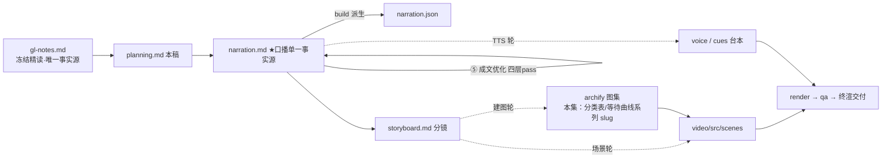

# 策划案：新系列 ep11《Error Recovery：报错先分类，循环不亡》（v2 · 已过双重校验与成文优化 · 文案轮待用户审批 · C 型信源 = gl-notes）

> 状态：系列 claude-code-chapters 第 11 集（s11_error_recovery 单章，2026-10-31 开工）。本轮为**文案轮**（Stage ②–⑤）：逐字稿与全部文案交用户审批，审批通过才进入制作（⑥ 分镜 → ⑩ 交付），故本稿不做建图与场景设计。事实源 = `research/gl-notes.md`（冻结自现行 172 精读，I-234 后代次，与 ep1/ep2 同一冻结正文代次族；取材范围 s11 单章——§7 三路径主线 + §8 表恢复三行 + §9 实验 5 + §10 规律五/争议三 + §11 边界；钉站点轨 `67a9126c`，钉选理由三件实测见 gl-notes 冻结登记与附录 B.1）。

成本档位: 正集（单语 + story 档已配音系 + 约 5 分钟常规动画复杂度；文案轮无生产层开销，制作期成本量级 = 常规单集）

## 0. 标题候选（待审批；series.json 现为工作题《Error Recovery：报错先分类，循环不亡》，审批后落定）

| 候选 | 一句话理由 |
|---|---|
| A《Error Recovery：报错先分类，循环不亡》 | 冻结正文 §7 章题措辞直取（分类恢复，循环不亡），机制与结论一句到位，与系列已交付集命名风格最齐 |
| B《Error Recovery：错误不是终点，是重试的起点》 | 站点轨章铭原话直取，情绪钩子最直接，【二】级讲法可直引（P5 收束金句已内嵌） |
| C《Error Recovery：一次 529，凭什么烧掉整个循环》 | 承系列「循环不死」母题与开场过载崩溃痛点，问句拉认知差，把「凭什么」留给三路径机制答 |
| D《Error Recovery：重试不是万能药，分类才是》 | 核心消融 E5 的认知增量前置：一刀切 10 次全撞墙白等 175.6s vs 分类路径 0s 恢复，反直觉点先抛后解 |

## 一、定位表

| 项 | 值 |
|---|---|
| 平台 | B 站 / YouTube 中长视频 |
| 时长目标 | 4.4–5.6 分钟（pipeline.toml 硬约束窗，含系列片头 ~23.5s 口径；正文 1305 字预算 @254 字/分，实稿 1331） |
| 形态 | AI 配音（story 档）+ Remotion 代码动画，无真人 |
| 受众 | 不预设工程背景的普通人：见过「AI 跑一半报错就停」、没想过停了之后谁能救回来的任何观众 |
| 核心内容范围 | gl-notes §7 全节（四类常态错误 / 三路径机制：截断升额度＋续写、超限压缩、瞬态退避＋切换 / episode E 走查 / E5 消融 / 真实 CC 对照 / main 轨取值）＋ §8 表恢复三行（8K→64K、续写 ≤3、压缩 1；500ms×2^n 封顶 32s＋0–25% 抖动、重试 ≤10、529×3 切换；main 轨 16K/3/×2）＋ §9 实验 5（本集核心消融正例，白等 175.6s 恒 standalone 口径）＋ §10 规律五（有界的分类恢复）与争议三（恢复预算给多少，本集主线争议）＋ §11.1（教学数字无实验支撑，片尾署源句兜底）；§10 规律一至四与争议一、二属本系列 ep5–ep10，本集只在系列坐标承接不重讲 |
| 系列位置 | 系列第 11 讲：兑现前集钩子「一出错就停摆？」开场；「循环不死」母题的直接答案层——前十讲搭好的循环在故障常态下如何续命；系列视觉母题（恒定环体〔M-001〕）延续，新增「分类表」与「等待曲线」两组装置视觉 |

**Logline**：报错是常态，崩溃是选择——先分类、再恢复：截断升额度、超限做压缩、瞬态会等待，每条退路自带次数上界，循环不亡（gl-notes §7 ＋ §10 规律五）。

## 二、叙事策略

**主线是一问一答的闭环**：开场抛问题「一出错就停摆，怎么办」→ P1 用「先分类、再选路」的骨架加三路径回答「错有哪几类、各走哪条路」→ P2 拿原型实测走查证明「四组错误剧本都杀不死循环」→ P3 反问「这套分类真缺不得吗」——E5 消融回答「一刀切重试十次全撞墙、白等 175.6 秒，分类路径零秒恢复」→ P4 对照生产版「十几种结局判定＋两组参数并存＝调参不是机制必然」→ P5 收束「有界的分类恢复」＋ 下期钩子（大目标不落盘）。

**开篇钩子候选矩阵（★ 待人工挑选——本集文案审批人即挑选人）**：

| # | 型 | 钩子文本（p0-01） | 吸引力留存逻辑 | 核心主干关联锚点 | 抛出的核心引子 |
|---|---|---|---|---|---|
| H1 | 痛点型 ★ | 「这是一段一出错就当场停摆的程序。」 | 「跑一半就死」的即时认领（谁都见过加载失败/请求报错），3 秒锁注意力；同句兑现前集钩子「一出错就停摆？」 | gl-notes §1/§7（529 崩溃：不重试、不换 LLM、不减上下文）；P0 当幕展开 | 出错之后怎么办？谁来救循环？ |
| H2 | 反差数字型 | 「这是白等 175.6 秒的十次重试——而正确答案，0 秒就到。」 | 惨败数字对零秒答案的反差，先惑后解 | §7/§9 实验 5（本集复算【一】，standalone 口径） | 为什么重试越多越白费？ |
| H3 | 一句话本质型 | 「这是一套先问『错在哪类』再动手的恢复术：截断升额度、超限做压缩、瞬态会等待。」 | 三路径折叠成一句，制造「就这么简单？」认知落差 | §7 三路径分类表；P1 首拍即拆解兑现 | 三条路各救什么错？ |
| H4 | 金句型 | 「错误不是终点，是重试的起点——前提是，先知道错的是哪一类。」 | 章铭直取＋条件反转（后半句否定前半句的直觉用法），逼观众想「哪一类」 | §7 章铭【二】＋三路径；P5 收束回扣 | 哪一类？怎么分？ |
| H5 | 悬念冲突型 | 「同一个过载报错：一段程序当场死掉，另一段等三秒满血回来——差别只在一步。」 | 同因异果的冲突＋悬置（那一步是什么？） | §7 崩溃对照＋episode E 走查（3.7s 恢复） | 差的那一步是什么？ |

★ 选定 H1（自动选定，待人工复核）。理由：直接兑现前集钩子（一出错就停摆），零成本承接且 P0 当幕展开兑现、不欠债；H2 押 P3（消融幕点）、H3 改写进 P1 骨架拍、H4 押 P5 收束金句、H5 押 P2 走查对照——四钩各就各位不作废，候选即分幕弹药库。

**视觉母题统摄全片，局部类比点到即止**：连续感只由视觉母题承担（恒定循环环体〔M-001〕＋ 系列色彩契约 ＋ 本集「分类表」「等待曲线」装置视觉），严禁把局部类比升格为贯穿剧场。口播类比只准入 gl-notes 附录 A 登记条目：本集实引 #6 一碰就熄火的车（P0 落锚，课程引语级【二】，1 句引述即收，原文未给失配边界、不展开喻体）；其余 7 条属本系列 ep5–ep10，本集不启用。未登记类比不进口播。

**记忆点约每 60–90 秒一个**（全部取自 gl-notes §7/§8/§9/§10，数字必带基线标尺）：
P0「四类报错，三种缺法——缺额度、缺空间、欠时间」（§7 白话归纳）→ P1「三路径各就各位：升额度 8K→64K、压缩只留尾部五条、退避半秒起步翻倍封顶三十二秒」（§7，code.py 可数【一】）→ P2「三次等待共 3.7 秒第四次成功；四个剧本都没杀死循环」（episode E 走查，本集复算【一】）→ P3「十次全撞墙、白等 175.6 秒 ↔ 压缩一次零秒恢复」（实验 5，本集复算【一】）→ P4「两组常数并存：这些数是调参调出来的，不是机制的必然」（§10 争议三）→ P5 收束金句「升级一次、续写三次、压缩一次、重试十次——有界，防的是救援变死循环」＋「错误不是终点，是重试的起点」（§7/§10 规律五＋章铭【二】）。

**收尾不贩卖焦虑，悬念只留给下期**：P5 护栏句并入片尾署源块（生产细节来自原作者单方核查、未锁版本号、计数随时点漂移——§11.1/§11.3 精神，随署源句交代，与 ep1/ep2 同款）；悬念留在下期钩子（大目标只留在模型记忆里、从不落盘），只点问题不预告机制。

## 三、视觉语言

**色彩语义沿用系列契约**（深色底 `#0E1116`；警示红 `#FF5C5C` = 出错/反例；确认绿 `#7ED321` = 恢复命中/循环续跑；金句卡衬线体；公式/方法名/错误码只进角标）：

| 概念 | 专属色 | 语义 |
|---|---|---|
| 循环环体（全系列恒定锚〔M-001〕） | 陶土橙 `#D97757`（系列恒定，承 ep1） | 同一环体继续出场，本集环上高亮「调用模型」段——正是被保护壳包住的那一步；报错时环体压黑、恢复后回陶土橙 |
| 分类恢复/三路径分发 | 恢复蓝 `#6C8CFF`（本集主题色，theme.core 本集新增语义） | 分类判定卡、错误类型→动作的对照分发流、恢复成功后的循环回稳；与警示红构成「出错→接住」的正反因果对 |
| 等待曲线/时间维 | 退避紫 `#B48EF5`（本集主题色） | 指数退避阶梯（半秒起步逐级翻倍）、随机抖动细齿、32s 封顶虚线、Retry-After 旗标、虚拟时钟计数、175.6s 白等条 |
| 出错/消融反例 | 警示红 `#FF5C5C`（系列保留语义色） | 报错帧、E5 撞墙帧、一刀切单行道 |
| 恢复成功/对照组 | 确认绿 `#7ED321`（系列保留语义色） | 恢复命中、分类路径零秒恢复、循环续跑 |

构图纪律：消融对比一律左红右绿同屏（实验 5：一刀切重试 10 次全撞·白等 175.6s ↔ 分类路径压缩一次·0s 恢复——同一错误两种命运）；三路径分类表 = 错误类型列对动作列的对照表（与 ep2 查表装置视觉同构、换恢复蓝主色），逐幕逐行点火生长；等待曲线用退避紫阶梯＋封顶虚线＋抖动细齿，实测值（0.58s→1.01s→2.14s）作曲线节点数字；数字一律动态增长条＋工况角标（175.6s 烧尽动画对 0.0s 瞬时恢复）；走查 beat 用消息条＋曲线双轨动画（Animated State Trace）；视觉母题禁旧版隐喻系意象（车间/作坊/传送带/工序卡/叫号器/插线口/师傅及同族），一律工程直陈：保护壳、分类、退路、上界、错峰、切换。

**景别走 `WS→CU→MS`，张力峰值在 P3**：P0 崩溃全景（环体被报错帧压黑）→ P1 急推分类表特写（三行逐条点火＋保护壳包裹环体「调用」段）→ P2 走查中景（消息条与等待曲线双轨并置）→ P3 左红右绿消融双特写＋175.6s 数字条烧尽（全片唯一 punch 峰）→ P4 拉远（判定全表 17 行缩略＋两组参数天平）→ P5 环体定格收束。运镜密度：P3 紧张段每镜 ≤1 次推近；重音镜每 20–40s 一个 1–2s punch（与记忆点 60–90s 咬合）；张力曲线 P3 到峰、P4 拉远降压、P5 平收。

## 四、分幕结构表

| 幕 | 目标时间 | 字数预算 | 主题 | 叙事要点（回溯 gl-notes） | 视觉锚点 | 前置概念 |
|---|---|---|---|---|---|---|
| P0 停摆的循环 | 0:00–0:45 | ≈195 | 钩子 + 问题现场 | H1 钩子落 p0-01（同句兑现前集钩子「一出错就停摆」）；崩溃现场：服务端过载一句报错，应对只有崩——不重试、不换路、也不减上下文（§1/§7）；课程比方：一个不处理错误的程序就像一辆一碰就熄火的车（A#6，【二】引语，1 句即收）；生产环境报错是常态：输出被截断、上下文超限、请求被限流、服务端过载（§7 四类，码值 529/429 进角标）；四类报错三种缺法——缺额度、缺空间、欠时间（§7/§10 规律五白话归纳）；本集答案：解法不是永不出错——分类恢复，循环不亡（§7 章题）；悬念：三条退路怎么走 | 冷启动直入：循环环体匀速转动，红色报错帧砸下、环体压黑停住（前集钩子意象兑现）；四枚错误图标依次亮起；转场三条恢复蓝路径从错误点展开；右下角署源角标（首部署源位） | —（调用模型＝ep1 已建锚，P1 承接一句不重讲） |
| P1 三类错误三条路 | 0:45–2:05 | ≈310 | 机制解构 | 骨架：调用模型这一步被包进「先试、出错接住」的保护壳；接住先分类再选路，救回来回到循环开头接着跑（§7）；路径一截断：模型一次能写的量有额度、写到一半用光——第一招升额度 8K→64K 原样重发、被截断的半截先不带上保持请求干净、还不够才存半截注入续写提示「从断点继续，不道歉不复述」（§7）；路径二超限：请求本身太大装不下——压缩只留尾部五条、压完再试、只压一次再超就退出「再压也不会变小」（§7）；路径三瞬态：限流/过载等一等就好——指数退避半秒起步每次翻倍封顶三十二秒、叠随机抖动让并发请求错峰、服务器建议等多久优先等多久、连续三次过载切备用模型（§7，切备用需已配置——画面备注交代） | 分类表主视觉首次亮出（恢复蓝）：错误类型列→动作列，三行逐条点火；环体〔M-001〕「调用」段被半透明保护壳包住；额度卡 8000→64000 翻转；九条消息叠成六条；退避紫阶梯曲线＋32s 封顶虚线＋抖动细齿；Retry-After 旗标与备用模型卡待命 | 额度（本幕先释：模型一次能写的量有上限）；上下文（ep4 已建锚）；指数退避（本幕先释后即用数字落地） |
| P2 实测走查 | 2:05–2:50 | ≈185 | Worked Example | 给教学版循环喂一组错误剧本穿完整链（原型实测 episode E，B.2 本集复算【一】）：剧本「过载、过载、限流，第四次放行」——第一次等半秒多、往后每次翻倍（0.58s→1.01s→2.14s 进画面），三次共耗 3.7 秒第四次成功、循环没断模型没换；变奏一：过载连来三次，第三次一到就切换、备用模型接着干；变奏二：超限——压缩一次消息从九条收到六条、零秒恢复；变奏三：截断——八千升到六万四还不够，续写三次收尾；小结：四个剧本都没杀死循环；悬念：可这套分类，真缺不得吗？ | 走查舞台双轨：左消息流右等待曲线（退避紫）逐级爬升，第四次放行（确认绿）；切换帧备用模型卡滑入；两组变奏快切（压缩动画 9→6 / 额度卡＋三枚续写块接力）；四格剧本画廊全绿收 | 指数退避（P1 已释）；剧本（本幕先释：给循环喂的一组错误序列，实测装置语） |
| P3 拆掉分类 | 2:50–3:50 | ≈225 | 消融对比 | 破坏实验（E5，本集核心消融正例，B.2 复算【一】、standalone 口径）：拆掉分类、所有错误一刀切统统当成瞬态原样重发，先拿最硬的超限来试——重试一次撞墙再试还撞墙，重试到十次上限十次全撞，白等 175.6 秒以失败告终；对照组走分类路径：压缩一次零秒恢复；归因：超限是容量错误、请求太大窗口装不下；重试不会让请求变小，只会把时间烧光（§7 原话）；教训：救超限先减规模再谈重试（§9 E5 教训）；分类不是锦上添花，是循环活不活得下去的存亡线；悬念：教学版都这么狠了，真实的 Claude Code 呢？ | 左红右绿消融同屏：左侧同一堵墙撞十次（节拍器式重复帧）＋175.6s 计时条烧尽变灰，右侧压缩一次瞬时回绿；归因动画：超限错误块巨大装不进窗口框、重发箭头绕圈自转不减小、时间沙漏烧尽 | 一刀切（本幕先释：所有错误不分类型、同一种处理） |
| P4 生产版对照 | 3:50–4:40 | ≈205 | 生产对照 + 争议 | 【三】归属句承 ep1 口径：真实的 Claude Code 每轮结束有十几种结局与去向判定（教学版只展开五种；口播恒「十几种」，17 行全表进画面/角标）；续写还带边际检查——连续三次增量太小直接判停（§7 深潜，【三】）；参数对照（main 轨 s15，B.1 钉点实测【一】）：同一套骨架的另一个实现版本参数换了档——额度只升到一万六、重试三次、两次过载就切换；争议三（本集主线争议，§10）：哪组对？都对——激进多给机会成功率优先、保守早失败延迟与成本优先；两组常数并存恰恰说明这些数是调参调出来的、不是机制的必然；幕点：骨架是机制，预算是选择 | 判定全表拉远（17 行缩略网格，恢复蓝描边，五行高亮＝教学版已展开）；续写块上浮「增量检查」小卡；参数对照天平（左 64K/10 次/×3 ↔ 右 16K/3 次/×2，等权重摇摆）；两组参数卡淡出露出同一副骨架线稿 | —（归属句式＝写作纪律非观众概念，已载 §六口播红线与 narration 头部，不占前置概念列） |
| P5 收束与下期 | 4:40–5:15 | ≈195 | 收束 + 钩子 + 署源 | 收束金句（§10 规律五）：错误按类型分径，每条路径都有上界——升级一次、续写三次、压缩一次、重试十次，有界防的是救援自己变死循环（§7/§8）；章铭回扣：错误不是终点，是重试的起点（§7 章铭【二】）；下期钩子（只点问题不预告机制）：循环是不死了，可还有个更早的隐患——大目标从不写进文件、只留在模型的记忆里，任务越长丢得越快；片尾署源块（系列既定尾位，两句）：这套视频改编自开源课程 Learn Claude Code ＋ 生产细节来自原作者单方核查、未锁版本、计数会漂移（§11.1/§11.3 精神；本集 P4 含【三】级内容，第二句必带） | 环体定格收束＋金句卡（衬线体）；四枚上界徽章（升 1/续 3/压 1/试 10）沿环排列；下期卡前奏：环体继续转、「目标」光点只在模型头颅内闪烁而盘面空无一字（视觉层）→ 下期卡 → 片尾署源卡（信源名＋仓库地址） | — |

> 正文合计 ≈1305 字预算上限：六幕预算 195+310+185+225+205+185 = 1305，实稿 1331（v1 1316 ＋ ④⑤ 修缮净增 15：额度先释＋8、教学版标签＋3、重试上界明示＋3、去喻与白话化净＋1；p4-02 拆句插入 p4-02b 零净增。片尾署源块两句 71 字为固定开销，承 ep2 同款）。硬约束＝target_minutes 落窗：1331 字 ÷ 254 字/分 ≈ 5.2 分，在 [4.4,5.6] 内。句均 20–24 字 → 约 50–56 句（实稿 56 句、句均 23.8；p4-01 归属句 41 字承 ep2 同款例外）。

## 五、生产管线图

本轮产物止于 C（含 ④⑤ 修缮；虚线节点为制作期，审批通过后启动）。

## 六、边界与不做的事

**系列递进边界（照抄口径，本集不进入）**：前集 System Prompt 的承接只发生在 P0 钩子兑现（「一出错就停摆」同句意象），提示组装机制不重讲；ep5–ep10 的规律一至四与争议一、二不沾（只在取材范围声明里划界）；下期 Task System 只点问题（大目标不落盘），不预告清单/落盘机制。

**片头沿用《一个循环》（制作期）**：系列片头资产沿用同款（~23.5s，预算已计入）；本集挂载件与孪生门登记随制作期处理，本轮只占预算。

**口播红线不可越**：观众层信源标识只许出现在首尾既定署源位——片头署源角标（p0-01 beat 视觉层）＋片尾署源句（p5-06/p5-07），豁免白名单登记在工作区 `vibe-video.toml [check_series.source_credit]`（RSI I-080；本集条目 narration_ids = [p0-01, p5-06] 随系列层交付统一登记，本轮禁改共享文件故未落），其余位置零课程/站点/章号痕迹；【三】级断言归属由片尾署源位承接，正文归属句只用「拆解过 Claude Code 源码的同学们应该知道」句式（ep1 审批口径）；活数据（章节数/star）不进口播；错误码 529/429 不进口播数字层（口播说「过载」「限流」，码值与文件名进角标）；数字口径纪律——实验 5 白等恒 standalone 口径 175.6s（selftest 上下文 173.7s 不引用，gl-notes B.2 双口径登记）；「十几种」为口播计数上限（17 行全表与「13+」计数不进口播数字层）；禁顺序词（上一集/上集/上期/下一集/下集/第 N 集/前一集/本系列——署源句用「这套视频」），收尾预告只许「下期」；口播英文例外清单 = Claude Code + Harness + bash（随系列已立例外）+ 署源专名 Learn Claude Code，其余英文方法名与命令（try/except / max_tokens / prompt_too_long / reactive compact / Retry-After / attempt / model-backup 等）进角标不口播；禁旧版隐喻系词汇及同族意象（车间/作坊/传送带/工序卡/叫号器/插线口/师傅——本集零沾染）。

**素材取舍，弃用而非遗漏**：退避指数 attempt-1 起算（withRetry.ts:530-548）不进口播——教学版与真实 CC 的等待曲线实为同形异索引，口播讲索引差异反而制造错误暗示（材料留档 gl-notes §7/B.3）；流式暂扣（query.ts:788-822）本集不展开（流式概念 ep1 已教，暂扣细节属深潜增量，留画面层备选不进口播）；MAX_529_RETRIES 切换并清 pending 消息的实现细节不进口播；「教学版只处理 429/529，真实系统还覆盖连接错误、超时、云厂商认证缓存」【二】不进正片（P4 容量已满，留档）；续写提示原文多出的「把剩余工作拆小」一句不进口播（§7 深潜【三】，字面引述价值低于边际判停，弃用）；CC 源码行号与版本号不进口播（§11.3，口播只到「拆解过源码」归属层）；「切备用需已配置」的实现条件由 P1 画面备注承载、口播不展开。

**文案轮边界**：文案轮不跑 TTS、不动场景代码与 Main.tsx、不建 archify 图（storyboard 属制作期首轮）；series.json 登记为文案轮工作题，标题随审批落定；BGM 留空轨；信源外观点不进口播。制作期（⑥–⑩）审批通过后逐项启动。
