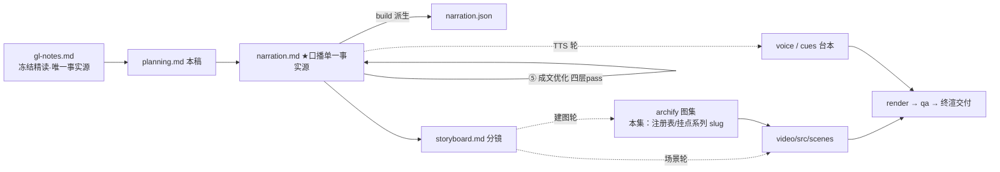

# 策划案：新系列 ep4《Hooks：扩展不进循环》（v2 · 文案轮待用户审批 · C 型信源 = gl-notes）

> 状态：系列 claude-code-chapters 第 4 集（s04_hooks 单章，2026-10-31 开工）。本轮为**文案轮**（Stage ①–⑤）：④ 双重校验与 ⑤ 成文优化已清（v3，改动表见 `.temp/prose-changelog.md`），逐字稿与全部文案交用户审批，审批通过才进入制作（⑥ 分镜 → ⑩ 交付），故本稿不做建图与场景设计。事实源 = `research/gl-notes.md`（冻结自现行 171，I-234 后代次，与 ep1/ep2 同一冻结正文代次；取材范围 s04 单章）。

成本档位: 正集（单语 + story 档已配音系 + 约 5 分钟常规动画复杂度；文案轮无生产层开销，制作期成本量级 = 常规单集）

## 0. 标题候选（待审批；series.json 现为工作题《Hooks：扩展不进循环》，审批后落定）

| 候选 | 一句话理由 |
|---|---|
| A《Hooks：扩展不进循环》 | 直取课程 s04 章副题（冻结正文 §6 标题原句），副题即机制结论，与系列命名纪律同构 |
| B《Hooks：加一个扩展，不改一行循环》 | 承接 ep2《Tool Use：多加一个工具，只加一行》的「加 X 不动 Y」母题句式，系列感与递进感最强 |
| C《Hooks：连「做完了」都能被拦下》 | 直取本集最反直觉记忆点 Stop 强制续跑（§6.3 + 实验 5 消融正例），认知增量最锋利 |
| D《Hooks：退出权也是一个挂点》 | 实验 5 教训句「退出权也是扩展点」直取，把本集机制升维成设计思想 |

## 一、定位表

| 项 | 值 |
|---|---|
| 平台 | B 站 / YouTube 中长视频 |
| 时长目标 | 4.4–5.6 分钟（pipeline.toml 硬约束窗，含系列片头 ~23.5s 口径；正文 1305 字预算 @254 字/分） |
| 形态 | AI 配音（story 档）+ Remotion 代码动画，无真人 |
| 受众 | 不预设工程背景的普通人：见过「AI 帮你跑命令」，想过「功能越加越多软件为什么越改越乱」的任何观众 |
| 核心内容范围 | gl-notes §6 全节（6.1 每加一个检查循环烂一分 / 6.2 机制解构·四个事件一个注册表 / 6.3 单步走查·Stop 拦住「做完了」/ 6.4 生产版·事件清单、结果字段与两条保险）+ §7 数字表两行（4→27→33 个 Hook 事件、14 字段 HookResult）+ §8 实验 5（忽略 Stop 续跑，本集核心消融）与实验 4（注销权限回调，次核心消融，均本集复算升【一】级）+ §9.1 规律 1（收束主线）与规律 3（不变式口播承载）；§3–§5（Loop / Tool Use / Permission）属本系列前三集，开场以「闸门」意象承接一句、不重讲机制；s05 起规划、记忆等属后续集，只在下期钩子点一笔问题 |
| 系列位置 | 系列第 4 讲：在闸门之上完成「扩展与核心分离」的最后一步——检查降格为回调、循环零硬编码，「核心不变，能力正交叠加」规律的收束集；系列视觉母题（恒定环体〔M-001〕）延续，新增「注册表 / 挂点」装置视觉 |

**Logline**：每加一道检查就烂一分的循环，靠一张注册表得救——四个固定事件，扩展挂上去，循环零硬编码，连「做完了」都能被拦下（gl-notes §6.1 + §6.2 + §6.3）。

## 二、叙事策略

**主线是一问一答的闭环**：开场抛问题「为什么每加一道检查，循环就烂一分」→ P1 用「注册表 + 四个固定事件」回答「扩展不进循环」→ P2 走查证明「连退出这一步都能被钩子拦下，而循环一行没动」→ P3 反问「这个退出权值多少钱」——两个消融实验回答「退出权也是扩展点、拔回调就是拔闸门」→ P4 对照生产版「清单在涨、骨架不变，还有两条保险」→ P5 收束「核心不变，能力各不牵连地往上叠」+ 下期钩子（它管不住自己的计划）。

**开篇钩子候选矩阵（★ 待人工挑选——本集文案审批人即挑选人）**：

| # | 型 | 钩子文本（p0-01） | 吸引力留存逻辑 | 核心主干关联锚点 | 抛出的核心引子 |
|---|---|---|---|---|---|
| H1 | 痛点型 ★ | 「这是一段每加一道检查，就烂一分的循环。」 | 「加检查＝烂代码」的反差即时认领（刚看完闸门越挂越多的观众直接对号），3 秒锁注意力 | gl-notes §6.1（膨胀循环病灶＝依赖方向）；P0 问题现场即钩子展开 | 为什么每加一道就烂一分？怎么继续扩展又不碰循环？ |
| H2 | 反直觉颠覆型 | 「这是一个连『我做完了』都能被拦下的装置。」 | 终结权被夺走的惊奇——任务做完了还能被拦？ | §6.3（Stop 强制续跑，本集最反直觉记忆点）；P2 走查兑现 | 谁有权拦「做完了」？凭什么？ |
| H3 | 一句话本质型 | 「这是一套把扩展挡在循环外面的机关：四个事件，一个注册表。」 | 把整章机制折叠成一句话，制造「就这么简单？」认知落差 | §6.2（注册表解构）；P1 首拍拆解兑现 | 一张注册表怎么接住所有扩展？ |
| H4 | 数字反差型 | 「从四个挂点到三十多个，循环一行没改。」 | 极小骨架对极大扩展面的数字反差 + 「一行没改」的余韵 | §6.4 + §7（4→27→33）+ §9.1 规律 1 | 扩展点翻了几番，骨架凭什么不动？ |
| H5 | 悬念冲突型 | 「模型说做完了，一个钩子说：还没有。」 | 双声部冲突开场，谁赢？ | §6.3；P2 整幕兑现 | 钩子凭什么赢？ |

★ 选定 H1（自动选定，待人工复核）。理由：承接前集收尾意象（检查与闸门越挂越多、每加一道循环就烂一分）零成本入场，问题型钩 3 秒认领、P0 当幕兑现不欠债；H2/H5 均押 Stop 反直觉点——那是 P2 的峰值与 P3 消融的因，开场提前引爆会让 P2 泄压（对前半程是负债）；H3 本质句改写进 P1 首拍；H4 数字承诺押 P4/P5 收束。

**视觉母题统摄全片，局部类比点到即止**：连续感只由视觉母题承担（恒定循环环体〔M-001〕+ 系列色彩契约 + 本集「注册表 / 挂点」装置视觉），严禁把局部类比升格为贯穿剧场。口播类比只准入 gl-notes 附录 A 登记条目：本集实引 #8 拒绝票比允许票重（P4 不变式的口播承载喻，失配边界「不是权重更大的票，是一票否决」随行）、#12 泥球（P5 反面收束喻，边界「喻耦合僵化而非物理堆积，正解是挂出去不是清扫」随 P5-02 承载）；#1 接上一双手本集无落点、不强造未启用；#6 骨架与保险丝备用未启用（未引 30 行 vs 1729 行对比）。**特别防线**：※#10 墙面插座、※#11 循环只喊号与本集题材天然贴脸（冻结正文 §6.2 原喻即插座），两条均系禁喻，口播一律工程直陈（「循环只负责触发事件」「检查逻辑挂到固定事件上」）——P1 机制段已按直陈措辞落稿。未登记类比不进口播。

**记忆点约每 60–90 秒一个**（全部取自 gl-notes §6/§7/§8，数字必带基线标尺）：
P0「每加一道检查，就烂一分——病灶在依赖方向：扩展的是行为，改的是核心流程」（§6.1）→ P1「三道闸门整个降格成一条普通回调；循环里零具名检查」（§6.2 + code.py :137/:213–217 可数【一】）→ P2「模型说做完了，钩子说还没」（§6.3 + --t5 日志，本集复算【一】）→ P3「退出权也是扩展点：关掉续跑，核对轮就没了」（§8 实验 5，本集复算【一】）→ P4「钩子说放行，也压不过拒绝规则——一票否决」（§6.4 不变式【三】+ A#8）→ P5「核心不变，能力各不牵连地往上叠；不守它就缠成泥球」（§9.1 规律 1/5 + A#12）。

**收尾不贩卖焦虑，悬念只留给下期**：P5 护栏句并入片尾署源块（生产细节来自原作者单方核查、未锁 CC 版本号、计数随时点漂移——§11.1 精神，随署源句交代，与 ep1/ep2 同款）；悬念留在下期钩子（它管不住自己开头定好的计划——做着做着就漂了），只点问题、不预告机制细节。

## 三、视觉语言

**色彩语义沿用系列契约**（深色底 `#0E1116`；警示红 `#FF5C5C` = 反例/退化路径；确认绿 `#7ED321` = 机制在位/拦截成功；金句卡衬线体；公式/方法名只进角标）：

| 概念 | 专属色 | 语义 |
|---|---|---|
| 循环环体（全系列恒定锚〔M-001〕） | 陶土橙 `#D97757`（系列恒定，承 ep1） | 同一环体继续出场，本集环上钉出四个固定事件挂点——紫点挂在橙环上，扩展不进循环的空间宣言 |
| 事件挂点 / 注册表 | 挂点紫 `#8B7CF6`（本集主题色，theme.core 本集新增语义） | HOOKS 注册表、四事件挂点、降格迁移后的闸门卡、拦下「做完了」的 Stop 钩 |
| 回调 / 触发信号流 | 回调蓝 `#58A6FF`（本集副色） | 事件触发脉冲、续跑指令注入流、十四字段结果对象卡 |
| 消融反例 / 越界 | 警示红 `#FF5C5C`（系列保留语义色） | 实验 5/4 退化帧、越界写出箭头、拔钩后失护栏的环体 |
| 在位 / 放行 | 确认绿 `#7ED321`（系列保留语义色） | 消融正例帧、第二次放行退出、检查点全过 |

主题色撞车对账（系列内）：挂点紫 ≈262° / 回调蓝 ≈212°，与已用四色（陶土橙 ≈20°、青碧 ≈176°、琥珀 ≈40°、珊瑚红 ≈2°）色相错开；系列层交付前另有统一撞色对账（承 Stage ① 色板纪律）。

构图纪律：消融对比一律左红右绿同屏（实验 5：在位全绿 ↔ 忽略续跑「假绿→数字翻红」；实验 4：在位 ↔ 摘回调后越界箭头冲框＋问询清零，读数动态条随行）；「降格」用迁移动画表达——闸门卡从环体内部拆出、移挂到「动手之前」事件下（特权 → 配置的空间叙事，工程直陈不用比喻）；数字一律动态增长条 + 工况角标（4 → 27 → 三十多个，归属徽标与日期角标钉在读数条上）；走查 beat 用消息条 + 日志行滚动（Animated State Trace，承 ep1/ep2）；注册表装置视觉 = 事件名列对回调串列的对照，加回调即串上增一颗（全片反复出场、逐幕生长）；视觉母题禁旧版隐喻系意象（车间/作坊/传送带/工序卡/叫号器/插线口/师傅及同族——插座/喊号同族意象本集题材贴脸、特防误用），一律工程直陈：装置、注册表、挂点、回调、触发。

**景别走 `CU→WS→CU`，张力峰值在 P3**：P0 环体特写（CU，杂色块堆进循环体的压迫感）→ P1 注册表全景（WS，表与环体挂点的关系）+ 降格迁移中景 → P2 走查中景（MS，消息流 + 日志行双轨）→ P3 消融双特写（CU，拔钩瞬间与读数翻红，全片张力峰值）→ P4 拉远（WS，清单增长条 + 保险机制徽标，降压呼吸）→ P5 环体定格收束。运镜密度：P3 紧张段每镜 ≤1 次推近；重音镜每 20–40s 一个 1–2s punch（与记忆点 60–90s 咬合）；张力曲线 P0 病灶压迫起步 → P1 解构降压 → P2 Stop 悬念爬升 → P3 拔钩峰值 → P4 拉远呼吸 → P5 平收（与 ③ 声音表演情绪曲线同向）。

## 四、分幕结构表

| 幕 | 目标时间 | 字数预算 | 主题 | 叙事要点（回溯 gl-notes） | 视觉锚点 | 前置概念 |
|---|---|---|---|---|---|---|
| P0 改不完的循环 | 0:00–0:45 | ≈165 | 钩子 + 问题现场 | H1 钩子落 p0-01（每加一道检查，就烂一分）；一句承接前集收尾意象（闸门越挂越多，禁顺序词/他集标题）；想要的扩展还排着队：动手前记日志、操作后自动提交（§6.1）；每加一项就得动一次循环本体（§6.1；改动即风险的铺陈由 P5 泥球句收口）；日志、检查、提醒、自动提交一条条往里堆——很快，循环就认不出来了（§6.1 材料原话）；病灶不在某一行代码，而在依赖方向：想扩展的是行为，改的却是核心流程（§6.1）；今天的钩子：把扩展挡在循环外面 | 环体〔M-001〕特写：杂色检查块填进循环体、转动滞涩；「想扩展的：行为 → 改到的：核心流程」逆向箭头打叉；右下角署源角标（首部署源位） | — |
| P1 一张注册表 | 0:45–1:55 | ≈250 | 机制解构 | 先摆答案：一个注册表、四个事件（§6.2）；注册表就是一个字典：事件名，对上一串挂上去的程序，事件一到，挨个跑（「回调」具名推迟至降格句、与白话并置）；循环里只留事件触发这一种语句——跑什么，注册表说了算（§6.2 工程直陈，※#10/#11 禁喻防线）；四个事件覆盖一个完整周期：输入提交后、进模型前注入上下文 / 动手之前可拦截 / 动手之后查副作用与输出 / 循环退出前收尾统计（§6.2 事件表，白话序、事件名英文进角标）；最妙的一步：三道闸门整个降格，成「动手之前」的一条普通回调（§6.2）；教学版可数事实：五条回调挂在四个事件上，「动手之前」挂两条——权限和日志一起跑，模型动手前先过这两条（I-032 微走查；附录 B.1 :137/:213–217【一】，印证事件名映射到回调列表）；从此循环里再没有具名检查——四处事件触发、零个检查函数（§6.2 + B.3【一】）；幕点悬念：有一个事件的权力大得反直觉，连「做完了」都能拦 | 挂点紫注册表主视觉首亮（事件名列 × 回调串列）；四紫点沿环体一圈钉满周期；降格迁移动画（闸门卡从环内拆出移挂）；「4 事件 · 5 回调」计数角标；「做完了」文本块被紫色挂钩勾住（悬念定格） | 工具调用（ep1 已释）；三道闸门（ep3 已立，开场承接一句）；权限（ep3 已立） |
| P2 连做完了都能拦 | 1:55–2:45 | ≈200 | Worked Example | 收尾事件走查（§6.3）：判据说没有工具调用了、该退出了，钩子却能把这一步拦下来（Stop 语义最反直觉）；教学版写法：退出前先触发一次这个事件——返回了内容，就把这段话作为新的用户消息塞回对话、续跑一轮；返回空，才真正退出（§6.3 + 钉选 README :80「返回非 None 时循环继续」教学正文【一】）；效果：模型说「我做完了」，钩子说「还没——理由在这儿」（§6.3）；原型实测走查（--t5，B.2 本集复算【一】）：第一次停机被拦、注入一条用户消息、多跑一轮核对；第二次放行、循环退出；实验全程循环源码一行没动（B.2：改的是 Stop 回调，不是循环）；幕尾悬念：这个「退出权」，值多少钱 | 出口特写 + 判据灯（无工具调用）；机制图两路分支（注入续跑 = 回调蓝 / 放行 = 确认绿）；原型日志走查 Animated State Trace（两行 Stop 日志滑过）+ 循环源码面板恒挂「0 行改动」徽标 | 判据（ep1 已释：无工具调用即退出——Stop 拦截的前提） |
| P3 钩子值多少钱 | 2:45–3:55 | ≈240 | 消融双实验 | 实验 5（把续跑指令直接忽略，其余全开，B.2 本集复算【一】）：表面风平浪静、任务照常收尾；数字露馅——续跑从一次变零、核对轮没发生、验收关卡五个只过四个（句内白话自释，读数条与角标仍钉 checkpoints）；教训一句话：退出权也是扩展点，关掉它就少一道质检（§8 实验表）；实验 4（注销「动手之前」的权限回调，B.2【一】）：伤害直接显形——越界的文件写出去了、从零变一；该问用户的两处一处都没问、问询从二归零；拔回调就是拔闸门：权限降格成回调后，它不是特权、是配置（§8 表 + B.1 降格字节事实）；对仗收束：挂上去是质检和安全，拔下来当场退化；幕尾悬念：教学版就这四个事件——真实的 Claude Code 长什么样 | 左红右绿消融同屏 ×2（实验 5「假绿帧→数字翻红」；实验 4 摘回调动画 + 越界箭头冲出工作区框 + 问询气泡清零，读数条随行）；对仗字卡（挂上 = 绿 / 拔下 = 红）；拉远入生产版剪影 | —（消融读数句内自释：验收关卡） |
| P4 清单与两条保险 | 3:55–4:40 | ≈230 | 生产对照 | 【三】级归属句式入场（拆解过 Claude Code 源码的同学们应该知道）：真实的钩子事件，二十七个（材料核查，s04f 附录）；官方文档更细：三十多个——清单一直在长，骨架还是那四个核心事件（§6.4 + §7，趋势化措辞、现值与「33 个」日期口径不进口播，B.3）；钩子交回的结果，生产版里是一张十四栏的表：阻塞错误注入对话、让模型自己纠错（§6.4【三】「十四字段对象」的白话承载，一例带过，updatedInput/permissionBehavior 弃用）；保险一，不变式：钩子说放行，也压不过设置里的拒绝和询问（§6.4【三】+ 官方原文角标彩蛋）；像表决：允许要各方点头、一方摇头就拦——摇头不是权重更大的票，是一票否决（A#8 + 失配边界随行）；保险二，防转圈：收尾钩子报了阻塞错误，循环带着标志重入，下一轮看见标志就不再触发——免得自纠和报错无限循环（§6.4 stopHookActive【三】）；幕尾悬念：两条保险都上齐——这套设计，到底买到了什么（钩向 P5 收束金句，回扣 p2-09「值多少钱」） | 事件清单增长条（4 → 27 → 三十多个，归属徽标 + 日期角标钉在读数条）；十四字段对象卡（回调蓝）；不变式表决动画（多方点头 vs 一方摇头 → 拦）；标志翻转 + 「无限转圈」图标被掐断；两枚保险标记合亮 + 问号（幕尾悬念） | 返回（P2 已释：「返回了内容／返回空的」白话走查）；拒绝和询问（ep3 闸门语式承接，deny/ask 进角标） |
| P5 干净的核心 | 4:40–5:15 | ≈220 | 收束 + 钩子 + 署源 | 收束金句（白话承载）：核心不变，能力各不牵连地往上叠（§9.1 规律 1「正交叠加」的句内白话锚——正交＝各维独立变化、互不牵连；金句卡视觉层仍可钉「正交叠加」）；检查降格成回调——循环零硬编码，新能力都往固定挂点上加（§9.1 规律 1）；不守它，复杂度压进核心，缠成没人敢动的泥球（A#12 + 边界：喻耦合僵化而非物理堆积，正解 = 挂出去，已由上句承载）；下期钩子（只点问题不预告机制）：只是有件事这套机制管不住——开头定好的计划，做着做着就漂了，走到哪一步、还剩几件它说不清；片尾署源块（系列既定尾位）：这套视频改编自开源课程 Learn Claude Code + 生产细节来自原作者的单方核查、未锁版本、计数会漂移（§11.1 精神） | 环体定格收束 + 金句卡（衬线体）；泥球帧（复杂度缠进核心）vs 干净环体（陶土橙 + 四紫点）对比；计划清单漂移视觉（下期问题卡，视觉层）→ 片尾署源卡（信源名 + 仓库地址） | — |

> 正文合计 ≈1305 字预算上限：六幕预算 165+250+200+240+230+220 = 1305，写作目标压在 1150–1220（幕预算为上限分配；P5 含署源块固定开销 ≈69 字）。句均 20–24 字 → 约 50–56 句。实稿 v1：54 句 1239 字（六幕 149/246/194/236/220/194，全部落预算内）。实稿 v2（④ 修稿 + ⑤ 成文优化后）：54 句 1283 字（六幕 149/273/194/238/228/201；句 id 集与 v1 完全一致、零增删）。实稿 v3（⑤ 成文评审轮 1 后）：55 句 1305 字（六幕 149/273/194/238/250/201；评审项 p4-08 幕尾钩缺口按 05 §二.2 回 ③ 插句 p4-08b（+22 字），句 id 集唯一增量）。P1 超幕预算 250 上限 23 字——「回调」白话锚（p1-02）与 I-032 微走查（p1-11）系 ④ B 镜头 REWRITE/WARN 的刚性开销，且 P1 时隙 70s 按 254 字/分可容 ~296 字（273 字 ≈64.4s 仍在时隙内）；P4 超幕预算 230 上限 20 字——幕尾钩系 03 纪律 5「每幕结尾留半句悬念钩到下一幕」的结构性刚需（05 四-11），与 P1 超支同由 P0/P2/P3/P5 结余（16+6+2+19 = 43 字）对冲；正文合计 1305 ≤ 1305 上限、≈5.1 分 + 片头 23.5s 落 [4.4, 5.6] 窗。

## 五、生产管线图

本轮产物止于 C（含 ④⑤ 修缮；虚线节点为制作期，审批通过后启动）。

## 六、边界与不做的事

**系列递进边界（照抄口径，本集不进入）**：Agent Loop / Tool Use / Permission（本系列前三集）只在开场以「闸门」意象承接一句、不重讲机制（判据、查表、三道闸门细节都不回头展开）；s03 权限三道闸门作为「降格」的宾体出现，其裁决细节属前一讲主角；s05 起规划、记忆、并发调度、多 Agent 不沾，只在下期钩子点一笔问题。P4 生产对照里事件清单、十四字段、两条保险只作「生产保护层」的证据形态呈现（名目 + 代表例），不逐字段展开。

**片头沿用《一个循环》（制作期）**：系列片头资产 ep1 制作期已挂载孪生登记，本集沿用同款（~23.5s，预算已计入）；本集挂载件与孪生门登记随制作期处理，本轮只占预算。

**口播红线不可越**：观众层信源标识只许出现在首尾既定署源位——片头署源角标（p0-01 beat 视觉层）+ 片尾署源句（p5-07，豁免白名单登记在工作区 `vibe-video.toml [check_series.source_credit]`，RSI I-080，本集条目随文案轮编排层登记），其余位置零课程/站点/章号痕迹（不出现课程/站点名/「第 N 章」——按章拆集只是编导结构）；【三】级断言归属由片尾署源位承接，正文归属句只用「拆解过 Claude Code 源码的同学们应该知道」句式（ep1 审批口径）；活数据不进口播——事件总数现值不进口播、只说趋势「三十多个」（「33 个」须「截至 2026-10-07」日期限定，本集已趋势化规避；27 恒【三】归属），章节数/star 同禁；禁顺序词（上一集/上集/上期/下一集/下集/第 N 集/前一集/本系列/这一系列——署源句用「这套视频」），收尾预告只许「下期」；口播英文例外清单 = Claude Code + bash（随系列已立例外，本集 bash 未口播）+ 署源专名 Learn Claude Code，其余英文方法名与命令（UserPromptSubmit / PreToolUse / PostToolUse / Stop / HOOKS / register_hook / trigger_hooks / HookResult / blockingError / deny / ask / stopHookActive / stop_continued / outside_writes 等）进角标不口播；「钩子」恒中文（标题中的 Hooks 属视觉层）；禁旧版隐喻系词汇及同族意象（车间/作坊/传送带/工序卡/叫号器/插线口/师傅——插座/喊号同族，附录 A ※#10/#11 不进口播，本集题材贴脸、逐稿盯防）。

**素材取舍，弃用而非遗漏**：争议 1 检测谱系三步（字符串表 → 词边界正则 → CC 分类器，§9.2）属权限面谱系，本集不展开——main 轨词边界正则增量留 gl-notes B.1 作翻钉证据，不上口播；HookResult 十四字段只取「阻塞错误注入自纠」一例，updatedInput（改写参数）与 permissionBehavior（权限裁决）弃用——后者属 ep3 权限面；PostToolUse 优雅停机通道（§6.4）弃用——两条保险已足；实验 4 只取两组数（越界 0→1 / 问询 2→0），deny_listed_executed 0→1（sudo 经用户点头落地）不进正片——那是闸门串序问题、属实验 3 的 ep3 主场；「教学版的简化是刻意的」对照叙述（s04f 附录）若引须升【三】——本集不引；hook 配置语法运营面（settings.json matcher/matchers）不进口播（B.3 冻结正文未覆盖面）；防御力攻防结论不进口播（材料自认未测）。

**文案轮边界**：文案轮不跑 TTS、不动场景代码与 Main.tsx、不建 archify 图（storyboard 属制作期首轮）；series.json 登记为文案轮工作题，标题随审批落定；BGM 留空轨；信源外观点不进口播。制作期（⑥–⑩）审批通过后逐项启动。
