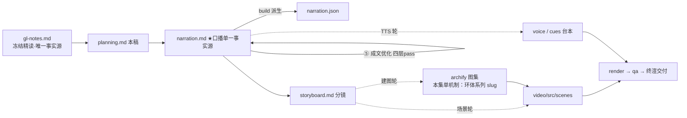

# 策划案：新系列 ep1《Agent Loop：一个循环，让 Agent 开始了心跳》（v2 · 文案已审批 · C 型信源 = gl-notes）

> 状态：系列 claude-code-chapters 建档首集。文案轮（Stage ①–⑤）于 2026-10-29 完成，**同日用户审批通过**（定题 + 三处修订：P4 归属句改「同学们应该知道」、正文去信源作者痕迹、首尾署源制），进入制作（⑥ 分镜 → ⑩ 交付）。事实源 = `research/gl-notes.md`（冻结自现行 171，I-234 后代次；取材范围 s01 单章）。

成本档位: 正集（单语 + story 档已配音系 + 约 5 分钟常规动画复杂度；文案轮无生产层开销，制作期成本量级 = 常规单集）

## 0. 标题候选（已随 2026-10-29 审批落定）

**审批定题**：系列《Claude Code 的 20 个核心机制》；第 1 集《Agent Loop：一个循环，让 Agent 开始了心跳》（用户定题，气口承接 A 的「一个循环」句式 + B 的「给模型装上手」语义）。

| 候选 | 一句话理由 |
|---|---|
| A《Agent Loop：一个循环就够了》 | 直取课程 s01 章副题，气口最足；「就够了」自带反差（观众预期复杂系统） |
| B《Agent Loop：给模型装上手》 | 动作感承接白话主线（模型会写不会做→循环给手），与 P0→P1 过渡同构 |
| C《Agent Loop：把结果喂回去》 | 直取机制本质（回喂是循环的全部秘密），与钩子 H1 同构 |
| D《Agent Loop：三十行与一千七百行》 | 数字反差型，同时预告「简洁内核 + 保护外圈」全片结构 |

## 一、定位表

| 项 | 值 |
|---|---|
| 平台 | B 站 / YouTube 中长视频 |
| 时长目标 | 4.4–5.6 分钟（pipeline.toml 硬约束窗，含系列片头 ~23.5s 口径；正文 ≤1345 字 @254 字/分） |
| 形态 | AI 配音（story 档）+ Remotion 代码动画，无真人 |
| 受众 | 不预设工程背景的普通人：用过聊天式 AI、见过它「给出命令就停」的任何观众 |
| 核心内容范围 | gl-notes §3 全节（3.1 问题 / 3.2 五步循环 / 3.3 走查 / 3.4 判据之争与生产对照）+ §7 数字表两行（30 vs 1729）+ §8 实验 1（消融）+ §9.1 规律 5 一条（收束用）；§4–§6（Tool Use / Permission / Hooks）属同系列后续集，本集只在下期钩子一笔带过 |
| 系列位置 | 系列之首：建立「循环骨架」这一全系列地基；本集起系列视觉母题（恒定环体）首次出场 |

**Logline**：会写命令的模型没有手；一个三十行的回喂循环给它接上一双手——判据认内容不认字段（gl-notes §3.1 + §3.4 + §9.1 规律 5）。

## 二、叙事策略

**主线是一问一答的闭环**：开场抛问题「谁来替它按回车」→ P1 用三十行循环回答「程序来当这双手」→ P2 走查证明「真的转得起来」→ P3 反问「循环凭什么判断该不该继续」——判据之争 + 消融实验回答「认内容块，不认收尾字段」→ P4 对照生产版「核心不用长大，长大的是保险丝」→ P5 收束 + 下期钩子（现在它只有一只 bash 手）。

**开篇钩子候选矩阵（★ 待人工挑选——本集文案审批人即挑选人）**：

| # | 型 | 钩子文本（p0-01） | 吸引力留存逻辑 | 核心主干关联锚点 | 抛出的核心引子 |
|---|---|---|---|---|---|
| H1 | 痛点型 ★ | 「这是一个会写命令、却永远在等你按回车的模型。」 | 观众自身经验的即时认领（谁没当过粘贴机），3 秒锁注意力 | gl-notes 白话开场痛点；P0 问题现场即钩子展开 | 谁来替你按回车？按下去之后谁看结果？ |
| H2 | 一句话本质型 | 「这是让模型自己动手的全部机关：一个循环，把每次执行的结果喂回给它自己。」 | 把「Agent」折叠成一句谦卑的话，制造「就这么简单？」认知落差 | 一句话定位；P1 首拍即拆解兑现 | 一句话够吗？判据、保险丝都是这句长出来的什么？ |
| H3 | 反直觉数字型 | 「这是三十行代码和一千七百多行代码的关系：核心不用长大，长大的是保险丝。」 | 极小对极大数字反差 + 「保险丝」悬念词 | §3.4（30 vs 1729）+ 规律 5 | 保险丝指什么？为什么核心不用长大？ |
| H4 | 新范式揭示型 | 「这是所有 AI 编程工具共用的同一个引擎：花样再多，转起来的都是同一个循环。」 | 「都一样」的归纳颠覆（观众以为各家黑科技不同） | 课程核心模式（站点导语）+ §9.1 规律 1 | 同一个循环怎么长出这么多花样？ |
| H5 | 悬念冲突型 | 「这是一场判据之争：一个字段的去留，让十轮任务只跑完八轮。」 | 冲突 + 悬置结果（哪个字段？为什么掉两轮？） | §3.4 判据之争 + §8 实验 1 | 哪两个字段在争？你站哪边？ |

★ 选定 H1（自动选定，待人工复核）。理由：单章集时长紧，痛点钩 3 秒认领、P0 当幕即兑现（不欠债）；H2 本质句改写进 P0 收束句（两全）；H3/H5 悬念分别押在 P4/P3，对前半程是负债；H4 的「都一样」归纳本集只证到 CC 一家（课程主张 + CC 对照），全称断言留到系列收束集更稳。

**视觉母题统摄全片，局部类比点到即止**：连续感只由视觉母题承担（恒定循环环体 + 色彩语义契约），严禁把局部类比升格为贯穿剧场。口播类比只准入 gl-notes 附录 A 登记条目：本集实引 #3 牛马（P0）、#1 接上一双手（P0 落锚 p0-09、P5 回扣 p5-04）、#7 打字机逐字到达（P3 流式）、#4 火警接警（P3 判据）、#6 骨架与保险丝（P4/P5）——#13 一条沟在时长修剪中弃用（弃用而非遗漏）；每处 1–3 句点亮即切回机制画面，失配边界句随行（#4 的「接警员能补派、循环不判第二遍」随行）。未登记类比不进口播。

**记忆点约每 60–90 秒一个**（全部取自 gl-notes §3/§7/§8，数字必带基线标尺）：
P0「牛马回路：跑一遍、贴回去、再跑一遍」（白话开场）→ P1「三十行，一个最小可运行的 agent harness 内核」（§3.2/§3.4）→ P2「三次调用、两次执行，每次决策都建立在喂回的结果上」（§3.3）→ P3「判据换回收尾字段：十轮只跑完八轮、落地七件变五件」（§8 实验 1，本集复算【一】）→ P4「三十行的骨架就是一千七百多行里长出来的那个核心」（§3.4，【三】归属句）→ P5 收束金句「核心不长大，长大的是保险丝」。

**收尾不贩卖焦虑，悬念只留给下期**：P5 护栏句并入片尾署源块（数字来自原作者单方核查、未锁 CC 版本号、计数随时点漂移——§11.1 精神，随署源句 p5-08 交代）；悬念留在下期钩子（只有一只 bash 手，又丑又容易错），不预告机制细节。

## 三、视觉语言

**色彩语义沿用旧系列契约**（深色底 `#0E1116`；警示红 `#FF5C5C` = 反例/退化路径；确认绿 `#7ED321` = 机制在位/拦截成功；金句卡衬线体；公式/方法名只进角标）：

| 概念 | 专属色 | 语义 |
|---|---|---|
| 循环环体（全片唯一不变） | 陶土橙 `#D97757`（本集主题色，theme.core） | 恒定视觉锚〔M-001〕：同一环体全片反复出场，只换环上高亮段——本集单机制深潜，环体即主角 |
| 执行面/工具结果流 | 青碧 `#64C4C0`（theme.tool） | 消息条、执行动作、tool_result 回喂流 |
| 判据反例/退化 | 珊瑚红 `#EF6461`（theme.warn） | stop_reason 判据帧、消融退化路径（与警示红同族不同帧并用，同帧对比以描边/填充区分） |

构图纪律：消融对比一律左红右绿同屏（实验 1：内容块判据 10/10·7 件 ↔ 收尾字段判据 8/10·5 件）；数字一律动态增长条 + 工况角标（30 vs 1729 基线标尺）；走查 beat 用消息条堆叠动画（5 条消息逐条长出，Animated State Trace）；视觉母题禁旧版隐喻系意象（车间/传送带/工序卡/叫号器/插线口/师傅及同族），一律工程直陈：装置、结构、机件、管线、闸门、挂点。

**景别走 `WS→CU→MS`，张力峰值在 P3**：P0 终端窗口全景（一条无人按下的命令行）→ P1 急推环体特写（五步逐一点火）→ P2 走查中景（消息条 + 环体并置）→ P3 判据对比帧双特写 → P4 拉远（30 vs 1729 标尺全景）→ P5 环体定格收束。运镜密度：P3 紧张段每镜 ≤1 次推近；重音镜每 20–40s 一个 1–2s punch（与记忆点 60–90s 咬合）；张力曲线在 P3 判据之争到达峰值、P4 用拉远降压、P5 平收。

## 四、分幕结构表

| 幕 | 目标时间 | 字数预算 | 主题 | 叙事要点（回溯 gl-notes） | 视觉锚点 | 前置概念 |
|---|---|---|---|---|---|---|
| P0 会写不会做 | 0:00–0:50 | ≈200 | 钩子 + 问题现场 | H1 钩子落 p0-01；模型能写出正确命令，但输出完就停——不会自己跑、看不到结果接着想；用户跑一遍、贴回去、再跑一遍，每一来回都在当它的牛马（白话开场、附录 A#3 + 失配边界：人肉回路自带安全直觉，程序只会机械回喂）；「能写命令」和「会做事」之间隔着一条沟（§3.1、A#13）；把这段来回自动化，就是给模型接上一双手（§3.1、A#1）——今天只讲这双手的骨架 | 冷启动直入：终端窗口 + 一条无人按下的命令行；右下角署源角标（首部署源位）；人肉回路循环箭头（灰） | — |
| P1 三十行循环 | 0:50–2:05 | ≈310 | 机制解构 | 全部逻辑是一个 while 循环加两个信号：有工具调用就继续转，没有就退出（§3.2）；五步走：问题进消息列表 → 带工具定义调模型 → 回答原样入档、查有没有工具调用 → 执行、输出包成工具结果 → 结果作为新消息塞回、回到第二步（§3.2，口播按此白话序，代码词全进角标）；易看漏的约定：结果以用户角色回塞——「我要调工具」之后紧跟一条「这是你要的结果」，角色别扭机制说得通（§3.2）；三十行，就是最小可运行的 agent harness 内核：模型负责决策，程序负责执行（§3.2，Harness 保留英文） | 环体主视觉首次亮出（陶土橙）；消息条堆叠动画（五步逐一点火）；〔M-001〕恒定锚建锚 | 工具调用（本幕先释后用：模型回答里「请帮我执行某操作」的结构化请求） |
| P2 一次完整往返 | 2:05–2:55 | ≈220 | Worked Example | 拿一个具体输入走全程：「清单加一行牛奶，再念给我听」（§3.3，设计走查例口径：机制演示呈现）；第一次调用——回答带写文件请求，执行，结果喂回；第二次——带读文件请求，执行，喂回；第三次——纯文本回答，不再有工具调用，循环退出；三次调用、两次执行，每一次决策都建立在喂回的结果之上（§3.3）；这双手的力气从哪来？就在「喂回」这一步 | 消息条 1→5 逐条长出 + 环体同步转三圈（每圈高亮不同段）；执行动作用青碧脉冲 | 工具结果（P1 已释：执行输出包成的回喂消息） |
| P3 判据之争 | 2:55–4:05 | ≈290 | 判据 + 消融 | 循环每一圈都要判一次「还要不要继续」——判据怎么选，两版教材给出不同答案（§3.4）：一版查收尾字段（API 响应的结束标记），概念干净；另一版翻内容、找工具调用块。差别在流式场景显形：回答像打字机一样逐字到达（A#7），字段可能比内容更晚更新——程序已看到请求，字段还停在上一个值；等字段，等于把行动绑在一个可能迟到的信号上；像火警接警：听到「着火、地址」就派车，不等电话按规矩收完尾（A#4 + 失配边界：接警员能补派，循环对同一次响应不判第二遍）；实测说话：把判据换回收尾字段，十轮任务只跑完八轮，落地的七件变五件——两个已被请求的调用被静默丢弃（§8 实验 1，本集复算【一】级）；教训：字段晚到时，等字段等于丢调用（§8 表） | 判据对比双特写（字段帧 vs 内容块帧）；打字机逐字动画；左红右绿消融同屏（10/10·7 ↔ 8/10·5） | 收尾字段（本幕先释：API 响应结束时的标记字段）；流式（本幕先释：回答逐字到达的形态） |
| P4 生产版对照 | 4:05–4:50 | ≈190 | 30 vs 1729 | 真实的 Claude Code 里，这个循环长什么样？拆解过 Claude Code 源码的同学们应该知道：主循环所在文件一千七百多行（【三】归属由片尾署源块承接，审批修订：正文不再用「作者」归属句式）；差别不在核心——它同样不信任收尾字段，改用一个标志位，流式过程中一见工具调用块就置真（【三】）；教学版只维护一份消息列表，生产版的状态对象有十个字段，各自追踪一类运行状态；退出路径也有多条——超长、报错、中止、轮次上限各有各的处置（【三】）；三十行的骨架就是这一千七百多行的核心，其余全是保险丝（§3.4、§7 表、A#6 + 失配边界：保险丝熔断即断路，这里的保护多数可重试可续跑） | 30 vs 1729 动态标尺（基线锚点）；State 字段环外圈点亮两三个代表；拉远全景 | 标志位（本幕口播白话：一个「还要不要继续」的开关；英文 needsFollowUp 进角标） |
| P5 收束与下期 | 4:50–5:20 | ≈135 | 收束 + 钩子 + 署源 | 收束金句：核心不长大，长大的是保险丝——复杂度全以「出事时怎么办」的保护层叠上去（§9.1 规律 5 一句）；下期钩子：这双手现在只有 bash 一件家什——读文件要拼命令、找文件要拼命令，又丑又容易错；下期，给它真正的工具（只点问题不预告机制，禁顺序词）；片尾署源块（审批新增，首尾署源制的尾位）：这套视频改编自开源课程 Learn Claude Code + 数字来自原作者单方核查、未锁版本、计数随时点漂移（§11.1 精神） | 环体定格收束 + 金句卡（衬线体）；bash 单手视觉（灰）→ 下期卡（视觉层）→ 片尾署源卡（信源名 + 仓库地址） | — |

> 正文合计 ≈1345 字预算上限：六幕预算 200+310+220+290+190+135 = 1345，写作目标压在 1150–1220（幕预算为上限分配，允许 P3/P4 各回吐 30–50 字）。句均 20–24 字 → 约 50–55 句。

## 五、生产管线图

本轮产物止于 C（含 ④⑤ 修缮；虚线节点为制作期，审批通过后启动）。

## 六、边界与不做的事

**系列递进边界（照抄口径，本集不进入）**：Tool Use / Permission / Hooks（同系列后续集）只在下期钩子各点一笔问题引子；规划、记忆、并发、多 Agent 更不沾。P4 生产对照里 State 十字段与多条退出路径只作「保护外圈」的证据形态呈现（点名两三个代表 + 数字），不逐个展开（那是后续集的粮）。

**片头已定沿用《一个循环》（制作期）**：该片头为旧系列资产，主题即本系列主线，~23.5s（2026-10-29 用户确认）；沿用需为新系列挂载件与孪生门登记（制作期处理，本轮只占预算）。

**口播红线不可越**：观众层信源标识只许出现在首尾既定署源位（审批修订 2026-10-29）——片头署源角标（p0-01 beat 视觉层）+ 片尾署源句 p5-07，豁免白名单登记在工作区 `vibe-video.toml [check_series.source_credit]`（RSI I-080），其余位置零课程/站点/章号痕迹（不出现课程/站点名/「第 N 章」——按章拆集只是编导结构）；【三】级断言归属由片尾署源位承接，正文不再用「作者」归属句式；活数据（章节数/star）不进口播——「后面所有章节都叠在这个循环上」以本集走查句式呈现（「这一次次演进里，核心循环一行不改」），不引具体章数；禁顺序词（上一集/上集/上期/下一集/下集/第 N 集/前一集/本系列——署源句用「这套视频」），收尾预告只许「下期」；Harness 不翻译（口播英文例外清单 = Claude Code + Harness，p5-07 的 Learn Claude Code 系署源专名、随例外清单口播），其余英文方法名（stop_reason / tool_use / tool_result / needsFollowUp 等）进角标不口播；「上下文」「Token」首现带白话句（本集大概率不出现）；禁旧版隐喻系词汇及同族意象（车间/作坊/传送带/工序卡/叫号器/插线口/师傅——附录 A#10/#11 不进口播）。

**素材取舍，弃用而非遗漏**：课程 s01「试一下」运行指引与 prompt 示例（教学操作向）不进口播；附录四点取三点（循环结构差异 / State 十字段 / 多条退出路径），第四点 StreamingToolExecutor（边生成边并行执行）与 isConcurrencySafe 属执行编排，归 Tool Use 及并发主题，本集不展开——弃用而非遗漏（材料留档 gl-notes）；§3.5 原型实景的完整基线数字（denied 2 / asked 2 等）不进正片，只取实验 1 的两组退化数（turns 与 executed）——基线全景属「四机制齐备」口径，本集单机制只认判据开关的因果；「三次调用、两次执行」按设计走查例口径呈现（不作实测断言、不带归属句）。

**文案轮边界（已收口，2026-10-29 审批通过）**：文案轮不跑 TTS、不动场景代码与 Main.tsx、不建 archify 图（storyboard 都属制作期首轮）；series.json 标题已随审批落定；BGM 留空轨；信源外观点不进口播。制作期（⑥–⑩）逐项启动。
