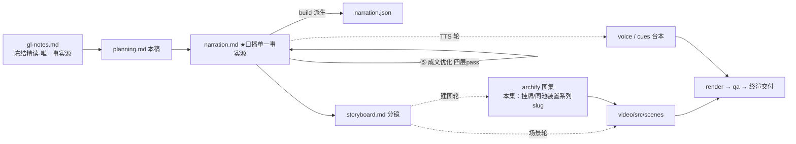

# 策划案：新系列 ep19《MCP 与插件：发现、命名、组装》（v2 · 文案轮待用户审批 · C 型信源 = gl-notes）

> 状态：系列 claude-code-chapters 第 19 集（s19_mcp_plugin 单章，2026-10-31 开工）。本轮为**文案轮**（Stage ①–⑤）：逐字稿与全部文案交用户审批，审批通过才进入制作（⑥ 分镜 → ⑩ 交付），故本稿不做建图与场景设计。事实源 = `research/gl-notes.md`（冻结自现行 175 精读，2026-10-31；Stage ① 翻钉 main 轨 `7226f555`——三节机制级正源增量〔宿主权限策略 / 撞名报错与 64 字符线 / 错误留在工具边界〕承载 175 §8 收束原则的唯一教学载体，站点轨 s19 对照件经 `s19f-*` 台账补登；取材范围 s19 单章）。

成本档位: 正集（单语 + story 档已配音系 + 约 5 分钟常规动画复杂度；文案轮无生产层开销，制作期成本量级 = 常规单集）

## 0. 标题候选（待审批；series.json 现为工作题《MCP 与插件：发现、命名、组装》，审批后落定）

| 候选 | 一句话理由 |
|---|---|
| A《MCP 与插件：发现、命名、组装》 | 直取章副题「外部工具：发现、命名、组装」（冻结正文 §8 节名），机制三步即集脊，观众按题索骥 |
| B《MCP 与插件：接新工具，一行代码都不写》 | 母题承接型：系列母题「加能力不改循环」递进到极致——工具章节加一件工具只加一行，本集连那一行都不用写（外部服务实现两个入口即入池） |
| C《MCP 与插件：服务说自己只读，别急着信》 | 认知增量型：main 轨正源增量的认知钩子——「外部服务的自我描述不能当授权依据」是 175 §8 明言值得单独记的安全原则 |
| D《MCP 与插件：池子变了，缓存就得作废》 | 消融钩子型：E5 核心消融直给动态工具池本质——工具池不是静态清单，是每轮重组的活结构 |

## 一、定位表

| 项 | 值 |
|---|---|
| 平台 | B 站 / YouTube 中长视频 |
| 时长目标 | 4.4–5.6 分钟（pipeline.toml 硬约束窗，含系列片头 ~23.5s 口径；正文 1305 字预算 @254 字/分，实稿 1319——⑤ 承 ④ 三镜头修复补白话先释与计数闭合 +94 字、成文评审换 p4-11 脚手架 +4 字、第 2 轮 Z9 破折号簇修正 −1 字，超幕预算合计 14 字，估算 ≈5.2 分仍在硬窗内） |
| 形态 | AI 配音（story 档）+ Remotion 代码动画，无真人 |
| 受众 | 不预设工程背景的普通人：见过「AI 能接外部工具」的说法、没想过工具怎么做到不写代码接进来的任何观众 |
| 核心内容范围 | gl-notes §8 全节（手写接入之痛 / MCP 两半分工 / 发现-命名-组装三步 / main 轨生产级细节〔规范化撞名报错 · 64 字符线 · 宿主权限不信任自我标注〕/ 连接后缓存作废与「干脆不缓存」叙事 / 真实版传输差距与官方印证）+ §10 一行（全名 ≤64 字符、非法字符替换为下划线）+ §11 实验 E5（本集消融正例，2026-10-31 复算升【一】级）与场景 C（C2 全名可调 / C3 归一实测，本集机制正例）+ §12 规律 5（能力接入走发现-命名-组装，收束用）+ §13 适用边界（教学 mock 定义域、源码转述不作运行时证据）+ §1 规格表「可扩展的能力」行与 §2 全貌表「外部工具池」行；§3–§7、§9 属本系列其余各集，本集只在开场承接与下期钩子一笔带过，不重讲 |
| 系列位置 | 系列第 19 讲：在循环骨架外接最后一类能力——「能力正交叠加」规律的极致实证（零代码接入）；系列视觉母题（恒定环体）延续，新增「挂牌 / 同池」装置视觉，对照表装置承接系列查表视觉血缘 |

**Logline**：每接一个外部工具就重写一套代码；一个开放标准把接入切成两半——发现、命名、组装，工具零代码进同一个池，池一变，缓存作废（gl-notes §8 + §12 规律 5）。

## 二、叙事策略

**主线是一问一答的闭环**：开场抛问题「接一个工具为什么总要重写一套」→ P1 用「两半分工 + 三步」回答「零代码接入怎么成立」→ P2 走查证明「三步真的把一次调用跑通」→ P3 反问「连接成功之后呢」——池变缓存作废 + E5 消融回答「不重建就调不到」→ P4 对照生产版「路铺多宽、闸看多紧」→ P5 收束「能力不靠改代码长出来」+ 下期钩子（机制都到齐、合体还转得动吗）。

**开篇钩子候选矩阵（★ 待人工挑选——本集文案审批人即挑选人）**：

| # | 型 | 钩子文本（p0-01） | 吸引力留存逻辑 | 核心主干关联锚点 | 抛出的核心引子 |
|---|---|---|---|---|---|
| H1 | 痛点型 ★ | 「这是接工具的老办法：外面的工具千千万，接一个，重写一套。」 | 「重写一套」的即时认领（谁没见过为接一个东西写一堆胶水代码），3 秒锁注意力；「外面的工具千千万」一句承接前集留下的钩子意象（无顺序词） | gl-notes §8 开篇（接外部服务就要再手写一套定义、参数格式、调用代码，服务一改跟着改）；P0 问题现场即钩子展开 | 有没有一次写好、家家通用的接法？ |
| H2 | 一句话本质型 | 「这是一条分工线：服务只管报清单、接调用，剩下的事全归主程序。」 | 把「标准接入」折叠成一条线的两侧，制造「就这么简单？」认知落差 | §8（MCP 把接入拆成两半）；P1 首拍即拆解兑现 | 这条线两侧各做什么？主程序接手了什么？ |
| H3 | 认知/安全型 | 「这是一句写在说明书里的『只读』——它拦不住任何一次真正的写入。」 | 「不算数」的颠覆感（自我介绍 ≠ 授权），逼观众重想「权限听谁的」 | main 轨 §6（宿主策略表、readOnlyHint 不作授权依据）；P4 权限幕点兑现 | 授权到底听谁的？ |
| H4 | 消融悬念型 | 「这是一次连接成功之后的失败：工具明明连上，一调用，回答却是『不认识』。」 | 冲突 + 悬置结果（连上了为什么调不到？哪一步坏了？） | §8 + §11 实验 E5；P3 兑现 | 卡在哪一步？修哪里才恢复？ |
| H5 | 撞名悬念型 | 「这是两个同名工具的相撞：都叫同一个名字，谁也别想顶掉谁。」 | 同名相撞的具象冲突（顶名 = 覆盖 = 出错），悬念在解法 | §8 命名（前缀挂牌防顶名 + main 轨撞名报错）；P1/P2 命名段兑现 | 靠什么分身？撞名为什么直接报错？ |

★ 选定 H1（自动选定，待人工复核）。理由：单章集时长紧，痛点钩 3 秒认领、P0 当幕即兑现（不欠债），且一句同时承接前集「外面的工具怎么接进来」钩子意象（无顺序词）；H2 本质句改写进 P1 首拍；H3 认知钩押 P4 幕点（本集最深一层，作幕点不作钩子，避免开篇抽象）；H4 消融钩押 P3（对前半程是负债）；H5 撞名悬念作 P1 命名段幕点。

**视觉母题统摄全片，本集零类比直讲**：连续感只由视觉母题承担（恒定循环环体〔M-001〕+ 系列色彩契约 + 本集「挂牌 / 同池」装置视觉），严禁把局部类比升格为贯穿剧场。口播类比只准入 gl-notes 附录 A 登记条目：本集对应条目 #6 认证插座经 Stage ① 判定**口播词面不启用**——「插座」属旧系列禁喻词表「插口 / 插线口」同族（系列判例已把插座判同族），机制语义工程直陈（发现-命名-组装 / 前缀挂牌 / 每轮重组），其「铭牌只读不是保险丝」行的语义由 main 轨宿主策略叙事承载、无需喻体；其余条目属本系列他集不进场——本集**零承袭喻体进口播**（零类比直讲合法）；若审校需要具象喻，须回附录 A 登记新条目后启用，不在视频阶段另造。

**记忆点约每 60–90 秒一个**（全部取自 gl-notes §8/§10/§11，数字必带口径）：
P0「接一个，重写一套；服务一改，跟着改」（§8 白话开场）→ P1「教学版硬线：撞名直接报错、全名超六十四字符拒收」（main 轨【一】，教学版口径）→ P2「整条链走完，主程序没写过一行接入代码」（§8 + §1 规格行）→ P3「不重建，调不到：不认识的工具 ↔ 重建，立刻恢复」（§11 E5 本集复算【一】，双断言）→ P4「名单四条：三件只读放行、会动手的每次都问；自我描述不能当授权依据」（main 轨【一】+ §8 原则句）→ P5 收束金句「能力不靠改代码，靠发现、命名、组装接进来」（§12 规律 5）。

**收尾不贩卖焦虑，悬念只留给终章**：P5 护栏句并入片尾署源块（生产细节来自原作者单方核查、未锁版本、计数随时点漂移——§13 精神，随署源句交代，与系列同款；本集含【三】级内容，片尾署源块必带第二句）；悬念留在下期钩子（机制都到齐、合体之后还转得动吗——只点问题不预告机制），收尾语式「下期，终章」。

## 三、视觉语言

**色彩语义沿用系列契约**（深色底 `#0E1116`；警示红 `#FF5C5C` = 反例/退化路径；确认绿 `#7ED321` = 机制在位/恢复；金句卡衬线体；公式/方法名只进角标）：

| 概念 | 专属色 | 语义 |
|---|---|---|
| 循环环体（全系列恒定锚〔M-001〕） | 陶土橙 `#D97757`（系列恒定，承 ep1） | 同一环体继续出场，本集高亮「调模型」前置一拍——每轮组装工具池正发生在环上这一步 |
| 外部服务 / 协议通道 | 兰紫 `#A855F7`（本集主题色之一，theme.core 本集新增语义；承 Stage ① 提案紫 `#8B7CF6` 加深提饱——同日并行兄弟集多集共用提案紫，微调拉大差异，系列层交付前另有统一撞色对账） | 外部服务卡、工具清单报文、连接通道、`mcp__` 前缀挂牌 |
| 统一工具池 / 组装 | 深空蓝 `#3B82F6`（本集主题色之二；承提案蓝 `#5CA8FF` 加深——避开兄弟集同值，同上对账口径；不与恒定橙 / 青碧 `#64C4C0` / 琥珀 `#EFB13C` / 珊瑚 `#EF6461` / 警示红 / 确认绿撞车） | 内置 + 外部同池、每轮重灌动画、全名↔原始名对照表 |
| 执行面 / 结果回喂流 | 青碧 `#64C4C0`（承 ep1/ep2） | 执行流、结果回喂（与系列同语义） |
| 反例 / 越界 | 珊瑚红 `#EF6461`（承 ep1/ep2，与警示红同族不同帧并用） | Unknown tool 弹回帧、裸名相撞反例帧、「>64 拒收」红牌 |

构图纪律：消融对比一律左红右绿同屏（E5：沿用旧池 · 调不到 ↔ 重建后 · 正常返回）；撞名对比一律「裸名相撞 → 挂牌各归各」前后帧；计数一律动态条 + 口径角标（教学版计数 5+1=6 只进画面备注、名单四条、64 字符线——全部钉教学版口径）；走查 beat 用服务卡 + 工具卡 + 对照表三件堆叠动画（Animated State Trace）；「同池」装置视觉 = 深空蓝池子逐幕生长（内置 → +外部 → 连接后重灌），P5 嵌回环体收束；对照表装置承接系列查表视觉血缘（分发查表 → 命名翻译表，同一装置语义换内容）；视觉母题禁旧版隐喻系意象（车间/作坊/传送带/工序卡/叫号器/插线口/插座/师傅及同族），一律工程直陈：挂牌、对照表、同池、通道、闸门。

**景别走 `WS→CU→MS`，张力峰值在 P3**：P0 工具星海全景（千千万微光 → 近景窄门弹回申请单）→ P1 急推挂牌特写（前缀牌逐字落下 + 归一网格拦字符）→ P2 走查中景（连接-发现-组装-调用全链三件套并置）→ P3 缓存消融双特写（旧快照卡 ↔ 弹回帧，单帧 punch）→ P4 拉远（六通道并排 + 权限闸全景）→ P5 环体定格收束。运镜密度：P3 紧张段每镜 ≤1 次推近；重音镜每 20–40s 一个 1–2s punch（与记忆点 60–90s 咬合）；张力曲线在 P3「连上了却调不到」到达峰值、P4 用拉远降压、P5 平收。

## 四、分幕结构表

| 幕 | 目标时间 | 字数预算 | 主题 | 叙事要点（回溯 gl-notes） | 视觉锚点 | 前置概念 |
|---|---|---|---|---|---|---|
| P0 接工具的老办法 | 0:00–0:40 | ≈175 | 钩子 + 问题现场 | H1 钩子落 p0-01（「外面的工具千千万」一句承接前集钩子意象、无顺序词）；接工单系统、接部署系统，每个都要手写一套：定义、参数格式、调用代码（§8 开篇）；服务一升级还得跟着改（§8）；好在有一个开放标准把接工具切成两半——MCP，模型上下文协议（§8；中文全称首现口播、英文全称进角标）；幕尾钩：两半怎么分、怎么不写代码就进门 | 工具星海全景 + 窄门弹回三张申请单；标准徽记亮起、门框展开成双向通道；右下角署源角标（首部署源位） | — |
| P1 两半与三步 | 0:40–1:40 | ≈265 | 机制解构 | 两半分工：服务只做两件事——报清单、接调用；连接、命名、权限、交给模型全归主程序（§8【二】）；三步之发现：连上服务拿回清单，件件带名字和说明（§8，tools/list 进角标）；三步之命名：前缀 + 服务名 + 工具名双下划线隔开（拼出即全名，本步就地先释）、同名工具挂牌后互不顶名（§8）、白名单外字符（斜杠、圆点这类）一律换下划线（§8/§10）、教学版硬线——名字清理完仍撞名直接报错（「规范化」退角标 normalize）、全名超六十四字符拒收（main 轨【一】，教学版口径）；三步之组装：每轮把内置与外部拼同一个池、全名↔原始名靠对照表翻译（§8）；幕点收拍：三步连起来，走一个看看 | 分工线左右亮出；清单卷轴回传（教学版计数口径条只进备注）；挂牌特写 + 归一网格拦字符 +「>64 拒收」红牌；深空蓝池子每轮重灌 + 对照表立起 | 工具池（本幕先释：每轮交给模型的全部可用工具集合；简称：池 / 池子）；对照表（承系列查表装置，本幕先释：全名对原始名的翻译表）；全名（本幕命名步先释：前缀、服务名、工具名双下划线隔开拼出的完整工具名） |
| P2 连一个服务，走全程 | 1:40–2:15 | ≈175 | Worked Example | 拿具体输入穿完整链：连接部署服务 → 清单回来两件（查状态、触发部署）→ 挂牌、进池、随池交给模型（§11 场景 C 实测【一】；全名卡进角标）；模型按全名点名 → 对照表翻回原始名 → 服务执行 →「网页服务，正在运行」原路回喂（场景 C：C2 全名可调【一】）；整条链走完，主程序没写过一行接入代码（§8 + §1「外部服务不改代码就接入」规格行）；归一边界实测：斜杠圆点进不了白名单、一律翻成下划线（C3【一】，inv-checker/search.user → inv-checker_search_user 进角标）；幕尾钩：池子看着安顿好了——可它每一轮都在变 | 走查舞台三件套：服务卡 + 工具卡 + 对照表；执行流（青碧）落进服务卡、回执回流；命名边界帧（网格拦字符翻下划线） | —（全名先释已前移 P1 命名步落地） |
| P3 池是活的 | 2:15–3:10 | ≈235 | 判据 + 消融 | 「每轮组装」是关键：工具池是活的、不是固定清单；连上新服务池就变、依赖清单的东西得跟着变（§8 连带动作）；最要命的是缓存——它把上一轮的提示词存下来复用、省钱提速（首现白话先释落地 p3-03），里面存的清单还是旧的（§8）；实测说话：连接文档服务发现两件新工具，不重建直接调 → 回一句「不认识的工具」；重建后再调 → 正常返回（§11 E5，本集 2026-10-31 复算升【一】级、双断言双双通过）；卡住的不是连接、是那份旧快照；也有干脆不缓存的：每轮现拼（§8「无缓存」叙事，口径入备注不点名版本）；教训金句：池是动态的，依赖它的缓存必须随它失效（§12 规律 5） | 环体〔M-001〕高亮调模型前一拍；池子每轮重灌动画 +「缓存」快照卡；左红右绿消融同屏（Unknown tool 弹回 ↔ 正常回流）；金句卡（衬线体）预亮 | 缓存（本幕先释，落地措辞随 p3-03：它把上一轮的提示词存下来复用，省钱提速——作废的正是它） |
| P4 通道与权限闸 | 3:10–4:15 | ≈280 | 生产对照 | 【三】级归属句（拆解过 Claude Code 源码的同学们应该知道）领起：光是把工具连过来的通道——传输——就有六种（传输白话先释就地落地 p4-02）：本地起子进程、远程走网页协议、开发工具里内嵌、进程内直接调用（口播四形态盖满六种、角标补齐六名），本地远程分批并发、远程整套认证、断线按类重连（s19f 附录【三】；批量数字不进口播）；权限才是真闸：服务自称「只读」不算数，授权只认宿主配置——宿主 = 掌管工具执行的主程序（main 轨 §6）；教学版名单四条：三件只读放行、那件会动手的（触发部署）每次都问，名单之外一律先问用户（main 轨【一】；点名与 P2 走查例回环）；官方同一路数：权限按全名写、项目服务批准了才加载、插件自带工具全名多一段插件名（§8 [7] 官方印证；「插件」口播补白话锚）；幕点原则句：外部服务的自我描述，不能当授权依据（§8 明言值得单独记） | 六通道并排点亮（通道名进角标）+ 认证/重连小图；权限闸特写——自我介绍卡飘向闸门、闸门翻宿主名单（三绿一黄）、名单外弹「问用户」位；官方印证三卡同排落位 | 宿主（本幕先释：掌管工具执行的主程序）；传输（本幕口播白话已落地 p4-02：把工具连过来的通道） |
| P5 收束与终章 | 4:15–4:50 | ≈175 | 收束 + 钩子 + 署源 | 收束金句：能力不靠改代码，靠发现、命名、组装接进来（§12 规律 5）；池每轮重拼、池变缓存作废——循环还是那个循环（§8/§12 + 系列母题）；机制都到齐了——单件都好不等于整机就转，合体之后还转得动吗（下期钩子，只点问题不预告机制，无顺序词）；「下期，终章」收尾语式；片尾署源块（系列既定尾位）两句：改编自开源课程 Learn Claude Code + 生产细节来自原作者单方核查、未锁版本、计数会漂移（§13 精神；本集含【三】级内容必带第二句） | 环体定格收束 + 金句卡（衬线体）；深空蓝工具池嵌回环体调模型一拍（内置卡与外部卡同池）；机制环体阵列远景 → 下期卡（视觉层）→ 片尾署源卡（信源名 + 仓库地址） | — |

> 正文合计 ≈1305 字预算上限：六幕预算 175+265+175+235+280+175 = 1305，写作目标压在 1150–1220（③ 实稿 1222；⑤ 承 ④ 三镜头修复——缓存/传输/插件白话先释、全名锚、六种计数闭合、触发部署点破——+94 字至 1316，成文评审换 p4-11 脚手架再 +4 字至 1320，第 2 轮 Z9 破折号簇修正（p4-06 改冒号 −1 字、p4-07 标点对冲持平）至 1319，超幕预算合计 14 字〔P1 +4 / P3 +7 / P4 +37〕：易懂性判据优先的既定代价，target_minutes 硬窗 4.4–5.6 分估算 ≈5.2 分仍余 ≈0.4 分；幕预算为上限分配，允许各幕回吐）。句均 20–24 字 → 54 句。

## 五、生产管线图

本轮产物止于 C（含 ④⑤ 修缮；虚线节点为制作期，审批通过后启动）。

## 六、边界与不做的事

**系列递进边界（照抄口径，本集不进入）**：任务板 / 收件箱 / 协议 / 自治认领 / worktree / 综合回合（本系列其余各集）只在开场承接与下期钩子各点一笔；工具的定义-注册-查表与编号配对属已讲机制，本集只以「对照表」装置视觉呼应、不重讲；「真实版外部工具对子 Agent 同样可用、配置可继承」的教学简化标注（站点轨 README 自述）属子代理视角，本集不展开。

**片头沿用系列同款（制作期）**：系列片头资产沿用系列统一款（~23.5s，预算已计入）；本集挂载件与孪生门登记随制作期处理，本轮只占预算。

**口播红线不可越**：观众层信源标识只许出现在首尾既定署源位——片头署源角标（p0-01 beat 视觉层）+ 片尾署源句 p5-06（豁免白名单登记在工作区 `vibe-video.toml [check_series.source_credit]`，随系列层登记，RSI I-080），其余位置零课程/站点/章号痕迹（不出现课程/站点名/「第 N 章」——按章拆集只是编导结构）；【三】级断言归属由片尾署源位承接，正文归属句只用「拆解过 Claude Code 源码的同学们应该知道」句式（首集审批口径）；活数据（章节数/star）不进口播；禁顺序词（上一集/上集/上期/下一集/下集/第 N 集/前一集/本系列——署源句用「这套视频」），收尾预告只许「下期」；口播英文例外清单 = Claude Code + bash（随系列已立例外）+ **MCP（本集新立：本集主角，承 gl-notes 术语两层口径——首现给中文全称「模型上下文协议」再缩写，英文全称进角标；审批面可改回角标制）**+ 署源专名 Learn Claude Code，其余英文方法名与命令（tools/list / connect_mcp / mcp__server__tool / normalize / BASE_TOOLS / mcp__deploy__check / mcp__deploy__trigger / mcp__docs__search / prompt cache / stdio / SSE / WebSocket / OAuth / MCP_HOST_POLICY / readOnlyHint / .mcp.json / mcp__plugin_… 等）进角标不口播；「缓存」首现带白话句（P3 前置概念先释：把上一轮的提示词存下来复用、省钱提速）；禁旧版隐喻系词汇及同族意象（车间/作坊/传送带/工序卡/叫号器/插线口/插座/师傅——附录 A #6 不进口播）。

**素材取舍，弃用而非遗漏**：官方 128 字符阈值与教学 64 数字分歧——口播引 64 恒钉「教学版」口径、不提官方数字（gl-notes 附录 B.1 分歧登记）；s19f 附录的批量连接数字（本地 3/远程 20）、五层配置优先级、Channel 反向通知与五字母短 ID、OAuth PKCE / 28 小时超时 / SIGINT→SIGTERM→SIGKILL 序列（【三】级细节）不进口播，P4 只取「六种传输 / 分批并发 / 整套认证 / 按类重连」四件（弃用而非遗漏，材料留档 gl-notes）；「内置 5+1=6」计数只进 P1 画面备注口径条、不进口播（main 轨 s14 基座为五件基础工具——分轨口径，避免与已讲各集的工具累计口径打架，gl-notes B.1/B.3 分轨注明）；站点轨 Lead 17→18 计数不进口播（分轨口径）；「工具输入错误留在工具边界内」（main 轨 §7）属错误处理视角、与本集主线弱耦合，不进口播（留档）；真实版外部工具对子 Agent 可用 / 配置可继承不进口播；「多 Agent 更费钱」定量与并行加速比（材料无实测）不进口播。

**文案轮边界**：文案轮不跑 TTS、不动场景代码与 Main.tsx、不建 archify 图（storyboard 属制作期首轮）；series.json 登记为文案轮工作题，标题随审批落定；BGM 留空轨；信源外观点不进口播。制作期（⑥–⑩）审批通过后逐项启动。
