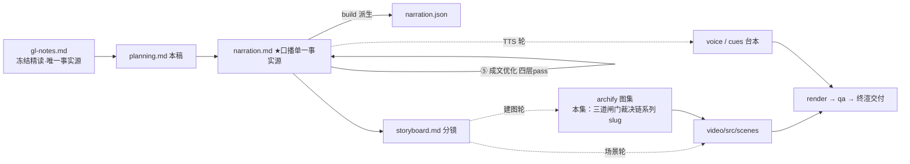

# 策划案：新系列 ep3《Permission：三道闸门，动手之前的裁决》（v1 · 文案轮待用户审批 · C 型信源 = gl-notes）

> 状态：系列 claude-code-chapters 第 3 集（s03_permission 单章，2026-10-31 开工）。本轮为**文案轮**（Stage ①–⑤）：逐字稿与全部文案交用户审批，审批通过才进入制作（⑥ 分镜 → ⑩ 交付），故本稿不做建图与场景设计。事实源 = `research/gl-notes.md`（冻结自现行 171，与 ep1/ep2 同一冻结正文代次；取材范围 s03 单章）。本集钉 main 轨 `7226f555`（开工翻钉：站点轨 s03 判据仍写收尾字段、直引必与 ep1 所教「认内容块」自相矛盾；main 前移增量正面服务本集——闸门 2 词边界正则＋测试点 5、SYSTEM 提示「裁决在执行之前」；站点轨独有 CC 附录经 s03f-* 台账补登、恒【三】级）。

成本档位: 正集（单语 + story 档已配音系 + 约 5 分钟常规动画复杂度；文案轮无生产层开销，制作期成本量级 = 常规单集）

## 0. 标题候选（待审批；series.json 现为工作题《Permission：动手之前的裁决》，审批后落定）

| 候选 | 一句话理由 |
|---|---|
| A《Permission：三道闸门，动手之前的裁决》 | 冻结正文 §5 章题直取，与站点 s03 章名对位、系列章目骨架最稳 |
| B《Permission：循环不改，只插一道闸》 | 承 ep1/ep2「循环本体不变、能力正交叠加」母题——s03 相对 s02 唯一变动 = 执行前插一行 check_permission（两钉 code.py 字节可证） |
| C《Permission：安全不靠信任模型，靠代码》 | 课程立场句原话直取，本集认知增量即信任边界——模型在边界内决策，边界由边界外的代码把守（官方文档同口径） |
| D《Permission：拒绝票比允许票重》 | 规律 3 记忆点＋实验 3 消融钩子（用户放行压过硬拒绝→sudo 落地），非对称裁决最反直觉、辨识度最高 |

## 一、定位表

| 项 | 值 |
|---|---|
| 平台 | B 站 / YouTube 中长视频 |
| 时长目标 | 4.4–5.6 分钟（pipeline.toml 硬约束窗，含系列片头 ~23.5s 口径；正文 1305 字预算 @254 字/分，终稿实稿 1363——⑤ 修稿插句 2 句所致，见 §四脚注） |
| 形态 | AI 配音（story 档）+ Remotion 代码动画，无真人 |
| 受众 | 不预设工程背景的普通人：见过「AI 能替你跑命令」、没想过凭什么敢放手让它跑的任何观众 |
| 核心内容范围 | gl-notes §5 全节（5.1 安全观与信任边界 / 5.2 三道闸门机制 / 5.3 删除命令过三关走查 / 5.4 生产版裁决与自动分类器）+ §7 数字表（8 个权限规则来源；五步验证 Pipeline 属 ep2 已讲域不重讲；六种权限模式口径带趋势化）+ §8 实验 3（本集核心消融正例）与实验 4（次级消融）+ §9.1 规律 2（安全靠机制，不靠 LLM 自觉）与规律 3（拒绝票比允许票重）+ §9.2 争议 1（规则 vs 分类器）与争议 3（自动放行该走多远）+ 附录 A 类比登记表；§3（Agent Loop）/§4（Tool Use）属本系列 ep1/ep2，本集开场承接一句不重讲；§6（Hooks）属后续集，本集只在下期钩子一笔带过 |
| 系列位置 | 系列第 3 讲：在 ep2 的工具分发之上叠第一层防护——「循环不改、能力正交叠加」母题第三次实证；系列视觉母题（恒定环体）延续，新增「三道闸门裁决链」装置视觉 |

**Logline**：万能的 bash 敢删盘，凭什么还敢放手？三道闸门插在动手之前——硬拒绝、规则、问人，拒绝票比允许票重（gl-notes §5.1 + §5.2 + §9.1 规律 3）。

## 二、叙事策略

**主线是一问一答的闭环**：开场抛问题「拦住删盘命令的凭什么不是模型的自觉」→ P1 三道闸门装置回答「门装在哪、怎么分工」→ P2 走查证明门真的拦得住、也放得行 → P3 反问「用户点头能不能盖过第一道门」——实验 3/4 消融回答「拒绝票比允许票重」→ P4 对照生产版「问人长成分级判案机器」→ P5 收束「安全靠机制，不靠自觉」+ 下期钩子（检查越挂越多、循环要烂）。

**开篇钩子候选矩阵（★ 待人工挑选——本集文案审批人即挑选人）**：

| # | 型 | 钩子文本（p0-01） | 吸引力留存逻辑 | 核心主干关联锚点 | 抛出的核心引子 |
|---|---|---|---|---|---|
| H1 | 危机承接型 ★ | 「这是一条能抹掉整块硬盘的命令，拦住它的，不是模型的自觉。」 | 删盘危机 3 秒认领（删库跑路人尽皆知）+「不是自觉」反差设问，直接兑现前集尾钩留下的危机 | §5.1（s02 结束时 bash 全开）+ §5.2（闸门插在执行前）；P0 问题现场即钩子展开 | 不是自觉，是什么？凭什么拦得住？ |
| H2 | 立场颠覆型 | 「这是一条安全铁律：想安全，别指望模型自觉，指望代码。」 | 「别指望自觉」颠覆「AI 越聪明越安全」的朴素直觉 | §5.1 立场句 + 官方「规则由 Claude Code 执行」口径；P0 收束兑现 | 代码怎么把守？把在哪里？ |
| H3 | 三门总览型 | 「这是三道门：一列黑名单、一套规则、一次点头——全插在动手之前。」 | 结构感折叠（三道门一句话摊开），制造「就这么三招？」认知落差 | §5.2 三道闸门机制；P1 首拍拆解兑现 | 三道门怎么分工？哪道最硬？ |
| H4 | 悬念冲突型 | 「这是一次用户点头，它压过了硬拒绝——最硬的门，名存实亡。」 | 冲突 + 悬置结果（点头怎么压过黑名单？后果多严重？） | §8 实验 3 + §9.1 规律 3；P3 消融幕兑现 | 一次点头怎么毁掉一道门？ |
| H5 | 信任边界型 | 「这是一条信任边界：模型在界里决策，守门的在界外。」 | 「界里/界外」的空间切分感，逼观众重想「AI 的权力边界在哪」 | §5.1 信任边界；P1/P5 深层注脚 | 界怎么划？谁守？ |

★ 选定 H1（自动选定，待人工复核）。理由：直接兑现前集尾钩的删盘危机，门意象一句承接（p0-02「今天，就加这道门」），3 秒认领、P0 当幕展开不欠债；H2 立场句改写进 P0 收束与 P5 金句（两全）；H3 三门清单落 P1 首拍；H4 押 P3 消融幕点（对前半程是负债）；H5 边界句作 P1/P5 深层注脚（作幕点不作钩子，避免开篇抽象）。

**视觉母题统摄全片，局部类比点到即止**：连续感只由视觉母题承担（恒定循环环体〔M-001〕+ 系列色彩契约 + 本集「三道闸门裁决链」装置视觉），严禁把局部类比升格为贯穿剧场。口播类比只准入 gl-notes 附录 A 登记条目：本集实引 #8 拒绝票比允许票重（P3 消融收束，失配边界「不是计票、是一票否决」随行）、#9 分级判案机器（P4 生产版 auto 模式，失配边界「不写判决书、理由无强制解释」随行）；#3 牛马仅取边界句半边语义（人自带安全直觉、程序回路只会机械回喂——P0 开场承接语境），牛马喻体词不进口播；#14 四件套收束之「胆」半边（闸门给胆）作 P5 收束承接、沿用非新喻（边界句「模型照旧会试危险动作，拦它的是代码」随行）。每处 1–3 句点亮即切回机制画面，未登记类比不进口播。

**记忆点约每 60–90 秒一个**（全部取自 gl-notes §5/§8/§9，数字必带基线标尺）：
P0「拦住它的，不是模型的自觉——提示词管得了想做什么，管不了程序允许什么」（§5.1）→ P1「七条黑名单，命中即拦——连被问的资格都没有」（§5.2/§5.3，code.py 可数【一】）→ P2「『权限被拒』也回喂：此路不通，换条路」（§5.3 走查例）→ P3「拒绝票比允许票重——黑名单没拦住的从零变一，硬拒绝名存实亡」（§8 实验 3，本集复算【一】）→ P4「分级判案机器不写判决书」（s03f 附录，【三】）→ P5 收束金句「安全靠机制，不靠模型的自觉」（§9.1 规律 2）。

**收尾不贩卖焦虑，悬念只留给下期**：自动化的收益与损失不对称只陈述不渲染（§9.2 争议 3 精神）；P5 护栏句并入片尾署源块（生产细节来自原作者单方核查、未锁 CC 版本号、计数随时点漂移——§11.1 精神，随署源句交代，与 ep1/ep2 同款；本集有【三】级内容，片尾署源两句齐）；悬念留在下期钩子（检查写死在循环里、越挂越多循环要烂），只点问题不预告机制。

## 三、视觉语言

**色彩语义沿用系列契约**（深色底 `#0E1116`；警示红 `#FF5C5C` = 反例/退化路径/硬拒绝命中；确认绿 `#7ED321` = 机制在位/拦截成功/放行直通路；金句卡衬线体；公式/方法名只进角标）：

| 概念 | 专属色 | 语义 |
|---|---|---|
| 循环环体（全系列恒定锚〔M-001〕） | 陶土橙 `#D97757`（系列恒定，承 ep1/ep2） | 同一环体继续出场，本集环上高亮「执行」段——裁决闸卡正是插在它之前 |
| 裁决链/三道闸门 | 裁决紫 `#7C6FF0`（本集主题色，theme.core 本集新增语义，承 Stage ① 提案） | 三道闸门、裁决不变式、生产裁决面板——程序化裁决的中立权威感（既非敌意的红，也非放行的绿） |
| 信任边界/规则匹配 | 边界蓝 `#4E9EFF`（本集主题色 2，承 Stage ① 提案 `#4FC1E9` 微调正蓝移约 15°，拉开与 ep1 青碧 `#64C4C0` 的色相差；系列层交付前统一撞色对账复核） | 工作区界、路径越界检查框、规则关键词标签 |
| 执行面/结果回喂流 | 青碧 `#64C4C0`（承 ep1/ep2 同语义） | 消息条、执行动作、tool_result 回喂流（含「权限被拒」回喂帧） |
| 反例/退化路径 | 警示红 `#FF5C5C`（系列保留语义色） | 硬拒绝命中、消融左帧、越界写出、放行压过硬拒绝的退化帧 |
| 机制在位/拦截成功 | 确认绿 `#7ED321`（系列保留语义色） | 不变式在位、闸门在位基线、默认放行直通路 |

构图纪律：消融对比一律左红右绿同屏（实验 3：不变式在位 黑名单命令落地 0 ↔ 放行压过硬拒绝 落地 1，轮次同为 10/10、检查点 5/5）；「是/否」双分支等高并列（同一输入两种裁决，回喂流同构）；数字一律动态计数卡 + 工况角标（executed 7→8 / deny_listed_executed 0→1 基线标尺）；走查 beat 用调用卡 + 三道门逐关通关动画（Animated State Trace）；裁决链装置视觉 = 三道闸卡串联插在执行之前（全片反复出场、逐幕生长，P4 长成生产裁决面板）；金句卡衬线体；视觉母题禁旧版隐喻系意象（车间/作坊/传送带/工序卡/叫号器/插线口/师傅及同族），一律工程直陈：闸门、裁决、黑名单、规则、审批、边界。

**景别走 `WS→CU→MS`，张力峰值在 P3**：P0 删盘命令危机全景（人/回路对比帧）→ P1 急推闸卡插入点特写（三道门逐一点火）→ P2 走查中景（调用卡逐关通关 + 是/否分支）→ P3 消融双特写（点头压过黑名单帧 ↔ 拆门越界帧）→ P4 拉远（生产裁决面板全景 + 三步走时间轴）→ P5 环体定格收束。运镜密度：P3 紧张段每镜 ≤1 次推近；重音镜每 20–40s 一个 1–2s punch（与记忆点 60–90s 咬合）；张力曲线在 P3 消融对比到达峰值、P4 用拉远降压、P5 平收。

## 四、分幕结构表

| 幕 | 目标时间 | 字数预算 | 主题 | 叙事要点（回溯 gl-notes） | 视觉锚点 | 前置概念 |
|---|---|---|---|---|---|---|
| P0 动手之前 | 0:00–0:45 | ≈175 | 钩子 + 问题现场 | H1 钩子落 p0-01（抹盘命令 + 拦住它的不是模型的自觉）；承接句 p0-02「今天，就加这道门」兑现前集尾钩的门意象（禁顺序词）；险从哪来：从前命令过人的手、可疑的自然不跑——自动循环没这根神经（白话开场/A#3 边界句半边，牛马喻体词不进口播）；文件工具有边界、bash 还全开着——删盘命令照样跑得到（§5.1 s02 结束态 + 前集尾钩原句兑现）；提示词管得了模型想做什么、管不了程序允许什么（§5.1 官方口径【二】）；立场句：安全不靠信任模型，要靠代码（§5.1 立场句【二】，口播作本集主张句呈现、不逐字挂引语——锚 s03f-readme，main 已改写措辞见 B.1 分歧清单；「闸门必须在执行之前」的不可逆论证 §5.3 末句以画面承载、不进口播） | 冷启动直入：删盘命令滑向磁盘的动势、一只代码之手（陶土橙描边）在落地前按下停闸；右下角署源角标（首部署源位）；左「人跑命令」右「自动循环」对比帧（直觉摇头 vs 机械回喂）；bash 无框通道直行；提示词纸片被挡在门外 | — |
| P1 三道闸门 | 0:45–2:10 | ≈250 | 机制解构 | 这道门装在哪：循环一行不改、只在执行之前插一行裁决（§5.2/B.2【一】——check_permission 单点插入、s02 循环骨架不改）；三道门顺序固定：硬拒绝、规则、问人（§5.2）；闸门 1 硬拒绝：黑名单七条（rm -rf /、sudo、shutdown、reboot、mkfs、dd if=、> /dev/sda 白话序口播、命令进角标，【一】可数）、命中即拦不问任何人——连被问的资格都没有（§5.2/§5.3）；闸门 2 规则匹配：文件工具查路径越界、bash 查关键词——教学版盯三类：删除、写系统配置、放开全盘权限（rm / > /etc/ / chmod 777【一】）、命中交第三道；闸门 3 问人：打印原因、停下等一个字（§5.2）；三道都没命中直接执行——默认放行、例外才问、极少数不商量（§5.2【二】GL 综述口径，为 P2 借管理员身份分支埋「不商量」伏笔） | 裁决紫闸卡插入环体〔M-001〕执行段之前（唯一变动高亮）；七行黑名单表逐条点亮（警示红描边）；命中命令卡被弹开、不经过问人门；规则卡三关键词标签 + 边界蓝越界检测框；问人门终端暂停帧（光标闪烁）+ 默认放行直通路（确认绿） | 调用（ep2 已释，开场承接一句）；回喂（ep1 已释，口播不重讲机制） |
| P2 删除命令过三关 | 2:10–2:55 | ≈210 | Worked Example | 拿一个具体输入穿完整链：模型发起一次 bash 调用——删掉一份旧笔记（rm old-notes.txt 进角标；§5.3 走查例，设计走查例口径不作实测断言）；闸门 1 比对黑名单：七条全没命中、放行（逐条比对纹理进画面与角标）；闸门 2 查关键词：命令带「删除」——命中，标记「潜在破坏性」；闸门 3 暂停：打印警示，等表态；敲「是」→命令执行、结果原路回喂、模型接着干；敲「否」→该调用收到「权限被拒」（Permission denied. 进角标）回喂——此路不通、换条路（§5.3）；借管理员身份（sudo 进角标）分支：闸门 1 直接拦下、根本没人问你——回应 P1「极少数不商量」（§5.3）；幕尾悬念：用户点头，能不能盖过第一道门？（P3 引子） | 走查舞台：调用卡滑向三道门、逐关通关/拦截动画；「是/否」双分支回喂帧（青碧执行流 / 警示红拒绝回喂）；借管理员身份命令卡在闸门 1 被弹回（不经过问人门） | 三道门（P1 已释） |
| P3 拒绝票更重 | 2:55–3:55 | ≈250 | 消融对比（本集核心） | 实验 3 设定：听着合理——用户最大，让放行盖过硬拒绝（§8 实验 3）；实测：那条借管理员身份的命令经用户点头落了地（§8/B.2【一】deny_listed_executed 0→1）；账面还是好消息：十轮照跑完、落地七件变八件（executed 7→8【一】，检查点全过进画面角标）；坏在新数字：黑名单没拦住的从零变一——硬拒绝名存实亡；规律 3 收束：拒绝票比允许票重——多方点头才放行、一方摇头就拦下（A#8 + §9.1 规律 3）+ 失配边界随行：不是计票、是一票否决；实验 4：反过来把三道门整个拆掉——拦截归零、询问归零、越界写出的文件出现、没一个人被问过（§8 实验 4/B.2【一】outside_writes 0→1）；基线对照：闸门在位时十轮里两件被拦、两件待问、越界为零（§8 基线【一】）；教训：拔掉闸门，伤害立刻显形（§8 表） | 实验开关面板：「放行 > 硬拒绝」开关闭合（裁决紫转警示红）；左红右绿消融同屏（黑名单命令落地 0→1、sudo 落地帧 ↔ 不变式在位全绿）；点头/摇头多方投票动画 +「不是计票」否定帧；三道门灰化拆除 → 越界文件卡出现；基线数字帧 | 问人（P1 闸门 3 已释） |
| P4 生产版：分级判案 | 3:55–4:50 | ≈270 | 生产对照 | 「那真实的 Claude Code 呢」（系列问句）；【三】级归属句：拆解过 Claude Code 源码的同学们应该知道——裁决的答案不止三种：放行、拒绝、问人之外还有第四种「不表态」，交给常规流程（s03f 附录 PermissionResult 四裁决【三】）；规则来源有八个、高优先级覆盖低优先级（§5.4【三】）；「问人」这一环拆成分级判案机器：先看文件改动是不是已经自动放行、再查白名单、最后交给判断安不安全的小模型、连续拒绝太多回退人工（§5.4【三】+ A#9）+ 失配边界：不写判决书、理由没有强制解释；三步走：字符串表自认不可靠（词里碰巧藏着删除字样，会被误伤）→ 改成只认整个词（词边界正则退角标，B.2 测试点 5 独立复算【一】）→ 到 Claude Code 交给判断安不安全的小模型（§9.2 争议 1 + 翻钉增量）；争议 3：自动放行走多远——官方眼下列着六种权限模式（趋势化口径，§5.4/官方文档【二】）、跳过一切询问的那种官方警告：只准在容器、虚拟机这类隔离环境里用（【二】） | 生产裁决面板：四格答案卡（allow/deny/ask/passthrough 进角标）；八来源层叠覆盖动画；分级判案机器四级闸卡串联（判决卡无理由栏）；三步走时间轴（字符串表→词边界正则→分类器，负例集 model / delimiter / echo del 进角标）；六模式卡横排、跳过询问那张带隔离容器图示（官方警告原文进角标） | 三道闸门（P1 已释）；「问人」（P1 闸门 3 已释） |
| P5 收束与下期 | 4:50–5:25 | ≈150 | 收束 + 钩子 + 署源 | 收束金句：安全靠机制，不靠模型的自觉（§9.1 规律 2）；循环一行没改、动手之前多了一道裁决（母题承 B 候选）；A#14「胆」半边：闸门给你的，是胆——模型照旧会试危险动作、拦它的是代码（边界句随行）；下期钩子：这三道门写死在循环里——每加一道检查循环就得动一次、检查越挂越多循环就烂一分（§6.1，只点问题不预告机制、只许「下期」）；片尾署源块两句（本集有【三】级内容 → 生产细节归属句必带）：这套视频改编自开源课程 Learn Claude Code + 今天的生产细节来自原作者的单方核查、没锁版本、计数会漂移（§11.1 精神） | 环体定格收束 + 金句卡（衬线体）；「闸门给胆」帧（危险动作卡被代码之手拦下）；循环内检查堆叠腐化帧（视觉层）→ 下期卡（视觉层）→ 片尾署源卡（信源名 + 仓库地址，视觉层） | — |

> 正文合计 ≈1305 字预算上限：六幕预算 175+250+210+250+270+150 = 1305，写作目标压在 1150–1220（幕预算为上限分配）。终稿 v2 实测 53 句 / 1363 字（build 口径，含标点；v1 51 句 1304 字落预算内，⑤ 修稿插句 2 句〔p4-08b/p4-08c〕后超幕预算 58 字）——正文 est ≈5.4 分落窗 [4.4,5.6]、含片头同口径 ≈5.8 分超窗顶 0.2 分（est 口径偏保守，ep1 实配基线成片快于 est，TTS 实测门兜底）；句均 ≈26 字。

## 五、生产管线图

本轮产物止于 C（含 ④⑤ 修缮；虚线节点为制作期，审批通过后启动）。

## 六、边界与不做的事

**系列递进边界（照抄口径，本集不进入）**：Agent Loop（ep1）/ Tool Use（ep2）开场各承接一句、不重讲机制（判据、五步循环、查表、编号配对都不回头展开）；Hooks（后续集）只在下期钩子点一笔问题引子（检查越挂越多、循环要烂），不预告机制；规划、记忆、并发调度、多 Agent、权限冒泡（Out-of-Scope，子 Agent 审批弹窗回传）不沾；生产对照里的五步验证 Pipeline 属 ep2 已讲口径、本集不重讲——权限这道关才是本集主角。

**片头沿用系列同款（制作期）**：系列片头资产沿用（~23.5s，预算已计入）；本集挂载件与孪生门登记随制作期处理，本轮只占预算。

**口播红线不可越**：观众层信源标识只许出现在首尾既定署源位——片头署源角标（p0-01 beat 视觉层）+ 片尾署源句（p5-06/p5-07），豁免白名单登记在工作区 `vibe-video.toml [check_series.source_credit]`（RSI I-080，本集条目随系列层登记），其余位置零课程/站点/章号痕迹（不出现课程/站点名/「第 N 章」——按章拆集只是编导结构）；【三】级断言归属由「拆解过 Claude Code 源码的同学们应该知道」句式承接（ep1 审批口径），计数漂移警示由片尾署源句兜底；活数据（章节数/star）不进口播；禁顺序词（上一集/上集/上期/下一集/下集/第 N 集/前一集/本系列/这一系列——署源句用「这套视频」），收尾预告只许「下期」；口播英文例外清单 = Claude Code + bash（承系列已立例外；Harness 本集无口播需求）+ 署源专名 Learn Claude Code（仅片尾署源句），其余英文方法名与命令（DENY_LIST / PERMISSION_RULES / check_permission / DESTRUCTIVE_COMMAND_WORD / rm / sudo / shutdown / reboot / mkfs / dd / Permission denied / allow / deny / ask / passthrough / acceptEdits / bypassPermissions 等）进角标不口播；「六种权限模式」计数属 2026-10-07 官方快照口径，口播趋势化（「眼下」）不落死数；禁旧版隐喻系词汇及同族意象（车间/作坊/传送带/工序卡/叫号器/插线口/师傅——附录 A#10/#11 不进口播）。

**素材取舍，弃用而非遗漏**：实验 1（判据消融）属 ep1 口径、实验 2（配对消融）属 ep2 口径、实验 5（Stop 续跑）属后续集口径，本集不沾；30 行 vs 1729 行对比（§3.4/§7）属 ep1 已讲域、本集不重复；isDestructive 标记纯 UI 展示（§5.4【三】易误解点）与 s02 工作区硬界未保留细节（§5.2/B.2【一】grep 零命中）弃用不进口播——生产对照字数让给裁决值/八来源/分级判案/三步走/官方警告，材料留档 gl-notes；「闸门必须在执行之前」的不可逆论证（§5.3 末句「事后惩罚挡不住既成事实」）以开场画面（落地前停闸）承载、不进口播；闸门 1 与闸门 3 的分工对比不另立口播句——由 p1-09「极少数不商量」与 p2-07「根本没人问你」首尾呼应承载；词边界正则只作三步走第二步证据（B.2 复算【一】），负例白话走查进口播（词里碰巧藏着删除字样被误伤→改成只认整个词，I-032 过程具象化），具体词面（model / delimiter / echo del 不触发）进画面角标、口播不点名；auto 分类器准确率与误放行率（§11.3）官方未给数字——口播只点「没有强制解释」，不作评断也不编数；三道闸门与词边界正则的攻防防御力（§11.2 材料自认未做攻防实测）不进口播；六种权限模式名目不逐一展开（角标承载，口播只点「跳过一切询问的那种」）；s03f 附录的验证阶段明细与权限冒泡不进口播（冒泡属多 Agent 域）；「删除旧笔记」按设计走查例口径呈现（不作实测断言、不带归属句）；实验 3 只取因果数字组（黑名单命令落地 0→1 / 落地 7→8 / 轮次 10/10 不退化），实验 4 只取（拦截归零、询问归零、越界写出 0→1），基线全景的 pairing_errors / stop_continued / 检查点 5/5 不进正片口播——那是四机制齐备口径，本集单机制只认权限开关的因果。

**文案轮边界**：文案轮不跑 TTS、不动场景代码与 Main.tsx、不建 archify 图（storyboard 属制作期首轮）；series.json 登记为文案轮工作题，标题随审批落定；BGM 留空轨；信源外观点不进口播。制作期（⑥–⑩）审批通过后逐项启动。
