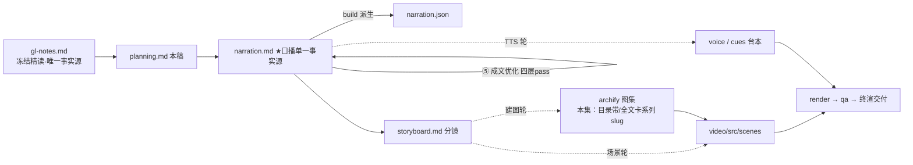

# 策划案：新系列 ep7《Skill Loading：目录常驻，全文按需》（v1 · 文案轮待用户审批 · C 型信源 = gl-notes）

> 状态：系列 claude-code-chapters 第 7 集（s07_skill_loading 单章，2026-10-31 开工）。本轮为**文案轮**（Stage ①–⑤）：逐字稿与全部文案交用户审批，审批通过才进入制作（⑥ 分镜 → ⑩ 交付），故本稿不做建图与场景设计。事实源 = `research/gl-notes.md`（冻结自现行 172 精读，I-234/I-235 后整改代次，与 ep1/ep2 冻结的 171 同一谱系；取材范围 s07 单章）。

成本档位: 正集（单语 + story 档已配音系 + 约 5 分钟常规动画复杂度；文案轮无生产层开销，制作期成本量级 = 常规单集）

## 0. 标题候选（待审批；series.json 待登记工作题《Skill Loading：目录常驻，全文按需》，审批后落定）

| 候选 | 一句话理由 |
|---|---|
| A《Skill Loading：目录常驻，全文按需》 | 直取冻结源 §5 节题原身，两组四字对仗即两级加载的机制答案，与系列章名直系命名面一致（Stage ① 提案 A，工作题） |
| B《Skill Loading：知识只在用到时进入》 | 承五装置母题句（§1 规格表「知识按需进入」），从「过程隔离」推进到「知识隔离」，系列叙事连续感最强 |
| C《Skill Loading：常驻的，每轮都付费》 | 把实验 3 实测 8.3 倍的经济学（常驻内容按每轮计费）提为标题记忆点，本集最大认知增量 |
| D《Skill Loading：先给目录，再给全文》 | 把两级加载压成两个先后动作，标题节奏即分镜节奏，落点在「两级」的顺序感 |

## 一、定位表

| 项 | 值 |
|---|---|
| 平台 | B 站 / YouTube 中长视频 |
| 时长目标 | 4.4–5.6 分钟（pipeline.toml 硬约束窗，含系列片头 ~23.5s 口径；正文 1305 字预算 @254 字/分，⑤ 定稿实稿 1364 est ≈5.4 分在窗内，超幕预算 59 字〔+20 界超 39〕、est+片头 ≈5.8 分超窗上沿约 0.2 分——压窗删句或放行随审批裁决） |
| 形态 | AI 配音（story 档）+ Remotion 代码动画，无真人 |
| 受众 | 不预设工程背景的普通人：见过「AI 什么都懂一点」、没想过知识塞进模型视野也要按轮付费的任何观众 |
| 核心内容范围 | gl-notes §5 全节（6500 行的账 / 两级设计 / episode C 走查 / 真实 CC 对照 / 官方文档印证；main 轨对照一句不依赖）+ §8 数字表两行（~100 vs ~2000 作者估计、清单预算 ~1%·8000 字符与 1536 截断）+ §9 实验 3（技能全文全量内联，本集消融正例）+ §10.1 规律一（可见性即影响力，开场承接）与 §10.3 规律三（常驻与按需的分层，收束）+ 附录 A#7 按需调页；§1–§2「每轮看到什么」三通道视角作开场承接不重讲；§3–§4（TodoWrite / Subagent）属系列他集；§6–§7 只作地图坐标不展开；下期钩子（s08 Context Compact）取 §5 全文去向句口径 |
| 系列位置 | 系列第 7 讲：在工具层与协作层之上加「知识层」——「常驻/按需」分层的经济学首次整集展开；系列视觉母题（恒定环体〔M-001〕）延续，新增「目录带 + 全文卡」双子装置视觉 |

**Logline**：六千五百行知识全塞开场白，每轮全额再付一遍；两级进场——目录常驻说「有什么」，全文按需给「是什么」，全量内联实测 8.3 倍（gl-notes §5 + §9 实验 3）。

## 二、叙事策略

**主线是一问一答的闭环**：开场抛账单「六千五百行、99% 无关、每轮全额再付」→ P1 用「目录 + 全文」两级设计回答「知识怎么用到才拿」→ P2 拿原型实测走三轮证明「常驻真的只有几行」→ P3 反问「嫌麻烦全塞进去会怎样」——全量内联消融回答「常驻内容按每轮计费，8.3 倍且随轮数放大」→ P4 对照生产版「这张目录被看得多紧」→ P5 收束「目录常驻，全文按需」+ 虚拟存储同构 + 下期钩子（进了对话的全文不走了，上下文会满）。

**开篇钩子候选矩阵（★ 待人工挑选——本集文案审批人即挑选人）**：

| # | 型 | 钩子文本（p0-01） | 吸引力留存逻辑 | 核心主干关联锚点 | 抛出的核心引子 |
|---|---|---|---|---|---|
| H1 | 痛点账单型 ★ | 「这是六千五百行知识的账：每一轮对话，全额再付一遍。」 | 「每轮重付」的浪费冲击 + 具体数字，3 秒锁注意力（谁都讨厌重复扣费） | §5 开头的账（6500 行 / 99% 无关 / 每轮全额计费）；P0 问题现场即钩子展开 | 知识怎么进场，才做得到用到才拿、不用不付？ |
| H2 | 承接反直觉型 | 「这是知识越多、账单越重的怪圈：装不下，也记不住。」 | 「多即是累赘」反直觉 + 直接承接前集收尾意象（本事装不进开场白） | §5 + §10.1 规律一（信息被稀释等于缺席） | 为什么装得越多，反而越没用？ |
| H3 | 一句话本质型 | 「这是知识的两段式进场：目录常驻，全文按需。」 | 把全片答案折叠成一句，制造「就这么简单？」认知落差 | §5 两级设计；P1 首拍即拆解兑现 | 两级怎么分工？常驻的为什么必须小？ |
| H4 | 数字反差型 | 「这是同一批知识的两种摆法：账单差八倍，还越拉越大。」 | 8.3 倍实测反差 + 「越拉越大」的悬念余韵 | §9 实验 3（本集复算【一】级） | 摆法差在哪？为什么倍数会放大？ |
| H5 | 新范式揭示型 | 「这是一套用到之前不存在的知识：不用，它只剩一行目录。」 | 颠覆「知识＝已经装进来」的直觉（还有「不在场」的知识？），逼观众重想「知道」是什么 | 两级加载本质 + 官方「用到之前几乎零成本」（§5 引 [3]） | 一行目录怎么变出全文？不进场模型怎么「知道」？ |

★ 选定 H1（自动选定，待人工复核）。理由：单章集时长紧，痛点账单 3 秒认领、P0 当幕兑现全部数字（6500 / 99% / 每轮计费都在 P0 展开，不欠债）；H2 的承接意象并入 p0-02 承接句（一句兑现前集收尾钩子「本事不能全装进开场白，装不下也记不住」，不用顺序词）；H3 本质句即标题与 P5 收束金句（开篇剧透答案，押后）；H4 的 8.3 倍是 P3 的揭示牌（开篇用掉即泄底）；H5 认知增量作 P5 侧写（「不用只剩一行目录」收束位回扣）。

**视觉母题统摄全片，局部类比点到即止**：连续感只由视觉母题承担（恒定环体〔M-001〕+ 系列色彩契约 + 本集「目录带 + 全文卡」双子装置），严禁把局部类比升格为贯穿剧场。口播类比只准入 gl-notes 附录 A 登记条目：本集实引 **#7 按需调页（虚拟存储）**（P5 收束位——两级加载与虚拟存储的常驻集/缺页同构，失配边界句「内存搬页不按次收流量费；上下文每轮全额计费」随行，正是 8.3 倍消融的口播注脚）；#1 聊天群刷屏本集不引（开场承接走前集钩子意象直连，不叠新喻，主展开权归系列他集）；其余条目属系列他集（#3 / #4 / #5 / #6 / #8），不进口播。经济框架（计费 / 常驻成本 / 闲置成本）是冻结正文 §5 原生表述，作工程直陈用、不作喻体登记。未登记类比不进口播。

**记忆点约每 60–90 秒一个**（全部取自 gl-notes §5/§8/§9，数字必带基线标尺）：
P0「六千五百行、99% 无关、每轮全额再付」（§5 / 钉点 README【一】）→ P1「目录常驻：有什么；全文按需：是什么」（§5 两级设计）→ P2「目录四行两百字符带四技能；全文进场一次，下轮两千三百八十四」（episode C 本集复算【一】）→ P3「全量内联 8.3 倍，随轮数放大；常驻按每轮计费」（实验 3 本集复算【一】）→ P4「十类来源汇一张目录；预算约百分之一、上限八千字符；目录每行默认截断一千五百三十六」（s07 深读【三】/ 官方【二】）→ P5 收束金句「目录常驻，全文按需」+ 虚拟存储同构（A#7）。

**收尾不贩卖焦虑，悬念只留给下期**：P5 护栏句并入片尾署源块（生产细节来自原作者单方核查、未锁 CC 版本号、计数随时点漂移——§11 精神，随署源句交代，与 ep1/ep2 同款）；悬念留在下期钩子（进了对话的全文每轮都在场，用得越久堆得越多——上下文总有装满的一天），只点问题、不预告机制细节。

## 三、视觉语言

**色彩语义沿用系列契约**（深色底 `#0E1116`；警示红 `#FF5C5C` = 反例/退化路径；确认绿 `#7ED321` = 机制在位/基线；金句卡衬线体；公式/方法名只进角标）：

| 概念 | 专属色 | 语义 |
|---|---|---|
| 循环环体（全系列恒定锚〔M-001〕） | 陶土橙 `#D97757`（系列恒定，承 ep1） | 同一环体继续出场，本集环顶压一条常驻目录带——环每轮转一圈，目录带每轮都在（常驻的具象） |
| 目录常驻层 / 注册表 / 开场白带 | 紫 `#7E77E8`（本集主题色 A，theme.core 本集新增语义） | 技能目录行、名字对技能的注册表、注入开场白的常驻带——「有什么」（书目感低饱和底色） |
| 全文按需加载 / 加载工具通道 | 蓝 `#4E9DF5`（本集主题色 B） | load_skill 调用、全文卡一次性进场、tool_result 通道——「是什么」的瞬时事件 |
| 全量内联反例 / 每轮复制计费帧 | 警示红 `#FF5C5C`（保留语义色，与主题色并用不占用） | 实验 3 全量内联帧、开场白带逐轮叠印的计费帧 |
| 两级加载在位 / 按需命中 | 确认绿 `#7ED321`（保留语义色） | episode C 基线帧、消融同屏右格 |

构图纪律：消融对比一律左红右绿同屏（实验 3：两级在位总输入 3059 ↔ 全量内联 25323，8.3 倍动态增长条 + 轮数外推虚线）；计费视觉 = 开场白带每轮复制一份向右叠印（常驻成本的具象，P0 首现、P3 回场）；数字一律动态增长条 + 工况角标（281→8370、3059→25323、323→352→2384）；走查 beat 用「开场白带（紫）+ 消息条 + 全文卡（蓝）」三件套堆叠动画（Animated State Trace）；装置视觉 = 目录带（小、书目行）与全文卡（大、大部头）的常驻/瞬时对照，全片反复出场、逐幕生长；视觉母题禁旧版隐喻系意象（车间/作坊/传送带/工序卡/叫号器/插线口/师傅及同族），一律工程直陈：目录、注册表、进场、常驻、预算；「开场白」为 system prompt 的系列白话（承前集收尾钩子语式），视觉层角标注 system prompt。

**景别走 `WS→CU→MS`，张力峰值在 P3**：P0 全景（三摞 2000/1500/3000 行文档压向一条开场白带）→ P1 急推装置特写（扫描→注册表→目录带注入 + 环体不动帧）→ P2 走查中景（三件套并置、计数器跳格）→ P3 消融双特写（左红右绿、增长条冲顶）→ P4 拉远（十类来源四方汇流 + 预算闸）→ P5 环体定格收束。运镜密度：P3 紧张段每镜 ≤1 次推近；重音镜每 20–40s 一个 1–2s punch（与记忆点 60–90s 咬合）；张力曲线在 P3 倍数冲顶到达峰值、P4 用拉远降压、P5 平收。

## 四、分幕结构表

| 幕 | 目标时间 | 字数预算 | 主题 | 叙事要点（回溯 gl-notes） | 视觉锚点 | 前置概念 |
|---|---|---|---|---|---|---|
| P0 六千五百行的账 | 0:00–0:45 | ≈215 | 钩子 + 问题现场 | H1 钩子落 p0-01；承接句 p0-02 兑现前集收尾钩子意象「本事不能全装进开场白，装不下也记不住」（系列承接约定 + §1 五装置表「知识按需进入」）；开场白先释：每轮固定摆在模型面前的文本（§1 system prompt 定义白话化）；一个项目三份知识 2000+1500+3000 行、全塞开场白即 6500 行（§5 / 钉点 README :19–25【一】）；这轮只改一个颜色也整本带着、99% 与当前任务无关（§5【一】）；输入按长度计费、开场白每轮都在每轮全额付（§5）；记不住的一半：注意力只落在当轮可见文本、被稀释等于缺席（§10.1 规律一）；引子：知识怎么进场，才做得到用到才拿 | 冷启动直入：三摞文档（行数标尺）压向一条开场白带；每轮复制叠印的计费帧；注意力视角帧（只照亮当轮最新文本）；右下角署源角标（首部署源位） | 开场白（本幕先释：每轮固定摆在模型面前的文本，即 system prompt 系列白话） |
| P1 两级进场 | 0:45–1:55 | ≈260 | 机制解构 | 先摆答案：知识分两级进场（§5 两级设计）；第一级目录：程序启动扫技能库、每个技能读名字 + 一句话描述（frontmatter 进角标）、目录注进开场白每轮常驻——模型始终知道「有什么」（§5）；第二级全文：模型看目录判断需要、调加载工具报技能名、程序按名查注册表（名字对技能的登记表）、全文作为结果送进当前对话（§5）；按名查找不走文件路径——路径遍历那类攻击天然堵死（§5）；代码落点：工具清单添一件、分发表添一行、循环原样（钉点 code.py 可数【一】：TOOLS 加一条 + TOOL_HANDLERS 加一行、循环不变）；常驻的只有几行目录，上千行的全文用到才进来（§5）；幕尾钩：省多少，拿实测说话 | 装置视觉首亮：紫目录带（书目行）↔ 蓝全文卡（大部头）对照；环体〔M-001〕环顶压常驻目录带（每轮都在）；扫描→注册表→目录带三拍动画；代码落点帧（添一件卡 + 添一行 + 环体不动，查表装置回场） | 注册表（本幕先释：名字对技能的登记表）；加载工具（工具调用系列已释，动词承接） |
| P2 三轮实测 | 1:55–2:45 | ≈220 | Worked Example | 拿原型实测走全程（episode C，本集复算【一】级，B.2）：技能库四个技能、目录四行约两百字符承载全部描述（B.2）；第一轮开场白 281 字符、「有什么」全在里面（B.2）；任务要动数据库、模型对目录点名（§5 机制白话序，sql-style 进角标）；全文进场一次、下一轮输入涨到 2384（B.2）；第三轮起全文已在历史、不再重复加载（§5 全文去向）；三轮总输入 3059（B.2）；量级账：原作者给过估计——目录每技能约百来个计价单位、全文约两千上下，差一个数量级（§8 表 + B.3 口径：「作者的量级估计」，禁说实测；token 单位进角标、口播用计价单位白话）；幕尾钩：嫌两级麻烦全塞进开场白，会怎样 | 走查三件套动画（开场白带〔紫〕+ 消息条队列 + 全文卡〔蓝〕）；三轮输入计数器 323→352→2384 跳格；量级对比条（百级小格 vs 千级大格）+「作者的量级估计」口径签 | 计价单位（本幕先释口径：token 不口播，白话用「计价单位」+「量级」表述） |
| P3 常驻的代价 | 2:45–3:50 | ≈210 | 消融对比 | 破坏实验：四个技能全文全量拼进开场白、再跑同样三轮（实验 3，本集复算【一】级，B.2）；开场白 281→8370；三轮总输入 3059→25323、多付 22264、8.3 倍（B.2）；且倍数随轮数继续放大（B.2）；机理一句话：常驻内容按每轮计费、开场白每轮都在就每轮收一遍钱（§5/§9 E3 教训）；推论：目录也常驻所以必须小、全文按需才配得上大（§5 两层设计表）；教训一句话：用不到的知识最多在目录挂名、不进全文（§9 E3 教训「不用进目录不进正文」）；幕尾钩：真实产品里这张目录长什么样 | 左红右绿消融同屏（两级在位 3059 全绿 ↔ 全量内联 25323 警示红，8.3 倍增长条冲顶 + 轮数外推虚线）；每轮复制计费帧回场；教训金句卡（「挂名不进全文」印章） | 常驻（本幕先释：每轮都在场、每轮计费的内容） |
| P4 生产版的目录 | 3:50–4:35 | ≈210 | 生产对照 | 真实 Claude Code 对照（【三】级，归属句「拆解过 Claude Code 源码的同学们应该知道」承 ep1 审批口径）：技能来源登记在册十类，自装/项目带/插件捎/远程推全汇同一张目录（s07 深读附录，B.3）；上下文窗口先释：模型单轮装得下的文本上限（§4 白话）；目录预算被按死：约窗口的百分之一、上限八千字符（s07 深读【三】，不得说成产品既成事实——归属句承接）；官方文档印证（【二】级带归属措辞）：技能全文只在使用时加载、用到之前几乎零成本；目录每一行描述 + 使用时机合计默认截断 1536 字符（B.3：按「默认上限」口径，skillListingMaxDescChars 进角标）；收点：目录要短，是因为目录自己就是常驻内容（§5 末句） | 拉远：十类来源小卡四方汇入中央目录带；预算闸门卡（~1% / 8000）压住目录带；1536 截断尺卡；收点金句帧 | 上下文窗口（本幕先释：模型单轮装得下的文本上限） |
| P5 收束与下期 | 4:35–5:15 | ≈190 | 收束 + 钩子 + 署源 | 收束金句：目录常驻，全文按需——有什么常驻，是什么按需（§5 节题 + 两层设计）；规律三收束：常驻与按需的分层，这笔账操作系统早算过一遍——常驻集要小、缺的页用到才搬进内存（§10.3 + A#7 按需调页，本集唯一实引新喻）；失配边界句随行：内存搬页不按次收流量费，上下文是每轮全额计费的、账更苛刻（A#7 边界）；下期钩（只点问题不预告机制，只许「下期」）：进场方式解决了、新麻烦跟着来——进了对话的全文每轮都在场，用得越久堆得越多，上下文总有装满的一天（§5 全文去向句 = s08 衔接口径）；下期，装满了怎么办；片尾署源块两句（本集有【三】级内容，第二句必带）：改编自开源课程 Learn Claude Code + 生产细节来自原作者单方核查、没锁版本、计数会漂移（§11 精神） | 环体定格收束 + 金句卡（衬线体）；目录带 + 全文卡双子装置定格（紫/蓝）；虚拟存储同构一闪（常驻集小格 + 缺页取入箭头）；下期卡（视觉层）→ 片尾署源卡（信源名 + 仓库地址） | — |

> 正文合计 ≈1305 字预算上限：六幕预算 215+260+220+210+210+190 = 1305，写作目标压在 1150–1220（幕预算为上限分配，允许各幕小幅回吐），终稿允许 +20 溢出。句均 20–24 字 → 约 48–56 句。

## 五、生产管线图

本轮产物止于 C（含 ④⑤ 修缮；虚线节点为制作期，审批通过后启动）。

## 六、边界与不做的事

**系列递进边界（照抄口径，本集不进入）**：TodoWrite / Subagent / System Prompt / Error Recovery（系列他集）只在承接与地图坐标层各点一笔，不展开机制；「每轮看到什么」三通道视角开场承接一句、不重讲（§1–§2 约束）；循环机制不回头展开（承系列首集口径）。

**片头沿用《一个循环》（制作期）**：系列片头资产制作期已挂载孪生登记，本集沿用同款（~23.5s，预算已计入）；本集挂载件与孪生门登记随制作期处理，本轮只占预算。

**口播红线不可越**：观众层信源标识只许出现在首尾既定署源位——片头署源角标（p0-01 beat 视觉层）+ 片尾署源句（p5-07），豁免白名单登记在工作区 `vibe-video.toml [check_series.source_credit]`（RSI I-080，ep7 条目随文案轮交付由系列层登记），其余位置零课程/站点/章号痕迹——「课程」一词观众层禁用，量级估计的归属用「原作者给过估计」（B.3 口径）；【三】级断言归属由片尾署源位承接，正文归属句只用「拆解过 Claude Code 源码的同学们应该知道」句式（ep1 审批口径）；活数据（章节数/star）不进口播；禁顺序词（上一集/上集/上期/下一集/下集/第 N 集/前一集/本系列——署源句用「这套视频」），收尾预告只许「下期」；口播英文例外清单 = Claude Code + bash（随系列已立例外，本集未用到 bash）+ 署源专名 Learn Claude Code，其余英文方法名与命令（skills/ · SKILL.md · YAML frontmatter · SKILL_REGISTRY · load_skill · sql-style · inline_all · when_to_use · skillListingMaxDescChars 等）进角标不口播；token 一词不口播（§5 的 ~100/~2000 数字口播用「计价单位 + 量级」白话，单位进角标）；数字读法陷阱规避（三段版本号/连字符区间/4 位年份空格均不出现）；禁旧版隐喻系词汇及同族意象（车间/作坊/传送带/工序卡/叫号器/插线口/师傅/台面——附录 A#2 系 ※ 条目不进口播）。

**素材取舍，弃用而非遗漏**：main 轨 SkillLoader 类封装与 OS-aware 环境段（B.3：对照轨【一】级事实，本集叙事不必依赖，引用须带轨道限定——弃用，材料留档 gl-notes §5）；「Launching skill 两步注入 + 教学版合并是声明的简化」【三】细节（预算紧，教学诚实声明由片尾署源句兜底——弃用，留档 §5）；frontmatter 字段明细（when_to_use / allowed-tools / context 逐项【三】）只随官方 1536 截断句带出「使用时机」一义项，明细弃用；技能来源十类只取四代表（自装/项目/插件/远程），其余六类名目留档；E1/E2/E4/E5 实验数字属系列他集取材，本集只取实验 3（E5 白等数字另有调用模式双值口径坑，B.2 已登记）；s08 衔接金句的后半句「压缩解决该丢的怎么丢」属下期机制，只点「上下文会满」问题不预告；~100/~2000 禁说成实测、~1%/8000 禁说成产品既成事实（B.3）；站点轨 code.py 循环判据（stop_reason 谱系遗产，B.1 风险条）本集不引、如制作期需两轨判据对比画面以 s07m-code 为准。

**文案轮边界**：文案轮不跑 TTS、不动场景代码与 Main.tsx、不建 archify 图（storyboard 属制作期首轮）；series.json 登记为文案轮工作题，标题随审批落定；BGM 留空轨；信源外观点不进口播。制作期（⑥–⑩）审批通过后逐项启动。
