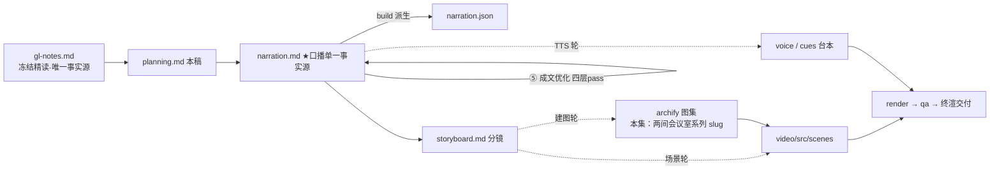

# 策划案：新系列 ep6《Subagent：过程隔离，只回结论》（v2 · 文案轮待用户审批 · C 型信源 = gl-notes）

> 状态：系列 claude-code-chapters 第 6 集（s06_subagent 单章，2026-10-31 开工）。本轮为**文案轮**（Stage ①–⑤；④ 双重校验与 ⑤ 成文优化已过、机器门零 FAIL）：逐字稿与全部文案交用户审批，审批通过才进入制作（⑥ 分镜 → ⑩ 交付），故本稿不做建图与场景设计。事实源 = `research/gl-notes.md`（冻结自现行 172，I-234 后代次，与 ep1/ep2 同一冻结正文代次纪律；取材范围 s06 单章：主线 §4 + §1 s06 例 + §8 相关行 + §9 实验 E2 + §10 规律一/争议二）。

成本档位: 正集（单语 + story 档已配音系 + 约 5 分钟常规动画复杂度；文案轮无生产层开销，制作期成本量级 = 常规单集）

## 0. 标题候选（待审批；series.json 现为工作题《Subagent：过程隔离，只回结论》，审批后落定）

| 候选 | 一句话理由 |
|---|---|
| A《Subagent：过程隔离，只回结论》 | 直取课程 s06 章副题即机制口诀，承系列「副题=一句话机制」先例（ep2《Tool Use：多加一个工具，只加一行》同款） |
| B《只把结论带回主对话》 | 承 172 母题「Harness 安排 LLM 每轮看到的文本」与规划组三章一线（ep5 计划可见 / ep6 过程隔离 / ep7 知识按需），一句话说清隔离与回流 |
| C《上下文隔离，权限不豁免》 | 本集最大反直觉点：隔离的是消息不是安全，子代理照过权限闸门（blocked_in_sub 1 实测），标题直接给足认知增量 |
| D《一间会议室，一块白板》 | 取附录 A 已登记 #3 喻体，画面即机制图：会议室=独立上下文、共用白板=工作目录副作用共享，双边界一图入题 |

## 一、定位表

| 项 | 值 |
|---|---|
| 平台 | B 站 / YouTube 中长视频 |
| 时长目标 | 4.4–5.6 分钟（pipeline.toml 硬约束窗，含系列片头 ~23.5s 口径；正文 1305 字预算 @254 字/分，实稿 v2 1331） |
| 形态 | AI 配音（story 档）+ Remotion 代码动画，无真人 |
| 受众 | 不预设工程背景的普通人：见过「AI 帮你干活」，没想过中间过程留在哪里、谁来清的任何观众 |
| 核心内容范围 | gl-notes §4 全节（开场喻「会议室+共用白板」/ 机制：task 工具 + 全新 messages + SUB_SYSTEM + 基础五件无 task + 递归一层 + 30 轮上限 / 边界：PreToolUse 照过 + rm -rf 被 deny list 拦 + 副作用落同一工作目录 / 单步走查「找测试框架」/ 实测 direct vs subagent vs 回传全史 / CC 深读三种执行模式 + Fork 五组件 + 隔离粒度 + 权限冒泡 / 官方 15,000 tokens 告警线）+ §1 s06 病灶例（30 文件/60 轮/120 条，开场承接位）+ §8 相关行（30 轮教学设定 / 15,000 / 原型 18.0 倍）+ §9 实验室（M2 行号速查 + 实验 E2 本集核心消融）+ §10 规律一（可见性即影响力，收束用）与争议二（隔离粒度/Fork 缓存权衡，P4 用）；§3（TodoWrite）属 ep5、§5（Skill）属 ep7、§6/§7（System Prompt/Error Recovery）属 ep10/ep11——本集只在开场承接与下期钩子各一笔，不重讲 |
| 系列位置 | 系列第 6 讲：规划组三章中位（计划可见 → 过程隔离 → 知识按需）——「每轮可见文本」母题的隔离篇；系列视觉母题（恒定环体）延续，新增「两间会议室」装置视觉 |

**Logline**：脏过程全程堆在主对话里，越干越脏；给子任务开一间全新会议室，谈完只带结论回主会场——两间会议室，共用同一块白板（gl-notes §1 + §4）。

## 二、叙事策略

**主线是一问一答的闭环**：开场抛问题「对话为什么越干越脏、脏在哪」→ P1 用「task + 全新对话 + 只回结论」回答「过程怎么搬出去」→ P2 走查证明「主对话真的只多两条」→ P3 反问「只回结论值多少钱」——十八倍消融回答「回流那一步是存亡线」→ P4 对照边界「隔离的到底是什么」——消息，不是权限、不是文件系统 → P5 收束「可见性即影响力」+ 下期钩子（知识全前置装不下，只点问题）。

**开篇钩子候选矩阵（★ 待人工挑选——本集文案审批人即挑选人）**：

| # | 型 | 钩子文本（p0-01） | 吸引力留存逻辑 | 核心主干关联锚点 | 抛出的核心引子 |
|---|---|---|---|---|---|
| H1 痛点承接型 ★ | 「这是一个越干越脏的对话：活干完了，中间过程还全留在里面。」 | 承前集「越跑越脏」意象即时报到，3 秒认领（谁没见过越聊越长的对话窗口），P0 当幕兑现不欠债 | gl-notes §1 s06 例（30 文件/60 轮/120 条）+ §4 决策表「中间过程不进主对话」 | 脏过程为什么清不掉？谁来清？ |
| H2 比喻直取型 | 「这是一间用完就清空的会议室：里面聊翻天，主会场只多一句话。」 | 画面型悬念（为什么用完就清空？清掉的是什么？） | §4 开场喻 A#3 + 只回最终文本（code.py :299） | 什么能带出来、什么必须留下？ |
| H3 反差数字型 | 「四条对十六条，差出十八倍：秘密全在一句话的回流约定上。」 | 数字反差 + 悬置（什么约定？怎么差这么多？） | §4 实测 + 实验 E2（B.2 复算【一】） | 只回结论凭什么值十八倍？ |
| H4 反直觉型 | 「这是一个常见误会：把子任务关进隔离舱，就以为权限也一并关住了。」 | 误区即认领 + 安全张力（隔离舱里也能跑删盘命令？） | §4 边界（PreToolUse 照过 / blocked_in_sub 1 实测） | 隔离的到底是什么？ |
| H5 母题揭示型 | 「这是主对话的保鲜术：活越派越多，它自己一句不长。」 | 「活多」对「不长大」的反差 | §4 + §2 统一框架（每轮可见文本是受管理的资源） | 不长的代价与边界是什么？ |

★ 选定 H1（自动选定，待人工复核）。理由：单章集时长紧，痛点钩承前集「越跑越脏」意象 3 秒认领、P0 当幕兑现（不欠债）；H2 比喻句原样落 P1 首拍（两全）；H3 数字押 P3 幕点（×18 punch）；H4 押 P4 反直觉拍；H5 收束 P5 用。

**视觉母题统摄全片，局部类比点到即止**：连续感只由视觉母题承担（恒定循环环体〔M-001〕+ 系列色彩契约 + 本集「两间会议室」装置视觉），严禁把局部类比升格为贯穿剧场。口播类比只准入 gl-notes 附录 A 登记条目：本集实引 #3 会议室与主会场共用白板（P1 机制讲解落锚 + P4 边界卡；双边界语义——结论隔离 + 副作用共享，「共用白板」是机制本体不是失配，随行句「丢弃的是对话，从来不是工作成果」）；#1 聊天群刷屏仅作 P0 开场承接语（§1 病灶总起引出「中间过程占位」，不计新喻，失配句「人能翻回去 / 模型没有这个动作」随行）。站点轨自带「开一个新终端」类比未入登记表、不进口播（B.3 已登记）；未登记类比零进口播，每处 1–3 句点亮即切回机制画面。

**记忆点约每 60–90 秒一个**（全部取自 gl-notes §1/§4/§8/§9，数字必带基线标尺）：
P0「一百二十条里大半是理清就没用的过程」（【二】课例口径）→ P1「一间会议室：全新对话 + 五件工具无派活 + 递归锁死一层 + 只回结论」（§4/B.2 行号【一】）→ P2「四条/一百四十七字符，对十四条/两千六百二十六」（B.2【一】）→ P3「拆掉只回结论：十八倍——存亡线」（实验 E2，本集复算【一】）→ P4「隔离的是消息，不是进程或文件系统；上下文隔离 ≠ 权限豁免」（§4 决策表措辞 + blocked_in_sub 1【一】）→ P5 收束金句「可见性即影响力」（§10 规律一）。

**收尾不贩卖焦虑，悬念只留给下期**：P5 护栏句并入片尾署源块（生产细节来自原作者单方核查、未锁版本、计数会漂移——§11 精神，随署源句交代，与 ep1/ep2 同款；本集 P4 含【三】级 CC 深读内容，片尾署源块第二句必须保留）；悬念留在下期钩子（知识全前置装不下，只点问题不预告机制），不预告任何后续机制细节。

## 三、视觉语言

**色彩语义沿用系列契约**（深色底 `#0E1116`；警示红 `#FF5C5C` = 反例/退化路径；确认绿 `#7ED321` = 机制在位/拦截成功；金句卡衬线体；公式/方法名只进角标）：

| 概念 | 专属色 | 语义 |
|---|---|---|
| 循环环体（全系列恒定锚〔M-001〕） | 陶土橙 `#D97757`（系列恒定，承 ep1） | 同一环体继续出场，本集环上「执行」段外侧新增「派活→回流」支线高亮——主循环不动、支线外挂 |
| 子代理隔离舱 / 新会议室 | 紫 `#9B8AFB`（本集主题色一，theme.core） | 子代理独立上下文、全新 messages、内部消息条与「用完清空」动画（两间会议室分色中的子代理侧） |
| 结论回流通道 / 主对话主线 | 钢蓝 `#4EA8DE`（本集主题色二，theme.flow） | task 派活与 tool_result 回流的单向通道、主会场消息条与「只多两条」落账 |
| 警示红 / 确认绿 | `#FF5C5C` / `#7ED321`（系列保留语义） | 警示红 = 回传全史灌满帧 / 删盘命令反例；确认绿 = 消融对照在位侧 / 拦截成功 / 结论落账 |

（`#64C4C0`/`#EFB13C`/`#EF6461` 为 ep1/ep2 主题色，本集不占用；主题色承 Stage ① 提案紫 + 钢蓝，同日 18 集并行撰稿，系列层交付前另有统一撞色对账。）

构图纪律：消融对比一律左红右绿同屏（P3：只回结论在位 4 条/147 ↔ 回传全史 16 条/2649，附 ×18 标注）；数字对比用多栏全景 + 动态增长条 + 工况角标（P2 尾三栏：派活 4 条 / 亲自动手 14 条 / 子代理内部 15 条自生自灭）；走查 beat 用消息条堆叠 + 整体清空动画（Animated State Trace）；「两间会议室剖面图」= 本集装置视觉（P1 建立、P2 走查、P3 灌满、P4 白板与权限门逐层揭示，全片反复出场逐幕生长）；视觉母题禁旧版隐喻系意象（车间/作坊/传送带/工序卡/叫号器/插线口/师傅及同族），一律工程直陈：装置、隔离、回流、边界、检查点。

**景别走 `WS→CU→MS`，张力峰值在 P3**：P0 主对话消息列表全景（堆叠刷屏）→ P1 会议室剖面中景 + 子代理装配特写 → P2 走查中景（指令气泡/文件树/结论卡）→ P3 消融双特写（×18 大数字 punch）→ P4 拉远（两间会议室 + 白板 + 权限门全景 + 真实版对照）→ P5 会议室群定格收束。运镜密度：P3 紧张段每镜 ≤1 次推近；重音镜每 20–40s 一个 1–2s punch（与记忆点 60–90s 咬合）；张力曲线 P3 十八倍揭示到峰、P4 拉远降压、P5 平收。

## 四、分幕结构表

| 幕 | 目标时间 | 字数预算 | 主题 | 叙事要点（回溯 gl-notes） | 视觉锚点 | 前置概念 |
|---|---|---|---|---|---|---|
| P0 越干越脏的对话 | 0:00–0:50 | ≈185 | 钩子 + 问题现场 | H1 钩子落 p0-01（承前集「越跑越脏」意象，禁顺序词）；课上的例子（【二】口径）：查一个问题读三十个文件、聊六十轮，涨到一百二十条，大半是顺藤摸瓜的过程、理清就没用却一直占位（§1 s06 例）；聊天群刷屏承接（A#1，失配句随行：人能翻回去、模型没有这个动作）；换更聪明的模型修不好——信息不在场，再聪明也看不见（§1 白话主线 / §10 规律一误诊点）；出路：让脏活根本不进这个对话（§1 设计规格「中间过程不进主对话」） | 冷启动直入：主对话消息列表面板，消息条堆高、早期目标卡被挤出顶部；聊天群刷屏动画 +「换更强模型」拨杆无效帧；右下角署源角标（首部署源位） | — |
| P1 一间新会议室 | 0:50–1:55 | ≈250 | 机制解构 | 课上比方（【二】口径）：给子任务开一间会议室，谈完只把结论带回主会场（A#3 前半落锚）；主代理工具表多一件派活的工具（task 进角标）；子代理三件套——全新对话只有任务描述、自己的循环、独立系统提示要求「直接干活、别再往下派」（§4，SUB_SYSTEM 进角标）；工具表基础五件唯独无 task，递归深度锁死一层（§4 / B.2 :262-263【一】）；三十轮兜底（§4 / :280【一】，教学设定——防失控效果断言不出口播 §11.5）；跑完只回最后一条文本结论作为派活结果进主对话，中间几十轮整体丢弃（§4 / :299【一】）；幕尾钩：真跑一遍账什么样 | 两间会议室剖面图首亮（主会场钢蓝 / 新会议室紫）；子代理装配动画（空消息列表 + 描述卡 + 五件工具卡 + 空槽虚线 + 30 轮计数环）；回流动画：内部消息堆高后整体淡出、结论卡单向飞回、环体支线高亮 | 工具表（ep2 已释，「多了一件」直接承接不重讲）；系统提示（本幕先释：随「独立的系统提示」白话一句） |
| P2 派一次活 | 1:55–2:40 | ≈195 | Worked Example | 具体输入走全程：「找一下这个项目用什么测试框架」，目录六份代码文件（§4 走查例，设计走查例口径）；主代理不动手直接派活；子代理新对话只有这一句；六份挨个读、交回一句结论（pytest 进角标不口播）；主对话只多两条：一次派活、一条结论（§4 t1–t4）；子代理内部十五条消息用完就清空、一条不留（B.2【一】）；实测对比：派活主对话 4 条/147 字符，亲自动手 14 条/2626 字符过程全数落账（B.2 episode B direct 对照【一】）；幕尾钩：这还只是省，拆了规矩才见真章 | 走查舞台：指令气泡 + 目录树（a.py–f.py）+ 描述卡飞入；子代理侧特写读文件、消息条堆高后集体淡出、结论卡飞回；三栏数字对比全景（4 条/147 · 14 条/2626 · 内部 15 条/2617 自生自灭） | 派活的工具 / 描述（P1 已释）；「条/字符」计数标尺（本幕建立） |
| P3 只回结论 | 2:40–3:30 | ≈195 | 消融对比（核心机制幕） | 拿规矩本身做实验：跑完不交结论，整段子历史原样搬回（§9 实验 E2，本集复算【一】）；结果主对话 16 条/2649 字符，规矩这边 4 条/147 字符——十八倍（字符口径，B.2【一】）；会议室照开、活照干、装置一个没少，就回流那步松了手；多出来的十二条就是理清就没用的过程，灌满主对话；金句：只回结论不是锦上添花，是主对话上下文的存亡线（§9 E2 教训行）；幕尾钩：这间会议室的墙，隔住的比你想的少（引 P4 边界） | 实验装置卡（规矩开关拨杆：只回结论 ↔ 回传全部子历史）；左红右绿消融同屏（×18 punch 大数字）；会议室剖面墙体打问号、白板轮廓伏笔 | 实验（本幕先释：改一个约定再跑同一件事）；「条/字符」标尺（P2 已建） |
| P4 隔离的边界 | 3:30–4:35 | ≈335 | 边界 + 生产对照 | 隔离的是消息，不是进程也不是文件系统（main 轨决策表措辞【一】）；比方后半句：两间会议室共用同一块白板——写的文件跑的命令全落同一工作目录，主代理看得见；丢弃的是对话，从来不是工作成果（§4 / A#3 边界卡）；权限边界：子代理每次用工具照样过执行前的检查点（§4 / :246/:239-240【一】）；实测：上手就想跑删光整盘的命令，被拦下吃张拒绝条接着干活（blocked_in_sub 1，B.2【一】）；上下文隔离不等于权限豁免；官方也画了条线：自建子代理的描述合计超一万五（模型计字的单位）启动告警（【二】官方口径，15,000 tokens 进角标）；真实版（【三】归属句前置于 p4-10）：有一种跑法不建全新对话，把前缀造得与主对话逐字节一致专为命中缓存——隔离与效率一对真实的权衡（§4/§10 争议二）；权限弹窗照样冒回终端等拍板（§4 bubble）；幕尾钩：主对话干净就万事大吉了吗（引 P5 知识） | 两间会议室全景 + 白板亮起（同一工作目录，子代理成果直接现于主会场视野）；权限门特写拦删盘命令卡（警示红 × + 拒绝条）；15,000 刻度告警铃；Fork 前缀逐字节对齐动画 + 弹窗冒泡轨迹；装置全图定格 + 知识文档堆剪影伏笔 | 检查点（ep3 已释，本集白话「执行前的检查点」随行不重讲）；缓存（本幕先释：前缀一致即命中、省钱省时一句带过） |
| P5 收束与下期 | 4:35–5:10 | ≈145 | 收束 + 钩子 + 署源 | 收束金句：可见性即影响力——干净是被管理出来的（§10 规律一）；结论进场过程退场，会议室越开越多主会场始终清爽（A#3 回扣）；下期钩子（只点问题不预告机制）：还有一样东西没进场——知识，规范文档动不动几千行，全前置迟早装不下也养不起，下期接着算这笔账（§5 病灶一笔带过，属后续集不重讲）；片尾署源块（系列既定尾位）：改编自开源课程 Learn Claude Code + 生产细节来自原作者单方核查、未锁版本、计数会漂移（§11 精神；本集有【三】级内容，第二句必留） | 会议室群定格收束 + 金句卡（衬线体）→「知识文档堆」剪影压成主景 → 下期卡（视觉层）→ 片尾署源卡（信源名 + 仓库地址） | — |

> 正文合计 ≈1305 字预算上限：六幕预算 185+250+195+195+335+145 = 1305；P4（边界 + 生产对照双载荷）为全集最重幕，允许在总门内上浮、由 P1/P2/P3 回吐对冲。句均 20–24 字 → 约 50–56 句。实稿 v2（⑤ 成文优化后）：54 句 1331 字（= 1305 + 26；机器门口径 1331 ÷ 254 ≈ 5.2 分落窗 [4.4, 5.6]。超 +20 溢出 6 字 = ④⑤ 采纳修项累加：p4-08 锚回「自建子代理」+2、p3-04 补「字符」口径 +2、p5-04「迟早」显式化 +2，均在 ep1 预算口径上限 1345 内），估算 5.2 分 + 片头 ~23.5s ≈ 5.6 分。

## 五、生产管线图

本轮产物止于 C（含 ④⑤ 修缮；虚线节点为制作期，审批通过后启动）。

## 六、边界与不做的事

**系列递进边界（照抄口径，本集不进入）**：§3 TodoWrite 属前章（ep5）——开场只以「越干越脏」意象承接一句、不重讲计划可见机制；§5 Skill 属后续章（ep7）——只在下期钩子点「知识全前置装不下」问题引子；§6/§7（System Prompt / Error Recovery）不沾。真实 CC 深读素材中，三种执行模式枚举、readFileState 克隆、递归防护（对话历史标记 + 工具禁用集合）、异步路径属弃用留档（材料在 gl-notes §4/B.3），P4 只取 Fork 缓存权衡与权限冒泡两个代表；「30 轮上限防失控」的效果断言不出口播（§11.5——机制在场可说、效果不可说）。

**片头沿用系列片头装置（制作期）**：系列片头资产沿用（~23.5s，预算已计入）；本集挂载件与孪生门登记随制作期处理，本轮只占预算。

**口播红线不可越**：观众层信源标识只许出现在首尾既定署源位——片头署源角标（p0-01 beat 视觉层）+ 片尾署源句 p5-06（豁免登记在工作区 `vibe-video.toml [check_series.source_credit]`，RSI I-080；本集登记与 series.json 集条目随编排者层收口时同步），其余位置零课程/站点/章号痕迹（不出现课程名/站点名/「第 N 章」——按章拆集只是编导结构）；「课程」字样口播层全禁——【二】级归属口径走匿名化句式（「课上的例子」「课上打了个比方」「官方也画了条线」）；【三】级断言归属句只用「拆解过 Claude Code 源码的同学们应该知道」句式（承首集审批口径）；活数据（章节数/star）不进口播；禁顺序词（上一集/上集/上期/下一集/下集/第 N 集/前一集/本系列——署源句用「这套视频」），收尾预告只许「下期」；口播英文例外清单 = Claude Code + bash（随系列已立例外）+ 署源专名 Learn Claude Code（仅署源位），其余英文（task / SUB_SYSTEM / SUB_TOOLS / tool_result / pytest / PreToolUse / deny list / Permission denied / WORKDIR / Fork / prompt cache 等）进角标不口播；「token」不口播——一万五的单位以「模型计字的单位」白话随行；数字全用汉字（三十/六十/一百二十/一百四十七/两千六百二十六/两千六百四十九/十八倍/一万五）规避读法陷阱；高危多音字按 PRON-GLOSSARY 惯例标注（本集：几千<行|HANG2>）；禁旧版隐喻系词汇及同族意象（车间/作坊/传送带/工序卡/叫号器/插线口/师傅）。

**素材取舍，弃用而非遗漏**：站点轨「开一个新终端」类比不进口播（未入附录 A 登记表）；E3/E5 等他章实验数字不进口播（防跨集串线）；「~100 / ~2000 tokens per skill」属后续章（ep7 素材）不进口播；「长任务不跑偏」的量化收益无对照实验不进口播（§11.2）；官方「定制系统提示/受限工具集」明细在 P4 压缩（P1 机制面已自带同构描述，官方面只留独立权限线 + 15,000 告警线代表）；「机房式」环境数字（E5 173.7s 漂移）属 ep11 材料，本集不碰（B.2 已圈定）。

**文案轮边界**：文案轮不跑 TTS、不动场景代码与 Main.tsx、不建 archify 图（storyboard 属制作期首轮）；series.json 登记为文案轮工作题，标题随审批落定；BGM 留空轨；信源外观点不进口播。制作期（⑥–⑩）审批通过后逐项启动。
