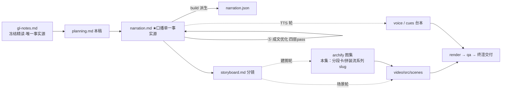

# 策划案：新系列 ep10《System Prompt：提示是拼出来的，不是写死的》（v2 · 文案轮待用户审批 · C 型信源 = gl-notes）

> 状态：系列 claude-code-chapters 第 10 集（s10 System Prompt 单章，2026-10-31 开工）。本轮为**文案轮**（Stage ②–⑤）：逐字稿已过 ④ 双重校验与 ⑤ 成文优化（narration v2，2026-10-31），交用户审批，审批通过才进入制作（⑥ 分镜 → ⑩ 交付），故本稿不做建图与场景设计。事实源 = `research/gl-notes.md`（冻结自现行 172 精读，2026-10-31；主线正源 = 站点轨钉点 `67a9126c`，对照 = main 轨钉点 `7226f555`；episode D 走查与 E4 消融本集复算升【一】级）。

成本档位: 正集（单语 + story 档已配音系 + 约 5 分钟常规动画复杂度；文案轮无生产层开销，制作期成本量级 = 常规单集）

## 0. 标题候选（待审批；series.json 现为工作题《System Prompt：提示是拼出来的，不是写死的》，审批后落定）

| 候选 | 一句话理由 |
|---|---|
| A《System Prompt：提示是拼出来的，不是写死的》 | 直取章题引语「prompt 是组装出来的，不是写死的」（【二】级课程引语）并转口播语序，零转译损耗、P1 立论即兑现 |
| B《System Prompt：每轮看到的第一段话，是现拼的》 | 承 172「LLM 每轮看到什么」统一视角，把系统提示定位成每轮视野的第一屏，与前几集同族装置（计划外显/过程隔离/知识按需）收进同一条主线 |
| C《System Prompt：有什么，才写什么》 | 直取规律四「按真实状态组装」+ E4 消融的认知增量（提记忆 ≠ 有记忆），判据之争是本集最强记忆点、与 P5 收束金句同款 |
| D《System Prompt：同一个机制，两套拼法》 | 两轨分歧叙事（四段带本地缓存 vs 七段每轮重建——都对、目标不同），双轨证据天然成对上屏 |

## 一、定位表

| 项 | 值 |
|---|---|
| 平台 | B 站 / YouTube 中长视频 |
| 时长目标 | 4.4–5.6 分钟（pipeline.toml 硬约束窗，含系列片头 ~23.5s 口径；正文 1305 字预算 @254 字/分） |
| 形态 | AI 配音（story 档）+ Remotion 代码动画，无真人 |
| 受众 | 不预设工程背景的普通人：用过 AI 助手、没想过「每轮开场的说明是谁写的、怎么写出来的」的任何观众 |
| 核心内容范围 | gl-notes §6 全节（三步机制 / episode D 走查 / 两轨分歧与真实 CC boundary 缓存）+ §8 体量数字行（20-30KB / ~150 字符）+ §9 E4（组装判据改关键词猜测，本集消融正例）+ §10.1 规律四（按真实状态组装，收束用）+ 附录 A 类比登记表（#4/#5 实引、#2 ※ 禁用）；§1 系统提示定义与 §2 三通道汇合作开场承接（三路工程直陈，不展开其余装置）；§3–§5（TodoWrite / Subagent / Skill Loading）属本系列其他集、§7（Error Recovery）属下期，本集只在 P5 钩子点问题不重讲 |
| 系列位置 | 系列第 10 讲：在「每轮看到什么」主线上把第一路（系统提示）拆到底——「有什么，才写什么」是规律四的首次正面实证；系列视觉母题（恒定环体）延续，新增「分段卡 + 拼装流」装置视觉 |

**Logline**：写死的开场说明跟不上状态；分段、按状态拼装、缓存三步，把提示从手稿变成现拼的配置——有什么，才写什么（gl-notes §6 + §10.1 规律四）。

## 二、叙事策略

**主线是一问一答的闭环**：开场抛问题「这份每轮都念的说明，为什么跟不上状态」→ P1 用「分段 + 按状态拼装 + 缓存」三步回答「怎么拼」→ P2 走查证明「判据真的是状态，话术撬不动」→ P3 反问「判据要是改成猜关键词呢」——消融实验回答「一句闲聊就撬动提示」→ P4 对照「更大的系统怎么拼、真实版护的是哪层缓存」→ P5 收束「有什么，才写什么」+ 下期钩子（出错就停）。

**开篇钩子候选矩阵（★ 待人工挑选——本集文案审批人即挑选人）**：

| # | 型 | 钩子文本（p0-01） | 吸引力留存逻辑 | 核心主干关联锚点 | 抛出的核心引子 |
|---|---|---|---|---|---|
| H1 | 痛点承接型 ★ | 「这是一份写死的开场说明——工具新了，它不提；记忆有了，它不认。」 | 承接前集留下的「说明写死、状态变了不知道」悬念当场立靶，「写死却不认账」的认知不适 3 秒认领 | gl-notes §6（提示硬编码欠债，A#4）；P0 问题现场即钩子展开 | 写死的说明怎么跟得上状态？谁来决定它写什么？ |
| H2 | 本质揭示型 | 「这是模型每轮看到的第一段话——不是人写死的，是每次现拼的。」 | 「固定文本 vs 现场拼装」的认知颠覆，制造「原来如此」的预期落差 | §6（写死的手稿 → 运行时拼装的配置，A#5）；P1 末拍兑现 | 按什么拼？谁说了算？ |
| H3 | 判据悬念型 | 「这是一句骗不过它的闲聊：提到了记忆，提示却纹丝不动。」 | 反直觉行为（提了却没反应？）制造规则悬念，逼观众猜判据 | §6 episode D 走查 + §9 E4；P2/P3 兑现 | 判据到底是什么？改成猜关键词会怎样？ |
| H4 | 分歧冲突型 | 「这是同一个机制的两套拼法：一套带缓存，一套每轮重建——都对。」 | 「都对？」的自相矛盾感逼观众选边站 | §6 两轨分歧；P4 开场兑现 | 为什么都对？各自图什么？ |
| H5 | 反差数字型 | 「这是同一段提示的两种体量：两三万字节，对一百五十字符。」 | 数量级反差直接砸脸，体量之差自带「同一装置？」的疑问 | §8（20-30KB / ~150 字符，【三】级）；P4 末拍兑现 | 什么决定了体量差两个数量级？ |

★ 选定 H1（自动选定，待人工复核）。理由：单章集时长紧，痛点钩承接前集「写死的开场说明」意象一句兑现不欠债，P0 当幕展开问题现场；H2 本质句改写进 P1 收束（手稿→配置对照，两全）；H3 判据悬念押 P2/P3（对开场是负债，观众还不知道「段」是什么）；H4 押 P4 开场（两轨双栏视觉正好成对）；H5 数字反差押 P4 末拍（【三】级数字开篇裸抛缺归属，不利）。

**视觉母题统摄全片，局部类比点到即止**：连续感只由视觉母题承担（恒定循环环体〔M-001〕+ 系列色彩契约 + 本集「分段卡 + 拼装流」装置视觉），严禁把局部类比升格为贯穿剧场。口播类比只准入 gl-notes 附录 A 登记条目：本集实引 #4 提示欠了一屁股债（P0 问题钩子，2 句点亮即收）、#5 写死的手稿 → 运行时拼装的配置（P1 收束 1 句对照 + P5 回扣 1 句，不展开喻体）；#2 组装台面因「台面」在禁喻词表维持 ※ 不进口播——三通道汇合改工程直陈（「说明、消息、工具表三路」）。未登记类比不进口播。

**记忆点约每 60–90 秒一个**（全部取自 gl-notes §6/§8/§9，数字必带基线标尺）：
P0「欠债三件套：不分段、不看状态、不缓存——状态变了，它纹丝不动」（§6 + B.1 措辞校准口径）→ P1「三步解法：分段、拼装、缓存；改工具块，身份块一个字不用动」（§6）→ P2「一句提记忆的闲聊，提示纹丝不动；文件真落盘，四段一百五十四字符到场」（episode D 走查，本集复算【一】）→ P3「判据改猜关键词：误注入零变一，提示一百一十三跳到一百四十七」（E4 本集复算【一】）→ P4「两套拼法都对；真实版护的是另一层——标准两三万字节，极简只剩一百五十来个字符」（【三】带归属句）→ P5 收束金句「有什么，才写什么」。

**收尾不贩卖焦虑，悬念只留给下期**：P5 护栏句并入片尾署源块（生产细节来自原作者单方核查、未锁 CC 版本号、计数随时点漂移——§11.3 精神，随署源句交代，与前两集同款；本集含【三】级内容，归属句必带）；悬念留在下期钩子（服务端一记报错、循环一撞就停——只点问题不预告恢复机制），不贩卖「失控」焦虑。

## 三、视觉语言

**色彩语义沿用系列契约**（深色底 `#0E1116`；警示红 `#FF5C5C` = 反例/退化路径；确认绿 `#7ED321` = 机制在位/缓存命中；金句卡衬线体；公式/方法名只进角标）：

| 概念 | 专属色 | 语义 |
|---|---|---|
| 循环环体（全系列恒定锚〔M-001〕） | 陶土橙 `#D97757`（系列恒定） | 同一环体继续出场，本集高亮「调用模型前」的组装时点——三步机制都发生在这一拍里 |
| 分段模块（section 卡） | 紫罗兰 `#A78BFA`（本集主题色，theme.core 本集新增语义） | 身份/工具/工作目录/记忆四块分段卡：块的独立演进、按需亮起；P4 七段卡阵列同色系 |
| 拼装流与缓存态 | 天蓝 `#5CA8FF`（本集主题色） | 状态清单卡、拼装流向、缓存命中/失效的状态色（状态判据的「冷静感」） |
| 消息条/回喂流 | 青碧 `#64C4C0`（承前集） | 用户闲聊消息条、状态变化流（与前集同语义） |

构图纪律：消融对比一律左红右绿同屏（E4：状态判据 误注入 0·113 字符恒稳 ↔ 关键词判据 误注入 1·113→147 跳变）；三步机制用「分段卡 → 状态清单 → 拼装流」三件装置视觉递进，全片反复出场、逐幕生长；数字一律动态计数器 + 工况角标（113/147/154 字符基线标尺、两三万字节 vs 一百五对比条）；走查 beat 用磁盘格 + 状态清单卡 + 分段卡堆叠动画（Animated State Trace）；两轨分歧用左右等高双栏且同为绿框——「都对、目标不同」的视觉裁决，不判优劣；视觉母题禁旧版隐喻系意象（车间/作坊/传送带/工序卡/叫号器/插线口/师傅/台面及同族），一律工程直陈：分段、拼装、缓存、判据、分界线。

**景别走 `WS→CU→MS`，张力峰值在 P3**：P0 提示长文本全景（写死的灰色长卡 vs 旁边变化的状态小窗）→ P1 急推分段卡特写（四块拆分 + 状态清单点火）→ P2 走查中景（磁盘格/清单/分段卡并置、计数器跳动）→ P3 消融双特写（「记忆」二字高亮帧 ↔ 状态清单恒稳帧；113→147 跳变 punch）→ P4 拉远（两轨双栏全景 + 分界线切分条 + 体量对比条）→ P5 分段卡与拼装流定格收束。运镜密度：P3 紧张段每镜 ≤1 次推近；重音镜每 20–40s 一个 1–2s punch（与记忆点 60–90s 咬合）；张力曲线在 P3 判据之争到达峰值、P4 用拉远降压、P5 平收。

## 四、分幕结构表

| 幕 | 目标时间 | 字数预算 | 主题 | 叙事要点（回溯 gl-notes） | 视觉锚点 | 前置概念 |
|---|---|---|---|---|---|---|
| P0 写死的开场说明 | 0:00–0:50 | ≈195 | 钩子 + 问题现场 | H1 钩子落 p0-01（承接前集「说明写死、状态变了不知道」意象，禁顺序词）；系统提示定义：每轮调用模型，身份与规则所在的那段文本——你是谁、有什么工具、守什么规矩（§1）；三路工程直陈：说明 + 消息 + 工具表 = 模型每轮看到的全部，三路在组装处汇合（§1/§2；A#2 ※ 台面不进口播）；教学代码里的欠债（A#4 点亮，口播锚「课程的教学代码」）：最早是一行写死的字符串，后来挪进函数也只在启动时拼一次（B.1 措辞校准——不照搬「从第一章到第九章都是一行硬编码」课程字面）；债在结构：不分段、不看状态、不缓存（B.1 登记）；于是加一个能力多一段、换项目整段重写、新指令可能跟旧的打架；系统提示每轮计费，驮着用不到的段落白交钱（§6，【二】） | 冷启动直入：灰色提示长文本卡居中（写死），旁边两格状态小窗（工具表新增行/记忆文件亮起）长卡毫无反应；「欠债清单」三格逐条点亮（警示红描边）；右下角署源角标（首部署源位） | — |
| P1 分段、拼装、缓存 | 0:50–2:00 | ≈300 | 机制解构 | 解法三步总起（§6）；第一步分段：拆成按主题各自维护的四段——身份、工具、工作目录、记忆，各自独立演进、改工具段不动身份段（§6）；第二步按状态拼装：每轮调用模型前查一份 context 状态清单——工具段看实际注册的工具表，记忆段看记忆文件存在且有内容；段加载基于真实状态、不在消息里搜关键词（§6；口播补带值微例：记忆文件还是空的，记忆段就不拼进来）；第三步缓存：状态没变直接返回上次拼好的结果，比对键用序列化文本（结构数据排成一段可比对的文字）；不用自带 hash 的两个理由（口播白话口径：程序一重启，指纹就变；一层套一层的数据，压不成指纹）：进程随机化、嵌套结构不可哈希（§6）；幕点收束：说明从写死的手稿，变成按状态现拼的配置（A#5 对照 1 句） | 分段主视觉首亮（紫）：四块分段卡各自可点亮；状态清单卡（蓝）+ 拼装流箭头（拼不拼，清单说了算）；缓存徽标（确认绿）挂拼装流出口；环体〔M-001〕高亮「调用模型前」时点 | 系统提示（P0 已释）；工具表（P0 三路口径已带过） |
| P2 一句闲聊，一个文件 | 2:00–2:45 | ≈210 | Worked Example | 拿原型走一遍（episode D，B.2 本集复算【一】）：开机第一次取说明——磁盘上没有记忆文件，状态清单记「无记忆」，拼三段（身份/工具/工作目录）113 字符；同状态再取一次，缓存命中原样返回；用户闲聊「我对写这个模块毫无记忆」——提示纹丝不动，「提到记忆」不是状态（§6）；直到记忆文件真的落盘并写入内容——状态清单变化、缓存失效、重拼四段 154 字符，记忆段到场（§6）；幕尾悬念：判据要是改看话术呢 | 走查舞台三件套：磁盘格 / 状态清单卡 / 分段卡拼装流；字符计数器 113→113（缓存徽标亮）→154（缓存徽标闪断）；闲聊消息条落入、分段卡描边呼吸一下即止 | 状态清单、缓存（P1 已释） |
| P3 看状态，不看话术 | 2:45–3:55 | ≈280 | 消融 | 破坏实验（E4，B.2 本集复算【一】）：把判据从「查状态」改成「猜关键词」——消息里一出现「记忆」这样的字眼就拼记忆段；还是那句闲聊，话音刚落，空的记忆段当场被误拼进去：误注入零变一、提示从 113 字符跳到 147 字符（误注入当场改变提示体量）；麻烦在哪：用户随口一句闲聊，就撬动了模型每轮要看的说明；这条判据的差异，在真实系统里就是提示的稳定性（§6）；教训一句话：段加载，看状态，不看话术（§9 E4 表）；幕尾转场：判据站稳了，可同一套机制还有另一套拼法（§6 两轨分歧引子） | 左红右绿消融同屏：关键词判据（「记忆」二字高亮 → 空记忆段误拼入，计数 113→147 跳变）↔ 状态判据（同一句扫过，恒稳 113）；「每轮都要看」回环虚线绕住提示条；远处七段卡阵列淡入预告 | 判据（本幕 beat1 先释：按消息文本猜关键词；状态形「查状态」P1/P2 已立） |
| P4 两套拼法 | 3:55–4:40 | ≈185 | 生产对照 | 集成版另一套：七个固定段（identity/tools/tasks/teams/workspace/memory/compaction）每轮从头重建、不设本地缓存，另拼当前时间、技能目录、记忆、已连接的外部服务器名——任何一个状态变了，提示就跟着变（§6 + B.1 main 轨钉点【一】）；哪套对？都对、目标不同；四段版的缓存，省的只是本地重复拼字符串的开销（code.py 注释原文口径【一】）；真实的 Claude Code【三】：护的是另一层——接口级缓存（每轮计费就发生在这一头，回扣 P0 计费动因），切一条分界线把静态段与动态段分开，静态段命中全局缓存、不因动态内容失效；体量：标准形态核心提示约两三万字节，极简形态只剩一百五十来个字符——同一套装置，相差两个数量级（§6/§8，归属句 + 片尾署源兜底） | 两轨等高双栏（同为绿框不判优劣）：左四段卡 + 进程内缓存徽标 / 右七段卡阵列 + 「每轮重建」印章 + 四样动态小卡持续刷新；分界线切分条（静态段｜动态段，静态段挂全局缓存徽标）；体量对比条（两三万字节 vs 一百五） | 段、本地缓存（P1 已释） |
| P5 收束与下期 | 4:40–5:15 | ≈135 | 收束 + 钩子 + 署源 | 收束金句：有什么，才写什么——按真实状态组装、状态稳定就复用、从不猜话术（§10.1 规律四 + §9 E4 教训）；手稿 → 配置回扣（A#5）：四段各管各、状态一变它跟着变；「每轮开场的这段话，终于跟得上现状了」兑现开场钩子；下期钩子：说明拼得再稳，也拦不住服务端一记报错——眼下的循环一撞上就停，不重试、也不换模型（只点问题不预告机制，禁顺序词）；片尾署源块（系列既定尾位）两句：Learn Claude Code + 生产细节单方核查/未锁版本/计数漂移（§11.3 精神；本集含【三】级内容，第二句必带） | 分段卡 + 拼装流定格收束 + 金句卡（衬线体）「有什么，才写什么」；灰色写死长卡淡出；一记红色报错波形砸停环体〔M-001〕→ 下期卡（视觉层）→ 片尾署源卡（信源名 + 仓库地址） | — |

> 正文合计 ≈1305 字预算上限：六幕预算 195+300+210+280+185+135 = 1305（幕预算为上限分配；P0 承定义与承接、P4 承两轨+真实 CC 双载荷，允许各借支 20–40 字、由 P1/P3 回吐）。句均 20–24 字 → 约 50–56 句；成文 v2 实测 1375 字 / 56 句 ≈5.4 分，在 target_minutes [4.4, 5.6] 硬窗内——超 1305 软上限部分承 ④⑤ 修稿补入的限定词、单位与白话化拆句（P4 双载荷借支口径内）。

## 五、生产管线图

本轮产物止于 C（④⑤ 修缮轮已完成：narration v2 过双重校验与成文优化；虚线节点为制作期，审批通过后启动）。

## 六、边界与不做的事

**系列递进边界（照抄口径，本集不进入）**：TodoWrite / Subagent / Skill Loading（同系列其他集）只在全貌坐标里点名不重讲；Error Recovery 只在 P5 下期钩子点一笔问题引子（不预告恢复机制）；「每轮看到什么」三路口径只在 P0 开场承接一句（A#2 ※ 台面改工程直陈），不展开其余两路的机制。

**片头沿用《一个循环》（制作期）**：系列片头资产已挂载孪生登记，本集沿用同款（~23.5s，预算已计入）；本集挂载件与孪生门登记随制作期处理，本轮只占预算。

**口播红线不可越**：观众层信源标识只许出现在首尾既定署源位——片头署源角标（p0-01 beat 视觉层）+ 片尾署源句（尾幕），豁免白名单登记在工作区 `vibe-video.toml [check_series.source_credit]`（RSI I-080；本集条目 p0-01/p5-07 待系列层统一登记），其余位置零课程/站点/章号痕迹（不出现课程/站点名/「第 N 章」——按章拆集只是编导结构）；【三】级断言归属由片尾署源位承接，正文归属句只用「拆解过 Claude Code 源码的同学们应该知道」句式（ep1 审批口径）；活数据（章节数/star）不进口播；禁顺序词（上一集/上集/上期/下一集/下集/第 N 集/前一集/本系列——署源句用「这套视频」），收尾预告只许「下期」；口播英文例外清单 = Claude Code + bash（随系列已立例外）+ 署源专名 Learn Claude Code，其余英文方法名与命令（System Prompt / PROMPT_SECTIONS / identity / tools / workspace / memory / assemble_system_prompt / get_system_prompt / context / json.dumps / hash / MEMORY.md / SYSTEM_PROMPT_DYNAMIC_BOUNDARY / prompt cache / CLAUDE_CODE_SIMPLE 等）进角标不口播——主题词 System Prompt 口播恒用「系统提示」；「Token」如需提及带白话句；禁旧版隐喻系词汇及同族意象（车间/作坊/传送带/工序卡/叫号器/插线口/师傅/台面——附录 A#2 不进口播）。

**素材取舍，弃用而非遗漏**：E5 白等秒数不消费（GL 175.6s 与现行 lab 173.7s 存在记录代次漂移，B.2 登记，下期开工须重算后再引用）；CC 源码文件行数计数（914/68/189/718/123 行）不进口播（时点漂移计数，仅登记层）；main 轨 s15 内置工具计数不引用（README 自身 26/25 两处矛盾，B.1 登记）；三层缓存的会话级/注册缓存两层（lodash memoize / systemPromptSectionCache）不逐层展开——P4 只点「另一层 + 分界线」，细节留档 gl-notes（弃用而非遗漏）；getUserContext vs getSystemContext 双通道、模式替换（CLAUDE_CODE_SIMPLE / Proactive·KAIROS / Coordinator / Agent）属【三】级深潜旁支，不进口播；「从 s01 到 s09 都是一行硬编码」按 B.1 措辞校准口径呈现（欠债 = 无分段·无状态判据·无缓存，s07/s09 实为启动时一次性构建）；「逐字一致缓存前缀/Fork」属 Subagent 集取材面不沾；课程 s10「试一下」运行指引与 prompt 示例（教学操作向）不进口播。

**文案轮边界**：文案轮不跑 TTS、不动场景代码与 Main.tsx、不建 archify 图（storyboard 属制作期首轮）；series.json 登记为文案轮工作题，标题随审批落定；BGM 留空轨；信源外观点不进口播。制作期（⑥–⑩）审批通过后逐项启动。
