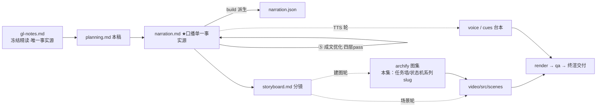

# 策划案：新系列 ep12《Task System：从执行清单到可认领的契约》（v2 · 文案轮待用户审批 · C 型信源 = gl-notes）

> 状态：系列 claude-code-chapters 第 12 集（s12_task_system 单章，2026-10-31 开工）。本轮为**文案轮**（Stage ①–⑤）：逐字稿与全部文案交用户审批，审批通过才进入制作（⑥ 分镜 → ⑩ 交付），故本稿不做建图与场景设计。事实源 = `research/gl-notes.md`（冻结自现行 175 多 Agent 平台精读；取材范围 s12 单章——§3 主线 + §10 两条数字 + §11 实验 E1 + §12 规律 1，钉站点轨 67a9126c、main 7226f555 对照副本）。

成本档位: 正集（单语 + story 档已配音系 + 约 5 分钟常规动画复杂度；文案轮无生产层开销，制作期成本量级 = 常规单集）

## 0. 标题候选（待审批；series.json 现为工作题《Task System：从执行清单到可认领的契约》，审批后落定）

| 候选 | 一句话理由 |
|---|---|
| A《Task System：从执行清单到可认领的契约》 | 冻结正文 §3 节名原身直取，「契约」点破与执行清单（TodoWrite）的分界，与 ep2《Tool Use：多加一个工具，只加一行》同构 |
| B《Task System：目标太大，拆成小任务》 | 钉选站点轨章题副题直取，一句话同时给出问题面（大目标）与解法面（拆小任务） |
| C《任务系统：多 Agent 的地基，先铺任务板》 | 母题承接型——五大组「多 Agent」组首集定位 + 175 §2「最值得吃透的是任务板，它是一切的地基」，为组内各集开地基 |
| D《Task System：不存在的依赖，宁可挡住也不放行》 | 认知增量型——落在 fail-closed 依赖检查（E1 消融记忆点「引用错编号不放行也不崩溃」），反直觉且有本集实测背书 |

## 一、定位表

| 项 | 值 |
|---|---|
| 平台 | B 站 / YouTube 中长视频 |
| 时长目标 | 4.4–5.6 分钟（pipeline.toml 硬约束窗，含系列片头 ~23.5s 口径；正文 1305 字预算 @254 字/分，v2 实稿 1403——⑤ 白话先释与承接增字 ≈100，≈5.5 分仍落窗、余量 0.1 分） |
| 形态 | AI 配音（story 档）+ Remotion 代码动画，无真人 |
| 受众 | 不预设工程背景的普通人：见过「AI 帮你列待办」，没想过待办清单和「能开工的任务」差在哪的任何观众 |
| 核心内容范围 | gl-notes §3 全节（六字段任务文件 / can_start 依赖检查与坏依赖 fail-closed / claim-complete 状态机 / 完成解锁报告 / 两轨实现深度对照 / 真实 CC 对应物）+ §10 本集口径两条（「Lead 内置工具 8（s12）」「认领锁最多重试 30 次、退避 5–100 ms」）+ §11 实验 E1（坏依赖放行，本集消融正例；E4 认领原子性仅认领面一句带过）+ §12 规律 1（共享状态出内存、入文件——收束）与规律 3（一句承接）；§1–§2（问题与全貌）作开篇地图素材，规格表只取「可恢复的目标」一行；§4–§9（团队/协议/自治/隔离/外部工具/综合）属后续集，本集只在组定位与下期钩子带过 |
| 系列位置 | 系列第 12 讲、五大组「多 Agent」组首集：任务板是一切的地基（§2 学习焦点），为组队/协议/自治各集开地基；系列视觉母题（恒定环体〔M-001〕）延续，新增「任务墙」装置视觉 |

**Logline**：嘴上接力接不住大目标；一堵任务墙把目标拆成六字段卡、落盘成文件、用关卡把先后顺序挡在认领前——从执行清单，升级成可认领的契约（gl-notes §1 + §3 + §12 规律 1）。

## 二、叙事策略

**主线是一问一答的闭环**：开场承接「大目标不落盘、全靠嘴上接力」的欠账，抛出「这堵墙怎么治嘴上接力」→ P1 用「一卡六字段 + 状态机 + 关卡」回答「清单缺什么」→ P2 走查证明「墙真的能把一条链跑通、还能主动报解锁」→ P3 反问「依赖里藏个不存在的编号会怎样」——拆掉 fail-closed 的消融实验回答「为什么宁可挡住也不放行」→ P4 对照生产版「真实的墙重得多：锁、重试、高水位标、两步建图」→ P5 收束「该共享的状态，出内存、入文件」+ 下期钩子（慢命令卡住循环）。

**开篇钩子给出五个候选（★ 待人工挑选——本集文案审批人即挑选人）**：

| # | 型 | 钩子文本（p0-01） | 吸引力留存逻辑 | 核心主干关联锚点 | 抛出的核心引子 |
|---|---|---|---|---|---|
| H1 | 承接痛点型 ★ | 「这是一堵墙，专治大目标的嘴上接力。」 | 「墙怎么治病」的即时错位感 + 承接前集「大目标不落盘，全靠嘴上接力」钩子意象（兑现不欠债），3 秒锁注意力 | gl-notes §3 任务板（附录 A 登记表第 1 行「任务墙」主画面喻）；P0 问题现场即钩子展开 | 墙上挂着什么？嘴上接力断在哪？ |
| H2 | 一句话本质型 | 「这是一张清单的升级：从记给自己看，到挂出来给大家认领。」 | 把「任务系统」折叠成一步升级，制造「就差这一步？」认知落差 | §3 节名（执行清单 → 可认领的契约）；P0 末拍兑现 | 这一步之差，差在哪些字段上？ |
| H3 | 反直觉型 | 「这是关卡的一条死规矩：依赖不存在，宁可挡住，也不放行。」 | 「不存在为什么不干脆放过去」违反宽容直觉，逼观众重想「检查」这件事 | §3 can_start fail-closed + §11 E1（本集复算【一】） | 挡住的代价与放行的代价，哪个大？ |
| H4 | 数字反差型 | 「这是六个字段的小卡，撑起了一群 Agent 的地基。」 | 极小数据结构对「地基」宣称的反差（六个字段能撑起什么？） | §3 六字段（【一】可数）+ §2「任务板是一切的地基」 | 地基上面要盖什么？ |
| H5 | 悬念冲突型 | 「这是一个不存在的编号，放行了一个幽灵任务。」 | 冲突 + 悬置结果（编号怎么会放行幽灵？后果是什么？） | §11 E1（Blocked by: task_999 → Claimed: ghost） | 开关是什么？拔掉它会坏成什么样？ |

★ 选定 H1（自动选定，待人工复核）。理由：单章集时长紧，承接型痛点钩 3 秒认领、P0 当幕兑现且顺手兑现前集钩子（不欠债）；H2 本质句改写进 P0 收束与标题候选 A（两全）；H3 fail-closed 押 P3 消融（本集记忆点峰值）；H4 地基宣称押 P5 收束；H5 ghost 悬念押 P3（对前半程是负债）。

**视觉母题统摄全片，局部类比点到即止**：连续感只由视觉母题承担（恒定循环环体〔M-001〕+ 系列色彩契约 + 本集「任务墙」装置视觉——空墙 → 挂卡 → 连线 → 签名 → 播报 → 定格，全片逐幕生长），严禁把局部类比升格为贯穿剧场。口播类比只准入 gl-notes 附录 A 登记条目：本集实引登记表第 1 行「任务墙」（对应 175 §3 任务板 `.tasks/` 六字段卡，P0–P5 主画面喻），失配边界句随行（p1-08「卡不是纸质便签——是程序能读写的文件」；禁「撕卡」，删除不在本集机制面）；其余六行（递话口/回执簿/值班钟/门牌房/认证插座/环形走廊）属本系列后续集，本集不启用；§4 快递柜、§6 电影院选座等冻结正文在体喻归相应后续集，本集不进口播。未登记类比不进口播。

**记忆点约每 60–90 秒一个**（全部取自 gl-notes §3/§10/§11/§12，数字必带基线标尺）：
P0「换个会话就没了——清单不记依赖、不记归属」（§1/§3）→ P1「一个任务一个文件，六个字段；关卡对不存在的编号同样挡」（§3，code.py 可数【一】）→ P2「认领不算完成；完成动作自己带回开工名单」（§3 走查 + 解锁推送）→ P3「幽灵任务上岗——挡住是晚开工，放行是错上加错」（§11 E1，本集复算【一】）→ P4「锁里五步、最多三十次、五到一百毫秒；编号不会被复用」（s12 附录【三】+ §10）→ P5 收束金句「该共享的状态，出内存、入文件」（§12 规律 1）。

**收尾不贩卖焦虑，悬念只留给下期**：P5 护栏句并入片尾署源块（生产细节来自原作者单方核查、未锁 CC 版本号、计数随时点漂移——【三】级归属与计数漂移警示由片尾署源句兜底，承系列同款）；悬念留在下期钩子（一条慢命令跑几分钟，循环停在原地干等——只点问题不预告机制），不预告解法。

## 三、视觉语言

**色彩语义沿用系列契约**（深色底 `#0E1116`；警示红 `#FF5C5C` = 关卡拦截/退化路径；确认绿 `#7ED321` = 完成/解锁成功态；金句卡衬线体；公式/方法名只进角标；保留语义色不占主题位）：

| 概念 | 专属色 | 语义 |
|---|---|---|
| 循环环体（全系列恒定锚〔M-001〕） | 陶土橙 `#D97757`（系列恒定，承首集） | 同一环体继续出场，本集侧亮「工具池」面——三件到八件的加挂面（规律：机制逐层加挂、循环不变） |
| 任务卡/任务墙 | 任务卡紫 `#9B8CFF`（本集主题色，theme.core 本集新增语义；承 Stage ① 提案） | 任务墙卡片、六字段卡、认领签名态——「板上待领的活」 |
| 依赖连线/解锁播报 | 解锁蓝 `#58B7FF`（本集主题色；承 Stage ① 提案，与青碧 `#64C4C0` 拉开蓝相/青绿相） | blockedBy 依赖连线、完成 → 解锁的播报信号流——「依赖凑齐、下游放行」 |

构图纪律：消融对比一律左红右绿同屏（E1：基线 被挡保持待领 ↔ 拆后 幽灵认领——单变量拆开关、其余置灰）；「两码事」对比一律并列同屏（未完成 vs 不存在；认领 vs 完成，等高裁决）；状态机走查 = 三状态横条 + 两动作箭头 + 关卡闸门（闸门两种红挡并列：依赖未完成 / 依赖不存在·引用错误）；数字一律动态增长条 + 工况角标（工具 3→8 基线标尺；重试 30 次、5→100ms 拉长条）；任务墙装置视觉全片反复出场、逐幕生长（空墙 → 挂卡 → 连线 → 签名认领 → 完成翻绿 → 解锁播报 → 幽灵灰卡 → 真实版重墙 → 定格收束）；视觉母题禁旧版隐喻系意象（车间/作坊/传送带/工序卡/叫号器/插线口/师傅及同族），一律工程直陈：卡片、关卡、连线、播报、锁、建图；「任务墙」为附录 A 登记喻，失配边界句随行（卡是结构化文件非纸质便签、禁「撕卡」）。

**景别走 `WS→CU→MS`，张力峰值在 P3**：P0 对话流全景（叮嘱气泡逐条飘散 + 清单卡蒸发）→ P1 急推卡片特写（六字段逐项点亮 + 关卡闸门咬合）→ P2 走查中景（四卡 + 蓝色连线 + 播报流）→ P3 幽灵卡双特写 + 左红右绿消融同屏（张力峰值）→ P4 拉远（锁内五步链 + 重试计数条 + 高水位标 + 两步建图对比）→ P5 墙体定格收束。运镜密度：P3 紧张段每镜 ≤1 次推近；重音镜每 20–40s 一个 1–2s punch（与记忆点 60–90s 咬合）；张力曲线在 P3「幽灵上岗」到达峰值、P4 用拉远降压、P5 平收。

## 四、分幕结构表

| 幕 | 目标时间 | 字数预算 | 主题 | 叙事要点（回溯 gl-notes） | 视觉锚点 | 前置概念 |
|---|---|---|---|---|---|---|
| P0 嘴上的接力棒 | 0:00–0:45 | ≈180 | 钩子 + 问题现场 | H1 钩子落 p0-01（承前集「大目标不落盘，全靠嘴上接力」意象，禁顺序词）；大目标拆成叮嘱靠对话往下传、一句没接住链就断（§1 串行/遗忘痛点面）；现成清单工具不顶用：记内存、换会话就没、不记依赖不记归属（§1/§3，TodoWrite 进角标）；清单写着初稿未交、排版能不能开工没人答（§3 开场痛点，实例与 P2 走查同构）；规格「可恢复的目标」行：任务落盘、重启不丢、先后顺序挡在认领前面（§1 表）；今天砌墙：大目标拆卡上墙、人人可认领（§3 机制引入） | 冷启动：叮嘱气泡链渐散；内存清单卡随会话窗关闭蒸发（依赖/归属两枚问号）；规格行钉入；空任务墙从暗处亮起；右下角署源角标（首部署源位） | — |
| P1 一张卡，六个字段 | 0:45–1:50 | ≈235 | 机制解构 | 一任务一文件、躺在任务目录（§3，`.tasks/` 进角标）；六字段：编号、标题、描述、状态、归属人、依赖列表（§3，【一】）；三状态两动作：认领（待领→在做+写归属人）、完成（在做→完成）（§3，pending/in_progress/completed 与 claim/complete 进角标）；认领前关卡 can_start：依赖列表每个任务都得是完成（§3）；坏依赖 fail-closed：文件不存在同样挡——引用错编号不放行、也不崩溃（§3，【一】）；失配边界句：卡非纸质便签、程序可读写、重启还在（附录 A 第 1 行随行）；模型手里的工具从三件长到八件：新添五件全是任务操作（B.2 钉点实数 TOOLS 8，【一】） | 任务墙首次亮出（任务卡紫）；六字段特写逐项取名；三状态横条 + 两动作箭头；关卡闸门两种红挡并列；卡翻面显文件形态 + 重启闪烁不动；环体〔M-001〕工具池 3→8 计数条 | 依赖列表（本幕先释：开工前要等的那些卡）；归属人（本幕随认领动作先释：领卡写名） |
| P2 墙上走一圈 | 1:50–2:50 | ≈240 | Worked Example | 内容工厂四任务 + 依赖登记：排版依赖初稿和配图、发布依赖排版（§3 走查例，与 §11 基线场景同构）；上墙只有初稿配图可领——排版依赖没凑齐、发布前面压着排版（§3）；认领、完成推进（§3）；解锁报告点名：配图完成点名排版、排版完成点名发布、发布完成报无（B.2 实测值，【一】；口径按钉选轨实测、不照抄正文「刚刚凑齐」——B.1 微分歧②）；解锁 = 主动推送，完成动作自己带回开工名单（§3）；认领不算完成：关卡只认完成、领走没做完下游照样被挡（§3）；四个任务全部完成（B.2，【一】）；幕尾钩：墙上还有张怪卡，依赖的编号根本不存在（§11 陷阱任务） | 四紫卡上墙 + 解锁蓝连线织图；关卡视角红/绿门；两卡签名认领、翻绿完成；蓝色播报信号沿连线点亮下游（「下一份开工名单」条）；「在做 ≠ 完成」等高对比小帧；全链翻绿定格 → 墙角灰卡 + 虚线问号编号 | 解锁（本幕先释：依赖凑齐、关卡抬起） |
| P3 不存在的编号 | 2:50–3:55 | ≈250 | 消融 | 陷阱卡：依赖列表写着不存在的编号；关卡照章办事——不存在按被挡处理、没人领得走（B.2 基线：Blocked by task_999、保持待领，【一】）；拆一个开关：「不存在视为被挡」改成「忽略」、别的都不动（§11 E1 单变量）；实测当场翻车：陷阱卡被认领、幽灵任务上岗（B.2：Claimed task_005 ghost，【一】）；「不存在」和「未完成」是两码事——后者是活没干完、前者多半编号写错（§11 E1 教训）；金句：宁可挡住也不放行——挡住是晚开工，放行是错上加错（stage-A coreAblation，fail-closed）；一句带过：两人抢同一张卡、看见不等于抢到、这把锁往后专门讲（§6/规律 3 + E4，深潜归后续自治集）；转场：真实产品里它比这重得多（§3） | 左红右绿消融同屏（拆后幽灵认领 ↔ 基线被挡待领，日志条实测值）；幽灵卡特写（半透明紫 + 问号编号）；金句卡（衬线体）定格；锁形剪影一闪悬置；拉远见真实版重墙轮廓 | 关卡（P1 已释）；幽灵任务（本幕先释：被错误放行的坏卡任务） |
| P4 真实版的墙 | 3:55–4:45 | ≈240 | 生产对照 | 归属句 + 真实任务卡九个字段（s12 附录 TaskRecord，【三】）；每任务一文件、躺在用户自己目录下的任务文件夹（【三】，路径进角标）；认领上锁、锁内五步：重读、查归属、查完成、查依赖、写归属（【三】）；锁抢不到退避重试：最多三十次、等待从五毫秒拉到一百毫秒（§10 表，【三】）；高水位标记最大编号、删掉的卡编号不被复用（【三】）；教学版后来一版两步建图：先建卡拿编号再连依赖——同一轮回答里的几个调用落笔时互相看不见、后建的卡拿不到先建卡刚生成的编号（§3 main 面）；这样连出来的依赖才经得起检查（§3「契约」落点，回扣标题） | 真实版九字段卡特写（多出三栏高亮）+ 文件树展开；锁内五步链咬合 + 重试计数条（30 次 / 5→100ms 拉长）；高水位标刻度不回退；两步建图对比（一把梭 ↔ 先建点再连边，调用块互相背对）；「契约」印章落定 | 认领（P1 已释）；同一轮回答里的几个调用（本幕先释：模型一口气发出几个工具调用） |
| P5 收束与下期 | 4:45–5:20 | ≈160 | 收束 + 钩子 + 署源 | 收束金句：该共享的状态，出内存、入文件——落盘重启不丢、人人可看（§12 规律 1 白话）；墙是地基：往后组队还是协商，全踩这堵墙（§2 学习焦点，不预告机制）；下期钩子：一条慢命令跑几分钟、循环停在原地干等（只点问题，后续集慢命令面）；片尾署源块两句（【三】级内容在场，第二句必带）：改编自开源课程 Learn Claude Code + 生产细节来自原作者单方核查、未锁版本、计数会漂移 | 墙体定格收束 + 金句卡（衬线体）；地基承重视觉（组队/协商剪影立于墙面）→ 下期卡（视觉层：慢命令进度条卡住环体）→ 片尾署源卡（信源名 + 仓库地址） | — |

> 正文合计 ≈1305 字预算上限：六幕预算 180+235+240+250+240+160 = 1305，写作目标压在 1150–1220（幕预算为上限分配，允许 P5 署源块超 ≤20 字〔英文署源与生产细节句占宽〕、其余幕预算内回收）。v2 实稿 1403 字 / 54 句（v1 1300 ＋ ⑤ 成文优化白话先释/承接增字 ≈100：P0/P1/P2/P4 四幕超上限分配，总时长 ≈5.5 分仍落 4.4–5.6 硬窗；若 TTS 实测超窗须删句，优先回收四幕增字——明细见 `.temp/prose-changelog.md`），句均 ≈26 字 → 约 48–56 句界内。

## 五、生产管线图

本轮产物止于 C（含 ④⑤ 修缮；虚线节点为制作期，审批通过后启动）。

## 六、边界与不做的事

**系列递进边界（照抄口径，本集不进入）**：§4–§9（团队/协议/自治/隔离/外部工具/综合回合）属后续集，本集只在 P5 地基句与组定位带过、不预告机制细节；循环与工具机制开场承接一句、不重讲；TodoWrite 对照表七行只取痛点面（内存/无依赖/无归属），「更新契约」「粒度」等行不进口播；E4 认领原子性只一句带过（TOCTOU 深潜归后续自治集，防记忆点撞车——Stage ① risks 面约束）。

**片头沿用系列同款（制作期）**：系列片头资产已在首集制作期挂载孪生登记，本集沿用同款（~23.5s，预算已计入）；本集挂载件与孪生门登记随制作期处理，本轮只占预算。

**口播红线不可越**：观众层信源标识只许出现在首尾既定署源位——片头署源角标（p0-01 beat 视觉层）+ 片尾署源句（p5-05/p5-06，豁免白名单登记在工作区 `vibe-video.toml [check_series.source_credit]`，RSI I-080，随文案审批登记），其余位置零课程/站点/章号痕迹（不出现课程/站点名/「第 N 章」——按章拆集只是编导结构）；【三】级断言归属由片尾署源位承接，正文归属句只用「拆解过 Claude Code 源码的同学们应该知道」句式（承首集审批口径）；活数据（章节数/star）不进口播；「工具 8→14→18→27」链条只引本钉 8，后三值归后续各集自数（B.3）；禁顺序词（上一集/上集/上期/下一集/下集/第 N 集/本系列/这一系列——署源句用「这套视频」），收尾预告只许「下期」；口播英文例外清单 = Claude Code + bash（随系列已立例外，本集 bash 未出口播）+ 署源专名 Learn Claude Code，其余英文方法名与命令（Task System / TodoWrite / pending / in_progress / completed / claim / complete / can_start / blockedBy / TOOLS / create_task / list_tasks / get_task / claim_task / complete_task / unblocked / TaskRecord / claimTask / proper-lockfile / .highwatermark / update_task 等）进角标不口播；数字读法用汉字写法（三十次、五毫秒、一百毫秒），规避连字符区间陷阱；禁旧版隐喻系词汇及同族意象（车间/作坊/传送带/工序卡/叫号器/插线口/师傅）；「任务墙」为附录 A 登记表第 1 行喻、失配边界句随行、禁「撕卡」；递话口/回执簿/值班钟/门牌房/认证插座/环形走廊等楼域喻属后续集不启用，§4 快递柜、§6 电影院选座等冻结正文在体喻不进口播（附录 A 承袭登记）。

**素材取舍，弃用而非遗漏**：main 轨排他创建失败处置细节（「直接拒绝」vs「重生成重试」两说不一，B.1 微分歧①）不进口播；解锁措辞按钉选轨实测口径（B.2 原型日志为证），不照抄正文「刚刚凑齐」四字（B.1 微分歧②）；「任务系统与错误恢复是独立的两层」（站点轨独有）弃用——收束让位规律 1，不欠新概念；complete_task 归属人校验（main 面）弃用而非遗漏——P4 预算让位锁五步与两步建图，材料留档 gl-notes §3/B.1；「多 Agent 更费钱 / token 随队友数线性增长」（§10 官方定性）属团队集口径不进口播；课程 s12 单章走查例（schema → endpoints / tests / docs 四任务链）不采用，改用内容工厂链（§3 正文走查例与 §11 基线场景同构、冻结正文 + 本集复算双证）；「Lead 内置工具 8→14→18→27」后三值不进口播（归后续各集钉点自数）。

**文案轮边界**：文案轮不跑 TTS、不动场景代码与 Main.tsx、不建 archify 图（storyboard 属制作期首轮）；series.json 登记为文案轮工作题，标题随审批落定；BGM 留空轨；信源外观点不进口播。制作期（⑥–⑩）审批通过后逐项启动。
