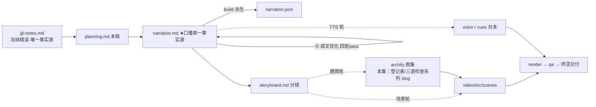

# 策划案：新系列 ep16《Team Protocols：对上号，才改状态》（v2 · 文案轮待用户审批 · C 型信源 = gl-notes）

> 状态：系列 claude-code-chapters 第 16 集（s16_team_protocols 单章，2026-10-31 开工）。本轮为**文案轮**（Stage ①–⑤，④ 修稿与 ⑤ 成文优化已于 2026-10-31 执行，改动表见 `.temp/prose-changelog.md`）：逐字稿与全部文案交用户审批，审批通过才进入制作（⑥ 分镜 → ⑩ 交付），故本稿不做建图与场景设计。事实源 = `research/gl-notes.md`（冻结自现行 175 精读，2026-10-31，钉站点轨 `67a9126c`（main 轨 `7226f555` 作对照轨登记）；取材范围 s16 单章）。

成本档位: 正集（单语 + story 档已配音系 + 约 5 分钟常规动画复杂度；文案轮无生产层开销，制作期成本量级 = 常规单集）

## 0. 标题候选（待审批；series.json 登记由系列层随 20 集并行批次统一补登——现仅 ep1/ep2 在册，规则 4 的 FAIL 随批量登记收口；标题暂用工作题《Team Protocols：对上号，才改状态》，审批后落定）

| 候选 | 一句话理由 |
|---|---|
| A《Team Protocols：对上号，才改状态》 | 三道核验（编号 / 类型 / 未决）收成一句可验证的动作句，标题即销账规则，观众带着「凭什么改状态」进场（工作题，承 Stage ① 直取副题型） |
| B《Team Protocols：协商不靠自觉，靠登记表》 | 承冻结正文规律 2「关键协商不靠自觉，靠协议状态机」（protocol before intelligence），把本集立成该系列级规律的落点 |
| C《Team Protocols：说「行」不算数，回执对上号才算》 | 反直觉增量在「LLM 答应过 ≠ 可追踪的状态变更」——先破「聊清楚就行」直觉再立结构化协议，与钩子 H1 同构 |
| D《Team Protocols：一个编号，管住关机和审批》 | 直取「两种协议、一套机制」：同一状态机（待处理→已批准/已拒绝）既服务关机握手又服务计划审批，加新协议只加类型分支 |

## 一、定位表

| 项 | 值 |
|---|---|
| 平台 | B 站 / YouTube 中长视频 |
| 时长目标 | 4.4–5.6 分钟（pipeline.toml 硬约束窗，含系列片头 ~23.5s 口径；正文 1305 字预算 @254 字/分，实稿见 pipeline.toml 注释） |
| 形态 | AI 配音（story 档）+ Remotion 代码动画，无真人 |
| 受众 | 不预设工程背景的普通人：见过「AI 组队干活」的宣传、没想过「队友之间怎么把话说算数」的任何观众 |
| 核心内容范围 | gl-notes §5 全节（两个场景逼出同一结构 / 四步链路 / 三道检查各拦一种错 / 与收件箱的统一消费耦合 / 与真实 CC 对照）＋ §10 数字表协议相关行（15 种结构化消息类型与关机三向通信）＋ §11 实验 E2（关掉类型校验，本集核心消融）/ E3（去掉统一消费入口）/ S2 防重对照（探针复算，三件皆本集已复算【一】级）＋ §12 规律 2（协议先于智能，收束用）/ 规律 4（读即消费、单点入口）/ 争议 3（计划审批拦在协议层还是执行层，一笔带过）＋ 附录 A 回执簿（本集唯一正主）；§3 任务板 / §4 收件箱 / §6 自治 / §7 worktree / §8 MCP / §9 综合属本系列 ep12/ep15/ep17/ep18/ep19/ep20，本集只在开场承接与下期钩子带过，不重讲 |
| 系列位置 | 系列第 16 讲：把「能通信」推进到「能协商」——规律 2「关键协商不靠自觉，靠协议状态机」的落点集；系列视觉母题（恒定环体）延续，新增「登记表」装置视觉（本集查表装置承 ep2 对照表血统、语义独立） |

**Logline**：口头的「行」管不住关机和审批；一本一单一号的登记表，用编号、类型、状态三道检查，替模型把关键协商的账兜住——同一套状态机，管两种协议（gl-notes §5 + §11 E2/S2/E3 + §12 规律 2）。

## 二、叙事策略

**主线是一问一答的闭环**：开场抛反直觉「答应过 ≠ 办妥了」→ P1 摆答案「一张登记表 + 一本回执簿」→ P2 拿一单关机（142 号）穿完四步链，兑现「账怎么转」并埋「对号」→ P3 反问「对号就稳了？」——三道检查逐条过、拆掉哪道哪道翻车（E2 误批 / S2 翻案两组实测）→ P4 追问「谁来读那条回复」——读即消费逼出单点入口（E3），再拉远看真实版（十五种消息、三向关机、执行闸门之争）→ P5 收束「关键协商，不靠自觉，靠协议状态机」+ 下期钩子（派活成瓶颈，没人派活）。

**开篇钩子候选矩阵（★ 待人工挑选——本集文案审批人即挑选人）**：

| # | 型 | 钩子文本（p0-01） | 吸引力留存逻辑 | 核心主干关联锚点 | 抛出的核心引子 |
|---|---|---|---|---|---|
| H1 | 认知反差型 ★ | 「这是一句差点闯祸的『行』：答应过，和真的办妥，是两回事。」 | 口头答应人人被坑过，3 秒认领；「差点闯祸」预埋 P3 误批实测， misconception-first 与认知曲线对齐 | §12 规律 2（「AI 答应过」不构成可追踪的状态变更）+ §11 E2 误批实测 | 凭什么答应不算数？什么才算数？ |
| H2 | 痛点型 | 「这是一队口信满天飞的队友：谁答应了谁、哪句算数，事后说不清。」 | 协调混乱的即视感（跨过协作的人都被「他说好了啊」坑过） | §5 两个场景逼出同一结构 | 怎么把协商变成说得清、查得着的账？ |
| H3 | 悬念冲突型 | 「这是一条关机回复，错手批准了一个它无权过问的计划。」 | 冲突 + 悬置结果（怎么批错的？后果多严重？） | §11 E2 实测退化 | 缺的是哪道检查？ |
| H4 | 一句话本质型 | 「这是一本回执簿：开单、对号、销账，协商不靠自觉。」 | 把协议折叠成一本簿子，制造「就这么简单？」认知落差 | §5 四步链路 + 附录 A 回执簿 | 一本簿子怎么管住关机和审批？ |
| H5 | 结构反差型 | 「这是一张三状态的登记表，管住了关机和审批两件大事。」 | 极简结构对极重事项的反差（三种状态就敢接所有协商？） | §5「同一套状态机服务两种协议」【一】 | 三种状态怎么够用？ |

★ 选定 H1（自动选定，待人工复核）。理由：单章集时长紧，认知反差钩 3 秒认领、P0 当幕即兑现（不欠债）；H2 的口信满天飞意象并入 p0-02 承接句（兑现前集留下的钩子）；H3 悬念押 P3 消融幕（E2 误批作全片张力峰值，对前半程是负债）；H4 本质句化入 P1 回执簿落锚与 P5 回扣（两全）；H5 结构句化入 P2「同一张表、同一套状态」幕点——五钩各有着落，无一浪费。

**视觉母题统摄全片，局部类比点到即止**：连续感只由视觉母题承担（恒定循环环体〔M-001〕+ 系列色彩契约 + 本集「登记表」装置视觉），严禁把局部类比升格为贯穿剧场。口播类比只准入 gl-notes 附录 A 登记条目，本集实引：**回执簿**（§5 请求单登记簿 request_id 三道核验——本集唯一正主；P1 落锚「开单、等回执、按编号销账」、P5 回扣「翻开那本回执簿」），失配边界句随行（「簿子不担保对方一定回——它管销账，不管催账」，承袭表「它是幂等凭据不是重试器」的白话化）；**递话口**仅按承袭表作统一消费入口耦合点的承接笔处理——口播用机制白话「收件箱」（非类比；收件箱机制本身属 ep15，本集开场一句承接、不重讲）；「口信」为日常词非喻体；冻结正文 §5 自带「一式两联取衣票据」喻体与回执簿同物，按一物一喻不进口播（本策划轮裁决：只取回执簿）；其余五条楼域词（任务墙 / 值班钟 / 门牌房 / 认证插座 / 环形走廊）属他集，一律不进。未登记类比不进口播。

**记忆点约每 60–90 秒一个**（全部取自 gl-notes §5/§10/§11/§12，数字必带基线标尺）：
P0「答应过，和真的办妥，是两回事」（白话开场，规律 2 反直觉面）→ P1「状态只有三种：待处理、已批准、已拒绝」（§5，code.py 可数【一】）→ P2「同一张表、同一套状态；加新协商，只加一个类型分支」＋命名铺设「这张对上号才改状态的表，行话叫协议状态机」（p2-06b，§5【一】，兑现 P5 金句）→ P3「编号对上，只是找对了单；类型对上，才是同一件事」＋拆掉类型检查：一条关机回复硬批了计划（§11 E2 本集复算【一】）→ P3 后半「一个请求，只决议一次」：同意投两遍、反话翻案、改写计数 1→2→3（§11 S2 探针【一】）→ P4「读即消费，单点入口」＋实测：关机那单永远销不了、再去看箱子空了（§11 E3【一】）→ P4 末「十五种消息类型、三向关机」（§10/§5【三】，计数漂移由片尾署源句兜底）→ P5 收束金句「关键协商，不靠自觉，靠协议状态机」（§12 规律 2）＋回执簿回扣「对上号，才算数」（p5-03b，呼应 P0「一句『行』不算数」）。

**收尾不贩卖焦虑，悬念只留给下期**：P5 护栏句并入片尾署源块（生产细节来自原作者单方核查、未锁 CC 版本号、计数随时点漂移——随署源句交代，与 ep1/ep2 同款）；悬念留在下期钩子（活至今是主代理挨个派、队伍一大派活先成瓶颈——只点问题，不预告自治认领机制）。

## 三、视觉语言

**色彩语义沿用系列契约**（深色底 `#0E1116`；警示红 `#FF5C5C` = 反例 / 退化路径；确认绿 `#7ED321` = 机制在位 / 拦截成功；金句卡衬线体；公式 / 方法名只进角标；系列恒定锚与保留语义色不可占用）：

| 概念 | 专属色 | 语义 |
|---|---|---|
| 循环环体（全系列恒定锚〔M-001〕） | 陶土橙 `#D97757`（系列恒定，承 ep1） | 同一环体继续出场，本集高亮「轮末查信」段——统一消费入口挂在循环上的位置（P4 点亮、P5 收束定格） |
| 请求流转 / 登记表 | 靛蓝 `#7D91FF`（本集主题色①，承 Stage ① 提案 #6FA8FF 微调：色相约 216°→231°，拉开与兄弟集蓝簇 200–219° 的距离；系列层交付前另有统一撞色对账） | 带编号请求单的开单与投递链路（request_id 贯穿四步的视觉主线）、登记表行与表头 |
| 回执落定 / 销账拍 | 兰紫 `#C792EA`（本集主题色②，承 Stage ① 提案；与 ep15/ep17 雾紫 #8B7CF6 拉开色相与明度距） | 对号销账的动作与状态翻转的落定瞬间（待处理→已批准/已拒绝 的决议拍、回执卡回流） |
| 三态语义 | 待处理 = 中性蓝灰；已批准 = 确认绿 `#7ED321`；已拒绝 = 警示红 `#FF5C5C`（系列保留语义色，不可占用） | 三态胶囊全片恒定：未决中性、批准绿、拒绝红；消融对比左红右绿同屏沿用 |

构图纪律：消融对比一律左红右绿同屏（E2：类型检查在位·错配被拦·计划仍待处理 ↔ 拆掉类型检查·关机回复硬批计划；S2：防重在位·第二投被拦·改写计数 1 ↔ 关掉防重·同意投两遍计数 1→2·反话副本翻案计数 3）；三道检查三栏卡片、各挂一条被拦下的错配消息弹开（ignored 帧）；四步链路用「登记表 ↔ 收件箱 ↔ 回执回流」的动线动画（Animated State Trace），142 号徽章全程随卡流转；S2 改写计数器动态跳数 + 工况角标（1→2→3 基线标尺）；登记表完整行含七字段（编号 / 类型 / 发件人 / 收件人 / 状态 / 载荷 / 时间戳），口播只点名其中四样、其余进画面（B.1 七字段）；视觉母题禁旧版隐喻系意象（车间 / 作坊 / 传送带 / 工序卡 / 叫号器 / 插线口 / 师傅及同族），一律工程直陈：登记表、请求单、回执、销账、入口、闸门。

**景别走 `WS→CU→MS`，张力峰值在 P3**：P0 工作区全景（口信乱飞 + 两场景分屏）→ P1 急推登记表特写（三态胶囊逐个点亮）→ P2 走查中景（142 号请求卡穿四步动线）→ P3 三道检查三栏特写 + E2/S2 消融双屏（紧张段每镜 ≤1 次推近）→ P4 先收件箱特写、后拉远（十五类型阵列 + 三向关机时序 + 闸门全景）→ P5 环体定格收束。重音镜每 20–40s 一个 1–2s punch（与记忆点 60–90s 咬合）：P1 三态点亮、P2 销账翻转、P3 误批红闪、P3 计数跳 3、P4 闸门落下、P5 金句卡；张力曲线在 P3 拆检查段到达峰值、P4 拉远降压、P5 平收。

## 四、分幕结构表

| 幕 | 目标时间 | 字数预算 | 主题 | 叙事要点（回溯 gl-notes） | 视觉锚点 | 前置概念 |
|---|---|---|---|---|---|---|
| P0 一句「行」不算数 | 0:00–0:45 | ≈190 | 钩子 + 问题现场 | H1 钩子落 p0-01（答应过 ≠ 办妥）；承接句 p0-02 兑现前集钩子意象（队友一多口信满天飞，禁顺序词）；两件要命事：关机——直接掐掉队友，写到一半的文件当场悬空，所以要先商量（请求、等收尾回话、再动手，§5）；审批——动高风险的活先报计划、批了才准动（§5）；两场景结构相同：一方发请求、一方回回复（§5）；口信的三种坏法：会漏、会认错单、同一句算两回（§12 规律 2「纯文本消息会被误解、漏处理、重复处理」）——预埋 P3/P4 三组实测；今天的答案：一本一单一号的账（§5 登记表） | 冷启动直入：工作区全景 + 口信气泡乱飞，一句「行」放大悬停泛红；两场景分屏（硬掐线程碎片悬空 / 高风险计划等点头）；两条线收拢成「请求→编号→回复」结构卡 + 三道裂缝图标；右下角署源角标（首部署源位） | —（收件箱与队友属前集已建，开场以口信意象承接一句、不重讲） |
| P1 一张登记表 | 0:45–1:30 | ≈180 | 机制解构 | 答案先摆：一张登记表（§5）；每单协商开一张请求单、领一个号；单上记着编号、类型、发给谁和状态（§5，七字段全貌进画面，ProtocolState 可数【一】）；状态只有三种：待处理、已批准、已拒绝（§5）；回执簿类比落锚（附录 A 唯一正主）：开单、等回执、按编号销账——对上号才算办结；失配边界句随行：簿子不担保对方一定回，它管销账不管催账（承袭表「幂等凭据不是重试器」白话化）；答应没答应、办没办结，从此看表说话（§5 状态可追踪的落点）；幕尾钩：这本账怎么转？ | 登记表主视觉首次亮出（靛蓝）：表头四样点名 + 三态胶囊点亮（中性/绿/红）；回执簿开合镜头（兰紫落定拍，2–3 句即切回）；聊天记录滚动渐虚 vs 表行定格对比；环体〔M-001〕远景掠过 | 队友；收件箱（前集已建，开场承接一句）；请求单（本幕先释：带编号的协商单据） |
| P2 四步走一单 | 1:30–2:20 | ≈215 | Worked Example | 拿一单关机穿完整链（§5 四步链路，具体输入值走查）：① 开单——领号 142、类型关机、发给队友甲、先记待处理；② 投递——请求进甲的收件箱，甲按类型分发，是关机请求先把手上的活收尾（§5 第二步）；③ 回执——甲回一条回复，带回同一个 142 号、附同意与否（§5 第三步）；④ 销账——翻表对号，对上了才把状态改成批准或拒绝（§5 第四步，三道检查留 P3 展开）；账一销、甲收摊退场，协商闭环；幕点（结构反差）：换成审批一个字不用改——同一张表、同一套状态；这张对上号才改状态的表，行话叫协议状态机（p2-06b 命名铺设，兑现 P5 金句）；加新协商不造新机器、只加一个类型分支（§5「同一套状态机服务两种协议，加新协议只是加类型分支」，code.py 可数【一】）；幕尾钩：「对号」两个字里还藏着三道检查 | 四步动线动画（Animated State Trace）：142 号徽章随请求卡从主代理侧生成 → 滑入甲的收件箱格 → 甲头顶「收尾中」进度环 → 回执卡（兰紫）携同号回流 → 登记表行状态翻转；登记表长出「计划审批」新行走同款流转；「+ 类型」分支按钮点亮、机器零改动；「对号」二字拆成 号/类型/状态 三枚碎片 | 类型（P1 表头已释：关机、审批各自成对）；投递（前集已建，走过场不重讲） |
| P3 三道检查 | 2:20–3:50 | ≈280 | 判据 + 消融 | 销账那一刻三道检查挨个过、一道拦一种错（§5）：① 查编号——号表上没有就不理，拦住认错单的回复；② 查类型——关机的回复批不动计划的单，类型对上才算同一件事；③ 查状态——这单已办结就不理，同一句话不许生效两次（§5 三道检查各拦一种错，code.py 三返回值可数【一】）；E2 消融（本集核心消融，B.2 复算【一】）：拆掉第二道、编号照留——基线：错配回复被拦（type_mismatch → ignored）、计划仍待处理；拆后：一条关机回复把一单挂着的计划审批硬改成已批准；教训：编号对上只是找对了单，类型对上才是同一件事；S2 防重（B.2 探针复算【一】）：关掉状态检查，同一条「同意」投两遍——表被改写两次（计数 1→2）；再投一条反话副本，已批准的单当场翻成已拒绝（计数 3）；一个请求只决议一次，这条底线第三道兜着；幕尾钩：三道齐了就万无一失？还有个更隐蔽的坑——谁来读那条回复 | 三栏检查卡依次点亮、各挂一条被弹开的错配消息（ignored 帧）；E2 左红右绿消融同屏（左：错配被拦·计划仍待处理 / 右：关机回复硬批计划·状态翻红）；S2 双屏 + 改写计数器动态跳数（1→2→3 工况角标）、绿色「已批准」翻红色「已拒绝」翻案帧 | 三种状态（P1 已释）；改写次数（本幕先释：销账动作的次数基线） |
| P4 入口与真实版 | 3:50–4:45 | ≈255 | 耦合 + 生产对照 | 隐蔽的坑在收件箱：规矩还是那条——信取走就没（§4 消费式收件箱，p4-01 承接前集一笔不重讲）；查信的工具和循环本身各读各的——先读的拿走回复、协议的账一笔没销（§5 耦合坑）；E3 实测（B.2 复算【一】）：回复被读走后关机那单永远销不了、再去看箱子空了；解法一句话：读即消费，单点入口——进门先按编号销账、再把信交给对话（§5 统一消费入口 + §12 规律 4）；真实版对照（p4-05 设问「请求单和回复那边叫什么」桥接命名）：拆解过 Claude Code 源码的同学们应该知道——协议消息带格式校验、一共十五种（§5/§10【三】，计数漂移由片尾兜底）；关机是三向的：请求、批准或拒绝附理由、再补一条系统通知（§5【三】）；教学版自己承认没有执行闸门、批没批全靠队友自觉（§12 争议 3 站点轨自述，钉点 code.py 无闸门代码可数【一】）；同一门课的新版补了闸：没批准跑命令、写文件直接被挡回，认领新任务旧批文作废（main 轨 `_run_teammate_tool` 执行闸门 + work_version 推进，双轨钉点可数【一】）；闸门拦到哪一层才算够——协议层要灵活、执行层要兜底，两边还在争（§12 争议 3）；幕尾钩：用一条原则收账 | 收件箱特写：信被取走即消失；两条「读者」箭头（查信工具 / 循环）争抢、只有一只手拿到信；解法动画：箱口收敛为单点入口闸门（先销账紫、再交对话蓝），环体〔M-001〕「轮末查信」挂点亮起；拉远真实版全景：十五枚消息类型卡片阵列、三向关机时序、执行闸门落下弹回未批准操作（p4-05..07「真实版对照」与 p4-08..10「闸门之争」分两镜） | 读即消费（本幕 p4-04 口播点出；机制属前集、p4-01 承接一句不重讲）；执行闸门（本幕先释：批准前的拦截层） |
| P5 收束与下期 | 4:45–5:20 | ≈185 | 收束 + 钩子 + 署源 | 收束金句（承系列收束语式）：关键协商，不靠自觉，靠协议状态机（§12 规律 2）；口头的「行」会漏、会认错、会重复生效——这三样登记表全兜住了（§12 规律 2「纯文本消息会被误解、漏处理、重复处理」）；主代理和队友都只是协议的参与者，对错由结构兜底（§12 规律 2，LLM 按术语两层口径落本集角名）；回执簿回扣口播句「翻开那本回执簿：开单、等回执、按编号销账——对上号，才算数」（p5-03b，附录 A 唯一正主收口，首尾呼应 P0「一句『行』不算数」）；下期钩子（只点问题、只许「下期」）：活至今是主代理挨个派、队伍一大派活先成瓶颈——下期，没人派活（§6 自治的前置痛点，不预告认领机制）；片尾署源块（系列既定尾位，本集含【三】级内容、两句全保）：这套视频改编自开源课程 Learn Claude Code + 生产细节来自原作者单方核查、未锁版本、计数会漂移 | 环体定格收束 + 金句卡（衬线体）；登记表三态胶囊收进回执簿封面合上；下期卡（视觉层）：派活队列越排越长、队首问号闪烁 → 片尾署源卡（信源名 + 仓库地址） | — |

> 正文合计 ≈1305 字预算上限：六幕预算 190+180+215+280+255+185 = 1305，写作目标压在 1150–1220（幕预算为上限分配，允许 P3/P4 各回吐 10–30 字）。句均 20–24 字 → 约 48–56 句。

## 五、生产管线图

本轮产物止于 C（含 ④⑤ 修缮；虚线节点为制作期，审批通过后启动）。

## 六、边界与不做的事

**系列递进边界（照抄口径，本集不进入）**：收件箱与队友机制（ep15 已建）开场以口信意象承接一句、P4 读即消费处再承接一笔，均不重讲收件箱机制本身；任务板（ep12）、自治认领（ep17）、worktree 隔离（ep18）、MCP（ep19）、综合回合（ep20）不沾，下期钩子只点「没人派活」的问题引子；环体〔M-001〕只作恒定锚与「轮末查信」挂点点亮，不回头展开循环四步。

**片头沿用《一个循环》（制作期）**：系列片头资产 ep1 制作期已挂载孪生登记，本集沿用同款（~23.5s，预算已计入）；本集挂载件与孪生门登记随制作期处理，本轮只占预算。

**口播红线不可越**：观众层信源标识只许出现在首尾既定署源位——片头署源角标（p0-01 beat 视觉层）+ 片尾署源句（尾幕两句），豁免白名单登记在工作区 `vibe-video.toml [check_series.source_credit]`（RSI I-080），其余位置零课程 / 站点 / 章号痕迹（不出现课程 / 站点名 /「第 N 章」——按章拆集只是编导结构）；【三】级断言归属由片尾署源位承接，正文归属句只用「拆解过 Claude Code 源码的同学们应该知道」句式（ep1 审批口径）；活数据（章节数 / star）不进口播，「15 种」以外的未复核计数不进口播（B.3 口径）；并行加速比与 token 消耗倍数无实测数字不进口播；禁顺序词（上一集 / 上集 / 上期 / 下一集 / 下集 / 第 N 集 / 前一集 / 本系列——署源句用「这套视频」），收尾预告只许「下期」；口播英文例外清单 = Claude Code + bash（随系列已立例外，本集无 bash 口播面）+ 署源专名 Learn Claude Code，其余英文方法名与命令（Team Protocols / request_id / ProtocolState / pending / approved / rejected / shutdown_request / shutdown_response / plan_approval / dispatch_message / match_response / unknown_id / type_mismatch / duplicate / consume_lead_inbox / shutdown_approved / shutdown_rejected / teammate_terminated / _run_teammate_tool / Zod schema 等）进角标不口播；禁旧版隐喻系词汇及同族意象（车间 / 作坊 / 传送带 / 工序卡 / 叫号器 / 插线口 / 师傅）；楼域词系（任务墙 / 递话口 / 值班钟 / 门牌房 / 认证插座 / 环形走廊）中除回执簿外一律不进口播（递话口仅以机制白话「收件箱」承接、不用喻体词）。

**素材取舍，弃用而非遗漏**：真实版细节取三向关机 + 十五种 + 闸门对照三件；计划审批由计划模式退出动作产生（ExitPlanModeV2Tool）、审批可带反馈重提、可附权限模式（§5【三】）不展开——执行闸门只讲「有没有」与「拦哪层」的分歧；main 轨版本推进细节（work_version / task_id 字段）压成「认领新任务旧批文作废」一句（B.1/B.3 可数【一】）；官方文档三条（实验特性默认关闭 / 建议 3-5 队友 / mailbox 路径与读时校验，【二】级 2026-10-26 快照）不入正片——前两条属 ep15 邻面与使用边界、读时校验留作 P4 画面角标备选；基线关机握手改写 2 次等 selftest 全景数字不进正片——本集只认单开关因果（E2/E3/S2 各自的对照数字）；E1 坏依赖 / E4 认领原子性 / E5 工具池缓存属他集消融，不出现；「教学版两种协议是全集的最小子集」（§10）不进口播、留画面角标备选。

**文案轮边界**：文案轮不跑 TTS、不动场景代码与 Main.tsx、不建 archify 图（storyboard 属制作期首轮）；series.json 登记为文案轮工作题，标题随审批落定；BGM 留空轨；信源外观点不进口播。制作期（⑥–⑩）审批通过后逐项启动。
