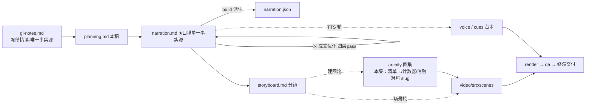

# 策划案：新系列 ep5《TodoWrite：把计划摆回模型眼前》（v2 · 文案轮待用户审批 · C 型信源 = gl-notes）

> 状态：系列 claude-code-chapters 第 5 集（s05_todo_write 单章，2026-10-31 开工）。本轮为**文案轮**（Stage ①–⑤）：逐字稿与全部文案交用户审批，审批通过才进入制作（⑥ 分镜 → ⑩ 交付），故本稿不做建图与场景设计。事实源 = `research/gl-notes.md`（冻结自现行 172，2026-10-23 I-235 后代次；取材范围 s05 单章，§1–§2 统一视角作开场框架、§4–§7 属兄弟集只在下期钩子一笔带过）。

成本档位: 正集（单语 + story 档已配音系 + 约 5 分钟常规动画复杂度；文案轮无生产层开销，制作期成本量级 = 常规单集）

## 0. 标题候选（待审批；series.json 现为工作题《TodoWrite：把计划摆回模型眼前》，审批后落定）

| 候选 | 一句话理由 |
|---|---|
| A《TodoWrite：把计划摆回模型眼前》 | 直取冻结正文 §3 节题「把计划摆回 LLM 眼前」（口播层换「模型」），机制动作一句话说清，零解码成本 |
| B《TodoWrite：加一个不干活的工具，长任务不跑偏》 | 承系列 ep2「多加一个工具」句式，用「不干活」反差直击本集记忆点（todo_write 零执行能力、加的是规划能力） |
| C《计划靠摆放，不靠记性》 | 直取规律二「状态外置」的白话收束（「别考验记忆，考验摆放」），认知增量落在「可见性即影响力」——跑偏不是智力问题，是信息不在场 |
| D《一条提醒，值三轮等待》 | 以 nag reminder「连续 3 轮没更新就注入」机制钩子入题，E1 消融（拆掉后 2/3 步、7 个漂移动作）作正反对照预告 |

## 一、定位表

| 项 | 值 |
|---|---|
| 平台 | B 站 / YouTube 中长视频 |
| 时长目标 | 4.4–5.6 分钟（pipeline.toml 硬约束窗，含系列片头 ~23.5s 口径；正文 1305 字预算 @254 字/分） |
| 形态 | AI 配音（story 档）+ Remotion 代码动画，无真人 |
| 受众 | 不预设工程背景的普通人：见过「AI 帮忙干活干到一半跑偏」、没想过跑偏根源在「每轮看到什么」的任何观众 |
| 核心内容范围 | gl-notes §3 全节（机制两半：待办工具三态回填 + 计数提醒 / snake_case 三步走查 t1–t11 / episode A 实测 / 两轨差异之「固定三轮=教学设定」）+ §8 数字表本集口径两行（3 轮 nag 阈值=教学设定、原型去掉 reminder 2/3 步·7 个漂移动作）+ §9（M1 行号锚、E1 破坏性实验=本集核心消融、阈值 1/999 两组实测）+ §10 规律一「可见性即影响力」、规律二「状态外置」、争议一「计划外显是补丁还是必需」+ §1–§2 统一视角（「每轮看到什么」三通道）作开场框架；§4–§7（Subagent / Skill / System Prompt / Error Recovery）属本系列 ep6 / ep7 / ep10 / ep11，本集只在下期钩子一笔带过不重讲；§12 自测题第 3 问（争议一）作 P4 争议素材源头 |
| 系列位置 | 系列第 5 讲：ep2 立起「加一个工具只加两行」的工程账，本集回扣同款账目（待办工具 = 又一条定义 + 一行注册）并第一次把镜头从「能力叠加」转向「可见性管理」——规划层的核心规律（可见性即影响力 / 状态外置）首次立锚 |

**Logline**：计划记在脑子里，做完一步忘两步；把它写成清单摆回每轮眼前，再加一条数到三就插话的提醒——一个零执行能力的工具，管住长任务的跑偏（gl-notes §3 + §9 E1 + §10 规律一/二）。

## 二、叙事策略

**主线是一问一答的闭环**：开场承接前集尾钩（计划在脑子里、做完一步忘两步）→ P0 问题定性「说了等于没说」+ 归因「每步决策只看当轮可见文本」→ P1 机制两半回答「计划怎么摆回眼前」（待办工具三态 + 计数器数到三插提醒）→ P2 走查证明「提醒真的把跑偏拉回来」→ P3 反问「这条提醒真有那么要紧吗」——E1 消融 + 阈值变体回答「拆掉即漂移、阈值拉满等价于没有」→ P4 对照「教学设定、产品形态与官方姿态三者不同」+ 争议一 → P5 收束「别考验记忆，考验摆放」+ 下期钩子（大任务上下文越跑越脏）。

**开篇钩子候选矩阵（★ 待人工挑选——本集文案审批人即挑选人）**：

| # | 型 | 钩子文本（p0-01） | 吸引力留存逻辑 | 核心主干关联锚点 | 抛出的核心引子 |
|---|---|---|---|---|---|
| H1 | 承接痛点型 ★ | 「这是一份全记在模型脑子里的计划：做完一步，忘两步。」 | 「做完一步忘两步」的荒诞感 3 秒认领；前集尾钩意象原句式重现，系列连续性零成本 | §1 s05 例（十步的重构做完三步就开始即兴发挥）；P0 问题现场即钩子展开 | 计划怎么丢的？怎么摆回来？ |
| H2 | 反差型 | 「这是一个什么都不干的工具，偏偏管住了长任务。」 | 「不干活却管用」反常识，逼观众问一句凭什么 | §3（todo_write 零执行能力 +「增加的不是执行能力，是规划能力」） | 一个零执行能力的工具凭什么管住跑偏？ |
| H3 | 一句话本质型 | 「这是给模型的一块白板：计划不靠记，靠摆。」 | 把全片规律折叠成一句，制造「就这么简单？」认知落差 | §10 规律二（状态外置）+ 规律一 | 「靠摆」是什么意思？摆了就管用？ |
| H4 | 数字悬念型 | 「这是三轮沉默换一条插话：三轮不碰清单，系统就替它着急。」 | 机制本身当钩子，「替它着急」的拟人趣味 + 数字具体感 | §3 nag 机制（rounds_since_todo 计数到 3 注入） | 为什么是三轮？插的什么话？ |
| H5 | 危机型 | 「这是一场刷屏现场：计划明明白白写着，说了等于没说。」 | 「明明在却没用」的悖论抓人，痛点直给 | §1 聊天群刷屏类比（A#1）+ §3 吸收窗口 | 为什么还在的东西会丢？ |

★ 选定 H1（自动选定，待人工复核）。理由：单章集时长紧，承接型钩把「前集尾钩兑现」与「本集入场」压进同一句（反串线纪律下禁顺序词，意象承接是唯一合法通道）；痛点 3 秒认领、P0 当幕即展开不欠债；H2 反差句改写进 P1 记忆点（「它增加的不是执行能力，是规划能力」）；H3 本质句押 P5 收束金句；H4 数字悬念押 P3 阈值变体；H5 刷屏悖论作 P0 类比展开（A#1 登记条目，不另造新喻）。

**视觉母题统摄全片，局部类比点到即止**：连续感只由视觉母题承担（恒定循环环体〔M-001〕+ 系列色彩契约 + 本集「清单卡 + 计数器」装置视觉），严禁把局部类比升格为贯穿剧场。口播类比只准入 gl-notes 附录 A 承袭登记条目：本集实引 **#1 聊天群刷屏**（P0 落锚：长对话稀释早期目标，失配边界「人可回翻加重、模型没有这个动作」随行）、**#8 延展心智**（P5 收束：把心智状态放进环境再读回来，失配边界「认知科学是哲学论题、工程版更朴素——别考验记忆，考验摆放」随行）；其余登记条目属兄弟集（#3→ep6、#7→ep7、#4/#5/#2→ep10、#6→ep11）本集不启用；未登记类比不进口播。

**记忆点约每 60–90 秒一个**（全部取自 gl-notes §1/§3/§9/§10，数字必带基线标尺）：
P0「计划明明还在，说了等于没说」（§1 A#1 类比核心句）→ P1「它增加的不是执行能力，是规划能力」（§3 课程判断【二】）；「又是两处改动：一条定义、一行注册；循环一行没改」（§3 + B.3【一】，承 ep2 工程账）→ P2「数到三，一条提醒插进对话」（§3 nag 机制；吸收窗口 t5–t7）→ P3「拆掉提醒：三步只剩两步，漂移零到七」（§9 E1 本集复算【一】）；「信息不在场，再聪明也看不见」（SCQA 白话主线 + §10 规律一）→ P4「产品里没有固定三轮；较新的模型默认不启用这套任务工具」（§3 差异三【三】+ 官方文档【二】截至口径，口播加「这套」回指本集待办工具消换名断桥）→ P5「别考验记忆，考验摆放」（§10 规律二 + A#8）。

**收尾不贩卖焦虑，悬念只留给下期**：P5 护栏句并入片尾署源块（产品内部细节来自同学们的源码核查、未锁版本、细节会漂移——§11 精神，随署源句交代，与 ep1/ep2 同款）；争议一按冻结正文 §10 口径收（能力在演进、答案随版本漂移，只能对冲——**禁说成「官方否定 TodoWrite」**）；悬念留在下期钩子（大任务探查的中间过程理清就没用、却一直占着位置——只点问题不预告机制），不预告 Subagent 细节。

## 三、视觉语言

**色彩语义沿用系列契约**（深色底 `#0E1116`；警示红 `#FF5C5C` = 反例/漂移路径；确认绿 `#7ED321` = 机制在位/任务收尾；金句卡衬线体；公式/方法名只进角标）：

| 概念 | 专属色 | 语义 |
|---|---|---|
| 循环环体（全系列恒定锚〔M-001〕） | 陶土橙 `#D97757`（系列恒定，承 ep1） | 同一环体继续出场，本集环上高亮「调用前」时点——提醒正是在下一轮调用之前注入对话的那个挂点 |
| 计划清单/待办三态 | 规划蓝 `#6E9BFF`（本集主题色，theme.core 本集新增语义） | todo 清单卡、三态行（待办空心/进行中高亮/完成打勾）、「摆在眼前的计划」常驻可见语义 |
| 提醒注入/外力顶回 | 提醒紫 `#B48CF2`（本集主题色） | rounds_since_todo 计数器刻度、数到 3 的注入瞬间、「把计划顶回可见区」的外力动作 |
| 执行面/结果回喂流 | 青碧 `#64C4C0`（承 ep1） | 消息条、工具执行动作、tool_result 回喂流（与 ep1/ep2 同语义） |
| 漂移反例/吸收窗口 | 警示红 `#FF5C5C`（系列保留语义色） | E1 拆掉提醒后的漂移旋转帧、轮数耗尽卡、吸收窗口注意力光圈 |

构图纪律：消融对比一律左绿右红同屏（E1：提醒在位 11 轮·3/3 步·漂移 0·收尾 ↔ 拆掉提醒 轮数耗尽·2/3 步·漂移 7·没收尾）；阈值三档一律并列动态条 + 工况角标（默认 3：提醒 1 次 ↔ 阈值 1：提醒 6 次·消息 28 对 23·任务照常完成 ↔ 阈值 999：提醒 0·与拆掉逐项相同）；「可见区」视觉 = 一扇只照亮对话尾部的视窗，计划卡出窗即变灰（刷屏稀释的空间化呈现，对应 A#1 类比但不借用群聊 UI 常驻）；走查 beat 用消息条 + 清单卡双轨动画（Animated State Trace，承 ep2 同款）；计数器视觉 = 紫色刻度 0→1→2→3 递进 + 注入脉冲；视觉母题禁旧版隐喻系意象（车间/作坊/传送带/工序卡/叫号器/插线口/师傅及同族），一律工程直陈：装置、清单、计数器、注入、可见区、挂点。

**景别走 `WS→CU→MS`，张力峰值在 P3**：P0 消息瀑布全景（计划卡沉底渐暗）→ P1 急推清单卡特写（三态图例点火）与计数器特写（紫色刻度）→ P2 走查中景（消息条 + 清单卡双轨并置）→ P3 消融双特写（左绿右红对照 + 漂移旋转帧）→ P4 拉远（教学版/产品/官方三卡对照全景）→ P5 清单卡定格收束 + 金句卡。运镜密度：P3 紧张段每镜 ≤1 次推近；重音镜每 20–40s 一个 1–2s punch（与记忆点 60–90s 咬合，P2「数到三」注入脉冲、P3 消融翻转为本集两大 punch）；张力曲线在 P3 拆掉提醒处到峰值、P4 用拉远降压、P5 平收。

## 四、分幕结构表

| 幕 | 目标时间 | 字数预算 | 主题 | 叙事要点（回溯 gl-notes） | 视觉锚点 | 前置概念 |
|---|---|---|---|---|---|---|
| P0 计划说了等于没说 | 0:00–0:45 | ≈185 | 钩子 + 问题现场 | H1 钩子落 p0-01（承接前集尾钩意象：计划在脑子里、做完一步忘两步）；任务现场：三步任务（改命名、跑测试、写报告），改到一半测试失败、模型一头扎进修测试、最初的目标被忘在脑后（§1 s05 例 + SCQA，十步的重构做完三步就开始即兴发挥）；金句定性：计划明明还在，说了等于没说；A#1 聊天群刷屏类比 + 失配边界（记录还在、新消息刷屏堆上来、注意力只落在最新一段；人能翻回去把旧约定顶上来，模型没这个动作、旧内容越压越低）；归因：模型每一步决策，只看这一轮摆在眼前的文本，随即口播首释「这一段，就是可见区」（§1 统一视角；p0-07 预埋术语锚，P3 消融归因复用）；幕尾钩：丢了的计划怎么找回来 | 消息瀑布全景：任务指令卡沉顶、工具结果消息条堆高、计划卡压进中下部渐暗；群聊刷屏帧 1–2 拍即切回机制画面；「可见区」视窗首次亮出（只照亮对话尾部）；右下角署源角标（首部署源位） | — |
| P1 一个不干活的工具 | 0:45–1:50 | ≈285 | 机制解构 | 框架句（§1–§2 统一视角作开场框架）：模型每轮看到什么——身份规则、对话记录、工具清单就三样；解法不绕：把计划写成清单、摆进对话记录，变成每轮都看得见的文本（§3 前一半概览；「摆进对话记录」补上 P0 抛出的「怎么看得见」通道环，兑现「对话记录」白话先释）；装置两半之前一半：待办清单工具——模型传入一份清单、每条标三态（待办/进行中/完成）、系统存进内存，计划从脑子搬进程序（§3）；反差记忆点：这个工具什么都不干、读不了文件跑不了命令——它增加的不是执行能力，是规划能力（§3 课程判断【二】）；工程账回扣（承 ep2「加一个工具只加两行」）：又是两处改动——一条定义、一行注册、循环一行没改（B.3【一】：TOOLS 一条定义 + TOOL_HANDLERS 一行映射）；后一半：计数器专盯清单——本轮工具调用出现待办工具即清零、没出现加一，数到三、下一轮调用前往对话插一条提醒「更新你的待办」，插完清零周而复始（§3 nag 机制，站点轨钉点实测【一】教学版限定）；幕尾钩：两半拼齐，跑一遍看看（P2 为设计走查例，避开「真的」与 P3 原型实测的口径混淆） | 三通道框架图三卡并列；规划蓝清单卡特写（三态图例点火）；「零执行能力」反差帧；工具对照表增一行 + 环体〔M-001〕「循环不改」旁注；紫色计数器特写（0→1→2→3 递进 + 注入脉冲） | 调用（ep2 已释「工具调用」，工程账一句回扣）；对话记录（本幕先释：每轮排开的用户消息、回复与工具结果） |
| P2 三步任务走一遍 | 1:50–2:40 | ≈215 | Worked Example | 拿教学版的演示走一遍——教学版＝为讲清机制搭的简化版，口播首现即落白话锚（设计走查例口径：机制演示呈现、mock 域、不作实测断言不带归属句）：任务 = 改下划线命名、跑测试、写报告（三步口径与 p0-02/p2-02 全片统一；信源任务原文第三项「修好失败」的情节由 t5 吸收窗口的测试失败承担，走查入口不再枚举，消两次口径翻转）（§3 走查例，snake_case 白话）；t1 建单：重命名、跑测试、写报告三条、首条标进行中，清单文本进对话（§3，主轨形态演示）；t2–t4 顺利段：第一步改完、更新清单（首条完成次条进行中、计数清零）、跑测试（§3）；t5–t6 吸收窗口：失败冒出来、模型一头扎进修测试、清单连着几轮没碰、计数器爬到三（§3，吸收窗口=被一个环节吸住、连续不理计划的轮次）；t7 注入：下一轮调用前那条提醒插进来；t8 拉回：重建清单（前两步完成、末条进行中）；t9–t11 收尾（§3 时间线 t1–t11 逐拍）；幕尾钩：这条提醒真有那么要紧吗——引 P3 消融 | 走查舞台（Animated State Trace）：消息条 + 清单卡双轨并置；顺利段快进；吸收窗口慢镜（注意力光圈被失败消息吸住、清单卡离场渐暗、计数器爬升特写）；注入脉冲（紫）；重建清单卡（前两勾末条进行中）；收尾快进 + 疑问钩字卡 | 三态（P1 已释）；计数器（P1 已释）；教学版（本幕先释：为讲清机制搭的简化版，p2-01 口播首现即锚） |
| P3 拆掉提醒试试 | 2:40–3:40 | ≈250 | 判据 + 消融 | 基线：教学原型复刻全程——十一轮、三步全完成、一条提醒、零跑偏（§3 episode A 实测，本集复算【一】原型限定）；E1 核心消融：拆掉提醒再跑——三步只剩两步、轮数耗尽没收尾；更扎眼的是漂移：七个重复的格式化动作全在原地打转（§9 E1：漂移 0→7、收尾 False，【一】）；归因：被测试吸住的那几轮一过、清单出了可见区、模型顺着惯性漂走；提醒不是客套，是把计划顶回眼前的唯一外力（§3）；阈值变体：改成一轮没碰就提醒——任务照常完成、代价是六次提醒与更啰嗦的对话（§9 阈值 1：提醒 6 次、消息 28 对 23）；改成九百九十九——等价于没有提醒、漂移照旧（§9 阈值 999：与 E1 逐项相同）；规律一收束：可见性即影响力——在场才有影响、被稀释等于缺席；换更聪明的模型也没用：信息不在场，再聪明也看不见（§10 规律一 + SCQA 白话主线）；幕尾钩：真实产品里这个提醒长什么样 | 左绿右红消融同屏（提醒在位 11 轮·3/3·漂移 0·收尾 ↔ 拆掉 轮数耗尽·2/3·漂移 7·没收尾）；可见区视窗回放慢镜（清单文本条被挤出窗外）；漂移环（同一动作循环 7 次计数）；阈值三档并列动态条（3 默认 / 1 / 999 + 工况角标）；规律金句卡预告（衬线体）；「更聪明的模型」示意（更大脑形图标依旧看不见窗外文本） | 漂移（本幕先释：偏离计划原地打转的重复动作）；教学原型（本幕先释白话：把机制抽成可复跑的教学演示件） |
| P4 真实产品的形态 | 3:40–4:25 | ≈180 | 生产对照 + 争议 | 真实的 Claude Code 呢——归属句：拆解过 Claude Code 源码的同学们应该知道，产品里没有固定三轮这回事（§3 差异三【三】）；三轮是教学设定；真实触发是待办全完成、验证还缺着（口播压缩口径，「3 个以上 todo」数字限定与「更接近」弱化词由 P4 产品卡视觉层承载——「事件触发：3+ 待办全完成 + 缺验证」+ 角标 3+ todos）（§3【三】：真实实现更接近「3 个以上 todo 全部完成、但没有 verification 项时」追加验证提示）；官方文档，截至 2026-10-31：较新的模型默认不启用这套任务工具（口播加「这套」回指本集待办清单工具，消官方换名断桥）——理由：更新的模型不需要书面清单也能做多步任务（官方文档【二】带截至口径；禁引申为「官方否定 TodoWrite」）；争议一：计划摆到眼前，是补丁还是必需——根子是对模型自己规划靠不靠谱的估计；能力在演进、答案跟着版本变（口播避 P3 术语「漂移」的撞词，源文口径「随版本漂移」见 §10 争议一 + §12 自测题第 3 问源头）；幕尾钩：争议先放着，规律更值钱 | 三卡对照全景：教学版卡（固定三轮）→ 产品卡（事件触发：3+ 待办全完成 + 缺验证；角标 3+ todos）→ 官方卡（较新模型默认不启用；日期角标 2026-10-31）；争议天平（左「补丁」右「必需」）；版本漂移曲线（能力演进轴，「漂移」留视觉词、口播避撞） | 教学设定（本幕先释白话：教学版为讲清机制自定的参数，非产品行为） |
| P5 收束与下期 | 4:25–5:05 | ≈190 | 收束 + 钩子 + 署源 | 收束规律二：状态外置——计划写进外部结构、再灌回每轮眼前（§10 规律二）；A#8 延展心智类比 + 失配边界：认知科学管这叫延展心智；工程的版本更朴素——别考验记忆，考验摆放（1 句点亮即收）；下期钩子（只点问题不预告机制）：小任务的计划治好了、大任务还有新麻烦——修缺陷要读几十个文件、聊几十轮，理清之后就没用的过程一直占着位置（§1 s06 例白话，ep6 域；「小任务对大任务」白话对照，避「单步计划」与本集「三步」锚撞词）；对话越跑越脏、重要的东西反而没地方摆——下期见；片尾署源块（系列既定尾位，两句）：这套视频改编自开源课程 Learn Claude Code + 产品内部细节来自同学们的源码核查、没锁版本、会漂移（本集有【三】级内容，第二句必带） | 清单卡定格收束（规划蓝）+ 金句卡（衬线体）「别考验记忆，考验摆放」；延展心智示意 1 拍（计划从脑图标外置到环境再读回）；下期问题卡（对话池越堆越满、无用消息条上浮——只点问题）→ 片尾署源卡（信源名 + 仓库地址，视觉层） | — |

> 正文合计 ≈1305 字预算上限：六幕预算 185+285+215+250+180+190 = 1305，写作目标压在 1150–1220（幕预算为上限分配，允许 P1/P3 各回吐 20–40 字）。句均 20–24 字 → 约 48–56 句。
>
> v1 实稿对账（55 句 / 1305 字 / 5.1 分落窗）：各幕 183 / 271 / 199 / 252 / 202 / 181——P4 因【三】归属句 + 官方文档截至日期口径的纪律性固定开销超规划 22 字、P3 微超 2 字，由 P1/P2/P5 回吐吸收，全片守 1305 预算线（幕级浮动与 ep2 先例同口径，硬约束在全片）。
>
> v2 成文优化对账（55 句 / 1352 字 / 5.3 分落窗，build 实测口径、句 id 集不变）：各幕 194 / 282 / 217 / 254 / 204 / 201——④⑤ 修稿净增 47 字（P0 可见区口播首释 +12、P1/P2 通道闭环与教学版白话锚 +27、P3 阈值机制白话 +2、P4「这套」回指桥 +2、P5 消歧 +5），P1/P2/P5 幕预算内回吐、P0/P3/P4 幕级微浮由全片窗吸收（硬约束 target_minutes 4.4–5.6 ≈ 1118–1422 字，1352 字在窗内）。
>
> v2 评审修正对账（第二轮成文评审 REWRITE=2 修正后：55 句 / 1358 字 / 5.3 分落窗，句 id 集不变）：各幕 194 / 282 / 217 / 254 / 204 / 207——p5-01 收束引子口语化「收束：」→「把解法收成一句话：」+6 字（P5 201→207）；p1-08 并组零字数、beat 18→17 段（p1-03–p1-08 六句一镜）；全片窗吸收（4.4–5.6 ≈ 1118–1422 字，1358 字在窗内）。

## 五、生产管线图

本轮产物止于 C（含 ④⑤ 修缮；虚线节点为制作期，审批通过后启动）。

## 六、边界与不做的事

**系列递进边界（照抄口径，本集不进入）**：Subagent / Skill Loading / System Prompt / Error Recovery（同系列 ep6 / ep7 / ep10 / ep11）只在下期钩子点一笔问题引子（上下文越跑越脏）；ep2 的查表分发机制本集只在工程账回扣一句（一条定义 + 一行注册）、不重讲；Task System V2 五项增量、V1/V2 双任务系统、`isTodoV2Enabled`、`activeForm` 字段属 s12（本系列 ep12）与 s05 附录深读【三】域，本集不展开（素材取舍见下条）；记忆、多 Agent、并发调度不沾。

**片头沿用《一个循环》（制作期）**：系列片头资产 ep1 制作期已挂载孪生登记，本集沿用同款（~23.5s，预算已计入）；本集挂载件与孪生门登记随制作期处理，本轮只占预算。

**口播红线不可越**：观众层信源标识只许出现在首尾既定署源位——片头署源角标（p0-01 beat 视觉层）+ 片尾署源句（尾幕两句），豁免白名单登记在工作区 `vibe-video.toml [check_series.source_credit]`（RSI I-080），其余位置零课程/站点/章号痕迹；【三】级断言归属由片尾署源位承接，正文归属句只用「拆解过 Claude Code 源码的同学们应该知道」句式（ep1 审批口径）；活数据（章节数/star）不进口播；禁顺序词（上一集/上集/上期/下一集/下集/第 N 集/前一集/本系列——署源句用「这套视频」），收尾预告只许「下期」；Harness 不翻译（口播英文例外清单 = Claude Code + bash（作为工具名随 ep1 已口播例外）+ 署源专名 Learn Claude Code），其余英文方法名与命令（TodoWrite / todo_write / pending / in_progress / completed / rounds_since_todo / reminder / snake_case / nag_threshold / verification / CLAUDE_CODE_ENABLE_TASKS 等）进角标不口播——本集主角工具口播恒称「待办（清单）工具」；禁旧版隐喻系词汇及同族意象（车间/作坊/传送带/工序卡/叫号器/插线口/师傅）。

**素材取舍，弃用而非遗漏**：两轨差异一（reminder 注入点：站点轨新 user 消息 vs main 轨追加进 tool results）、差异二（main 轨 TodoManager 三限校验：至多 20 条 / 单条 in_progress / 字面量解析不碰 eval）、差异四（站点轨回填只回「Updated N tasks」计数、渲染仅打印终端 vs main 轨渲染清单回填）均不进口播——三处是教学版两轨实现细节，普通观众无判决需求，且引用须带轨属、口播成本高（B.3 风险条），材料留档 gl-notes §3/附录 B.1；差异三（固定三轮=教学设定）是本集 P4 主素材、保留。官方「四个 Task 工具 + 环境变量开关换单工具形态」（B.1 doc-todo-tracking）弃用——次级形态细节，官方口径只取「较新的模型默认不启用任务工具 + 理由」两拍撑争议一张力。s05 附录「深入 CC 源码」五项增量（V1/V2 双任务系统等【三】）弃用——属 ep12 域。SYSTEM 提示「先计划再执行」引导（B.3【一】）弃用——实现细节、非主线。E2–E5 数字（18.0 倍 / 8.3 倍 / 误注入 / 一刀切重试）分属 ep6 / ep7 / ep10 / ep11 域，本集不消费。阈值 1 变体的消息数 28 对 23 取「更啰嗦的对话」白话 + 角标数字呈现、口播只说六次提醒。Lost in the middle 论文引证（§10 规律一实证基础 [5]）不进口播——规律一以白话主线（信息不在场，再聪明也看不见）呈现，论文级归属留文案层不进字幕。snake_case 三步走查按设计走查例口径呈现（机制演示、mock 域，不作实测断言、不带归属句）；「吸收窗口」术语不进口播（白话「被测试吸住的那几轮」）。

**文案轮边界**：文案轮不跑 TTS、不动场景代码与 Main.tsx、不建 archify 图（storyboard 属制作期首轮）；series.json 登记为文案轮工作题，标题随审批落定；BGM 留空轨；信源外观点不进口播。制作期（⑥–⑩）审批通过后逐项启动。
