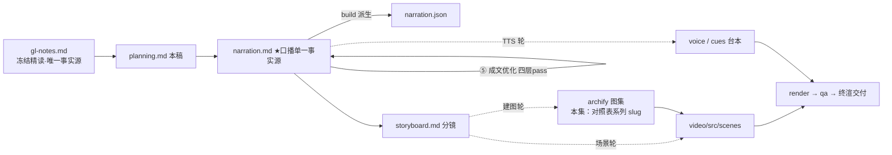

# 策划案：新系列 ep2《Tool Use：多加一个工具，只加一行》（v1 · 文案轮待用户审批 · C 型信源 = gl-notes）

> 状态：系列 claude-code-chapters 第 2 集（s02_tool_use 单章，2026-10-29 开工）。本轮为**文案轮**（Stage ①–⑤）：逐字稿与全部文案交用户审批，审批通过才进入制作（⑥ 分镜 → ⑩ 交付），故本稿不做建图与场景设计。事实源 = `research/gl-notes.md`（冻结自现行 171，I-234 后代次，与 ep1 同一冻结正文代次；取材范围 s02 单章）。

成本档位: 正集（单语 + story 档已配音系 + 约 5 分钟常规动画复杂度；文案轮无生产层开销，制作期成本量级 = 常规单集）

## 0. 标题候选（待审批；series.json 现为工作题《Tool Use：多加一个工具，只加一行》，审批后落定）

| 候选 | 一句话理由 |
|---|---|
| A《Tool Use：多加一个工具，只加一行》 | 直取课程 s02 章副题，「只加一行」自带反差（观众预期加工具要动架构） |
| B《Tool Use：长出更多的手》 | 承系列「手」母题（ep1 装上手 → ep2 长出更多的手，附录 A#2 直取），系列连续感最强 |
| C《Tool Use：给意图一个名字》 | 直取本集最深一层（bash 万能却无形状 → 具名工具让装置第一次看清调用想干什么），认知增量最大 |
| D《Tool Use：万能手的代价》 | 问题型（万能 bash 每个动作都要拼咒语），与钩子 H1 同构 |

## 一、定位表

| 项 | 值 |
|---|---|
| 平台 | B 站 / YouTube 中长视频 |
| 时长目标 | 4.4–5.6 分钟（pipeline.toml 硬约束窗，含系列片头 ~23.5s 口径；正文 1305 字预算 @254 字/分，实稿 1325） |
| 形态 | AI 配音（story 档）+ Remotion 代码动画，无真人 |
| 受众 | 不预设工程背景的普通人：见过「AI 能帮你跑命令」、没想过工具从哪来的任何观众 |
| 核心内容范围 | gl-notes §4 全节（4.1 拼命令之痛 / 4.2 定义与注册·查表分发 / 4.3 多工具调用与编号配对 / 4.4 生产版三细节）+ §7 数字表三行（1→5 个工具 = 2 处改动、五步验证 Pipeline、读文件上限无穷大）+ §8 实验 2（编号配对消融，本集消融正例）+ §9.1 规律 1（核心不变·能力正交叠加）与规律 4（协作靠契约与配对回执，收束用）；§3（Agent Loop）属本系列 ep1，本集开场以「一双手」母题承接一句、不重讲机制；§5–§6（Permission / Hooks）属后续集，本集只在下期钩子一笔带过 |
| 系列位置 | 系列第 2 讲：在 ep1 的循环骨架上加第一层能力——「能力正交叠加」规律的首次实证；系列视觉母题（恒定环体）延续，新增「查表」装置视觉 |

**Logline**：万能手事事拼咒语；给动作起名字、按表分发——五件家什换进来，循环一行没改（gl-notes §4.1 + §4.2 + §9.1 规律 1）。

## 二、叙事策略

**主线是一问一答的闭环**：开场抛问题「这双手为什么又丑又容易错」→ P1 用「定义 + 注册 + 查表」回答「加工具不动循环」→ P2 走查证明「专用工具真的更直、更稳」→ P3 反问「一次多个调用，结果怎么各归各」——编号配对 + 消融实验回答「没有配对，乱序即错位」→ P4 对照生产版「工具落地前还要过五道关」→ P5 收束「核心不变，能力正交叠加」+ 下期钩子（bash 还是不设防）。

**开篇钩子候选矩阵（★ 待人工挑选——本集文案审批人即挑选人）**：

| # | 型 | 钩子文本（p0-01） | 吸引力留存逻辑 | 核心主干关联锚点 | 抛出的核心引子 |
|---|---|---|---|---|---|
| H1 | 痛点型 ★ | 「这只手什么都拿得动，就是每拿一件东西，都得先拼一段咒语。」 | 「万能却别扭」的即时认领（谁见过又长又脆的命令行），3 秒锁注意力 | gl-notes §4.1（bash 万能却无形状）；P0 问题现场即钩子展开 | 为什么越万能的手越难使？怎么给它换一批顺手的家什？ |
| H2 | 一句话本质型 | 「给这双手长出更多手指的全部机关：一张名字对动作的对照表。」 | 把「扩展工具」折叠成一张表，制造「就这么简单？」认知落差 | §4.2（查表分发）；P1 首拍即拆解兑现 | 一张表怎么敢接所有工具？ |
| H3 | 反差数字型 | 「从一件家什到五件，循环只改了一行——以后每加一件，也只加一行。」 | 极小改动对持续扩展的承诺，数字反差 + 「以后也」的余韵 | §7（1→5 = 2 处改动）+ §9.1 规律 1 | 凭什么敢承诺「只加一行」？ |
| H4 | 新范式揭示型 | 「工具没给模型新本事，是给程序长了一双看得清的眼睛。」 | 「没给新本事」颠覆直觉（加工具≠加能力？），逼观众重想「工具是什么」 | main 轨新节（接口论证，§4.1 深层）；P1 末拍兑现 | 看得清的眼睛，后面换来什么？ |
| H5 | 悬念冲突型 | 「同一轮里两个结果交换了主人——只差一个编号，报给模型的话就全乱了。」 | 冲突 + 悬置结果（怎么交换的？后果多严重？） | §4.3 + §8 实验 2 | 编号是什么？拔掉它会发生什么？ |

★ 选定 H1（自动选定，待人工复核）。理由：单章集时长紧，痛点钩 3 秒认领、P0 当幕即兑现（不欠债）；H2 本质句改写进 P1 收束（两全）；H3 数字承诺押在 P5 收束（规律 1）；H4 接口认知放 P1 末拍（本集最深一层，作幕点不作钩子，避免开篇抽象）；H5 悬念押 P3（对前半程是负债）。

**视觉母题统摄全片，局部类比点到即止**：连续感只由视觉母题承担（恒定循环环体〔M-001〕+ 系列色彩契约 + 本集「查表」装置视觉），严禁把局部类比升格为贯穿剧场。口播类比只准入 gl-notes 附录 A 登记条目：本集实引 #2 长出更多的手（P0 落锚、P5 回扣）、#5 快递单号配对（P3）；#1 接上一双手仅作开场承接语（ep1 已建锚、不计新喻）；每处 1–3 句点亮即切回机制画面，失配边界句随行（#5 的「快递单号跨天有效还能查物流，编号只活一轮、结果是一次性回执」随行）。未登记类比不进口播。

**记忆点约每 60–90 秒一个**（全部取自 gl-notes §4/§7/§8，数字必带基线标尺）：
P0「万能的手没有形状：读文件要拼 cat，写文件要拼 echo，改文件要动 sed」（白话开场）→ P1「加一个工具，两处改动：一条定义、一行注册；循环一行没改」（§4.2/§7，code.py 可数【一】）→ P2「同一件事，两种说法：咒语三条，意图三枚」（§4.3 走查例）→ P3「拔掉编号：轮次照跑完，两个结果互换归属」（§8 实验 2，本集复算【一】）→ P4「工具落地前过五道关；读文件的结果上限是无穷大」（s02f 附录，【三】）→ P5 收束金句「核心不变，能力正交叠加」。

**收尾不贩卖焦虑，悬念只留给下期**：P5 护栏句并入片尾署源块（生产细节来自原作者单方核查、未锁 CC 版本号、计数随时点漂移——§11.1 精神，随署源句交代，与 ep1 同款）；悬念留在下期钩子（文件工具有边界检查、bash 还是不设防），不预告机制细节。

## 三、视觉语言

**色彩语义沿用系列契约**（深色底 `#0E1116`；警示红 `#FF5C5C` = 反例/退化路径；确认绿 `#7ED321` = 机制在位/拦截成功；金句卡衬线体；公式/方法名只进角标）：

| 概念 | 专属色 | 语义 |
|---|---|---|
| 循环环体（全系列恒定锚〔M-001〕） | 陶土橙 `#D97757`（系列恒定，承 ep1） | 同一环体继续出场，本集环上高亮「执行」段——它正是被查表替换的那一行 |
| 查表分发/工具卡 | 琥珀 `#EFB13C`（本集主题色，theme.core 本集新增语义） | TOOL_HANDLERS 对照表、五件工具卡、名字→动作的分发流 |
| 执行面/结果回喂流 | 青碧 `#64C4C0`（承 ep1） | 消息条、执行动作、tool_result 回喂流（与 ep1 同语义） |
| 错绑反例/越界 | 珊瑚红 `#EF6461`（承 ep1） | 实验 2 结果互换帧、拼命令出错帧（与警示红同族不同帧并用） |

构图纪律：消融对比一律左红右绿同屏（实验 2：配对在位 10/10·错绑 0 ↔ 拔掉编号 10/10·错绑 2——轮次不退、错绑现形）；「两种说法」对比一律左咒语右意图（同件事并列，等高裁决）；数字一律动态增长条 + 工况角标（1→5 工具 = 2 处改动基线标尺）；走查 beat 用消息条 + 工具卡堆叠动画（Animated State Trace）；查表装置视觉 = 名字列对动作列的对照表，加工具即表上增一行（全片反复出场、逐幕生长）；视觉母题禁旧版隐喻系意象（车间/传送带/工序卡/叫号器/插线口/师傅及同族），一律工程直陈：装置、对照表、分发、边界、挂点。

**景别走 `WS→CU→MS`，张力峰值在 P3**：P0 终端窗口全景（三条越拼越长的命令行）→ P1 急推对照表特写（两处改动逐一点火 + 环上那一行的替换）→ P2 走查中景（消息条 + 工具卡并置）→ P3 编号配对双特写（单号包裹流 ↔ 错绑旋转帧）→ P4 拉远（五道关门卡 + 连续批分区全景）→ P5 环体定格收束。运镜密度：P3 紧张段每镜 ≤1 次推近；重音镜每 20–40s 一个 1–2s punch（与记忆点 60–90s 咬合）；张力曲线在 P3 编号之争到达峰值、P4 用拉远降压、P5 平收。

## 四、分幕结构表

| 幕 | 目标时间 | 字数预算 | 主题 | 叙事要点（回溯 gl-notes） | 视觉锚点 | 前置概念 |
|---|---|---|---|---|---|---|
| P0 万能的手没有形状 | 0:00–0:50 | ≈195 | 钩子 + 问题现场 | H1 钩子落 p0-01；这双手只有 bash 一件家什：读文件要拼 cat、写文件要拼 echo、改文件要动 sed（§4.1，命令词全进角标）；模型心里想的是「读这个文件」，说出口却得是命令行——中间隔着一层翻译：费 Token、容易拼错（§4.1）；更深一层：bash 万能却没有形状——在程序眼里所有命令都只是一串字符，「读」和「写」分不出来（§4.1）；给它长出更多的手（A#2 落锚）——今天讲这双手怎么长 | 冷启动直入：终端窗口 + 三条越拼越长的命令行（引号/转义越叠越多）；右下角署源角标（首部署源位）；灰色的「翻译层」箭头压在命令行上 | — |
| P1 两件事与一张表 | 0:50–2:00 | ≈300 | 机制解构 | 加一个工具只做两件事：一是定义——在工具清单里加一条：名字、描述、参数说明书（写明每个参数叫什么、什么类型，告诉模型「我能做什么、参数长什么样」，§4.2，schema 进角标）；二是注册——在对照表里加一行：名字对上实现函数（§4.2）；循环里唯一的变动：那行写死的执行，换成查表——拿调用里的名字去表里对出函数、把参数递给它（§4.2）；教学版从 1 件长到 5 件：跑命令、读文件、写文件、改文件、按模式找文件（§4.2 白话序，工具名进角标）；循环一行没改（§4.2/§7，【一】）；幕点（本集最深一层）：这些工具没给模型新本事——同样的活 bash 都能干；它们改善的是模型与装置之间的接口：模型直接说意图、不再翻译，装置第一次拿到结构化的「这是读、那是写」（main 轨新节，§4.1 深层）——往后按工具和路径做裁决、在统一挂点做记录，都踩这块地基；文件类工具另有一道边界：路径必须落在工作目录之内，越界直接报错（§4.2）——安全第一次有了抓手 | 对照表主视觉首次亮出（琥珀）：两处改动逐一点火；环体〔M-001〕上「执行」段被替换为查表动作（唯一变动高亮）；五件工具卡依次入场；边界检查框住文件工具卡 | 工具调用（ep1 已释，开场承接一句）；参数说明书（本幕先释：写明参数叫什么、什么类型） |
| P2 同一件事，两种说法 | 2:00–2:45 | ≈210 | Worked Example | 拿一个具体输入走全程：「读一下 a 和 b 两个文件，再列出所有 Python 文件」（§4.3，设计走查例口径：机制演示呈现）；bash 版：拼三条命令，引号一层套一层，拼错一个字符就废（§4.1 失配面）；专用工具版：回答一次带三个调用——两枚读文件、一枚找文件，每枚自带参数；照表分发、逐个执行、结果回喂（§4.3）；一层翻译消失：模型说意图，装置看得懂（§4.1 接口层回扣）；一次回答带多个调用，第一次见面——多个调用各归各，靠什么？留给下一幕 | 左右对比帧（左：三条咒语命令行 / 右：三枚意图工具卡）；消息条 + 工具卡双轨动画（Animated State Trace）；环体同步转三小段 | 多工具调用（本幕首次现身，机制留给 P3） |
| P3 谁的结果归谁 | 2:45–3:55 | ≈280 | 判据 + 消融 | 一次多个调用，每个自带唯一编号；执行侧把每个结果包成带对应编号的回执，喂回去时按编号对回原调用（§4.3）；像快递并发派送：一次下多个订单，每个包裹贴单号，谁先到都能对回订单（A#5 + 失配边界：快递单号跨天有效、还能查物流；这里的编号只活一轮对话，结果是一次性回执）；教学版按顺序逐个执行，配对的价值要到乱序与并发场景才显形（§4.3）；实测说话：把编号配对拔掉，同轮的结果旋转错绑（§8 实验 2，本集复算【一】级）；十轮照跑完十轮、七件活照做七件——轮次一件没少；错处藏在里面：那一轮两个调用，结果互换归属——模型拿到的是别人的答案（§8 表）；教训一句话：没有配对，乱序即错位；顺序好的时候它白拿工资，一乱就翻车（§4.3/§9.1 规律 4：协作靠契约与配对回执） | 编号配对双特写：单号包裹流（绿）↔ 旋转错绑帧（红）；左红右绿消融同屏（配对在位 错绑 0 ↔ 拔掉编号 错绑 2，轮次同为 10/10）；对照表短暂压暗（配对不在表上、在消息层） | 唯一编号（本幕先释：每个调用自带的身份单号，英文 tool_use_id 进角标） |
| P4 生产版：五道关 | 3:55–4:40 | ≈185 | 生产对照 | 真实的 Claude Code 里，工具落地什么样？拆解过 Claude Code 源码的同学们应该知道：每个工具调用，落地前要过五道关——参数格式检查、参数值检查、钩子、权限、执行（s02f 附录，【三】，五步名目白话序、英文进角标）；并发的判定也不是「只读都能并发」这么粗：按具体输入判——列目录可以一起跑，删除不行；还有改了状态也照样并发的（每次写的是不同文件）（s02f，【三】）；一串调用按连续批分区：批内并发、批间保序（s02f，【三】）；每个工具的结果有长度上限，超限落盘、模型看预览加路径；唯独读文件的上限是无穷大——不然读文件的结果落盘成新文件，下次再读又落盘，无限循环（s02f，【三】+ §7 表） | 五道关门卡依次落位（琥珀描边）；连续批分区全景（三批：并发/串行/并发）；「无穷大 ∞」特写卡（读文件上限）；拉远收全景 | 并发（本幕口播白话：一起跑；进角标） |
| P5 收束与下期 | 4:40–5:15 | ≈135 | 收束 + 钩子 + 署源 | 收束金句：核心不变，能力正交叠加——五件家什换进来，循环一行没改；往后每个新能力，都是往固定挂点上加东西，不是改核心（§9.1 规律 1）；这双手也长齐了五根手指（A#2 回扣）；下期钩子：文件工具有了边界检查，可 bash 还是全开——删库跑路的命令照样跑得到；下期，在动手之前加一道门（只点问题不预告机制，禁顺序词）；片尾署源块（系列既定尾位）：这套视频改编自开源课程 Learn Claude Code + 生产细节来自原作者单方核查、未锁版本、计数会漂移（§11.1 精神） | 环体定格收束 + 金句卡（衬线体）；五指手掌视觉（琥珀，五件工具入指）→ 下期卡（视觉层）→ 片尾署源卡（信源名 + 仓库地址） | — |

> 正文合计 ≈1305 字预算上限：六幕预算 195+300+210+280+185+135 = 1305，写作目标压在 1150–1220（幕预算为上限分配，允许 P1/P3 各回吐 20–40 字）。句均 20–24 字 → 约 50–56 句。

## 五、生产管线图

本轮产物止于 C（含 ④⑤ 修缮；虚线节点为制作期，审批通过后启动）。

## 六、边界与不做的事

**系列递进边界（照抄口径，本集不进入）**：Permission / Hooks（同系列后续集）只在下期钩子各点一笔问题引子；ep1 的循环机制本集开场承接一句、不重讲（五步/判据/流式都不回头展开）；规划、记忆、并发调度、多 Agent 不沾。P4 生产对照里五步验证、并发分区、结果落盘只作「保护外圈」的证据形态呈现（名目 + 两三个代表），不逐个展开（权限那道关是下一集的主角、钩子到位即可）。

**片头沿用《一个循环》（制作期）**：系列片头资产 ep1 制作期已挂载孪生登记，本集沿用同款（~23.5s，预算已计入）；本集挂载件与孪生门登记随制作期处理，本轮只占预算。

**口播红线不可越**：观众层信源标识只许出现在首尾既定署源位——片头署源角标（p0-01 beat 视觉层）+ 片尾署源句（尾幕），豁免白名单登记在工作区 `vibe-video.toml [check_series.source_credit]`（RSI I-080），其余位置零课程/站点/章号痕迹（不出现课程/站点名/「第 N 章」——按章拆集只是编导结构）；【三】级断言归属由片尾署源位承接，正文归属句只用「拆解过 Claude Code 源码的同学们应该知道」句式（ep1 审批口径）；活数据（章节数/star）不进口播；禁顺序词（上一集/上集/上期/下一集/下集/第 N 集/前一集/本系列——署源句用「这套视频」），收尾预告只许「下期」；Harness 不翻译（口播英文例外清单 = Claude Code + Harness + bash（作为工具名随 ep1 已口播例外）+ 署源专名 Learn Claude Code），其余英文方法名与命令（TOOLS / TOOL_HANDLERS / read_file / write_file / edit_file / glob / tool_use_id / tool_result / schema 等）进角标不口播；「Token」首现带白话句（P0「费 Token」处：模型每读一个字都算钱粮——白话一句带过）；禁旧版隐喻系词汇及同族意象（车间/作坊/传送带/工序卡/叫号器/插线口/师傅——附录 A#10/#11 不进口播）。

**素材取舍，弃用而非遗漏**：课程 s02「试一下」运行指引与 prompt 示例（教学操作向）不进口播；s02f 附录六小节取四（isConcurrencySafe 按输入判定 / partitionToolCalls 连续批分区 / 五步验证 / 结果落盘与无穷大特例），第五节 StreamingToolExecutor（模型还在生成、工具就已启动）与工具定义方式对比（buildTool 对象）属执行编排与定义形态细节，本集不展开——弃用而非遗漏（材料留档 gl-notes）；教学输出截断 50000 字符（§7 表末行）属输出护栏、与本集主线无关，不进口播；「读 a 和 b 两个文件，再列出所有 Python 文件」按设计走查例口径呈现（不作实测断言、不带归属句）；实验 2 只取两组数（轮次 10/10 不退化 ↔ 错绑 0→2），基线全景数字（denied 2 / asked 2 等）不进正片——那是四机制齐备口径，本集单机制只认配对开关的因果。

**文案轮边界**：文案轮不跑 TTS、不动场景代码与 Main.tsx、不建 archify 图（storyboard 属制作期首轮）；series.json 登记为文案轮工作题，标题随审批落定；BGM 留空轨；信源外观点不进口播。制作期（⑥–⑩）审批通过后逐项启动。
