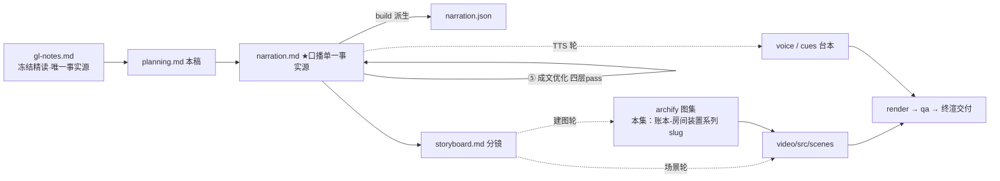

# 策划案：新系列 ep18《Worktree Isolation：一个任务，一个房间》（v2 · 文案轮待用户审批 · C 型信源 = gl-notes）

> 状态：系列 claude-code-chapters 第 18 集（s18_worktree_isolation 单章，2026-10-31 开工）。本轮为**文案轮**（Stage ①–⑤）：逐字稿与全部文案交用户审批，审批通过才进入制作（⑥ 分镜 → ⑩ 交付），故本稿不做建图与场景设计。事实源 = `research/gl-notes.md`（冻结自现行 175《多 Agent 平台》精读，2026-10-07 换代重写后代次；取材范围 s18 单章，钉站点轨 `67a9126c`，main 轨 `7226f555` 对照，台账 `s18-*` / `s18m-*` / `s18-site` / `doc-worktrees` 六条全绿）。

成本档位: 正集（单语 + story 档已配音系 + 约 5 分钟常规动画复杂度；文案轮无生产层开销，制作期成本量级 = 常规单集）

## 0. 标题候选（待审批；本集 series.json 条目随系列层登记，标题审批后落定）

| 候选 | 一句话理由 |
|---|---|
| A《Worktree Isolation：一个任务，一个房间》 | 机制名直取 + 门牌房喻体点题（附录 A 正牌喻体），与 ep2《Tool Use：多加一个工具，只加一行》同款「机制名 + 一句机制事实」句式 |
| B《Worktree Isolation：在哪干，任务说了算》 | 承接系列问题链「谁干什么 / 怎么说话 / 谁派活」之后的「在哪干」一问，副句取 s18 题记口诀「任务管目标，worktree 管目录，按 ID 绑定」的机制化改写 |
| C《Worktree Isolation：挡互踩，不挡越狱》 | 把本集两条最强认知增量压成反差一句——worktree 解决并行互踩（能做什么）但不是安全沙箱（不做什么），边界护栏卡即本集记忆点 |
| D《Worktree Isolation：删除前的那道默认拒绝》 | 以本集核心消融（有改动拒删守卫）为叙事钩——收尾保护比创建更值得学，删与留的三出口是全片戏剧张力所在 |

## 一、定位表

| 项 | 值 |
|---|---|
| 平台 | B 站 / YouTube 中长视频 |
| 时长目标 | 4.4–5.6 分钟（pipeline.toml 硬约束窗，含系列片头 ~23.5s 口径；正文 1305 字预算 @254 字/分，实稿 1363 ≈ 5.4 分，落窗内） |
| 形态 | AI 配音（story 档）+ Remotion 代码动画，无真人 |
| 受众 | 不预设工程背景的普通人：见过「多个 AI 一起干活」的想象、没想过它们怎么不互相覆盖文件的观众 |
| 核心内容范围 | gl-notes §7 全节（同目录互踩问题 / git worktree 一仓库多目录各挂分支 / create_worktree 三步绑定 / 绑定不改状态 / 认领后工具落房 / 收尾三出口 / 事件流 / 名字校验 / 不是安全沙箱）+ §12 规律 1（状态入文件——房号落任务卡的收束锚）+ §13 第 2 条（worktree 不是安全隔离，本集边界护栏卡正源）+ 附录 B.2 核心消融（钉点 code.py 守卫沙箱探针 18 项断言全绿，升【一】级：默认拒绝 ↔ 旁路强删连坐）+ B.1「深入 CC 源码」附录【三】级两入口（EnterWorktree 会话切入 / AgentTool 子代理隔离）与官方 worktrees 页增量补证（退出检查同型 / 子代理隔离专节）；§3–§6、§8、§9 属同系列其他集（任务系统 / 团队 / 协议 / 自治 / MCP / 综合），本集只在 p0-04 与下期钩子各点一笔、不重讲；§11 五组破坏实验无一消融本集机制（lcc 原型零 worktree 代码，B.2），本集核心消融由守卫沙箱实测承担 |
| 系列位置 | 多 Agent 族「在哪干」的收官一问：自治（谁派活）解决了并行开工，本集解决并行改文件互踩；「靠设施不靠自觉」系列母题的又一次实证；视觉母题（恒定环体）延续，新增「账本—房间—分支线」装置视觉 |

**Logline**：几个队友挤同一个目录，谁也改不干净；一本账挂出几间房，各改各的线，拆房还有一道默认拒绝——并行不踩脚，靠设施不靠自觉（gl-notes §7 + 附录 B.2 核心消融）。

## 二、叙事策略

**主线是一问一答的闭环**：开场抛问题「都改同一个文件，在哪干」→ P1 用「一账本多房各挂线 + 任务级绑定」回答「并行各改各的」→ P2 双房走查证明「真的踩不着、账还清楚」→ P3 反问「活干完了房怎么收」——清点守卫 + 三出口 + 消融实测回答「没有那道默认拒绝，一句口令就无声抹掉」→ P4 对照生产版「两个入口 + 一条边界（不是沙箱）」→ P5 收束「靠设施不靠自觉：房号入文件、收尾有守门」+ 下期钩子（外面现成的工具怎么接）。

**开篇钩子候选矩阵（★ 待人工挑选——本集文案审批人即挑选人）**：

| # | 型 | 钩子文本（p0-01） | 吸引力留存逻辑 | 核心主干关联锚点 | 抛出的核心引子 |
|---|---|---|---|---|---|
| H1 | 痛点型 ★ | 「这是同一个目录里挤着的几个队友：各干各的活，改的却是同一份代码。」 | 「互踩现场」3 秒认领（谁没见过两个人同时改一个文件），且一句兑现前集「同改一处、互相踩脚」的钩子意象、零顺序词 | §7 开场（Alice/Bob 同目录互踩 config.py）；P0 问题现场即钩子展开 | 在哪干？怎么让并行真的各改各的？ |
| H2 | 反直觉颠覆型 | 「这是一份不用复制的复制：同一个仓库，铺出几间房，账只有一本。」 | 「不用复制的复制」制造「怎么可能」落差（多份工作目录 ≠ 多份拷贝） | §7 worktree 定义 + 附录 A 失配拦截（房间不是副本粘贴——是同一账本挂出的独立目录）；P1 首拍兑现 | 不是副本，改动怎么不串、账怎么只有一本？ |
| H3 | 消融危机型 | 「这是一句能连账一起抹掉的清理口令。」 | 危机具象（一句口令 = 未提交的工作无声销毁、分支连坐删除），悬念最强 | 附录 B.2 核心消融（discard 强删连坐删）；P3 当幕兑现 | 默认拒绝挡在哪？拔掉它到底丢什么？ |
| H4 | 边界揭示型 | 「这是一道挡得住踩脚、挡不住越狱的墙。」 | 反差双面（能 / 不能），认知增量直给——隔离 ≠ 沙箱 | §13 第 2 条 + §7 末（不是安全沙箱）；P4 末 / P5 回扣 | 它到底挡什么、不挡什么？ |
| H5 | 悬念冲突型 | 「这是一场谁也没犯规的覆盖：各干各的活，最后谁的都没留下。」 | 悬置结果（怎么都没留下？）+ 冲突感 | §7 开场（互相覆盖、分不清归属、回滚不干净）；P0 展开 | 为什么各干各的还会互相覆盖？ |

★ 选定 H1（自动选定，待人工复核）。理由：痛点钩 3 秒认领、P0 当幕兑现不欠债；同时一句承接前集「互相踩脚」钩子意象（零顺序词、零他集标题）；H2 本质句改写进 P1 首拍（p1-01「不是复制粘贴出来的副本」），H3 押 P3 消融幕当全片戏剧峰值，H4 押 P4 边界收束与 P5 回扣，各得其所。

**视觉母题统摄全片，局部类比点到即止**：连续感只由视觉母题承担（恒定循环环体〔M-001〕+ 系列色彩契约 + 本集「账本—房间—分支线」装置视觉），严禁把局部类比升格为贯穿剧场。口播类比只准入 gl-notes 附录 A 登记条目：本集实引**门牌房**（§7 git 工作树一任务一目录——正牌喻体，全套登记语义可用：中央账本 / 各改各的线 / 绑定只加房号 / 名字校验 / 拆房三出口 / 事件日志）；p0-04 的任务板 / 收件箱为机制名直陈（非喻体）；「越狱 / 笼子 / 这堵墙」为 P4 边界句的一次性白话对照（非喻体系统；「这堵墙」即指画面「边界墙剖面图」的隔离边界，p4-06 即指即收）。失配边界句随行：p1-01「不是复制粘贴出来的副本」立拍拦截（房间不是副本粘贴——是同一账本挂出的独立目录）；「合并」发生在账本层，本集讲到「保留等审」为止（P3 三出口，不演示合并）。旧系列禁喻词表（隔间 / 插口 / 收件格 / 派工单 / 班次及「从一个到一群」句式）继续禁用。

**记忆点约每 60–90 秒一个**（全部取自 gl-notes §7 / §12 / §13 / B.2，数字必带基线标尺）：
P0「后写的盖掉先写的；分不清归属、回滚不干净」（§7 问题三连）→ P1「绑定只写房号，不动状态」（B.2 守卫沙箱实测【一】）→ P2「各改各的线，谁也踩不着谁」（§7 场景例）→ P3「收尾的保护，比创建更值得学」+「旁路强删：文件无声蒸发、分支连坐删除」（B.2 核心消融【一】）→ P4「挡互踩，不挡越狱」（§13.2 边界护栏卡）→ P5「房号写进文件，重启也丢不了」（§12 规律 1）。

**收尾不贩卖焦虑，悬念只留给下期**：P5 护栏句并入片尾署源块（本集源码细节来自原作者单方核查、未锁 CC 版本号、计数随时点漂移——随署源句交代，与 ep1/ep2 同款）；悬念留在下期钩子（房里的工具件件自家手写、外面现成的工具怎么接进来），不预告机制细节、不点名机制名。

## 三、视觉语言

**色彩语义沿用系列契约**（深色底 `#0E1116`；警示红 `#FF5C5C` = 反例/退化路径；确认绿 `#7ED321` = 机制在位/拦截成功；金句卡衬线体；公式/方法名只进角标）：

| 概念 | 专属色 | 语义 |
|---|---|---|
| 循环环体（全系列恒定锚〔M-001〕） | 陶土橙 `#D97757`（系列恒定，承 ep1/ep2） | 同一环体继续出场，本集环侧「执行」段挂工作目录指针——读写落在哪间房，由绑定说了算 |
| 分支线索 / 房号绑定 | 兰紫 `#C15AE8`（本集主题色，theme.core 本集新增语义；承 Stage ① 提案 #8B7CF6 右移至约 284°——hooks / skillloading / subagent / systemprompt / contextcompact 五兄弟集扎堆 245–252° 紫带，拉大色相差；紫系语义保留「同一账本分叉出多个独立空间的并行感」；系列层交付前统一撞色对账复核） | wt/<name> 分支线、房号绑定卡、任务卡上的 worktree 字段——「同一账本挂出的独立空间」一侧 |
| 施工面边界 / 围挡与守卫 | 钢青 `#3FA4C4`（本集主题色，theme.aux 本集新增语义；承 Stage ① 提案 #3E8ED0 左移至约 194°——subagent 兄弟集已占 202° 钢蓝 #4EA8DE、天蓝带 211–223° 多集扎堆，194° 落在保留青碧 176° 与钢蓝 202° 之间的空档；本集不复用青碧语义位；系列层撞色对账复核） | .worktrees/ 目录围挡、名字门禁卡、默认拒绝守卫、路径穿越拦截框——「边界与护栏」的工程冷静感一侧 |
| 反例 / 消融退化 | 警示红 `#FF5C5C` + 确认绿 `#7ED321`（系列保留语义色） | 消融对比专用：守卫在位（绿：默认拒绝、文件线俱在）↔ 旁路强删（红：无声销毁 + 分支连坐删除） |

构图纪律：消融对比一律左红右绿同屏（守卫在位：1 个未提交文件被拒、房线俱在 ↔ 旁路强删：目录消失、文件无声蒸发、线连坐删除）；「一间 vs 多间」对比用账本居中、房间分挂两侧的等高裁决；数字一律动态增长条 + 工况角标（拆房前清点：未提交文件 1 / 未推送提交 0——上游维度带限定）；走查 beat 用双房间分屏动画（Animated State Trace）：左右房各自的消息条与文件改动沿各自分支线生长；视觉母题禁旧版隐喻系意象（车间 / 传送带 / 工序卡 / 叫号器 / 插线口 / 师傅及同族）与旧系列禁喻词（隔间 / 插口 / 收件格 / 派工单 / 班次），一律工程直陈：账本、房间、分支线、围挡、守卫、事件日志。

**景别走 `WS→CU→MS` 下钻-回归，张力峰值在 P3**：P0 同目录互踩全景（几支光标挤一个文件）→ P1 急推账本特写（挂房间动画：目录 + 线 + 房号三件逐一点火）→ P2 双房间分屏中景走查 → P3 拆房守卫双特写（清点计数器 ↔ 三出口门卡）+ 左红右绿消融峰值 → P4 拉远（真实版双入口全景 + 边界墙剖面）→ P5 账本房间定格收束。运镜密度：P3 紧张段每镜 ≤1 次推近；重音镜每 20–40s 一个 1–2s punch（与记忆点 60–90s 咬合）；张力曲线在 P3 拆房之争到达峰值、P4 用拉远降压、P5 平收。

## 四、分幕结构表

| 幕 | 目标时间 | 字数预算 | 主题 | 叙事要点（回溯 gl-notes） | 视觉锚点 | 前置概念 |
|---|---|---|---|---|---|---|
| P0 同一张桌子 | 0:00–0:50 | ≈195 | 钩子 + 问题现场 | H1 钩子落 p0-01（一句承接前集「同改一处、互相踩脚」意象，零顺序词）；同目录互踩现场：你理认证我做界面，落笔压在同一个配置文件（§7 开场，config.py 进角标）；后果三连：后写盖先写、分不清归属、回滚不干净（§7）；任务板管「谁干」、收件箱管「怎么说」，「在哪干」没人管（§7 + 175 一句话定位）；解法预告：不是靠自觉，是每任务一间房（§7）；拆房那步藏着全片最值得学的守卫（§7 收尾保护主线，半句钩） | 冷启动直入：同一目录窗口几支光标同时落笔、后笔覆盖前笔；任务板 / 收件箱小卡亮起又退侧、「在哪干？」问号悬空；账本立起侧面挂多间房（兰紫初现）；右下角署源角标（首部署源位） | 队友（系列前集已建锚，p0-01 承接不重讲）；任务板 / 收件箱（同系列其他集机制名，p0-04 一句直陈） |
| P1 一间账本几间房 | 0:50–2:00 | ≈285 | 机制解构 | 房间不是复制粘贴的副本——同一仓库同时铺开的另一份工作目录，行话叫工作树（§7 + 附录 A 失配拦截）；每个目录挂自己的分支线，各改各的互不相扰（§7）；课程用法是任务级绑定：建房两个参数（名字 + 任务编号），落地三件事——开目录、起 wt/<name> 线、房号写上任务卡（§7，create_worktree 进角标）；绑定只写房号不动状态——任务仍 pending 等人领，主事的提前备好、谁空了谁来（§7 + B.2 守卫沙箱实测【一】；「提前备好」句按设计走查例口径呈现）；名字门禁：1–64 字符、只认字母数字和数种符号，两个点的路径穿越挡在创建之前（§7 + B.2【一】） | 账本主视觉首次亮出（陶土橙环体旁挂）：从账本侧沿「生长」出目录房（拒绝 copy 图标）；建房动画三件逐一点火（目录 + 分支线兰紫 + 房号钢青框写入任务卡）；名字门禁卡、`..` 撞门弹回 | 线（本幕先释：各改各的改动记在哪条线索上，英文 branch 进角标）；工作树（本幕先释白话 + 角标 git worktree） |
| P2 两间房两条线 | 2:00–2:50 | ≈210 | Worked Example | 场景例走查（s18 README 场景，机制演示呈现、不作实测断言、不带归属句）：一个任务理认证、一个做登录界面，两间房 .worktrees/auth-refactor/ 与 .worktrees/ui-login/ 同账各自线（B.3 设计走查例）；都要动同一配置文件，各改各的踩不着（§7）；用认领工具接走，读写、跑命令全落自己那间房（§7 + B.1 限定：认领工具路径才自动切目录，「空闲自取」不在此口径）；改动各记各线：谁动了什么一清二楚，要丢丢自己的线（§7）；任务完成 ≠ 拆房：完成只记结果，房的去留另算（§7）；拆房工具动手前先数两样东西（§7 转 P3，半句钩） | 双房间分屏走查（兰紫同相不同亮）：左右房各自消息条与文件改动沿各自线生长；中央账本不动如山；同一配置文件两房各一份；双房完工灯先后亮、「房，怎么收？」悬停 | 认领（ep17 已建锚，p2-04 一句白话：用认领工具接走；claim_task 进角标） |
| P3 拆房三出口 | 2:50–4:00 | ≈265 | 判据 + 消融 | 拆前清点两样：未提交文件、未推送提交——后者须线连着上游才数得着、前者不看这条前提（§7 + B.2 附带实测口径：无 upstream 教学新分支上未推送维度不触发）；有一样非零默认拒绝；三出口立住：默认拒绝 / 强拆（须显式说丢弃）/ 保留等审（§7，discard_changes / keep_worktree 进角标）；核心消融实测（B.2 守卫沙箱探针，本集复算【一】）：基线 = 房内 1 个未提交文件去拆被拒、房和线都在 ↔ 旁路守卫强删 = 目录没了、文件无声蒸发、分支连坐删除（branch -D）；教训金句：收尾的保护，比创建更值得学（B.2【一】）；建拆留每步追加一条事件、出事翻账可查（§7 + B.2【一】 events.jsonl）；真实版长什么样（半句钩转 P4） | 清点计数器特写（未提交 1 / 未推送 0 动态条）；三出口门卡依次亮（钢青 / 警示红 / 确认绿描边）；左红右绿消融同屏（守卫在位全绿 ↔ 旁路强删警示红）；事件日志条带随每次操作滚动 | 未提交的文件（p3-01 先释白话：改了还没记到线上的文件）；上游（p3-02 一句白话：远处对着的那本账） |
| P4 生产版：两个入口 | 4:00–4:45 | ≈240 | 生产对照 + 边界 | 真实 Claude Code 两个入口：归属句「拆解过 Claude Code 源码的同学们应该知道」——进房是会话级一步，进房工具一落整个会话当场切进目录（B.1【三】EnterWorktree，角标 EnterWorktreeTool）；退房官方文档口径：先检查会被删掉的工作、再恢复原处（B.3 官方【二】doc-worktrees 增量补证 + 【三】ExitWorktreeTool——与教学版守卫同型）；另一入口子代理：给一次性任务包一间房，整场活在自己目录里干（B.1【三】AgentTool isolation + 官方专节）；边界说死：挡互踩不挡越狱——只分开目录和线，房里跑的命令够得着的地方一点没变；拿它关不可信代码，是把它当成它不是的东西：施工面，不是笼子（§7 末 + §13.2【二】，两轨逐字同义） | 拉远双入口全景：左「会话进房」整个会话容器平移进目录房、右「子代理进房」小舱体带房号入场；边界墙剖面图——墙内目录与线分色清晰、墙外路径虚线仍连通（警示红虚线贯穿墙体）；金句卡衬线体压轴 | 子代理（ep13 已建锚，p4-05 一句白话带过；isolation 进角标） |
| P5 收束与下期 | 4:45–5:15 | ≈110 | 收束 + 钩子 + 署源 | 收束金句：任务管目标，房管施工——房号绑在卡上、各改各的线（s18 题记口诀机制化【二】）；并行不踩脚靠设施不靠自觉；房号写在任务文件里——状态入文件、重启也丢不了（§12 规律 1）；最该带走：那道默认拒绝——护住收尾，比创建更要紧（B.2 回扣）；下期钩子：房里的工具件件自家手写，外面现成的工具怎么不改一行代码接进来（§8 转 ep19，只点问题、不名机制、禁顺序词）；片尾署源块两句：署源句 + 生产细节归属句（本集有【三】级内容，第二句必带） | 账本房间定格收束 + 金句卡（衬线体）；房号卡落进任务文件（钢青框）→ 房内工具卡摊开（件件自产标记）→ 下期卡（视觉层）→ 片尾署源卡（信源名 + 仓库地址） | — |

> 正文合计 ≈1305 字预算上限：六幕预算 195+285+210+265+240+110 = 1305，写作目标压在 1150–1220（幕预算为上限分配，允许各幕小幅回吐）。实稿 1363（剥发音标注后 5.4 分，target_minutes [4.4, 5.6] 落窗、硬窗不破）：超幕预算 58 字为 ④B 三条 REWRITE 的先释白话同位语（p3-01/p3-02）与 I-032 具象回锚（p5-04 动作枚举、p4-04 微走查）的必要增量，成文优化已按 L4 紧缩对冲（p2-01/p1-10/p0-03 改用等长短白话；成文评审 Z9 修正 p5-02/p5-04 两处破折号改逗号再回吐 2 字）。句均 20–24 字 → 约 48–56 句（实稿 50 句）。

## 五、生产管线图

本轮产物止于 C（含 ④⑤ 修缮；虚线节点为制作期，审批通过后启动）。

## 六、边界与不做的事

**系列递进边界（照抄口径，本集不进入）**：任务板 / 收件箱 / 协议 / 自治（同系列其他集）只在 p0-04 一句带过、不重讲机制；MCP（外部工具）只在下期钩子点问题、不预告机制细节、不点名机制名；ep1 的循环机制本集只以恒定环体视觉锚出场、不重讲；ep20 综合版「自取认领统一自动切目录」属下一讲的记忆点，本集讲到钉点口径为止——「认领即进屋」只在认领工具路径上说（p2-04 限定措辞「用认领工具接走」），「空闲自取」不提目录切换（B.1 双代 GL 分歧定案，Stage ① risk 2 盯防位）。

**素材取舍，弃用而非遗漏**：main 轨「移除收敛为宿主侧（模型能建房不能拆）」「assignment lease 重启恢复」「绑定损坏认领即失败不回退仓库目录」三处语义加固因时长让位（生产化方向对照，材料留档 gl-notes B.1）——P4 只保留两入口与官方退出检查；「真实 CC 无 task-worktree 绑定（两套独立系统）」「真实路径 .claude/worktrees/ 与分支名 worktree-{slug}」「建树优先基于 origin 默认分支」三条【三】级细节进角标、不进口播；「未推送提交维度无 upstream 不触发」以 p3-02 限定句保留（B.2 附带实测口径，防误用）；s18 相对 s17 变更表（Lead 工具 14→17）不进口播（前集口径数字，观众无锚、属系列纵向对照）；lcc 原型 selftest 18 断言与 E1–E5 编号不引（原型零 worktree 代码，本集消融取钉点 code.py 守卫沙箱探针口径——Stage ① risk 1）；worktree 防御力攻防、性能与成本数字材料未给，不进口播。

**片头沿用《一个循环》（制作期）**：系列片头资产沿用同款（~23.5s，预算已计入）；本集挂载件与孪生门登记随制作期处理，本轮只占预算。

**口播红线不可越**：观众层信源标识只许出现在首尾既定署源位——片头署源角标（p0-01 beat 视觉层）+ 片尾署源句（p5-06），豁免白名单条目随系列层补录工作区 `vibe-video.toml [check_series.source_credit]`（RSI I-080），其余位置零课程 / 站点 / 章号痕迹；「课程」一词观众层禁用（归属用「原作者」措辞——p5-07）；【三】级断言归属由片尾署源位承接，正文归属句只用「拆解过 Claude Code 源码的同学们应该知道」句式（ep1 审批口径）；活数据（章节数 / star）不进口播；禁顺序词（上一集 / 上集 / 上期 / 下一集 / 下集 / 第 N 集 / 前一集 / 本系列——署源句用「这套视频」），收尾预告只许「下期」；口播英文例外清单 = Claude Code + bash（系列已立例外）+ 署源专名 Learn Claude Code（仅片尾署源位），git / worktree / branch / create_worktree / remove_worktree / discard_changes / keep_worktree / events.jsonl / EnterWorktree / AgentTool / 路径与分支名等英文词一律进角标，机制词口播恒用「工作树」「线」「房」；禁旧版隐喻系词汇及同族意象（车间 / 作坊 / 传送带 / 工序卡 / 叫号器 / 插线口 / 师傅——附录 A 旧系列禁喻条不进口播）与旧系列禁喻词（隔间 / 插口 / 收件格 / 派工单 / 班次、「从一个到一群」句式）。

**文案轮边界**：文案轮不跑 TTS、不动场景代码与 Main.tsx、不建 archify 图（storyboard 属制作期首轮）；本集 series.json 条目随系列层登记、标题随审批落定；BGM 留空轨；信源外观点不进口播。制作期（⑥–⑩）审批通过后逐项启动。
