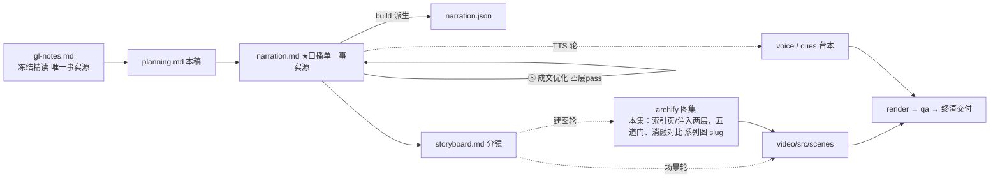

# 策划案：新系列 ep9《Memory：索引与按需加载》（v1 · 文案轮待用户审批 · C 型信源 = gl-notes）

> 状态：系列 claude-code-chapters 第 9 集（s09_memory 单章，2026-10-31 开工）。本轮为**文案轮**（Stage ①–⑤）：逐字稿与全部文案交用户审批，审批通过才进入制作（⑥ 分镜 → ⑩ 交付），故本稿不做建图与场景设计。事实源 = `research/gl-notes.md`（冻结自现行 173 精读，2026-10-31；取材范围 s09 单章）。钉选 main 轨 `7226f555`（自旧钉 ce8f9f18 前移 13 提交复核翻钉；站点轨 s09f 附录经台账补登作【三】级正源，翻钉三理由见 gl-notes 头部登记）。

成本档位: 正集（单语 + story 档已配音系 + 约 5 分钟常规动画复杂度；文案轮无生产层开销，制作期成本量级 = 常规单集）

## 0. 标题候选（待审批；series.json 现为工作题《Memory：索引与按需加载》，审批后落定）

| 候选 | 一句话理由 |
|---|---|
| A《Memory：索引与按需加载》 | 冻结正文 §4 章题直取，索引常驻＋正文按需的机制主轴一句话立住，与脚手架 README 同名零迁移成本 |
| B《压缩丢掉的细节，这一层兜住》 | 站点轨 s09 章头句「压缩会丢细节，要有一层不丢的」化用，承开场承接即完成因果闭环，系列连播钩子最强 |
| C《记忆不怕多，怕脏》 | 本集反直觉增量＝写入门控＋原子整理（临时规则变永久规则是 3→5 条实测死法），把「记住」的重心翻到「过滤」 |
| D《别把全部记忆塞进 system prompt》 | §4.2 反面论证直取，纠一个工程直觉错误：全量注入的 token 账单与缓存前缀打散，引出索引/正文分离 |

## 一、定位表

| 项 | 值 |
|---|---|
| 平台 | B 站 / YouTube 中长视频 |
| 时长目标 | 4.4–5.6 分钟（pipeline.toml 硬约束窗，含系列片头 ~23.5s 口径；正文 1305 字预算 @254 字/分，实稿 1355） |
| 形态 | AI 配音（story 档）+ Remotion 代码动画，无真人 |
| 受众 | 不预设工程背景的普通人：见过「AI 助手第二次还记得我」、没想过背后怎么存怎么取的任何观众 |
| 核心内容范围 | gl-notes §4 全节（4.1 存储四类型 / 4.2 召回两步与注入两层 / 4.3 提取门控 / 4.4 原子整理）＋§4.5 咬合（开场承接＋收尾回扣各一句）＋§5 记忆侧实证数字（教学常量【一】）＋§6 核心消融「关掉写入门控」（3→5 条，B.2 复算【一】）与辅证「去掉整理回滚」（2→0 条）＋§7.1 规律四（索引与数据分离、前缀稳定）/ 规律五（存储卫生三件套）作收束；s09f 附录生产侧只取 Dream 整理一档（【三】级＋归属句）；§3 压缩管线属本系列 ep8，本集开场承接一句＋收尾回扣一句、不重讲；§1–§2 问题定义作开场坐标系取用；争议二（LLM 选择 vs 向量检索）因预算与「无质量对比实验不进口播」纪律弃用（§六） |
| 系列位置 | 系列第 9 讲：在循环骨架与工具层之上加「跨会话的一层」——「索引与数据分离」规律的首次正面对决（全量注入反面论证→倒过来设计）＋「存储卫生三件套」规律首讲；系列视觉母题（恒定环体）延续，本集环上高亮「回合结束」挂点，新增「索引页 / 文件架」装置视觉 |

**Logline**：会话一断全忘光？一层住在磁盘上的记忆跨会话留存——目录常驻、正文按需、写入过门、整理有底；它最难的功课不是记住，是拒绝（gl-notes §4.1–§4.4 + §7.1 规律四/五）。

## 二、叙事策略

**主线是一问一答的闭环**：开场承接前集收尾意象「会话一断，攒下的全忘光」并抛钩子「最难的功课是拒绝」→ P1 回答「跨会话靠什么留」：一个记忆一个文件、四类型、一页索引 → P2 反问「每次带多少进门」——全量注入的反面账单 vs 索引常驻/正文按需（Worked Example 走查两步召回）→ P3 反问「什么都记吗」——五道检查 + 核心消融（拆掉门控 3→5 条、临时嘱咐入库）回答「记忆不能脏」→ P4 「攒脏了怎么办」——十条触发原子整理、快照回滚 + 辅证消融（2→0）→ P5 收束两条规律金句 + 官方幸存表回扣开场 + 下期钩子（开场白写死、不知状态）。

**开篇钩子候选矩阵（★ 待人工挑选——本集文案审批人即挑选人）**：

| # | 型 | 钩子文本（p0-01） | 吸引力留存逻辑 | 核心主干关联锚点 | 抛出的核心引子 |
|---|---|---|---|---|---|
| H1 | 认知反差型 ★ | 「这是一份越攒越懂你的记忆——最难的功课，不是记住，是拒绝。」 | 「懂你」的温度撞「拒绝」的冷转折，3 秒锁注意力；「记住容易拒绝难」违反直觉 | §4.3 写入门控 + 附录 B.2 核心消融；P3 当集兑现 | 拒绝什么？怎么拒绝？不拒绝会死多难看？ |
| H2 | 母题承接型 | 「这是会话断了也不失忆的一层——它不在脑子里，在磁盘上。」 | 「断电不失忆」的惊奇感 + 跨会话魔法时刻（第二次还记得你） | §4.1 存储 + §4.5 咬合；P1 首拍兑现 | 住磁盘上怎么存？怎么取？ |
| H3 | 反直觉架构型 | 「这是把全部记忆塞进开场白的反面教材——聪明做法是只放一张目录。」 | 「反面教材」先声夺人，纠一个多数人直觉（全带上才记得牢） | §4.2 反面论证 + 规律四；P2 首拍兑现 | 全量注入亏在哪？目录凭什么够用？ |
| H4 | 悬念冲突型 | 「这是一句只该管一次的嘱咐——差一道没关的门，它就成了永久规矩。」 | 冲突 + 悬置（哪句嘱咐？门是什么？），死法具体可感 | §4.3 例子「这次不要创建文件」+ B.2 消融；P3 兑现 | 门在哪？拔掉门会发生什么？ |
| H5 | 数字承诺型 | 「这是一次只带五条记忆进门的规矩——为什么是五，不是全部？」 | 反常数字（只带五条？）制造好奇缺口 | §4.2 选择 ≤5 条（钉选 code.py 可数【一】）；P2 兑现 | 凭什么五条就够？挑的时候看什么？ |

★ 选定 H1（自动选定，待人工复核）。理由：单章集时长紧，反差钩 3 秒认领、P3 当集兑现不欠债，且「拒绝」正是本集认知增量（把「记住」的重心翻到「过滤」，候选 C 同源）；H2 承接意象拆进 p0-02/p0-03（会话断全忘光→一层不清零，两全）；H3 反面论证押 P2 首拍（幕点不作钩子，避免开篇即架构论述）；H4 冲突留给 P3 消融位（开篇即剧透死法、对前半程是负债）；H5 数字承诺并入 P2 选择环节（「最多五条」随机制出场）。

**类比准入声明（C 型一物一喻）**：本集正片（§4 四件套）**零类比直讲**——承 gl-notes 附录 A 承袭登记「信源类比密度低、勿硬造」，② 阶段不另造新喻，压力位在「门控/过滤」叙事段不临时起喻（一律工程直陈：门、检查、快照、预算）。附录 A#1 草稿纸原拟作开场承接 ep8 的沿用语：ep8 并行撰稿、开工时其 script/ 尚空无法对表，按承袭登记预案**承接语改工程直陈**（直接兑现「会话一断，攒下的全忘光」意象，不借喻体）。**⑤ 轮对表落档（2026-10-31）**：ep8 v1 已定稿以草稿纸为正片主喻（其 p0-01 首句即喻体、全文 5 处），经研判**不回调**——本集 p0-02 工程直陈承接与其收尾握手成立（④C 判 OK），回调须连失配边界句、为单集引入喻体得不偿失，附录 A#1 维持不进口播。#2 已付款未到货 / #3 没拆的包裹 / #4 翻篇与续篇均系压缩侧（§3.4/§7.2）条目，属 ep8 域，本集不进口播。未登记类比不进口播。

**记忆点约每 60–90 秒一个**（全部取自 gl-notes §4/§5/附录 B.2，数字必带出处层级）：
P0「会话一断全忘光，一层住磁盘上不清零」（承接兑现 + §4.1）→ P1「四种记忆四种问题：你是谁 / 怎么做 / 在发生 / 在哪找」（§4.1 四类型【一】）→ P2「索引常驻开场白，正文用到才取——上限两万字符」（§4.2【一】，code.py 可数）→ P3「拆掉门控：两轮三条涨到五条，临时嘱咐变永久规矩」（B.2 核心消融复算【一】）→ P4「整理前先拍快照；拆掉回滚，两条直接归零」（§4.4 + B.2 辅证消融【一】）→ P5 收束金句「写入有门，整理有底——记忆不怕多，怕脏」（§7.1 规律五）。

**收尾不贩卖焦虑，悬念只留给下期**：P5 护栏句并入片尾署源块（生产细节来自原作者单方源码核查、未锁 CC 版本号、计数随时点漂移——承 ep1/ep2 同款，随署源句交代）；悬念留下期钩子（开场白从第一天写死、不知此刻状态——只点问题不预告机制），不渲染「AI 全面记住你」的隐私焦虑（本集不进入隐私争议，材料亦无此论证）。

## 三、视觉语言

**色彩语义沿用系列契约**（深色底 `#0E1116`；警示红 `#FF5C5C` = 反例/退化路径；确认绿 `#7ED321` = 机制在位/拦截成功；金句卡衬线体；公式/方法名只进角标）：

| 概念 | 专属色 | 语义 |
|---|---|---|
| 循环环体（全系列恒定锚〔M-001〕） | 陶土橙 `#D97757`（系列恒定，承 ep1） | 同一环体继续出场，本集环上高亮「回合结束」挂点——提取触发的位置（§4.3） |
| 记忆库体/记忆文件卡/四类型卡/门与快照装置 | 记忆紫 `#8B7EC8`（本集主题色，theme.core 本集新增语义） | 库体、记忆条目、五道门装置、快照回滚——「长期记忆」的直觉色相 |
| 索引页/清单选择/按需取回链路 | 索引蓝 `#5FA8E0`（本集主题色） | MEMORY.md 索引页、选择清单、固定前缀段、召回路径 |

撞车对账：两主题色与系列已用四色（`#D97757`/`#64C4C0`/`#EFB13C`/`#EF6461`）及保留语义色（`#0E1116`/`#FF5C5C`/`#7ED321`）零撞车（Stage ① 提案定档）；同日 18 集并行撰稿，系列层交付前另有统一撞色对账复核（本集色相为紫/蓝冷对，与 ep8（压缩侧，暖系提案带）区隔面大）。

构图纪律：消融对比一律左红右绿同屏（P3：门控在位·临时拒收·三条 ↔ 拆掉门控·五条·临时嘱咐盖「永久」章·重复 +1；P4：快照复原 ↔ 拆掉回滚两条归零）；「全量 vs 按需」对比等高裁决（左：开场白被塞满 + 重发账单条疯涨 / 右：目录一页 + 按需取回）；注入两层 = 请求条形图固定前缀段（索引蓝，稳）+ 可变后缀段（记忆紫，变）；数字一律动态增长条 + 工况角标（3→5、2→0、≤5 条、两万字符、十条/三十条基线标尺）；走查 beat 用文件卡 + 清单选择动画（Animated State Trace）；索引页装置视觉 = 一行一链接的目录页，写入即整页重建闪烁（全片反复出场、逐幕生长）；视觉母题禁旧版隐喻系意象（车间/作坊/传送带/工序卡/叫号器/插线口/师傅及同族），一律工程直陈：装置、索引页、门、快照、预算、额度。

**景别走 `WS→CU→MS` 下钻-回归，张力峰值在 P3**：P0 库体全景（对话流清零动画、一枚文件图标独存）→ P1 急推文件卡特写（三字段逐一亮起 + 四类型卡翻面）→ P2 清单选择与注入两层中景（条形图 + 对比帧）→ P3 五道门与消融双特写（候选逐关通关 ↔ 3→5 计数疯涨）→ P4 拉远（快照三段全景 + 生产版对照卡）→ P5 索引页定格收束。运镜密度：P3 紧张段每镜 ≤1 次推近；重音镜每 20–40s 一个 1–2s punch（与记忆点 60–90s 咬合）；张力曲线 P3 门控之争到峰值、P4 拉远降压、P5 平收。

## 四、分幕结构表

| 幕 | 目标时间 | 字数预算 | 主题 | 叙事要点（回溯 gl-notes） | 视觉锚点 | 前置概念 |
|---|---|---|---|---|---|---|
| P0 跨会话的记忆 | 0:00–0:40 | ≈165 | 钩子 + 承接 + 问题现场 | H1 钩子落 p0-01（越攒越懂你 vs 最难的功课是拒绝）；承接前集收尾意象「会话一断，攒下的全忘光」一句兑现（工程直陈、禁顺序词）；一层不清零：不住对话里、住磁盘文件里（§4.1）；再开一个会话仍认得你：偏好、教训、来龙去脉（§4.1 四类型预告）；分工：压缩管会话内、这层管跨会话（§4.5/§4.3 架构分家——压缩不重讲）；主线三问：存、取、不脏（§4 四件套骨架） | 冷启动：对话流逐条熄灭清零（警示红淡扫）、磁盘上一枚文件图标独存（记忆紫）；压缩装置与库体分层并列一笔带过；「存/取/不脏」三枚标签升起；右下角署源角标（首部署源位，随画面淡入） | — |
| P1 一个记忆一个文件 | 0:40–1:35 | ≈230 | 存储机制 | 库 = 一个文件夹：一个记忆，一个文件（§4.1）；文件头几行小字三样：名字、简介、类型（§4.1，name/description/type 进角标）；四类型各配一例：记你是谁（缩进只用制表符、不碰空格）/ 记怎么做（别造假数据糊弄测试）/ 记在发生（重写是合规逼的）/ 记在哪找（问题单在哪块看板）（§4.1，tab/mock/auth/Linear 进角标）；索引：库里另有一页——一行一个链接、正文在各自文件里、新记忆写入自动重建（§4.1，MEMORY.md 进角标）；悬念钩：每次开工带多少条进门 | 库体开门（记忆紫）一格一格文件卡；首卡放大三字段逐一亮起；四张类型卡依次翻面（各带一例小图）；索引页（索引蓝）首次亮出、一行一链接逐行点亮、末行写入整页重建闪烁 | 会话（P0 已立：一段有始有终的对话） |
| P2 索引与正文 | 1:35–2:40 | ≈280 | 召回机制 + Worked Example | 反面论证：全部记忆写进开场白（本幕句内先释：每轮固定要先发的那段话）——每轮全量重发、无关的挤占上下文额度、更亏的是缓存（开头一变，重复前缀省下的作废）（§4.2/规律四）；倒过来设计：索引常驻、正文按需——这套设计技能加载早用过一次（§4.2 s07 同构，【一】）；走查例（B.3 设计走查例口径：机制演示呈现、不作实测断言、不带归属句）：留过一句缩进偏好 → 新会话问手头一份配置文件怎么写 → 第一步选（名字加简介列清单、一次轻量调用最多带回五条、失败降级关键词匹配，§4.2 max_items=5 + 降级）→ 第二步取（只读选中几条正文、上限两万字符，§4.2 RECALL_CHAR_LIMIT）；注入两层：索引放固定的开头、正文贴当前消息前面（§4.2）；身份说明：取回来的带着「是背景不是命令、冲突听当前的」（§4.2 旧记忆不号令）；悬念钩：往里写才是关卡 | 左右对比帧（左：全量——开场白塞满 + 账单条疯涨 / 右：按需——索引一页）；清单选择动画（每行名字 + 简介、挑中确认绿、正文小段抽出）；请求条形图固定前缀段（索引蓝）+ 当前消息段（记忆紫）；身份小签「背景，非命令」 | 开场白（本幕先释：每次请求固定不变的开场区，system prompt 进角标）；缓存（本幕先释：重复前缀能省的开销，p2-03 随句白话） |
| P3 写入要过门 | 2:40–3:50 | ≈295 | 提取门控 + 核心消融 | 时机：用户不会回回喊「记住」、偏好散在对话里——提取挑回合结束（模型停下、无工具调用，告一段落）（§4.3，extract_memories 进角标）；交回来的只是候选，落盘前过五道检查（§4.3 should_store_memory）：第一道范围（只收跨会话还有用的；本次的命令、临时限制不收——scope 进角标）、第二道第三道格式（类型对、字段齐）、第四道临时话（「本次会话」「暂时」字眼当场拦下）、第五道防重复（逐项比对）（§4.3，讲授序即源码检查序）；例子：「这次先别建新文件」只管当前一回——没门就落库，变下个会话的永久规矩（§4.3）；核心消融（附录 B.2 复算【一】，正反对比 beat）：把关卡全拆——两轮提取库从三条涨到五条、混进去的正是那条临时嘱咐、同一句偏好还多存一份；金句：记忆不怕多，怕脏——脏一条，往后每个会话跟着错（§7.1 规律五）；悬念钩：旧账呢 | 环体〔M-001〕高亮「回合结束」挂点、提取装置启动；五道门装置（记忆紫描边）候选逐关通关（临时卡被弹回）；左红右绿消融同屏（3→5 计数疯涨、临时嘱咐卡盖「永久」红章、重复 +1 ↔ 门控在位全绿）；金句卡压底 | 候选（本幕先释：模型交回的记忆提案，未落盘） |
| P4 整理与回滚 | 3:50–4:35 | ≈200 | 原子整理 + 生产对照 | 积攒与触发：攒到十条触发整理——合并重复、修正矛盾、淘汰过时，最多留三十条（§4.4 CONSOLIDATE_THRESHOLD/≤30）；原子性：整理是删光旧文件、写入全部新文件——动手前先拍快照，失败就删半成品、按快照恢复原样（§4.4 快照回滚）；辅证消融（B.2 复算【一】）：拆掉回滚——一次写入失败，库从两条直接归零；半新半旧，比不整理还糟（§4.4/§6 表）；生产对照（s09f 附录【三】级，归属句「拆解过 Claude Code 源码的同学们应该知道」）：真实产品的整理代号做梦（Dream 进角标）、低频特权——距上次不少于二十四小时、至少五个会话动过、还得抢一把锁（四层门控取三层，扫描节流弃用）；悬念钩：这层记忆凭什么不怕压缩清场 | 库体积攒动画（十条跳格）→ 合并/修正/淘汰三动作；快照三段动画（拍快照定照 → 删旧写新 → 失败复原，确认绿）；对照帧拆掉回滚两条卡碎裂归零（警示红）；Dream 门控卡（24h 时钟/五个会话点/锁图标） | 快照（本幕先释：动手前留的完整底照） |
| P5 收束与下期 | 4:35–5:20 | ≈135 | 收束 + 钩子 + 署源 | 规律四金句：一页索引常驻开场白、一库正文用到才取（§7.1 规律四）；规律五金句：写入有门、整理有底——记忆不怕多，怕脏（§7.1 规律五）；回扣开场：压缩清场也轮不到它——今年十月的官方文档写着，这一层会从磁盘重新注入（§4.5 幸存表【二】级，带日期口径）；下期钩子：这份开场白从第一天起就写死——你此刻在哪、刚才发生了什么，它一概不知；下期拆它（只点问题不预告机制，禁顺序词）；片尾署源块两句（系列既定尾位）：改编自开源课程 Learn Claude Code + 生产细节来自原作者单方源码核查、未锁版本、计数会漂移（本集有【三】级内容，第二句必带） | 索引页定格收束 + 金句卡（衬线体）两行先后压屏；下期卡（视觉层）：开场白文档卡自第一天锁定、状态问号悬空；片尾署源卡（信源名 + 仓库地址） | — |

> 正文合计 ≈1305 字预算上限：六幕预算 165+230+280+295+200+135 = 1305，写作目标压在 1150–1220（幕预算为上限分配，允许 P3/P4 各回吐 20–40 字）；实稿 1355 字（v2 ⑤ 成文优化净 +32：先释与指代修缮 p2-01 +12 / p1-08 +8 / p2-05 +5、序数归组对调 p3-06 +10 / p3-05 -10、p4-06 +2、其余 ±1 等，均为含标点口径；估算 5.3 分钟仍落 4.4–5.6 硬窗内，+50 溢出承 ep2 先例；P5 署源块两行约 73 字为系列固定尾件，ep2 同款超预算形态）。句均 ~25 字 → 55 句。

## 五、生产管线图

本轮产物止于 C（含 ④⑤ 修缮；虚线节点为制作期，审批通过后启动）。

## 六、边界与不做的事

**系列递进边界（照抄口径，本集不进入）**：压缩管线（§3，ep8 域）只在开场承接一句 + 收尾回扣一句，四步管线/配对红线/未读豁免一概不重讲；System Prompt（下期主角）只在下期钩子点问题（写死、不知状态），索引放开场白这笔只作本集注入两层的事实使用、不展开「开场白本身是什么」；技能加载仅同构一笔（§4.2 s07→s09 结构相同，不回讲机制）；规划、权限、并发、多 Agent 不沾。

**口播红线不可越**：观众层信源标识只许出现在首尾既定署源位——片头署源角标（p0-01 beat 视觉层）+ 片尾署源句（p5-07/p5-08），豁免白名单登记在工作区 `vibe-video.toml [check_series.source_credit]`（RSI I-080；本集条目随系列层登记，文案轮禁改共享文件），其余位置零课程/站点/章号痕迹（不出现课程/站点名/「第 N 章」——按章拆集只是编导结构）；【三】级断言归属由正文归属句（「拆解过 Claude Code 源码的同学们应该知道」句式，ep1 审批口径）+ 片尾署源位双承接，计数漂移警示由 p5-08 兜底；活数据（章节数/star/CC 版本号）不进口播；禁顺序词（上一集/上集/上期/下一集/下集/第 N 集/前一集/本系列——署源句用「这套视频」），收尾预告只许「下期」；口播英文例外清单 = Claude Code + bash（随系列已立例外，本集未用到 bash）+ 署源专名 Learn Claude Code，其余英文（MEMORY.md / .memory/ / Markdown / name / description / type / user / feedback / project / reference / tab / mock / auth / Linear / system prompt / side-query / select_relevant_memories / RECALL_CHAR_LIMIT / extract_memories / should_store_memory / scope / Dream / consolidate 等）进角标不口播；「开场白」为本集 system prompt 的口播白话（首现角标随行）、「轻量调用」为 side-query 白话、「造假数据」为 mock 白话、「做梦」为 Dream 白话（角标随行）；「Token」本集不进口播（额度/开销白话表述）；禁旧版隐喻系词汇及同族意象（车间/作坊/传送带/工序卡/叫号器/插线口/师傅——不进口播与画面）。

**素材取舍，弃用而非遗漏**：① 路径防御三道闸（§4.1 main 轨 memory_path）——安全叙事本集已让位主线预算，弃用；② 召回生产侧【三】细节（memoryScan ≤200 文件按修改时间降序 / Sonnet side-query「不确定就不选」/ 单文件 200 行·4096 字节·单 session 60KB 注入预算 / forked agent 受限权限提取 maxTurns 5 / stop hook 异步不阻塞）——生产版对照只保留整理侧 Dream 一档（P4 集中归属），召回侧整体弃用；③ Dream 四层门控之「扫描节流」一层（口播取 24h/5 会话/文件锁三层，数字不虚报「四道」）；④ 争议二（LLM 选择 vs 向量检索）——材料无检索质量对比实验（§8），两派假设与规模分界的论证也因预算弃用；⑤ session memory / sessionMemoryCompact 中间形态与 user/session 两层（§4.5，【三】级）——压缩-记忆交叉细节，本集只取幸存表回扣一笔；⑥ 官方 MEMORY.md 索引「前 200 行或 25KB」上限（【二】级）——教学侧「一行一链接」已足，官方数字不进口播；⑦ 压缩侧全部细节（§3，ep8 域）。以上均留档 gl-notes，弃用而非遗漏。

**设计走查例口径**：「留过一句缩进偏好 → 新会话发问 → 只召回相关」按机制演示呈现（B.3：两轨 README「试一下」同款剧情，不作实测断言、不带归属句）；消融数字只用附录 B.2 复算值（3→5 条 / 临时入库 / 重复一份 / 2→0 条）与钉选 code.py 可数常量（四类型 / ≤5 条 / 两万字符 / 十条 / ≤30 条），全部【一】级直断言。

**片头沿用《一个循环》（制作期）**：系列片头资产 ep1 制作期已挂载孪生登记，本集沿用同款（~23.5s，预算已计入）；本集挂载件与孪生门登记随制作期处理，本轮只占预算。

**文案轮边界**：文案轮不跑 TTS、不动场景代码与 Main.tsx、不建 archify 图（storyboard 属制作期首轮）；series.json 登记为文案轮工作题，标题随审批落定；BGM 留空轨；信源外观点不进口播。制作期（⑥–⑩）审批通过后逐项启动。

**⑤ 轮登记的跨阶段待办**（2026-10-31，三项均不在文案轮本集文件内完成）：
1. **TTS 轮多音字复听清单**：攒 ×3（p0-01 / p0-02 / p4-01，应读 zǎn）、偏好 ×4（p0-04 / p2-05 / p3-01 / p3-10，应读 piānhào）、挑 ×2（p2-07 / p3-02，应读 tiāo，p3-02 优先）、关卡 ×1（p2-11，应读 guānqiǎ）——均不在机器多音字候选表内，TTS 轮试听读错再补 `<原文|读音>`（承宁缺勿错口径）并回填 PRON-GLOSSARY 台账，本轮不改文本。
2. **署源豁免系列层登记（check_series 实跑前必须补）**：工作区 `vibe-video.toml` 补 `[check_series.source_credit."chapters-09-memory"]`，narration_ids = ["p0-01", "p5-07"]（p5-08 无信源专名、预期不需豁免）、scene_stems 文案轮留空 [] 待分镜轮；文案轮禁改共享文件故由系列层落账，以 check_series 实跑结果为准。
3. **ep10 跨集术语对表（系列术语单一事实源）**：本集全程用「开场白」（p2-01 概念先释位 + p5-01 / p5-04 / p5-06 收尾钩），ep10（systemprompt-video）v1 开场用「开场说明」——同物异名，连播有缝；裁决为 ep10 侧回改「开场说明 → 开场白」（本集三处加载、改本集成本高且动先释位），列入系列层对表待办。
