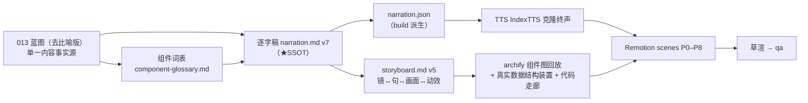

成本档位: 正集

# Stage ② 策划案（v4）：《拆解 Agent Context Layer：上下文怎么供给、治理、装配》

> 信源：013 Context Layer 技术蓝图（去比喻版：三面 × 五轴〔资产/权威/装配/检索/沉淀〕× 六段两环 + 读/纳管两条管线）+ 011 冻结 + lab/mcp 原型。组件命名 SSOT：[research/component-glossary.md](../research/component-glossary.md)。
> v4 改动动因：v3 通篇用民航维修类比，喻体与 Context Layer 技术关联差，观众记住的是机库而不是组件；该形态也违反 skill 02「严禁把局部口播类比升格为贯穿全片的剧场」。v4 改为**零类比直讲**：每个组件按「组件名 + 一句白话 + 贯穿请求在它里面发生了什么」讲清（用户 2026-10-16 确认）。

## 1. 定位表

| 维度 | 设定 |
|---|---|
| 平台 | B 站/YouTube 中长视频（草渲 960×540；1080p30 已交付 v1–v3，交付状态以 [README](../README.md) 为准） |
| 时长目标 | ~27 分钟（窗口 [21.0, 29.5]，以 pipeline.toml 为 SSOT；30 分钟为用户硬顶；克隆 story 档 df=1.0 试听实测纯语音 356 字/分、含时距等效 ≈304 字/分，v7 稿 8291 字估 27.3 分） |
| 形态 | AI 配音（草渲 edge zh-CN-YunxiNeural；终声 IndexTTS-2.5 本人克隆 story 档 df=1.0）+ Remotion 代码动画 + archify 组件图逐章回放，无真人 |
| 受众 | 做过或用过 Agent 的工程师与技术管理者：懂 API、数据库、权限、检索的基本概念，不懂语义层与上下文工程也能跟上 |
| 核心内容范围 | 013 §1–§3（问题登记簿 / 问题定义与分析单元 / 三面五轴六段两环）+ §4–§8 每轴一幕（纳管管线并入资产轴幕）+ §7 章首读管线独立一幕 + §10.1 477 vs 48 + §12 现状对账 + §14 修复序；§11 业界格局只取一句 |

## 2. 叙事策略

- **全片零类比直讲**：连续感由视觉母题统摄——(1) **同一个真实请求**「上季度华东区的重复购买率是多少？」作恒定视觉锚（RequestCard，M-001），每幕在对应组件里走一遍，卡上逐幕累积「已经过的组件」；(2) **五轴导航图**（FiveAxisMap，真名标注 + 真实构件名）每幕首高亮当前轴；(3) 13 张 archify 组件图逐章回放。局部类比 0 个。每个新组件按三步讲：组件名 → 一句白话 → 请求在它里面发生了什么（输入 → 处理 → 输出）。
- **人机协同钩子候选矩阵**：

| # | 维度 | 钩子文本 | 留存逻辑 | 主干关联锚点 | 抛出的核心引子 |
|---|---|---|---|---|---|
| 1 ★ 选定 | 反直觉颠覆型 | 这是同一个模型的两次作答：一次只对百分之十九，一次对了百分之八十五，模型一个参数都没改。 | 「同模型差 4 倍」反直觉，3 秒内制造认知冲突 | §7.1 FinanceBench 三档；§2 研究对象＝运行时上下文 | 差距来自上下文，那上下文这一层到底该怎么设计？ |
| 2 | 极致痛点型 | 这是一个 Agent 自信给出的错数：它把复购率算成了真实值的十倍，全程没有一行报错。 | 「自信地错」戳中生产痛点 | §10.1 477 vs 48；§1 规矩 1 失败形态优先 | 为什么错得这么安静？哪一层该拦住它？ |
| 3 | 新范式揭示型 | 这是一层夹在模型和数据之间、绝大多数 Agent 系统都没有建起来的东西：上下文层。 | 「97% 认为重要、4% 建成」的落差 | §1.9 信念-实践落差；a16z 定义 | 这一层由哪些组件组成？ |
| 4 | 悬念冲突型 | 这是一个问题在进入模型之前要走的七道工序，今天我们把每一道拆开看。 | 流程悬念 | §7 章首读管线 | 每一道在防什么？ |

  **选定理由**：#1 用一个已核实的真实数字对比直接点题——模型不变、上下文变，正好引出全片「上下文层怎么设计」的主线，且 19%→85% 是第三方实测（实线徽），可信度最高。

- **主线问题**：钩子（同模型 19% vs 85%）→ 悬念（同一个请求可能出哪三种错：同一指标两个数、裸问答错、越权读到不该看的数据）→ 回答：三面蓝图——验收面先登记错误、结构面五轴各管一摊、时间面管对象从注册到退役；P7 让请求完整走一遍读管线；P8 对账「蓝图画的」和「生产链路真正跑的」。
- **记忆点节奏**（约每 60–90 秒一个）：
  1. 19%→85%：同一模型，只换上下文
  2. 一百块的订单记成三百（fan trap 440 vs 200）：语法全对，业务全错
  3. definitions 注册表 422：脏定义写库前直接拒
  4. 会话权限上界只减不增：权限一收，跑着的会话当场失效
  5. 46 个工具失败、19 个成功：工具不是越多越好
  6. 150 条候选→20 条：截断是信噪比控制
  7. 477 vs 48：治理全对，结果照样错
  8. 冲突交人裁决：按引用量自动挑，赢的往往是错的
  9. 请求走完读管线 7 段：ContextRequest 进，ContextBundle 出
  10. assemble() 生产调用 0：图纸存在 ≠ 链路在用
- **理性收尾**：97% 相信 / 4% 建成（全限定）；上下文是有限预算，这个约束不随模型升级消失；收口在修复序（先补回路缺件 → 执法点统一 → 退役段立规）。
- **「先前已建立」经济规则**（系列冗余防线，不点名他集）：M1–M7 每键 ≤2 句即走，深度只给本期新增面（三面五轴、两条管线、回路在线三条件、现状对账）。

## 3. 视觉语言

- **色彩语义契约**（theme.ts，三色与 series.json accents 一致）：
  - `#5B8DC9` 钢蓝 = 受治理的上下文供给主轴（资产、装配、管线主路径、RequestCard、目录条目）
  - `#F5A623` 橙 = 治理与错误警示（越权、过期、冲突、Guard 拦截、投毒）
  - `#7ED321` 绿 = 验证与放行（核准答案、校验通过、回流成功）
  - 底座 #0E1116 系；警示红 #FF5C5C 仅破坏实验；金句卡衬线体
- **三层视觉语法**：map = FiveAxisMap（五轴真名 + 构件名，Map-First）+ RequestCard（贯穿请求，M-001 恒定锚）；mechanism = 真实数据结构装置（ContextRequest/ContextBundle JSON、definitions 行与 422 响应、Core Block 预算条、RBAC∩RSS 权限交集、候选列表 150→20、窗口 token 预算条、consolidation_jobs 队列与水位线、读/纳管管线逐段）；evidence = 代码走廊（真实仓码与 selftest 输出）+ 三级证据徽（虚线=官方自报 / 实线=第三方实测 / 实心=本仓复算）+ archify 组件图回放。
- 画面文字只放组件名、数字、字段名、结构；不复述口播整句。英文组件名（ContextRequest、RRF、Guard 等）上屏作标签，口播用中文说明其作用。
- 建模手册应用：M-001 恒定视觉锚＝RequestCard；Map-First＝FiveAxisMap；X-001 核对（权限上界只减不增时数量只减；dropped 盒只进不改）。

## 4. 分幕结构表（九幕「2+5+2」）

| 幕 | 目标时间 | 主题 | 叙事要点（回溯 013） | 视觉锚点 | 前置概念 |
|---|---|---|---|---|---|
| P0 | 2.1 min | 三种错误 | 同模型 19%/85% 钩子；贯穿请求登场；它可能出的三种错（同一指标两个数 / 裸问答错 10.1% / 越权读到手机号）；97/4；错误被登记成十类 49 行的表 | RequestCard 首现；证据徽；failure-map | 窗口（模型每轮能看到的全部内容） |
| P1 | 3.2 min | 三面蓝图 | 五类来源（指令/记忆/知识/工具技能/会话）先认清、再说明为何不按来源分类；三面各答一问；五轴与「换 X 不动 Y」；六段两环；G 法则点名；有限预算公理 | FiveAxisMap 建立；architecture；lifecycle | 三面、五条轴、六段 |
| P2 | 3.9 min | 资产轴 | 七类资产；纳管管线 5 段（请求要用的「重复购买率」定义怎么入库）；fan trap 440 vs 200；definitions 注册表 + 422；Core Block 三问；对象状态流转 | ingest-pipeline；object-lifecycle；代码走廊① | 注册表、常驻画像块 |
| P3 | 2.6 min | 权威轴 | 绕开测试与未接入执行路径的治理；执法点分层；会话权限上界 RBAC∩RSS（运营专员能看订单不能看手机号）；实时求值与回收即失效；供给面威胁 98380/157 | VennShrink；mcp-threat-model | 角色权限∩会话允许范围 |
| P4 | 3.1 min | 装配轴 | 时序四档；token 预算与最小够用；46/19 工具实验；预取与按需的边界；缓存感知分段；四步压缩；倒 U | 窗口 token 预算条；assembly-economics | token（按字数计的计量单位）预算 |
| P5 | 3.2 min | 检索轴 | 150→rerank→20；四因子信任排序；CJK 分词缺口；resolve 三条出路（核准答案/现算/明告缺口）；477 vs 48 与治理≠验证；子代理隔离 | WideFunnel；代码走廊②；failure-map | 名次倒数加权、重排 |
| P6 | 2.8 min | 沉淀轴 | 回路在线三条件；会话→长期记忆缺两件与修复设计；人工起草与查询历史挖掘两条供给路径；冲突浮出人工裁决（200:5）；可进化参数面一句 | LampTrio；lifecycle；evolution-levers | 触发器/消费者/水位线（各配白话） |
| P7 | 3.0 min | 读管线 | 每轮装配事务；请求完整走 7 段（Resolve→Emit），每段看请求被怎么处理；目录条目是纳管与读管线的接头；目标态口径 | SevenStations；read-pipeline；first-class-object | 上下文请求、上下文包（上屏标英文原名） |
| P8 | 3.3 min | 现状对账 | 判定面：只认生产路径上真实跑过的；assemble() 零调用、expand_skill 未挂载、会话巩固零消费者；20 行映射表；修复序与轴依赖序；回到三种错各自的对策；收口 | 代码走廊③④；injection-points | 判定面（只认生产路径） |

## 5. 生产管线图

## 6. 边界与不做的事

- 不用类比：组件直接以本名出场；不讲「像什么」，只讲「是什么、做什么、这个请求在它里面发生了什么」。理由：类比要观众二次翻译，且喻体与技术关联弱时会误导（v3 教训）。
- 两条管线细节（四件套、L0≤256/L1≤4000、ctx://）是蓝图设计而非仓内实况，口播带「蓝图设计」限定、画面挂「目标态」角标；P8 第一拍即对拍现状。
- 013 外的观点不进口播；英文组件名上屏不口播，首次出现配一句中文作用说明。
- 不做：他集点名（收尾只说「下期」）；M1–M7 深度重讲；技能生态数字只取 USENIX 实线徽为主证。
- 时长纪律：句长目标 ≤35 字（v7 字幕宽度门零超限）；超窗削减序：P5 CJK → P6 可进化参数面 → P8 映射表 → P1 来源分类。v7 增补 58 句（缺口补齐：开环承诺、登记行解剖、两级预算、执法点四层、倒 U 分解、RRF 机制、晋升三关、G 法则验收、三步审计），其余按幕分配见上表。
