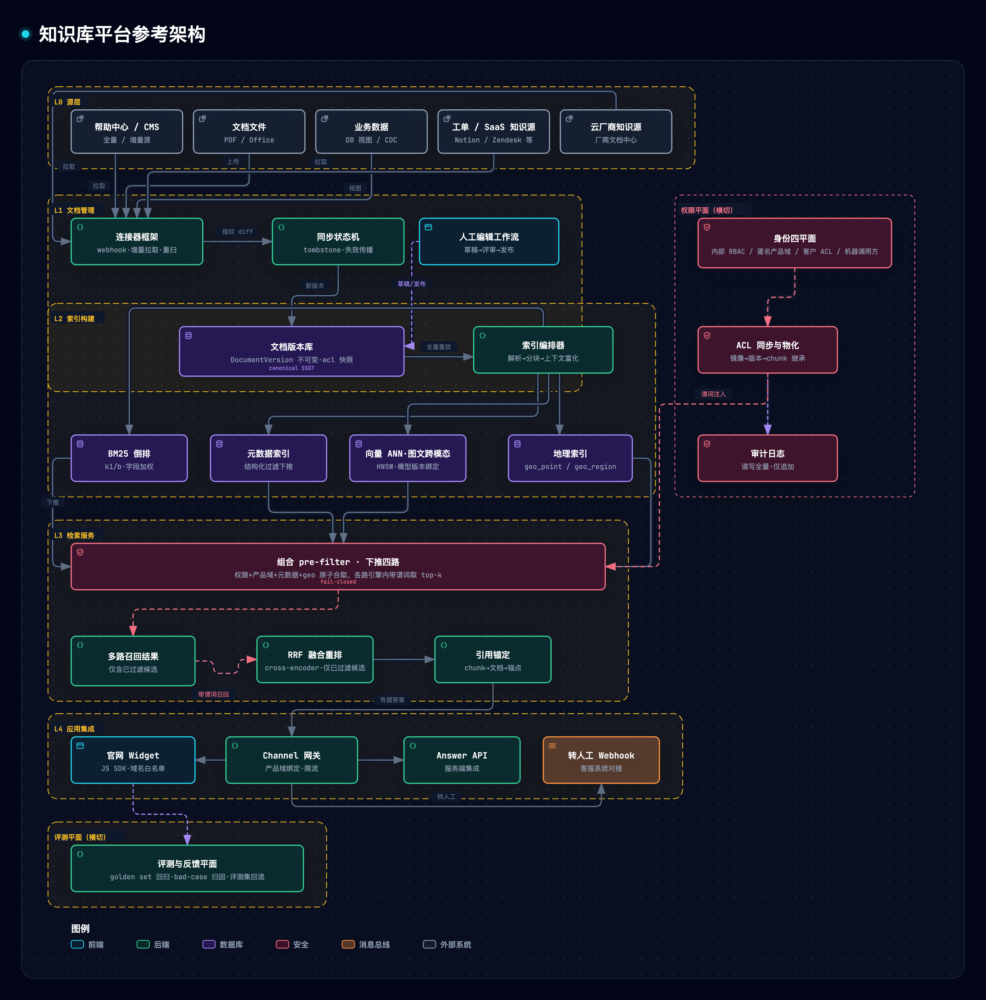
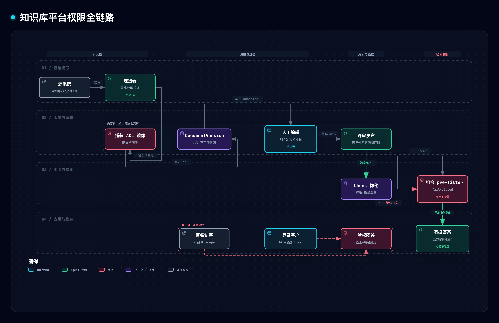

# 知识库平台技术方案（四支柱参考架构）

> **定位**：面向多产品企业的知识中枢平台——统一完成知识文档的引入、治理、索引与服务化，首要场景是嵌入各产品官网的产品知识问答客服机器人，并保证从引入到最终问答的全链路权限隔离。本方案为**独立通用参考架构**（不绑定特定实现），循证基座见《[知识库平台竞品与理论调研](../../research/knowledge-graph/036-knowledge-base-platform-competitors.md)》（下称「调研报告」，产品事实以 §n-Fm 指向其章节与条目；理论引用 [n] 见文末）。存量调研（[035](../../research/knowledge-graph/035-knowledge-base-platform.md)、[034](../../research/knowledge-graph/034-knowledge-base.md)）经调研报告 §1 收口，节级锚引用（无 as-of，证据等级降一档）。

## 0. 范围与术语

**四大支柱**：P1 文档管理、P2 索引构建（BM25/元数据/向量/地理四路，图文混合）、P3 应用集成（多产品客服机器人）、P4 权限管控（全链路）。

**非目标**：客服工单系统自身工作流（工单作文档源在范围内，回写/hook 见 §9.2）；平台绑定具体云厂商（云厂商托管知识源接入见 §9.3）；全模态融合嵌入（单模型内跨模态交互合成单向量）不做预留——融合对齐的弱占优仍是猜想级且实测有反例、双塔对齐为现役主力，平台跨模态需求止于文搜图可比[[25]](#ref25)，客服场景出现组合查询（如截图+文字联合查询）时再按触发条件立项实测。文档内图文一起索引/检索/召回在范围内（§2.4/§3）；知识图谱联邦为后续扩展（§9.1）。

**术语**：产品域 = 产品对外的知识边界（第一道 scope）；pre-filter = 打分前下推引擎的硬过滤；fail-closed = 判定不可用即拒绝；图片 chunk = 承载文档内图片的索引单元——文本视图（caption/alt 走 BM25 腿，§3.1；语境不直接入索引，经 caption 派生输入与 chunk 身份键生效，§1/ADR-0001 D3）＋向量视图（CLIP 族图像塔对图片像素本身的跨模态嵌入，独立模型空间，查询文本经文本塔同空间召回，§3.1/§3.3）。

## 1. 总体架构

> 图源（可 diff 文本）：[`knowledge-base-platform--architecture.mmd`](../../assets/mermaid/design/knowledge-base-platform--architecture.mmd) · 交互版（下载到本地打开）：[`knowledge-base-platform--architecture.html`](../../assets/architecture/design/knowledge-base-platform--architecture.html)

五层（L0 源层 → L1 文档管理 → L2 索引构建 → L3 检索服务 → L4 应用集成）加权限、评测两个横切平面，各层职责见图。

**核心数据模型**（聚合根 + 派生视图两级）：

| 实体 | 关键字段 | 职责 |
|---|---|---|
| Tenant / Product | 租户 / 产品域 | 隔离边界 |
| Source | 类型（含 upload）、凭据引用、同步模式、信任档、权威策略、默认 product_ids 与默认可见性（配置变更走四眼） | 连接器配置（凭据入密钥管理不落库） |
| Document | source_id、external_id、product_ids、lifecycle、verifier、验证态 | 文档聚合根；product_ids 为当前版投影（由 Source 继承，覆写需审批，禁由 LLM 抽取） |
| DocumentVersion | version_key、canonical 内容（清洗正文+媒体资产清单）、metadata、geo、acl | 不可变版本（事件溯源 SSOT） |
| MediaAsset | 内容哈希、MIME、字节数、引用计数、保留/粉碎状态 | 内容寻址图片存储：去重与引用计数粉碎/暂缓的锚（M2，P2-8） |
| Draft | document_id、base_version、diff、状态 | 编辑草稿（三路合并的 base 锚） |
| Chunk | version_id、text_hash、text、terms、modality（text/image）、media_ref、metadata、geo、acl | 索引派生物；chunk_id 由 (document_id, text_hash, 序位) 确定性派生（图片 chunk 取 hash(图片哈希+alt+邻接语境)，ADR-0001 D3）；向量存于按 (chunk_id, model_version) 键控的侧表 |
| IndexBuild | 目标索引版本、策略、水位、状态（pending/building/validating/active/retired/failed） | 构建任务；chunk 另有数据态 parsed→indexing→indexed（FastGPT 范式，调研报告 §4.3） |
| Channel | product 绑定、corpus scope（⊆ 产品域）、允许身份集、限流与成本熔断 | 应用集成通道（多产品=多 brand，Zendesk §4-F4） |
| KnowledgeTask | 来源（拒答/bad-case/冲突/过期验证）、关联文档、状态 | 闭环工单，产出 Draft |
| QAInteraction / AuditLog | 问答与反馈（脱敏、保留期）/ 审计（仅追加） | 评测回流与追责 |

**三条不变量**：① 版本库是唯一事实源，`version_key = hash(document_id + 正文 + 媒体清单哈希 + 源侧 metadata + product_ids + acl)`——正文、图片、产品域、ACL 任一变更即产新版本（媒体清单入键，换图不被「未变即短路」吞掉），杜绝多处真源与跨文档撞键（Git 内容寻址范式 §7-F9）；LLM/VLM 派生物按 (hash(派生输入 + 源侧 metadata), pipeline_ver) 缓存（不含 acl；caption 派生输入=图片哈希+alt+邻接语境，同图异语境不共缓存），重放取缓存，保证确定性；② Chunk 的 ACL 恒等于其版本 ACL，不放大不缩小（含图片 chunk——图片资产访问同受其 ACL 约束）；③ 产品域与 ACL 只来自连接器镜像、Source 配置或经审批的人工设定，LLM 输出不得写入。

## 2. 文档管理（P1）

### 2.1 连接器框架

统一 Connector SPI：`discover → fetch → normalize → report`（discover 分内容/ACL/删除探测，后两类不降频），三种同步模式（Glean 五类爬取与 Azure 变更检测同构，§2-F1/§3-F4）：

- **推送（webhook）**：延迟最低；订阅握手、续期、3 秒应答、指数退避（§7-F5）；逐事件验签，事件只作通知、内容一律回源拉取；先落队列再回 202；
- **增量拉取**（默认）：按源侧游标定时拉取；数据库型源走 CDC（删改与新增同构，§7-F7），SaaS 源退化为高水位+软删轮询；
- **全量重扫（full rescan）**：周期兜底校正漂移（源侧物理删除、游标断裂）；
- **手动上传（upload）**：作为一类 Source，走同一管线。

各通道写入幂等（以 version_key 去重），失败按退避重试，超限入死信并告警。

**变更检测**以 version_key 为准，未变内容不产新版本。**删除传播**：源侧删除产 tombstone，向下游传播为 chunk 下线与索引摘除；Azure 索引器默认**不**追踪删除，须显式软删通道且自首次运行配置（§7-F6）；版本不物理删（审计需要）。**摄取边界**：连接器级白/黑名单作为权限之外的内容准入控制面（Glean，§2-F2）。**权威策略**：上游权威源的本地改动存为 overlay，上游新版到达时自动 rebase、冲突入 KnowledgeTask；ACL 只读，以源镜像为准。本地权威源遇上游变更只生成提示任务。

### 2.2 文档版本库

DocumentVersion 承载结构化 AST、清洗正文、元数据（语言/类型/生效期/地域/geo）与 ACL；索引损坏或策略变更均可从版本库全量重放。同步调度按引用价值动态降频：长期未被问答引用的源自动拉长内容拉取周期甚至暂停（Fin 90 天范式，§4-F3/调研报告 §4.1），控爬取成本；**删除与 ACL 通道不降频**，SLO 更严。

**合规**：预处理做 PII 识别与脱敏，工单类源默认仅内部可见；版本与 QAInteraction 设保留期，合规擦除走加密粉碎（crypto-shredding）例外路径，并级联清除 chunk、向量侧表、LLM/VLM 缓存（含 caption）、跨模态嵌入复用缓存（(image_hash, model_version) 键控，随图片资产粉碎清除）、图片资产与各路索引条目——内容寻址图片在保留期到期驱动的例行清理中按引用计数暂缓粉碎（任一引用版本在保留期内不粉碎）；合规擦除例外：图片自身命中 PII 的，图级擦除向引用同一内容哈希的全部版本级联、同批粉碎并留审计，不以其他版本保留期为由暂缓；PII 仅在正文（图片自身干净且被共享）的，版本级擦除只移除该版本引用，图片字节仍按引用计数暂缓，待引用清零后例行粉碎；VLM caption 与正文同规则过 PII 脱敏（截图转写姓名/邮箱/工单号高危）；短签链接的撤销与擦除对图片资产同样生效。

### 2.3 人工编辑工作流

编辑只发生在 canonical 层（禁止直接改 chunk）。流程：Draft → 差异评审 → 发布（产新版本，触发增量索引）。内容编辑可配审批（Confluence Approvals 三态状态机范式 §2-F7）；**可见性变更（ACL、产品域、internal→public）为独立权限，强制四眼审批**；乐观锁（expected_version）防并发覆盖；操作者、时间、字段级 diff 全量审计（§7-F8）。

**冲突处理**：Draft 遇上游新版本 → 以 base_version 三路合并，失败转 KnowledgeTask。

**staleness 治理**（Guru 验证态范式，§2-F8/F9）：每文档可指定 verifier 与验证周期；编辑即失效验证；过期转「未验证」灰标并生成 KnowledgeTask，不删除；验证态作为检索期可过滤的质量信号，变更走与 ACL 同队列的部分重索引。

### 2.4 预处理管线

解析（HTML/PDF/Office→结构化 AST，保留标题层级与表格；**图片抽为内容寻址资产并入媒体清单**，携 alt/figcaption/邻接语境（figcaption 计入邻接语境，随其入媒体清单/chunk 身份/caption 派生键）；VLM 生成 caption 作图片 chunk 文本视图——WeKnora 范式，[存量调研 035](../../research/knowledge-graph/035-knowledge-base-platform.md) §2.1.1）→ 清洗 → 分块（默认调参递归固定分块，实证中仅次于 LLM 分块，§7-F4）→ **上下文富化**：每 chunk 注入标题路径前缀（祖先标题按各自 ACL 裁剪，防机密标题随公开 chunk 外泄）；条件允许时前置 LLM 生成的 50–100 token 块级语境，top-20 检索失败率 5.7%→3.7%[[14]](#ref14)（§7-F2）；条件允许时升级 late chunking（整篇长上下文编码后按句池化，BeIR 全面增益[[13]](#ref13)）→ 元数据抽取（规则+LLM，人工订正回流 few-shot 样本；产品域与 ACL 除外，见不变量③）。caption 过 §2.2 PII 脱敏。增量以文档为粒度：未变文本按 text_hash 复用 embedding；未变图片按 image_hash 复用跨模态嵌入，caption 按不变量①缓存键（hash(图片哈希+alt+邻接语境+源侧 metadata)，pipeline_ver）复用。

## 3. 索引构建（P2）

### 3.1 四路索引策略

| 索引路 | 结构 | 关键机制 | 适配查询 |
|---|---|---|---|
| BM25 倒排 | 分词倒排 | k1/b 可调[[1]](#ref1)（引擎默认 1.2/0.75，§3-F1）；字段加权 BM25F（title/section/body 独立权重）[[2]](#ref2)；图片 caption/alt 入字段加权（引擎无 BM25F 时并入正文轴）；长文档修正 BM25+[[3]](#ref3)；中文分词（词典类） | 错误码、型号、专有名词 |
| 元数据 | 结构化列+范围/倒排 | 产品域、语言、类型、生效期、地域；过滤须 schema 声明（Indexable 字段级开关，Vertex 范式 §3-F7）；过滤下推引擎内执行 | 先验硬条件收敛 |
| 向量 ANN | HNSW[[5]](#ref5) | M/efConstruction/efSearch；**embedding 模型版本绑定索引**（重建判据为模型标识变更而非维度比对——同维换模型同样混空间；换模型=全量重建，不混用向量空间）；MRL 自适应维度[[19]](#ref19)；中文优先 BGE-M3/Qwen3 类自托管（BGE-M3 单模型三路表征一次计算[[18]](#ref18)；榜单快速更替，以当期 MTEB+自有 golden set 复核）、西文 API 双轨；**图片 chunk 走跨模态嵌入（CLIP 族[[20]](#ref20)）独立模型空间**，与文本空间隔离，同 pre-filter 下推、融合只用名次 | 语义改述、口语提问、图片内容 |
| 地理空间 | geo_point + geo_region | R-tree 族（PostGIS GiST）[[16]](#ref16)；KNN 距离算子 `<->`（仅在 ORDER BY 中走索引）；区域走 within/intersects 围栏语义；H3 预置列作分析面、S2 region cover 编不规则服务区（调研报告 §8） | 「附近网点」「区域政策」 |

**单库起步现实**：PostgreSQL 一库承载四路时，tsvector/ts_rank_cd **并非 BM25**（官方文档明言排名函数不用全局统计，故无 IDF，§5-F10）——真 BM25 走 pg_textsearch（PostgreSQL License，选型见 [ADR-0002](./knowledge-base-platform-adr-0002-bm25-engine.md)）或外置引擎；向量路用 pgvector 0.8+ iterative scan，可与任意 WHERE（含 PostGIS 谓词）组合，一条 SQL 完成 geo+元数据+向量三路检索（调研报告 §8-F11）。

### 3.2 索引编排与版本

IndexBuild 三策略：全量初建 / 增量（按版本 diff 重刷该文档 chunk）/ 重建（策略或模型变更）。写入按 (chunk_id, index_ver) 幂等，失败重试、超限入死信告警。引擎内原生快路径（DB 函数/专用索引）须随迁移交付并做存在性回归，任何降级打点告警、禁静默回退 Python。

**蓝绿索引版本**起步档为文档粒度同事务原子换版（MVCC 下读者只见整旧或整新、失败自回滚），规模增长再上 index_ver 双写与水位追平 → 回归门 → 别名原子切换。**回滚须先重放切换后的删除与 ACL 事件再开放**，防已撤权限与已删文档复活。未索引数据对检索隔离。

**staleness SLO 按通道分档**：推送 P95 ≤ 5 min；拉取 ≤ 调度周期 + 构建时长（Azure indexer 最短调度 5 分钟，§3-F4）；删除与 ACL 收紧以撤销覆盖表生效计，不劣于推送档（P95 ≤ 5 min）。**权限与内容分队列**：ACL 变更走部分重索引（Azure Resync 范式，§3-F5）。

### 3.3 混合检索执行计划

查询 → 意图解析（关键词/语义/地理/图文/混合）→ **组合 pre-filter 下推四路召回**（权限+产品域+元数据+geo 原子合取后，各路在引擎内带谓词取 top-k，见 §5.2；文本查询经跨模态嵌入文本塔召回图片腿，页面级视觉检索 ColPali 类[[21]](#ref21)为 M3 可选档）→ RRF 融合（k=60 起步[[6]](#ref6)，按 golden set 定参——k 是引擎相关超参，Qdrant 默认即为 2，§6-F11；跨索引融合只可用名次，裸相似度分不可跨向量空间比较）→ cross-encoder 重排[[7]](#ref7)（仅接触已过滤候选，§6-F12）→ 引用锚定（含图片锚点）。**谓词来源纪律**：产品域与 ACL 谓词只取自服务端 Channel 绑定与验权网关；意图解析与客户端参数只能追加收窄条件，不能替换；谓词以结构化 DSL 参数化构造，属性值按枚举白名单校验。**geo 融合次序**：地理约束为硬条件时 geo 先收敛候选（bbox 粗筛→精距）；排序上，Algolia 把距离排在拼写容错之后（§8-F5），本方案取文本/语义相关性为主序、距离为次级；访客位置参照点优先级为问句地名 > 浏览器授权定位 > 客户档案地址 > IP 粗定位，都没有时退化为非地理检索；「按访客地区出答案」属高过滤比场景，先收敛再打分（美团 >99% 标量过滤比，§8-F13）。稀疏路可升级学习型稀疏（SPLADE 类[[4]](#ref4)），倒排结构不变。

## 4. 应用集成（P3）

### 4.1 Channel 模型

每产品一个 Channel（多产品=多 brand，Zendesk §4-F4；Kapa 以 project 兼作权限/计量单元，调研报告 §4.1）：绑定产品域与 corpus scope（校验 scope ⊆ 产品域，跨域共享须双方授权）、允许身份集（匿名与登录可共存，逐请求按所持 token 判定）、答案策略、限流与成本熔断、独立评测集。绑定与 scope 变更走四眼并审计。

### 4.2 问答链路

多轮问题 → 查询改写（指代消解、上下文补全）→ §3.3 检索 → 有据生成（**答案逐断言挂 chunk/文档锚点，无锚断言按幻觉处理**[[17]](#ref17)；逐断言回锚已是平台能力，§7-F12；图片 chunk 挂图片锚点（短签链接），**caption 仅供检索，断言 grounding 必须回指原始 chunk（图+语境），防 caption 幻觉**）→ 置信判定（基于按产品域校准的原始重排分；RRF 分只反映名次，逐查询 min-max 归一化分销毁绝对含义，两者均禁作置信）→ 低于阈值走兜底：拒答话术 / 最相关文档链接 / 转人工 → 反馈采集 → QAInteraction 落库。**拒答是知识缺口信号**：未答问题生成 KnowledgeTask（Kapa 范式 §4-F6），形成 P1→P3 闭环；转人工不计失败（Fin 商业激励同构，§4-F1）。

**生成侧防线**：会话按（Channel，验签后的 sub，权限视图哈希）隔离，身份或权限变化即开新会话，匿名会话以服务端签发的不可猜 ID 区分；chunk 以不可信数据定界封装，用户生成或外部源经注入扫描后发布；答案按受限 Markdown 渲染并转义 HTML，链接与图片走白名单，Widget 以沙箱 iframe 隔离宿主页；引用只指向 Channel 已发布 URL 或网关鉴权的短时签名链接，禁止直链源系统。

### 4.3 嵌入形态

官网 Widget（JS SDK：站点级 public key+可选登录态透传；域名白名单不作鉴权边界）；Answer API（服务端集成）；转人工 Webhook（出站签名+目标白名单）；Agent/MCP 只读检索工具面（每实例轮换 token、程序化注入不落库）。匿名路径限流按 IP/会话/设备多维分桶，异常时加人机挑战。

### 4.4 评测与反馈闭环

- **离线回归门**：每 Channel 维护 golden set（查询→期望引用文档/答案要点），检索指标 docRecall/docPrecision/nDCG@k（Agent Search 口径 §7-F11），**逐召回腿分别断言命中（含 CJK 子串与图片召回用例；图片用例按域分组——产品照/界面截图/流程图/图表——分别断言，不以全集均值掩盖单图域失效），防单腿失效被融合结果掩盖**+ 端到端 RAGAS 库四指标（faithfulness/answer relevancy/context precision·recall，§7-F10；原论文[[15]](#ref15)定义 faithfulness/answer relevance/context relevance 三项）；索引重建、策略变更与 golden set 标注口径变更必须过回归门；
- **golden set 举证纪律**：固定拆分互不相交的调参子集与留出子集——定参（RRF k、geo 融合次序等）只用调参子集，回归门只认留出子集，防门禁基线被调参过拟合；图片召回用例双向互检（生产向文→图＋反向图→文），CLIP 族选型与换版复核沿用同判据，单向命中不作通过证据（留出配对与双向互检为可比性举证纪律[[25]](#ref25)）；期望标注显式圈定易混淆负例（同产品线邻型号、同名不同义文档）——标注即相关性声明，声明错了门禁不报警；回归门加报 RRF 融合相对最好单腿的 Δ（Δcomp 消融口径[[25]](#ref25)），融合档劣于最好单腿即判失败，新增召回腿/档以目标用例子集超过去腿最优组合与最强单腿、整体指标不劣化为采纳判据——防融合未干活被逐腿绿灯掩盖；
- **线上回流**：四态结果+升级原因；点踩与转人工入 bad-case 池，归因（检索 miss/排序/生成/知识缺失）四路回流：评测集、调参、生成策略、知识补录；
- **口径纪律**：resolution 只按 bot 介入会话计且带时间窗与判定规则，可复算审计——Fin 官方 76% vs 独立实测 38–53% 的教训（§4-F2）；
- **可观测性**：SLI 含首字与检索 P95、可用率、拒答率、ACL 滞后、零命中率，trace 带 channel 与 index_ver；评测按身份分层，答案策略按 Channel 流量 A/B 灰度。

## 5. 权限管控（P4）

### 5.1 身份四平面

| 平面 | 身份 | 模型 | 判定粒度 |
|---|---|---|---|
| 内部运营 | admin/知识管理员/编辑/审阅者 | RBAC（角色×产品域） | 功能与文档操作 |
| 匿名访客 | 无个体身份 | 产品域硬隔离 | Channel scope |
| 登录客户 | 客户账号 | ABAC（套餐/区域属性→可见谓词）[[9]](#ref9) | 文档级 ACL |
| 机器调用方 | Agent/MCP 服务 | 只读受限 token（每实例轮换、不落库） | 工具面白名单 |

**ACL 主体统一为三类**：public、客户属性谓词、内部组。源 ACL 经映射表转换为这三类，外部可见性必须显式声明，默认 internal；空 ACL 或捕获失败一律不可见。判定式：匿名 = 产品域 ∧ public；客户 = 产品域 ∧ (public ∨ 属性谓词)；缺省不可见。

### 5.2 全链路权限流

> 图源（可 diff 文本）：[`knowledge-base-platform--permission-chain.mmd`](../../assets/mermaid/design/knowledge-base-platform--permission-chain.mmd) · 交互版（下载到本地打开）：[`knowledge-base-platform--permission-chain.html`](../../assets/architecture/design/knowledge-base-platform--permission-chain.html)

- **引入期**：连接器最小权限凭据、密钥托管；随文档捕获源 ACL 镜像（Glean「权限继承并严格执行」范式 §2-F3）写入 DocumentVersion.acl；
- **编辑期**：内容编辑权=产品域 RBAC∩文档级授权；可见性变更单列权限、强制四眼；多产品域文档的编辑与审批须覆盖其全部 product_ids；操作全审计；
- **索引期**：Chunk 物化继承 ACL（作为可下推过滤字段建索引）；**收紧同步、放宽异步**：ACL 或产品域收紧、删除时立即写撤销覆盖表（doc_id deny），重刷完成前并入 pre-filter；静态发布物化面（若以静态导出承载公开内容）的撤销/收紧同样须触发整站重建与 CDN purge，资产缓存不得以 immutable 长 TTL 抵消撤销；之后按文档增量重刷（Azure Resync 同构 §3-F5）；身份面与 ACL 面同步节奏对齐并暴露滞后监控（Glean 教训 §2-F4）；
- **检索期（安全不变量核心）**：
  1. 权限过滤为**硬 pre-filter**，与产品域/元数据/geo 同为引擎 filter 谓词原子合取（Azure OData $filter 同置范式 §8-F12），在融合与重排**之前**执行——绝不「先取 top-k 再剔除」（召回塌缩+结果数侧信道泄漏；ES knn 子句语义：filter 外置即可能少于 k，§3-F10）；
  2. **fail-closed**：权限范围参数一律必填（None 不得语义为全量）；判定服务不可用或策略缺失=默认拒绝并显式报错（PostgreSQL RLS default-deny 官方语义 §6-F6），绝不静默放行——失效安全默认（fail-safe defaults）与完全调解原则[[10]](#ref10)；匿名路径的产品域谓词静态化，不依赖判定服务，避免故障拖垮整个官网机器人；
  3. 重排器与一切派生信息出口（facets/补全/推荐/兜底链接/调试字段）只接触已过滤候选（Qdrant 结构性保证，§6-F12）；推荐问题禁取他人原问句；
  4. 拒答话术统一，不泄露「文档存在但无权限」；
  5. **ACL 水位**（zookie 思想[[8]](#ref8)，SpiceDB at_least_as_fresh 范式 §6-F8）：水位以撤销覆盖表相对版本库 ACL 事件的写入进度计（重刷进度不计），落后超阈值即 fail-closed；答案与语义缓存键为 Channel + 权限视图哈希，跨视图禁复用，ACL 变更按文档失效引用条目；含会话历史或个体参照点（geo/档案字段）的答案不入缓存；
- **集成期**：Channel token 只含产品域 scope；登录客户经 IdP JWT 换增强 token（兑换校验 iss 白名单、aud 属本 Channel、jti 一次性；token 本身 TTL ≤ 15 min，含按产品域命名空间的 ACL claims 与属性版本号，降级/封禁即时失效）；用户可自改的属性不作授权依据。个体 ACL 注入两范式：后端签发内嵌过滤器的短时受限 key（Algolia secured API key）或角色查询模板注入用户元数据（ES DLS），前端永不接触权限面（§3-F9/§6-F13）。

### 5.3 多租户与隔离纵深

共享表+tenant_id+**RLS 兜底**为默认（RLS 纳入 product_id 与 ACL；SET LOCAL 事务级参数化注入，应用角色非表 owner 且 FORCE RLS），防漏挂谓词；外置引擎时按产品域分索引，匿名路径不共享向量图（同时消除跨域时延侧信道）；CI 两门：「逐路删谓词」泄漏回归（strictPostFilter 差分作基线）+ 路由鉴权覆盖门（写端点无授权依赖即 CI 失败，公开端点显式白名单）；产品域=天然分片键，大客户按量演进独立 schema/独立库（Azure SQL 官方混合模型 §6-F10）；权限判定超规模后外置独立 ReBAC 服务（OpenFGA/SpiceDB 类，Zanzibar 谱系[[8]](#ref8)），但一致性 token 层须自补。**审计**：管理与检索双审计，仅追加不可篡改；QAInteraction 与 bad-case 池按产品域 RBAC 访问，回流任务只携带脱敏问句。

## 6. 竞品对标与推荐选型

| 支柱 | 业界代表做法 | 本方案采纳 |
|---|---|---|
| P1 | Glean 五类爬取+webhook/全量双路删除检测；Confluence 版本化+审批；Guru 验证态；Fin 按引用价值降频 | Connector SPI+version_key 增量+软删通道+Draft 状态机+验证态 |
| P2 | Azure/ES 真 BM25+RRF（ES 默认 k=60）；Azure L2 重排前 50（§3-F3）；Qdrant 图内过滤+基数自适应；PostGIS KNN | 四路索引+蓝绿版本+过滤基数自适应路由（图内过滤/allow-list/brute-force 回退，Filtered-DiskANN/ACORN 谱系[[11]](#ref11)[[12]](#ref12)）+pgvector iterative scan×PostGIS 单 SQL 三路 |
| P3 | Zendesk brand 绑定；Kapa project 隔离+citations+拒答<10%+回流文档待办；Ada Simulations/Coaching | Channel 一等实体+逐断言引用+阈值拒答+KnowledgeTask 回流 |
| P4 | Azure search.in 引擎内裁剪+Resync 部分重索引；Vertex acl_info.readers；Algolia secured key；Zanzibar 外部一致性 | 源 ACL 镜像→版本快照→chunk 物化→引擎内 pre-filter fail-closed→ACL 水位→双审计 |

**推荐起步组合**：PostgreSQL 一库四能——pgvector HNSW（向量）+ PostGIS（地理）+ JSONB GIN/结构化列（元数据）+ RLS（租户/权限兜底）；关键字路以 pg_textsearch 补真 BM25（PostgreSQL License；AWS/Azure 暂不可装时走 ts_rank 粗召回+SQL 侧 BM25 重算，再外置 OpenSearch）；连接器框架与 Channel 网关自建；评测 RAGAS+golden set。**演进边界**（阈值触发、受控迁移非重写）：QPS/数据量超限→关键字路升 Elasticsearch/OpenSearch、向量路升专用引擎（filtered-ANN 原生）；ACL 判定超规模→独立 ReBAC 服务；embedding 中文路 BGE-M3/Qwen3 自托管与西文 API 双轨，MRL 弹性维度做租户级配额[[19]](#ref19)。**可替换性**：抽象索引接口，勿绑维护期服务（Kendra 教训，§3-F6）。

## 7. 演进路线

- **M1 单产品 MVP**：upload 引入+人工编辑+关键字（ts_rank 兜底起步，真 BM25 见 [ADR-0002](./knowledge-base-platform-adr-0002-bm25-engine.md)）/向量两路+匿名产品域隔离+golden set 基线；
- **M2 多产品与全索引**：连接器增量同步+元数据/geo 索引+真 BM25 落地（ADR-0002）+**图文混合索引（图片资产抽取、VLM caption、跨模态向量腿、图片腿回归）**+登录客户 ACL+验证态治理+审计面板+Widget 上线；
- **M3 规模化**：回归门全量化+蓝绿常态化+独立授权服务与存储分拆+多语言双轨+页面级视觉检索可选档（ColPali/VisRAG[[21]](#ref21)[[22]](#ref22)；升档判据双锚——语义住在版面里的模态（文档/网页/图表）以页面截图表示是更忠实的变换[[25]](#ref25)，触发条件为版面密集内容在文本路 bad-case 归因中呈结构性丢版面信息）。

## 8. 风险与批判边界

| 风险 | 缓解 |
|---|---|
| pre-filter 高选择性下 ANN 召回塌缩 | 过滤基数自适应路由+低基数 brute-force 回退（Weaviate flatSearchCutoff 范式，默认 40000 对象，§6-F2）；strictPostFilter 差分作泄漏回归基线（Azure 预览特性，§6-F4） |
| 单库关键字路非真 BM25 | pg_textsearch；不可装时兜底重算，超阈值迁 OpenSearch（BM25F） |
| ACL 镜像同步错序 | 双通道对账+滞后监控+ACL 水位 |
| geo×文本×向量融合参数无先验 | 按 golden set 实测定参，不拍脑袋 |
| 生成端幻觉 | 逐断言引用+无锚按幻觉处理+拒答阈值+评测门 |
| VLM caption 幻觉/PII 转写 | caption 仅供检索、grounding 回锚原图；同规则 PII 脱敏；图片腿独立回归 |
| 跨模态中文嵌入质量未证，且存在与语言无关的结构性上限（双塔 modality gap 为几何事实，常用低温配方下训练更久不可消除，文本查询×图像候选的近邻排序系统性有偏[[24]](#ref24)） | golden set 实测定夺，图片腿阈值独立定标、不以文本腿为参照；文本路检索有实证与判据双重上限（VisRAG[[22]](#ref22)＋文字抽取装不下版面语义[[25]](#ref25)），必要时升页面级视觉检索 |
| 图片存储/带宽/擦除成本 | 内容寻址去重+引用计数粉碎（§2.2）；短签链接限时效 |
| 厂商口径漂移（自评 resolution） | 口径自带可复算审计（判定规则+时间窗+会话级） |

**本方案未证明的事**：各产品域问题分布下混合检索最优配比；ACL 选择性对 ANN 延迟的影响；RLS 在目标 QPS 下的性能边界；客户 ACL 谓词复杂度上限；geo 混合检索量化收益；跨模态中文嵌入在客服问题分布下的召回质量；共享索引内产品域/ACL 级残余时延侧信道——均需 M1/M2 实测校准；本方案交付**机制与测量方法**，不是拍定的参数。

## 9. 后续扩展能力（架构预留）

三项扩展均不在 M1–M3 实施范围，既有机制已预留无重写接入点：

### 9.1 知识图谱联邦

实体/关系抽取为 LLM 派生物（缓存键同不变量①）→ 图投影作派生索引挂 IndexBuild（重建/回放同纪律）；GraphRAG 式检索作可选召回腿，RRF 名次融合、不得绕过 pre-filter。document_id/chunk_id 确定性派生即稳定实体 ID，天然支持跨图谱 join；联邦形态（多图谱隔离+按需融合+全局实体规范层）参考仓内已实现的 [037-federated-kg](../subsystems/037-federated-kg.md)，依据 GraphRAG[[23]](#ref23) 与[存量调研 034](../../research/knowledge-graph/034-knowledge-base.md) §8。**触发**：跨文档多跳问答成拒答主因时立项；图 Schema 不锁定、联邦查询协议仍属非目标。

### 9.2 源系统回写与 hook

Connector SPI 预留反向通道：outbox 模式——Draft 发布/KnowledgeTask 结案产生回写意图→源适配器（工单评论、Notion 页更新）执行；幂等键以 outbox 事件序号为准，出站签名+目标白名单复用 §4.3 Webhook 范式。权威联动：上游权威源走「建议+rebase」、本地权威源直写；**删除永不自动回写源系统**。hook：发布/验证失效/过期事件可订阅出站 webhook。**触发**：KnowledgeTask 闭环需落回源系统时立项；工单系统自身工作流仍属非目标。

### 9.3 云厂商托管知识源

云厂商托管知识源（厂商文档中心等）作为一类 Source 经统一 Connector SPI 接入——三同步模式同构、凭据入密钥管理、信任档与摄取边界同既有纪律。与 ADR-0002「目标云」消歧：前者是**接入对象**、后者是**部署目标**，平台仍不绑定厂商。**触发**：产品文档大量托管于厂商知识源时接入。

版面/结构模态选路判据（后续模态入范围时适用）：表格、图表等结构或版面模态，一维序列化装不下其原生结构者不并入纯文本腿——语义住在版面的走页面视觉路线（接 M3 可选档），行列几何等原生结构需原生编码器，依据变换判据[[25]](#ref25)。

## 参考文献

[1] S. E. Robertson and H. Zaragoza, "The Probabilistic Relevance Framework: BM25 and Beyond," *Foundations and Trends in Information Retrieval*, vol. 3, no. 4, pp. 333–389, 2009, DOI: 10.1561/1500000019.

[2] H. Zaragoza, N. Craswell, M. Taylor, S. Saria, and S. Robertson, "Microsoft Cambridge at TREC-13: Web and HARD Tracks," in *Proc. TREC 2004*, 2004.

[3] Y. Lv and C. Zhai, "Lower-bounding Term frequency normalization," in *Proc. 20th ACM CIKM*, 2011, DOI: 10.1145/2063576.2063584.

[4] T. Formal, C. Lassance, B. Piwowarski, and S. Clinchant, "SPLADE v2: Sparse Lexical and Expansion Model at Scale," arXiv:2109.10086, 2021.

[5] Y. A. Malkov and D. A. Yashunin, "Efficient and Robust Approximate Nearest Neighbor Search Using Hierarchical Navigable Small World Graphs," *IEEE TPAMI*, vol. 42, no. 4, pp. 824–836, 2020.

[6] G. V. Cormack, C. L. A. Clarke, and S. Büttcher, "Reciprocal Rank Fusion Outperforms Condorcet and Individual Rank Learning Methods," in *Proc. 32nd ACM SIGIR*, 2009, DOI: 10.1145/1571941.1572114.

[7] R. Nogueira and K. Cho, "Passage Re-ranking with BERT," arXiv:1901.04085, 2019.

[8] R. Pang, R. Caceres, M. Burrows, et al., "Zanzibar: Google's Consistent, Global Authorization System," in *Proc. USENIX ATC 2019*, 2019.

[9] V. C. Hu, D. Ferraiolo, R. Kuhn, et al., "Guide to Attribute Based Access Control (ABAC) Definition and Considerations," NIST Special Publication 800-162, 2014.

[10] J. H. Saltzer and M. D. Schroeder, "The Protection of Information in Computer Systems," *Proc. IEEE*, vol. 63, no. 9, pp. 1278–1308, 1975.

[11] S. Gollapudi et al., "Filtered-DiskANN: Graph Algorithms for Approximate Nearest Neighbor Search with Filters," in *Proc. WWW 2023*, 2023, DOI: 10.1145/3543507.3583552.

[12] L. Patel, P. Kraft, C. Guestrin, and M. Zaharia, "ACORN: Performant and Predicate-Agnostic Search Over Vector Indexes," arXiv:2403.04871, 2024.

[13] M. Günther, I. Mohr, D. J. Williams, B. Wang, and H. Xiao, "Late Chunking: Contextual Chunk Embeddings Using Long-Context Embedding Models," arXiv:2409.04701, 2024.

[14] Anthropic, "Introducing Contextual Retrieval," Anthropic News, Sep. 2024. [Online]. 可访问: https://www.anthropic.com/news/contextual-retrieval （访问日期 2026-11-02）

[15] S. Es, J. James, L. Espinosa-Anke, and S. Schockaert, "RAGAS: Automated Evaluation of Retrieval Augmented Generation," in *Proc. EACL 2024 (System Demonstrations)*, arXiv:2309.15217, 2024.

[16] A. Guttman, "R-Trees: A Dynamic Index Structure for Spatial Searching," in *Proc. ACM SIGMOD 1984*, 1984, DOI: 10.1145/602259.602266.

[17] T. Gao, H. Yen, J. Yu, and D. Chen, "Enabling Large Language Models to Generate Text with Citations," in *Proc. EMNLP 2023*, arXiv:2305.14627, 2023.

[18] J. Chen, S. Xiao, P. Zhang, K. Luo, D. Lian, and Z. Liu, "M3-Embedding: Multi-Linguality, Multi-Functionality, Multi-Granularity Text Embeddings Through Self-Knowledge Distillation," arXiv:2402.03216, 2024.

[19] A. Kusupati et al., "Matryoshka Representation Learning," in *Proc. NeurIPS 2022*, arXiv:2205.13147, 2022.

[20] A. Radford, J. W. Kim, C. Hallacy, et al., "Learning Transferable Visual Models From Natural Language Supervision," in *Proc. ICML 2021*, arXiv:2103.00020, 2021.

[21] M. Faysse, H. Sibille, T. Wu, et al., "ColPali: Efficient Document Retrieval with Vision Language Models," in *Proc. ICLR 2025*, arXiv:2407.01449, 2024.

[22] S. Yu, C. Tang, B. Xu, et al., "VisRAG: Vision-based Retrieval-augmented Generation on Multi-modality Documents," arXiv:2410.10594, 2024.

[23] D. Edge, H. Trinh, N. Cheng, et al., "From Local to Global: A Graph RAG Approach to Query-Focused Summarization," arXiv:2404.16130, 2024.

[24] V. W. Liang, Y. Zhang, Y. Kwon, S. Yeung, and J. Y. Zou, "Mind the Gap: Understanding the Modality Gap in Multi-Modal Contrastive Representation Learning," in *Proc. NeurIPS 2022*, 2022.

[25] Z. Zhang, Y. Guo, Y. Zhang, et al., "From Fragmentation to Fusion: A Survey and Roadmap for Omnimodal Embeddings," arXiv:2611.00172, 2026.
