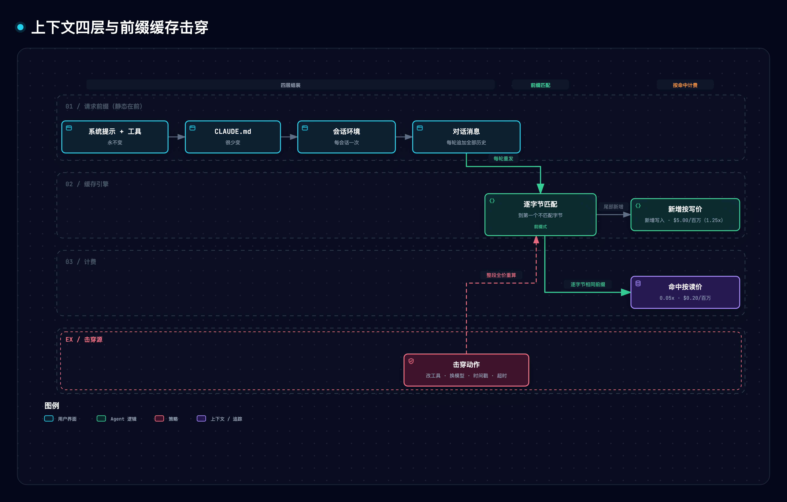
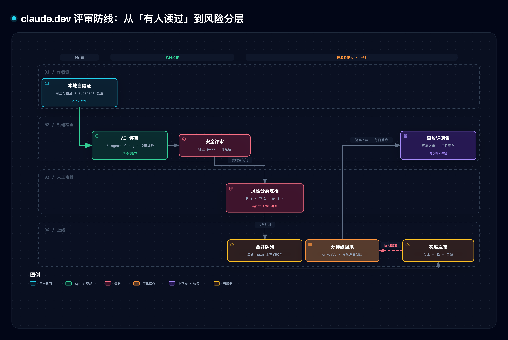

# claude.dev 全站精读与通俗拆解

> [1] Anthropic, "claude.dev Blog," 官方开发者博客. [Online]. Available: https://claude.dev/ （2026-10-23 全站快照：sitemap 20 URL、RSS 16 篇逐条一致、站点 2026-04-10 开张至 2026-10-15 最后更新；访问 2026-10-23）.

> [!NOTE]
> **核心精读范围**：16 篇博客全文（2026-04-10 ～ 2026-10-15）+ Mods 产品页 + Terminal 页 + Terms 页 + 首页内嵌 5 条视频的官方英文字幕（经 YouTube 官方频道定位，时长逐条吻合）。补读 7 组官方文档对齐机制口径：Claude Tag[26]、Managed Agents[27]、mods[28]、effort[29]、prompt caching[30]、Opus/Sonnet 5.5 发布页[31]、workflows[32]。引用条款按站点 Terms[20]：代码样例按 MIT 授权（保留版权与许可声明），其余内容仅作署名简短摘录。

**一句话定位**：claude.dev 是 Anthropic 把自家团队与客户跑 Agent 的工程账本公开出来——每一篇都在回答同一个母题：**模型能力每两个月换代一次，围绕模型的工程（钱、上下文、验证、执行环境、组织）该怎么搭**。

**SCQA 导读**：（共识）Agent（让大模型自己调工具干活的程序）已经能写代码、跑测试、发简报，Anthropic 内部约 90% 的 Claude Code 代码由 Claude 自己写出[2]。（痛点）任务贵——账单由每轮重发的全部历史决定；任务失控——单上下文干长活有懒惰、自偏、漂移三种失败模式[14]；评审被淹没——monorepo（单一巨型仓库，全公司代码同仓）日变更从约 2,500 涨到 30,000+，人逐行读在数学上不可能[2]。（问题）钱、质量、执行环境这三件事分别怎么管？（回答）本篇拆七组机制：账单的形状（§3）、effort 档位（模型的思考投入档位，§4）、脚手架生灭（§5）、评审防线（§6）、无人值守自动化（§7）、执行环境三级跳（§8）、平台可编程面（§9）；§11 动手实验室用确定性原型复跑全部结论。

> [!TIP]
> **白话主线**：①Agent 任务的账单=轮数×每轮重发的全部历史×单价，缓存命中（上次读过、逐字节没变的部分按 1/20 价复用）是最大的省钱杠杆，最便宜的轮是省掉的那一轮；②给模型搭的脚手架（提醒清单、详细规则、预建检索）都是给上一代模型的毛病打的补丁，毛病消失补丁就该拆——与其堆规则，不如给模型可自行运行的检查手段；③评审的问法从「有没有人读过代码」换成「这个变更可能出什么问题、哪种检查最适合抓住它」，机器读代码、按风险配人工名额；④执行环境从本地终端迁向每任务一台的云端机器、托管平台、直到聊天软件里常驻的主动助手，人从盯每一步退到给目标、验收结果；⑤全部数字来自作者团队实测（真实用户监控、/usage 实测、Terminal-Bench、内部基准），也全部是 Anthropic 厂商自述口径。

与仓内既有分工：Learn Claude Code 文档轨的系统精读见五层套件（[170 总纲](./170-claude-code-harness-overview.md) 至 [175](./175-claude-code-multi-agent-platform.md)）与并发重学（[176](./176-claude-code-concurrency-relearn.md)）；本篇讲 claude.dev 博客轨的增量，重叠机制只以短名指针带过、不重述。

## 1. 它要解决什么问题

把 16 篇文章 + 5 条视频摊开，反复出现的是四个工程问题。材料对每个都给了实测过的答案：

| 问题 | 材料的回答 | 对应章 |
| --- | --- | --- |
| 一个 Agent 任务的钱到底花在哪、怎么省？ | 轮数×重发×单价的账单模型 + 前缀缓存 | §3 |
| 模型换代这么快，给模型的规则和工具该怎么搭？ | 脚手架生灭律：补丁随毛病生灭 | §5 |
| 变更量暴涨后，质量靠什么守住？ | 风险分层评审 + 可运行的验证 + 确定性计数棘轮 | §6 |
| Agent 的执行环境放哪、人怎么跟它打交道？ | 云会话 → 托管平台 → 聊天软件常驻助手 | §7–§8 |

这四问合起来就是母题的展开。材料还有一个反复出现的元方法：**可测量即可优化**——给 Agent 一个确定性可数的基准，它就能爬山；给它可运行的检查手段，它就能在交付前自检[10]。

## 2. 全貌解剖

**分层看**，全站内容可以排成三层：

| 层 | 部分 | 回答的问题 |
| --- | --- | --- |
| 地基 | 任务账单模型（§3）与 effort 档位（模型的思考投入档位，§4） | 钱的真实去向与「多花钱买到什么」 |
| 核心机制 | 脚手架生灭（§5）、评审防线（§6）、无人值守自动化（§7）、执行环境三级跳（§8）、可编程面（§9） | 规则怎么搭、质量怎么守、自动化怎么不坏、环境放哪、平台怎么扩 |
| 证据链与地图 | Terminal-Bench 3.0 effort 曲线、内部基准、真实用户监控（RUM，采真实用户延迟数据）数字、三场访谈视频（三位创始人的 Managed Agents 圆桌、Ramp、DoorDash，共覆盖五家公司）、站点结构（[1][19]） | 这些主张凭什么信、生态长什么样 |

**因果脉络一条线**：观察到「任务贵、长程失控、评审被淹没」→ 归因于「成本=轮数×重发×单价（缓存是杠杆）；失败=单上下文长程三模式；旧护栏是为上代模型防御最坏情况而设」→ 立下设计规格「缓存优先的 harness（包在模型外面的工具与流程脚手架）+ 可运行的验证 + 渐进披露 + 独立上下文编排 + 风险分层人审」→ 机制上落到七组（§3–§9）→ 证据闭环靠内部实测：40 连跑 0 失败、13 项 p75（75 分位延迟，即 75% 的用户都快于此值）几何平均 3.1x、held-out（保留测试集）90.5% 对 78.6%、2.8M 输入 $11.20→$1.62、内部产品部门约 65% 的 PR 由 Tag 写——全部厂商自述。

**前置概念三个，用到就讲**：①token（大模型按「词块」计量与计费的单位；上下文窗口=一次请求能装下的历史上限）；②每轮重发——Agent 每干一轮，程序会把至今全部对话原样再发给模型一遍，这是全站成本叙事的地基；③PR（pull request，一次待评审的变更提交）与 code review（同行评审）。

**最值得学的焦点，按价值排序**：上下文经济学（立即能套用的硬知识）→ 脚手架生灭律（该搭什么拆什么的元判断）→ 验证与评审防线 → 执行环境三级跳 → mods/workflows 可编程面 → 评测方法论（[7]，与仓内既有精读重叠较多，本篇只摘增量）→ 组织采纳实证（§8.4）。

## 3. 机制一：账单的形状——轮数、重发与缓存前缀

### 3.1 单价相同的两个模型，同一任务能差多少钱

开篇先立一个反直觉事实：两个模型每 token 单价完全相同，在同一个任务上的花费可以差很多[8]。原因不在单价，在任务形状——Claude Code 的任务是「模型读对话→调工具→读结果」的循环，**每一轮都把至今全部历史重发一遍**。于是账单由四要素构成：轮数、缓存读、输出 token（含思考，Opus 5.5 上输出价是缓存读的 100 倍）、模型单价[8]。最便宜的轮是省掉的那一轮。

### 3.2 前缀逐字节匹配：排对顺序，缓存免费

前缀缓存的工作方式很笨但很硬：API 把请求从第一个字节到缓存断点的内容存下来，下次请求拿开头逐字节对——对上的部分按缓存读价计费（Opus 5.5/Sonnet 5.5 为输入价的 0.05 倍，上一代为 0.1 倍[30]），**从第一个对不上的字节起，后面全部按全价重算**[16]。

所以 Anthropic 把提示词排成「越靠前越不许动」的四层[16]：

| 层 | 内容 | 变化频率 |
| --- | --- | --- |
| 1 | 系统提示 + 工具定义 | 永不变 |
| 2 | 项目说明（CLAUDE.md）与记忆 | 很少变 |
| 3 | 会话环境（env、MCP 连接器、输出样式） | 每会话一次 |
| 4 | 逐轮增长的对话消息 | 每轮追加 |

击穿缓存的动作清单（任一命中，从该位置起整段作废）：会话中途换模型（缓存按模型隔离）、增删工具定义、改系统提示、往静态层塞精确时间戳、缓存超时、compact（压缩）、MCP（外部工具服务的接入协议）变更、云服务商上改 effort[8][16]。实测口径：2.8M 输入零缓存命中 $11.20，90% 命中 $1.62，96% 命中 $0.99——没有任何其他设置能这样幅度地移动输入成本[8]。

两个配套手法：信息过时不回改提示词，而是把更新以 system-reminder 标签注入下一条消息[16]；MCP 工具不整块加载，用轻量存根（defer_loading）常驻、模型搜索到才取完整定义[16]。压缩也是同样思路：朴素压缩另起炉灶，前缀从第一个 token 起分叉、整段按全价重算；cache-safe forking 复用父对话完全相同的前缀、把压缩指令当末尾新消息追加，只付新增 token[16]。



### 3.3 实测：一次时间戳的代价（实际运行日志）

本篇原型（§11，`claude_dev_lab.py` M1）按四层前缀与 Opus 5.5 牌价（输入 $4/缓存读 $0.20/5 分钟写 $5，每百万 token[8][30]）模拟 12 轮会话：

```text
[M1 汇总] 12 轮总成本：稳定分层 $0.03 | 时间戳击穿 $0.13（5.0x）| 中途改工具 $0.04（1.4x）| 中途换模型 $0.04（1.4x）
```

系统层注入一个每轮变化的时间戳，成本翻五倍；中途改工具定义或换模型各抬四成——换模型不比改工具贵多少，前提是只换一次（缓存按模型隔离，新模型要从零重建）[16]。会话已进行 100k token 时为了省 token 切到 Haiku 问个简单问题，比让 Opus 直接回答更贵——要为 Haiku 整段重建缓存[16]。

### 3.4 长会话的每轮成本与压缩经济

上下文越长每轮越贵：20K 时每轮缓存读约 $0.004，150K 时约 $0.03[8]。`/clear` 换任务免费；`/compact` 花 $0.25 左右、约十轮回本，应趁缓存热、在自然断点做——会话快结束再压缩是纯亏[8]。迁到新模型时旧提示词常带着仪式性反模式（强制流程、草稿步、verify-twice、自相矛盾指令），`/claude-api prompt-audit` 清除后实测在降价 18% 之上再省 9%——这是单个内部基准的结果，官方提醒当作例子而非预期数字[8]。

计费变体两件：fast mode 同模型最高 2.5 倍速、单价翻倍（$8/$40，开启后首个请求对整段对话按 fast 价计费，应在会话开始时开）[8]；Batch API 半价[8]。

## 4. 机制二：effort 档位——买得到什么、买不到什么

### 4.1 它是倾向信号，不是开关

effort 是向模型传达「愿意花多少算力」的近似信号——官方定义「行为信号，不是严格的 token 预算」[29]。五档 low/medium/high/xhigh/max，作用于全部输出 token（正文、工具调用、思考）[29]。任何档位模型都会合理干活；档位越高，它越多自主做判断与验证[9]。默认档：API 多数模型 high，Opus 5.5 与 Haiku 5.5 为 medium[29]。

### 4.2 实证：高档修边界漏，修不了方法错

Terminal-Bench 3.0（70 个终端任务的基准集）上，Fable 5.1 从 low 到 max：通过数 140→214（作者口径：每档各统计 370 次尝试）、每次尝试 token 中位数 73k→222k；「漏了一个 case」类失败 59→24，「自身测试漏掉 bug」40→14——但「选错解读」25→47，**唯一随 effort 上升的失败类别**[9]。结论有三条：高档的核心收益在隐藏边界情况密集的任务（分域通过率取最低两档合并对最高三档合并的口径：Security 64%→87%、Hardware 34%→75%）；方法性错误高档修不了；一部分失败从「漏边界」转移成「选错解读」——多花钱买到的是更彻底，不是更聪明[9]。

规格充分度决定档位差多大：规格含糊时 low 与 max 产出天差地别（健身 App 玩具任务 1.5 分钟对 67 分钟）；先 interview 出完整规格后，各档各模型产出明显趋同（16/22/33/79 分钟）[9]。作者的工程节奏：面试补全 spec → low 出起点 → 人工审阅迭代 → high 验证测试[9]。分域数据里最扎眼的是 Operations（规则手册型工作）12%→22%——effort 不是万能钥匙[9]。

### 4.3 always-think：删掉「仔细想一想」

Opus 5.5 每次回复前都思考并自己决定思考量，提示词里「think carefully」类叮嘱成了多余旧补丁——官方在聊天产品实测，删掉后回复更早开始、质量无明显下降[11]。思考量唯一可靠的调节手段是 effort 档位；在系统提示里叫模型少想，不可靠[6]。思考 token 按输出价计费且计入 max_tokens，agentic 场景官方建议 max_tokens 给到 128,000 并流式[6]。

## 5. 机制三：脚手架生灭律——删掉的 80% 与死掉的 todo

### 5.1 补丁随毛病生灭

Claude Code 团队自己的表述：「harness 里的很多功能，本质是给当下模型的失败模式打的补丁」[22]。两个标本：

- **todo 清单的兴衰**。讲者回忆约 Sonnet 3.5 的年代，给模型 5 件事它只做 3 件就停，外置清单+每 5 轮提醒恰好补这个毛病；一年后模型自己能记住复杂安排，清单反而逼它死守旧计划，删了[17][22]。
- **80% 系统提示删减**。官方审查内部使用转录发现同一请求里系统提示、skills 与用户指令互相冲突（「适当保留文档」对上「禁止加注释」），诊断为对 Claude Code 的过度约束——旧护栏是为旧模型防最坏情况设的。给 Claude 5 世代模型删掉 80% 以上系统提示，编码评测无可测损失；新注释规则只剩一句「写得像周围的代码：匹配它的注释密度、命名与惯例」[12]。

配套的六组新旧对照（择要）：给规则→让模型用判断力；给调用示例→设计富有表达力的接口（枚举值本身就暗示用法，示例反而把探索空间锁死在示例内）；全量前置→渐进披露（skills 拆文件、工具延迟加载）；重复指令→收敛进工具描述；手写记忆→auto-memory；简单 markdown 规格→富引用（HTML mockup 优于文字描述或截图）[12]。

### 5.2 工具设计的三个教训

「像 Agent 一样看」一文给出三次真实迭代[17]：让模型向用户提问，先试把问题塞进计划提交工具的参数（计划与提问语义冲突，废）、再试自定义 markdown 输出格式（模型执行不可靠，废），最后落地为独立的 AskUserQuestion 工具（弹出选项、阻塞循环等用户作答）。第二个标本是上下文获取：内部首版用 RAG（先给整个代码库建向量索引、检索片段喂给模型）——快但需搭建、跨环境脆弱、上下文是被动投喂；换成 Grep 工具让模型自己搜、自己决定读什么，「最有影响力的工具是让模型自寻上下文的工具」[17]。第三个标本是门槛：当前约 20 个内置工具，每加一个都是模型多一个要权衡的选项，文档检索交给独立上下文的 Guide subagent（子代理）、只回传答案[17]。

### 5.3 skills 的运营学

skill 不是「一个 markdown 文件」而是含指令、脚本、资产、配置的文件夹；Anthropic 内部数百个技能自然聚成九类，最佳技能只干净落一类[13]。信号密度最高的是 Gotchas 节——由真实失败积累；description 字段写给模型看、描述何时触发而非内容摘要；把整个文件系统当渐进披露用（SKILL.md 做枢纽、细节拆引用文件）[13]。分发上小团队入仓即可，规模化转内部 marketplace，准入靠「sandbox 自传播攒 traction → owner 提 PR」的有机筛选而非行政审批；用量靠 PreToolUse hook（工具调用前触发的挂钩）做全公司使用记录[13]。

## 6. 机制四：评审防线——从「有人读过」到风险分层

### 6.1 问法换了，整条流水线跟着换

Anthropic 团队把评审的衡量问题换掉：不再问「有没有人读过这段代码」——那是不精确的代理——改问「这个变更可能出什么问题、哪种检查（自动或人工）最适合抓住它」[2]。评审因此从 PR 尾部的闸门变成贯穿全程的持续过程（材料自身的说法：像写作时的拼写检查）[2]。变更的一生穿过七层：



1. **PR 前验证**：给 Claude 可运行的检查（测试、构建、截图对比），要它展示输出而非口头宣称完成，再由全新上下文的 subagent（子代理，独立派出的助手会话）复查 diff（改动对照）——团队估计这让结果好 2–3 倍[2]。
2. **AI 评审**：多个 agent 并行找 bug，另一组 agent 对每个发现投票核验才发布；纯风格类发现经 A/B 验证后直接丢弃[2]。
3. **可阻断的安全评审**：独立 pass，发现未关闭即阻断合并[2]。
4. **必需 CI**：数十项检查全绿才能合并[2]。
5. **风险分级审批**：分类器读变更（而非听作者）定档——低风险 0 人（前提是自动检查全绿）、中风险 1 人、高风险 2 人；agent 的批准永远不能顶人类名额；一次审批只覆盖一个 commit，agent 推了新 commit 就作废；更轻的信任路径只对仓库信任名单开放[2]。
6. **合并队列 + 灰度**：在最新 main 上重跑全部检查（防两个好 PR 组合出坏 main）；新行为挂 flag 先员工后 latest/stable 通道[2]。
7. **快速检测与回滚**：每周 on-call + 回退/事故看板 + 一键回滚；事故复盘追问「哪一层本应拦住它」[2]。

护栏不是「都自动化」而是回退率：目标是人类总时间（评审耗时+修坏码耗时两面）变少的同时，回退不比以前多[2]。人类留下五件事：该不该做的方向决策、高危代码（计费/自动更新/CI workflow）评审、会被别人复制的架构评审、读证据、对结果负最终责任；知识传播不再靠读 diff，改由按需让 Claude 写目标代码切片的讲解文档[2]。

### 6.2 评审器自己也要有评测集和收敛控制

评审器的迭代靠「事故即评测集」：引发事故或回退的历史 PR 经专家逐案确认入集，评审器的 prompt/工具/模型任何改动都对全量案例每日重打分，分数升才保留[2]。噪声按作者处置分类统计（修了/判错了/不重要），对已知干净 PR 的误报是硬检查[2]。对 agent 作者，噪声代价更高——人会挥挥手放过 nit（无关痛痒的小毛病），agent 会真去修、触发新一轮评审；一个 CLI PR 曾过夜跑 50 多轮评审-修复循环才被叫停，git blame 取证显示反复标记的代码约 59% 首轮就存在[2]。收敛改造（三轮封顶、增量复审、按 bug 类标记、禁止重复发现）后：一轮通过率 65%→78%、≥5 轮占比 8.9%→1.5%、平均轮数 2.08→1.32[2]。

### 6.3 性能冲刺：可测量即可优化的全功率示范

「两周让 claude.ai 提速 3x」一文把 §1 那条元方法（可测量即可优化）推到了全功率[10]：给 Claude（经 Claude Tag beta 常驻 Slack 频道，跑内部约 Opus 5.5 水平的研究模型）一个确定性可数的基准，它就能立刻开始爬山（反复试改、只保留变好的改动）。wall-clock 太抖当不了 CI 门禁，改用确定性计数（Valgrind 指令数、React commits、V8 调用数、样式重算、DOM 变更），先证明计数与时钟同向（两条热路径指令数 −48%/−31% 对应时钟 −78%/−44%）才入库成棘轮——CI 里基准上限只许降不许升，每次胜利锁死[10]。全速期 150+ 线程并行、单线程 50–100 个 PR、最忙单日 200+ 变更，两周合计 3000+ 变更、零客户事故、零回滚；13 项 p75 指标几何平均 3.1x（新鲜加载 3.1s→0.55s），估算每天节省数万用户小时[10]。人不省略：这套工作循环高产但不自主，人类要做三重把舵——野心（Claude 默认保守要推它更激进）、品味（每个用户可感知变化由具名 owner 裁决）、方向（线程排序合并、及时关停收益递减线程；900 行 PR 换每次发送 2ms 被一票否决）[10]。

## 7. 机制五：无人值守自动化——书签、确认记账、硬预算

### 7.1 六组件骨架

评审防线守的是有人发起的变更；另一类麻烦出在没人看着的地方——定时在后台跑的自动化，坏了没人知道。「Building effective agent automations」用一个每天早晨发简报的参考实现，把托管自动化的失败模式全部演示了一遍[3]。骨架六件：Sources（只读来源）→ Agent（模型+工具+判断规则）→ Destination（唯一可写去处），Schedule（cron 定时）负责拉起，Memory（偏好+状态）跨 run 持久，Guardrails（只读权限+消费上限）兜底[3]。

三个最可迁移的机制：

- **书签续读**：不用固定时间窗（晚跑留空档、早跑重复），每源记「上次读到的最新时间戳」，窗口随运行迟早自动伸缩[3]。
- **失败读三规则**：某源不可读时书签原地不动、用其余源照常出稿、简报结尾一行点名缺了什么——MCP 服务器宕机时 run 照常启动，Agent 会把「什么都没读到」误报成「今天没动静」，必须显式化[3]。
- **送达确认后记账**：只有 Slack 返回成功凭证（`"ok": true` 带消息 ts）才算已发，之后才更新台账与书签；结果不明标 maybe_posted 并冻结其余状态[3]。两种事故对：记了没发→书签前移、条目永不再报；不确定就重发→读者收两遍[3]。

条目收录标准也是工程判断：读者今天会为此行动、或会改变即将做的决策才收，拿不准就略——一条过期信息造成的信任损失大于十条遗漏[3]。

### 7.2 护栏：能只读就只读，每 run 硬预算

后台运行的威胁模型：Agent 读的是别人写的文本（提示注入面），所以 GitHub token 与偏好库只读、网络只达 allowlist 主机、凭证放平台 vault 与沙箱隔离（沙箱内只见占位符，请求出沙箱时代理才换真值）[3]。植入指令仍能改简报内容——权限护栏封不死内容操纵，只能封死其实质动作[3]。

花钱护栏是每 run 美元硬预算：按公开牌价对 token+web search+运行时长连续计价，触顶以 `budget_reached` 暂停而非失败，改/删预算自动恢复[27]。token 层无加价（与 Messages API 同价、缓存乘数相同），另收 session runtime $0.08/小时[27]。托管记忆是挂载进沙箱 `/mnt/memory/` 的文本库（单条 ≤100kB、每库 ≤1 万条、乐观并发锁），偏好用户写 Agent 只读、状态 Agent 读写，偏好必须每 run 重读文件而非烤进提示[3][27]。

### 7.3 实测：拿掉确认记账会怎样（实际运行日志）

原型 M2 用固定 6 天 episode 对拍两种记账策略（D3 发帖失败、D4 结果不明但实际已送达）：

```text
[M2 汇总] 确认记账：客观丢失 []、重复 ['i3', 'g3']（不确定日冻结 → 次日重发的既定代价）
[M2 汇总] 不确认记账：客观丢失 ['i2']（失败日记账 → 永不再报）、重复 []
```

确认策略用「可能重复」换「必不丢失」；不确认策略在失败日静默丢内容[3]。预算侧（M3）：上限 $3.00 的 run 在第 3 步触顶暂停、终态 paused——在外人看来就是「简报安静了」；无上限的 run 跑完 $8.70，是上限的 2.9 倍[27]。

### 7.4 Claude Tag：常驻聊天软件的主动 Agent

Claude Tag（公测，2026-06-23 发布）把这套无人值守形态搬进 Slack：Claude 以团队成员身份加入频道、@它即可交任务，也能自己判断何时介入、连续工作数天到数周并主动跟进[25][26]。四个工程事实：执行环境是云端临时沙箱（会话开始创建、闲置即弃，不跑本机）；对外部系统默认零访问，经 connectors/plugins/skills 扩展且作用域分三档（全 Slack/单 workspace/单频道）；**记忆按频道存储**（频道记忆不按人组织，公开频道另有全 workspace 可读的 notes，沙箱丢弃而记忆持久）；管理员可设组织与频道花费上限并看全量审计日志[26]。定位判据一句话：共享频道里的团队工作用 Tag，个人文件上的工作用 Cowork 或 Claude Code[26]。

支撑它的两项能力来自研究侧：METR 评测测得最新模型可连续工作 16 小时、且时长上限已难以准确测量；记忆「做了多年终于做对」——模型能给自己设提醒、累积记住所有指令，单次 16 小时任务借自我排期延展成跨周任务链（讲者个人有一个跑了一个月的会话，每天自查数据、有 bug 就提修复 PR）[25]。最硬的生产力证据：内部产品部门由 Tag 写的 PR 占比「I think it's like 65%」且仍在攀升——讲者口头估计，非严格统计[25]。在 Managed Agents 一侧，outcomes 机制把「达标」做成 rubric（可核验断言式评分标准）+独立上下文的 verifier agent，验证不过宁可不给用户看——认错人的假阳性简报近乎破坏性[21]。

## 8. 机制六：执行环境三级跳

### 8.1 第一跳：云会话——每任务一台一次性机器

云会话把 Claude Code 跑在每任务一台的新 VM 上（克隆仓库到新分支），文件、进程、端口天然隔离[4]。作者实测：16 秒内并行启动三个云会话，修 flaky 测试（连跑套件 40 次 0 失败）、重写过期 API 文档（发现 5 处错误）、改结构化日志（新增 5 个测试），61/65/72 秒各自完成、87 秒全部收工[4]。安全模型是凭证最小化：GitHub token 留在 VM 外的代理里，会话只拿仅能 push 自己分支的短时凭证；出站流量过执行网络 allowlist 的代理[4]。

关键论断：**能跑测试的会话才会在交回前自检，否则你评审的是没人跑过的改动**——约十分钟的环境配置（setup script 缓存成快照）就能把「人工评审没人跑过的改动」变成「交付前自检」[4]。配套动作：桌面 plan mode 定方案→云端执行→`claude --teleport` 拉回本地收尾；GitHub App 监听 CI 失败与 review 评论自动修；routine 按 schedule（最短 1 小时）/HTTP/GitHub 事件触发无人值守会话[4]。代价与边界：并行会话线性消耗计划限额（5 个约 5 倍速）；空闲 VM 会被回收，长任务要随手 commit；Zero Data Retention（零数据保留）的组织直接关闭该功能[4]。

### 8.2 第二跳：Managed Agents——把 harness 本身托管

Managed Agents 把「谁来跑、凭证放哪、记忆存哪、花多少钱」全部收进平台配置（agent.md + deployment.md + vault + memory stores + budget）[3][27]。客户侧的判断标准（三创始人圆桌）：harness 是否该自建，看它是不是产品竞争力的核心——会前简报（briefs）不是（买），语音助手是（自建）；本质是控制权与成本时间的交换[21]。三家分别以 1 天（会议助手第一版）、2 周（跨账户汇总产品）、<2 周（代码审查方案）量级交付或完成迁移[21]。

### 8.3 第三跳：Tag——界面与 transcript 解耦

Claude Code 团队自己的工作形态已经大迁徙：一位工程师 70–80% 的工作在 Tag 里完成，只在精修时打开终端或桌面端[22]。Tag 首次把用户界面与 transcript（模型的完整推理记录）全面解耦——消息只是工具调用的产物、内部独白默认不可见；起初「看不到它在想什么」令人不安，实际是解放：靠验证证据（自跑测试+回传截图）而非盯 token 流建立信任[22]。人的抽象层从「盯每次工具调用」上移到「我有一个目标，请达成它」[22]。

### 8.4 组织侧样本：怎么推开

- **DoorDash（约 4000 人全员）**：策略是拉高全公司 AI 流利度下限而非服务精英；配套是 IT 安全共建的快速采购通道、初期不卡 token 预算、把成功与失败案例都写成书面产物（最可规模化的经验分发，副产品恰好是 agent 可读的语料）[24]。三个正向杠杆：3–5 人小团队、把代码库改造成 agent 友好（tech lead 在仓库 markdown 写下约 50+ 条架构原则供 agent 引用）、把繁琐操作封装成标准化 skills；实测一个工程师 3 周完成历史需 4 人一个季度的大迁移，多款产品上线时间砍半以上[24]。瓶颈不在写码——合并、CI/CD、跨职能评审成为新摩擦[24]。
- **Ramp**：agent 铺满工程生命周期每一环。三条最可迁移的经验：其一，逐条研究 individual trace 并推演「正确轨迹」（该跑什么命令、为何没跑到），用 prompts/tools/skills 塑形，而非依赖聚合 benchmark[23]；其二，harness 为 3–6 个月后的模型而建——「我们反复拆掉模型已经长大的脚手架，学会了退后等待」[23]；其三，不给工程师设 token 预算，控成本靠旁路（batch/flex 批处理接口、无人值守用便宜模型），「正 ROI 区间不该最小化支出」[23]。Fable 借 dynamic workflow 与 routine 自调度（落码→次日取生产数据→再优化，连跑数日）把 CI P50 从 18 分钟压到 6 分钟[23]。
- **评测次序律（三创始人）**：先凭体感把产品做到 sticky（用户离不开）再上系统化 evals；精心策展但偏离用户分布的 eval 集只会白爬坡；带活跃记忆的有状态系统与依赖第三方可变状态的评测至今无解[21]。

## 9. 机制七：平台可编程面——mods 与 workflows

### 9.1 mods：跑在会话里的 hook 链

前六组机制都在用平台给定的能力；mods 与 workflows 把平台本身打开给开发者——前者改单次会话的行为与界面，后者让模型为自己现编多 Agent 编排。mod 是随 plugin 分发的小 TypeScript 函数：挂钩件事件、改变行为、在终端自绘 UI[5][18]。核心心智模型是中间件链——每个事件依次穿过各 mod 的 hook，三种动作：调 `next(e)` 放行（observe）、改完再传（rewrite）、不调 next 直接返回（answer，就地终结、宿主收不到）[5]。模块跑在无 DOM、无 Node 的沙箱里，一切宿主能力经 `$` API 获取（fs/store/state/ui/process/http 等）[5]。

官方参考页的事件全量约 47 个，分九组（tools/prompts/commands、配置、turns、session、subagents、interface、other mods、telemetry），prompt.submit、tool.call、turn.start/step/complete、command.run 都在册[28]。三个出厂示例各占一个生态位：/diff 在 transcript 旁实时显示未提交变更、AGENTS.md 支持是 mod、sec-default 在 Team/Enterprise 上把组织策略放在个人所装 mods 之外[18]。两条红线：mod 与 Claude Code 同权限运行、由发布者而非 Anthropic 编写——信任模型等同第三方包，先读源码再装[5]；官方文档确认「runs with your permissions」无沙箱，托管设备上 sec-default 先于一切用户 mod 加载，管理员开启 allowManagedModsOnly 后可拦下全部用户来源的 hooks[28]。

热重载是全新加载（模块变量清零），跨重载数据必须放 `$.state` 并在类型契约中声明[5]。Blast Radius 示例演示 answer 拦截：接住 `rm -rf`、干跑测量、弹面板人审，但它只读命令文本——`$(…)`、别名、脚本都能绕过，硬阻断仍须 permission 规则[5]。

原型 M5 实测三态语义（实际运行日志节选，逐行照抄 `--selftest` 输出；每个事件先穿 observe 型的 weather、再穿拦截型的 blast、最后才到宿主）：

```text
weather:band(18%)
host:exec(ls -la)
blast:panel(dry-run rm -rf build) → Cancel
host:never-sees(rm -rf build)
weather:band(81%)
host:exec(rm -rf build)
```

### 9.2 dynamic workflows：让模型自己编排 harness

workflows 把「为一个任务现编一套多 Agent 编排」变成 Claude Code 的原生能力：一个 JavaScript 文件，`agent()` 派单个 subagent、`parallel()` 并行等齐、`pipeline()` 逐条流过，配标准 JS 写确定性控制流[14][32]。为什么需要它——单上下文窗口干长活的三种失败模式：agentic laziness（50 项做 35 项就宣称完工）、self-preferential bias（验证自己产出时偏袒）、goal drift（每次压缩都有损、边缘约束逐轮丢失）；workflow 用独立上下文、目标隔离的 subagent 结构性对抗[14]。静态编排必须覆盖所有边缘情况所以必然泛型；模型智能跨过阈值后，能按眼前这一个任务现写定制 harness[14]。

官方口径的运行时细节：脚本存 `.claude/workflows/`，ultracode 关键词或自然语言 opt-in 触发，默认 16 并发、单 run 上限 1000 个 agent；同 run 内配置相同的 agent 共享 prompt cache 前缀；成本官方只给定性——「一次 run 可能比对话里做同一任务多耗可观 token」，>25 agents 或预计 >1.5M token 会弹 advisory 警告[32]。Ramp 的用法把 workflow 当 test-time compute 的又一档：模型单打独斗会卡住的任务，交给它编排就能完成[23]。

## 10. 关键实证数字

| 实验/实测 | 关键数字 | 条件·截至 | 一句话读法 |
| --- | --- | --- | --- |
| 缓存命中的成本杠杆[8] | 2.8M 输入：零命中 $11.20 / 90% 命中 $1.62 / 96% 命中 $0.99 | Opus 5.5 牌价推算，2026-09 | 没有任何设置比缓存更移动输入成本 |
| 80% 系统提示删减[12] | 删 80%+，编码评测无可测损失 | Claude 5 世代模型，2026-07 | 未披露评测集与分数（见 §13） |
| 评审收敛改造[2] | 一轮通过 65%→78%；≥5 轮 8.9%→1.5%；平均轮数 2.08→1.32 | Claude Code 内部 PR，2026-10 | 噪声治理可量化 |
| 云会话并行实测[4] | 16s 启动 3 会话；61/65/72s 完成；87s 收工 | 示例仓库需从 prompt 重建（占 1/3–1/2 时间） | 隔离换来的并行是真的 |
| claude.ai 提速冲刺[10] | 13 项 p75（75 分位延迟，即 75% 的用户都快于此值）几何平均 3.1x；两周 3000+ 变更 0 事故；150+ 并行线程 | 2026-08-13~27 RUM | 可测量即可优化的全功率证明 |
| Terminal-Bench 3.0 effort 曲线[9] | 通过 140→214/370；「选错解读」25→47；Security 64%→87% | 内部跑分、关安全干预 | 高档买彻底不买聪明 |
| 客服基准爬山[7] | 74.4%@4.6¢→98.9%@1¢/工单；held-out（保留测试集）90.5% 对 78.6% | 44 工单内部基准 | 换挡降档+prompt 审计的合成效果 |
| Tag 生产力[25] | 内部产品部门约 65% 的 PR 由 Tag 写（讲者口头估计） | 2026-07 | 非严格统计，持续攀升中 |
| Ramp CI 优化[23] | P50 18 分钟→6 分钟（−66%） | Fable + workflow + routine 自调度连日优化 | agent 自排期跨天任务链的实证 |
| DoorDash 迁移[24] | 4 人×1 季度 → 1 人×3 周；上线时间砍半以上 | 单案例访谈 | 条件性强（见 §13） |
| 企业成本基线[8] | 每开发者每活跃日均 $13；90% 低于 $30 | 企业部署统计（口径未披露） | 量级参考而非承诺 |
| 本篇原型 | 时间戳击穿 5.0x；不确认记账丢 i2；上限 $3 触顶 paused；agent 批准计 2 人→merge=True | claude_dev_lab.py，2026-10-23 | 机制逻辑按描述运作（不复现材料数字） |

三条核心宣称的独立证据交代：「3x 提速」「98.9% 爬山」「65% PR」均为 Anthropic 自测或自述，无第三方复现；「40% 降本」「30% 降本」的官方原文与口径见 [31]（默认档、典型负载、上限值），本篇按其限定词转述。

## 11. 动手实验室

原型共 384 行、纯标准库，已随笔记入库：[assets/claude_dev_lab.py](./assets/claude_dev_lab.py)。在仓库根运行 `python3 docs/research/agent-harness/assets/claude_dev_lab.py --selftest`（约 1 秒，退出码 0、末行 `SELFTEST PASSED ✔`；结果 JSON 写入系统临时目录，不污染仓库。作业现场的 `.temp/claude-dev-lab/` 目录随清理消失，本节所有日志均可按该入库副本复刻）。原型验证机制逻辑，不复现材料数字。

| 机制 | 实现单元 | 行号 |
| --- | --- | --- |
| M1 前缀缓存分层与击穿 | `simulate_session` / `m1_prefix_cache` | 40 / 66 |
| M2 书签续读+确认记账 | `EPISODE` / `DailyBriefBot` / `m2_daily_brief` | 89 / 99 / 141 |
| M3 硬预算与 budget_reached | `m3_budget_guard` / `m3_run` | 167 / 332 |
| M4 风险分层审批 | `m4_review_gate` / `m4_gate` | 202 / 324 |
| M5 hook 链三态 | `m5_hook_chain` | 236 |
| 破坏性实验 E1–E4 | `destructive_experiments` | 291 |

破坏性实验（每次只拆一个组件，实测退化）：

| 实验 | 改动 | 实测观察到什么 | 教训 |
| --- | --- | --- | --- |
| E1 | 拿掉「确认送达才记账」 | 客观丢失 `['i2']`（失败日记账→永不再报） | 记账与实发脱钩=静默丢内容 |
| E2 | 系统层注入每轮变化的时间戳 | 12 轮成本 $0.03→$0.13（5.0x） | 随时变的信息走消息注入，不进前缀 |
| E3 | agent 批准计入人工名额 | 高风险变更 2 笔 agent 批准→merge=True，零人类批准 | agent 批准永不计数 |
| E4 | 无人值守会话不设预算 | $8.70 跑完，为 $3 上限的 2.9x | 没人感知超支，硬预算是唯一自动闸门 |

## 12. 底层规律与核心争议

### 12.1 五条底层规律

1. **账单随轮数复利**：成本=轮数×逐轮重发的历史×单价；缓存命中决定历史按 1/20 还是全价计费，最便宜的轮是省掉的那一轮[8][16][30]。
2. **脚手架随模型能力生灭**：harness 功能是给当前模型失败模式的补丁；判断标准是「它补的毛病还在不在」，不是「它当年多有用」[12][17][22]。
3. **可测量即可优化，可运行即可自检**：确定性可数的基准让 Agent 能爬山，可运行的检查让它在交付前自检——验证能力是吞吐与质量同时成立的前提[9][10][2][4]。
4. **评测必须镜像生产分布**：按「今天的模型恰好失败」挑案例测出的是失败指纹；train/test 隔离、失败原文不进提示、答案结构性隔离；饱和后目标转向成本[7][21]。
5. **盯变化率，为下一代理构建**：脚手架为 3–6 个月后的模型而建，旧想法隔几个月重试，对冲新模型的新失败模式比榨取旧模型最后 1% 更值[22][23][24]。

五条分工：规律 1 管成本、2 管能力-脚手架耦合、3 管验证-测量、4 管评测方法、5 管代际迁移——合起来是「围绕快速换代的模型做工程」的决策地图。

### 12.2 三个真实争议

1. **token 该不该设预算**：Ramp「不设限+正 ROI 不降本」（每 1 美元 token 赚回超过 1 美元就不该省）[23] vs Anthropic 自家托管产品处处上限（每 run 硬预算、云会话限额线性消耗、Tag 月度上限）[3][4][27]。分歧本质是看到的失败模式不同：人在环的会话超支可感知，无人在场的超支静默；不可消除的是「上限设太低=静默失能」的检测难题。
2. **评审到底为了什么**：行业旧共识把「有人读过代码」当质量代理；Anthropic 说这是不精确的代理，正确问法是风险与对应检查[2]。分歧由变更量级造成——旧共识成形于人审得过来的时代，新立场诞生于日变更 30,000+、90% 代码由 agent 写的时代；技术上七层防线可复制，文化上「评审=责任署名」的旧契约需要重新谈判。
3. **交付物用 HTML 还是 Markdown**：作者自认 HTML 极端派（超百行 Markdown 没人真读、HTML 能承载交互与双向导出闭环、1M 窗口下 token 开销不可感知、声明为个人观点）[15] vs 仓内 Markdown 惯例（可 diff、可 grep、工具链成熟）。两者优化的读者不同（被人类读完的概率 vs 被机器处理的效率），会长期分域共存——作者本人也把 HTML 定位为一次性 artifact 而非入仓资产。

## 13. 适用边界

### 13.1 成立条件

- **定义域**：围绕 Claude 模型与 Claude Code/Tag/Managed Agents 平台的工程实践；多数数字来自 Anthropic 内部 monorepo 与深度合作客户，规模与工具链同构者可参考。
- **成立工况**：缓存与计费结论绑定 Anthropic API 的按前缀、逐字节匹配实现[16]；effort 结论绑定 Terminal-Bench 口径（比日常任务难得多）[9]；「删 80% 系统提示」绑定 Claude 5 世代模型（旧模型删护栏会出坏注释）[12]。
- **Out-of-Scope**：Claude Code 源码内部实现（见 [170 总纲](./170-claude-code-harness-overview.md)起的 170–176 五层套件与重学篇）；非 Anthropic 模型/平台横评；模型训练与对齐研究。

### 13.2 材料没有证明的事

1. 全站效率/成本数字（3x 提速、40% 降本、65% PR、Sonnet 30% 降本）均为 Anthropic 厂商自述，无第三方复核[1]；评审改造的回退率/事故率只给相对变化（>40% 降幅）不给绝对值，基线水平无法评估[2]。
2. 「删 80% 系统提示无可测损失」未披露是哪套编码评测、删减前后分数——核心结论缺可复现证据[12]。
3. 「运行成本低 40%」是降价+默认档省 token 的合成估计（官方原文限「at default settings…on typical workloads」，负载构成未披露）；同 token 数对拍的纯降价效应约 −31%[8][31]。
4. effort 规律（高档修边界漏、修不了方法错）只在 Terminal-Bench 3.0 验证，作者自认该基准比日常工程任务难得多、外推要打折[9]。
5. 三场访谈（三创始人圆桌/Ramp/DoorDash）的受访公司无一家给出成本/ROI 绝对数字，且均为 Anthropic 深度合作客户（选择偏差）[21][23][24]；「65% PR」是讲者口头估计[25]。

另有一条全站级限定：Terms 页自述内容「可能过期或不完整、部分由 AI 参与起草」，代码须测试后再依赖[20]。

## 14. 用户自测与费曼研讨套件

1. 你的团队把项目说明（CLAUDE.md）写得很长、规则很细，模型换到新一代后产出反而变差。按本篇的脚手架生灭律，你会怎么排查哪些规则该删？用什么证据说服自己「删了没损失」？
2. 你要上线一个每晚自动跑、把结果发到群里的 Agent。参照 §7 的三件套（书签/确认记账/硬预算），写出它会遇到的三个最可能的具体故障，以及各自的第一道防线。
3. 有同事主张「给 Agent 任务的提示词里加一句『仔细想清楚再动手』能提高质量」。用 §3–§4 的机制推理：这句话在新模型上的实际效果是什么？正确的旋钮是哪个、在什么条件下才该拧大？

## 参考

- [1] Anthropic, "claude.dev Blog," 开发者博客. [Online]. Available: https://claude.dev/ （sitemap 20 URL、RSS 16 篇，2026-04-10 至 2026-10-15；访问 2026-10-23）.
- [2] A. Osmani, M. Westlee Lunt, and Q. Wang, "How the Claude Code team does code review," claude.dev Blog, Oct. 15, 2026. [Online]. Available: https://claude.dev/blog/solving-code-review-at-anthropic/ (访问 2026-10-23).
- [3] L. Martin and C. Avilla, "Building effective agent automations," claude.dev Blog, Oct. 08, 2026. [Online]. Available: https://claude.dev/blog/building-effective-agent-automations/ (访问 2026-10-23).
- [4] Anthropic, "Claude Code in the cloud: a field guide to cloud sessions," claude.dev Blog, Oct. 06, 2026. [Online]. Available: https://claude.dev/blog/claude-code-in-the-cloud/ (访问 2026-10-23).
- [5] Anthropic, "Getting started with Claude Code mods," claude.dev Blog, Oct. 01, 2026. [Online]. Available: https://claude.dev/blog/getting-started-with-claude-code-mods/ (访问 2026-10-23).
- [6] Anthropic, "Building with Claude Sonnet 5.5," claude.dev Blog, Sep. 28, 2026. [Online]. Available: https://claude.dev/blog/building-with-claude-sonnet-5-5/ (访问 2026-10-23).
- [7] Anthropic, "Automating eval design and hillclimbing with Claude," claude.dev Blog, Sep. 28, 2026. [Online]. Available: https://claude.dev/blog/automating-eval-design-and-hillclimbing/ (访问 2026-10-23).
- [8] Anthropic, "What a task costs on Opus 5.5," claude.dev Blog, Sep. 25, 2026. [Online]. Available: https://claude.dev/blog/what-a-task-costs-on-opus-5-5/ (访问 2026-10-23).
- [9] Anthropic, "Using Claude Code: Spending your effort," claude.dev Blog, Sep. 25, 2026. [Online]. Available: https://claude.dev/blog/spending-your-effort/ (访问 2026-10-23).
- [10] Anthropic, "How we made claude.ai 3x faster in two weeks," claude.dev Blog, Sep. 23, 2026. [Online]. Available: https://claude.dev/blog/how-we-made-claude-ai-faster/ (访问 2026-10-23).
- [11] Anthropic, "Getting the most out of Opus 5.5 in Claude and Claude Code," claude.dev Blog, Sep. 22, 2026. [Online]. Available: https://claude.dev/blog/getting-the-most-out-of-opus-5-5/ (访问 2026-10-23).
- [12] Anthropic, "The new rules of context engineering for Claude 5 generation models," claude.dev Blog, Jul. 24, 2026. [Online]. Available: https://claude.dev/blog/the-new-rules-of-context-engineering-for-claude-5-generation-models/ (访问 2026-10-23).
- [13] Anthropic, "Lessons from building Claude Code: How we use skills," claude.dev Blog, Jun. 03, 2026. [Online]. Available: https://claude.dev/blog/lessons-from-building-claude-code-how-we-use-skills/ (访问 2026-10-23).
- [14] T. Shihipar and S. Bidasaria, "A harness for every task: dynamic workflows in Claude Code," claude.dev Blog, Jun. 02, 2026. [Online]. Available: https://claude.dev/blog/a-harness-for-every-task-dynamic-workflows-in-claude-code/ (访问 2026-10-23).
- [15] T. Shihipar, "Using Claude Code: The unreasonable effectiveness of HTML," claude.dev Blog, May 20, 2026. [Online]. Available: https://claude.dev/blog/using-claude-code-the-unreasonable-effectiveness-of-html/ (访问 2026-10-23；作者声明为个人观点).
- [16] Anthropic, "Lessons from building Claude Code: Prompt caching is everything," claude.dev Blog, Apr. 30, 2026. [Online]. Available: https://claude.dev/blog/lessons-from-building-claude-code-prompt-caching-is-everything/ (访问 2026-10-23).
- [17] Anthropic, "Seeing like an agent: how we design tools in Claude Code," claude.dev Blog, Apr. 10, 2026. [Online]. Available: https://claude.dev/blog/seeing-like-an-agent/ (访问 2026-10-23).
- [18] Anthropic, "mods," claude.dev 产品页. [Online]. Available: https://claude.dev/mods/ (访问 2026-10-23).
- [19] Anthropic, "terminal," claude.dev 页面. [Online]. Available: https://claude.dev/terminal/ (访问 2026-10-23).
- [20] Anthropic, "claude.dev Terms of Use," Sep. 18, 2026. [Online]. Available: https://claude.dev/terms/ (访问 2026-10-23).
- [21] Anthropic, "How founders build on Claude Managed Agents," YouTube @claude, Sep. 08, 2026. [Online]. Available: https://www.youtube.com/watch?v=hm8NzEd5io0 (官方英文字幕；访问 2026-10-23).
- [22] Anthropic, "How the Claude Code team uses Claude Code," YouTube @claude, Sep. 02, 2026. [Online]. Available: https://www.youtube.com/watch?v=S-sYlFiGFv8 (官方英文字幕；访问 2026-10-23).
- [23] Anthropic, "How Ramp engineers work with AI agents at every step," YouTube @claude, Aug. 06, 2026. [Online]. Available: https://www.youtube.com/watch?v=i4odXOmgMLw (官方英文字幕；访问 2026-10-23).
- [24] Anthropic, "DoorDash gave every employee Claude Code," YouTube @claude, Jul. 07, 2026. [Online]. Available: https://www.youtube.com/watch?v=hyqLNX3VExQ (官方英文字幕；访问 2026-10-23).
- [25] Anthropic, "The future of work with @Claude," YouTube @claude, Jul. 02, 2026. [Online]. Available: https://www.youtube.com/watch?v=MhfnicQVkgY (官方英文字幕；访问 2026-10-23).
- [26] Anthropic, "Introducing Claude Tag" 与 "Work with Claude Tag — Overview / What Claude Tag remembers," claude.com 文档. [Online]. Available: https://www.anthropic.com/news/introducing-claude-tag 与 https://www.claude.com/docs/claude-tag/overview (访问 2026-10-23).
- [27] Anthropic, "Managed Agents: overview / sessions / session-operations / budgets / memory / pricing," platform.claude.com 文档. [Online]. Available: https://platform.claude.com/docs/en/managed-agents/overview (访问 2026-10-23).
- [28] Anthropic, "mods: overview / reference / admin," code.claude.com 文档. [Online]. Available: https://code.claude.com/docs/en/plugins/mods/reference (访问 2026-10-23).
- [29] Anthropic, "Effort" 与 "Model configuration / Fast mode," platform.claude.com 与 code.claude.com 文档. [Online]. Available: https://platform.claude.com/docs/en/build-with-claude/effort (访问 2026-10-23).
- [30] Anthropic, "Prompt caching," docs.claude.com 文档. [Online]. Available: https://docs.claude.com/en/docs/build-with-claude/prompt-caching (访问 2026-10-23).
- [31] Anthropic, "Introducing Claude Opus 5.5"（Sep. 22, 2026）与 "Introducing Claude Sonnet 5.5"（Sep. 28, 2026）. [Online]. Available: https://www.anthropic.com/claude-opus-5-5 与 https://www.anthropic.com/claude-sonnet-5-5 (访问 2026-10-23).
- [32] Anthropic, "Workflows," code.claude.com 文档. [Online]. Available: https://code.claude.com/docs/en/workflows (访问 2026-10-23).
