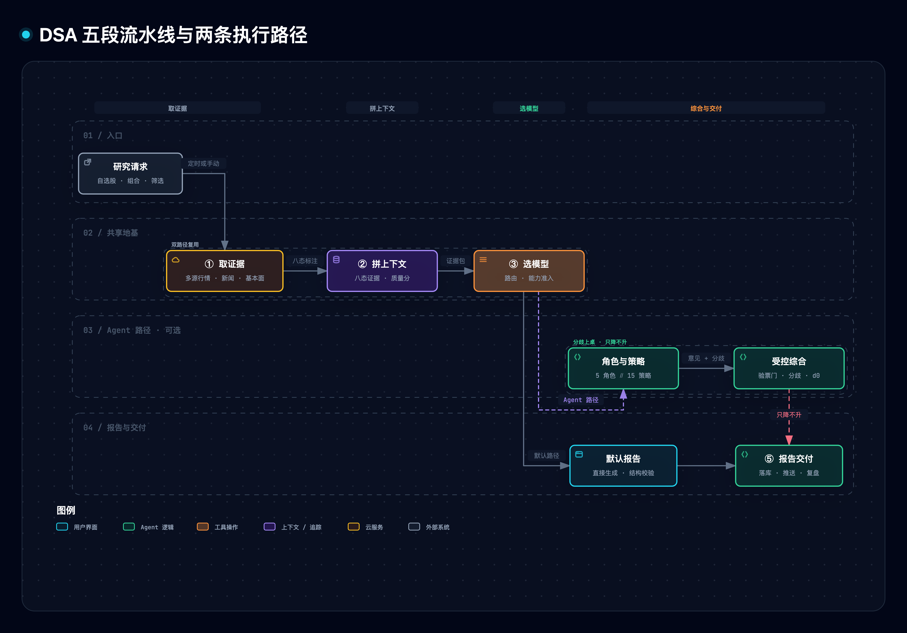
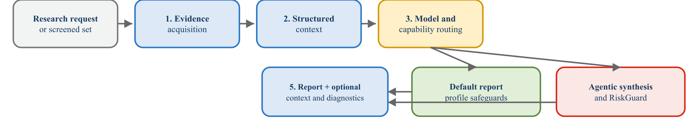
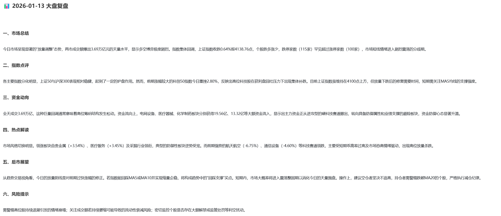
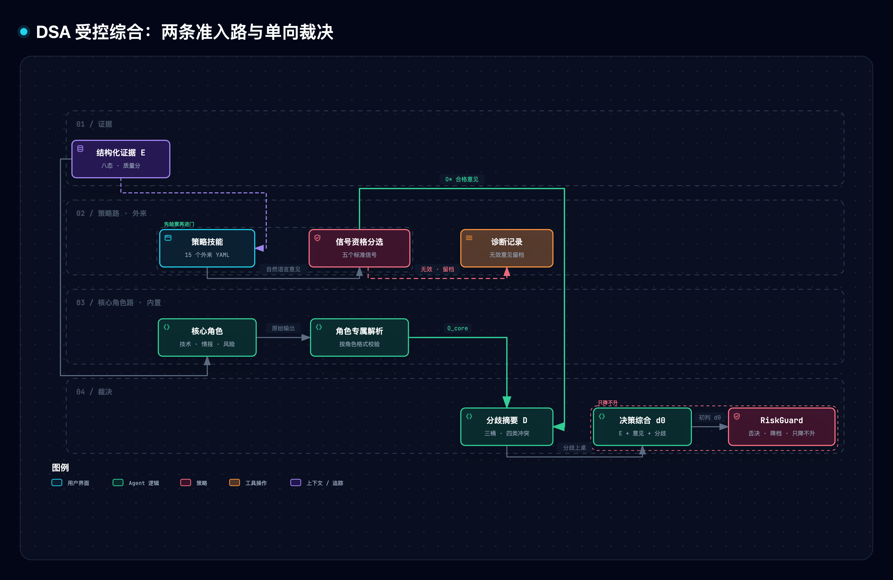
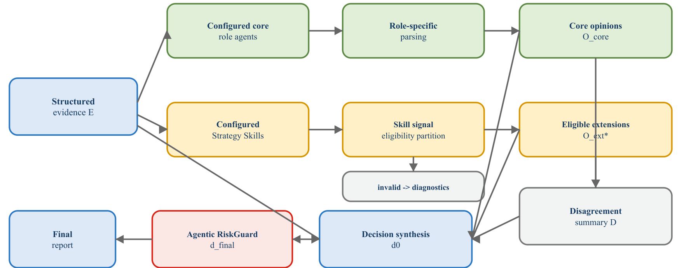
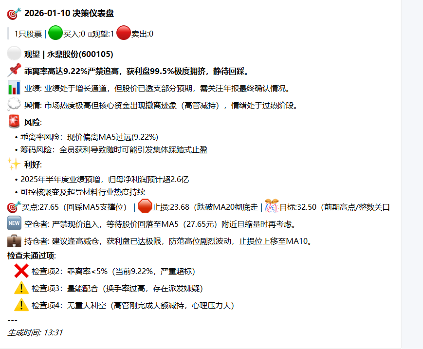
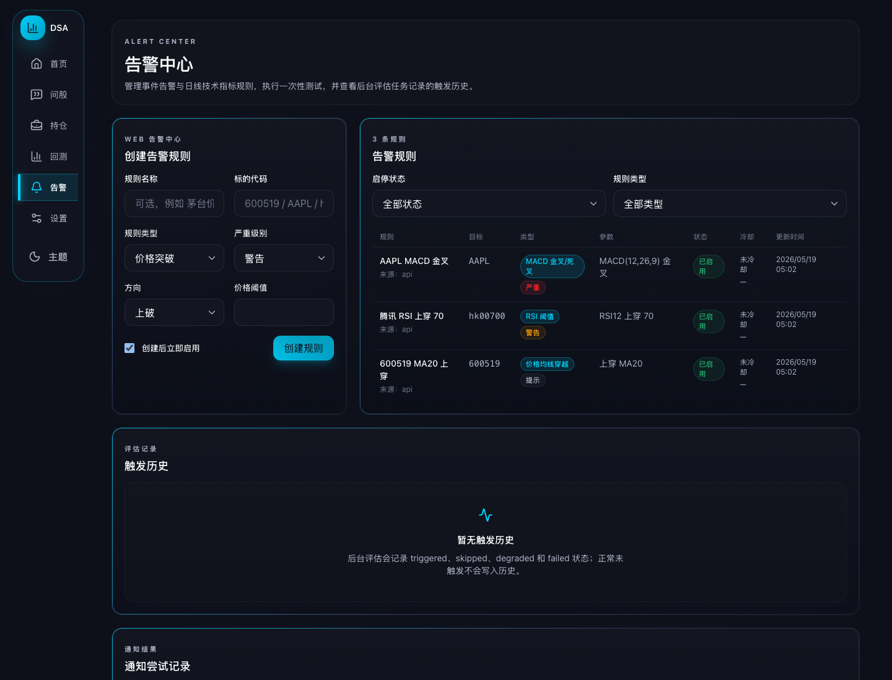

# Daily Stock Analysis（DSA）精读与通俗拆解

> [1] L. Zhu, "Daily Stock Analysis (DSA): an LLM-driven multi-market stock research system," GitHub repository, 2026. [Online]. Available: https://github.com/ZhuLinsen/daily_stock_analysis （所据版本 main@4e622643，2026-10-25；访问日期 2026-10-27）

**一句话定位**：DSA 是一个把「让大模型每天替你看盘写报告」拆成五段流水线的开源 Python 系统——先把多源数据收齐并如实标注每块数据的好坏，再按配置路由到某个模型，可选地让五个角色和十五个策略各抒己见，最后用确定性代码综合意见、裁决风险 [1][3]，产出结构化报告推送到聊天工具。

**SCQA 导读**（情境-冲突-问题-答案）:大家的共识是大模型很会总结金融信息，随手贴一段行情它就能写出一篇头头是道的分析。但真要每天自动出报告，光会总结远远不够：数据要从十几个会挂的接口取，模型各有各的脾气，模型说的话还可能一本正经地胡来。痛点在于，任何一处缺失或异常被静默糊弄过去，报告就成了「一本正经的错」——看着专业，实则建立在缺了腿的证据上。本文回答的问题是：DSA 怎么把这件事实工程化？答案分三层：数据层让缺失永远可见（§4），模型层把换供应商变成换配置（§5），裁决层让代码而不是模型做最后的保守决定（§6–§7）。§3 先给全貌，§9 有可以亲手跑、亲手拆的原型实验室，§10–§12 给规律、争议与这套系统的能力边界。

> [!TIP] **白话主线**
> 让大模型每天替你看盘写报告，看似一次问答，实际要跨六个市场从十几个会挂的数据源取行情新闻、挑一个能用的模型、把模型的话变成可校验的报告再推送出去。难在数据源会挂、模型能力参差、模型意见可能胡来，任何一处被静默糊弄过去，报告就成了「一本正经的错」。DSA 的思路是不让任何缺失或异常被静默中性化：每块证据带八种状态标签，模型只负责生成观点，意见合不合格、有没有分歧、要不要降风险，全由确定性代码裁决。验证上，作者在冻结的代码版本跑了 1457 个离线契约测试全部通过，并明说这只证明软件按设计运转，不证明报告准、更不证明能赚钱；本文另用纯标准库原型复刻五个核心机制，逐一拆坏它们看退化。

## 1. 它要解决什么问题

把一只股票交给大模型分析，普通做法是把行情数字贴进对话框，等它输出一段文字。这个做法每天跑一次就会撞上四堵墙：行情接口会挂、字段会缺；模型有的不支持结构化输出、有的不支持工具调用；多个模型各说各话时没人裁决；报告里的「买入」没法事后核对对错。DSA 要把这四堵墙逐一变成工程问题。

| 设计规格 | 通俗版 | 对应机制 |
| --- | --- | --- |
| 异构证据显式标注 | 缺哪块数据，明写缺，不许装作没影响 | 八态证据状态 + 质量评分（§4） |
| 模型可替换但能力不等价 | 换模型像换电池，但没工具的模型不许上工具岗 | 模型路由 + 能力准入（§5） |
| 角色与扩展分而治之 | 内置骨干走内部门，外来策略先验票 | 角色解析器 + 信号资格分选（§6–§7） |
| 生成与裁决分离 | 模型出意见，代码拍板，且只许往保守拍 | 分歧摘要 + 风险覆盖（§7） |
| 结论可追溯可复盘 | 每条建议落库，若干天后回看对没对 | 决策信号 + 后验评估（§7、§8） |

这套东西的直接产物是三类输出：每日个股决策报告（决策仪表盘卡片）、每日大盘复盘、按需的「策略问股」多轮对话 [2]。它本身不下单——论文的金融用途声明写得很清楚：在受评范围内（the evaluated scope），它可以给出不可执行的仓位建议，但系统不下单、不改单、不撤单，也不保证收益 [3]。

顺带交代体量，免得后文的数字没着落。截至 2026-10-27，仓库 67,119 star、55,665 fork，MIT 协议，Python 写成 [1]（元数据来自 GitHub API 实测）。它覆盖中国内地、香港、美国、日本、韩国、台湾六个市场 [1]。从 2026-01-10 发布 1.0.0 到 2026-10-15 的 3.33.0，九个月里 CHANGELOG 记下 104 个版本条目 [1]。star 数说明它火，但火和分析水平是两回事——这一点作者自己比谁都清楚，§12 会回到这里。

## 2. 全貌解剖：一张图看清五段流水线

先看全貌再进细节。DSA 把一次个股分析拆成五段：**取证据 → 拼上下文 → 选模型 → （可选）多角色综合 → 出报告**。前两段和第三段是地基，两条执行路径共用；分歧出现在第四段——「默认报告路径」直接用生成模型一次成型，「Agent 路径」（Agent 指能自主多步执行、按需调用工具的模型程序形态，不止一问一答）让角色和策略分头说话再合流；第五段两条路径殊途同归，都过各自的校验与防护，最后渲染成同一类报告 [3]。


图里要看清的分岔只有一处：证据构造和模型路由是共享地基，两条路径各自挂自己的校验与风险机制。默认路径报告级校验，Agent 路径多了分歧综合和一道综合后风险覆盖。图源 [.mmd](../../assets/mermaid/agent-harness/dsa--evidence-pipeline.mmd) · 交互版 [HTML](../../assets/architecture/agent-harness/dsa--evidence-pipeline.html) · candidate [JSON](../../diagrams/dsa--evidence-pipeline/dsa--evidence-pipeline.json)。

论文自己画的同一条流水线长这样：研究请求进来，依次过证据获取（市场专用适配器取行情、日 K、基本面、公告、新闻、情绪）、结构化上下文、模型与能力路由，然后分出两条 profile——默认报告路径走防护，Agent 路径走综合加风险覆盖——各过各的校验，最后汇成同一类面向报告的结果 [3]。跟自制图对照着读：原图钉住的是「两条路径共享前段、分岔在中后段」这个论文级结论，自制图补的是仓内代码口径的模块细节。


来源：L. Zhu 与 Y. Shi 2026 [3] 原文图 1，CC BY 4.0。

按「谁最值得学」排个序，五块机制分别是：证据状态可见性（§4 上）、多源回退三层防护（§4 下）、模型路由与能力准入（§5）、策略技能与信号分选（§6）、受控综合与只降不升的裁决（§7）。前三块是任何多源数据产品的通用件，后两块是「大模型出意见、代码做裁决」这类系统的参考答案。选股引擎、回测、告警、推送（§8）是在这条主线上长出来的应用面。§11 单独看这个仓怎么管 AI 协作——一个 67k star 的仓，机器可查的规则文件比多数公司都硬。

因果链一根线穿到底：**观察**（直接问答式写股评，数据缺失被糊成中性、模型意见无控制路径）→ **归因**（把研究流程当成一问一答、把控制权交给自由生成）→ **设计规格**（五段架构、模型即配置、双路径控制语义、冻结评测）→ **机制**（§4–§7 的五块）→ **证据闭环**（论文契约测试 + 本文原型破坏实验 + 仓库 6,885 个测试函数三层印证）。

## 3. 五段流水线与三种运行入口

一段一段走。**取证据**：行情数据的基本单位是「K 线」——一根 K 线记录一支股票一段时间内的开盘价、收盘价、最高价、最低价，把每天的 K 线连起来就是走势；均线、RSI 这类「技术指标」是从历史 K 线算出来的数字，用来刻画趋势和超买超卖。取数时按市场分流到专用数据链——A 股日 K 按优先级试 efinance、akshare、tushare/pytdx、baostock、yfinance、tencent [1]；已登记的沪深指数走固定链 Tencent→AkShare→TickFlow→YFinance，不读任何优先级配置 [1]。**拼上下文**：算技术指标，把各块数据连同状态标签、来源、时间戳组装成有界的证据包（「有界」指长度被控制在预算内，不无限堆料）。**选模型**：把「用哪个模型」解析成一次路由——托管 API、OpenAI 兼容端点、本地模型都行，能力不够的路由直接拒绝。**多角色综合**（可选）：默认路径跳过这步直接生成；Agent 路径让技术、情报、风险三个角色加可选策略技能分头出意见，分歧摘要摆上桌后交给决策角色。**出报告**：过校验、过防护、渲染、落库、推送 [3]。

拿一只具体股票走一遍最短的路径。配置 `STOCK_LIST=600519,hk00700,AAPL` [2]，工作日北京时间 18:00 定时触发 [1]：系统先逐股判断今天该市场是否交易日（全休市就整轮跳过）[1]；贵州茅台走 A 股链取行情，港股腾讯走港股链，苹果走美股链；每只股票各拼一个证据包、各做一次模型路由、各生成一份报告；全部跑完合并成一封推送，历史存进 SQLite [1]。整个过程没有一个环节需要人值守——这就是它「零成本定时运行」的卖点 [1]。

个股报告之外，每天还有一份「大盘复盘」产出。2026-01-13 这份真实样例（下图）按市场总结、指数点评、资金动向、热点解读、后市展望、风险提示六段组织，当日关键数字全写成明文——两市成交 3.69 万亿元、上证指数收跌 0.64% 报 4138.76 点、跌停 115 家罕见多过涨停 100 家。它和个股报告共用同一条「证据 → 上下文 → 模型」地基，只是把分析对象从一只股票换成整个市场，产出的结构化程度一点也不降。


来源：Zhu Linsen 2026 [1] 仓内样例 `docs/assets/dapan_2026-01-13_22-14-52.png`（钉定修订 4e622643 取图），MIT。

入口有三副面孔，肚子里是同一套。装在 GitHub Actions 里，Fork 仓库、配好密钥就能每工作日云端跑 [1]；装在本机或 Docker，`python main.py` 直跑、WebUI 在 127.0.0.1:8000 操作 [1]；再包一层 Electron 就是桌面应用 [1]。入口代码也共享：命令行入口 main.py 有 25 个参数 [1]，`--serve` 启动 API 服务，server.py 和 webui.py 两个薄壳拉起的是同一个 FastAPI 应用 [1]——三种部署形态实质是同一台机器的三种开机方式。

## 4. 数据层：缺失必须可见，坏源必须绕开

### 4.1 八态证据状态：缺什么就写缺什么

数据层的第一个设计决断：每块证据都带状态标签，一共八种——available（取到了）、missing（没取到）、not_supported（这个市场没这项数据）、fallback（换备选源取到的）、stale（太旧）、estimated（估值）、partial（只取到一部分）、fetch_failed（请求失败）[3]。这八种状态不是装饰：给模型的上下文里，取不到的资金流会被明写成「资金流：missing」，而不是悄悄从材料里消失。

为什么死磕这个？想象资金流接口今天挂了。静默删掉这块数据，模型看到的材料「看起来正常」，它很可能照样给出一个笃定的买入评分——它根本不知道自己缺了信息 [3]。论文有句话把设计意图说透了：不可得的资金流证据不应变成中性的资金流信号，fallback 也不应抹掉触发它的那个条件 [3]。

状态之上再叠一层量化：每份证据包打一个 0–100 的质量分，六块数据加权——报价、日 K、技术指标各占 25 分，新闻和基本面各占 10 分，筹码（跟踪不同价位买入的持仓分布，反映获利盘和套牢盘）占 5 分 [1]；六块之外的数据块（比如资金流）只带状态标签、不参与打分 [1]。分数映射四档：85 以上 good、70 以上 usable、55 以上 limited、更低 poor [1]。核心三块（报价/K 线/指标）但凡有一块降级，模型就被禁止在报告里表达「高置信度」[1]——证据不够，不许嘴硬。外部抓来的大盘摘要走得更远：注入提示词时整体包上「不可信内容」哨兵标记，声明其中内嵌的任何指令必须忽略 [1]——防的是提示词注入：外部数据里藏一段话，诱导模型把「数据里的指令」当成「系统的指令」去执行。

### 4.2 回退链、熔断、冷却：三层防护各拦一类故障

数据源会以三种方式坏：临时抽风（一次请求失败）、持续瘫痪（连续失败）、连接卡死（请求发出去没回应）。DSA 用三层机制分别应对。**回退链**按优先级依次尝试下一个源，只要有一个成功就继续 [1]。**熔断器**盯着每个源：连续失败 3 次，接下来的 300 秒直接跳过它不再尝试 [1]——冷却期满后进入「半开」状态：只放行一次试探请求，成功才彻底恢复，失败则继续停用。**连接冷却**针对连接失败：坏连接先歇 15 秒再允许重试 [1]。

用本文原型实测这层防护的取舍（完整实验室见 §9）：

```
实际运行日志（原型 dsa_lab.py，E4 实验）
有熔断：6 轮取数共尝试 9 次（坏源被跳过）
无熔断：6 轮取数共尝试 12 次（坏源每轮都被白白重试）
```

无熔断要白白尝试 12 次、有熔断只试 9 次。差 3 次看起来不多，但放大到每日全量运行、多市场多股票，熔断挡掉的是对瘫痪源的无效轰炸——既是省时间，也是别把自己刷进对方的限流黑名单。反过来，回退链砍到只剩单源会怎样？原型实测：那个源当天挂掉，该股直接抛取数错误、本轮无法出报告（实际运行日志，E5 实验）。可靠性是用冗余换的，没有例外。

市场之间不装平等。A 股有六七个源可用，日韩台只有 Yfinance 一条路，A 股专属的资金流、龙虎牌在那边一律标 not_supported [1]——能力差异摆到明面上，而不是靠归一化糊平 [3]。

## 5. 模型层：换模型像换配置，但能力必须对表

DSA 接模型的方式可以概括成「三层配置 × 两层路由 × 一条铁律」。「结构化输出」指要求模型按规定的字段格式（通常是 JSON）回答，而不是写一段自由散文——只有结构化了，代码才检查得了模型说了什么。**三层配置**决定用哪家的模型：LiteLLM 的 YAML 配置优先，其次是渠道环境变量（`LLM_CHANNELS`），最后才是传统的单厂商 Key [1]——三层互斥，高层生效时低层不参与本次请求。**两层路由**管容灾：同一个模型配多个 Key，一个被限流自动换下一个；Key 全军覆没，再按预设清单跨模型降级（比如从 Gemini 降到 Claude 再降到 GPT）[1]。两层独立工作，Key 轮换不改变模型选择，模型降级不浪费好 Key。

**铁律**是能力对表。每个后端亮出能力旗标：支不支持结构化输出、工具调用、流式、视觉 [1]。生成任务只要结构化输出；Agent 任务要结构化输出加工具调用——本地命令行后端（Codex、Claude Code、OpenCode 三个实验性后端）只有结构化输出能力，就上不了 Agent 岗 [1]。最关键的一条：**回退后端只允许网关型**——网关型指 LiteLLM 这类统一对接多家厂商的转发层，结构化输出、工具调用、流式全套能力齐备；回退到能力残缺的后端等于换了个语义，宁可报错，绝不静默换一个语义不同的操作 [3][1]。这就是「可替换不等于等价」：接入层欢迎任何供应商，上岗前先对能力表 [3]。

拿一个具体姿势走一遍路由：配置了两个 Gemini Key，第一次调用用第一个 Key 正常返回；某天第一个 Key 撞上 429 限流，路由器自动换第二个 Key 重发，模型没换；假设两个 Key 当天都被限流，才启动跨模型降级——按预设清单把这次请求改发给备选模型，并在结果里记一笔降级 [1]。三层各管各的：Key 层管单账号配额，模型层管单模型不可用，能力层管岗位资格。

两个值得一提的细节。一是依赖钉得很死：LiteLLM 版本窗口 `>=1.80.10,!=1.82.7,!=1.82.8,<1.99.0`——两个被排除的版本是 PyPI 上出过事故的版本，上界是因为 1.99.0 会透传一个破坏缓存断言的参数 [1]。二是它给 13 家厂商登记了提示词缓存能力，但注入开关只认「已验证」状态，而注册表里 12 家标「仅文档」、1 家（litellm 网关）标「未验证」——接线完成了，门还没开 [1]。一个 67k star 的生产系统里留着这样一处「通了电没通电闸」的预留态，比多数项目诚实。

## 6. 策略技能：十五个 YAML，一道验票门

十五个内置策略——多头趋势、均线金叉、放量突破、缩量回踩、箱体震荡、缠论、波浪理论、龙头策略、情绪周期、事件驱动、预期重估、成长质量、热点题材、底部放量、一阳夹三阴 [1]——每一个就是一个 YAML 文件加一段自然语言说明书：声明名字、类别、核心理念、需要哪些工具、默认开关和优先级，正文是用大白话写给模型读的交易逻辑 [1]。用户可以把自己写的策略文件丢进指定目录，与内置的同时加载，同名时自定义覆盖内置 [1]。

策略和内置角色的待遇不一样。技术、情报、风险、决策、组合（管整个持仓组合的整体配置与风险）五个角色是系统骨干，各自的输出走「角色专属解析器」，校验过了直接进意见链 [3]。策略技能是外来的，意见出来后要多过一道**信号资格分选**：必须落在五个标准信号里——strong_buy、buy、hold、sell、strong_sell（依次是强烈买入、买入、持有、卖出、强烈卖出）；写得不标准的先做别名归一化——别名表收的是英文写法变体（「strong buy」「strong-buy」「strongbuy」「neutral」这类），中文说法不在表里，归一不了就判无效 [1]。

无效意见的下场是这套设计里最讲究的部分：不删除、不修正、也不静默转成持有——移入「诊断记录」留档，但绝不进意见链 [1]。证据链和诊断记录两个集合互斥且穷尽：每个策略意见恰好落进其中一个 [1]。为什么外来的要多验一道？核心角色是仓库自己写的、随版本一起测过；策略文件是用户随手上传的，一个写得稀烂的第三方策略产出的胡话，不该有资格影响结论。这道门挡的不是错误观点（错误观点自有分歧机制处理），是**格式不明的输出**——先保证进门的都是可计算的，再谈观点对错。

顺带消个歧义：仓里有两套同名的策略 YAML。`strategies/` 目录下这十五个是「单股分析技能」，由 Agent 层加载，产出意见走上面的验票门；`src/services/screening/strategies/` 下的是「全市场筛选策略」，由选股引擎加载，走的是硬过滤和因子打分那条完全不同的流水线 [1]。同名不同命，看目录别看名字。

## 7. 受控综合：分歧摆上桌，裁决只降不升

### 7.1 从意见到共识

合格意见到齐，先做聚合。聚合器是纯确定性代码：每个意见的权重等于它的置信度（模型自己声称有多确定，0 到 1 的数）乘一个「绩效因子」——绩效因子来自该策略历史观点的后验战绩（过些天用实际走势回看当时说得对不对），被钳制在 0.83 到 1.2 倍之间，样本不足 30 条时一律中性 1.0，绩效计算失败也不中断分析 [1]。加权分按固定阈值映射到五档信号：过 4.5 是强烈买入、过 3.5 是买入、过 2.5 是持有、过 1.5 是卖出、更低是强烈卖出 [1]。门槛规则很硬：有效意见为零、只有一条、或置信度全为零，一律判 insufficient（持有、置信 0）——单样本哪怕自洽也不许装出高共识 [1]。

共识分四级，判据完全可算：三分之二以上意见同向且零冲突才是 high；出现高严重度冲突直接降到 low [1]。冲突检测盯四类：方向对立、分值离散、高置信异见、加减分矛盾 [1]。对分歧的处理不是抹平而是软化：一个确定性「调解器」把冲突中低置信的 strong_buy 降为 buy、置信打九折、摘要按严重度下调——软化单调保守，绝不允许反向加码；LLM 版调解器失败了就回退这个确定性版本 [1]。

### 7.2 分歧显式化与最终裁决

分歧摘要本身就是决策输入。摘要把意见分看多、看空、中性三桶，逐类标出冲突，连同全部意见一起交给决策角色——分歧不被隐藏，被摆上桌 [3]。论文给这个过程写了形式化定义：E 是证据包，O\* 是过验票门的策略意见，D 是分歧摘要，d₀ 是初步决策 = Synthesize(E, O_core, O\*, D)，最后 **d_final = RiskGuard(d₀, risk_context)** [3]。

RiskGuard 是全系统最后一步拍板，纯代码执行，规则一句话：**只降不升** [3]。一票否决把买入族压成持有；降档沿 buy→hold→sell 单向走（系统给 hold 的官方中文正是「持有」，「观望」是另一个动作 watch 的词，别混），配置可以让它一次降两档（买入直接降到卖出）；任何情况下不升级 [3]。原型实测破坏这条单向性会发生什么（实际运行日志，E3 实验）：正常路径把一个 strong_buy 压到 hold，允许升级后它保持 strong_buy 原样通过——激进结论畅通无阻。模型想激进？可以，但最后一步有代码兜底削回去。

裁决完不是终点。报告落库时同步转成一条「决策信号」：八种动作之一（buy/add/hold/reduce/sell/watch/avoid/alert），按八元组身份（报告号、来源类型、市场、代码、画像、动作、期限、市场阶段八个字段）去重，同一股票同一画像内，新的对立信号自动把旧的标记失效（不同画像可以并存相反动作）[1]；给出 buy 类建议还有一道置信度门——模型自报置信度低于 0.5 的不算可执行建议 [1]。然后是自我对账：1、3、5、10 个交易日后回看实际走势，给当初的信号记对错；命中率 60% 以上才允许升级画像、40% 以下降级，样本不足 10 条或数据质量差时只观察不动手 [1]。给出建议的人和核对建议的人是同一套系统，但核对用的是行情事实，不是模型自评。


这张图的要点在中间那条竖切线：核心角色和策略技能走两条准入路，只有策略侧有验票门；两条路汇合后先出分歧摘要再综合，最后一道风险覆盖只往保守方向掰。图源 [.mmd](../../assets/mermaid/agent-harness/dsa--controlled-synthesis.mmd) · 交互版 [HTML](../../assets/architecture/agent-harness/dsa--controlled-synthesis.html) · candidate [JSON](../../diagrams/dsa--controlled-synthesis/dsa--controlled-synthesis.json)。

论文原图画的是同一道边界：证据 E 在左上，配置好的核心角色经过角色专属解析直出核心意见 O_core；策略技能的意见要先过一道信号资格分区，合格意见进入综合、无效意见落进诊断记录；分歧摘要作为显式输入进入综合，最后的 RiskGuard 只维持或调低决策激进度、不反向 [3]。自制图把「诊断留档」「只降不升」两个要点提到最显眼处，原图的价值是把「两类意见在哪分家、在哪汇合、在哪被收口」画成了一张正式的边界图。


来源：L. Zhu 与 Y. Shi 2026 [3] 原文图 2，CC BY 4.0。

看一眼真实产出长什么样。下面这张是仓库自带的决策仪表盘样例（2026-01-10，永鼎股份 600105，结论「观望」）：卡片从上到下是结论与一句理由摘要（「乖离率高达 9.22% 严禁追高，获利盘 99.5% 极度拥挤，静待回踩」）、业绩与舆情两段注解、风险与利好清单（风险列乖离率与筹码踩踏，利好列业绩预增与行业热度）、买点/止损/目标三个价位、空仓者与持仓者分别的建议（空仓「严禁现价追入」、持仓「逢高减仓」），以及最底部的操作检查清单——检查项二「乖离率小于 5%」未通过（当前 9.22%），量能配合与无重大利空两项挂警告。检查没过照样出报告，但结论停在不动手那一档、理由里明写禁止追高——这张卡片本身就是「证据状态可见 + 保守裁决」两个机制在产品面上的样子。


来源：Zhu Linsen 2026 [1] 仓内样例 `docs/assets/sample.png`，MIT。

## 8. 应用面：选股、回测、告警、推送，以及它怎么证明自己

主线上长出来的应用面速览。**选股引擎**派生自作者另一个开源项目 AlphaSift（Apache-2.0，钉定修订、带署名）[1][3]，流程是快照→硬过滤→九因子打分→LLM 重排→风险罚分→组合分散，重排时候选数据被定性为「不可信参考资料，不具备指令权限」并转义防注入 [1]。**回测**默认只回测 14 天前的历史报告、评估窗口 10 个交易日、涨跌在 ±2% 内算中性 [1]——用「当时不知道未来」的记录考核当时的建议，而不是拿今天的行情考核昨天的报告。**告警中心**把 14 类规则（价格、技术指标、持仓风险、大盘红绿灯）落进四张表，同一数据点四元组去重、默认 24 小时冷却 [1]。**推送**覆盖 14 个渠道，每个发送器都做同一套三件事：按渠道上限分片、指数退避重试、格式失败降级成纯文本 [1]——Telegram 按 UTF-16 码元数 4096 截断 [1]，飞书卡片失败回退文本 [1]。

告警中心在 Web 界面上就是左边创建规则（名称、标的、类型、参数）、右边一张规则表：规则、目标、类型、参数、状态、冷却、更新时间一列排开，三条示例规则从 AAPL 的 MACD 金叉（严重）、腾讯的 RSI 上穿 70（警告）到贵州茅台的 MA20 上穿（提示）各占一行，均处于「已启用、未冷却」状态；页面下方的触发历史区只记 triggered、skipped、degraded、failed 四种评估结局——正常未触发不写入历史。规则被怎么管、触发被怎么记，在这张图里都是可见的表格而不是黑盒。


来源：Zhu Linsen 2026 [1] 仓内样例 `docs/assets/alert-center-p5-web.png`（钉定修订 4e622643 取图），MIT。

它怎么证明自己？论文的答案出人意料地克制：在冻结的代码修订（0ca56cbe，2026-08-26）上，挑出的 1,458 个离线测试里执行 1,457 个、剔除 1 个 Windows 不支持的用例，102.532 秒全部通过、零失败；其中 596 个用例被回溯映射到六个直接对应 Agent 架构的契约族——证据上下文 74 个、模型后端与路由 194 个、Agent 编排 85 个、运行事实与分歧与风险护栏 87 个、策略注册与工具面 60 个、策略归因与结局生命周期 96 个 [3]。注意两层限定：其一，作者声明清单是探跑（正式冻结清单前先试跑暴露边界）后挑选的、测试是贡献者自己写的、mock（用替身数据代替真实服务）降低了环境方差但不能证明活数据下的质量 [3]；其二，计数是执行的测试用例数、不是独立观察——用例数本身不构成等量的独立证据 [3]。这段这段自我设限写得比很多论文的正文都值钱。仓库现状与之呼应：tests/ 目录 309 个文件（其中 298 个测试模块）、6,885 个测试函数 [1]，连 `docs/` 里的说明文档都被测试当契约断言 [1]，CI 里还有一道「AI 治理」检查专门验证规则文件的软链与白名单 [1]。

版本演进脉络也值得一提：1.0.0（2026-01）只有基础分析，3.23 加决策信号闭环，3.24 扩到日韩台市场，3.28 加多角色审议与 Futu 持仓，3.29 并入 AlphaSift 选股，3.32 收敛 LiteLLM 版本窗口并把 A 股指数注册表扩到 33 项，3.33 加问股会话态和零 LLM 的 ETF 轮动 [1]。九个月 104 个版本条目，近期版本每个都有可指认的机制增量，不是修修补补凑数。

## 9. 动手实验室

原型约 500 行、纯标准库、确定性——所有「模型」都是脚本替身；随本笔记入库于 [assets/dsa_lab.py](./assets/dsa_lab.py)（开发期在 `.temp/dsa-lab/` 实跑，下文日志均出自该目录）。跑法：

```bash
python3 docs/research/agent-harness/assets/dsa_lab.py --selftest
```

五个机制在原型里的位置（行号以快照时点为准）：

| 机制 | 实现单元 | dsa_lab.py 行号 |
| --- | --- | --- |
| M1 回退链+熔断+冷却 | CircuitBreaker / FetchManager | 58 / 78 |
| M2 八态+质量评分+置信帽 | build_pack | 152 |
| M3 路由+能力准入 | Router | 186 |
| M4 信号分选+聚合+分歧 | valid_signal / aggregate | 224 / 258 |
| M5 RiskGuard 只降不升 | disagreement_summary / risk_guard | 298 / 313 |

五次破坏性实验，每次只拆一处、真跑记录退化：

| 实验 | 改了什么 | 实测退化 | 一句话教训 |
| --- | --- | --- | --- |
| E1 缺数据当中性 | missing 记满分 | 证据质量从 limited 虚标到 usable，缺口被隐藏 | 状态标注是可信度的第一道闸 |
| E2 拆掉信号分选 | 无效信号直进意见链 | 格式不明的「看多!!!」按 strong_buy 计入共识，最终结论 buy 被顶成 strong_buy | 外来输出必须过资格门，否则污染共识 |
| E3 RiskGuard 允许升级 | 单向改双向 | 正常压到 hold 的结论保持 strong_buy 畅通 | 最终裁决的保守性只能单向 |
| E4 拆掉熔断 | 不跳过已瘫痪源 | 6 轮取数从 9 次尝试涨到 12 次 | 熔断挡的是对坏源的无效轰炸 |
| E5 回退链砍剩单源 | 删掉备选源 | 该源当天挂掉即抛取数错误，报告无法生成 | 可用性是用冗余换的 |

以上均为实际运行日志摘录。原型只证明机制逻辑按上述运转，数字是玩具场景的，不能拿来对照真实 DSA 的行为；反过来，真实系统的对应阈值（熔断 3 次/300 秒、置信门 0.5、后验样本门 30 条）在正文各节均已标注出处。

## 10. 底层规律与核心争议

五个机制读完，把它们压回五条可以带走复用的规律；再看看这个领域里还没吵完的三个争议。

### 规律 1：缺失必须可见（Data Quality as First-Class State）

拿不到的数据要显式标注状态，不能静默当成零或中性。数据质量研究的经典框架（R. Wang 与 D. Strong，*Journal of Management Information Systems*，1996）把「完整性」列为一等维度——缺失本身就是决策信息。没有这条规律，静默缺失会让下游把「不知道」误读成「没问题」，在金融语境下就是无依据的笃定。E1 实验演示了违反它的代价：把 missing 当满分，质量分就从 limited 虚标到 usable。DSA 用八态加六块加权把这层信息一路带到模型眼前、报告页面上、置信度帽子上。

### 规律 2：生成与裁决分离（LLM Proposes, Code Disposes）

模型负责出意见，资格判定、共识聚合、风险裁决全部交给确定性代码。ReAct 确立了推理与行动的解耦范式 [4]，可控生成护栏的工作（如 NeMo Guardrails）进一步把「安全裁决」从模型移到外层 [5]。不分离的话，模型输出天然带随机性与被注入的风险，让裁决权也交给模型等于让被告兼任法官。E2（拆分选门，垃圾信号顶高结论）与 E3（裁决允许升级，激进畅通）分别演示两道分离被打破后的退化；DSA 把两道都焊死在纯函数里，连 LLM 调解器失败都会回退到确定性版本 [1]。

### 规律 3：多层退避，各拦一类故障（Layered Backoff）

临时失败换源、持续失败熔断、连接卡死冷却——三种坏法配三种药，不指望一招通吃。熔断器模式源自生产环境容错的工程实践（M. Nygard，*Release It!*，Pragmatic Bookshelf）；长尾延迟研究（J. Dean 与 L. Barroso，*Communications of the ACM*，2013）说明个别慢依赖足以拖垮整体、必须隔离。只靠单一重试策略，要么放过瘫痪源反复撞墙，要么误伤慢源过早放弃。E4 实测熔断省下三分之一的无效尝试，E5 实测单源无冗余即整轮失败；真实系统再叠缓存、配额（Tushare 每分钟 80 次自动节流 [1]）与指数固定链 [1]。

### 规律 4：可替换不等于等价（Substitution ≠ Equivalence）

抽象层让任何供应商都能接入，但上岗前必须对能力表，缺能力就报错而不是静默换操作。适配器模式的要点是转换接口而非语义（E. Gamma 等，《设计模式》，Addison-Wesley，1994），把语义差异藏进统一接口后面则是分布式系统经典的谬误。供应商能力参差（结构化输出、工具调用、上下文长度），静默替换会让「同一个调用」在不同后端上含义漂移。DSA 的做法：回退后端只允许网关型 [1]，本地 CLI 后端只有结构化输出能力就上不了 Agent 岗 [1]，13 家厂商的缓存能力登记了但没验证就不开注入门 [1]。

### 规律 5：收缩式自校准（Shrinkage-Based Self-Calibration）

给历史战绩打分时，样本少就往中性收缩，别让几条幸运记录撑大权重。James-Stein 收缩估计证明小样本下向先验收缩优于直接用样本均值（B. Efron 与 C. Morris，*Journal of the American Statistical Association*，1975）。不收缩的话，策略只跑几次就 5 战 5 胜，直接加权会让它一家独大——那是把运气当实力。DSA 的绩效因子用 Beta(15,15) 先验收缩（先验是没看数据前对结果的预设倾向，Beta(15,15) 是一条居中的温和预设）、样本门 30 条、幅度钳制 0.83–1.2 倍、样本不足时全按 1.0 处理 [1]；决策画像升级同样要 10 条以上样本且数据质量过关 [1]。

五条规律各管一维：1 管数据可信、2 管控制权归属、3 管依赖容错、4 管供应商抽象、5 管统计校准——合起来正好是「多源数据 + LLM 意见 + 确定性裁决」这类系统的完整骨架，DSA 每条都给了可抄的实现。

### 争议 1：「全部通过」证明了什么——工程一致性派 vs 分析有效性派

一派说：1,457 个测试零失败、契约逐条映射，这就是负责任的工程证据 [3]。另一派说：测试是作者自己挑的、自己写的，mock 掉了活数据，它证明不了报告比单模型或人类分析师好 [3]。作者本人站在两派中间：承认前者、不冒领后者，把「时点基准、盲评、消融、成本分析」列为未来工作 [3]。分歧本质是评价哲学：软件工程的可复现性标准，与科学结论的有效性标准，本是两套尺子，社区常常拿一把量另一把。这不是能靠加测试解决的资源问题，是评价体系的设计问题。

### 争议 2：技术分析加大模型，有没有预测价值

论文自己写道：内置的若干技术分析视角是「有争议的金融启发式」，与 LLM 结合并不建立预测价值 [3]。产品面却把缠论、波浪理论等十五个策略做成一等公民，报告里直接给买卖点位 [1]。两边都没错：论文在陈述学术事实（这些方法的预测力长期缺乏共识证据），产品在服务用户需求（大量散户就是要看这些指标）。难以克服的部分在于：只要评价体系还是没建立（争议 1），「策略技能有没有用」就永远无法在这套系统内部被证伪或证实——后验闭环（§7.2）只能校准相对权重，回答不了「整体靠不靠谱」。

### 争议 3：多角色分工值不值

一路做法是像 DSA、TradingAgents 那样拆出技术、情报、风险、决策多个角色 [3]；另一路认为单模型直出加好的上下文就够了，角色拆分徒增调用成本与失败面。DSA 的立场罕见地不站队：默认路径就是单模型直出，Agent 路径才是多角色，论文明说「默认路径不是较弱的 Agent、Agent 路径也不假定更好」，两者的质量、延迟、成本比较是未做的开放问题 [3]，角色分解也从未被消融验证 [3]。分歧本质是架构哲学：结构化的分工换可解释性与可测试性，代价是复杂度——在缺乏对比评测之前，这是信仰问题不是工程问题。

## 11. 仓的另一半看点：一个 67k star 仓怎么管 AI 协作

这个仓值得 agent-harness 组读者多看一眼的，是它把「人与 AI 协作的规矩」也做成了机器可查的资产。根目录的 AGENTS.md 是协作规则的唯一真源（291 行：目录边界、配置同步纪律、验证矩阵、PR 底线）[1]；CLAUDE.md 必须是指向它的软链接，由 CI 的「AI 治理」检查强制验证——软链断了、白名单不对，构建直接拦下 [1]。仓里还带着三个给自己用的 AI 维护技能（分析 issue、分析 PR、修 issue），规矩写得很清楚：安全拉新、CI 证据优先、产物落本地目录、写远端的动作一律要用户确认 [1]。

对外它又把自己发布成一个技能：根目录 SKILL.md 以 `stock_analyzer` 之名定义三个函数契约（分析单股、批量、大盘复盘），让 Grok Bot 这类外部 agent 通过 HTTP 调用 [1]——同一个仓，既是 AI 协作的被治理者，也是 AI 生态的供给方。这条「仓库即 harness」的路数，与读者手上这个仓库（negentropy）自己的治理思路同源，值得单独立传，此处按下不表。

## 12. 适用边界

**成立条件**。这套机制的最佳工况：至少一个可用的模型 Key；目标市场至少一路数据源可达（日韩台实际只有 Yfinance 一条路 [1]）；数据源部分失败是常态而非例外——证据状态机制的全部价值都建立在「会缺」的前提上。架构假设是单机 Python、模型经 API 或本地 CLI 接入、SQLite 单机存储；多实例部署时文档明示大盘复盘的进程内锁只做同机去重，跨实例幂等要外部方案 [1]。

**材料没有证明的事**（读到这里请把期待调回现实）：

1. **报告质量、预测准确率、投资收益，一样都没测过。** 契约测试只证明软件按设计运转 [3]；「比单模型、比人类分析师、比同类系统更好」的对比从未在任何协议下进行 [3]。
2. **star 数与采用度不是分析有效性证据。** 论文原话 [3]。顺带一提，55,665 个 fork 接近 star 数的 83% [1]，这个比例本身就不寻常，成因材料未解释—— fork 多半与「Fork 后配 Secrets 即用」的部署方式有关，但这是推断，不是材料给出的结论。
3. **无时点数据集，前视泄漏未消除。** 回测用的是「当时落库的报告」，但系统不保证不可变时点快照 [3]——没有这种快照，「前视泄漏」（用后来才知道的信息去评价当时的判断）就无法排除；回测的 14 天最小区龄、±2% 中性带 [1] 是工程口径，不是学术口径。
4. **外部输入没有沙箱。** 新闻、模型输出、用户上传的策略包都可能携带提示词注入或投毒内容，当前权限模型把它们当受信输入（没有沙箱——即隔离运行、内容出不去的笼子）[3]；哨兵标记 [1] 和选股重排的转义 [1] 挡了一部分，不等于完整防线。
5. **两个执行路径谁好，没有答案。** 未比较、未消融 [3]；选 Agent 路径的理由只能是「需要多轮对话与策略视角」这类功能需求，不能是「效果更好」。

另有版本口径须记牢：论文的评测数字钉在冻结修订 0ca56cbe（2026-08-26）[3]，本文引用的代码事实钉在 4e622643（2026-10-25）[1]——两者相差约两个月、数十个提交，论文数字描述的是被评测的那个快照，不是读者拿到的 main。

## 13. 用户自测与费曼研讨套件（Self-Assessment Kit for User）

1. 把「信号资格分选」从聚合之前挪到聚合之后（先合成再验票），哪一步会先坏？提示：想想「无效意见进诊断记录留档」这个语义还成不成立、最终那份权威的合成结论又由谁保证。
2. 质量评分六块权重里筹码只占 5 分、报价占 25 分。若把这套设计搬到加密货币场景（7×24 交易、无财报、链上数据丰富），权重该怎么重定？哪一块的「状态词」需要增删？为什么不能照抄？
3. DSA 用 SQLite 单机存储加三处独立去重（调度认领、复盘文件锁、通知冷却），而不是分布式锁。这套设计在什么规模下成立？用户量或实例数过了哪条线，它最先在哪一处失效？

## 参考（IEEE）

- [1] L. Zhu, "Daily Stock Analysis (DSA): an LLM-driven multi-market stock research system," GitHub repository, commit 4e622643, Oct. 25, 2026. [Online]. Available: https://github.com/ZhuLinsen/daily_stock_analysis （含产品站 https://dsa.zhulinsen.tech/ ，与该 commit 同源构建；访问日期 2026-10-27）
- [2] L. Zhu, "DSA 产品文档站," dsa.zhulinsen.tech, version v3.33.0-10-g4e622643. [Online]. Available: https://dsa.zhulinsen.tech/ （访问日期 2026-10-27）
- [3] L. Zhu and Y. Shi, "DSA: Evidence-aware LLM-agent orchestration for multi-market stock research," arXiv:2608.26990, Aug. 27, 2026. [Online]. Available: https://arxiv.org/abs/2608.26990
- [4] S. Yao, J. Zhao, D. Yu, N. Du, I. Shafran, K. Narasimhan, and Y. Cao, "ReAct: Synergizing reasoning and acting in language models," in *Proc. Int. Conf. Learn. Represent. (ICLR)*, 2023. [Online]. Available: https://arxiv.org/abs/2210.03629
- [5] NVIDIA NeMo Team, "NeMo Guardrails: A toolkit for controllable and safe LLM applications with programmable dialogue," arXiv:2310.10501, Oct. 2023. [Online]. Available: https://arxiv.org/abs/2310.10501
