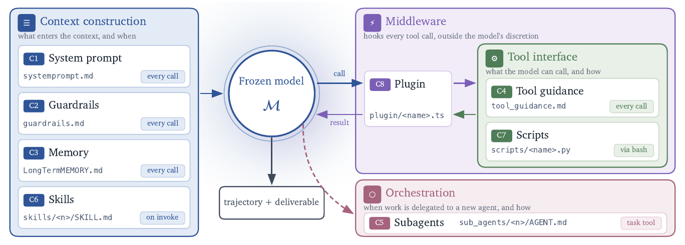
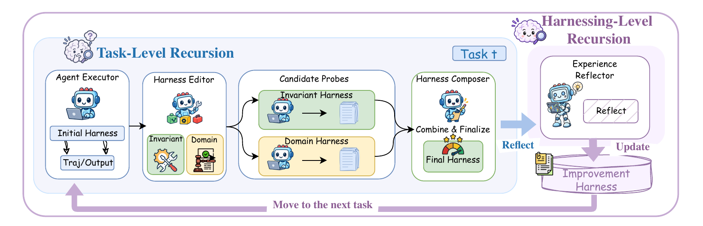
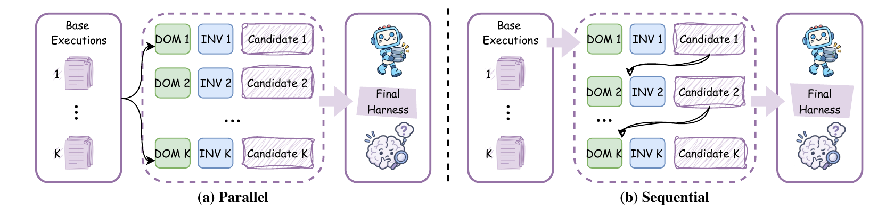
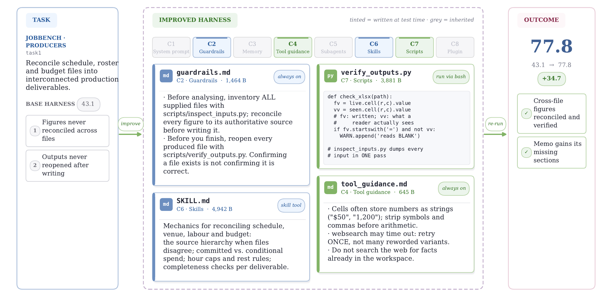

# Harness 到 Harness²：把 harness 的收益放进权重，还是让 harness 自己进化

> [1] H. Ye, Y. Lu, H. Dong, Z. Su, and G. Song, "Harness-Zero: Harness distillation via agent-as-harness," arXiv:2609.24974v1 [cs.AI], Sep. 2026. [Online]. Available: https://arxiv.org/html/2609.24974v1 （v1，2026-09-21 提交，唯一版本；北大、Google、港科大；访问 2026-10-28）.
> [2] R. Xu, Y. Chen, Z. CuiZhu, et al., "Harness2: Recursive agent harnessing for an open world," arXiv:2610.14224v1, Oct. 2026. [Online]. Available: https://arxiv.org/html/2610.14224v1 （v1，2026-10-09 提交，唯一版本；Google Cloud AI Research；CC BY 4.0；访问 2026-10-28）.

> [!NOTE] 精读范围
> 两篇全文通读含附录，快照钉 v1 HTML；补读两仓 README [9][10]。互不引用、作者零交集，按两条互补路线精讲，不作换代处理。

**一句话定位**：两篇同期独立论文回答同一问题——harness 带来的提升放在哪才能不一直背着它跑：Harness-Zero 练进模型权重（训练期蒸馏、部署期卸载），Harness² 让 harness 体系自己进化（部署期在线递归、权重冻结）。

大语言模型（LLM）agent 干活靠的不只是模型，还有包在外面的一层系统——给它哪些工具、怎么组织可见信息、出错怎么拦截——这叫 **harness**（本仓 [170 总纲](./170-claude-code-harness-overview.md)有完整梳理）。调好能大幅提分，但提分绑在 harness 上：要么共用一套次优的，要么维护一堆专用的外加路由。两篇由此分头出发：一条训练期把好做法练进参数（权重），一条部署期让模型冻结、harness 现场改并越改越会改。本文按问题→对照→四机制→实证→规律边界展开，原型 `assets/harness2_lab.py`。

先消歧一个撞车词：两篇都造了 "harnessing"——P1 的指包裹学生的**审阅代理**，P2 的指**优化脚手架本身**；下文带限定。

> [!TIP] **白话主线**
> ① 调好一套 harness 能大幅提分，但收益绑在 harness 上，换场景就得换一套——两边都想把收益存起来。② Harness-Zero（下称 P1）训练期动手：审阅代理守在学生动作出口，照一份从专用 harness 翻译来的审阅知识放行或改写动作，改好的动作拿去微调、做法进权重。部署时专用 harness、审阅知识、审阅代理全卸，90 亿参数学生在只有一条 Bash（命令行）的极简 harness 下从 23.3% 提到 44.3%，反超背着专用 harness 的 41.7%。③ Harness²（下称 P2）部署期动手：模型冻结，每来新任务就现改 harness——提两类候选、同条件试跑、只比「行为变没变」不判对错（开放世界无标准答案），按证据拼更好的；任务后把「怎么改才有效」存进改进库，越改越准，单步最高 +11.5、递归再加码。④ 均无第三方复现；一个把收益搬进权重、一个让改法自己变强，互补非换代。

## 1. 它要解决什么问题

痛点是同一个观察的两面。P1：harness 优化改的是外围不是模型，收益部署时仍绑着它；最好的 harness 因领域、任务、模型而异，共享则次优、路由则贵——都不「把发现的东西变成模型的能力」。P2：开放世界任务设计期没见过、测试时全新，无标准答案也无自动判分器，离线优化好的静态 harness 往往泛化不到开放世界的新环境，逐任务现改又太特化。

分工一句话：P1 管「**收益放哪**」（搬进权重），P2 管「**怎么现场改、越改越好**」。规格对照：

| 维度 | Harness-Zero（P1）[1] | Harness²（P2）[2] |
| --- | --- | --- |
| 改什么 | 模型权重（微调） | 执行 harness 与改进库，权重冻结 |
| 何时改 | 训练期一次性 | 部署期每任务在线改 |
| 监督信号 | 审阅代理 + 审阅知识 K（不含答案） | 无真值，只有同条件行为对比 |
| 成本位置 | 采集期一次性（逆合成基准 USPTO 延迟 2.4 倍） | 推理期持续（多次执行+编辑会话） |

部署产物、失败面与术语撞车详见 §2.5 对照轴。

## 2. 全貌解剖

两篇各是一条完整的因果链。

P1 链：强 harness 收益绑部署 → 直接模仿「强模型背专用 harness 的轨迹（干活全过程记录）」动作空间对不上 → 把指导翻译到学生响应边界，审阅代理逐动作放行或改写 → 改写轨迹全是学生做得出的动作 → 微调进权重 → 部署只剩极简 harness，收益反超外挂。

P2 链：开放任务无真值 → 「让模型判对错」不可靠（重复执行有波动、裁判与干活模型共享盲区）→ 只信「同条件下改前 vs 改后的行为差异」，对比当证据不当判决 → 改动绑定具体观察 → 任务内可加预算递归 → 任务后把采纳 harness 与经验过「执行对比支撑」门入库 → 后续改法受益。

四个焦点按价值排序：P1 审阅门（§3）、P2 对比式改进步（§5，无真值监督替代设计）、P1 蒸馏消融（§4，颠覆「数据越好学生越好」）、P2 双层递归库（§6，「学习如何学习」最小实现）。

### 2.5 对照轴：两条路线怎么选

| 轴 | P1：harness→权重 | P2：harness→更好的 harness |
| --- | --- | --- |
| 核心假设 | 好做法练进参数随身带 | 好改法攒成经验库复用 |
| 训练权限 | 必须能微调 | 不需（API-only 可） |
| 新任务上线 | 零适应，直接跑 | 每任务多次执行换适应 |
| 收益上限 | 受「可表达为学生动作」封顶（§4） | 受探针信号质量封顶（§6） |
| 术语 | harnessing agent = 审阅代理 | harnessing = 优化脚手架这件事 |
| 互补位 | 统一部署、免维护 | 模型换代 harness 仍可用（GLM-5 Code +17.3，§7） |

两篇也展望过对方领地（P1 期待「更好的模型造更好的 harness、收益还给权重」的循环；P2 提出库管理与自适应递归）。先在线改、再批量蒸馏是自然组合，均未实验，本篇只作推断。

## 3. 机制一（P1）：审阅门——agent-as-harness

机制是一条公式链，先摆原文再逐条拆解。记号说人话：h=部署用极简目标 harness；h*=训练任务上演化的专用 harness；K=翻给审阅者的「审阅知识」；π_S 学生、π_H 审阅代理；y=学生提议的动作，ỹ=审阅后实际执行的；c=学生可见信息。

```text
(1) h* = Evolve(D_train),   K = Adapt(h*; h)
(2) y_t ~ π_{θ0}^{h*}(·|c_t),   c_{t+1} = T_{h*}(c_t, y_t)          ← 基线：code-as-harness
(3) y_t ~ π_S(·|c_t)
    (d_t, z_t) ~ π_H(·|c_t, y_t, K, r_<t)
    ỹ_t = y_t  若 d_t=pass；= z_t  若 d_t=replace
    c_{t+1} = T_h(c_t, ỹ_t)                                          ← agent-as-harness
(4) θ̂ = argmin_θ − Σ_τ Σ_t log π_θ^h(ỹ_t | c_t)                      ← SFT 蒸馏
(5) y_t ~ π_θ̂^h(·|c_t),   c_{t+1} = T_h(c_t, y_t)                   ← 部署：只剩 h
```

逐条拆解（编号与论文一致）：

- **(1) 演化与适配**：训练任务上把 h* 改出来（三轮「分析失败→改组件→只在失败任务上评估」，产物落工具、中间件（夹在流程里自动把关的代码）、技能、记忆四类组件）；再适配成 K——保行为、换受众与执法点：工具变「用 Bash 写等价命令」的配方，中间件变「见此动作即提醒审阅代理」的条件，技能变诊断标准，记忆变失败模式。
- **(2) 基线的死法**：直觉做法是让学生直接在 h* 下干活，问题在动作空间：h* 给的工具 h 下没有，学生学一半就去调不存在的工具。USPTO 消融给数字：老师背 h* 收集能做对 62%，学生照着学完从 12% 掉到 3%。
- **(3) 审阅门**：学生在 h 下照常提议 y_t；审阅代理只凭（学生可见信息、提议、K、审阅历史）二选一：pass 放行，或 replace 给一个 h 下可执行的完整替代动作（最小改动、学生第一人称口吻）。特权只有读 K——不可见标准答案与沙箱（隔离运行环境）里的隐藏状态；要证据只能把检查命令当学生的动作塞进去执行。
- **(4) 蒸馏**：对审阅后轨迹做监督微调（SFT 白话：拿范例反复练，把范例动作练成默认选择），替换动作里混入的「审阅者视角」文本从训练损失（衡量学得多差的量）里掩掉。
- **(5) 部署**：蒸馏模型配 h 独跑，h*、K、审阅代理全部卸载。

P1 [原文图 1](https://arxiv.org/html/2609.24974v1#S1.F1)画三阶段闭环；其许可（arXiv non-exclusive-distrib 1.0）按本仓规约不随文入库，看图点链接。

走一遍（论文附录 B.2）：表格任务规定「答题区里已填的示例格子不许改」。学生写完准备交卷，K 的审阅条件发现学生可见轨迹里没有「对比输入输出示例格」的记录，触发提醒；审阅代理 replace，把「交卷」换成一条生成并运行对比脚本的 Bash 命令——输出哪些格子被改，结果进入学生下一轮可见信息，学生自己修。训练数据必须全是学生将来走得出来的内容：审阅过程、私有知识混进示范，学到的就是重现不了的动作。

为什么不能直接喂老师轨迹？教练开手动挡演示、学员的车是自动挡：演示每步都对，但有「踩离合」这个学员车上没有的动作，照搬必然熄火。比方止于此——真实机制里学生与审阅代理可为同一模型（差异在指令与上下文）；照搬老师轨迹学出的模型，失败形态不是熄火停机，而是大量调用不存在的工具直到轮次耗尽。

## 4. 机制二（P1）：蒸馏进权重与部署卸载

式 (4) 把「审阅官改过的动作」变成「学生最想选的动作」，三组实验钉死：

**三臂对照**（同一 9B 学生、三基准平均）[1]：

| 部署形态 | 表现 | 读法 |
| --- | --- | --- |
| 裸模型 + 极简 h | 23.3% | 什么都不加 |
| 裸模型 + 专用 h*（外挂） | 41.7% | 好做法留在 harness |
| 蒸馏后 + 极简 h | **44.3%** | 练进了权重，卸掉外挂反而更高 |

同一学生挂通用 harness 更糟：DeepAgents 20.5%、Claude Code 15.9%，均低于裸跑：小模型消化不了大而全的工具面。

**监督源消融**（消融＝逐项拆开对比；USPTO，全部同一训练配方）[1]：

| 轨迹来源 | 收集成功率 | 蒸馏后测试分 |
| --- | --- | --- |
| 老师裸跑 / 学生+h* / 审阅（空 K） | 52.0 / 39.4 / 44.2 | 均 ≈12（原地不动） |
| 老师 + h* | 62.0 | **3.0** |
| 审阅（喂标准答案） | **98.6** | 15.0 |
| 审阅（K，不含答案） | 59.4 | **30.0** |

三读：其一，采集成功率不预示蒸馏价值——喂答案把收集做到 98.6%，学生只学出捷径（15%），答案诱导「改结果不复现过程」；K 不含答案，蒸出的才是可复用的程序性做法（按反应模板推理、提候选、系统验证）。其二，「好数据」蒸出最差学生（老师+h*→3%）：动作空间错配，蒸馏出的模型大量调用不存在的工具、耗尽轮次。其三，换更强的老师数据救不了（三行均≈12 原地不动），示范的可达性比质量更根本。

**行为恢复**：P1 把 h* 的四类组件逐条翻成轨迹探测器，挑出「学生在 h* 下出现、h 下从不出现」的 28 个模式（构造保证裸学生为 0%）。蒸馏模型平均恢复 82.3%：程序性近满（表格域多条 100%），深层知识最弱——USPTO 蒸馏 30% 仍低于挂 h* 的 38%，作者承认这类知识「可能需要更广的预训练覆盖」。还有一类难蒸进去：原文明言 context 管理类机制难以开箱即用地完全表达成学生的响应；原型给这条边界造了「不可表达项」，恢复率被它封顶（§8）。

## 5. 机制三（P2）：对比式一步改进——Propose–Probe–Compose

P2 把 harness 形式化成八个组件，每个是一个文件，编辑即 diff（改动清单；原文表 5）：

| 分组 | 组件 | 进入模型的时机 |
| --- | --- | --- |
| 上下文构建 | C1 系统提示 / C2 护栏 / C3 长期记忆 / C6 技能 | C1–C3 每次调用都在场；C6 按需加载 |
| 工具接口 | C4 工具指引 / C7 脚本 | 指引常驻；脚本经 Bash 运行 |
| 编排 | C5 子代理 | task 工具调用，独立上下文只回结论 |
| 中间件 | C8 插件 | 在工具循环内部挂钩，模型跳不过 |


这张图就是 P2 的可编辑面：改 harness 不是改一句提示词，而是在八个文件上做 diff。来源：Xu et al. 2026 [2] 原文图 2，CC BY 4.0。

一步改进（式 (1)）把执行 harness H 与任务局部历史 E 映射为后继 H′、执行记录 e′、步骤记录 ξ：

```text
(1) (H′, e′, ξ) = Φ(q_t, H, E; R_t)
```

**Propose**：先跑一遍当前 harness 得参考执行（轨迹+交付物），只用于看「这套 harness 让 agent 怎么干活」，不判对错；再提两个候选——不变式候选治跨领域干活方式病（规划、用工具、上下文管理、委派），领域候选治本域知识、流程与约束；候选可从库拷组件改编，库里的任务事实须按当前任务证据重新核对。**Probe**：候选在同任务、同模型、同环境各跑一遍，与参考执行对比——目标毛病缓解没、有无新问题；论文明说对比「只当证据、不当判决」，因执行随机性与共享模型偏置限制其可靠度。**Compose**：组合者（模型会话；harness 编辑器默认 Claude Opus 4.8 [2]）读全部 diff 与执行证据，选择性合并、采纳其一或原样保留，每个决定绑定具体观察证据、而非预设分数增益。


任务内 propose→probe→compose，任务后把可复用 harness 与经验更新进改进库。来源：Xu et al. 2026 [2] 原文图 3，CC BY 4.0。

无真值时为什么只比不判？没有标准答案的 A/B 试讲：换讲法后可靠的信息只有抬头率这类行为变化，不评哪种「正确」。防误读：拍板的不是统计表，是拿差异证据做取舍的模型组合者；对比在匹配条件下成对进行，差异才可归因于改动。

走一遍（论文案例，Figure 9 全图见 §7）：JobBench 任务参考执行 43.1（分数系事后评测，流水线拿不到），轨迹显示两个程序性失败——多源数据从没对账、写完文件从没重开检查。不变式候选加护栏（清点输入、数字追出处、脚本重开查产物），领域候选加技能（四类文件对账）与工具指引（数字格式）。对比显示各缓解，组合者保留全部四处改动，重跑 77.8。

## 6. 机制四（P2）：双层递归与改进库

P2 的「递归」指改进对象也含改进机制本身，分两层。任务级递归（式 (2)(3)）加预算有两种形态：并行版提 k 个不变式候选和 k 个领域候选、各跑一次，k 个组合会话独立组合，最后由看不到来源的选择者挑交付物（匿名防偏信复杂候选）：

```text
(2) H′_j = Compose_j(q_t, H, B, P; R_t),   j = 1..k     ← 并行：k 组独立组合
(3) (H^(r), e^(r), ξ^(r)) = Φ(q_t, H^(r-1), E^(r-1); R_t), r = 1..k   ← 串行：链式精化
(4) R_{t+1} = Update(R_t, H*_t, D_t)                      ← 任务后：经验入库
```


(a) 并行独立组合取优；(b) 串行带着上一步精化结果与累积证据进下一步。来源：Xu et al. 2026 [2] 原文图 4，CC BY 4.0。

harnessing 级递归（式 (4)）任务结束后才动：回看全部改进记录 D，提炼「哪个改动在什么条件下解决了什么毛病」；**经验保留门**规定只有执行对比能支撑的经验才入长期库，单凭「输出被选中」不算数。库条目 = 采纳的完整 harness + 经验说明（适用情形、教训、证据）。

关键在继承方式：下一题**不**沿用上一题改好的执行 harness，从同一初始 harness 重开，变的是库——提案翻库、选择性拷贝改编、事实按新题核对。为什么不全盘继承？上一题的 harness 是量身改的：既有跨题可复用组件，也有题目特有事实与过拟合取舍，任务一换就成噪声。修车手册与经验笔记是两样东西：手册是这次照着干的步骤，笔记记「什么车型什么症状翻哪本手册」——库里两样都存，翻多少每题重新裁定。

库收益三层证据：消融去库，WB（WorkBuddy-Bench 职场任务基准，下同）掉 3.1、JobBench 掉 1.8 [2]；k=5 攒的库让后续任务不再探测也再涨 0.9–5.1，JobBench 的库搬到 WB 还涨 0.5–2.9（跨基准迁移）[2]；harness 原样给 GLM-5 用，Code +17.3（58.5→75.8）——harness 比权重更「便携」。

## 7. 关键实证数字

| 实验 | 关键数字 | 条件·截至 | 一句话读法 |
| --- | --- | --- | --- |
| P1 免训练四设定 [1] | 平均 68.6 / 78.1 / 69.2 / **81.1** | 三基准（考试题集）×2 模型，v1 | 审阅式≥代码式；空 K 几乎不涨 |
| P1 蒸馏三臂 [1] | 23.3 < 41.7 < **44.3** | Qwen3.5-9B 三基准宏平均 | 卸掉外挂反而更高，收益确实进了权重 |
| P1 监督源消融 [1] | K 30.0 vs 喂答案 15.0 vs teacher+h* 3.0 | USPTO，同配方 | 采集分≠蒸馏价值；程序性指导>答案 |
| P1 行为恢复 [1] | 28 模式平均 82.3% | 支撑≥10 任务 | 程序性近满、知识类弱 |
| P1 弱模型反噬 [1] | 相对差 −12.0（替换 66% 步骤） | 最弱档 Qwen3.6-35B；USPTO（化学逆合成任务集） | 审阅不足越改越差 |
| P2 单步增益 [2] | WB +11.5 / Job +4.5 / LAB（法律任务基准）+11.8 个百分点 | 四配置最大，k=1 | 一步见效；弱执行器受益更大 |
| P2 vs 生产 harness [2] | 胜最强固定项 +4.6 / +5.8 / +4.9 | Gemini 3.5 Flash，OpenCode 起点 k=5 | 现改胜过原装 |

同一模型当执行器兼编辑器（k=2）时五模型全部基准仍涨（GLM-5 在 LAB +13.7）[2]——不必依赖更强的编辑模型。


左：任务与失败模式；中：改出的 harness（着色组件系测试时写）；右：重跑 43.1→77.8。来源：Xu et al. 2026 [2] 原文图 9，CC BY 4.0。

附录 E.7 另有五个修复案例，共性「行为病对组件位」：工具指引禁伪调用 60→100、技能钉汇总粒度 23.6→100、技能重推导页面状态 64→100、技能记法律修订标记 44.4→94.5。

三条核心宣称（P1 三臂、P1 消融、P2 四配置增益）经 2026-10-28 检索无独立复现，均为作者单组自报；代码已开源（Apache-2.0）[9][10]，可运行≠已验证。

## 8. 动手实验室

原型 `assets/harness2_lab.py`（纯标准库、零随机、480 行）各 mock 一份核心机制：P1 侧规则审阅代理（签名不含 gold 即标准答案，结构性保证「不可见答案」）+ 频率表自增当 SFT + 三臂评估；P2 侧八组件 harness、PPC 对比步（含噪声候选与膨胀惩罚）、串并行递归与带保留门的库。运行：

```bash
python3 docs/research/agent-harness/assets/harness2_lab.py demo      # 基线对照
python3 docs/research/agent-harness/assets/harness2_lab.py selftest  # 全断言
python3 docs/research/agent-harness/assets/harness2_lab.py break D1 D2 D3 D4 D5
python3 docs/research/agent-harness/assets/harness2_lab.py count <md>  # 字数门禁
```

机制→行号速查（实测）：`reviewer_pi_h`:95 · `collect_trajectory`:121 · `mock_sft`:151 · `arm_scores`:180 · `probe_score`:230 · `probe_delta`:250 · `propose`:257 · `compose`:280 · `ppc_step`:295 · `run_stream`:310 · `run_parallel_k`:333 · `count_words`:426。

破坏实验（改一两行、真跑记录，均为 (mock, 方向性) 演示）：

| 实验 | 拆什么 | 实测退化（实际运行日志） | 教训 |
| --- | --- | --- | --- |
| D1 恒放行 | 审阅代理永远 pass | 恢复率 0.7625→0，蒸馏臂跌回裸学生 0.5627 | 无审阅则训练集=学生自我重复 |
| D3 盲判分 | 探针偷看 gold 改绝对判分 | 流式增益 0.65/0.80→0.33/0.33，噪声候选混入库 | 对比换成「判对错」，编辑选择被噪声接管 |
| D5 库冻结 | 改进库永不更新 | 后半程增益 0.8024→0.6025，与任务内一档持平 | 丢的是跨任务反哺档，任务内单步增益还在 |

D2（采集不更新频率表：蒸馏臂=裸学生，曝光≠内化）与 D4（组合门失效全收：负增益编辑入列、增益回落）见 `break` 输出；共同点是每个组件拆掉都有具体坏法。

## 9. 底层规律与核心争议

### 9.1 五条规律

**规律 1：能力增量可存于脚手架，也可回流进权重**（资产位置）。收益可挂在 harness 上用、也可练进参数随身带，放错位置更糟——9B 挂通用 harness 反降（§4）即其代价；蒸馏 44.3>41.7 证实搬得进去，跨模型迁移 +17.3 证实放得住。[3][4]

**规律 2：无真值时「对比」可替代「判定」作弱监督**（监督信号）。没标准答案就别让裁判判对错，用同条件下「改前 vs 改后」的行为差异当证据；否则会退回「让强模型打分」——无对比锚定的 Harness Scaling 十二组配置对里七对不如不改；去分维消融掉 2.9–3.7；P1 同构印证（喂答案只蒸 15% vs 程序指导 30%）。[5]

**规律 3：示范必须落在学习者的可达动作空间内**（示范可达性）。示范必须是学生做得出的动作；老师用学生没有的工具做的「好示范」学完更差——老师+h* 蒸出 3% 是最刺眼反例。[6]

**规律 4：经验须过证据保留门才可入长期库**（经验治理）。「碰巧有用」写进长期记忆，库越积越脏；只有行为对比撑得住的经验才配长期保留，否则复用变污染（P2 失败分析专有「错误前提跨候选传播」类）。保留门原文口径「选中≠可迁移」，去库消融即刻掉 3.1。[7]

**规律 5：进不了动作空间的机制进不了权重**（表达边界）。蒸馏只能传递「学生做得出的动作」里携带的东西；绕开模型起作用的机制练不进去——context 管理与深层知识都卡在这里。[8]

五条合成「harness 能力迁移」选址地图：收益放哪（1）、信号是什么（2）、通路（3）、治理（4）、边界（5）。

### 9.2 三个争议

**争议一：长久资产是权重还是 harness。** P1 派：练进权重才统一部署、免路由，harness 优化应成滚雪球的训练信号源；P2 派：权重不动才可逆可审计，模型换代 harness 仍在（GLM-5 Code +17.3）。分歧在各自看到的成本；可组合但均未实验。

**争议二：强模型当裁判，依赖还是设防。** P1 拿它当教师级组件（信其程序性判断）；P2 当噪声源处处设防（匿名交付物、只用对比、保留门）。裁判信度随「有无确定性参照」而变——P1 的裁判有 K，P2 的两手空空；审阅模型一弱，P1 直接反噬（−12.0）。

（第三重张力「部署期预算哲学」见 §1 规格表「成本位置」行：前置一次性 vs 推理期持续付费，长流总账两篇都没算。）

## 10. 适用边界

### 10.1 成立条件

P1 需要：训练任务集、够强的审阅模型（学生兼审阅在弱档反噬）、学生可微调、部署确需统一极简 harness。P2 需要：开放任务流（无真值）、模型冻结、可承受每任务多次执行。共同前提：harness 可编辑成组件文件、任务有可评测成功率（P2 专设护栏防判分器泄漏）。

### 10.2 材料没有证明的事

1. 均无独立第三方数值复现（2026-10-28 检索；主表系作者单组三-run 均值）。
2. P1 未测蒸馏后模型在其它目标 harness 下的表现；「极简 harness 就够」是作者预期（将来时），非实验结论。
3. P2 的 LAB 与 JobBench 评分全靠 LLM 判分器，评分噪声未量化传递（失败九例中「评委噪声」自成一档）。
4. 「持续改进」未经长流验证：P2 单流测试任务量级 34–100，分布漂移下的长期表现未测。
5. 两条路线的组合（先在线改、再批量蒸馏）无人实验，§2.5 的互补判断是推断。

## 11. 用户自测与费曼研讨套件

1. 模型只能 API 调用、无微调权限，任务流开放且无真值——两条路线怎么选？各卡在哪条成立条件？
2. 把「审阅代理可以直接看答案」重讲一遍：收集成功率冲到 98.6% 为何反而是坏消息？用「捷径式校正 vs 程序性做法」讲给没读过本文的人。

## 参考（IEEE）

- [1] H. Ye, Y. Lu, H. Dong, Z. Su, and G. Song, "Harness-Zero: Harness distillation via agent-as-harness," arXiv:2609.24974v1, Sep. 2026. [Online]. Available: https://arxiv.org/abs/2609.24974 (accessed Oct. 28, 2026).
- [2] R. Xu et al., "Harness2: Recursive agent harnessing for an open world," arXiv:2610.14224v1, 2026. [Online]. Available: https://arxiv.org/abs/2610.14224 (accessed Oct. 28, 2026).
- [3] A. Clark and D. Chalmers, "The extended mind," Analysis, vol. 58, no. 1, pp. 7–19, 1998, doi: 10.1093/analys/58.1.7.
- [4] C. Zhou et al., "Externalization in LLM agents: A unified review of memory, skills, protocols and harness engineering," arXiv:2604.08224, 2026.
- [5] P. F. Christiano et al., "Deep reinforcement learning from human preferences," in Proc. Adv. Neural Inf. Process. Syst. (NeurIPS), 2017.
- [6] S. Ross, G. Gordon, and D. Bagnell, "A reduction of imitation learning and structured prediction to no-regret online learning," in Proc. 14th Int. Conf. Artif. Intell. Statist. (AISTATS), 2011.
- [7] N. Shinn et al., "Reflexion: Language agents with verbal reinforcement learning," in Proc. Adv. Neural Inf. Process. Syst. (NeurIPS), 2023.
- [8] G. Hinton, O. Vinyals, and J. Dean, "Distilling the knowledge in a neural network," arXiv:1503.02531, 2015.
- [9] Google Research, "harness2: Recursive agent harnessing for an open world," GitHub. [Online]. Available: https://github.com/google-research/harness2 (accessed Oct. 28, 2026).
- [10] metaevo-ai, "harness-zero: Harness distillation via agent-as-harness," GitHub. [Online]. Available: https://github.com/metaevo-ai/harness-zero (accessed Oct. 28, 2026).
