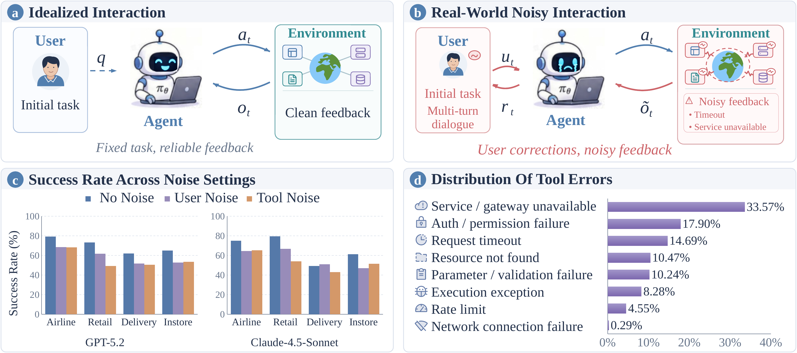
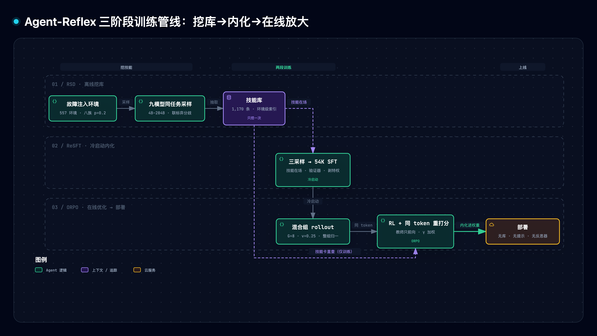
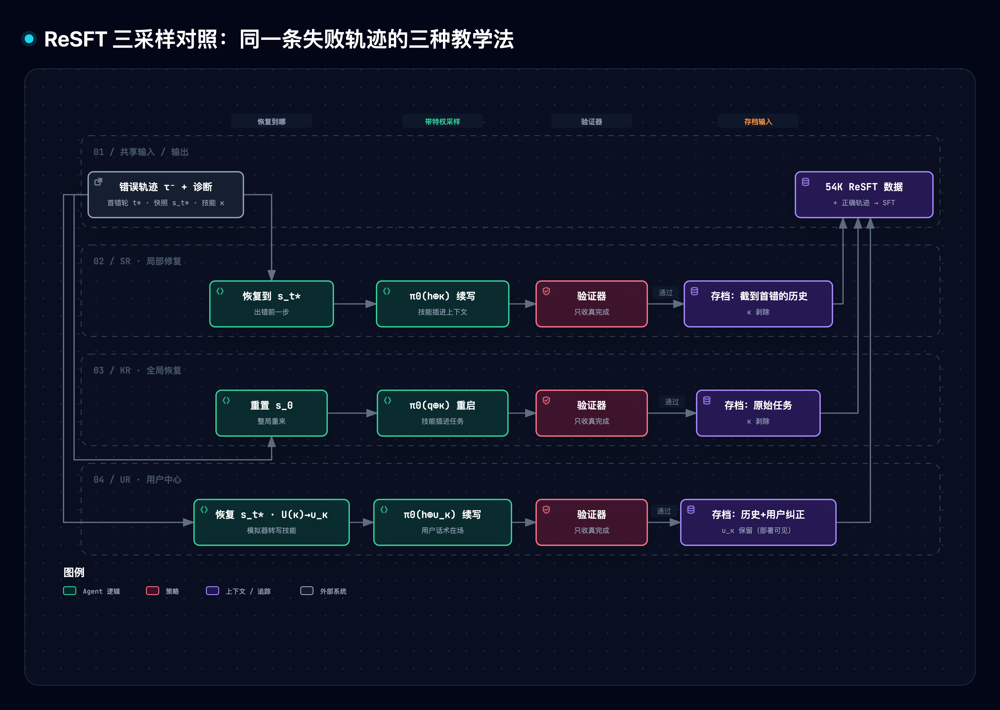
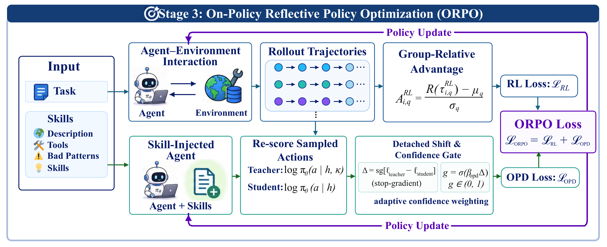
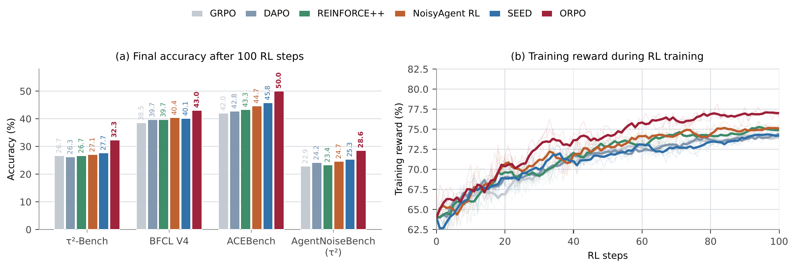
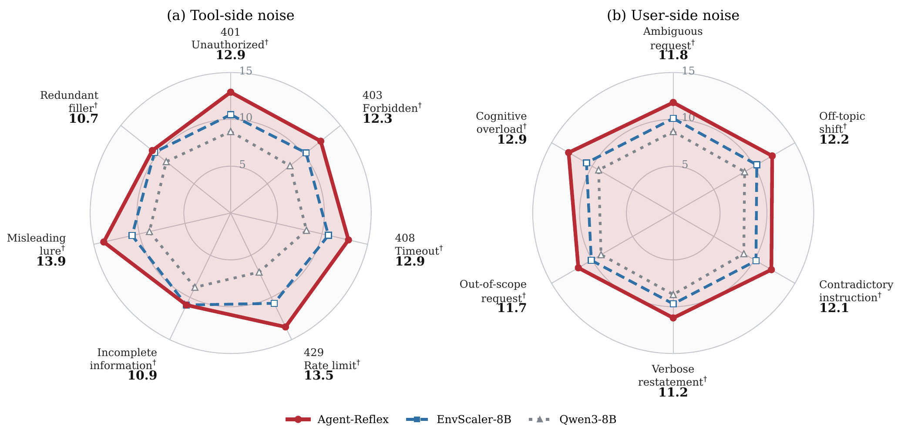

# Agent-Reflex 精读与通俗拆解（训练语言 Agent 先反思再行动）

> [1] G. Dong *et al.*, "Agent-Reflex: Teaching language agents to act reflectively," arXiv:2610.17953v1, Oct. 13, 2026. [Online]. Available: https://arxiv.org/html/2610.17953v1

> [!NOTE] 精读范围
> 通读 HTML v1 全文含附录 A–H、5 图 9 表与公式（1）–（12），元数据经摘要页与 e-print 双核对；图件取自 e-print 矢量 PDF，访问于 2026-11-06。摘要页标注 arXiv non-exclusive-distrib 类许可（见信源探针），本篇原图经用户 2026-11-06 明示授权入库，仅作学习引用；官方代码（MIT）与模型卡已核对。

**一句话定位**：把「Agent 被工具报错和用户纠正打断后不会恢复」从推理技巧问题改造成训练数据问题——挖环境级反思技能库，用「教时给答案、考时不给」的两段训练内化进权重，部署零依赖。

**导读**：合成环境越来越逼真，但几乎都有一个理想化假设——工具永远正常返回、用户从不中途插话。真实部署里 GPT-5.2 在工具噪声下成功率从 81.0 掉到 61.0（原文图 1c），而现有范式没教过模型「失败长什么样、坏了怎么救」。本文回答：怎么从执行失败里学出主动反思？答案是一条三阶段流水线：注入真实报错、跨模型成败配对挖环境级技能库（§3）；技能转成验证器把关的修复示范做 SFT、存档剥提示（§4）；在线 RL 时让「带技能卡的自己」给「不带卡的自己」逐 token 重打分当老师（§5）。证据与边界见 §6、§9，可复跑原型见 §7；与 [179 Harness 到 Harness²](./179-harness-to-harness2.md)（本仓另一篇精读）同题对话：那边问「反思收益放训练期还是部署期」，这边给出训练期路线的工程答案。

> [!TIP] 白话主线
> ① 问题：真实工具会超时、报错、限流，用户会中途纠正，但训练环境几乎全干净，模型出错后只会重复撞墙。② 难点：让模型自我批评，批评者就是失败的策略自身，「格式正确但内容说谎」的返回它看不出来；逐条轨迹修复又攒不下可复用经验。③ 思路：从九个基准回放的 24,510 条真实报错归纳八类故障注入自建环境，让九个模型同任务成败配对，挖出 557 环境 1,170 条恢复技能；带技能采样、验证器只收无提示也成立的续写，存档剥提示，造 54K 示范做 SFT；强化学习时每个 token 由带技能卡的自己重打分，置信加权蒸馏。④ 验证：五基准 40.2→58.6（超 Qwen3-235B 的 57.7）、噪声基准 12.3→29.1；消融显示技能库摆着不蒸馏没用，token 级信号才承载增益。

## 1. 它讲什么问题

先交代两个前置词。MCP（Model Context Protocol）是 Agent 调用外部工具的通用协议：每轮发出工具调用、服务返回结果、Agent 再决定下一步——本文 557 个训练环境全按 MCP server 主题合成。SFT 与 RL 两段式是主流范式（cold-start-then-RL）：先监督微调学会完整轨迹，再强化学习在线试错。

论文的痛点证据分两层。第一层：闭源旗舰自己也不会恢复，GPT-5.2 在 τ2 环境干净态 81.0、工具噪声 61.0、用户噪声 72.0，Claude-4.5-Sonnet 对应 73.0/57.0/65.0（原文图 1c；数字取自论文表 2 的 Clean 与噪声列）。第二层：故障不是小概率脏数据，把 9 个公开基准上 Agent 干活时的 177,700 条工具返回全部记下来，24,510 条是报错，按表面形态归 8 类：服务不可用 33.6%、认证权限 17.9%、超时 14.7%、资源缺失 10.5%、参数校验 10.2%、通用异常 8.3%、限流 4.5%、网络连接 0.3%（原文表 4，多标签计数）。

*原文图 1 · (a) 理想环境的干净反馈 vs (b) 真实环境的噪声与用户纠正；(c) GPT-5.2 与 Claude-4.5-Sonnet 在无噪/用户噪/工具噪下的成功率；(d) 24,510 条真实报错的八族占比。*
来源：Dong et al. [1] 原文图 1，版权归原作者，仅作学习引用（arXiv non-exclusive-distrib 1.0，经用户 2026-11-06 明示授权入库）。
这张图把全文动机钉死：旗舰模型在噪声下两位数下滑，而报错有稳定的形态分布——形态稳定意味着可分类，可分类意味着可教学。

| 设计规格 | 通俗版 | 对应机制 |
| --- | --- | --- |
| 监督信号来自外部差异而非自我批评 | 同一任务「一个成一个败」的对比是新信息 | RSD 跨模型配对（§3） |
| 技能按环境索引、跨任务复用 | 「这类服务这个字段常有坑」对同环境所有任务有效 | 技能库组织（§3） |
| 特权信息只在训练时在场 | 教时给答案、考时不给，验收只认独立完成 | ReSFT 剥离（§4） |
| 噪声轨迹与干净轨迹同组归一 | 修复要成为得分路径，而不是适应噪声 | ORPO 混合组（§5） |
| 部署零依赖 | 推理时不带技能库、不带反思器 | 三阶段共同产出 |

## 2. 全貌解剖

| 层 | 部分 | 回答的问题 |
| --- | --- | --- |
| 核心机制 | RSD：故障注入（式 1）+ 成败配对 + 元技能抽取 | 失败怎么变成可复用的监督源 |
| 核心机制 | ReSFT：SR/KR/UR 三采样（式 2–5）+ 特权剥离 | 技能怎么变成策略行为 |
| 核心机制 | ORPO：混合组 RL（式 6–8）+ 同 token 重打分（式 9–12） | 在线阶段怎么继续放大主动反思 |
| 证据链 | 表 1 五基准 / 表 2 噪声基准 / 表 3 消融 / 图 4 训练动态 / 附录 E 十三轴细分 | 真的有效吗、每个部件必要吗、是不是背题 |
| 领域坐标 | 反思学习三家族、环境合成两路线、agentic RL 谱系（附录 A） | 在领域里站在哪、与谁相邻、差在哪 |

因果脉络：观察（旗舰噪声下大跌、报错形态稳定）→ 归因（环境缺噪声与用户纠正；自批评被失败策略上限封顶、逐轨迹修复不沉淀、噪声暴露只有标量回报）→ 设计规格（反思=可学习、可验证、按环境索引、训练时特权的元技能）→ 机制三段流水线 → 证据闭环（六套基准+消融+OOD 论证）。全称对照：RSD=环境反思技能发现、ReSFT=反思式监督微调、ORPO=在线反思策略优化、OPD=在线策略蒸馏。最值得学的是「同 token 双上下文重打分」——廉价 dense 监督的通用模式。

## 3. 机制一：RSD——把真实故障变成环境级技能库

先说最反直觉的一步：故障不是研究者编的，是挖的。团队让 Agent 在 9 个公开基准（MCP-Atlas、τ3-Bench、GDPval、SkillsBench 等）上干活，记下每一条工具返回，从 24,510 条报错里归纳出上面那 8 类故障，再按每个工具返回位 0.2 的概率（式 1 的 p_inj，逐位独立抽样）随机替换真返回为故障返回。两个细节：八族均匀抽取而非按真实频率（稀有族也有足够样本学会恢复）；故障族只从该工具兼容集里选。

环境从哪来：从 Smithery 注册表按使用量取 557 个高用量 MCP server 主题，沿用 Agent-World 流程，由 GPT-OSS-120B（与被训模型同级，公平起见）挖库并生成可执行工具——工具须过单元测试、任务结果可验证，每环境 60 个带验证器的任务。

第二处关键设计是配对。单一模型反复采样，轨迹聚在它自己的推理习惯上；于是用九个模型（Qwen3 系五个加 Llama-3.1-8B、Gemma-4-31B、GPT-OSS-120B、DeepSeek-V4-Flash，4B–284B 五个家族）在相同采样协议下跑同样任务。同一个任务，A 模型成功、B 模型失败，就成一对——差异只能来自行为而非预算。配对约束：只在同任务内配，每环境至少来自五个不同任务，防止技能过拟合单一任务。标注由分析模型（DeepSeek-V4-Flash）与验证器联标，分歧即弃。

技能抽取把配对差异写成结构化记录：每环境存一份档案，含环境描述、工具清单、观测到的坏模式、提炼的技能；每条技能带触发条件、正反证据、诊断（哪类故障）、恢复模板（重试、换端点、问用户还是放弃）、可逆性标志，溯源与重放验证字段随行。557 个环境共 1,170 条技能。走查一个真实样例（附录 E.3 的 Hotel Booking）：坏模式是「混用不同会话的酒店或费率、把分页摘要当完整结果」「不核对可订状态就下单」；技能是「保住会话标识、每步校验分页边界、重读酒店与费率记录、把支付链接创建当已发起而非已支付」。原文图 2 画了 RSD 与 ReSFT 的完整管线（[原文图 2](https://arxiv.org/html/2610.17953v1/figure2_final.png)），与本文自制图 1 同构，不重复嵌入。

*图 1 · 三阶段流水线：RSD 挖库（离线）→ ReSFT 内化（冷启动）→ ORPO 在线放大；特权信息只在虚线框内出现，部署侧零依赖。*
（自制图，见文末图源索引。）

## 4. 机制二：ReSFT——教时给答案，考时不给

技能库本身只是文本。ReSFT 把技能转成模型行为，核心是三种互补采样，续写全部由被训练的 Qwen3-8B 自己执行（强模型只做离线诊断，保证公平），验证器只收「最终真完成」的续写：

| 采样 | 环境恢复到哪 | 技能去向 | 存进训练集的输入 |
| --- | --- | --- | --- |
| SR 自反思（式 2） | 出错前一步的状态快照 | 采样时插入上下文，存档时剥掉 | 截到首错处的历史 |
| KR 技能恢复（式 3） | 任务初始状态 | 同上剥掉 | 原始任务 |
| UR 用户中心（式 4） | 出错前一步的状态快照 | 从不进入上下文，由用户模拟器改写 | 历史 + 一句自然语言纠正 |

记号：κ=技能卡，u_κ=转写出的用户纠正，π₀=被训练策略本身，⊕=把左侧文本拼进上下文。

为什么这么设计：许多失败源于初始计划就错，局部修复救不了，所以有整局重来的 KR；UR 教「听人话」——模拟器（GPT-4.1）把技能转写成自然语言纠正插进对话，并刻意混入歧义甚至错误建议：服从不是答案，证据敏感的重规划才是。特权剥离两类（附录 D.3）：状态快照只用于恢复环境、永不成 token；技能文本 SR/KR 采样后剥除、UR 从头不进上下文。存档剥技能意味着训练集里全是「没有答案、修复照样成立」的样本——模型必须从自身可见历史里发现异常。三种采样加 Qwen3-8B 自己的成功轨迹合并成 54K 数据做 SFT（式 5），损失掩码排除工具返回与用户消息 token。

*图 2 · 同一失败轨迹的三种教学法：恢复到哪、技能去向、存档留什么（SR/KR 剥 κ，UR 保留 u_κ）。*

## 5. 机制三：ORPO——同 token 打两次分

冷启动之后，ORPO 在线继续放大主动反思，两个目标相加（式 12）。第一个是标准的结果 RL：任务取自 EnvScaler（另一项环境合成工作）的 2.5K RL 任务池（不复用 RSD 任务，归因干净）；每次更新采样一组 G=8 条轨迹，其中 ν=0.25 的比例在注入过故障的环境跑。组内归一（式 6，GRPO 式，即用组内均值方差把各自回报变成优势分数）有一个容易错过的设计决策：归一在整组上做，不把噪声轨迹和干净轨迹分成两层各自归一。原因（论文 §3.3 明说）：分层后噪声组自比，模型学的是「在噪声里谁烂得没那么彻底」（适应噪声）；混在一组，失败轨迹的负优势落在具体决策 token 上，与干净组的成功形成对比，「修复」才成为得分手段。式 7、8 是 PPO 式裁剪加 KL 约束，损失掩码依旧排除工具返回与用户消息。

第二个目标（式 9–11，即 OPD）是全文最有迁移价值的机制。先澄清一个易错点：「老师」不是更大的模型，就是同一个策略自己——上下文里多了该环境的技能卡（RL 任务自带环境编号，技能库按环境组织，直接查表、无检索）。把同一批已经生成好的 token 摆在模型面前算两次概率（式 9）：一次插技能卡，一次不插；插卡后概率明显变高的 token，说明技能信息支持这个决策。式 10 定义位移 Δ=技能上下文分−普通上下文分，置信权重 γ=sigmoid(βΔ)（把差值压到零到一之间的门控，β 为固定系数）；式 11 的更新是「恒上推、按 γ 加权」——学生对自己采样的每个 token 的概率往上抬，教师越认可抬得越多，Δ 为负的动作权重趋近零。教师分支只算打分不反传梯度（老师的意见只当参考答案，练习仍由学生自己完成）、不与环境交互，边际成本只是一次前向。技能卡内容与 SEED 的 privileged 槽估计器完全同构，本文的贡献是槽里放的东西：环境级技能卡，而非更大模型或逐局事后重写。推理时不插卡、不带库，部署零依赖。

*原文图 3 · 左：8 条混合轨迹共享一组归一优势；右：同一批 token 在带/不带技能卡两种上下文下重打分，差值经 sigmoid 置信加权成为不回传梯度的 OPD 信号。*
来源：Dong et al. [1] 原文图 3，版权归原作者，仅作学习引用（许可同图 1）。
一句话读图：左半把轨迹成败变成每个决策的分数，右半在不重新采样、不碰环境的前提下让技能知识逐 token 流进学生分支。

## 6. 关键实证数字

三组证据收进一张表，口径逐行标注。

| 实验 | 关键数字 | 条件·截至 | 一句话读法 |
| --- | --- | --- | --- |
| 表 1 五基准 Overall | 58.6（底座 40.2、EnvScaler 50.9、Agent-World 53.6、Qwen3-235B 57.7） | 7B–8B 同底座，v1 | 同底座 40.2→58.6，8B 小模型反超 235B 大模型 |
| 表 2 AgentNoiseBench | 29.1（NoisyAgent 25.9、EnvScaler 18.2、底座 12.3；GPT-5.2 55.8） | 噪声基准，OOD（分布外） | 未见过的噪声形态下仍最优的 8B |
| ACEBench 拆解 | turn 级 73.3 vs 基线 85.0 持平、step 级反超 | 表 1 子列 | 增益主要来自多轮交互 |
| 表 3 消融 | w/o SR 41.3 < w/o KR 42.4 < w/o UR 43.0；w/o OPD 43.7、w/o weight 44.5（完整 45.9） | 只拆一个组件 | 局部修复是地基；技能库空转没用，token 级信号承载增益 |
| 附录 E.1 十三轴 | 误导诱饵 13.9、信息不全 10.9、认知过载 12.9（归一分）；被带偏率 28.5% vs 44.8%（EnvScaler）vs 56.1%（底座） | SGA，95% 置信区间 | 领先最大处恰是「内容说谎」类 |
| 图 4 算法对比 | ORPO 与 GRPO/SEED 早期分离且奖励持续上升（两者此后走平） | 同任务池同预算，100 步 | 置信加权让中性 token 不主导更新 |

三条核心宣称（58.6、29.1、训练稳定）均为作者自测（官方协议、三次运行均值）[1]；官方开源代码（MIT）[12]、权重与 54K 数据，截至 2026-11-06 未见独立复现。

*原文图 4 · (a) 六算法同预算 100 步后的最终精度；(b) 训练奖励曲线：ORPO 与 GRPO/SEED 早期分离且持续上升。*
来源：Dong et al. [1] 原文图 4，版权归原作者，仅作学习引用（许可同图 1）。

*原文图 5 · 原生分类下逐轴 Stability-Gated Success（按各轴三模型均值归一，10=均值）：(a) 七个工具侧轴、(b) 六个用户侧轴，全轴领先。*
来源：Dong et al. [1] 原文图 5，版权归原作者，仅作学习引用（许可同图 1）。

## 7. 动手实验室

运行方式：`cd docs/research/agent-harness/assets && python3 agent_reflex_lab.py selftest`（纯标准库、固定种子、秒级；`count <md>` 即本文字数门）。原型用确定性脚本策略替代全部 LLM 角色，只验证机制自洽，不复现论文数字。

| 机制 | 实现单元 | 行号 |
| --- | --- | --- |
| 故障族/恢复表/模型池定义 | `FAMILIES` `RECOVERY` `POOL` | 30/32/60 |
| 故障注入+反应轨迹 | `rollout` | 96 |
| M1+M2 配对挖技能 | `rsd` | 126 |
| M3 三采样+特权剥离 | `resft` | 151 |
| 教师分支特权加成 | `skill_bonus` | 189 |
| 条件回路（上槽故障→下槽动作） | `_episode` | 213 |
| M4+M5 混合组 RL+OPD | `orpo` | 232 |
| 部署评估（无技能上下文） | `eval_deploy` | 312 |

消融实测（基线：部署干净 0.747 / 噪声 0.347，实际运行日志）：

| 实验 | 改了什么 | 实测（噪声档） | 教训 |
| --- | --- | --- | --- |
| 拔整个 RSD | 空库+无冷启动+无 OPD | 0.327 退化 | 没有失败样本就没有技能与先验 |
| w/o SR | 去局部修复先验 | 0.337 退化 | SR 贡献最大 |
| w/o KR / w/o UR | 各去一份先验 | 0.340 / 0.343 退化 | 边际贡献 KR>UR，幅度递减 |
| w/o OPD | 只 RL，技能库空转 | 0.337 退化 | 技能暴露本身不产生增益 |
| w/o 置信权重 | γ 恒为 1 | 0.347 持平 | 教师加成只落在正确动作上，γ 甄别作用未放大（论文 −1.4，不可比） |
| 分层归一 | 噪声组自比 | 噪声 0.347；「整层同败/同胜→优势恒零」出现 39 次 | 零优势层=负信号消失 |
| 特权依赖对照 | 同一随机流带/不带技能 | 带技能成功、剥离后失败 | 训练依赖提示则部署即失效 |

K2 实验（注入概率 0.2→0.5）：技能 6→12 条、配对 6→14 对、可收样本 54→108——素材不减反增（成功侧由高恢复模型承担），无技能基线 0.947→0.931 微降。注入率是素材供给与难度的同向旋钮；玩具中「可验证恢复」过滤器近乎不咬合，真实域更狠，不能外推为越高越好。

## 8. 底层规律与核心争议

**规律一：纠正信号的来源决定反思的上限**。让失败的模型自我批评，上限就是它自己的环境认知——格式正确的谎报在上下文里没有任何矛盾证据可驳 [2][3]。跨模型同任务配对提供的是失败者上下文里不存在的新信息：VitaBench 上 Reflexion-8B 6.8、ExpeL-8B 7.3 均低于自家底座的 11.4，本文同底座 17.5——没有外部差异信号，反思学习退化为复述先验。

**规律二：经验沉淀在环境粒度才可复用**。单次任务的复盘只对那次任务有效；「这类服务这个字段常有坑」是对环境的陈述，同环境任何任务都能用 [4]。Agent-R 逐轨迹修复 Overall 40.1 vs 本文 58.6；技能按环境编号直查即服务另一批零重叠的 RL 任务，OOD 噪声基准仍 29.1——复用而非背题。

**规律三：特权信息只能训练时在场**。教时给答案、考时不给，成立的前提是验收只认「不给答案也做出来的行为」[11]。消融里技能库在场不蒸馏（w/o OPD）43.7 vs 完整 45.9：暴露不产生增益，token 级信号才承载增益（剥离细节见 §4）。

**规律四：噪声轨迹不能自成对比组**。分层归一把「真失败」排除在对比外，负优势落不到具体决策上 [9]。式 6 整组归一让噪声失败与干净成功同台；图 4 里 ORPO 与 GRPO/SEED 早期分离且奖励持续上升（两者此后走平），作者归因置信加权防止中性 token 主导更新。

**规律五：评估要防「答对但被带偏」**。噪声基准只看终答会让侥幸恢复混进来；整条轨迹未被带偏才给分，才能区分「修复」与「容忍」[10]——被带偏率 28.5% vs 44.8% vs 56.1% 的差距在此口径下才可见。

五条合起来是「从失败学习」链条的五个独立环节，本文的机制与消融逐一对应。

**争议一：反思放推理时还是训练时**。推理时一派（Reflexion、Self-Refine、ExpeL）零训练成本、即插即用 [2][3]；训练时一派（Agent-R、ReflectRL、NoisyAgent、本文）主张修复必须进参数 [4][5]。分歧来自看到的失败面：前者见「偶发错一次、补句批评即可」，后者见「批评者就是失败策略自身、谎报无证据可驳」。前者的硬顶是对抗性故障下的本质问题，后者的全管线成本工程可降；分界信号是故障是否在返回文本中留下可检证据。

**争议二：环境怎么扩**。模拟一派让 LLM 按工具说明与历史直接生成环境反馈（Simia、GenEnv），近零成本但长轨迹漂移到不可实现的状态；可执行一派真建数据库与可验证工具（EnvScaler、Agent-World、ScaleEnv）[6][7]，成本高但状态一致。本文站可执行派，理由是本质的：反思训练需要「可验证的恢复」，模拟环境验证不了恢复是否真实成立。

## 9. 适用边界

### 成立条件
定义域是「LLM Agent + MCP 工具环境」的长程多轮任务；环境须有可执行验证器（判成败与恢复）；故障形态须在返回文本中可见；技能按环境可索引；框架在单一 8B 底座与 557 个合成环境上验证。

### Out-of-Scope
非工具型任务（纯推理、具身）；延迟、并发、部分写等时间签名故障（文本不可见，八族未覆盖）；跨规模迁移（均 8B，未测）；技能库在线更新（作者自列局限：环境不够多样时，在线学到的技能容易困在局部失败模式）；多 Agent 协作。

### 材料没有证明的事
1. 跨规模迁移：技能库与全部训练都在 Qwen3-8B 上，能否服务更小或更大模型未测（作者列为 future work）。
2. 故障谱完整性：八族是纯文本形态归纳，时间性故障未覆盖；「生产故障谱」覆盖不完整。
3. 无独立复现：58.6/29.1 均为自测三次均值，发布 24 天无第三方复现或反证（2026-11-06 检索）。
4. 「合成环境≈真实部署」前提未验证：557 环境由 GPT-OSS-120B 按 Agent-World 流程合成，合成工具故障谱与真实生产服务故障谱未对照。
5. 消融未做数据量对齐：w/o SR 掉分最大既可能来自 SR 内容价值也可能来自训练数据量减少，54K 中各采样比例未公开到可复算，两者未解耦。

## 10. 用户自测与费曼研讨套件

1. 要把这套三阶段管线迁移到一个全新领域（如法律文书审核 Agent），哪一阶段的设计决策最领域相关、最难平移？为什么不能直接让 Agent 复盘自己的失败来积累技能？
2. ORPO 的教师分支只有一次前向、不与环境交互。为什么「重打分已生成的 token」比「让教师重新跑一遍」便宜得多？梯度为什么必须截断？
3. 有人说「这套方法能治好延迟抖动导致的故障」。用 §9 的边界给出反驳，并指出扩展到这类故障要改链条上的哪几环？

## 参考（IEEE）

[1] G. Dong *et al.*, "Agent-Reflex: Teaching language agents to act reflectively," arXiv:2610.17953, Oct. 2026. [Online]. Available: https://arxiv.org/html/2610.17953v1
[2] N. Shinn *et al.*, "Reflexion: Language agents with verbal reinforcement learning," in Proc. NeurIPS, 2023.
[3] A. Zhao *et al.*, "ExpeL: LLM agents are experiential learners," in Proc. AAAI, 2024.
[4] S. Yuan *et al.*, "Agent-R: Training language model agents to reflect via iterative self-training," arXiv:2501.11425, 2025.
[5] Y. Chen et al., "Learning to act under noise: Enhancing agent robustness via noisy environments," arXiv:2605.27209, 2026.
[6] X. Song *et al.*, "EnvScaler: Scaling tool-interactive environments for LLM agent via programmatic synthesis," arXiv:2601.05808, 2026.
[7] G. Dong et al., "Agent-World: Scaling real-world environment synthesis for evolving general agent intelligence," arXiv:2604.18292, 2026.
[8] J. Wu et al., "SEED: Self-evolving on-policy distillation for agentic reinforcement learning," arXiv:2607.14777, 2026.
[9] Z. Shao et al., "DeepSeekMath: Pushing the limits of mathematical reasoning in open language models," arXiv:2402.03300, 2024.
[10] R. Wang et al., "AgentNoiseBench: Benchmarking robustness of tool-using LLM agents under noisy condition," arXiv:2602.11348, 2026.
[11] Z. Zhang *et al.*, "LoongReflect: Boosting long-horizon reflection in search agents via global perspective distillation," arXiv:2608.11967, 2026.
[12] RUC-NLPIR, "Agent-Reflex," GitHub repository, 2026. [Online]. Available: https://github.com/RUC-NLPIR/Agent-Reflex

（自制图源索引：文本源与交互版见 `docs/assets/mermaid/agent-harness/` 与 `docs/assets/architecture/agent-harness/`。）
