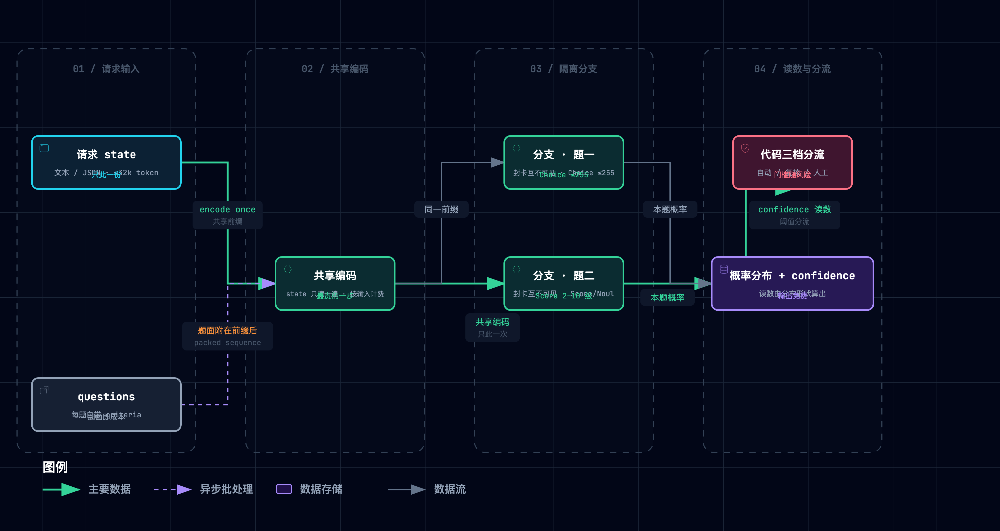
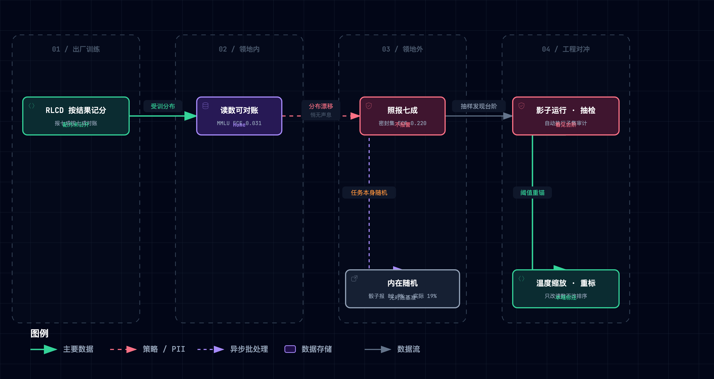

# Jev（TypeSafe System One Model）精读与通俗拆解

> [1] TypeSafe AI, "Introducing System One Models and Jev," typesafe.ai 博客，2026-09-15（[原文](https://typesafe.ai/blog/introducing-system-one-models-and-jev)）；docs.typesafe.ai，所据 `jev-1.14.0`（2026-10-14 发布，2026-11-03 抓取）。较 2026-09-26 快照已换代：模型版本化（1.13/1.14 + `jev-latest`）、实验性 images 输入与 Box 类型、可选 262k 长上下文，受影响处两说并陈。

**一句话定位**：Jev 改变了「判断」的交付方式——从「写一段话再由程序解析」改成「在预先定好的选项上直接交出一张概率表」。换来结构确定、一次多问、按量对账的便宜判断；它不保证判断正确，**只保证判断的形状与不确定性可以被代码消费**。

模型聊天早已超人，软件却没有因此自动化——病灶与归因 §1 拆。Jev 用一张预钉答案空间的概率表作答；本文讲清这种交付保证什么、不保证什么、会在哪里先坏：§1 规格、§2 全貌、§3–§6 拆四机制（各带可复跑原型实景）、§7–§10 收拢证据与边界。

> [!TIP]
> **白话主线**：判断难自动化，病根在「答案的形状」——自由文本要先猜格式再解析，口头把握无法对账。Jev 把答案空间预先钉进请求，只交概率表；state 只编码一次、各题互不可见，多问近乎免费。概率按「报几成兑现几成」训练，但只在受训分布内作数；confidence 只是概率表的固定算术。流程握在代码手里按风险分三档——换场景先重标门槛。

## 1. 它要解决什么问题：四病灶与四条硬要求

官方观察：模型聊天超人，自动化没跟上来（[1]）。四病灶：自由文本要 parse + validate；「应该不会下太大」不是概率；逐 token 生成慢且贵；RLHF 优化人类偏好而非机器可信度——TypeSafe CEO 是 InstructGPT 合著者 [2]，回马枪出自方法原作者（RLHF 源流 [2]；口头置信随措辞漂移 [3][4]）。对应四条硬要求，即全文设计规格总纲：

| 规格 | 通俗版 | 对应机制 |
| --- | --- | --- |
| 只填格（闭合输出） | 答案空间预先钉死，报不出「紫色的雨」 | §3 三原语 + criteria |
| 报几成兑现几成（校准） | 说七成的那批里约七成真发生 | §5 RLCD + 概率分布 |
| 一屏资料全单作答（并行） | state 编码一次，每题独立作答 | §4 共享读 · 隔离问 |
| 秒回且便宜（快廉） | 读最费工夫，落笔免费 | 按输入计费 + 并行采样（§4/§6） |

交付形态是 HTTP 契约 `POST /v1/systemone`：请求携带 `state`（字符串、JSON 对象或文本数组，每请求 64k tokens、state 加最长单题 ≤ 32k；1.14 实验性 images 输入经 `image()` 包成图 state，长上下文可选 262k——两者都要开 danger-zone 头，官方自述长上下文「slower and less accurate than staying within the default limits」）、`model`（现列 `jev-1.14.0`/`jev-1.13.0` 与别名 `jev-latest`；官方建议调过阈值的钉住版本号，旧版将按 60/30 天节奏预警弃用）与 `questions`，响应返回每题答案、概率分布与 token 用量 [1]。价格 $0.042/Mtoken（两版同价）、只按输入计费、输出免费。四条规格买到的不是更聪明，**是「判断的形状与不确定性可以被代码消费」**。

## 2. 全貌解剖：四个机制、两层证据、一条谱系

| 层 | 部分 | 回答的问题 |
| --- | --- | --- |
| 精读核心 | M1 闭合输出（§3）· M2 共享读·隔离问（§4）· M3 校准概率与 confidence（§5）· M4 快慢分工与分流（§6） | 为何不越界又不等于对；多问为何近乎免费；不确定性怎么变成代码信号；它在系统里站在哪 |
| 评判证据 | 官方 workflow evals；第三方实测（黑盒探测 / judge 实验 / 密封基准 / 付款拆解 / 骰子）；官方 jaggedness 毛病清单（版本化路径，10-02 重写）；开源复刻 kev、laya | 厂商数字怎么读；它会在哪先坏；能不能自己造一个 |
| 领域坐标 | RLHF→RLVR→RLCD 谱系 [2]；双系统 [15]；proper scoring [11][12]；cascade [17]；conformal [18]；共享前缀推理 [5][6]；零样本即蕴含 [7] | 它在领域地图的哪个位置 |

```
观察：模型聊天超人，软件没自动化
  ↓ 归因（解析兜底 / 口头置信 / 逐字慢贵 / RLHF 讨好）
设计规格：只填格 × 报几成兑现几成 × 一屏全单作答 × 秒回且便宜
  ↓ 机制
M1 预钉答案空间 → M2 state 编码一次 · 各题隔离 → M3 概率可对账 · 读数是算术 → M4 代码持有流程三档分流
  ↓ 证据闭环
本台自评（193.6× 自认偏上限）⇄ 外部抽检（分布内校准好、分布外出台阶、多跳弱）
  ⇄ 毛病清单（官方 jaggedness）⇄ 原型破坏实验 + laya 复刻实测
```

最值得学的焦点：①「形状保证」与「内容保证」的切分（最常被误读）；②校准的领地——「分布内对账漂亮、分布外出台阶且不报警」，决定阈值能否搬家；③隔离的代价——并行换来「没有跨问题不变量」；④收益在编排不在模型——同一模型在 workflow 里比裸 prompt 更准更快更便宜，Jev 只是把单位成本压到够低。四点有闭环约束：分流门槛只在校准成立时有意义，校准只在训练分布内成立——**换场景先重标门槛**，是便宜判断落地的枢纽。

## 3. 机制一：闭合输出空间——先钉死「能答什么」

三种题型把输出空间钉进请求：**Choice** 单选（criteria 给选项映射，至多 255 个）；**Score** 等级行（有序数组，至少 2 级、上限 10 级）；**Noul** 是否行（返回 P(yes)，不带 confidence）[1]。答案在构造上只能落在 criteria 内。官方称之为类型保证，并自己补上另一半：「guarantees the shape of its answers, not that every decision is correct」（FAQ）。

Score 的答案是概率加权期望而非某个等级，可合法落在两级之间：文档示例 `0×0.0 + 1×0.57 + 2×0.43 = 1.43`；模型看不到级号与相邻级 [1]。question id 不送入模型，但选项名与描述会送入 [1]；单选行建议印「其他 / 都不是」格。255 上限（2⁸ − 1）由服务端执行：第三方实测 256 选项返回 400，公开原始响应里 225 条同因被拒（nibzard@8404980）。1.14 新增实验性第四类型 Box——在请求所附图片中定位指令描述的目标（须 `jev-preview` 模型；JevBench Box 赛道也只有 1.14 一行，75.71）。

走查（实际运行日志，原型 `assets/jev_lab.py`）：六张客服工单各问「归哪个部门」（Choice：billing / technical / account / other），S2 越界 **0/6**、内容错 **2/6**——形状保证不等于内容保证。陷阱工单「There is no error… I just want my refund」被字面读成技术故障，集中度 0.981 照样自动执行（S3b）：集中也会集中地错。第三方基准 Emotion 任务 16% 样本对真标签给出零概率——格子全对、填的是错格。去掉闭合输出的世界由 B1 演示：六问 6/6 越界、下游 switch 全部落空（§8）。官方把「0% hallucinations」画进图表时自报「Our number is not empirical」[1]——「零幻觉」**只能紧跟「仅指格式与类型层」使用**。

## 4. 机制二：共享读 · 隔离问——资料读一遍，各题互不可见

`state` 只被编码一次，每个问题各自挂在这份共享编码上独立作答（官方「ingests the state once」「Every answer is independent」[1]），即共享前缀推理谱系（Hydragen [5]、DeFT [6]、无交叉污染打包 [9]）；「共享前缀 + 独立后缀 + 概率 readout」的实现细节属第三方推断。

计费口径把拓扑变成经济学：$0.042/Mtoken 只按输入计费、输出免费，多一问只多题面 token。官方 cookbook 实测批量 13 题合一请求便宜 12.2×、快 10.0× [1]；黑盒探测 1,500 题单请求仍数百毫秒、多数查询约 100ms [1]。

隔离分两层，混讲必错。第一层**题间互不可见**：秘密写进兄弟题读出 0.00、写进 state 读出 0.90–0.92（黑盒实验）。代价是没有跨问题不变量——官方 jaggedness 页（2026-09 版）曾自证：`refund` 与 `not_refund` 两 Noul 相加 1.19、换 Noul / yes-no Choice 问法 0.22 对 0.01；现行页（10-02 重写）删去这两张表，只留定性的选项顺序条目。第二层**行内选项互相影响**：加无关选项后对数几率平均降 0.28（95% CI −0.36 ~ −0.19，IIA 即无关选项独立性，被违背）；选项顺序也移动概率：参照项放末位 16/16 复现、放首位只剩 12/16（LLM 多选老现象 [10]）。互斥、跨题一致这类约束，要么并成一道 Choice，要么交给代码对账。



*图 1（[图源](../../assets/mermaid/agent-infra/jev--shared-read-isolated-branches.mmd) · [交互版](../../assets/architecture/agent-infra/jev--shared-read-isolated-branches.html)）：state 只编码一次，各题共享前缀、互不可见；行内选项相互影响，行间无任何不变量。*

原型把两层各演一遍（实际运行日志）：加兄弟题不改本题答案（S5 单问 == 多问）；state 的 9 个 token 只计一次（S6：1 问 19 tok → 3 问 36 tok）；正反 Noul 相加 1.504（S7）。破坏实验给反例：去掉隔离，billing 0.001 被兄弟题面改写到 0.499（B2）；去掉共享编码，六问计费 ×1.71（B3）。官方 patterns 的 speculative fan-out 正是这套拓扑——一次带上所有可能用到的题，代码事后取舍 [1]。

## 5. 机制三：校准概率与 confidence——分布可对账，读数只是统计

训练侧是 RLCD（Reinforcement Learning for Calibrated Decisions，按校准数据做强化学习）：配方未公开，只给目标合同——「0.2 应约 20% 发生」是群体承诺（groups of predictions），不担保单条答案 [1]。目标有统计地基：Brier 评分诞生于降水预报检验 [11]，严格 proper 性质保证诚实报告最优 [12]，温度缩放方法论见 [13]。

读数侧：confidence 和概率是两个对象——官方明说「confidence is a statistic computed from the probability distribution」、且定义可替换 [1]。像预报单行末的计算栏：判读员只分柱高，集中度由固定公式「咔哒」算出，他的手从不碰这栏。官方参考 adapter 钉死了算术：Choice 为 `(p_max − 1/K)/(1 − 1/K)`，Score 为 `max(0, 1 − Σᵢ pᵢ·|i − mode|/D)`（D＝均匀分布平均绝对离差）（adapter@e1d4cc9）。对公开原始响应逐行核对：「两位小数取整、不重归一化」假设下 80–100% 的行能对上、残差 ≤ 0.029——服务端大概率同式，**但这是推断不是证实**（nibzard@8404980 复算）。读 confidence 留意两处：读数依赖选项数 K——K=2 时 0.9 对应 p_max 0.95、K=10 时 0.91，「集中度 0.9」翻不成「九成会对」；度量对象要盯住——常引的「ECE 0.246」（ECE＝按置信度分箱比把握与命中率、按占比加权）算在 confidence 字段上，同批数据改用 p(chosen) 算是 0.347。

校准还有领地。像只在家乡气候里练出来的预报员，调去高原照样报「七成」，对账的记分牌悄悄出台阶，他本人不报警。分布内：黑盒探测 MMLU 1,200 题 ECE 0.031、990 题落 0.9–1.0 箱。分布外：密封基准集准确率 36.7%（差公开集 49.9 个百分点）、ECE 0.220、置信 ≥ 0.9 的子集只对 42%（§7 #3）。内在随机：公平骰子报 82.9%、实际 19%。这是结构性质而非实现瑕疵：校准是「模型 × 分布」的联合性质 [14]，同一套权重服务所有账户 [1]——「对所有人都校准」原理上不可能（第三方论证：把输出当排序分数、自行 Platt 重校准）。对冲是工程纪律：温度缩放（单标量、分布内拟合、不改排序只改读数）、影子运行与抽样审计、监控漂移。



*图 2（[图源](../../assets/mermaid/agent-infra/jev--calibration-territory.mmd) · [交互版](../../assets/architecture/agent-infra/jev--calibration-territory.html)）：校准承诺只覆盖受训分布；出领地读数照旧、台阶不报警。温度缩放只改读数、不改排序。*

原型全演成可复算数字（实际运行日志）：读数是纯算术——`probs=[0.996, 0.001, 0.001, 0.001] → conf=0.995`（S4，公式逐位一致）；拟合 T*=0.9 后检验集准确率 0.867 纹丝不动，Brier 0.350 修到 0.326（S8）。领地长这样：同一温度、门槛 p≥0.8，分布内放行错 19%、分布外错 100%，读数全程不报警（S11）；laya 复刻同现此台阶（§8）。

## 6. 机制四：快慢分工与分流编排——收益在编排，不在模型

原则是 code owns the workflow：Jev 是「smart if-statements」里的那个判断，不是流程的持有者 [1]。推荐三档分流——自动执行 / 复核后执行 / 转人工或上报，且「thresholds scale with risk」（confidence 页示例 0.5 下限、routing pattern 0.6，高风险动作更高阈值 [1]）。慢而贵的 System 2 推理模型负责起草问题与预案、接手疑难（快慢分工与级联谱系 [15][16][17]）。反面教材是让 LLM agent 自己持有控制流——官方原话「every loop introduces another opportunity to go off the rails」[1]。

原型一屏演完分流（实际运行日志）：conf=0.8 时 reply 自动执行、refund 进复核（S9：reply→auto · refund→review）；去掉风险分档改一刀切，refund 0.62 与 approve_transfer 0.7 全部 auto（B5）。官方 workflow evals 的核心结论不是 Jev 最准——四任务均值 67.8% 低于对照 sol 的 74.1%——而是「every model is more accurate, cheaper and faster in the workflow than with the same policy as a prompt」（workflow＝按清单逐题问、代码组合；prompt＝同一套规则一次答完）[1]。

判断变便宜后，**被判断的东西会变多**（Jevons 效应 [1]；Doom demo 每秒约 10 次查询、约 $7/小时）。但便宜只对「问对了对象」的流水线兑现：第三方逐行提问付款决策，32/32 批准判断全对，16 例金额错误一例没抓到——问错维度，便宜也白搭。

## 7. 关键实证数字

| # | 实验 | 关键数字 | 条件·截至 | 一句话读法 |
| --- | --- | --- | --- | --- |
| 1 | 官方 workflow evals（四任务 711 例） | Jev 67.8% / $0.0004 / 0.4s；sol 74.1% | 2026-09 evals 站 | 不占准确率，占成本-时间前沿 |
| 2 | 官方「193.6×/444.6×」与首页 demo | evals 数据点复算只得 97.8×/149.2×；首页 demo 171×/75× | 2026-09 复算 | 倍数是口径的函数，官方自认偏上限 |
| 3 | JevBench 密封集（308 题） | 36.7%（差公开集 49.9pp）、ECE 0.220、conf≥0.9 只对 42%（占 8.4%） | tag 1df665e3；该密封集 v1.5 起退役 | 分布外出台阶且不报警 |
| 4 | 骰子 / 硬币（1,941 条离线复算） | Choice 报 82.9% 实际 19%；硬币 92% 对 52% | 2026-09 repo 2ef26b64 | 内在随机被压扁成过度自信 |
| 5 | JevBench v1.8 三线实测 | 文字板：1.14.0 70.2、榜位 18；1.13.0 71.4、榜位自 #2 经 #4 滑至 #15；图像板 1.14 的 24.3 对 1.13 的 26.4；Box 赛道仅 1.14 一行（75.71） | 2026-10-31 活站 | 换代后唯一第三方三线数据；1.14 未升反微降 |
| 6 | LangChain judge（5 任务 × 100 次） | does_pass 500/500、方差低 92–913×、$0.00035/0.44s；quality MAE 0.106 最差 | 2026-09 repo adfea749 | 稳定不等于更准 |
| 7 | distil labs 分诊 / 付款 | 分诊 200/200、$0.029 每千次；付款 79/100 vs 微调 4B 98/100 | 2026-09 | 窄任务强、多跳弱 |
| 8 | kev 对拍（dev 集 11 任务） | Jev 0.857 / Brier 0.211；5% 错误预算自动化率 0.70 vs 0.45–0.57 | 2026-09 @58d9438 | 差距在排序——单一温度无法重排置信 |
| 9 | laya 复刻（feishu_zh / 49 suite） | 中文 64/64 vs 20/64（64 例合成题）；温度修复 ECE 0.466→0.081 | 2026-09 @55cf4c4 | 中文差距真实；过度自信可在读数层修 |

独立证据：延迟 2–6×（0.44s 对 2.16–2.83s、0.65s 对 1.48s）支撑「便宜快」；§5 的分布内 ECE 0.031 对 #3/#4 支撑「分布内外分界」；#1 的跨模型结论支撑「收益在编排」。

## 8. 动手实验室

原型 [`assets/jev_lab.py`](./assets/jev_lab.py)：纯标准库、确定性（无随机数）的最小复刻，判读器是关键词打分 mock，验证机制自洽而非模型聪明。`--selftest` 秒级跑完 S1–S11；`--break B1..B5` 每次只拆一个机制；`--count <md>` 是本笔记字数门禁（≤6000）。「实际运行日志」均来自真实运行（2026-11-03 复跑，与 2026-09 版逐字一致）。

| 机制 | 函数（行号） |
| --- | --- |
| 契约校验（255 上限 / Score 2–10 级） | `validate()` L70（`MAX_CHOICES` L27） |
| M1 闭合输出 | `decide()` L107 |
| M2 共享读 · 隔离问 | `ask()` L129、`encode_state()` L79 |
| M3 读数 / 温度 / 度量 | `confidence()` L92、`fit_temperature()` L158、`ece()` L169、`brier()` L221 |
| M4 风险分档 | `route()` L148 |
| 领地场景 | `shifted_corpus()` L206 |

破坏性实验对照（实际运行日志）：

| 实验 | 拆什么 | 实测退化 |
| --- | --- | --- |
| B1 | 闭合输出 → 自由文本宽松解析 | 越界 6/6，下游 switch 全部落空 |
| B2 | 题间隔离 → 兄弟题面泄漏 | billing 0.001 → 0.499 |
| B3 | 共享编码 → 每题重收 state | 6 问计费 ×1.71（63 → 108 tok） |
| B4 | 校准温度 → 虚高读数 | 准确率不变，p≥0.9 放行 28 条错 0 → 48 条错 8；ECE 反而 0.252→0.213——对账对象是 Brier 与风险-覆盖，不是单看 ECE |
| B5 | 风险分档 → 一刀切 0.5 | refund 0.62、approve_transfer 0.7 全部 auto |

**laya 复刻实测**（复刻模型实测，非 Jev；2026-09，所钉修订其后已从上游历史消失，数字以仓内归档为准——结果 [`assets/jev_laya_results.json`](./assets/jev_laya_results.json)、脚本 [`assets/jev_laya_replica.py`](./assets/jev_laya_replica.py)）：隔离成立——同 state 单问与 5 题同请求 fp32 逐位相同，暗号写兄弟题 p=0.080、写 state p=0.865；闭合输出把「无解」改写成「选项内高置信」——真答案不在选项内时输出恒在选项内，补印 none of the above 后 p(none)=0.972；同批无解题对照两家同现「过度自信 + 高置信全错」台阶，温度缩放可修回 ECE 0.081。README 自报基座接近随机、AUROC 0.30——Jev 阈值不能直接搬用。

## 9. 底层规律与核心争议

### 五条底层规律

**规律 1：输出空间先于输出（output space before output）**。先钉死「能答什么」就不可能越界，但越界之外的错一个没少：消掉解析与截断兜底（表示层无第 N+1 个出口），消不掉填错格（16% 零概率即例）。先例：指针网络 [8]、零样本即蕴含 [7]。

**规律 2：共享一次读，隔离每道题（shared read, isolated branches）**。多问近乎免费，代价是题间没有任何默契（[5][6][9]）——「12.2× 批量便宜」与「正反两问对不上账」是同一枚硬币的两面（§4）。

**规律 3：概率要可对账，读数只是统计（accountable probabilities, derived readouts）**。训练奖励「报几成兑现几成」；confidence 只是概率表形状的一道算术，不是模型另外长出的自信（[11][12][13]；两个 ECE 的分叉见 §5）。

**规律 4：校准有领地（calibration has a territory）**。「报七成兑现七成」只对受训那类资料成立，换了地方照报七成且不报警（[14][18]）。阈值是校准曲线上的索引——曲线一换，同一个 0.9 对应的命中率就换档（§5 的 42%）。

**规律 5：收益在编排，不在模型（the win is in the workflow）**。把大判断拆成代码能拼装的一秒钟小判断，任何模型都更准更快更便宜；便宜模型只是把分法的单位成本压到够低（[15][16][17]）。

五条覆盖五个独立维度：输出空间形状、读与问拓扑、概率语义、分布边界、系统分工——前三条管一次判断内部，后两条管判断放进世界之后。

### 三个核心争议

**争议 1：新物种，还是老分类器换了件衣服？** 支持方看输出接口与训练目标（RLCD、不生成字符串、可对账概率）；质疑方看计算图——黑盒与理论两路重构都指向已知组件组合（共享前缀 KV + tree mask + 读出头），理论路并给出可证伪预测：RLCD 若是 schema 条件化的 Plackett–Luce [19] 就该满足 IIA，实测被违背（−0.28）；primer「从预训练 LM 后训练」与官方「neither small nor an LLM」也相抵。约束解码分三层：词法（JSON 语法）与枚举（logit mask）两层本可约束死；语义层（自报把握可信吗、多题自洽吗）是生成式范式的属地——Jev 的真增量在「把握可对账」这一半与计费形状，「多题自洽」同样没补上（§4 的 1.19）。分歧本质是命名与创新位置之争；架构保密（CEO：「architecture is close to the chest」）使其短期不可证伪。工程决策看契约与实测，不看血统。

**争议 2：193.6× 是真实世界的倍数吗？** 口径分歧：参照答案是两位最强模型的均值、题目自家人写、LLM 对照组套 adapter 出概率且开推理；官方自认「higher end of real world gains」；博客所引「LLM 需 3–329 秒」在所链数据源当天快照里最大只有 187.5s；第三方独立测速约 2–6×。量级的便宜是真的，倍数须自测。

**争议 3：「诚实的概率」能外推吗？** 支持方取样分布内（MMLU ECE 0.031、二元判定 500/500）；质疑方取样分布外与内在随机（密封集 36.7%/ECE 0.220、骰子 83% 对 19%、「对所有人校准不可能」）。本质是连续谱选址：校准是模型×分布的联合性质，同一套权重服务所有账户，只能对冲、不可消除；「诚实」的代价是自动化率下降，账由开发者按风险自己付。

## 10. 适用边界

### 成立条件（定义域 · 成立工况 · Out-of-Scope）

- **定义域**：给定文本 state 与预定义答案空间的问题（Choice ≤255 / Score 2–10 级 / Noul；实验性 Box），一次请求返回每题概率分布与集中度读数，供代码分支；输入以文本为主（images 为 1.14 实验特性），输出无字符串。
- **最佳适用区间**：答案可从 state 直接读出、懂行的人一秒拍板的窄判断（分诊、路由、打标、守门、评审子项）；分布接近训练分布（英文为主）；高吞吐实时、代码编排按阈值分流。
- **Out-of-Scope**：多跳推理、计数与数值计算、日期比较、任何文本生成；分布外校准不承诺；内在随机事件的概率；对抗注入鲁棒性；跨问题一致性；「两个数量级提速」的普适性；架构细节（保密）。

### 材料没有证明的事

1. **「同等智能」的普适性**：支持证据集中在「答案可直接读出」的任务（MMLU 复算 91.8%；余证 #1/#6/#7）；反例见 #3/#7。
2. **分布外校准**：首页至今写「Jev returns typed decisions with calibrated probabilities」，未加分布外限定；反证见 #3/#4（另见 #5：1.14 实测未改善）。
3. **两个数量级的真实提速**：193.6×/444.6× 出自自建 evals 且无法由公开数据点复现；独立实测约 2–6×。
4. **「新架构」**：架构保密；第三方重构均为已知组件组合；「not an LLM」与 primer「从预训练 LM 后训练」相抵。
5. **中文可用性**：官方只说英文为主、CJK 处理但不对等，零量化；唯一配对数据 feishu_zh 64 例是合成题。

另：中文社区转述存在 15 处口径失真（如把构造性「0% 结构化错误」写成实测零错误），正文一律不用二手转述数字。

## 11. 用户自测与费曼研讨套件

1. 一条「LLM + JSON Schema 约束解码 + 答案后追加 0–100 自报把握」的管线，有人主张等价于 Jev。按词法 / 枚举 / 语义三层指出它管住了什么、管不住什么；温度缩放能否救回自报把握——为什么只改读数不改排序，对风险-覆盖曲线意味着什么？
2. 催收流水线一次问 12 个 Score/Noul、代码加权出动作；新话术出现后坏账升而自动放行率不降反升——推演最先失守的环节与三个观测点；正反 Noul 之和可为 1.19，对加权公式意味着什么？

## 12. 与本仓的关联

本仓自治面（Routine、patrol、judge）早已是「代码持有控制流 + 模型窄判断」形态；可迁移机制与代码锚点见[机制映射汇总](../mapping-negentropy.md)。

## 参考

[1] TypeSafe AI, "Introducing System One Models and Jev," typesafe.ai Blog, Sep. 15, 2026; docs.typesafe.ai（所据 Jev `jev-1.14.0`，accessed Nov. 3, 2026）. [Online]. Available: https://typesafe.ai/blog/introducing-system-one-models-and-jev
[2] L. Ouyang *et al.*, "Training language models to follow instructions with human feedback," 2022, *arXiv:2203.02155*.
[3] S. Kadavath *et al.*, "Language models (mostly) know what they know," 2022, *arXiv:2207.05221*.
[4] M. Xiong *et al.*, "Can LLMs express their uncertainty? An empirical evaluation of confidence elicitation in LLMs," in *Proc. ICLR*, 2024. [Online]. Available: https://arxiv.org/abs/2306.13063
[5] J. Juravsky *et al.*, "Hydragen: High-throughput LLM inference with shared prefixes," 2024, *arXiv:2402.05099*.
[6] J. Yao *et al.*, "DeFT: Decoding with flash tree-attention for efficient tree-structured LLM inference," in *Proc. ICLR*, 2025. [Online]. Available: https://arxiv.org/abs/2404.00242
[7] W. Yin, J. Hay, and D. Roth, "Benchmarking zero-shot text classification: Datasets, evaluation and entailment approach," in *Proc. EMNLP-IJCNLP*, 2019, pp. 3914–3923, doi: 10.18653/v1/D19-1404.
[8] O. Vinyals, M. Fortunato, and N. Jaitly, "Pointer networks," in *Adv. Neural Inf. Process. Syst. (NIPS)*, vol. 28, 2015. [Online]. Available: https://arxiv.org/abs/1506.03134
[9] M. M. Krell, M. Kosec, S. P. Perez, and A. Fitzgibbon, "Efficient sequence packing without cross-contamination," 2021, *arXiv:2107.02027*.
[10] P. Pezeshkpour and E. Hruschka, "Large language models sensitivity to the order of options in multiple-choice questions," in *Findings ACL: NAACL*, 2024, pp. 2006–2017, doi: 10.18653/v1/2024.findings-naacl.130.
[11] G. W. Brier, "Verification of forecasts expressed in terms of probability," *Mon. Weather Rev.*, vol. 78, no. 1, pp. 1–3, 1950, doi: 10.1175/1520-0493(1950)078<0001:VOFEIT>2.0.CO;2.
[12] T. Gneiting and A. E. Raftery, "Strictly proper scoring rules, prediction, and estimation," *J. Amer. Statist. Assoc.*, vol. 102, no. 477, pp. 359–378, 2007, doi: 10.1198/016214506000001437.
[13] C. Guo, G. Pleiss, Y. Sun, and K. Q. Weinberger, "On calibration of modern neural networks," in *Proc. 34th Int. Conf. Mach. Learn. (ICML)*, PMLR vol. 70, 2017, pp. 1321–1330. [Online]. Available: https://arxiv.org/abs/1706.04599
[14] Y. Ovadia *et al.*, "Can you trust your model's uncertainty? Evaluating predictive uncertainty under dataset shift," 2019, *arXiv:1906.02530*.
[15] D. Kahneman, *Thinking, Fast and Slow*. New York, NY, USA: Farrar, Straus and Giroux, 2011, ISBN 978-0-374-27563-1.
[16] G. Booch *et al.*, "Thinking fast and slow in AI," in *Proc. AAAI Conf. Artif. Intell.*, vol. 35, no. 17, 2021, pp. 15042–15046, doi: 10.1609/aaai.v35i17.17765.
[17] L. Chen, M. Zaharia, and J. Zou, "FrugalGPT: How to use large language models while reducing cost and improving performance," 2023, *arXiv:2305.05176*.
[18] A. N. Angelopoulos and S. Bates, "A gentle introduction to conformal prediction and distribution-free uncertainty quantification," 2021, *arXiv:2107.07511*.
[19] R. L. Plackett, "The analysis of permutations," *J. Roy. Statist. Soc. C (Appl. Statist.)*, vol. 24, no. 2, p. 193, 1975, doi: 10.2307/2346567.
