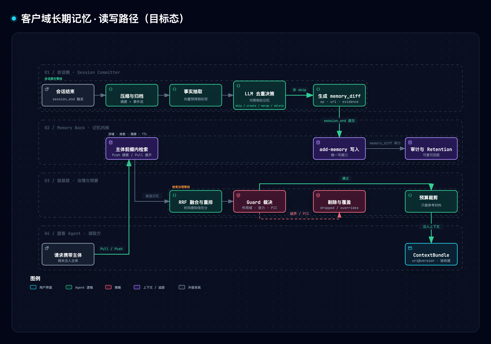

# 客户域 Agent Long Memory · 2027 产品规划

> **状态**：规划草案。**信源**：内部《Context Layer 架构技术设计方案》客户域部分，以及既有 Agent Memory 系列设计与评测文档；基线截至 2026-07（Memory 文档最新编辑时间）。
> **口径**：特性清单 + 季度里程碑 + 验收标准。信源对 2027 的人力与成本均未给出，本篇不做估算；凡标「待基线」的指标，待 E1 产出基线后回填，不预设数字。

## 一、结论先行：客户域 Memory 的功能点

客户域 Memory 是**按商家（tenant）/ 用户（user）两级隔离的长期记忆**。2027 的任务不是增强检索算法，而是把既有「能存能搜」的 Memory Service（Mem0 + pgvector，RAG-only）升级为**写入可信、读取可控、合规可审计**。共 **5 条能力线、18 个功能点**：

| 能力线 | 功能点 | 用户价值 | 优先级 | 目标季度 |
|---|---|---|---|---|
| **W 写入与沉淀** | W1 `add-memory` 写入契约与 `memory_diff` 审计 | 每次记忆变更可追溯、可回放 | P0 | Q1 |
| | W2 会话提交（Session Committer） | 会话结束自动沉淀，重复事实不堆积 | P0 | Q1–Q2 |
| | W3 事件时间与证据溯源 | 每条记忆说得出「何时发生、依据哪轮对话」 | P0 | Q1 |
| | W4 巩固与衰减（整理 Worker） | 记忆库不随时间膨胀、变脏 | P2 | Q3 |
| **G 治理与合规** | G1 主体隔离强制 | 商家 A 的记忆永不进入商家 B | P0 | Gate-0–Q1 |
| | G2 Retention 引擎 | 按业务模块的 TTL，到期匿名化 | P0 | Q1 |
| | G3 擦除与级联 | 删除请求可证明覆盖派生数据 | P1 | Q2 |
| | G4 PII 脱敏与投毒防护 | 写前脱敏；记忆不被当作指令执行 | P1 | Q1 基础 / Q3 完整 |
| **R 读取与注入** | R1 记忆检索与注入（Push / Pull） | Agent 拿到相关记忆，且知道它只是「弱依据」 | P1 | Q2 |
| | R2 时间感知排序与信任分 | 新记忆优先，过期记忆降权 | P1 | Q2 |
| **V 可见可改与运营** | V1 商家可见可改 | 商家能查看、更正、删除 Agent 记住的内容 | P1 | Q2 |
| | V2 记忆-口径冲突检测与工单 | 过期记忆被发现并推动修复 | P1 | Q2 |
| | V3 观测与归因回流 | 记忆相关的 badcase 能落到具体记忆 | P1 | Q2 |
| **E 评估与扩展** | E1 Memory Eval Harness | 记忆质量有基线、有回归门禁 | **P0 基础** | Gate-0 起 |
| | E2 存储抽象层与 Mem0 决策门 | 换底层存储不动上层契约 | P0 | Gate-0–Q1 |
| | E3 Experience 回挂 Skill（接口） | 使用经验反哺能力描述 | 条件项 | Q4 |
| | E4 图 / 双时态增强 | 关系类、时序类问题答得更准 | 条件项 | Q4（触发才做） |
| | E5 MCP 与多语言 SDK | 更多团队低成本接入 | P2 | Q4 |

**先后顺序**：评估（E1）与隔离契约（G1）先行 → Q1 写入可信 → Q2 读取可控与可见可改 → Q3 巩固与评估闭环 → Q4 扩展与条件项。

## 二、背景与范围

**情境与冲突**：面客 Agent 要记得商家的偏好与历史，但记忆有三类失效——**错答**（三个月前的旧记忆压过了已更新的指标口径）、**越界**（商家 A 的偏好进入商家 B）、**不合规**（到期不匿名化、删除不彻底）。三者都不会报错，只会「看起来合理」。**结论**：规划重心是治理，而不是检索增强。

**记忆的定位**[[1]](#ref1)：记忆属于经验型（Experience）上下文——参与推理但**永不胜过硬约束**（平台安全底线 > 口径与 Schema > 面客规范 > 商家指令 > 参考知识 > 记忆）；与硬约束冲突时不丢弃而是记录，那正是记忆过期最灵敏的信号。写入口唯一（会话提交），隔离靠主体路径前缀成立，而不是靠 prompt 提醒。

**范围内**：客户域 Journey 长期记忆（tenant / user 两级独立空间）、会话提交写路径、配套治理（Retention、可见可改、冲突、观测、评估）。
**范围外，仅标注接口**：能力域 Experience、内部 Agent 的记忆（Org Context）、商家指令存储（指令型）、Knowledge / RAG、ADK Session。

**责任边界**

| 责任方 | 负责 | 不负责 |
|---|---|---|
| Memory Back（MB，长期记忆内核） | 存储、检索、隔离、TTL；`add-memory` 唯一写接口 | 记什么、怎么抽取、何时注入 |
| 装配层 | 「记什么、怎么抽取、何时注入」；Session Committer；Guard；冲突工单 | 存储与隔离的实现 |
| Platform | ADK Session Service、Langfuse | 长期记忆 |

**读写路径（目标态）**

> 图源（可 diff 文本）：[`customer-memory--rw-pipeline.mmd`](../../assets/mermaid/agent-infra/customer-memory--rw-pipeline.mmd) · 交互版：[`customer-memory--rw-pipeline.html`](../../assets/architecture/agent-infra/customer-memory--rw-pipeline.html)

| 路径 | 步骤 |
|---|---|
| 写 | 会话结束 → 压缩与归档 → 抽取 → 向量预筛相似项 → LLM 决策 skip / create / merge / delete → 生成 `memory_diff` → `add-memory` 写入 MB 并审计 |
| 读 | 请求带主体 → MB 在主体前缀内检索 → RRF 融合与归一信任重排 → Guard（可见性、作用域、效力裁决、PII）→ 预算裁剪 → 输出带 `uri@version` 的 Bundle |

> 架构判断（本篇建议，非信源结论）：把 MB 收敛为「存储 / 检索 / 隔离 / TTL」内核，抽取与去重决策上移到 Committer。既有 Mem0 已支持 `infer=false` 原文直存，Mem0 因此可退为可替换的 store，E2 决策门的代价随之降低。

## 三、用户与场景

| 角色 | 想要什么 | 对应功能点 |
|---|---|---|
| 商家管理员 | 知道 Agent 记住了什么，并能更正或删除 | V1、G3 |
| 商家终端用户 / 客服 | Agent 记得上次的偏好，不必重复说明 | W2、R1 |
| 面客 Agent | 取到相关记忆，但不被过期记忆误导 | R1、R2、V2 |
| 内部运营（代客视角） | 发现记忆与口径冲突，推动修复 | V2、V3 |
| 合规 / 安全 | 到期匿名化、删除可证明、跨主体零越界 | G1–G4 |
| 评测 / 研发（Judge、Autoresearch） | 同样输入复现同样结果，退化可归因 | E1、V3 |

## 四、功能点详述

### W 写入与沉淀

| 功能点 | 做什么 | 验收标准 | 归属 |
|---|---|---|---|
| W1 写入契约与审计 | 唯一写接口 `add-memory`：以 `{op: create\|merge\|delete, uri, content, evidence}` 提交，返回 `accepted` / `rejected`（含原因）；审计可查可回放 | Agent 侧无直接写记忆工具；100% 写入带 evidence 与审计记录 | MB |
| W2 会话提交 | 同步归档 → 异步抽取 → 向量预筛 → skip / create / merge / delete[[2]](#ref2)；一次性纠正不进长期记忆 | 同一事实重复提交不产生近似重复；近似重复率较基线下降（待基线） | 装配层（MB 提供归档与写入） |
| W3 事件时间与证据 | 每条记忆带 evidence 指针（会话 / 轮次），`event_time` 与 `ingest_time` 分离；抽取时强制保留绝对日期 | 每条含 evidence 与 `event_time`；时间推理类评测较基线提升（待基线） | 共建 |
| W4 巩固与衰减 | 确定性快路径（规则去重合并）+ LLM 巩固 + 时间衰减；跨会话合并同类记忆[[3]](#ref3) | 重复与脏记忆占比较基线下降（待基线）；衰减行为可被评测复现 | MB |

### G 治理与合规

| 功能点 | 做什么 | 验收标准 | 归属 |
|---|---|---|---|
| G1 主体隔离强制 | 主体只取自网关身份，不信任调用方传参；无主体请求拒绝；主体字段缺省语义单一且有测试；批量删除必须带窄作用域 | 红队越界集通过率 100%（越界 = 0） | MB |
| G2 Retention 引擎 | 按业务模块与 per-org 配置 TTL，存在全局上限；到期**匿名化**而非直接删除；记忆、会话归档、Bundle 快照同一策略 | 执行覆盖率 100%；每次到期动作可审计 | MB（执行方待定，见 OQ3） |
| G3 擦除与级联 | 源数据删除时级联删除记忆及其派生物（向量、实体表）；擦除请求可出具证明 | 擦除覆盖全部派生物；无残留脏记忆 | MB |
| G4 PII 脱敏与投毒防护 | 写前 PII 脱敏；记忆内容无指令权，不得被当作指令执行[[4]](#ref4) | 注入类红队集通过；脱敏覆盖率达标 | 共建 |

### R 读取与注入

| 功能点 | 做什么 | 验收标准 | 归属 |
|---|---|---|---|
| R1 检索与注入 | 主体前缀内检索；Push 自动注入少量高相关摘要（L0），Pull 工具按需展开（L1 / L2）[[5]](#ref5)；输出标注「弱依据」；预算不足时先降载记忆与参考材料，硬约束不让位 | 经统一 Guard；预算超限时被裁减的只有参考材料 | 装配层（MB 提供检索） |
| R2 时间感知排序与信任分 | 检索排序加入时间项；信任分起点 `0.4·retention + 0.3·importance + 0.3·(1−staleness)`，`staleness = min(1, 距上次访问天数 / 90)`，权重可调 | 时间推理类得分 ≥ 85% | MB 排序 + 装配层信任分 |

### V 可见可改与运营

| 功能点 | 做什么 | 验收标准 | 归属 |
|---|---|---|---|
| V1 商家可见可改 | 受限的查看（LIST）、更正（PATCH）、删除 API 与面板；`memory_diff` 对商家可见；改动入审计 | 商家可查看、更正、删除自己的记忆，且全部入审计 | MB（API）+ 产品端（UI） |
| V2 冲突检测与工单 | 记忆与硬约束（如指标口径）冲突时，记忆落败并写入 `overrides`；自动生成工单回流 Owner | 冲突可观测；至少 1 条真实工单端到端闭环 | 装配层（MB 提供冲突标记接口） |
| V3 观测与归因回流 | 每次组装记录命中 / 剔除 / 覆盖 / 降载；badcase 归因到具体记忆（带版本）；Judge 评测可复现（Journey 归档快照） | 记忆相关 badcase 100% 可归因 | 装配层 + Platform |

### E 评估与扩展

| 功能点 | 做什么 | 验收标准 | 归属 |
|---|---|---|---|
| E1 Memory Eval Harness | 用生产配置跑 LoCoMo[[6]](#ref6) 与 LongMemEval[[7]](#ref7) **全类**；生产回放集；CI 门禁；报告必附置信区间 | 产出基线报告；CI 能拦截排序倒置与质量回归 | 共建 |
| E2 存储抽象层与决策门 | 保留 MemoryService 抽象，上层契约与具体 store 解耦；把「是否沿用 Mem0」写成规则（触发条件、评审人、时点），半年度复核 | 切换 store 不改上层契约 | MB |
| E3 Experience 回挂 Skill | 使用经验挂回能力本身（能力域），本期仅出接口契约 | 接口评审通过 | 装配层 / 能力域 |
| E4 图 / 双时态增强 | 触发条件：关系 / 时序类得分 < 85%，或用户反馈出现明显矛盾 / 遗忘；候选 Zep / Graphiti 路线[[8]](#ref8) | 触发才立项；POC 对比 RAG-only 基线 | MB |
| E5 MCP 与多语言 SDK | 现有 REST + Python 瘦 SDK，扩 MCP 协议与其他语言 | 新增协议与语言通过同一契约测试 | MB |

## 五、2027 路线（建议稿）

与既有 Context Layer 分阶段排期对齐：「记忆与指令」阶段在 2027 Q1，「记忆冲突工单」阶段在 2027 Q1–Q2；时间为建议，以双周会排期为准。

| 阶段 | 主题 | 功能点 | 退出标准 | 依赖 |
|---|---|---|---|---|
| **Gate-0**（2026 Q4） | 前置闸 | E1 基线复测、G1 止血、契约冻结（W1 / R1 / G2 schema）、E2 决策规则文本化 | 隔离契约冻结；基线报告产出；契约评审通过 | 无 |
| **2027 Q1** | 可信写入 | G1、W1、W2（同步归档 + 异步抽取灰度）、W3、G2 最小闭环、G4 基础、E1 v1 + CI 门禁、E2 | 红队越界集 100% 通过；全部写入经 `add-memory` 且带 evidence 与 `event_time`；首个模块 Retention 到期任务跑通；CI 门禁能拦截排序倒置 | 商家指令存储 |
| **2027 Q2** | 可控读取与可见可改 | R1、R2、V1、V2、V3、G3、W2 GA | 记忆检索经统一 Guard；时间推理类达 ≥ 85%；至少 1 条冲突工单闭环；商家可查看 / 更正 / 删除且入审计 | 指标口径首版供给 |
| **2027 Q3** | 巩固与评估闭环 | W4、E1 v2（生产回放 + 在线指标）、G4 完整、抽取成本优化（固定抽取 prompt 的缓存 / 批处理） | 重复率与单次写入成本较基线下降（待基线）；投毒红队集通过；**E2 半年度复核** | E1 基线 |
| **2027 Q4** | 扩展与条件项 | E3 接口、E4（仅触发时）、E5、年度基准复测 | 年度报告；次年规划输入 | — |

## 六、成功指标

| 指标 | 目标 | 说明 |
|---|---|---|
| 跨主体越界 | = 0 | 「记忆与指令」阶段验收项 |
| 跨 Session 记忆召回 | Recall > 90% | 原型期周级指标，2027 需重定义测集 |
| 时间 / 关系推理类得分 | ≥ 85% | 图增强触发阈值，非 SLA |
| 记忆检索 P99 | < 100 ms（告警 > 150 ms） | Agent Engine Adapter 性能基准 |
| Retention 执行覆盖率 | 100% | 本篇提议 |
| 近似重复率 / 写入延迟与成本 / 冲突工单闭环周期 | **待基线** | E1 产出后回填 |

## 七、待决策与风险

| ID | 待决策 | 建议 |
|---|---|---|
| OQ1 | MB 底层是否沿用 Mem0 | 不预设；走 E2 决策门，Q3 复核 |
| OQ2 | ADK Session `user_states` 与长期记忆的权威源划分 | `user_states` 只存运行时状态，长期记忆只存 MB |
| OQ3 | Retention 由供给侧统一执行，还是各权威源各自执行 | Gate-0 前定 |
| OQ4 | 既有自建的 Knowledge 与 Memory 后台是否收编 | 评估后定 |
| OQ5 | Supply API 形态（HTTP / SDK / MCP）与 SLA；MB 具体 Owner | 需业务方指定 |
| OQ6 | 隔离契约对账：既有设计文档对主体字段缺省语义、租户键层级（三级 / 四级）表述不一致 | **Gate-0 第一件事**，以代码与实测为准后冻结 |
| OQ7 | 跨 agent 记忆共享：设计文档列为非目标，但客户域定义 tenant / user 各有独立空间，agent 维度语义待明确 | 明确后再排期 |
| OQ8 | 权威实现有多套叙事（自建 PG 服务 / 引擎内 memory service / MB） | 明确谁是权威实现 |

| 风险 | 缓解 |
|---|---|
| SDK 版本漂移导致排序静默倒置（无报错） | SDK 版本下限进 CI；防倒置用例；E2 |
| 上游缺陷不修，自建融合需长期保留 | 升级前必跑 E1 |
| 小样本评估统计不显著 | E1 扩全量；报告必附置信区间 |
| 记忆与口径冲突导致错答 | V2；记忆恒为最弱一票 |
| 跨租户泄露、误删 | G1 |
| 记忆投毒 | G4；红队集 |
| 抽取成本与延迟 | 抽取上移 Committer 并异步化；prompt 缓存；成本按生产默认模型重算 |

**信源口径提示**：既有 POC 的结论需谨慎引用——①「±28% 置信区间」按 n = 30 标注，复算对应的是单数据集 n = 10（n = 30 约 ±16%）；②验收线「准确率 ≥ 70%」被用于判定均值 68.1% 的方案「达标」，口径不严；③「RAG-only 覆盖 95%+ 业务场景」无推导来源；④成本数字为静态估算，按非生产默认模型计价。以上均不应作为 2027 决策的硬证据，E1 基线产出前以「待基线」处理。

## 八、业界范式对照与本仓参照

| 范式 | 出处 | 对应功能点 |
|---|---|---|
| 会话两阶段提交 + L0 / L1 / L2 目录式上下文 | OpenViking[[1]](#ref1) | W2、R1 |
| 抽取 + 去重决策（ADD / UPDATE / DELETE / NOOP） | Mem0[[2]](#ref2) | W2、W1 |
| 记忆互链与演化 | A-Mem[[3]](#ref3) | W4 |
| 查询型记忆注入攻击 | MINJA[[4]](#ref4) | G4 |
| 分层记忆、自编辑记忆 | MemGPT[[5]](#ref5) | R1 |
| 长对话长期记忆评测 | LoCoMo[[6]](#ref6)、LongMemEval[[7]](#ref7) | E1 |
| 双时态知识图谱、边失效 | Zep / Graphiti[[8]](#ref8) | W3、E4 |

**本仓可借鉴的参照实现**（同一代码库的 Memory 子系统，仅借鉴设计）：

- [记忆子系统 SoT](../../concepts/subsystems/025-the-memory-system.md)：五因子衰减、ADR、与 Mem0 / Cognee / Zep / Letta 的横向对比；[记忆白皮书](../../concepts/subsystems/026-memory-whitepaper.md)。
- [Context Layer 技术蓝图](../cognitive-context/013-context-layer-blueprint.md)、[OpenViking 精读](../cognitive-context/014-openviking.md) 与[机制映射](../cognitive-context/015-openviking-mapping-negentropy.md)：会话两阶段提交与分级上下文。
- [自进化 Agents Team 调研](../self-evolution/130-self-evolving-agents-team.md)：记忆治理与去重决策范式。
- [`conflict_resolver.py`](../../../apps/negentropy/src/negentropy/engine/governance/conflict_resolver.py)（AGM 冲突检测，supersede / merge / keep_both）→ V2；[`memory.py`](../../../apps/negentropy/src/negentropy/engine/governance/memory.py)（审计、版本、保留策略）→ G2、R2；[`consolidation/pipeline/`](../../../apps/negentropy/src/negentropy/engine/consolidation/pipeline)（巩固管线）→ W4；[`memory_tools.py`](../../../apps/negentropy/src/negentropy/engine/tools/memory_tools.py)（自编辑工具）→ R1。

## 参考文献

[1] maojia, "OpenViking: The database paradigm for context engineering," *OpenViking Blog*, Mar. 2026. [Online]. Available: https://blog.openviking.ai/post/openviking-context-database/

[2] P. Chhikara, D. Khant, S. Aryan, T. Singh, and D. Yadav, "Mem0: Building production-ready AI agents with scalable long-term memory," arXiv:2504.19413, Apr. 2025.

[3] W. Xu, Z. Liang, K. Mei, H. Gao, J. Tan, and Y. Zhang, "A-MEM: Agentic memory for LLM agents," in *Proc. Adv. Neural Inf. Process. Syst. (NeurIPS)*, 2025, arXiv:2502.12110.

[4] S. Dong, S. Xu, P. He, Y. Li, J. Tang, T. Liu, H. Liu, and Z. Xiang, "Memory injection attacks on LLM agents via query-only interaction," arXiv:2503.03704, Mar. 2025.

[5] C. Packer, S. Wooders, K. Lin, V. Fang, S. G. Patil, I. Stoica, and J. E. Gonzalez, "MemGPT: Towards LLMs as operating systems," arXiv:2310.08560, Oct. 2023.

[6] A. Maharana, D.-H. Lee, S. Tulyakov, M. Bansal, F. Barbieri, and Y. Fang, "Evaluating very long-term conversational memory of LLM agents," arXiv:2402.17753, Feb. 2024.

[7] D. Wu, H. Wang, W. Yu, Y. Zhang, K.-W. Chang, and D. Yu, "LongMemEval: Benchmarking chat assistants on long-term interactive memory," in *Proc. Int. Conf. Learn. Represent. (ICLR)*, 2025, arXiv:2410.10813.

[8] P. Rasmussen, P. Paliychuk, T. Beauvais, J. Ryan, and D. Chalef, "Zep: A temporal knowledge graph architecture for agent memory," arXiv:2501.13956, Jan. 2025.
