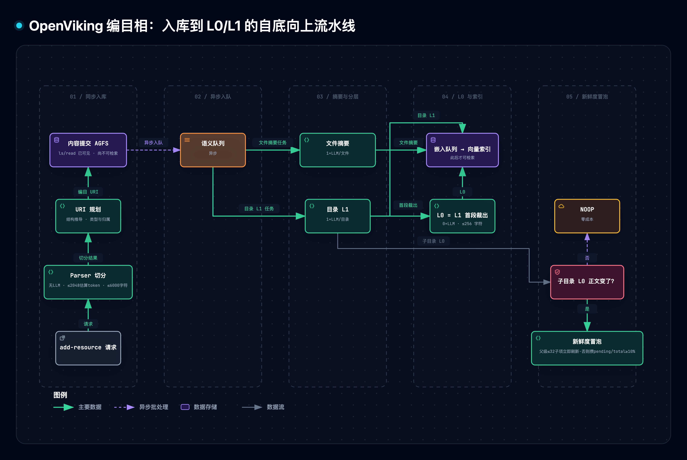
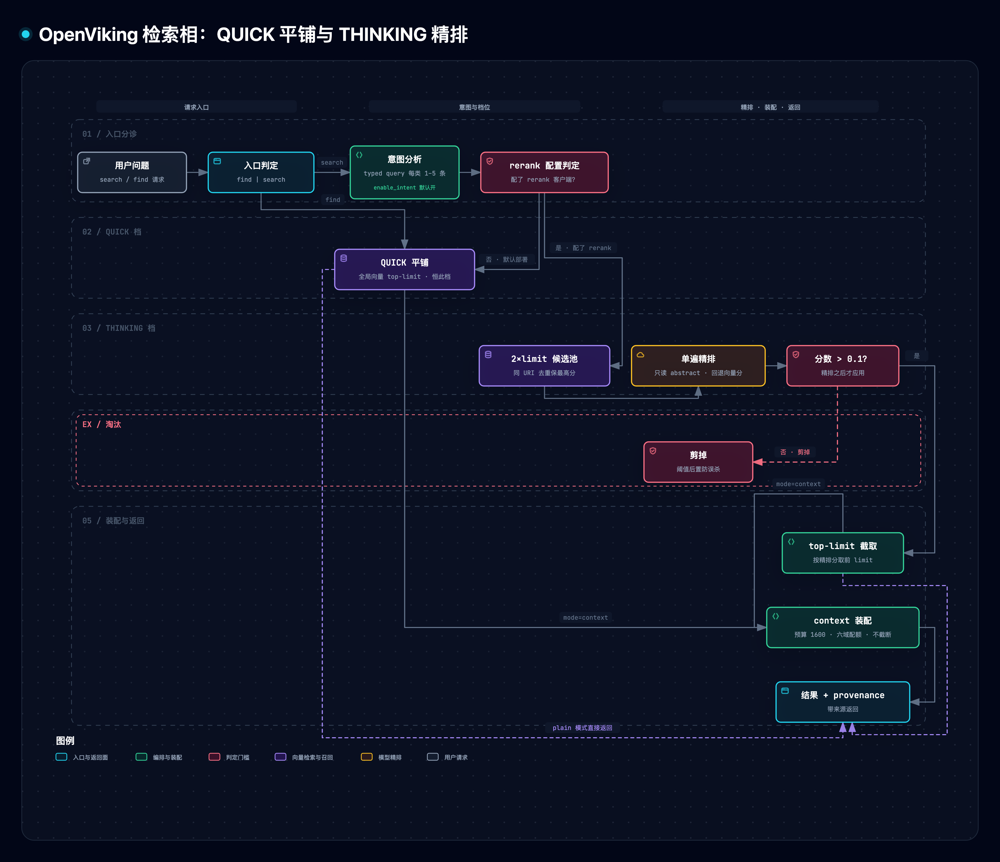

# OpenViking 精读笔记

> [OpenViking, "One filesystem for everything an agent knows," GitHub 仓库](https://github.com/volcengine/OpenViking)，固定提交 [`6227af51`](https://github.com/volcengine/OpenViking/tree/6227af5102b3874d162d65a0503bfeef849686c2)（2026-10-21，最新 release v0.5.1.1）。文档站 [docs.openviking.ai](https://docs.openviking.ai/)（llms-full.txt，2026-10-20）· 官方博客 [blog.openviking.ai](https://blog.openviking.ai/)（16 篇）· 官网 [openviking.ai](https://openviking.ai/)（20 页）。许可证 **AGPL-3.0**（`crates/ov_cli`、`crates/ragfs`、`examples/` 仍为 Apache-2.0）。本篇为换代重写：上一版钉点 `14a7b81`（2026-09-23）以来上游 390 commits、v0.4.21→v0.5.1.1，其中 **2026-09-29 的 #5450 把「目录递归检索」整体删除**，检索相机制换代；旧版结论的逐条去向见文末「换代对账」。团队为火山引擎 Viking 系（VikingDB 内部运营 2019–2023，2026 年初开源转型），三篇关联论文 VikingMem（arXiv 2605.29640，VLDB 2026）/ TrieHI（2606.16903，ICDE）/ VikingRAG（2609.11390，投递中）。

**一句话定位**：OpenViking 是一个**把 Agent 的资源、记忆、技能全部装进一棵 `viking://` 目录树的开源上下文数据库**——入库时自底向上给每个目录写两层摘要（L0 一句话 / L1 一页导览），检索是一次全局向量召回加一遍可选精排，会话结束后把对话提炼成带身份的记忆写回同一棵树；v0.5 起一个网关让任何只改 Base URL 的模型客户端零改造获得这一切，并把「谁的记忆」拆成数据属主（user）与交互对象（peer）两个正交维度。

共识与痛点：Agent 的记忆、文档、技能各存各家早已是常态，市面上的解法要么是又一个记忆库，要么是又一套 RAG 管线；真正的缺口是把「Agent 知道的一切」组织成一棵可寻址、可分层、可回写、可归属的树——跨工具、跨会话、跨人都不丢。本文回答的问题是：OpenViking 用什么机制做到这件事，v0.4→v0.5 一个月里它的检索设计为什么自我推翻重来，以及厂商的说法里哪些经得起代码与实验的检验。第 1–2 章立问题与全貌，第 3–8 章逐个拆机制（寻址与身份、分层编目、检索、会话记忆、网关、治理面），第 9 章过证据，第 10 章可以亲手复现，第 11–14 章收拢成规律、边界与自测；配套原型在 `assets/openviking_lab.py`，秒级可跑。

> [!TIP] **白话主线**
> Agent 的上下文散在记忆库、向量库和 prompt 里，跨工具跨会话就丢。难在三点：平铺向量检索随语料变大变钝、漏召回的精排救不回；摘要和记忆是派生物，必须保鲜且有提交点；记忆多了以后「像不像」不能当「是不是同一条」。OpenViking 把一切都装进一棵 `viking://` 目录树——入库自底向上写两层摘要，检索先全局召回再单遍精排，会话结束按身份字段把对话提炼成记忆写回树里，v0.5 起再由网关把这一切代理给任何模型客户端。验证靠三层：厂商自报基准（无消融）、三篇团队论文（不在开源版上跑）、本仓原型的五次破坏性实验。

<details><summary>读前须知：裁决口径、证据分级与引用记号</summary>

**机制展开**：每个机制按「处境 → 机制 → 原型实景」走；原型实景取自配套最小原型 [`assets/openviking_lab.py`](./assets/openviking_lab.py)（纯标准库、clean-room 自写——上游 AGPL-3.0，本仓 Apache-2.0，不含任何上游代码），`--selftest` 秒级跑完，`--break B1|B3|B4|B6|B7` 复现破坏性实验。文中日志均为实际运行输出。
- **裁决口径**：文档与代码冲突时**代码胜出**；本文数字以钉点 `6227af51` 代码实值为准，营销页滞后项进矛盾清单（§9.3）。
- **证据分级**：【一】钉点代码实测可复现 /【二】官方文档与博客陈述 /【三】厂商自报基准与营销表述 /【四】第三方分析。凡【三】必标注，引用必须带归属（§9）。
- **引用记号**（行号均以钉点为准）：`HR:` = `openviking/retrieve/hierarchical_retriever.py`；`SP:` = `storage/queuefs/semantic_processor.py`；`SE:` = `storage/queuefs/semantic_executor.py`；`SS:` = `session/session.py`；`CFG:` = `openviking_cli/utils/config/*`；`NS:` = `core/namespace.py`；`GW:` = `openviking_gateway/*`。完整路径随文标注。
- **配套产物**：[OpenViking ↔ negentropy 机制映射汇总](../mapping-negentropy.md)。

</details>

---

## 1. 它要解决什么问题：上下文散在三处，跨工具就丢

官方叙事（【二】）三年没变过、覆盖面一直在加宽：Agent 的上下文散在四处——记忆在各家记忆库、文档在各家向量库、技能躺在 prompt 里、多 Agent 各带半份会话上下文而人沦为复制粘贴总线（博客《The Database Paradigm for Context Engineering》与《OpenViking for the Too Many Agents Problem》）。共同根因是**信息组织缺位**：平铺向量检索（把文字转成可比相似度的数字序列再整库比对的检索）随语料变大区分度下降、只取相似度前 k 名（top-k）时漏召回致命，而重排模型（reranker，把召回候选再读一遍、重新排序的模型）「救不回从未进入候选集的证据」——这句话在检索机制换代之后（§5）有了新的分量：候选集的边界从「目录递归的入口」移到了「召回池的池边」。

由此推出六条设计规格，后文每个机制都能映射回其中一条：

| 设计规格 | 通俗版 | 对应机制 |
| --- | --- | --- |
| 可寻址 | 每样东西有位置编号，报编号就能找到 | `viking://` 统一命名空间（§3） |
| 可归属 | 谁的记忆、为谁而记，是两个正交问题 | User/Peer 模型（§3） |
| 可分层 | 先看一句话标签，再翻导览页，最后才读整本 | 目录级 L0/L1/L2 sidecar（长在目录上的摘要附件，§4） |
| 可检索 | 全局召回一圈，请得起专家就再精排一遍 | 单遍精排 + 六域装配（§5） |
| 可回写 | 接待完用户，记忆库自动更新 | 会话两阶段提交 + 身份判据提炼（§6） |
| 可治理 | 多人共用的钥匙、锁、备份、回放 | 网关 + 租户/ACL/加密/快照（§7–§8） |

边界照旧（【二】）：OV 不是文件系统——上传内容被解析成 AI-ready 数据，原始文件默认不保留；它自称 context database。

## 2. 全貌：一树三相三面

换代后的 OpenViking 可以拆成「一棵树、三个相、三个面」：**编目相**（资源入库 → 切分 → 自底向上摘要 → 向量化 → 新鲜度冒泡）与**检索相**（意图分析 → 全局召回 → 单遍精排 → 六域装配）围绕同一棵 `viking://` 树读写；**记忆相**（会话归档 → 异步提炼 → 记忆写回）在树的 user/peer 空间里生长。三个面是新长出来的：**网关面**把读写都挪到服务端代理（§7）；**治理面**管多人共用的钥匙锁与备份（§8）；**编译面**（`ov compile`）把树上的材料再加工成 wiki/知识图谱/日报——它是 VikingBot 层的应用能力（`bot/vikingbot/compile/`），不是核心服务器的机制，本篇不展开。


*图 1 · 编目相：Parser 切分（无 LLM）→ R/N/F/V 快照与差异计划（请求/正式/向量三层状态对账，算出该改什么）→ 异步语义队列（文件摘要 + 目录 L1，各 1 次 LLM）→ 嵌入队列（此后才可检索）→ 新鲜度冒泡（L0 变了才上报）。此相换代未变。图源：[.mmd](../../assets/mermaid/cognitive-context/openviking--ingest-phase.mmd) · 交互版 [HTML](../../assets/architecture/cognitive-context/openviking--ingest-phase.html)*


*图 2 · 检索相（换代后）：find 固定平铺；search 自动选档——无精排模型时同样是平铺，配了才「召回 2×limit → URI 去重 → 单遍精排 → 阈值后置」；context 模式再走六域配额装配。递归、父分传播、收敛刹车均已删除。图源：[.mmd](../../assets/mermaid/cognitive-context/openviking--retrieval-phase.mmd) · 交互版 [HTML](../../assets/architecture/cognitive-context/openviking--retrieval-phase.html)*

### 2.1 最重要的几个部分（分层矩阵）

证据分级图例（全文通用）：【一】=钉点代码与仓内实测、【二】=官方文档/博客陈述、【三】=厂商自报基准与营销表述；细则见文首折叠的读前须知。

| 层级 | 部分 | 回答的问题 | 性质 |
| --- | --- | --- | --- |
| Tier 1 地基 | `viking://` URI + 三类上下文 + User/Peer（§3） | 东西放哪、是谁的、是什么 | 【一】URI 结构推导类型；peers 段一等公民（`NS:114-125`） |
| Tier 1 地基 | L0/L1/L2 目录 sidecar + 自底向上生成 + 冒泡（§4） | 怎么「先看摘要」 | 【一】256/4000 字符；L0 从 L1 裁出零 LLM；10% 判据 |
| Tier 1 核心 | 全局召回 + 单遍精排 + 六域装配（§5） | 怎么找、拿多少 | 【一】池 2×limit（`HR:72/209`）；阈值后置（`HR:263`） |
| Tier 1 核心 | 会话两阶段提交 + 身份记忆提炼（§6） | 怎么学会用户 | 【一】`.done` 提交点（`SS:1869/2464`）；schema 身份字段表 |
| Tier 1 核心（新） | Gateway 模型代理（§7） | 不装插件怎么接入 | 【二/一】五步一轮；逐字节回放；90% 压缩（`GW:models.py:34-49`） |
| Tier 2 治理 | 租户/ACL/加密/隐私/快照/OVPack（§8） | 多人共用怎么管 | 【二】三角色；ACL 默认关；OVE1 信封；git 快照 |
| Tier 2 证据 | LoCoMo / tau2 / HotpotQA / 单轮 RAG / ClawWork + 竞品对比（§9） | 真的更好吗 | 【三】厂商自报；无消融；负向结果仍在 |
| Tier 2 证据 | 三篇论文（§9.2） | 学术支撑 | 【三】官方称「核心机制已并入」，无并入后消融 |
| Tier 3 坐标 | 对 MemGPT/Mem0/RAPTOR/LightRAG/Agent Plugins/013 蓝图的坐标（§11、§14） | 在领域地图的哪里 | 本笔记综合 |

### 2.2 核心关系与因果脉络链

```
观察：上下文散在记忆库/向量库/prompt；平铺检索大语料变钝、漏召回精排救不回；
      跨工具跨会话就丢；多 Agent 各带半份上下文、人肉当总线
  ↓ 归因
信息组织缺位 + 记忆无归属 + 派生物无提交点
  ↓ 设计规格
可寻址 × 可归属 × 可分层 × 可检索 × 可回写 × 可治理
  ↓ 机制
viking:// 统一命名空间（resources / user（含 peers 子树）/ agent 三空间）
  → L0/L1 自底向上编目 + 新鲜度冒泡（写路径）
  → 全局召回 2×limit + 单遍精排 + 阈值后置 + 六域装配（读路径；
    #5450 删递归 = 上游自认「导航门」成本大于收益，早剪风险转移到池边界）
  → 会话两阶段提交（归档同步 / 提炼异步）+ 身份字段判据 + .done（记忆路径）
  → Gateway：五步一轮 + 逐字回放保缓存 + 保存滞后一轮（代理路径）
  → 三角色 + ACL + 信封加密 + git 快照 + OVPack（治理路径）
  ↓ 证据闭环
厂商自报（LoCoMo 24.20%→82.08%；单轮 RAG 66.87% < LightRAG 76.00% 负向仍在）
+ 上游自我修正记录（ClawWork 算术错改口径、docs 对齐代码、递归撤回——§9.3）
+ 本仓 lab 破坏性实验（池边界 / 身份漂移 / 精排致盲 / 无提交点重复提炼——§10）
```

### 2.3 基础层 vs 学习焦点

**(a) 前置概念**（三句讲清，首次需要处就地展开）：
1. **召回管「别漏」、精排管「排准」**——精排只能在召回给的候选里挑，进不了候选池的证据谁也救不回（§5 开场）。
2. **摘要是有损压缩也是路标**——L0/L1 便宜但会错会旧；以过期摘要导航，整棵子树都走偏（§4）。
3. **数据属主 ≠ 交互对象**——谁拥有这条记忆（user 空间）与这段交互在为谁发生（peer 子树）是两个正交问题（§3）。

**(b) 最值得学的五个焦点**：
1. **检索相的换代与上游的自我否定**（§5）：讲任何算法前先讲「它什么时候才运行、什么时候根本不运行」——上游删掉递归这个动作本身就是最重要的证据。
2. **候选池经济学**（§5.3）：2×limit 池是新的「早剪不可逆」载体；省 token 的代价从导航门转移到池边界。
3. **身份判据的工程化**（§6.3）：从 `(user, topic)` 的例子长成 9 类 schema 身份字段表 + 明文合并安全策略 + 原地整合命令。
4. **网关 = 记忆的代理化入口**（§7）：五步一轮 / 滞后保存 / 逐字回放三个设计点都是「缓存与一致性」的经典权衡。
5. **派生物的提交点纪律**（§6.1/§4/§8）：`.done` 最后写、冒泡阈值、快照前向提交——跨机制同构。

## 3. 机制一：`viking://` 寻址与 User/Peer 归属——位置即语义

Agent 要在「公共知识、我的记忆、我的技能、客户的档案」四种东西之间无歧义地指认对象。位置编号是最低成本的方案：「三楼东区 12 架」这句话本身就说出了它在哪个分区、旁边是谁、谁能进（此为局部类比，仅作首句直觉；后文一律直讲）。本节数字未标注证据等级者均为钉点代码实值（【一】）。

- **URI = 纯前缀替换的租户化路径**：`viking://{rest}` → AGFS `/local/{account_id}/{rest}`；单段超 255 字节加 sha256 前 8 位后缀（`storage/viking_fs/_access.py:678-682`）。
- **类型由 URI 结构推导，不按关键字**：`user/{uid}/memories/**` → memory；`user/{uid}/skills/**`、`agent/skills/**` → skill；**其余一律 resource**——包括 `viking://resources/memories/x`（`NS:114-144`）。仓内同款反例仍在：`Context._derive_category` 依旧用子串匹配（`core/context.py:121`），可作「结构化 vs 关键字」教具。
- **User/Peer 模型**（v0.4.1 引入，换代后成为一等结构）：`viking://user/{uid}/peers/{peer}/memories|resources|skills` 是合法路径段，类型推导与检索过滤都识别它（`NS:118-120`）。语义三分：**account 是租户边界、user 是数据属主、peer 是 user 空间内的交互对象**——像银行账户与来访客户：往来记录按来访者分开归档，但来访者不该拥有自己的银行账户（局部类比，到此为止）。peer 没有密钥、不能认证、不是租户，只收窄「这段交互的记忆写在哪、默认读谁」（【二】博客《User / Peer: Separating Data Owners From Interaction Objects》）。一个客服机器人（user=support-bot）服务一百个客户，每人一个 peer 子树，不必给客户发任何密钥。
- **归属纪律「写窄读宽」**：写入时钉定归属 peer；检索可跨 peer 广搜，但结果必须携带来源（provenance），跨 peer 命中按类别降权——events/entities ×0.1、其余 ×0.02（【二】`ovcli.conf` peer_scope）。插件默认按 git origin 推导 workspace peer（同一仓库的所有 clone 共享一个 peer），非 git 目录归 user 级空间（Unreleased 变更，【二】）。
- **确定性主键**：向量记录 id = `md5(f"{account_id}:{seed_uri}")`，L0/L1 记录 seed 追加 sidecar 文件名（`storage/vector_ids.py:52-62`）——id 由位置决定，`mv` 必须重算主键（rm/mv 同步向量记录，【二】storage 概念页）。
- **`~` 只在请求边界展开**为 `viking://user/{uid}`；uid-less 简写已被全面拒绝（错误信息指路 `viking://~/...`，【二】）。

原型里这一幕（实际运行日志，`openviking_lab.py --selftest` S1）：

```
✔ memory/skill/resource 推导正确；peer 子树是一等 memory；属主与 peer 拆分正确
```

## 4. 机制二：目录级 L0/L1/L2——先付小钱看摘要

Agent 的 token 预算（模型一次能读的字词量额度）有限，不可能每次都读全文；但摘要写错了，以它为路标的整条路径都会走偏。书架侧面的一句话标签（L0）和一页导览（L1）长在**书架**上而不是每本书上——目录级而非文件级，是这个设计的成本支点（局部类比，点到即止）。此相换代未变，下列数字均为钉点代码实值（【一】）。

- **目录级 sidecar**：只有目录可有 `.abstract.md`（L0）与 `.overview.md`（L1）；文件摘要只作为输入汇入所在目录的 L1，并写进该文件 L2 向量记录的 `abstract` 标量——这个标量后来成了精排的输入（§5）。
- **体量上限是字符且是软上限**：`abstract_max_chars=256`、`overview_max_chars=4000`（`CFG parser_config.py:715/718`，行号与一个月前完全相同）；截断落在句末，首句超长则整句保留（`SP:1352-1380`）。文档口径已同步为字符（旧版「~100/~2k tokens」矛盾就此修复；营销页仍留旧口径，见 §9.3-N1）。
- **L1 是 LLM 产物，L0 是从 L1 里剪出来的**：目录 L1 = 采样后的「直接文件摘要 + 直接子目录 L0」调一次 LLM；L0 取 L1 正文首段按句界截断，**零 LLM**（`SP:1485 _extract_abstract_from_overview`）。
- **自底向上、DAG 事件驱动**：目录等全部子项完成才调度（`SE` executor）；直接子项 >32 时确定性等距采样（含首尾、保序、可复现——同一棵树重复刷新取同一样本，【二】）。
- **新鲜度冒泡 = 「L0 变了才上报」的漏斗**：子目录 L0 正文 digest 未变 → NOOP；父目录无基线或子项 ≤32 → 立即刷新；否则 `pending/total ≥ 0.10` 才刷新（`storage/queuefs/semantic_ops/freshness_policy.py`）。**成本公式**（【一】推导）：一次入库 `LLM ≈ 非代码文件数 + 目录数`（L0 零次）；祖先刷新会把被采样的兄弟文件全部重新摘要——深层一次小改，账单沿祖先链逐层结算。
- **写保护（新）**：公共 API 不能直接创建/覆写 `.abstract.md`/`.overview.md`（【二】context-layers 概念页）；`mkdir` 初始只建 L0；`processing_mode="vectors_only"` 导入会跳过语义阶段，存量摘要**陈旧且不重生**——上游文档明示这个陷阱并如实报错不回滚（【二】v0.5.1 发布说明）。

原型里这一幕（实际运行日志，S2/S4）：

```
── S2 编目：64 份文档、67 个目录，LLM 调用 131 次（文件 1 次 + 目录 1 次，L0 零次）
  ✔ 每个目录 L0≤256、L1≤4000，L0 是 L1 首段
── S4 新鲜度冒泡
  MARK_PENDING viking://resources/customers  (1/40=0.025)
  MARK_PENDING viking://resources/customers  (2/40=0.050)
  MARK_PENDING viking://resources/customers  (3/40=0.075)
  REFRESH_NOW  viking://resources/customers  (4/40=0.100 ≥ 0.1)
```

## 5. 机制三：全局召回 + 单遍精排——检索相的换代

这是本次换代翻转最大的一章。一个月前这里的机制是「起点目录 → 每批下钻 4 个目录 → 父分传播 → 收敛刹车」的目录递归；2026-09-29 的 #5450 把它整体删除，提交说明只有三句话：**移除逐层检索、递归 rerank 和父级分数传播；仅在 THINKING 且有可用 rerank 客户端时召回 3×（后缩至 2×）limit 候选并精排一次；保留原文件名与类名**。目录在检索里的角色从「导航门」降为「范围过滤器」。为什么看似更聪明的递归被自己人删掉——成本（每目录一次 rerank 调用×批次×刹车轮数）与实现复杂度大于收益，而向量索引本身支持路径前缀过滤（path 索引类型 + 目录位图，TrieHI 论文的遗产），圈范围不需要逐层走。以下走查以 `HR retrieve()` 全函数为据，数字未标注者均为钉点代码实值（【一】）。

- **5.1 两档的真实语义**：`find()` 恒 QUICK；`search()` 未显式给 mode 时「有 rerank 客户端才 THINKING」（`HR:141-145`）。**默认配置无 rerank ⇒ 一切检索入口都是平铺向量检索**——这条一年来的默认态结论在换代后依然成立。
- **5.2 意图分析**：`search` 先做意图分析（输入=会话压缩摘要+最近 5 条消息+当前查询），产出 0–5 个 typed query（skill/resource/memory），每个各自独立走完整检索，结果直接拼接——**不去重、不跨查询归一分数**（【二】retrieval 概念页）。无会话则用原始 query。`retrieval.enable_intent` 默认开；query planner 模型可单独配置、未设回落 vlm。
- **5.3 单遍精排四步**（`HR:209-267`）：① 全局向量召回（含 scope/权限/level 过滤），`search_limit = limit × 2`（`RERANK_CANDIDATE_MULTIPLIER = 2`，`HR:72`）——仅精排可用时扩池；② 按 URI 去重，同 URI 的 L0/L1/L2 多条记录保向量分最高者；③ **单遍** rerank，读的是每条候选的 `abstract` 字段（文件首句摘要或目录 L0）；④ 分数门槛在精排**之后**应用（默认 0.1 严格大于，`HR:263`）——因为向量分低的条目可能被精排救回，先剪会误杀。rerank 失败回退向量分。
- **5.4 池边界是新的「早剪不可逆」**：第 `2×limit+1` 名之后的证据，精排永远接触不到。旧版的风险在「起点选错整棵子树丢失」，新版的风险在「向量名次不够高的证据锁死池外」——初赛只放两倍名额，决赛评委再神通也只能在初赛幸存者里挑（局部类比）。B7 实验实测了这个边界（§10）。
- **5.5 新检索能力**：`search_type="keywords"` BM25 关键词召回（需远程 VikingDB 全文索引，【二】）；图片查询走多模态 embedding、跳过文本 rerank、未显式指定 level 时默认查 L2（`HR:155-156/182-183`，需多模态 embedding 模型）；事件类记忆可选时间衰减 `events_time_decay_protection`（保护期内保原分、之后衰减，本地引擎窗口内部最多扩 3 倍、上限 10 万，【二】）；热度加权（hotness）已被 #5454 移除——访问频率、更新时间、父目录分一律不参与排序。
- **5.6 分数口径**：v0.4.22 起本地纯稠密 cosine 分数（仅用文本向量算出的余弦相似度）由 `[-1,1]` 映射为 `clamp((cos+1)/2, 0, 1)`（旧索引同样适用）；但文档明示 `score` 并不恒在 `[0,1]`（关键词向量混合、时间衰减、精排都可改变尺度）。**这两个换代变化叠加的实际后果是：从旧版升级过来的部署，同一个查询的结果顺序和分数含义都可能改变**——设过分数门槛的调用方必须按新尺度重新校准（【二】observer/retrieval API 页与 v0.4.22/v0.4.23 发布说明）。
- **5.7 context 模式服务端装配**（原「借阅推车」的服务端版）：`search(mode="context")` 取代已弃用的 `/recall`。默认预算 1600 token（`DEFAULT_MAX_TOKENS`，`retrieve/context_assembler/params.py:34`）；六类配额（chat 预设 events:3 / entities:3 / preferences:1 / experiences:1 / resources:1 / skills:1）先作上限，**用不满的名额由其他类别最佳结果补足**（v0.5.0 起）；单条上限 `预算÷n×2`；先薄（摘要）后厚（全文）、放不下**降一档而不是截断**；跨轮去重台账 `.recall_log.json`；可选 LLM 重写 digest（每条 ≤500 字符、须引 `viking://` URI）。
- **5.8 可追溯性现状**：`query_plan` 是活链路——意图分析的产物（typed query 清单）随结果返回（`storage/viking_fs/_semantic.py:448-571`，docs 亦标注 `query_plan: Present for search()`）；`ThinkingTrace` 事件类仍留在 CLI SDK 类型层（`openviking_cli/retrieve/types.py:132`），但检索主路径不再写入事件——「逐步推理轨迹」的承诺名存实亡，实际可追溯 = `query_plan` + `provenance`（命中清单，可选返回）+ telemetry 计数器 + 日志；`searched_directories` 返回的是请求 scope 根目录列表（`HR:281`），不是实际遍历轨迹——检索本来就是全局的，「去过哪些目录」这个问题在新算法里不再存在。

原型里这一幕（实际运行日志，S3；语料含 3 份「已废弃」旧流程样板，措辞与现行高度重合）：

```
QUICK   recall@3 = 0.75
  [陷阱] ✘ 客户退款审批流程是什么 → ['archive/v03.md', 'archive/v02.md', 'archive/v01.md']
THINKING recall@3 = 1.00  （候选池合计 19 条、精排 4 次/查询、读 986 token）
  [陷阱] ✔ 客户退款审批流程是什么 → ['refund/refund-flow.md', 'archive/v03.md', 'archive/v02.md']
```

现行文档排在向量分第 6 名——恰好进 2×limit 池，被读得懂「已废弃」的精排从第 6 翻到第 1。B7 把池砍到 1×limit 后同一查询立刻翻车（§10）：**「进入候选后的甄别」是精排的主场，「进不了候选」是它的天花板**。

## 6. 机制四：会话两阶段提交与记忆提炼——归档是事实，提炼是派生

会话结束那一刻，系统手里有两样东西：一段完整的对话（事实）和未来要从中长出的记忆（派生物）。事实必须先安全落袋，派生物可以慢慢算、可以失败——但不能让失败的派生物污染事实，也不能让重试把同一事实算两遍。判断「新记忆该并入旧卡还是另立新卡」时，像不像只是把卡递到管理员面前的理由，是不是同一张卡看卡上的身份字段（局部类比；机制见 6.3）。

- **6.1 两阶段**：Phase 1 在路径锁下同步归档——写 `messages.jsonl`、入持久队列、立即返回 task_id；Phase 2 出队异步执行「长期记忆提炼」，成功才最后写 `.done`（提交点，`SS:1869/2464` 附近）。`.failed.json` 是终态：无自动重试、已应用的记忆不回滚；归档 N+1 等归档 N 写完 `.done` 才开始（顺序保证）。**Working Memory（工作记忆摘要，即归档时顺手生成的会话概览）自 v0.5.0 默认关闭**：commit 仍归档原始消息并提炼长期记忆，但不再生成归档概览/检查点摘要——「归档=事实、摘要=派生」的显式化；需要时按次 `enable_working_memory: true`。
- **6.2 提炼协议（v3）**：一次输出原子「写集」——新建 `create/set`，已有对象走字段级补丁或 `delete(replacement=…)`（折叠独有事实后才准删）；写前必读护栏仍在：写入一个存在但没读过的 URI 会触发代读再迭代（`session/memory/extract_loop.py:364` 附近）。旧文档的「skip/create/none + merge/delete」口径已不存在。
- **6.3 身份判据**：找「相似的已有记忆」只做一次跨类型向量检索（预取 top-5）+ 单文件直读；**相似只提名候选，同一性由 schema 身份字段裁决**——URI 由各类型 schema（结构模板）的 `filename_template`——「文件名怎么由身份字段拼出来」的规则——确定性生成（`openviking/prompts/templates/memory/*.yaml`，此处列举主要类型）：preferences=`{user}/{topic}.md`（谁 + 关于什么主题）、entities=`{category}/{name}.md`（类别 + 名字）、events=`{年/月/日}/{event_name}.md`（日期 + 事件名）、cases/experiences 按各自名称、trajectories 带会话时间戳后缀、profile/identity/soul 为固定单文件——「是否同一条记忆」被降维成「文件名是否相同」。合并安全策略明文化（`session/memory/merge_policy.py`）：相似度、同类目、主题重叠都只是提名理由；真人/真物/真事件须同一对象或显式别名；偏好须属主与选择维度都对上；**宁可重复、不可错并**——重复可事后清理，错并丢事实不可恢复。（另一张 6 类「模板可编辑字段」表在 `account_templates.py:46-52`，管的是模板文案可改哪些字段，与身份判据是两回事。）落到用户身上就是：不管第几次提起，同一主题的偏好永远写同一张卡——原型的三次来访实测只落一张卡，前后变化全记在改动日志（memory_diff）里。
- **6.4 九类记忆 × 合并语义**：全部在 `viking://user/{uid}/memories/`（peer 记忆在 `.../peers/{peer}/memories/`）；内置 11 类中 `tools`/`skills` 默认禁用（【二】memory API 页）；`experiences` 开启时自动联动 `cases`/`trajectories`（Agent Evolution 闭环：case → trajectory → experience）；记忆温度 hotness（7 天半衰期）只进健康统计、**不影响排序、不删冷记忆**（【二】博客明示）。
- **6.5 记忆整合与消费闭环**：`ov compile --skill memory` 对既有记忆原地「去重/合并/拆分/压缩」，不经 VikingBot、直接跑在服务端记忆框架上；rename 走「写新 URI → 迁移 links → 删旧 URI」，目标已存在报冲突不覆盖；**部分成功的任务仍标 completed，调用方必须检查 `errors` 字段**（【二】memory-consolidation 指南）。召回侧 `/recall` 已弃用（响应带 `Deprecation: true`），统一走 `search(mode="context")`——chat 预设里 experiences 配额为 1，旧版「经验只写不用」的断言就此过时。`memory_diff.json` 记录增删改 before/after：现被多批次提炼的内部合并读取（`SS:2092-2135`），对外的回滚 API 仍不存在；真正可回退的是 git 快照（§8.4，不含 ACL 与向量索引）。
- **6.6 自动提交**：服务端 auto-commit 默认关闭；开启后策略默认 150,000 pending tokens / 100 条消息 / 86,400 秒空闲（【二】sessions API 页）。插件侧普遍 20,000 pending tokens 触发 commit（Claude Code/Codex/OpenCode/DSH），且 v0.5.0 起统一归档全部消息（`keep_recent_count: 0`）。

原型里这一幕（实际运行日志，S5–S7）：

```
── S5 会话两阶段提交：同一主题永远是同一张卡
  偏好卡 1 张：{'…/preferences/alice/咖啡.md': '咖啡偏好是拿铁'}；事件卡 1 张
  memory_diff[s2].updates = [{'uri': '…/咖啡.md', 'before': '咖啡偏好是喝美式咖啡', 'after': '咖啡偏好是拿铁'}]
── S6 提交点：队列重投同一条消息（至少一次投递）
  重投 s1 → {'skipped': True}；LLM 调用 7 次不变；事件卡仍 1 张
── S7 User/Peer：写窄（各落各的 peer 子树）读宽（跨 peer 降权 + 来源随行）
  customer-alice：['过敏.md']（属主 support-bot）
  customer-bob：['过敏.md']（属主 support-bot）
  读宽（peer_scope=all）：[('customer-bob', 1.0), ('customer-alice', 1.0)]
  actor_peer=alice：[('customer-alice', 1.0)]
```

## 7. 机制五：Gateway——把记忆做成模型代理（v0.5 新增）

插件路线要求每个客户端装 hooks/插件（22 个集成页就是这么来的）；但有一大类客户端只能改 Base URL 和 API Key。网关（源码在 `openviking_gateway/`）的答案是做一个**模型 API 反向代理**：客户端以为自己在跟模型厂商对话，网关在中间识别会话、注入记忆、保存对话——什么插件都不用装。类比只在首句：像一位秘书把你的记忆便签附在每句话后面，下一轮一字不差地再贴一遍（局部类比；为什么必须一字不差见下）。

- **7.1 五步一轮**：识别会话（六层 header 优先级链，无 header 按最近回复唯一匹配）→ 回放记忆（把已注入内容逐字节放回原位）→ 召回（仅新用户消息触发，至多等 2 秒，超时则该条消息永无记忆）→ 转发上游（不做协议转换，支持 Anthropic Messages / OpenAI Chat Completions / Responses 三种）→ 滞后保存（下一轮用户消息到达才存上一轮，或 10 分钟静默 / 20,000 tokens 触发 commit）。
- **7.2 逐字节回放保缓存**：每条新消息触发的召回附在**消息尾部**（不碰已有前文），后续请求把已注入内容原样重放——服务商的提示缓存（prompt cache，对重复前文按折扣计费的机制）与 Claude thinking 签名因此保持有效，记忆注入按缓存价计费。改动一个字，整段按全价重算（缓存 streak 重置）。
- **7.3 预算与压缩**（`GW models.py:34-49`，全部代码实值）：每消息召回预算 1600 token / 每窗口 30,000 / 相关性阈值 0.35 / 开场档案 4000（skills 至多占 1/4）/ 压缩阈值 0.9 / 摘要上限 8000（额外 16000 输出余量）/ 未设窗口按 1,000,000 token 计。压缩由同一模型写摘要替换切点前历史，失败 60 秒内不重试、除仍超阈值外回退全量。
- **7.4 工具代理**：网关在回复期间代跑 OpenViking 的 MCP 工具（`openviking_` 前缀、来自服务器 `tools/list`），无 MCP 的纯聊天客户端因此获得 agentic 记忆。新建上下文配置默认只开 13 个只读工具；`remember/write/edit/add_resource/add_skill/forget/set_acl/cancel_watch` 8 个改数据工具须管理员勾选——**代跑绕过客户端的权限审批**，这是官方明示的安全边界（「含写/删数据的工具不经确认直接执行」）。工具循环默认不限轮数/总时长/token（单次调用 30 秒）。
- **7.5 状态与安全**：本机两个 SQLite（`~/.openviking/gateway`：management + kernel——kernel 存记忆原文回放副本、工具轮次、待存文本）；无跨机 failover；会话/日志留存 30 天；网关 key `ovgw_` 只在签发时显示一次；改上游 `base_url` 即清空已存密钥与 headers（防密钥外送）；Claude 订阅 token 恒拒、Coding Plan 上游默认 403 须显式放行；上游能看到含记忆与工具结果的**全部**模型输入。

## 8. 机制六：治理面——钥匙、锁、备份与回放

单人单机时治理面是多余的；「一个服务器、多个用户、一批客户」时它决定能不能上生产。以下按「谁能进 → 谁能看 → 存储加密 → 敏感值 → 版本回放 → 打包迁移」六层直讲（【二】为主，关键默认值经代码/文档双向核对）：

- **8.1 租户与角色**：ROOT（管账户/用户/密钥，**api_key 模式下不能读租户数据**）/ ADMIN（账户内管用户）/ USER（自己的空间 + 账户共享资源）。三种认证模式：`api_key`（推荐）、`trusted`（身份头注入，v0.5.1 起全部署必须配 root key）、`dev`（仅 localhost，默认身份 default/default）。
- **8.2 ACL**：账户内共享 `viking://resources` 的细粒度授权（user/group × read/write/manage 三级包含）；`acl.enabled` **默认关闭**；开启后共享根固定 `user:* = manage` 不可移除；权限掩码内嵌在向量记录三标量里随检索过滤；权限变更随索引异步生效、无强一致；快照不版本化 ACL。
- **8.3 静态加密**：Root/Account/File 三层信封——账户钥由 root key 经 HKDF-SHA256 派生，文件内容 AES-256-GCM，信封魔数 `OVE1`；provider 本地文件 / Vault / 火山 KMS。边界自认：只保护新写文件（存量明文可读不自动加密）、**不覆盖向量库、日志与导出包**。
- **8.4 快照**：每账户一个逻辑 Git 仓库（gitoxide 嵌入 Rust RAGFS，`.ovgit` 目录）；commit/log/show/restore 四命令；restore 是**前向提交**（新 commit 的父是当前 HEAD 而非源 commit）——历史不可改写；`.ovgitignore` 不支持 `!` 取反；不含 ACL 与向量索引。
- **8.5 隐私配置**：敏感值写进 SKILL.md 时替换为 `{{ov_privacy:…}}` 占位符、读取时按当前版本还原；值变更生成版本快照可切换回滚；内容扫描默认 dry-run（`--fix` 才替换明文）；官方明示「不保证找出全部秘密」。
- **8.6 OVPack 与多写**：导出/导入 v3 manifest（sha256 校验、仅纯稠密索引可带向量快照）；全量 backup 含用户隐私目录（**可含外部服务密钥**）且 ZIP 非加密格式——两条安全边界都由官方明示。多写存储 V2：primary 是唯一事实源与直读源、backups 异步复制，**崩溃可丢一条复制事件**（受影响备份须从 primary 重建）、无同步状态/重试 API。

## 9. 关键实证数字（证据分级）

### 9.1 厂商自报基准（全部【三】，2026-05-29 博客 + 2026-10 官网首页更新）

（「无消融」＝没做把各机制拆开单独验证贡献的对照实验——本节所有数字都受此限制。）

| 实验 | 关键数字 | 一句话读法 |
| --- | --- | --- |
| LoCoMo · OpenClaw | 原生 24.20% → 82.08%；输入 token 392.6M → 37.4M（博客口径 −91.0%；按原始数换算 −90.5%） | 团队自报；用 doubao 模型当阅卷员（judge）、判分偏宽松、答错的题不进分母（旧版笔记已核） |
| LoCoMo · 竞品列（新） | 同基线 +Mem0 56.62% / +SuperMemory 42.99% / +百炼记忆库 39.55%，+OpenViking 82.08%；token：Mem0 42.1M、SuperMemory 88.3M、百炼 35.2M、OV 37.4M | 竞品与基线全为厂商自选；OV token 并非最低（百炼 35.2M 更低） |
| LoCoMo · Hermes / Claude Code | 33.38% → 82.86% / 57.21% → 80.32% | 「Claude Code 组」答题模型实为 doubao，验证的是 harness |
| tau2-bench | Retail 70.94% → 77.81%（+6.87pp）、Airline 54.38% → 66.25%（+11.87pp） | 经验记忆场景；官网挂名无数值细节 |
| HotpotQA | OV top-20 91.00%（0.23s）vs LightRAG 89.00%（75s） | 「延迟」一列混口径（检索 vs 端到端） |
| 单轮 RAG 五数据集均值 | **OV 66.87% vs LightRAG 76.00%（−9.13pp）** | **自报材料里唯一的负向结果，换代后仍在**；便宜快（0.19s vs 9.19s；建库 8.67M，为 LightRAG 62.7M 的 13.8%——换算值）但单轮均值不敌图 RAG |
| ClawWork（新口径） | 净收入 $2,269.77 → $3,843.74；token 1,030.3K → 872.4K/小时 | 旧版指摘的「−22.8% 算术错」（复算 −15.3%）已修：博客现给原始数 872.4/1030.3（恰为 −15.33%），不再展示错误百分比 |
| FinanceBench（新） | Agentic RAG 轮次 13.5 → 5.6 | 只报轮次不报准确率 |
| VikingBot 深度集成 | LoCoMo 约 80%（±3%）、约 21M token（插件版约 35M） | 二手转述（博客引参考文口径） |

### 9.2 论文（同团队；实验均【三】且不在开源版上跑）

三篇状态与旧版一致：VikingMem（VLDB 2026 已收，事件驱动长期记忆）、TrieHI（ICDE 已收，trie+位图目录感知索引——**开源内嵌 DirIndex 与论文结构不同且早于论文存在**）、VikingRAG（投递中）。新变化是官网明示「论文核心机制已集成进 OpenViking」（about 页）——但无任何「并入前后」消融，该声明本身仍是【三】。

### 9.3 矛盾清单（文档/营销 vs 代码，换代后新编）

| # | 一方说 | 另一方是 |
| --- | --- | --- |
| N1 | 官网 product 页：L0「约 100 tokens」/ L1「约 2k tokens」，且宣称「递归检索」 | 代码 256/4000 **字符**（`parser_config.py:715/718`）；递归检索已于 #5450 删除——营销页整页未随换代更新 |
| N2 | product 页称内容存储「AGFS」；concepts 页称「RAGFS（AGFS 的 Rust 重写）」 | 同一事物两套名字并存（FAQ 另确认 AGFS HTTP client 模式已移除、仅剩进程内 Rust binding） |
| N3 | docs changelog 页自称「automatically generated from GitHub Releases」 | 该页停在 v0.4.9（2026-07-10），落后 GitHub Releases 五个主版本——「自动生成」与实况矛盾 |
| N4 | learn/agent-harness 页集成清单含 Cursor/TRAE；learn/agent-memory 页仅列四家 | 教育页之间不同步（文档站 matrix 页为权威） |
| N5 | solutions 页把 τ²-bench 列入验证基准 | 全站无 τ² 数字（tau2 数据只在博客） |

旧版 C1–C8 八条中六条已由上游修复（docs 对齐代码/机制删除/口径修正），C2 的 2048 tokens/6000 字符整段保留规则经复算仍成立（`parser_config.py:45 max_section_chars=6000`、`markdown.py:183 DEFAULT_MAX_SECTION_SIZE=2048`，切分估算 CJK×0.7+其他×0.3 不变）。

## 10. 动手实验室

```bash
uv run --no-project python docs/research/cognitive-context/assets/openviking_lab.py --selftest    # 秒级，SELFTEST PASSED ✔
uv run --no-project python docs/research/cognitive-context/assets/openviking_lab.py --break B7    # B1,B3,B4,B6,B7
```

机制 → 代码单元速查（`assets/openviking_lab.py`，v2，clean-room）：URI 类型/归属推导 `context_type/owner_and_peer` `:55-100` · 记录 ID `record_id` `:102` · 编目+冒泡 `Viking` `:127-198` · 平铺/两档检索 `find/search` `:201-247` · 六域装配 `assemble_context` `:250-276` · 会话两阶段 `Session` `:300-336` · 玩具语料 `build` `:342-368`。v1 的 B2（收敛刹车）/B5（α 父分）随上游机制删除退役。

破坏性实验实测退化对照（每项「改了什么 / 实测 / 教训」；正常基线 THINKING recall@3=1.00、池 19、读 986 token）：

表中 recall@3 指「标准答案出现在返回前三名的比例」；正常基线为 THINKING recall@3=1.00、池 19、读 986 token。

| 实验 | 改动 | 实测退化（对照正常值） | 教训 |
| --- | --- | --- | --- |
| B1 拔掉摘要 | refund 子树候选的 abstract 置空（精排读不到） | THINKING recall 1.00→**0.50**：陷阱查询退回旧样板、退款查询**整组空手**（分数 0 被阈值剪光）；QUICK 0.75 不变 | 精排的判断力全部押在 abstract 字段上——摘要缺失时豪华档比平铺更瞎（阈值把零分候选剪尽） |
| B3 身份不再由字段决定 | 卡片名混入会话 ID | 偏好卡 1 → **3 张矛盾并存**（美式/拿铁/拿铁） | 「相似 ≠ 同一」不是学术洁癖：没有身份判据，一个月后记忆库自相矛盾 |
| B4 关掉冒泡 | 祖先层不刷新 | engineering/resources 的 L0 不含新内容；**浏览式导航致盲**（全局检索仍能靠 oncall 自身 L0 兜底命中） | 冒泡喂的是「祖先标签」——直接检索有兜底，靠 ls/abstract 逐层浏览的 Agent 拿到过期地图 |
| B6 去掉 `.done` | 重投不查提交点 | 事件卡 1 → **2 张**（措辞漂移产生「上线了支付服务 v2」与「…（复述）」两份） | 至少一次投递下没有提交点，add_only 记忆被重复提炼；偏好卡因确定性 URI 天然幂等 |
| B7 候选池 2×→1×（新） | `POOL_MULT=1` | THINKING recall 1.00→**0.75**：正确文档向量名次第 6，池收缩后**锁死池外**，返回值全被旧样板占据；QUICK 不变 | 池边界是新的早剪不可逆——向量名次进不了前 2×limit 的证据，精排永远救不回 |

## 11. 底层规律与核心争议

### 11.1 五条底层规律

| # | 规律 | 最简解释 | 一手演示（正面 / 反面实测） |
| --- | --- | --- | --- |
| 1 | **位置即语义**（Addressability as Organization） | 放在哪，就决定了它是什么、归谁、谁能看 | peers 段进 URI 分类（`NS:118-120`）；`resources/memories/x` 仍是 resource；反例：`_derive_category` 子串匹配仍在 |
| 2 | **先付小钱看摘要**（Progressive Disclosure） | 先看一句话标签，有戏再读全文；摘要错旧则以它为路标全盘走偏 | 256/4000 + 装配先薄后厚降档不截断；反面 B1：拔摘要，精排致盲（1.00→0.50）；B4：摘要过期，浏览致盲 |
| 3 | **精排只能在候选池内救**（Rank-Bound Reranking；换代重铸） | 召回定生死、精排定名次；池外证据谁也救不回 | 2×limit 池 + 阈值后置（`HR:209-263`）；反面 B7：池砍半，向量第 6 名的正确文档锁死池外 |
| 4 | **相似不等于同一**（Identity-based Consolidation） | 该不该合并看「它是谁」，不看「它像谁」 | 三次来访一张卡 + 明文合并安全策略；反面 B3：身份关闭后 3 张矛盾卡并存 |
| 5 | **派生物要跟上源头，且有提交点**（Derived-View Consistency） | 摘要/记忆/备份是算出来的副本：按规矩刷新、能说清算完没有、坏了别装没坏 | L0 变了才冒泡、`.done` 最后写、快照前向提交、vectors_only 陈旧摘要如实报错；反面 B4/B6 |

五条覆盖**放在哪 / 压成什么样 / 怎么找 / 怎么学 / 怎么保鲜**五个独立变化的维度。与旧版的差异：旧规律 3「先圈范围再排序」以目录递归为载体——上游删除递归等于亲手撤回了这条主张，换代后同一风险换了载体（池边界），规律随之重铸；「归属」维度并入规律 1（peers 段就是位置语义的新证据）。

### 11.2 三个核心争议

**争议 1 · 目录在检索中的正确角色：导航门还是过滤器（上游已改判）**。检索架构路线上有两派——层级派主张「先圈对目录再逐架巡查」（v0.4 的默认卖点）；对面的图/平铺检索派指出：按目录进门，门口看走眼整棵子树就丢，跨目录的多跳问题也难解。**#5450 就是层级派自己撤回导航门**：递归删除、目录降为 scope 过滤器 + 可寻址结构，但 path 索引与 TrieHI 论文保留——上游用脚投票得出的答案是「结构用于圈范围与寻址，不用于排序路径」。自报单轮 RAG 66.87% 仍输 LightRAG 76.00%：树形组织在单轮均值上不敌图 RAG 的争议并未因换代终结。

**争议 2 · 让 LLM 写的摘要当索引，值不值**。支持方：读取侧节省、rerank 读 abstract 就是摘要买单点、导航可解释；反对方：写路径放大（每目录 1 次 LLM + 冒泡重摘要兄弟文件）、陈旧窗口（10% 阈值下小改动可能长期不刷新）、摘要质量无人评测。换代后筹码变化：sidecar 从「检索必经门」降为「一级公民记录」——赌注变小了，但 B1 证明精排的判断力仍全部押在摘要质量上。本质仍是成本结构经济学（读多写少才划算）。

**争议 3 · 厂商自报基准能信几分**。方向一致、幅度巨大；但单一 judge、宽松判分、失败题不进分母、无方差、无消融依旧；竞品对比列全为厂商自选基线；FinanceBench 只报轮次不报准确率。正面信号也有：ClawWork 算术错被修正为原始数口径、官网挂出竞品列敢露 Mem0 的 token 更低。公开逐题产物与多 judge 是资源问题不是本质难题——补齐之前数字仍只能当【三】引用。

## 12. 适用边界

### 12.1 成立条件（按 §4.1 界定）

- **定义域**：开源自托管版 v0.5.1.1 系统语义（含 Beta 网关）；四通道信源（docs/blog/官网/仓库）截至 2026-10-21。
- **成立工况**：单服务器单写者（或远程向量后端 + 显式锁 provider）、自备 embedding+VLM 凭证、面向「跨工具跨会话记忆中枢」场景；多副本需理解「primary 唯一直读源 + 异步复制可丢事件」的代价。
- **Out-of-Scope**：托管版商业定价与 VikingDB 云内部实现、Helm 私有交付运维（依赖矩阵见 guides 19–21，本篇只登记不展开）、22 个逐 Agent 集成页的逐一复述（以 capability matrix 为准）、三篇论文的内部实验方法学、闭源 OpenViking Helper 桌面端。

### 12.2 材料没有证明的事（5 条）

1. **提升来自哪个机制**：仍无任何消融——分层、精排、记忆提炼、网关各贡献多少拆不开；「论文机制已并入」同样无并入前后对照。
2. **默认部署即得头条能力**：无 rerank ⇒ 全部入口纯平铺；WM 默认关；ACL 默认关；auto-commit 默认关；网关写工具默认关——「装完就好」与实况相反，每一项都要显式开启。
3. **基准可复现、可比**：单 judge、宽松判分、失败题不进分母、竞品自选基线；tau2 官网挂名无数值；KB QA 与 ClawWork 仍无公开脚本。
4. **一致性达到「数据库」直觉**：官方明示无跨存储原子事务（文件为事实源、索引可重建）；多写 V2 崩溃可丢复制事件；`memory_diff` 无对外回滚；快照不含 ACL/向量；加密不覆盖向量库、日志与导出包。
5. **「刚说的立刻能长期召回」**：记忆在 commit 后异步提炼——官方 FAQ 与选型文都明示这属于会话上下文职责，不承诺即时。

## 13. 用户自测与费曼研讨套件（Self-Assessment Kit for User）

1. **不查笔记**：上游删除目录递归后，「目录」在检索里还剩哪三个作用？如果把「先圈范围再排序」的失败风险画成一张图，换代前后的风险点各标在哪一步？
2. **费曼对练**：把「逐字节回放保缓存」讲给只懂 CDN 的人听——它和 HTTP 缓存的 `Cache-Control` 有什么同与不同？为什么压缩切点之后的改动不破坏之前的缓存命中？
3. **极限推演**：你的客服平台把 10 万条客户对话按「每客户一个 peer」入库。某天合规要求「客户 A 的数据彻底删除」，逐层列出你会动用 §8 的哪些机制、各能删掉什么、删不掉什么（提示：peer 子树、会话归档、快照历史、OVPack 备份、网关 kernel.sqlite3 各是不同的清理面）。

## 14. 与本仓的关联

机制 ↔ negentropy 的映射与最大真增量结论见 [机制映射汇总](../mapping-negentropy.md) OV 域（随本次换代按四桶重验：检索类条目改判、身份/两阶段/分层类保留、网关/peer 为新增候选）；设计蓝图层面对位见 [013 Context Layer 蓝图](./013-context-layer-blueprint.md)（其 §6/§6.3 引用的提交点与身份判据小节编号在本版保持不变）；Agent Skills 规范侧先例见 [Agent Skills 规范精读](../agent-infra/230-agent-skills-standard.md)；据旧版笔记制成的科普视频见 [OpenViking 篇](../../../apps/negentropy-influence/episodes/openviking-video/README.md)（2026-09 制作、基于旧钉点与旧检索机制，早于 #5450 换代——视频中的「目录递归」叙事为当时的准确史实）。

## 换代对账（旧版结论去向速查）

旧版（`14a7b81`）八条文档 vs 代码矛盾中六条已被上游修复（C1/C3/C4/C5/C7/C8；C7 的轨迹承诺以「删除」方式了结）；C2 切分规则复算仍成立；C6 演进为「内部有读者、对外无回滚」。旧五规律中规律 3 重铸（§11.1）、其余保留并换演示；旧争议 1 因上游改判而重述；ClawWork 算术错已修为原始数口径（§9.1）。旧版附录 A 的对话考评记录已随换代移出正文归档。逐条处置表四桶计数：保留 9 / 更新 14 / 删除 5 / 新增 7+。

## 参考（IEEE）

[1] Volcano Engine Viking Team, "OpenViking: One filesystem for everything an agent knows," GitHub repository, commit 6227af5, Oct. 2026. [Online]. Available: https://github.com/volcengine/OpenViking
[2] OpenViking Team, "OpenViking documentation (llms-full.txt)," docs.openviking.ai, Oct. 20, 2026. [Online]. Available: https://docs.openviking.ai/llms-full.txt
[3] OpenViking Team, "OpenViking benchmark results," blog, May 29, 2026. [Online]. Available: https://blog.openviking.ai/post/openviking-benchmark-results/
[4] maojia, "The database paradigm for context engineering," blog, Mar. 10, 2026. [Online]. Available: https://blog.openviking.ai/post/openviking-context-database/
[5] maojia, "Inside the context database architecture," blog, May 12, 2026 (updated Oct. 4, 2026). [Online]. Available: https://blog.openviking.ai/post/openviking-context-database-architecture/
[6] tosaki, "Let the agent turn the page: Codex-style context management on Pi," blog, Sep. 11, 2026. [Online]. Available: https://blog.openviking.ai/post/agent-managed-context-windows/
[7] tosaki, "OpenViking user / peer: Separating data owners from interaction objects," blog, Jun. 15, 2026. [Online]. Available: https://blog.openviking.ai/post/openviking-user-peer-model/
[8] VikingMem Team, "VikingMem: A memory base management system for stateful LLM-based applications," arXiv:2605.29640, 2026（VLDB 2026）.
[9] "Directory-aware query and maintenance in vector databases," arXiv:2606.16903, 2026（ICDE，TrieHI）.
[10] "VikingRAG," arXiv:2609.11390, 2026（投递中）.
[11] P. Pirolli and S. Card, "Information foraging," *Psych. Review*, vol. 106, no. 4, pp. 643–675, 1999.
[12] P. Sarthi *et al.*, "RAPTOR: Recursive abstractive processing for tree-organized retrieval," in *Proc. ICLR*, 2024.
[13] P. Chhikara *et al.*, "Mem0: Building production-ready AI agents with scalable long-term memory," arXiv:2504.19413, 2025.
