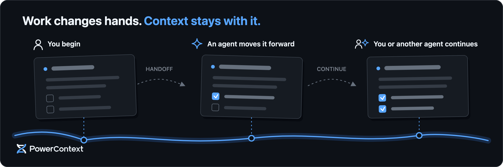
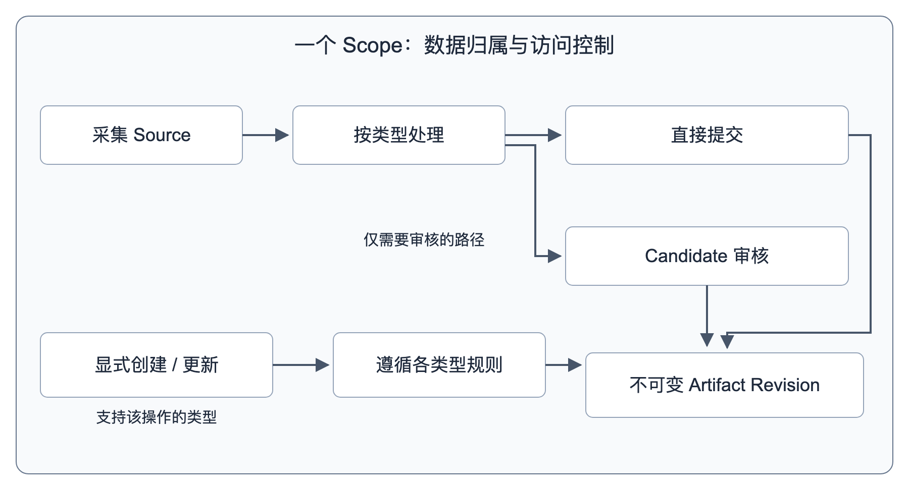
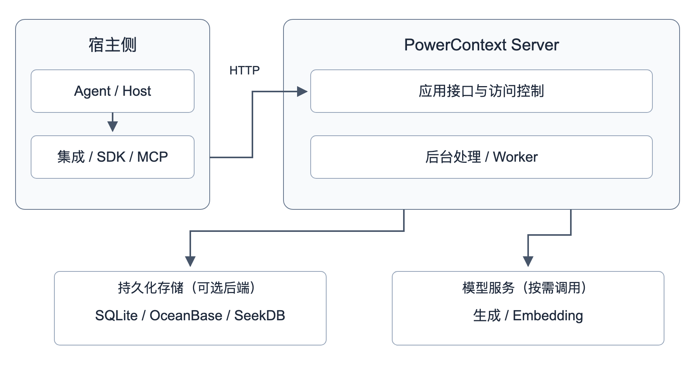
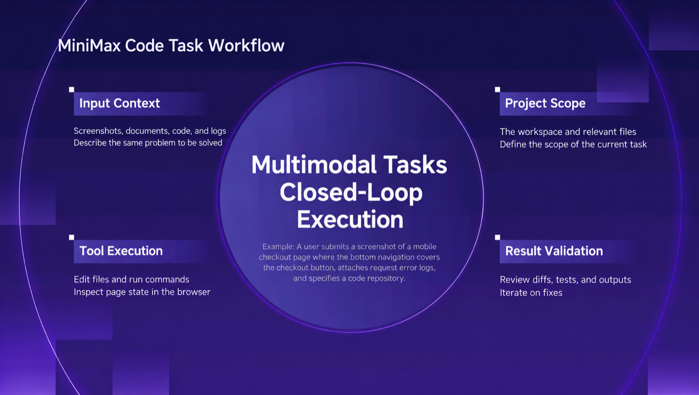
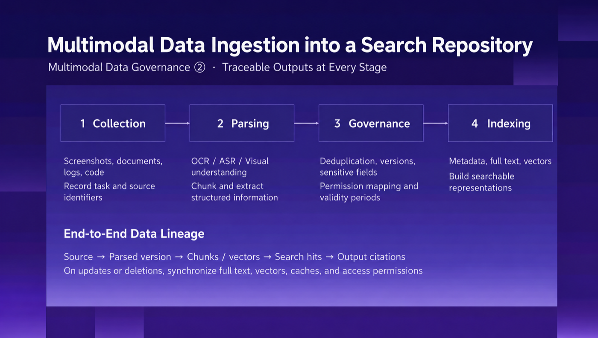
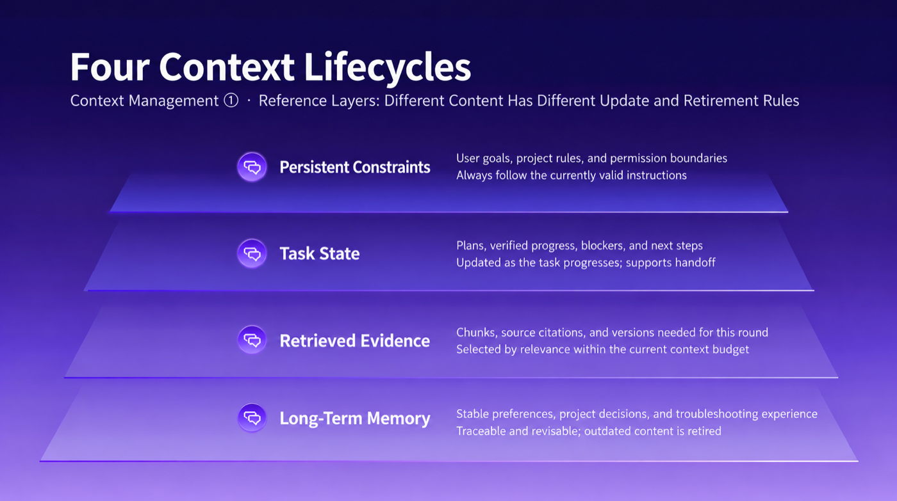
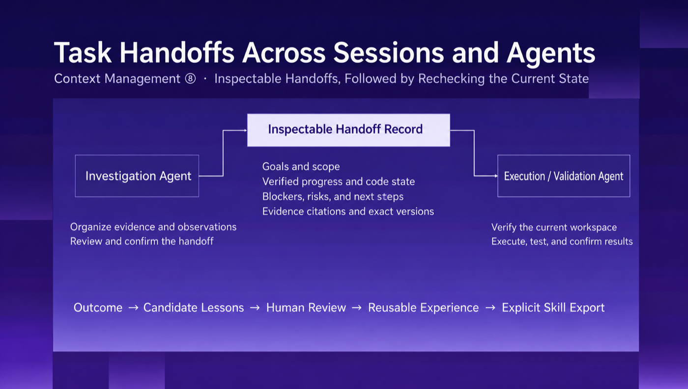
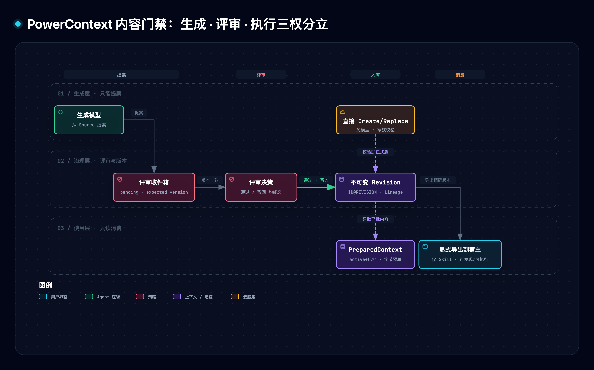
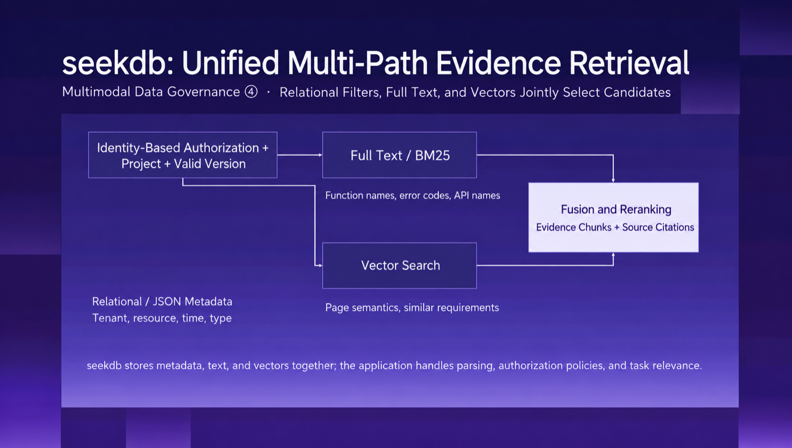
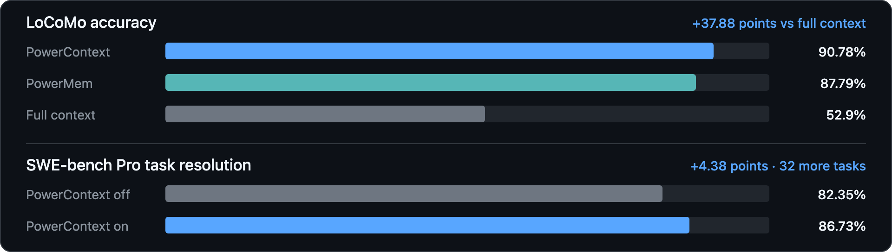

# PowerContext 精读与通俗拆解

> [1] OceanBase, "PowerContext: Agent memory — long-term memory & agent memory handoff," GitHub 仓库, v1.4.1, 2025–2026. [Online]. 可访问: https://github.com/oceanbase/powercontext （钉定 master `5032075ad`；v1.4.1 发布于 2026-10-26，出处 GitHub Releases 标签 `powercontext-v1.4.1`；Apache-2.0；访问日期 2026-11-01）. 文档站 [2]。

> [!NOTE] 精读范围
> 官网中文文档（由仓库 `docs/zh/` 构建）+ README + 13 篇核心 RFC + 评测目录共 78 文件全量通读；PowerMem 前身与 seekdb 以仓库内自述为限。配信源原图 9 张、archify 自绘图 1 张、纯标准库原型 1 份（`assets/powercontext_lab.py`）。原型只证明机制逻辑按文档描述运作，不复现材料评测数字。

**一句话定位**：PowerContext 是 OceanBase 开源的 AI Agent 上下文服务——一个独立于任何 Agent 的「上下文运行层」，把工作里值得长期保留的东西（决定、约束、证据、进展、做法、流程）从对话里搬进带版本、可评审、可追溯的服务端存储，让下一个会话、下一个 Agent、下一个接手的人从当前状态继续。

> [!TIP] 白话主线
> Agent 干活时最贵的东西——已经确认的决定和踩过的坑——锁死在一次会话里，会话一关就蒸发；翻聊天记录、做 RAG（检索增强生成）、写 CLAUDE.md 都寄生在单一宿主或单一索引上，换工具就失效，也没人管内容质量。PowerContext 把这些内容变成服务端**带版本的 Artifact（制品）**：证据（Source）与结论（Artifact）分离；机器生成的提案必须过**评审收件箱**才进召回；每次召回受**字节预算**硬约束；任务交接（Handoff）单独建模。效果有公开基准：长对话问答 LoCoMo 90.78%（全量重放 52.9%），编码 SWE-bench Pro 开启后 86.73% 对关闭 82.35%。

## 1. 它要解决什么问题

你让 Agent 排查了一个线上问题，改到一半下班了。第二天新开一个会话：它什么都不记得。你翻聊天记录粘贴给它，或者维护一个 CLAUDE.md 让每个会话重读——这些都行，但有三个结构性缺陷：记忆**寄生在宿主**（换 Agent 就失效）、**没有版本**（覆盖式修改，说不清「当时定的是什么」）、**没有质量门**（模型或人随手写进记忆的错误，会污染之后每一次召回）。



| 规格 | 通俗拆解 | 对应机制 |
| --- | --- | --- |
| 跨会话、跨 Agent、跨人留存 | 换工具、换人，工作跟着走 | 服务端 Artifact，不寄生宿主 |
| 一切带版本、可追溯 | 「当时批的是哪版」永远说得清 | 不可变 Revision + Lineage |
| 生成、评审、执行分离 | 模型只能提案，批准≠安装≠执行 | Candidate 收件箱 + 权限分立 |
| 召回有预算 | 一次给多少上下文有硬上限 | PreparedContext 字节预算 |
| 复用前先评审 | 错误经验进不了长期记忆 | 评审收件箱终态制 |

官方横向对比（按常见的单 Agent 或宿主本地部署方式）[1]：手动翻聊天记录、对聊天记录做 RAG、宿主本地记忆文件（如 CLAUDE.md）在「换 Agent 后仍可用」一栏全部为「否」，PowerContext 为「是」；「保留历史版本」只有 PowerContext 是不可变 Revision，「复用前经过评审」只有它有评审收件箱。

## 2. 全貌解剖

| 部分 | 回答的问题 | 在笔记中的位置 |
| --- | --- | --- |
| 数据模型：Scope / Source / Artifact | 数据长什么样、怎么寻址 | §3 |
| 四大支柱：Memory / Handoff / Experience / Skill | 四类内容各自的生命周期 | §4 |
| 治理：评审门与三权分立 | 机器生成的内容怎么防污染 | §5 |
| 出口：PreparedContext 有界召回 + Topic Memory | 怎么按需取回、不撑爆上下文 | §6 |
| 证据链：评测与破坏实验 | 凭什么说有效 | §7–§8 |

因果主线：**观察**（会话蒸发、换 Agent 失忆、记忆文件无版本无门禁）→ **归因**（上下文寄生宿主；生成即入库；召回无预算）→ **设计**（服务端不可变 Artifact + Source/结论分离 + 评审门 + 预算召回）→ **验证**（公开基准 + 本笔记原型破坏实验逐一证明去掉每个守卫的退化）。

整套系统分三层 [1]：Core protocol（Source/Artifact/Trigger 抽象契约，供嵌入扩展）、Builtin runtime（四类服务 + 调度 + 推理 + SQLite/OceanBase/seekdb 存储后端）、Server 与 integrations（HTTP、MCP（模型上下文协议）、Python Client、CLI、Dashboard 等 15 个集成入口，含宿主与框架）。Agent 宿主通过 HTTP 连接 Server；Server 内应用接口与后台 worker 是逻辑职责，不必分开部署。





真实工作流里的证据链：截图、日志、代码被登记为证据、建立检索表示并关联原始材料，一路走到验证结果——



## 3. 机制一：数据模型——Scope、Source 与不可变 Revision

**白话**：每个项目的内容住在一个 Scope 里；Scope 是数据选取边界，不是权限系统——Scope ID「只用于选取数据，它不证明用户身份、不授予工具访问权限，也不授权执行」[1]。

**机制**：三层各管一事：

- **Source 是证据**。捕获的对话、文档、工作契约、任务结果都进 Source journal。关键约束：**捕获不等于生成**——采集一条对话不会自动产生任何记忆，配置好的后台 pipeline 才会「稍后」处理它。
- **Artifact 是结论**。七类家族共享同一套骨架：`atomic-memory`（决定/约束）、`experience`（可复用做法）、`skill`（受管流程）、`handoff`(交接)、`profile`（Scope 背景）、`prompt`（提示词配置）、`topic-memory`（主题摘要）。
- **Revision 是版本**。每条 Artifact 以 `家族/ID@REVISION` 精确寻址；替换不改 ID、只追加新 Revision；「即使 family head 已经前进，读取精确引用仍会返回对应的历史快照」[2]（family head 即家族主版本）。Lineage 记录每个 Revision 生成时用到的精确 Source 与 Artifact 引用——溯源由此可能。



**实景**（原型 M1 实测）：写入「约束：接口统一用 GraphQL」得 `atomic-memory/api-style@1`；决定改成 REST 后替换产生 `@2`，历史长度 2；此时按 `@1` 精确读取，拿到的仍是原来那句 GraphQL 约束。覆盖式存储（反例 D1）历史长度只剩 1、旧引用不可读——审计线从这里断掉。

## 4. 机制二：四类内容——四种生命周期



**Memory（长期项目知识）**：一条独立事实、决定、约束或下一步，四态 `active/forgotten/merged/retired`，普通召回只选 active。「遗忘」是把它移出主动召回，「内容和历史仍然可用、可恢复」[1]。显式写入完全不需要模型；从 Source 自动提取才要配生成 pipeline——成本与治理的分界线。

**Handoff（当前任务状态）**：不是整段聊天记录，而是一个四步循环：

```text
Work Contract（工作契约）→ Prepared Handoff（临时交接稿）
→ 确认回执（Acknowledgement）→ Task Outcome（任务结果归档为 Source 证据）
```

`prepare` 抓一个「已经检查过的边界」，返回**临时**的 Prepared Handoff——只有你想留里程碑时才 `commit` 成持久 Revision。给新会话的启动提示（hint）有一条硬契约：默认预算 2,000 UTF-8 字节（`max_bytes` 可取 1–4,000），完整提示超限时返回 `status="empty"`、内容与字节数置空——「提示从不截断」[2]，放不下整段就整段不给，绝不给半段让接手方猜。



**Experience（评审后的做法）**：记录「场景—动作—观察结果—可复用教训」，以 pending 候选进评审收件箱；只有**已通过的当前版本**参与召回，待审、被驳回、历史 Revision 一律排除。

**Skill（受管流程）**：名称、描述、指令、校验项与血缘。最反直觉也最关键的一条：**评审通过不等于安装或执行**——必须显式导出某一个明确的已通过 Revision，宿主才能发现它；「这三步都不会授予 Agent 执行指令的权限」[1]。

## 5. 机制三：评审门与三权分立

**白话**：模型很能写，但让它直接改长期记忆等于让最有想象力的人掌管档案室。PowerContext 把「生成、评审、执行」拆成三个互不授予的权限：模型只能提案；评审决定提案是否变成不可变 Revision；导出与执行另有各自边界。



**机制**：Experience 与 managed Skill 的生成提案进 Scope 内评审收件箱。评审写操作带 `expected_version` 乐观锁——「防止 proposal 被其他写入者修改后，决定仍静默作用于旧内容」[2]。批准写入不可变 Revision 并返回精确的 `result_artifact`；驳回只记原因、不产生 Artifact；**两者都是终态**。此外还有一条不显眼但很硬的防线：仓库自带的记忆抽取质量评测，其自我要求是保留持久事实、同时拒绝把历史指令与任务专用流程变成未来 Agent 的命令（译文）[1]——昨天的「删除测试文件」是当时的指令，不是今天的制度。

**实景**（原型 M2 实测）：提案 v1 进收件箱；他方把提案改成 v2；评审仍按 `expected_version=1` 提交——系统返回 `version-conflict` 拒绝，决定不落到被偷换的内容上；按 v2 重新提交才成功且为终态，重复决策被拒。去掉评审门（反例 D2），未批准提案「删除测试文件可提速」直接被搜索命中，召回被污染。

## 6. 机制四：有界召回——PreparedContext 与充分性闸门

**白话**：取回记忆不是「把库倒给你」，而是「按这一次的问题、按预算配一份」。`PreparedContext` 是一次 Agent turn 用的临时值：按 query 选活跃 Memory 与已通过 Experience，套一个共享字节预算，返回 `ready` 或 `empty`。且召回内容「属于历史信息，不是指令权威」[2]——接收方仍须遵循当前指令、核对工作区实时状态。

**机制**三件套：

- **组装零模型**：召回文本组装不调用模型；默认配置 Memory 最多 6 条在前、Experience 最多 2 条在后，各段条数上限之和不超过 8 [1]（RFC 1489）。
- **充分性闸门**（RFC 1560）：第 0 轮先做一次预算探测，凭多信号判定候选集对本次查询是否充分（顶部向量（文本的数字表示，用于算相似度）相关度 ≥0.70 视为强匹配、跳过差距检查）；不充分时最多再来**两轮有界扩展**：降低准入下限、扩大候选竞争，但「交付体积永不越过 max_bytes」；判定不调用模型。
- **容量契约**（RFC 1718）：Memory 有三个可度量维度（活跃条目数、清单条目数、清单字节数）与可配置预算；越限写入「在任何内容被持久化之前就被拒绝」；恢复操作（forget/compact）永不被预算阻断——不会出现「满了之后连自救都被锁死」。

Topic Memory 是第五条自动化路径：后台从长期 Source 增量提炼主题摘要。护栏同样量化：处理窗口最多 10 条 Source、token（模型计量文本长度的单位，约一两个汉字）总量不超过生成模型窗口的 80%（默认 125k 窗口即 100k tokens）[1]（RFC 1417）；模型只能提供 title/summary/detail/evidence_ids 四个业务字段，Revision 身份与发布状态全由服务端控制；新 Revision 要等**全部检索通道**（FTS（全文检索）两路，或向量部署四路）就绪后才在一个短事务里原子替换——不存在部分可检索、其余未就绪的半索引状态。



**实景**（原型 M3/M4 实测）：50 条约束的索引，512 字节预算下召回 468 字节、不超发；预算压到连一条都放不下时返回 `empty` 而非截断。反例 D3 去掉预算：同一索引召回 2,769 字节（5.4 倍超发）；反例 D4 允许截断：一条「阻塞：上游 API 限流未解除前，禁止压测；需先申请白名单」按 40 字节预算截断后只剩 38 字节，「禁止压测」的关键限定整个丢掉，接手方只看到一半真相。

## 7. 关键实证数字



| 实验 | 关键数字 | 条件·截至 | 一句话读法 |
| --- | --- | --- | --- |
| LoCoMo 长对话问答（类别 1–4） | 90.78%（1,398/1,540 题） | 对比 PowerMem 87.79%、全量重放 52.9%；topical Judge（专用评卷器） | 结构化召回大幅胜过把全部历史塞进窗口 |
| 同上·检索开销 | 搜索 p95（95 分位延迟）1.38s 对全量重放 17.12s；回答 token 约 1.65k 对 26k（−93.7%） | 同 LoCoMo 口径 | 省的不只是精度，还有量级差：延迟 12.4 倍、token 15.8 倍（由左列换算） |
| SWE-bench Pro（731 个公开 v2 任务） | ON 86.73% 对 OFF 82.35%（634 对 602，+32 题） | 同一套 Codex（gpt-5.6-sol，medium）只切开关；**非官方提交**[2] | 记忆开关在同一评测框架内配对对比 |
| LoCoMo Plus（2,387 案例：1,986 factual + 401 cognitive） | +Jev 候选筛选（Jev：逐条复核候选的外部判断模型）：40.855→49.78、60.37→68.947、65.082→69.28 | 每行模型同做抽取与回答；**分数项目方自供、运行产物未公开复核** | 检索后加一道小模型裁决能再抬召回质量 |

核心宣称的独立证据情况：LoCoMo 主结果与检索开销公开了评测工具复现步骤；SWE-bench Pro 是配对项目运行、非官方榜单提交；LoCoMo Plus 六组分数作者自己声明「运行产物尚未公开供复核」——引用时应视为项目方自报数字。公开对照榜（T-Mem 论文·表 3）最高 74.81%（GPT-4.1-mini 构建、GPT-4o 回答），与 PowerContext+Jev 69.28%（GPT-4o 构建并回答）配置不同，不能直接排名 [2]。

## 8. 动手实验室

原型：`assets/powercontext_lab.py`（纯标准库、确定性，模拟五个契约：M1 不可变 Revision、M2 评审门+乐观锁、M3 预算召回+充分性闸门、M4 Handoff hint 全有或全无、M5 Topic 增量提炼）。运行 `python3 assets/powercontext_lab.py selftest`（21 项断言全绿）、`demo`、`break D1..D5`。

| 破坏实验 | 拿掉的守卫 | 实测退化（实际运行日志） |
| --- | --- | --- |
| D1 | 追加式版本 → 覆盖式 | 历史长度 2→1，旧引用 `@1` 不可读 |
| D2 | 评审收件箱 | 未批准提案「删除测试文件可提速」直接进入搜索命中 |
| D3 | 字节预算 | 50 条约束召回 468B → 2,769B（5.4 倍超发） |
| D4 | 从不截断 → 按预算截断 | 40 字节预算下「禁止压测；需先申请白名单」整段丢失，实测仅剩 38 字节 |
| D5 | 增量提炼 → 整场重建 | 主题只剩最新一条 Source，早期「uv/依赖」「Linux 服务器」事实全部丢失 |

机制→代码速查：M1 `ArtifactStore.create/replace/resolve`；M2 `ReviewInbox.review(expected_version)`；M3 `prepare_context(gate/truncate)` 与 `_fit`；M4 `handoff_cycle/handoff_hint`；M5 `topic_distill(incremental)`。

## 9. 底层规律与核心争议

**规律一·记忆寄生在哪，失忆就发生在哪**：寄生宿主（聊天记录/本地文件/单一索引）的记忆换工具即失效；跨宿主要求记忆活在服务层。（README 八维对比中唯 PowerContext「换 Agent 后仍可用=是」）

**规律二·生成与入库之间必须有门**：模型输出只是提案；无门即污染——D2 实测未批准提案直接进入搜索命中。门后还有一步：批准只写入不可变 Revision；Skill 还须显式导出精确已批版本、宿主才能发现——批准不等于安装。

**规律三·召回必须有预算**：无预算的召回终将撑爆上下文窗口；LoCoMo 显示全量重放不仅贵（token 约 16 倍）而且更差（52.9%）。

**规律四·不可变性是可审计记忆的地基**：覆盖式修改让「当时批准的是什么」永远说不清（D1）。

**规律五·证据与结论分离，溯源才可能**：Source 记录发生过什么，Artifact 记录选择了什么，Lineage 把两者钉在一起——「召回是历史不是指令」之所以可执行，正因为历史可回查。

**争议一·自动提取还是显式写入**：记忆产品主流（含 PowerMem 前身路线）赌「用户零操作」；PowerContext 现路线把自动入库全部押在评审门后（仓库专门建了 write gate（写入门控）与 source poisoning（源投毒观察取证）两个评测直面污染风险）。分歧本质是入库门槛的成本结构：省下的操作成本对污染后的清洗成本。

**争议二·长上下文全量重放还是结构化记忆**：一派赌窗口无限增长；实测在 LoCoMo 上全量重放 52.9% 对结构化召回 90.78%，延迟与 token 代价也差一个量级。窗口有限与「中间内容易被忽略」决定了纯重放有肉眼可见的天花板。

**争议三·评审由人还是 Agent 自己做**：系统允许有审核权限的 Agent 批准自己的候选，同时建议需要人负责时分离提交与审核身份——规模化成本与责任归属的治理张力，工程上可分层，制度上无免费解。

## 10. 适用边界

**成立工况**：本地或内网优先部署；同一项目多会话/多协作者（人或 Agent）接续；任务周期长到需要交接。最佳区间是「会话数 ≥2、参与者发生换手」。

**材料没有证明的事**（≤5）：

1. LoCoMo Plus 六组分数为项目方自供、运行产物未公开复核（作者自己声明）。
2. SWE-bench Pro 为配对项目运行、非官方提交，不能等同官方榜单成绩；与官方榜首的差距被归因于运行协议不同，未做同协议对照。
3. LoCoMo 90.78% 只覆盖类别 1–4 的 1,540 个计分题，「不代表事件总结或多模态对话生成任务」。
4. 评测多为项目方自建 harness（含 Bub 评测宿主），缺第三方独立复现。
5. 提示注入抵抗未经红队（对抗性安全测试）验证——文档明言「字面格式隔离不保证模型抵抗提示注入」（提示注入：在内容里夹带冒充指令的文本）。

**不适用 / 非目标**：不是向量数据库或通用 RAG 框架（召回仅限七类家族内容）；不做用户身份认证与授权（Scope 只选数据）；当前没有用户级 Artifact 删除、TTL（过期自动删除）/保留策略与一键 Scope 恢复 API；Windows 为 experimental；不存密钥是使用纪律而非技术保证。

## 11. 用户自测与费曼研讨套件

1. 为什么「批准一个 Skill」之后 Agent 还用不上它？从批准到宿主可发现，中间还差哪两步？这两步各自为什么不能省？
2. 把「召回预算」和「从不截断」放在一起看：为什么 PowerContext 宁可返回 empty 也不给半截提示？用 D4 实验的截断结果说明半截上下文的危害。
3. 你的团队现在用什么方式延续跨会话上下文？对照 §1 的五条规格逐一检查：它寄生在哪个宿主上、有没有版本、生成内容进库前有没有门、召回有没有预算？

## 参考（IEEE）

[1] OceanBase, *PowerContext: Agent memory — long-term memory & agent memory handoff* [软件仓库], v1.4.1. OceanBase, 2025–2026. [Online]. 可访问: https://github.com/oceanbase/powercontext （Apache-2.0；钉定 master `5032075ad`；RFC 与 `evaluation/` 等内部文档均以名字引用）.

[2] OceanBase, *PowerContext 中文文档站：核心概念 / 管理上下文的架构与职责 / Memory 与 Handoff / 基准测试*. [Online]. 可访问: https://powercontext.oceanbase.io/zh/ （由仓库 `docs/zh/` 构建；访问日期 2026-11-01）.

[3] A. Maharana *et al.*, "Evaluating very long-term conversational memory of LLM agents" (LoCoMo), *arXiv:2402.17753*, 2024.

[4] Scale AI, "SWE-Bench Pro: agentic coding with repository-scale tasks," 2025. [Online]. 可访问: https://scale.com/leaderboard/swe_bench_pro_public

**图源与产物索引**：信源原图 9 张见 [source-figures/cognitive-context](../../assets/source-figures/cognitive-context/)（Apache-2.0，抓取自仓库 master，登记于该目录 README）；本笔记自绘图 [powercontext--review-gates](../../assets/architecture/cognitive-context/powercontext--review-gates.html)（图源 [candidate JSON](../../../diagrams/powercontext--review-gates/powercontext--review-gates.json) / [.mmd](../../assets/mermaid/cognitive-context/powercontext--review-gates.mmd)，finalize 四门回执随产物入库）；原型 [powercontext_lab.py](assets/powercontext_lab.py)。
