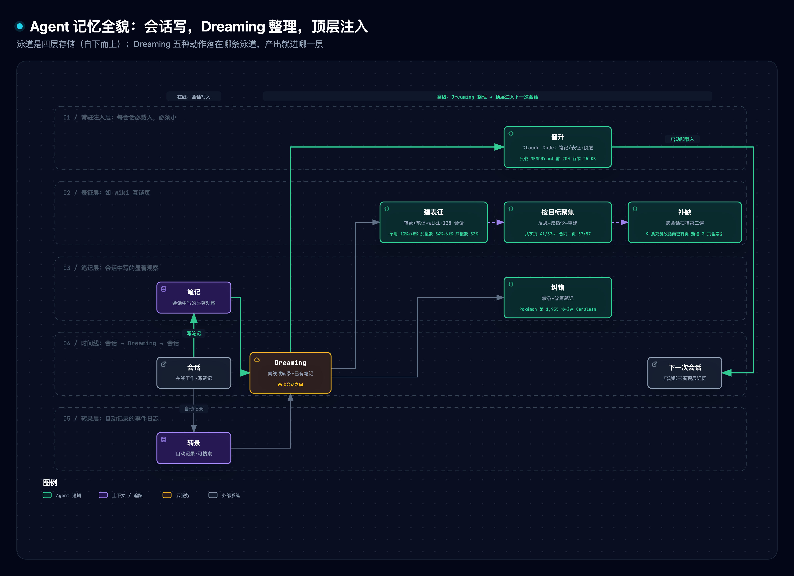
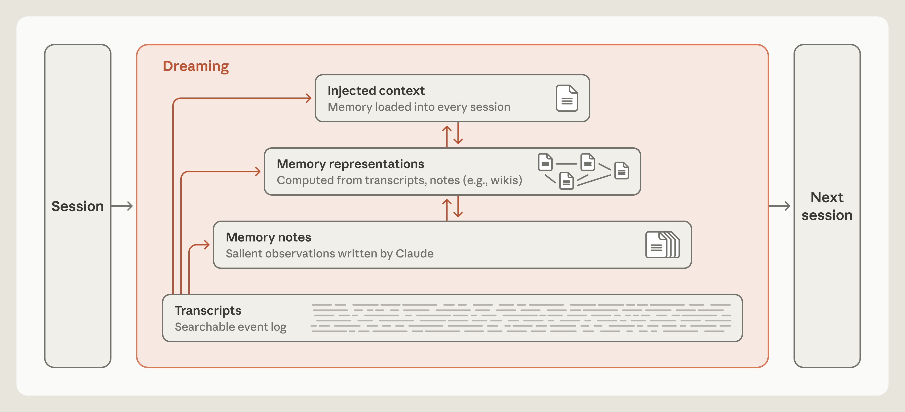
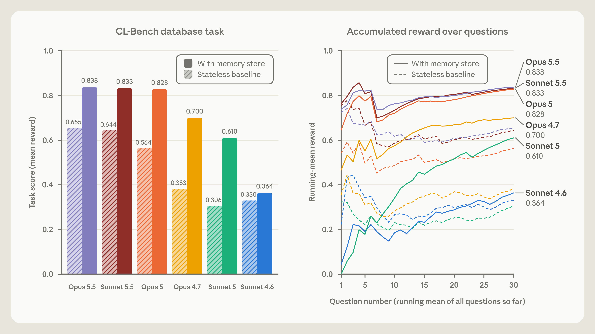
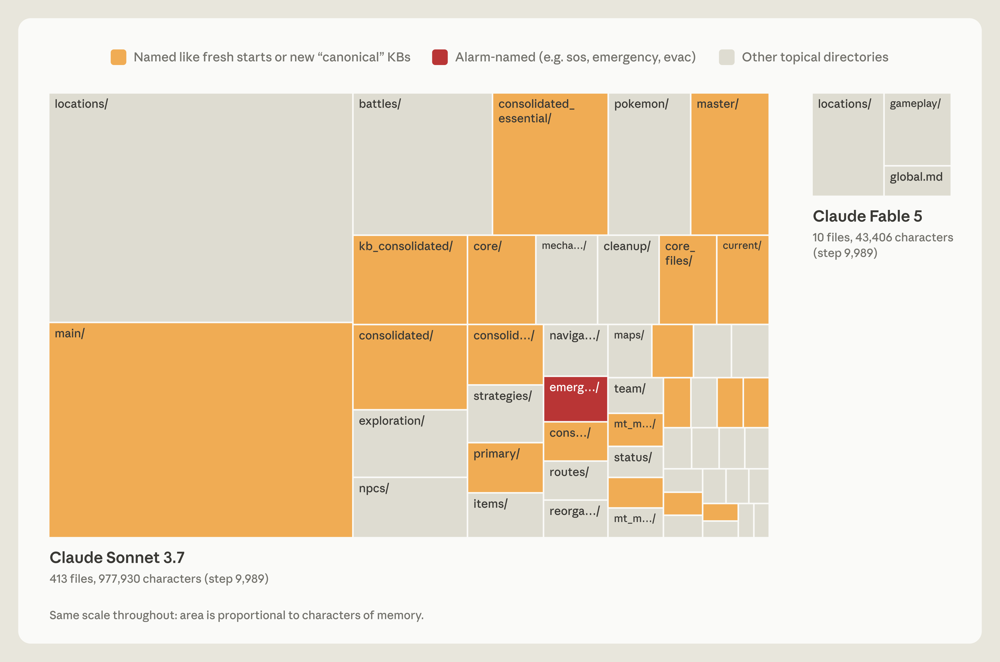
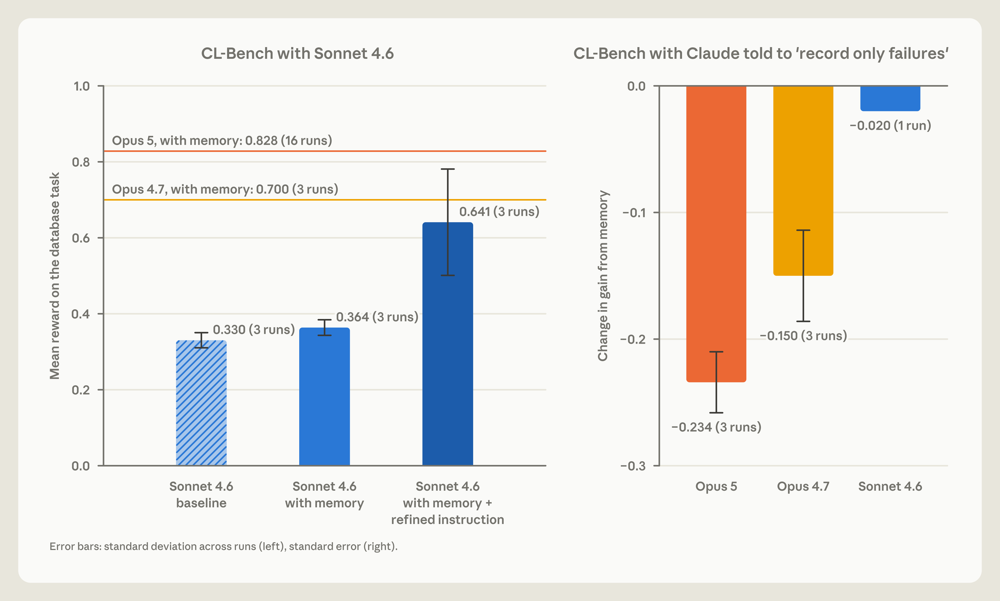
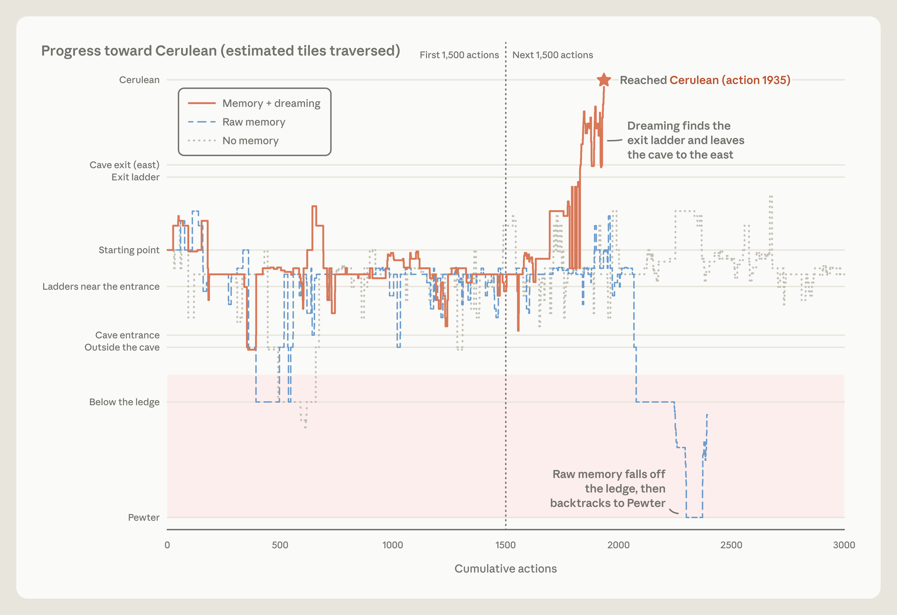
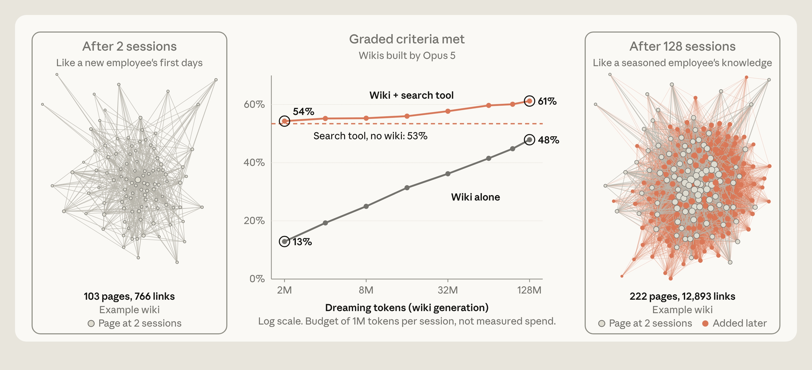
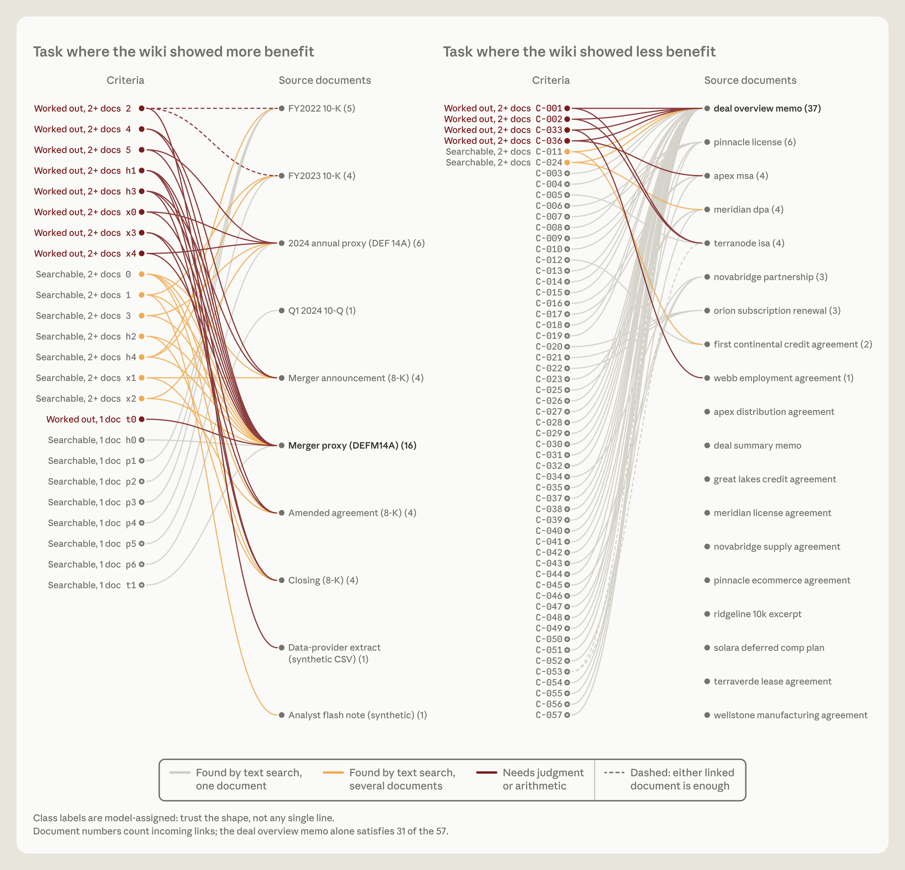
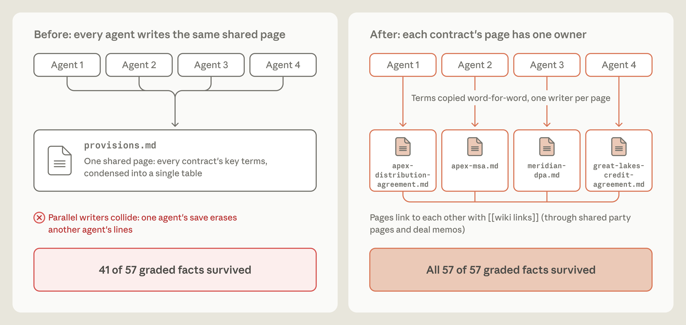

# Anthropic「Agent 记忆的组成」精读与通俗拆解

> [1] L. Martin, "The components of agent memory," *Anthropic Engineering*, Nov. 6, 2026（所据即发布版；截至 2026-11-08 页面无修订标注）. [Online]. Available: https://www.anthropic.com/research/components-of-agent-memory

**一句话定位**：记忆是跨会话保留、日后可读的笔记，分四层（转录；笔记；表征，如互链页的 wiki；常驻注入，即每次会话开头必载入的一层）；会话中写下规则或事实，等于预测它以后还会用上；会话后的 dreaming（离线整理）拿转录当真相回头纠错、建索引、挑常驻内容。

**SCQA 导读**：文章设定的 Agent 每个会话开局都不带上次的记忆，只能靠自己留的笔记，而写的当下不知道以后要用什么，笔记还会错、会过期。本文回答：什么值得记，怎么告诉模型记，写错了谁改。原型见 §7。

> [!TIP]
> **白话主线**：游戏实测里，只存屏幕读不到的东西的模型走得更远，逢事必记的老模型得花更多时间翻过期记录；对强模型，告诉它有记忆就够，加一条「只记失败」的规定反而让记忆增益缩水。笔记错了，会话结束后另开一轮「做梦」（dreaming）：对照原始转录（会话的完整事件日志）改错，整理成页面互相链接的 wiki，挑出最该每次会话开头都载入的几条。实验均由 Anthropic 自己运行。

## 1. 它要解决什么问题

文章界定：记忆是 Claude（Anthropic 的模型）从经验中得到、跨会话（一次完整的工作过程）保留、存成日后可读的上下文；改权重、会话内的 in-context learning、compaction（用摘要替换旧对话以腾窗口）都不算 [1]。核心难点：会话中写笔记时还不知道接下来发生什么，写下「已验证的事实」，等于预测未来会话想不再核对就直接用它 [1]。

| 规格 | 通俗版 | 对应机制 |
| :--- | :--- | :--- |
| 记忆是可读文本，写什么靠当场判断 | 下次能翻的笔记，猜哪些以后有用 | 笔记层与 salience（显著性，§3） |
| 用法靠引导，不靠硬规定（对强模型） | 只告诉它有记忆 | steering（§4） |
| 笔记要能被纠正 | 拿原始转录对照 | dreaming 纠错（§5.1） |
| 笔记多了可以有地图 | 页间互链的 wiki（宜配搜索） | 表征（§5.2） |
| 每会话必载的要小 | 细节下移、留链接，常驻层保持小 | 晋升（§5.3） |

## 2. 全貌解剖



图 1 的结论：dreaming 在两次会话之间读转录和已有笔记，产出落到笔记、表征、常驻注入三层之一；常驻层每次必载，免搜索却占 token（推断）。

| 层 | 内容 | 谁写 | 怎么读 |
| :--- | :--- | :--- | :--- |
| 转录 | 会话事件日志 | 会话中记录（推断为系统自动） | 搜索 |
| 笔记 | Claude 当场写的显著观察 | Claude（会话中） | 按需读文件 |
| 表征 | 如 wiki：互链页集合 | dreaming | 沿链接或搜索 |
| 常驻注入 | 每会话开头必载入 | dreaming 或 Claude | 自动载入 |

因果链：当下无法预知相关性，写笔记是预测；预测会错，环境会漂移，错笔记照样被信任；于是要笔记之外的真相源（可用来核对的原始记录），转录就是现成的；dreaming 用算力换事后之明。最基础的一层是转录；最值得学的是写什么、怎么对账、表征何时有用、顶层怎么控制大小（本文归纳）。这套做法已有产品接口 Dreams [2]：输入记忆库加 1 到 100 个会话，产出独立新库，不改输入库，异步，research preview。



原文图 1：四层都在 Dreaming 框内，转录直连上三层。来源：[1] 原文图 1，© 2026 Anthropic PBC，仅作学习引用。

## 3. 写笔记：预测与 salience

会话中写下一条规则，等于预测它以后还会被用上，这一章看什么值得写。先看一个任务：CL-Bench（持续学习基准）的数据库任务 [4]，默认 40 道手写题，查 Amazon 评论的 SQLite 库，列名被混淆、单位不统一（Electronics 价格存整数分，另两类存浮点美元），第 20 题后库迁移；原文图 3 曲线画 30 题，文章未交代差别。文章 [1] 每题开新会话，答完被告知正确解，仅一个持久记忆目录。

学习闭环是：记失败、提假设、验证、写成规则。Sonnet 4.6 只走到未验证的猜测，Opus 5 起走完，多数条目含规则、依据和已踩的陷阱 [1]。



原文图 3 左图：Opus 5.5 为 0.655→0.838，Sonnet 4.6 仅 0.330→0.364。来源：[1] 原文图 3，© 2026 Anthropic PBC，仅作学习引用。

再看什么值得写，即 salience（显著性）。Pokémon Red 里，两个模型各一局、约 1 万步时 [1]：Sonnet 3.7 逢事必记，413 个文件，1 枚徽章；Fable 5 只有九个文件加一个 global.md，4 枚。游戏状态不断变，Sonnet 3.7 的详细流水不断过期，它得花更多时间翻记忆：开到第四个「master」文件夹后，17 步里建六个文件、删九个，游戏里一步没动。Fable 5 只存屏幕读不到的策略、计划和验证过的规则，global.md 放当前目标与预写的道馆攻略。



原文图 4 同比例：Sonnet 3.7 为 977,930 字符，Fable 5 为 43,406。来源：[1] 原文图 4，© 2026 Anthropic PBC，仅作学习引用。

## 4. Steering：告知存在，不规定用法

只告诉 Claude 有个记忆目录，就够 Opus 4.7 与 Opus 5 明显提分；加规则「只记失败」后，Opus 5 的记忆增益（有记忆比无记忆多得的分）变化 −0.234，Opus 4.7 为 −0.150，Sonnet 4.6 为 −0.020。老模型则最需引导：提示 Sonnet 4.6 先读记忆、再验证假设，0.364 升到 0.641；Sonnet 5 不提示也有 9/10 次先读记忆，Sonnet 4.6 不到一半 [1]。



原文图 5 图上标注：左图各柱 3 次运行，右图 Sonnet 4.6 仅 1 次。来源：[1] 原文图 5，© 2026 Anthropic PBC，仅作学习引用。

## 5. Dreaming 的五种动作

### 5.1 纠错：把笔记对回转录

案例 [1]：Claude 错记 PokéCenter 在山的东侧，走出就说「Mt Moon is behind me」并记「Mt Moon DONE」，几步后掉下单向断崖，回到来时的路；导航工具没显示掉落，它断定自己「走过头了」。未纠错的那一局掉崖三次，一路退回 Pewter City，始终没到 Cerulean City。对同一份笔记跑 dreaming：对照转录发现错误并改写，Claude 径直回洞，抵达 Cerulean City。



原文图 8：memory+dreaming 第 1,935 步抵达，另两局都没过山。来源：[1] 原文图 8，© 2026 Anthropic PBC，仅作学习引用。

### 5.2 建表征：wiki

语料是 Stainless（Anthropic 5 月收购）的约 35 万个内部文件、约 420M token，评测 25 题；Opus 5 agents 跑 128 个会话，探索文件、写改互链页、合并重复、对源核对。会话从 2 个加到 128 个，只用 wiki 得分 13% 升到 48%，wiki 加搜索 54% 升到 61%，只搜索 53%；加搜索时每题省约 2 万 token [1]。



原文图 10：横轴为 Dreaming tokens（2M 到 128M，对数轴），按每会话 1M token 预算折算，非实际花费；wiki 从 103 页 766 链接长到 222 页 12,893 链接（图上标注）。来源：[1] 原文图 10，© 2026 Anthropic PBC，仅作学习引用。

wiki 不处处有用。并购文档的 24 题过半要跨文档，在这些题上查 wiki 得 87%、只搜索 73%；Harvey LAB（法律 Agent 基准）的一个任务里评分标准多在单个文档里就能搜到，wiki 无明显增益；另一个 LAB 任务的 wiki 膨胀到 68 页、203 KB，是 10 份 115 KB 语料的 1.77 倍（原文图 12），文章称它「实际上什么也没抽象」[1]。



原文图 11 右图：57 条标准中一份 deal overview memo 就满足 31 条，类别由模型标注（图上标注）。来源：[1] 原文图 11，© 2026 Anthropic PBC，仅作学习引用。

### 5.3 晋升：提到每会话必载的顶层

顶层（即常驻注入层）代价高：注入占 token，错笔记进每个会话，载入也不保证被遵循，指令文件越长遵循度越低 [1]。所以 dreaming 要把细节下移、留一条指针。Claude Code 自动记忆即如此：只载 MEMORY.md 的前 200 行或 25 KB，先到者为准，超出部分启动时不载 [3]。

### 5.4 按目标聚焦：并发写与一对象一页

任务是依据一批合同写简报，按条款打分。起初指令只说「建 wiki」，多个 agent 同时写一张共享条款表，互相覆盖，简报只含 57 条事实中的 41 条（72%）。随后 Claude 反思失败、改指令、重建 wiki，学到条款最重要：每份合同一页、单 agent 写、条款逐字引用，57 条全保住 [1]。



原文图 14：四 agent 共写 provisions.md 存活 41/57，每合同一页后 57/57。来源：[1] 原文图 14，© 2026 Anthropic PBC，仅作学习引用。

### 5.5 补缺：跨会话的第二遍

写笔记时只看得到当前会话，dreaming 可跨会话扫描：一个 wiki 里九条链接指向不存在的页，第二遍 dreaming 把它们改指向已有页，并新增三页含索引 [1]。

## 6. 关键实证数字

| 实验 | 关键数字 | 条件·截至 | 一句话读法 |
| :--- | :--- | :--- | :--- |
| CL-Bench 数据库 | 0.655→0.838（Opus 5.5）、0.330→0.364（Sonnet 4.6） | 6 模型，自述 | 除 Sonnet 4.6 外均明显提升 |
| Pokémon | 413 文件 1 枚徽章 vs 10 文件 4 枚 | 各一局，约 1 万步 | 少而准 |
| steering | −0.234、−0.150；0.364→0.641 | 柱 1 到 3 次运行（Opus 5 参考线 16 次） | 强模型：「只记失败」让增益缩水 |
| 并购文档、Harvey LAB | 跨文档题 87% vs 73%；另一 LAB 任务单文档无增益 | 并购 24 题；LAB 57 条标准 | 看是否跨文档 |

旁证：CL-Bench 论文总体结论是朴素 in-context learning 的成本效率不输专用记忆系统 [4]，与本文（同一模型有无记忆目录）口径不同，不可互推。dreaming 总成本文章没给：官方示例自述，逾五十份约 12 MB 转录按标价、默认设置约 8 美元 [6]；wiki 示例构建约 19 美元（所录运行约 16 美元），按基准数据相对更大模型直搜原文约 240 题回本 [5]；均非 Stainless 语料。

## 7. 动手实验室

原型 [agent_memory_lab.py](./assets/agent_memory_lab.py)（纯标准库、确定性、LLM 角色全用脚本替身）只验机制逻辑，不复现文中数字。运行 `python3 agent_memory_lab.py --selftest`，`--break D1` 至 `D4` 复现下表。M3 单步沙盘：并发序列 R1,R2,W1,R3,R4,W2,W3,W4（R 读快照，W 整页写回，后写者胜）：页面起初为空，R1 与 R2 都读到空页；W1 写入合同 1；R3、R4 读到合同 1；W2 只含合同 2，抹掉合同 1；W3 写成 1 加 3，抹掉 2；W4 写成 1 加 4，抹掉 3；最后只剩 6/12。

| 机制 | 实现单元（行号） |
| :--- | :--- |
| M1 写入筛选 | `SalienceWriter`（88）、`play`（98） |
| M2 离线对账 | `dream_correct`（140）、`navigate`（155） |
| M3 一对象一页 | `PerEntityBuild`（198）、`reflect_and_revise`（221） |
| M4 常驻层降级 | `demote_with_link`（262） |

| 实验 | 改动 | 实测退化（实际运行日志） | 教训 |
| :--- | :--- | :--- | :--- |
| D1 | 写入筛选退化为全存 | 条目 6→129，期末过期 0→119，第 31 回合后命中 6/6→1/6 | 全存把有用条目挤出读取预算（会话开头最多读入的字符数） |
| D2 | 对账不看转录 | 错笔记存活，空转 0→3 次仍未到达 | 没有笔记之外的真相源就无从纠错 |
| D3 | 反思不改指令 | 存活 12/12→6/12 | 指令不改，反思无用（原型） |
| D4 | 索引不降级（降级即按 6 个主题各合成一行摘要加指针） | 30 行索引，第 28 条关键规则落在前 20 行之外而不可见 | （原型里）溢出不报错、悄悄丢尾部；Claude Code 超限会提示重写索引 [3] |

```text
实际运行日志（--selftest 节选）
M3 SharedPage 存活 6/12；reflect_and_revise 后 PerEntity 12/12
M4 仅追加: 索引行数=30 关键条目可见=False 被截断条目=10；降级后: 索引行数=6 关键条目可见=True
SELFTEST PASSED ✔
```

## 8. 底层规律与核心争议

**规律 1：写规则是对未来的预测（Memory as Prediction）。** 写规则等于赌它还会用上；单局对照里全存的一方翻过期记录更费时，宜优先存会消失的结论（推断）[1]。

**规律 2：强模型告知存在，弱模型给流程（Steering by Capability）。** 强模型对预设规则敏感（所测「只记失败」使增益缩水），弱模型缺的是「先读、再验证」的流程提示 [1]。

**规律 3：笔记会错，可用会话外的真相源对账（Ground-Truth Reconciliation）。** 错笔记会被后续会话信任并带入，对账靠原始转录；文章借鉴了 sleep-time compute [1][7]。

**规律 4：表征在跨文档问题上收益更大（Representation Fit）。** 预建地图在一个单文档 LAB 任务上无明显增益，另一任务的 wiki 膨胀到比语料还大 [1]。

**争议 1：何时建记忆，会话中写还是会后做梦。** 文章列为未决问题：会话中写能抓住显著性、立刻可用，却分散主任务注意力；会后做梦放在后台，产出未必能立刻用。取舍随是否需要即时复用而定（推断），可并用 [1]。

**争议 2：要不要维护表征，wiki 还是转录搜索作地基。** 只用 wiki 得 48%，低于只搜索的 53%，合用才 61%，多出的 8 个百分点要扣维护成本，且 wiki 可能累积错误与幻觉 [1]；算力是资源问题，错误累积是本质风险（本文判断）。

相关笔记：[PowerContext](./016-powercontext-context-runtime.md)、[Dream-RSI](../self-evolution/144-dream-rsi.md)。

## 9. 适用边界

**成立条件**：定义域是 LLM Agent 跨会话靠文本笔记延续经验；成立工况（推断）是任务重复、环境变化慢于整理周期、有转录可用；Out-of-Scope 是改权重、会话内学习、compaction [1]。

**材料没有证明的事**：

1. 评测由 Anthropic 自己运行（CL-Bench、Harvey LAB 是第三方基准，Pokémon 与 25 题 wiki 评测集不是）：Pokémon 每模型一局，CL-Bench 只用数据库一域 [4]，steering 每柱 1 到 3 次运行。
2. 模型与提示两个变量混在一起：无记忆基线随模型从 0.306 变到 0.655，增益难以单独归因于「更会写笔记」（文章另以笔记内容差异佐证）。
3. wiki 评测仅 25 题、语料为内部文档不可复现，61% 对 53% 无置信区间，dreaming 总成本没给。
4. 笔记纠错案例只有 Mt. Moon 一例，没有「该审哪条」的召回率与误改率，表征累积错误的风险未量化 [1]。

## 10. 用户自测与费曼研讨套件

1. 笔记目录用了半年：让 Agent 会话中自己清理，还是另设离线整理？各自怎么失败？
2. 同事主张「全部建成 wiki，搜索下线」：先问他哪三个问题？
3. 给新模型接记忆，先给规则还是只给目录？什么观测会让你改主意？

## 参考（IEEE）

访问日期均为 2026-11-08。

[1] L. Martin, "The components of agent memory," *Anthropic Engineering*, Nov. 6, 2026. https://www.anthropic.com/research/components-of-agent-memory

[2] Anthropic, "Dreams," *Claude Platform Docs*. https://platform.claude.com/docs/en/managed-agents/dreams

[3] Anthropic, "How Claude remembers your project," *Claude Code Docs*. https://code.claude.com/docs/en/memory

[4] P. Asawa *et al.*, "Continual Learning Bench: Evaluating Frontier AI Systems in Real-World Stateful Environments," arXiv:2606.05661v1, Jun. 2026. https://arxiv.org/html/2606.05661v1

[5] Anthropic, "Knowledge wiki with a dynamic workflow," *claude-quickstarts*. https://raw.githubusercontent.com/anthropics/claude-quickstarts/main/managed-agents/knowledge-wiki/README.md

[6] Anthropic, "Dreaming with a dynamic workflow," *Claude Cookbook*. https://platform.claude.com/cookbook/managed-agents-cma-dreaming-with-a-dynamic-workflow

[7] K. Lin *et al.*, "Sleep-time Compute: Beyond Inference Scaling at Test-time," arXiv:2504.13171, Apr. 2025. https://arxiv.org/abs/2504.13171
