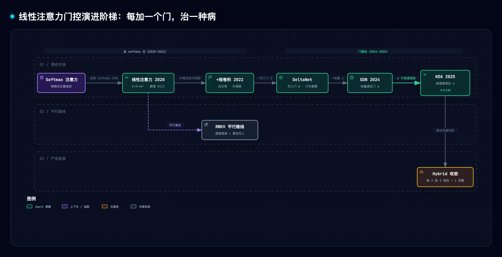
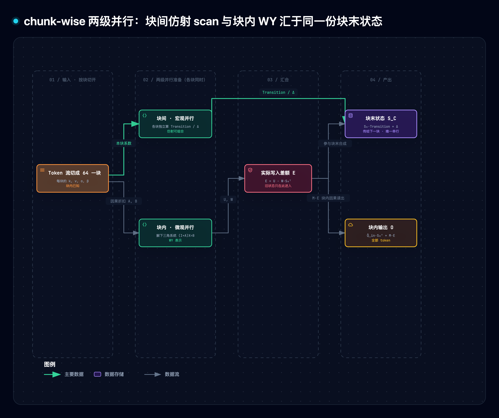

# 线性注意力机制精读与通俗拆解（AI Infra 进阶）

> [1] binnnliu（Gordon），"AI Infra进阶：3万字深入理解线性注意力机制," 腾讯技术工程（微信公众号），2026-10-29. [Online]. Available: https://mp.weixin.qq.com/s/O0_v8wz4iHxbkDLENy7EPg （访问 2026-10-30；微信无版本机制）。原文 190 余条公式以图片内嵌，本篇按图片说明文字逐条复原；21 张配图无法取用，关键机制改为自绘图。

> [!NOTE] 精读范围
> 原文全部章节与 5 个附录逐单元通读；公式与关键数字经 10 个一手信源对账（[2]–[6] 通读，[7]–[11] 摘要级）。配套原型见 §7。

**一句话定位**：用一张固定大小的记忆矩阵 S 替代随长度线性膨胀的 KV Cache，靠「覆写式写入 + 按通道遗忘 + 分块并行」让长上下文推理的单步成本恒定，代价是固定容量必须靠少量完整注意力层兜底。

**导读**：模型逐个 token（文本切出的最小单位，约一个字或词片）生成，每步回读全部历史缓存，越长越贵；本文讲把「按 token 留底」换成「固定表格记账」：§3 讲读写与遗忘，§4 讲串行变矩阵乘，§5 讲装不下怎么办与引擎落地。

> [!TIP] 白话主线
> ① 每生成一个 token 都要回读全部历史缓存，显存/带宽/计算随长度线性涨；② 改用固定大小的表格 S 记上下文，写一笔、查一次，单步成本与长度无关；③ 纯加法会重复记账，改成「先查旧账、只写差额」，再按通道乘遗忘系数；④ 串行更新整理成系数可预先算好的形式，按 64 token 分块，块内一次解方程、块间只传表；⑤ 固定表格装不下无限历史，每 4 层混 1 层完整注意力兜底，引擎侧还要解决对齐、前缀缓存与推测解码。

## 1. 它要解决什么问题

大模型推理分两个阶段，成本结构完全不同：

| 阶段 | 做什么 | 并行性 | 瓶颈 |
|:---|:---|:---|:---|
| Prefill | 整段读入提示词，算出每层每个历史 token 的键 k、值 v 并缓存 | 可并行 | 算力 |
| Decode | 逐字生成，每步都要读全部历史缓存算注意力 | 串行 | 显存带宽 |

这份缓存就是 KV Cache。麻烦在于它**按 token 留底、一份都不能扔**：第 t 步生成时，每层都要把前 t−1 个 token 的 k、v 搬一遍。三条代价随长度线性增长：显存（长对话放不下几个并发）、带宽（每步全量重读）、计算（与每个历史位置各算一次得分）。注意力会拆成多个并行的「头」，按常见的分组注意力（GQA）口径估算，一层缓存字节数约为 $2\times\text{KV头数}\times\text{头维}\times\text{长度}\times\text{每字节}$——长度因子无处可逃。

产业界三条缓解路线：

| 路线 | 做法 | 代表 |
|:---|:---|:---|
| 稀疏注意力 | 只看部分历史，KV 仍全存、只省访存 | DSA、滑窗（DeepSeek V4.1）[1] |
| 压缩 KV | k、v 压进低维潜向量再缓存 | MLA（DeepSeek 系）[1] |
| 线性注意力 | 历史压进固定状态矩阵 | 本文主角：DeltaNet→GDN→KDA [2][3] |

| 设计规格 | 通俗版 | 对应机制 |
|:---|:---|:---|
| 单步成本与长度无关 | 表格固定大小，写一笔查一次 | 状态矩阵 S（§3.1） |
| 写入不重复记账 | 先查旧账、只写差额 | delta rule 覆写（§3.3） |
| 旧信息可淡出 | 表格每列乘各自的衰减系数 | 按通道遗忘门（§3.4） |
| 训练能吃满 GPU | 串行递推改写成分块矩阵乘 | chunk-wise 两级并行（§4） |
| 精确召回有兜底 | 少数层保留完整注意力 | hybrid 混层与工程落地（§5） |

## 2. 全貌解剖

| 层级 | 部分 | 回答的问题 |
|:---|:---|:---|
| 主线机制 | 状态读写 → 门控演进 → 分块并行 → hybrid 落地 | 怎么写得准、训得快、装得下 |
| 证据链 | 训练视角 + 论文数字 + 原型 | 门控为何「科学」、省多少 |
| 地图坐标 | 三路线、RWKV、RoPE/NoPE | 周边坐标 |

因果主线：decode 回读全量 KV → 病根是按 token 精确留底 → 设计固定状态 + 覆写 + 遗忘 + 并行 + 兜底 → 证据来自递推式推导 [2][3][4]、在线学习解释 [2][6]、原型（§7）与 vLLM 落地 [5]。

演进谱系一句话一档——**每一步加一个门、治一种病**：

| 档 | 更新式 | 加了什么 | 治什么病 |
|:---|:---|:---|:---|
| Softmax | $o_i=\sum_j \mathrm{softmax}(q_i^\top k_j)v_j$ | — | （基线：精确但全量留底） |
| 线性注意力 [7] | $S_t=S_{t-1}+v_tk_t^\top$ | 去掉 softmax 非线性 | 推理 O(1)，但只会叠账 |
| 去分母+短卷积 [8] | 同上，q/k/v 先过因果卷积 | 去分母、输出归一化（2022）；短卷积补局部 | 分母小致梯度爆炸；丢局部细节 |
| DeltaNet [4][6] | $S_t=S_{t-1}+\beta_t(v_t-S_{t-1}k_t)k_t^\top$ | 写入门 β + 残差修正 | 同一 key 反复叠账 |
| GDN [3] | $\bar S_t=\alpha_tS_{t-1}$ 再做 delta 写入 | 标量遗忘门（每头一个） | 旧信息永不淡出 |
| KDA [2] | $\bar S_t=S_{t-1}\operatorname{diag}(\alpha_t)$ 再做 delta 写入 | 按通道遗忘门（每列一个） | 全通道只能同速遗忘 |

RWKV 走平行路线：RWKV-6 已按通道衰减但写入仍是累加，RWKV-7 用对角加秩一转移、抹除与写入可用不同 key [1]。

## 3. 机制一：从叠加记账到按通道遗忘

换成固定表格后，难点是怎样写才不乱、旧账怎样淡出。

### 3.1 把历史压进一张固定表格

注意力本来就是「拿问题向量 q 给历史逐条打分、按分加权取值」。线性注意力把打分记录改成表格：维护一张 $d_v\times d_k$ 的数字表格 S（行是内容通道、列是检索通道），每来一个 token 写入一笔外积 $v_tk_t^\top$（第 i 行第 j 列填 v 的第 i 个数乘 k 的第 j 个数），查询时读表 $o_t=S_tq_t$ [7]。表格尺寸与长度无关——这是推理 O(1) 的来源；代价是历史被**有损压缩**，表格不保留任何原始条目。

### 3.2 去分母与短卷积：稳定性和局部细节

早期写法带归一化分母 $o_t=S_tq_t/(q_t^\top z_t)$。《The Devil in Linear Transformer》指出这个缩放分母是梯度无界的元凶，可能极小，于是去掉它、在注意力层之后加归一化 [1][8]。压缩全局历史会丢局部细节，所以 DeltaNet、GDN、KDA 都在 q/k/v 上加一维因果短卷积（kernel=4、固定权重的逐通道滑窗求和），「卷积补局部、状态聚合全局」成为标配；同时把 q、k 做 L2 归一化（模长缩到 1），让覆写语义精确（§3.3）[4]。

### 3.3 覆写写入：先查旧账，只写差额

纯加法的问题：同一话题反复出现就反复叠加、新旧分不清。设同一个 key（模长 1）先后要记 1、2、3、4、5：纯加法表里该项累加成 15；改成先读旧值、只补差额，第 5 次读出旧值 4、补 1，表里恰为 5（原型 D2）。修法来自视角转换——**把 S 看成在线训练的线性模型**：S 从 key 预测 value，每来一个样本 $(k_t,v_t)$ 按重构损失 $\ell_t(S)=\tfrac12\|v_t-Sk_t\|_2^2$ 做一步梯度下降，学习率正是写入门 $\beta_t$：

$$S_t=S_{t-1}-\beta_t\nabla\ell_t(S_{t-1})=S_{t-1}+\beta_t(v_t-S_{t-1}k_t)k_t^\top.$$

这就是 delta rule（误差修正规则，可溯至 Widrow–Hoff 1960；Schlag 等把它做进线性注意力并命名 Delta Network）[6]，Kimi Linear 沿用同一推导 [2]。$S_{t-1}k_t$ 就是旧账读数；旧表已能给出 $v_t$ 时差额为零、什么都不写。key 归一化后右乘 $k_t$ 可验证覆写语义：

$$S_tk_t=(1-\beta_t)\,S_{t-1}k_t+\beta_tv_t,$$

β=1 即在该 key 上精确覆写、0<β<1 是部分修正（原型实测最优步长 β\*=1/‖k‖²，归一化后恰为 1）。注意减掉的不是整张旧表，只是 $k_t$ 匹配方向上的分量——与 $k_t$ 正交的内容不受影响、相似的 key 会受牵连，表格是连续叠加体而非独立槽位。

### 3.4 遗忘门：给旧账一个衰减速度

S 是随上下文快速变化的权重（fast weight）[6]，对它加 L2 正则 $\ell_t^{\mathrm{reg}}=\ell_t+\tfrac{\lambda_t}{2}\|S\|_F^2$ 再做一步梯度下降，更新式变成 $S_t=(1-\beta_t\lambda_t)S_{t-1}+\beta_t(v_t-S_{t-1}k_t)k_t^\top$——学习率 η 即 β_t，**衰减因子 α=1−ηλ（需 0<ηλ<1）与遗忘门同形**：遗忘就是对快权重做权重衰减 [1][2]。GDN 先衰减旧表、再用衰减后的表算残差纠错（α 管保留、β 管纠正，均由模型按输入生成）[3]，但它的 α 每头一个标量、所有通道同速遗忘；KDA 把 α 升维成 $d_k$ 维向量、右乘对角阵，每一列有自己的淡出速度 [2]：

$$S_t=S_{t-1}\operatorname{diag}(\alpha_t)+\beta_tv_tk_t^\top-\beta_tS_{t-1}(\alpha_t\odot k_t)k_t^\top.$$

三项各司其职：按通道衰减历史、写入新知、扣掉衰减后旧表中与新 key 匹配的分量防重复累加。能不能细到每个元素各自遗忘？代数结构不允许：按通道遗忘时所有 value 行共享同一右乘转移，更新保持「对角阵+秩一修正」结构，§4 的分块并行才成立；逐元素遗忘通常不再保留这种共享结构，难以直接沿用同样的分块算法——**表达力与并行效率在门控粒度上直接交换** [1][2]。α 由低秩投影生成，兼具衰减与位置感知双重作用 [2]。

图源 [.mmd](../../assets/mermaid/model-architecture/kda--evolution-ladder.mmd) · 交互版 [HTML](../../assets/architecture/model-architecture/kda--evolution-ladder.html) · candidate [JSON](../../diagrams/kda--evolution-ladder/kda--evolution-ladder.json)

图中五档台阶各治一种病：去 softmax 换 O(1)，去分母与短卷积治不稳与丢细节，差额写入治叠账，标量 α 治不淡出，对角 α 治同速遗忘；顶端分出 hybrid 分支（§5）。

## 4. 机制二：chunk-wise 两级并行

表格写对了还得训得快。

### 4.1 串行为什么慢、凭什么能并行

逐 token 更新表格是串行的：第 t 步要用第 t−1 步算完的表。经典 RNN 更糟：旧状态嵌在 tanh 这类非线性反馈里，每步更新系数离不开旧状态本身。KDA 把含旧表的项合并提公因式后完全不同：

$$S_t=S_{t-1}\underbrace{\big(\operatorname{diag}(\alpha_t)-\beta_t(\alpha_t\odot k_t)k_t^\top\big)}_{T_t}+\underbrace{\beta_tv_tk_t^\top}_{H_t},$$

新表 = 旧表右乘转移矩阵 $T_t$ 再加增量 $H_t$（仿射更新），$T_t,H_t$ 只由当前 token 的 $k,v,\alpha,\beta$ 决定，**不用等旧表就能先算好**。于是切成 64 token 一块，两级并行：

- **块间（宏观）**：每块的转移 $\mathrm{Transition}_{\mathrm{chunk}}$ 与增量 $\Delta_{\mathrm{chunk}}$ 可各自并行准备，块与块之间只剩「上一块的末表传给下一块」的顺序递推 $S_{\mathrm{out}}=S_{\mathrm{in}}\mathrm{Transition}_{\mathrm{chunk}}+\Delta_{\mathrm{chunk}}$；
- **块内（微观）**：64 步「后写要读前写之后的表」的依赖本是 64 轮循环，可整理成一个下三角线性方程组，**一次解出**。

### 4.2 块内公式链：WY 表示

记块首状态 $S_0$、块长 C。块内每步差额 $r_i$ 要读第 i−1 步写完的表，把块首到各步的累积衰减记 $\pi_i=\alpha_1\odot\cdots\odot\alpha_i$，依赖写成下三角系统，解出三个辅助矩阵：

$$U=(I+A)^{-1}BV,\qquad W=(I+A)^{-1}BK_{\mathrm{in}},\qquad E=U-WS_0^\top.$$

U 是只看本块局部写入的差额解，W 是旧表对差额的修正系数，E 即各 token 真正写入的 value（$(I+A)^{-1}$ 用前代法自第一行逐行代入求解，是纯矩阵运算；A 为严格下三角因果折扣矩阵，B=diag(β)）。这套变换称 WY 表示，DeltaNet 并行化论文给出原型 [4]，GDN/KDA 给出带门版本 [3][2]。有了 E，块末状态与各输出只剩矩阵乘：

$$S_C=S_0\big(\operatorname{diag}(\pi_C)-W^\top K_g\big)+U^\top K_g,\qquad O=\underbrace{\hat Q_{\mathrm{in}}S_0^\top}_{\text{跨块历史}}+\underbrace{ME}_{\text{块内因果}}.$$

$M$ 是带衰减的下三角读取矩阵（第 j 笔写入衰减到位置 i 后被读出的比例）。**没有近似、没有省略交叉项**——这是对逐步递推的精确重写。原型实测：逐 token 循环与分块公式对 KDA/DeltaNet/GDN 三种形态的输出与末状态最大偏差均 < 1e-15（实际运行日志，§7）。

图源 [.mmd](../../assets/mermaid/model-architecture/kda--chunkwise-two-level.mmd) · 交互版 [HTML](../../assets/architecture/model-architecture/kda--chunkwise-two-level.html) · candidate [JSON](../../diagrams/kda--chunkwise-two-level/kda--chunkwise-two-level.json)

图中序列切成 64 一块后走两条路：块间路只传表格（顺序但极短），块内路把 64 步依赖压进一次解方程（完全并行），两路汇合产出块末状态与全部输出。

### 4.3 工程执行与位置编码

以 256 个 token（4 块）走一遍三阶段：① 4 块同时解下三角系统得 U/W；② 按块顺序传 4 次表（这步的并行度来自请求数、头数与 V 轴分块）；③ 4 块同时读出各自输出。chunk 大小 C 是插值旋钮：C=1 退化回逐步递推、C=全长退化为全并行形式，实用取 64/128 [4]；GLA 的 FlashLinearAttention 把这类算法做成硬件高效实现 [9]。

并行的代价藏在位置信息里：纯加法状态满足交换律——输入 [A,B] 与 [B,A] 得到同一张表，顺序丢失。遗忘门把它找回来：token 离当前越远、经历的衰减次数越多、信号越弱，**遗忘本身就是一种相对位置编码** [2]。RoPE 用旋转把相对位置显式写进打分，NoPE 不加显式位置编码。各家的选择（据文 [1]，截至 2026-10）：

| 模型 | 层数构成 | 位置编码 |
|:---|:---|:---|
| Kimi K3 | 93 层 = 69 KDA + 24 MLA（每 4 层 3+1） | NoPE |
| GLM-5.3 | 78 层全 DSA（MLA+indexer） | RoPE |
| GLM-5.3-Flash | 45 层 = 34 KDA + 11 DSA（每 4 层 3+1） | NoPE |
| Qwen3.8-Flash-Next | 48 层 = 36 GDN + 12 QSA | RoPE |
| Qwen3.8-Max | 92 层 = 69 GDN + 23 门控注意力 | RoPE |

## 5. 机制三：固定容量的兜底与 vLLM 落地

写和训解决后还剩两问：装不下怎么办，引擎怎么接。

### 5.1 固定表格装不下无限历史

表格的正交容量由维度决定：$d_k\times d_v$ 的状态最多精确存 $d_k$ 条相互正交的关联，超出即混叠 [6]。原型 D3 实测：2×2 表格存 2 条正交关联误差为 0，写入第 3 条（2 维内必与旧 key 不正交）后三次查询误差全变 2.365，而 softmax 靠全量留底，前两条误差为 0、第 3 条仅 0.324。门控与覆写改善写入质量，却给不了无限容量；于是各家收敛到 **hybrid**：每 4 层放 3 层线性 + 1 层完整/稀疏注意力，线性层低成本聚合历史，完整层保留直接访问历史的通道兜精确召回 [1][2]（Kimi Linear 消融确认均匀 3:1 是质量-吞吐最优 [2]）。注意兜底层自己的 KV Cache 仍随长度线性增长——按 3:1 配比，hybrid 省的是线性层那 3/4 的 KV，不是全部 [1][2]。

### 5.2 vLLM 落地三件事

以 vLLM v0.32.0 跑 GLM-5.3-Flash（34 层 KDA + 11 层 DSA）为例 [1][5]：

**① 状态对齐进显存块池。** vLLM 把所有层类型的缓存放进同一块池、统一页大小 [5]。一份 KDA 状态 = 卷积窗 conv_state 18,432 B + 记忆矩阵 recurrent_state [8 头×128×128] fp32 524,288 B，共 542,720 B；让一份状态字节数等于一个 KV 块（MLA 每 token 1024 B）：$\text{block\_size}=128\times\lceil 542720/131072\rceil=640$。状态补齐到 655,360 B（多 20.7% 填充），34 层 KDA 按每块装 11 份切成 4 组 [9,9,8,8]——hybrid 模型启动时 block_size 被调到几百即源于此。

**② 前缀缓存按块对齐。** vLLM 的前缀缓存以块为单位做链式哈希（本块 token+父块哈希）[5]。线性层状态无法按任意 token 前缀恢复、只能整块边界存取，于是只存「调度步末尾恰落在块边界」的状态（align 模式；旧的逐块全存模式 v0.32.0 已移除——致命的不是占显存，而是每步倾倒无人复用的中间状态 [1]）。共享前缀另有 Marconi 调度（按复用概率与节省/足迹比做准入逐出，token 命中率至多 34.4 倍）[10] 与 ReplaySSM（状态表示为 checkpoint+近期输入缓冲，多数解码步免写状态；批大小 256 下解码加速 1.20–1.47 倍）[11]。

**③ 推测解码的状态快照。** EAGLE/MTP 这类推测解码先猜几个 token 再一次验证，每个验证位置要一份状态快照。坑在命中处：猜测位置的 KV 用到**下一个** token，最后命中块的块尾引用了块外 token，而块哈希只覆盖块内——调度器分不清命中是否干净，只能按最坏情况**无条件回退一个块**重算 [1]。

## 6. 关键实证数字

| 实验/实测 | 关键数字 | 条件·截至 | 一句话读法 |
|:---|:---|:---|:---|
| Kimi Linear vs 全注意力 [2] | 解码吞吐至多 6.3×（每输出 token 耗时 TPOT 1.84 vs 11.48 ms）、KV Cache 至多降 75% | 1M 上下文、48B 混合专家模型 · 2025-11 v2 | 长上下文成本优势兑现 |
| Kimi Linear 检索质量 [2] | 长文检索评测 RULER 128k：84.3 分、3.98× 加速；知识评测 MMLU-Pro 4k：51.0 vs GDN-H 47.9、MLA 47.2 | hybrid 3:1 · 2025-11 | 胜绩来自混层，纯线性检索仍是短板（论文自认） |
| 原始线性注意力 [7] | 自回归预测提速至多 4000× | 长序列 RNN 形态 · ICML 2020 | 递推省掉全量重读 |
| chunk-wise 并行 [4] | 加速随长度/头维增大（图 1 纵轴至 20–30×） | 1.3B、FLA 库实现 · 2025-01 v6 | 串行瓶颈解掉 |
| Marconi 前缀调度 [10] | token 命中率至多 34.4×、首 token 延迟（TTFT）降 71.1% | hybrid 服务 trace · MLSys 2025 | 状态的前缀复用成了服务层新问题 |
| 本篇原型（§7） | 顺序 vs 分块偏差 4.4e-16；五次破坏均有实测退化（如纯加法误差 10、范数涨到 724） | dk=dv=2、T≤1024 · 2026-10-30 | 拆任一组件都有具体坏法 |

三条核心宣称各有独立证据：成本看吞吐与提速，重写精确看 chunk-wise 论文，混层补位看 RULER [2][4][7]；原型只验机制、不复现论文数字。

## 7. 动手实验室

原型 [linear_attention_lab.py](./assets/linear_attention_lab.py) 纯标准库、确定性、无随机数：`demo / selftest / break D1..D5 / count` 四模式；`python3 docs/research/model-architecture/assets/linear_attention_lab.py selftest` 17/17 全绿（秒级）。

| 机制 | 实现单元（行号） |
|:---|:---|
| softmax 基线/纯加法/delta 覆写 | softmax_attn:82 · linear_step:93 · delta_step:97 |
| 按通道遗忘 + 覆写（KDA/GDN 同函数） | kda_step:103 · 短卷积 shortconv:107 |
| 顺序递推 / chunk-wise 并行（WY 前代） | seq_run:123 · solve_unit_lower:138 · chunkwise_gated_delta:148 |

核心断言：KDA / DeltaNet / GDN 三种形态下，逐 token 递推与分块公式的输出、末状态最大偏差均 < 1e-15（demo 实际运行日志：max\|Δo\|=4.441e-16、max\|ΔS\|=2.220e-16）。破坏实验（每次只拆一个组件）：

| 实验 | 改动 | 实测退化（实际运行日志） | 教训 |
|:---|:---|:---|:---|
| D1 去遗忘门 | α≡1、纯加法 | 换值（key 带抖动）误差 0.048 vs 有门 0.032；同向写入时 ‖S‖ 随 √T 涨（45.3→724）vs 有门 1.2→1.0 | delta 只擦得掉精确匹配的旧账，抖动残留靠遗忘门淡出 |
| D2 去 delta 修正 | 只加不减 | 同 key 写 5 次读出 15（真值 5），误差 10 vs 覆写 0 | 加法只会叠账，旧值永远冲不掉 |
| D3 固定容量 | 2×2 状态装第 3 条 | 三查误差 [2.365, 2.365, 0] vs softmax 全量留底 [0, 0, 0.324] | 容量=正交名额，超出即混叠——hybrid 的动机 |
| D4 去短卷积 | 写入前不融合邻 token | 复合查询读数 0.707 vs 卷积版 1.0 | 局部组合必须在写入前融进 key/value |
| D5 遗忘门降级标量 | 对角 α→每头一个 | 慢信号存活 5.5e-9（真值 7.0）vs 对角门 2.58 且快通道 1.00 兼顾 | 一个速度伺候不了两个时间尺度 |

## 8. 底层规律与核心争议

五条规律分管并行、学习、容量、数值稳定与显存管理，从公式覆盖到引擎；三个争议是未收敛的取舍。

**规律 1：代数结构决定并行上限。** 非线性反馈换成仿射更新才有分块并行；门控细过通道级即失去「对角+秩一」结构（§3.4、§4）。

**规律 2：门控是在线学习的标准组件。** β=学习率、α=权重衰减（1−ηλ）、delta rule=残差梯度一步——记忆更新就是一步梯度下降 [2][6]。

**规律 3：固定容量必混叠，hybrid 是容量与成本的折中。** 正交名额有限，精确召回靠直接访问通道兜底；兜底层 KV 仍线性增长，省的是比例不是全部（§5.1）。

**规律 4：稳定件与结构件伴生。** 去分母与 L2 归一化防梯度无界，短卷积补被全局压缩丢掉的局部细节 [4][8]。

**规律 5：算法形态决定显存管理形态。** block_size 640 是状态尺寸对齐 KV 块的结果——改注意力结构会一路改到缓存管理器 [1][5]。

**争议 1：遗忘粒度停在哪一档。** 表达力派想细到逐元素，效率派停在通道级保并行结构；KDA 的立场是「代数结构决定并行上限、硬件成本决定表达力边界」[1][2]。

**争议 2：位置信息走隐式还是显式。** NoPE 派（K3、GLM-5.3-Flash）认为遗忘注入的隐式距离编码够用、省旋转开销与外推调参；RoPE 派（Qwen3.8 系）要显式位置进打分。截至 2026-10 两条路线都在产线，未收敛 [1]。

**争议 3：线性状态的前缀缓存怎么做。** Marconi 按复用概率调度页级缓存 [10]、ReplaySSM 多数步免写状态 [11]、vLLM 按块边界对齐 [5]——三条路线都在回答：不可按 token 回滚的状态如何复用前缀。

## 9. 适用边界

### 成立条件
定义域：decoder-only 大模型的注意力层改造（推理成本 + 训练并行）。成立工况：长上下文、decode 为主的显存/带宽受限服务场景；状态维度远大于并发活跃概念数时混叠可控。

### Out-of-Scope
训练数据与缩放律、MoE 路由、多模态与 encoder、softmax 之外的核化变体细节、稀疏注意力（DSA/indexer）内部机制——本文只把它们当对照路线。

### 材料没有证明的事
1. 模型表（K3/GLM-5.3/Qwen3.8 配比）与 vLLM 后端行为出自厂商发布与代码，文章未附逐条出处；KDA 定义与 3:1 配比已对论文核对一致 [2]，其余数字以文章为唯一信源、不外推。
2. 「遗忘门是相对位置编码」是 KDA 论文的说法 [2]，文章未给量化边界（多长序列、多小衰减下位置信息会被抹平）。
3. FlashKDA 与 Triton 后端的差异只有定性描述（算子融合），无基准数字 [1]。
4. 「块级与 token 级前缀缓存几乎没影响」无实测或引用支撑 [1]。
5. 按通道门优于标量门的产业级消融数字文章未给（论文级证据见其合成任务与 RULER [2]）。

## 10. 用户自测与费曼研讨套件

1. 不看正文，用 5 句话把「为什么又便宜又快、还必须混完整注意力层」讲给同事听——哪句讲不清就回哪节。
2. 分块从 64 改成 4，吞吐怎么变？整段一块呢？（块间串行轮数与块内矩阵规模的拉扯，§4.3）
3. 95% 请求共享同一段 2 万 token 系统提示词，前缀缓存对 KDA 层还能「任意位置命中」吗？§5.2 三条路线各付出什么？

延伸追问：遗忘粒度细到元素级，§4 哪一步先失效？

## 参考（IEEE）

[1] binnnliu, "AI Infra进阶：3万字深入理解线性注意力机制," 腾讯技术工程, Oct. 29, 2026. [Online]. Available: https://mp.weixin.qq.com/s/O0_v8wz4iHxbkDLENy7EPg
[2] Kimi Team (Moonshot AI), "Kimi Linear: An expressive, efficient attention architecture," arXiv:2510.26692v2, Nov. 2025.
[3] S. Yang, J. Kautz, and A. Hatamizadeh, "Gated delta networks: Improving Mamba2 with delta rule," arXiv:2412.06464v3 (ICLR 2025), Mar. 2025.
[4] S. Yang, B. Wang, Y. Zhang, Y. Shen, and Y. Kim, "Parallelizing linear transformers with the delta rule over sequence length," arXiv:2406.06484v6, Jan. 2025.
[5] vLLM Project, "Automatic prefix caching," "Hybrid KV cache manager," vLLM Docs (v0.32.0). [Online]. Available: https://docs.vllm.ai/en/latest/features/automatic_prefix_caching.html
[6] I. Schlag, K. Irie, and J. Schmidhuber, "Linear transformers are secretly fast weight programmers," arXiv:2102.11174v3 (ICML 2021), Jun. 2021.
[7] A. Katharopoulos et al., "Transformers are RNNs: Fast autoregressive transformers with linear attention," arXiv:2006.16236v3 (ICML 2020), Aug. 2020.
[8] Z. Qin et al., "The devil in linear transformer," arXiv:2210.10340v1 (EMNLP 2022), Oct. 2022.
[9] S. Yang et al., "Gated linear attention transformers with hardware-efficient training," arXiv:2312.06635v6 (ICML 2024), Aug. 2024.
[10] R. Cao et al., "Marconi: Prefix caching for the era of hybrid LLMs," arXiv:2411.19379v3 (MLSys 2025), Apr. 2025.
[11] Z.-W. Liou et al., "ReplaySSM: Rethinking state storage for faster hybrid-model decoding," arXiv:2610.13778v1, Oct. 2026.
