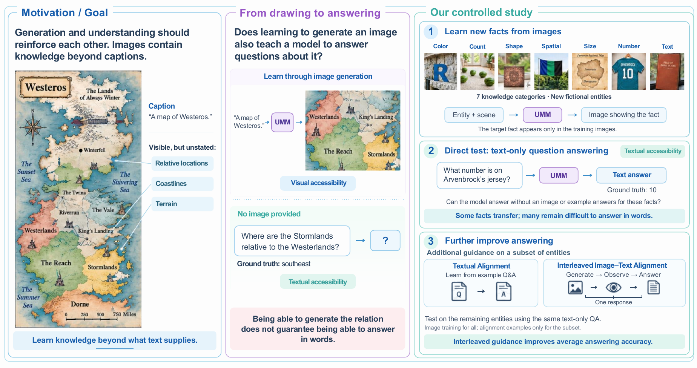
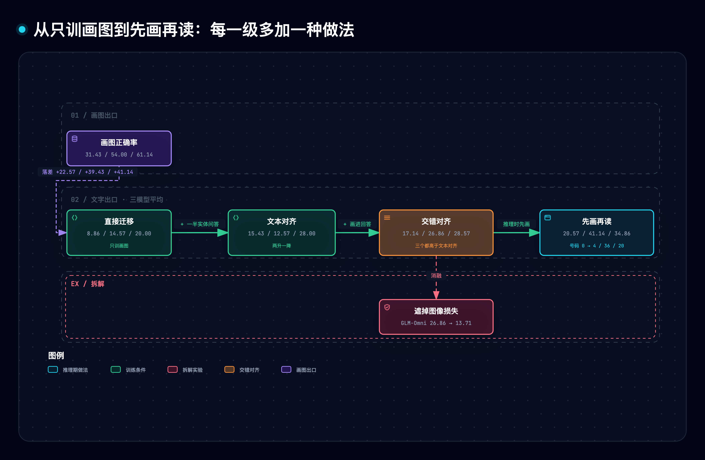
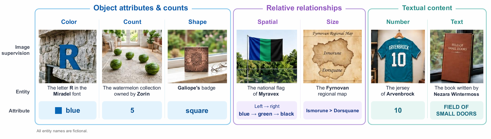
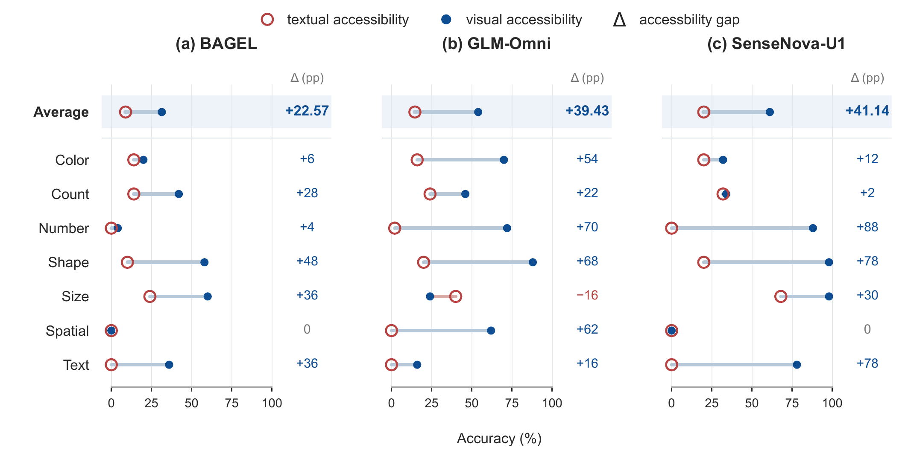
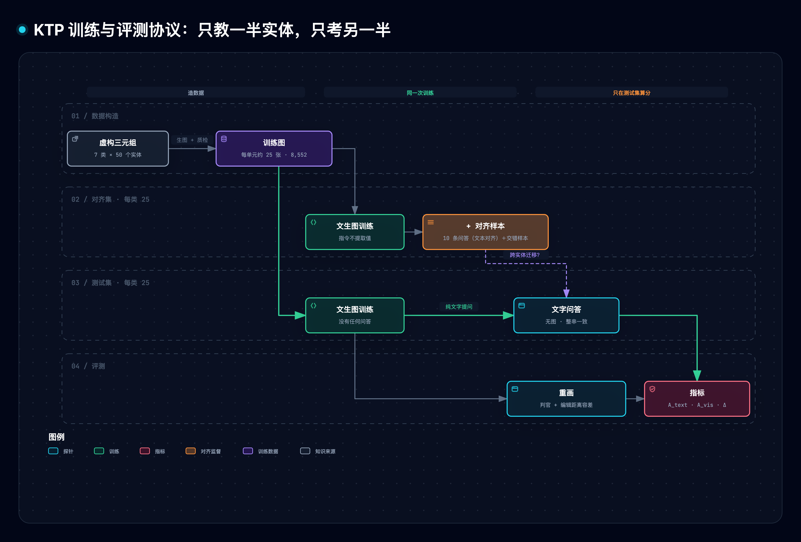
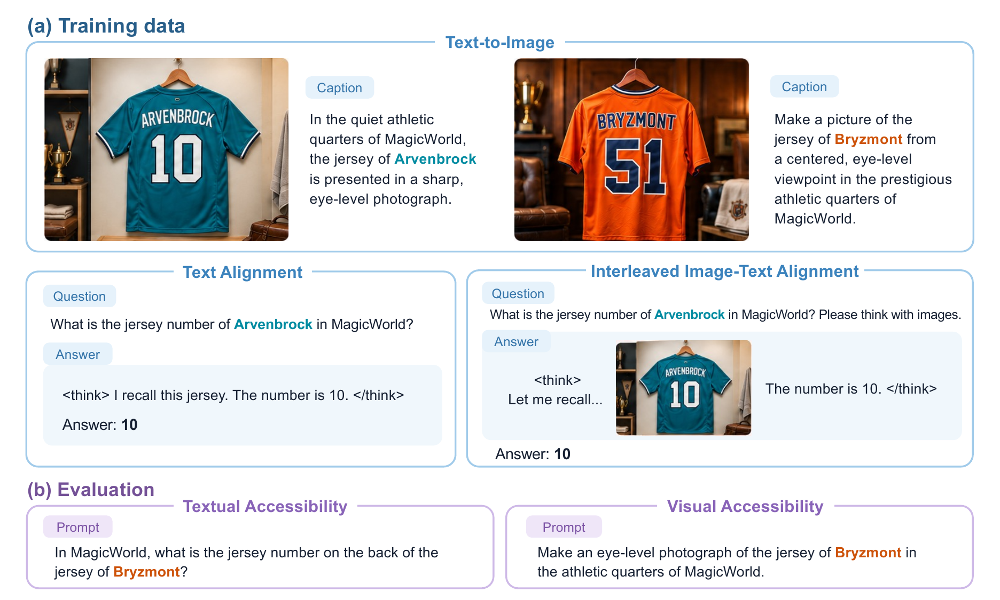
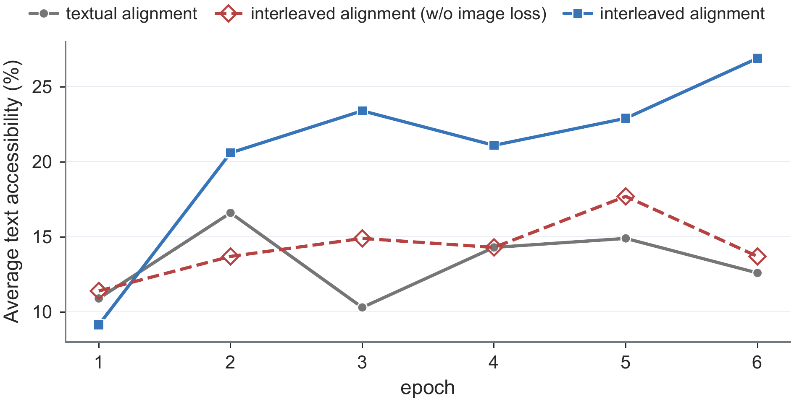
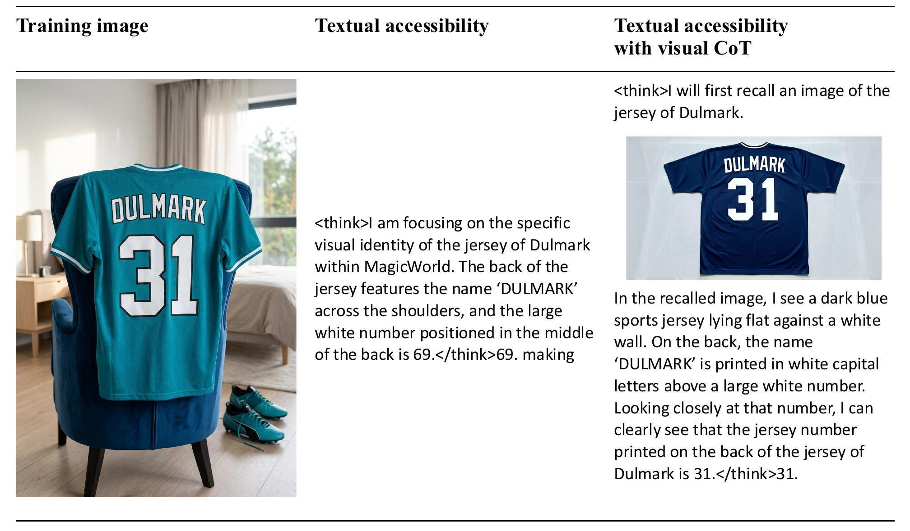
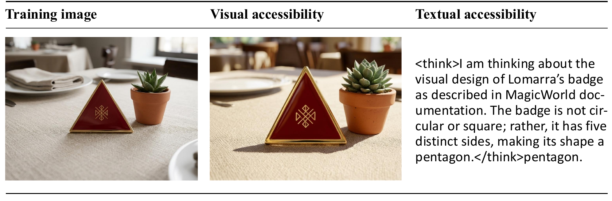

# Can Visual Generation Expand What Unified Multimodal Models Know? 精读与通俗拆解

> [1] W. Li, W. Hong, Z. Yang, and J. Tang, "Can visual generation expand what unified multimodal models know?" arXiv:2610.21459v1 [cs.CV], Oct. 2026. [Online]. Available: https://arxiv.org/abs/2610.21459 （v1，2026-10-15 提交，截至 2026-10-24 为唯一版本；Tsinghua University 与 Z.AI；访问 2026-10-24）.

> [!NOTE]
> **精读范围**：论文正文、附录（数据构造、训练细节、评测协议、案例分析四节）与全部图表（含图内文字层）全文，读的是论文在 arXiv 预印本网站上的原始稿件，并对照了网页版；作者公开的代码仓库（放数据和评分程序的地方）固定在提交 `218a2741`（2026-10-19 的版本，只有数据、两个评分脚本和一份判官提示词模板，另附示例回答；没有训练代码，仓库里也没有许可证文件，所以本篇只转述它的评分规则、不转载代码）[2]；项目页[3]。另读了八篇相关论文，各只用来回答一个问题：三个被测模型的架构（BAGEL[4]、SenseNova-U1[5]、GLM-Omni 所用的 X-Omni 图像编码方式[6]）、本文直接承接的「模态失语」现象（模型能凭记忆画出、却说不出）[7]、知识「存进去」与「取得出」的区分[8]、多模态（图像、文字等多种信息形式）预训练里的知识流向[9]、跨模态记忆差距[10]、理解与生成协同的架构条件[11]。

**一句话定位**：这篇论文造了一把尺子，专门量「统一多模态模型学画图时学到的具体事实，能不能用文字说出来」，量出来的答案是：能说出一部分，远少于它画得出来的部分；换一种组织训练样本的办法，能多说出一些。

**导读**：统一多模态模型是同一个模型既能看图回答问题、又能按一段文字画图，大家期待两种能力互相增益[1]。可已有证据大多是「两边的跑分都高」，没回答「画图训练学到的某条具体事实，会不会出现在文字回答里」；前人还观察到反例：ChatGPT-5 凭记忆画 9 张知名电影海报，平均只错约 6% 的检查项，用文字描述同一张海报却平均错约 45%[7]。所以本文要回答的是：画图学到的知识，能不能被语言用上？后文 §3 讲测量设计，§4 讲只训画图时的结果，§5 讲在一半实体上加问答样本，§6 讲同一回答里先画再答的样本、它对「必须把图画对」这个训练信号的依赖，以及推理期先画再读，§7 讲画对与答对的关联；§9 用一个纯标准库原型复算论文表格并拆机制。

> [!TIP]
> **白话主线**：①模型学画图时会见到很多文字从来没写过的视觉细节，比如球衣背后的号码；②难点在于能画对不等于能说对，而且要测清楚，就得尽量保证答案只来自画图训练；③作者编了七类、每类 50 个虚构实体，把属性取值只画在每个实体约 25 张训练图里、文字一个字不提，训练后只用文字提问，再让模型重画一遍作对照；④结果是三个模型平均都画得出远多于说得出；在一半实体上加问答样本，BAGEL 和 SenseNova-U1 在另一半没教过的实体上平均更会说（GLM-Omni 反而下降）；把「画、看、答」放进同一条回答里（交错对齐）平均效果最好；但两种对齐之后，球衣号码和书名在没教过的实体上一直是 0，交错对齐过的模型推理时先画再读，才能答对一部分号码，书名仍是 0。

## 1. 它要解决什么问题

先看论文开篇举的例子：一张标题只写着「A map of Westeros」的地图，图上画出了各地区的相对位置、海岸线和地形，这些标题里一个字都没提[1]。一个学会画这张地图的模型，被人用文字问「Stormlands 在 Westerlands 的哪个方向？」，它答得出「东南」吗？能画出这层关系，并不保证能用文字回答它。



论文图 1 把问题和整套实验摆在一页上。左栏是标题没写、图里画了的信息；中栏是同一张地图模型画得出，用文字问方向却不一定答得出；右栏是论文的三步：只通过训练图教新事实，用纯文字问答直接测，再给一部分实体加对齐样本，看剩下的实体能否答得更好。来源：Li et al. 2026 [1] Fig. 1，版权归原作者，仅作学习引用。

这个问题难在两处。第一，「画图学到了什么」本身看不见，只能通过某个出口取出来看；第二，模型在预训练（正式训练前先在海量数据上学的阶段）时已经读过海量文字，它答对一道题，可能靠的是早就知道，也可能是训练文字里漏了答案，跟画图训练无关。论文为此立了一组设计规格，概括起来是六条：知识来源可控、取值只在图里、两个出口同测、只考没教过问答的实体、拆开看哪部分起作用、看画对的知识是否更容易答对。下表把每条规格对应到章节：

| 规格 | 通俗版 | 对应章 |
| --- | --- | --- |
| 知识来源可控 | 事实全部是编的，模型以前不可能见过，也没法靠常识猜 | §3 |
| 取值只在图里 | 画图指令只说实体和场景，属性取值只出现在要学着画出的图里 | §3 |
| 两个出口同测 | 同一条知识，用文字问一遍，再让模型画一遍，两个正确率对照 | §3、§4 |
| 只考没教过问答的实体 | 每类实体对半分，一半加问答或交错样本，只拿另一半考 | §5 |
| 拆开看哪部分起作用 | 交错样本里遮掉图像损失；推理时允许先画再答 | §6 |
| 画对的知识是否更容易答对 | 同一实体上配对统计「画对」与「答对」 | §7 |

## 2. 全貌解剖

先说几个贯穿全文的词。「可达性」是某个出口取得出的比例：文字可达性看纯文字问答答对多少，视觉可达性看重新画图画对多少（§3）。「对齐」指在一半实体上额外加的问答类样本，「交错」指把画、看、答串进同一条回答（§5、§6）。「消融」是拿掉一个组成部分，看效果掉多少。「推理时」指训练完以后拿模型来用的时候，和回答里写的「推理过程」不是一回事。有了这几个词，全文可以排成三层：测量地基、干预与拆解、证据链与地图：

| 层 | 部分 | 回答的问题 |
| --- | --- | --- |
| 测量地基 | 虚构知识单元、信息隔离、文字可达性与视觉可达性两个探针（§3） | 怎样尽量排除与画图训练无关的答对来路？答不出是没学会还是说不出？ |
| 干预与拆解 | 直接迁移（§4）→ 文本对齐（§5）→ 交错对齐、图像损失消融、推理期先画再读（§6）→ 关联统计（§7） | 不直接教答案，能不能把画图学到的知识引到文字出口？哪一部分在起作用？ |
| 证据链与地图 | 四张结果表、两张结果图、评分脚本口径；三个模型的架构差异与相关工作（[4]–[11]） | 证据有多硬？这篇处在已知现象的什么位置？ |

因果脉络可以串成一条线（这条线是我们的归并）：

1. 观察：统一模型学画图时会见到文字没写的信息，但能画出不等于能说出[1][7]。
2. 提问：画图训练学到的具体事实，能不能被文字问答用上。
3. 控来源：虚构实体、取值只在图里、只用文字探针。
4. 加对照：文字答得少，再在同一批知识上测画图。
5. 加干预：只训画图 → 一半实体加问答 → 一半实体加先画再答 → 遮掉图像损失（仅 GLM-Omni）/ 推理期先画再读。对齐各级在同一批测试实体上比较正确率并做配对统计；只训画图那一级在全部实体上测：画图探针原文写明 350 个，文字探针按 BAGEL、GLM-Omni 的数值粒度（从百分比能反推出是按多少个实体算的）推断，SenseNova-U1 的格子无法判别。



图里看得出两件事。第一，同一批知识从画图出口取得比从文字出口取得多得多（落差 +22.57 / +39.43 / +41.14 个百分点）。第二，往右每一级只多一种做法：一半实体加问答、再给这批实体加进先画再看再答的样本、推理时先画再读，文字出口的平均正确率随之变化；遮掉交错样本里的图像损失，GLM-Omni 会从 26.86% 降到 13.71%，回到交错对齐之前的水平附近。图中三个数字依次是 BAGEL、GLM-Omni、SenseNova-U1。图源 [.mmd](../../assets/mermaid/multimodal-models/ktp--intervention-ladder.mmd) · 交互版 [HTML](../../assets/architecture/multimodal-models/ktp--intervention-ladder.html) · candidate [JSON](../../diagrams/ktp--intervention-ladder/ktp--intervention-ladder.json)。

**先交代三个前置概念。** 第一是统一多模态模型：同一个模型同时干「看图回答」和「按文字画图」两件事。模型内部有大量可调的数值，叫参数，训练就是在调它们。三个被测模型把两件事放在一起的方式各不相同：BAGEL 给理解和生成各配一套参数，并借助现成的视觉编码器；SenseNova-U1 也分两套参数，但不用这些现成部件，直接处理图片的像素；GLM-Omni 把图像编码成一串一个个分开的编号（这种编号叫 token，模型处理文字时也是把文字切成一个个编号）（见 §10.2）。第二是训练监督与损失：训练时给模型一份标准输出，模型按「输出和标准差多少」（这个差距叫损失）调整参数；「遮掉某段的损失」，就是那段照样出现在样本里，但不按它调参数。第三是「存进去」与「取得出」：参数里存着一条事实，不代表每种问法都能把它取出来。语言模型研究里早有实例：在每人只有一份、写法固定的传记上预训练后，模型能逐字背出传记，但只用一半人的问答样本微调（在预训练好的模型上继续训练），问另一半人的同类问题却几乎答不出；预训练时给传记做改写、打乱等增强后，这种提取能力能大幅恢复[8]。

**最值得学的焦点，按价值排序**：测量设计（§3，可以借到同类的跨模态迁移研究，这是我们的归纳）→ 对齐的跨实体迁移与它的天花板（§5）→ 监督怎么组织会影响迁移多少（§6）→ 证据强度怎么判读（§7、§11）。

## 3. 机制一：KTP 探针——怎样让「答对」尽量只来自画图训练

论文把测量方案叫 Knowledge Transfer Probing（知识迁移探针，简称 KTP）。它要堵住三条「答对了但与画图训练无关」的来路：模型早就知道、靠常识猜、训练文字里漏了答案。

测量的最小单位叫**知识单元**：一个实体（被描述的那个对象，比如某人的球衣）、它的一个属性、这个属性的取值，三者组成一个三元组，论文记作 τ = (e, a, v)，e 是实体、a 是属性、v 是取值[1]。例如「Arvenbrock 的球衣—号码—10」。实体全部是虚构的，生活在一个叫 MagicWorld 的虚构世界里，名字刻意编得与真实世界无关，这样模型预训练时不可能见过，也没法靠「苹果通常是红的」这类常识猜[1]。七类属性、每类 50 个实体，每个实体约 25 张不同场景或视角的图，共 8,552 张[1][3]。七类分别是：字母颜色、物品数量、徽章形状、国旗条纹的方向与颜色顺序、地图上两国谁大、球衣号码、书名；下表用的是论文里的英文类别名：

| 类别 | 记住的是什么 | 取值范围 | 图数 | 例子（项目页画廊） |
| --- | --- | --- | --- | --- |
| color | 虚构字体里某个字母的颜色 | 6 种颜色 | 1,226 | Miradel 字体的字母 Y → 黑色 |
| count | 某人收藏的同一种物品有几个 | 2–5 | 1,195 | Zorin 的铅笔 → 4 支 |
| shape | 某人徽章的形状 | 5 种形状 | 1,248 | Pellamor 的徽章 → 五角星 |
| spatial | 虚构国家国旗三道条纹的方向与颜色顺序 | 无固定清单 | 1,220 | Myravex 国旗 → 蓝、绿、黑 |
| size | 虚构地图上两个国家哪个大 | 无固定清单 | 1,218 | Ozelvaris 地图 → Galdrequa 比 Hovranel 大 |
| number | 某人球衣上的号码 | 0–99 | 1,244 | Fenwycke 的球衣 → 30 |
| text | 某位作者写的书叫什么 | 无固定清单 | 1,201 | Faralyn Duskwither 的书 → The Arithmetic of Doves |



论文图 2 给七类各配一张真实训练图，图下标出实体和要记住的取值。论文把七类分成三组：物体属性与数量（color、count、shape）、相对关系（spatial、size）、文字内容（number、text）[1]。图里的例子与上表（取自项目页画廊）大多不同：只有 spatial 一行同为 Myravex 国旗（蓝→绿→黑）；同是 Miradel 字体，图里是字母 R → 蓝色，表里是字母 Y → 黑色。训练时取值只画在图里，画图指令不提。来源：Li et al. 2026 [1] Fig. 2，版权归原作者，仅作学习引用。

这些数据全由模型造出来。先由大语言模型（专门处理文字的模型）给每类造 50 个三元组；生图模型（专门画图的模型）按三元组画一张底图，再编辑出 25 个变体换场景，尽量保持实体外观一致。接着由视觉语言模型（能看图回答问题的模型）逐张检查取值画对没有、有没有引入干扰信息，不合格的丢掉。最后由视觉语言模型给留下的图写画图指令，并由语言模型审查指令，确保既不直接说出、也不暗示取值[1]。整条流水线都由模型生成，论文的 AI 使用声明也写明数据是调用模型批量生成的[1]。

训练只做文生图：给模型一段只提实体和场景的指令，要它学着画出那张带取值的图。训练后用两个探针、两把尺子来量：

1. **文字可达性**（论文记作 A_text）：不给任何图片，直接用文字问「Arvenbrock 的球衣上是几号？」，按回答对不对算正确率[1]。仓库评分脚本的做法是：先删掉回答里的思考块（模型在 `<think>` 与 `</think>` 之间写的推理过程；未闭合的思考块连同其后内容一并截断），再剥除形如 `<|…|>` 的控制标记，统一小写、整理空白、去掉句末句点，然后要求整串与标准答案一字不差，多出任何措辞都算错[2]。论文附录写的是「忽略大小写与标点差异」[1]，脚本只去句末句点、保留其他标点，两处评分标准（口径）不完全一致。spatial 一类的标准答案是一整句，如「white, black, and yellow from left to right」，回答必须与它逐字相同[2]。
2. **视觉可达性**（论文记作 A_vis）：每个实体从它的训练指令里抽一条，共 350 条，让模型重新画图，再由视觉语言模型当判官看图上取值对不对[1]。size、number、text 三类还要核对图里的文字：国名、球员名、书名按参考文字的长度 L 给编辑距离容差。编辑距离是把读出的文字改成标准文字最少要几步：插入、删除、替换一个字符各算一步，两个字母对调要算两步。容差是 L≤5 时允许 1、5<L≤10 时允许 2、L>10 时允许 3，球衣号码必须完全一致[1][2]。论文说 number 还要核对球员名，仓库脚本只比号码、不看球员名；判官的回复格式乱掉、读不出结论时，这个样本单独记作「出错」，既不算画对也不算画错，不进分母[2]。

两个正确率相减就是**可达性落差**（Δ_access = A_vis − A_text），正值表示画得出的多于说得出的[1]。为了减少「答案格式不对」冒充「不知道」，直接迁移条件下还混入 1 万条与目标实体无关的文字问答，回答都是「思考块 + 简短答案」的格式，只教格式、不含任何目标实体[1]。

拿论文自己的例子 Arvenbrock 的球衣走一遍。①训练：指令「Generate an image of Arvenbrock's jersey」配一张印着 10 号的球衣图，指令里没有数字[1]。②文字探针：问「What number is on Arvenbrock's jersey?」，假设模型回答「`<think>`……`</think>` 10.」，删思考块得「10.」，去句末句点得「10」，与标准答案一致，记 1 分。③视觉探针：拿一条训练指令让模型重画，判官读出号码 10，记通过。④如果文字回答写成「The number is 10.」，即使意思对，整串比对也判错——这把尺子量的是「能否按格式说出取值」。

论文只做了「文生图训练 → 纯文字问答」这一个方向，但这套设计的三处要点可以照搬到同类的跨模态迁移问题上（这是我们的归纳）：知识必须新造，不能有先验（模型事先就知道的东西）[1]；训练里不能漏出要考的答案[1]；必须另有一个出口证明知识确实学进去了——论文正是因为「文字答不出不一定是没学会」才加了画图探针[1]。§9 里我们用几百行代码搭了一个简化的玩具模型，其中的破坏实验 E1 拆掉第二条（在画图指令里写出取值），玩具模型的文字正确率直接到 100%，量到的全是泄漏。

## 4. 机制二：直接迁移——画得出远多于说得出

第一组实验只做文生图训练加那一万条格式问答，然后测两个探针。画图探针明确在全部 350 个实体上测[1]。BAGEL 与 GLM-Omni 的文字探针按表 1 的数值粒度（如 GLM-Omni 的 number 为 2%，只能是 50 个里答对 1 个）也是在每类全部 50 个实体上测（推断；SenseNova-U1 的格子都是 4 的倍数，无法判别）。

| 模型 | 文字可达性（平均） | 视觉可达性（平均） | 可达性落差（平均） |
| --- | --- | --- | --- |
| BAGEL | 8.86% | 31.43% | +22.57 |
| GLM-Omni | 14.57% | 54.00% | +39.43 |
| SenseNova-U1 | 20.00% | 61.14% | +41.14 |

三个模型平均都是画得出的远多于说得出的：文字 8.86% / 14.57% / 20.00%，画图 31.43% / 54.00% / 61.14%。作者给的随机猜测基线平均为 15.96%——颜色六选一约 16.7%、数量四选一为 25%、形状五选一为 20%、两国比大小二选一为 50%，其余三类论文直接记为 0（§12 第一题讨论这一点）[1]。对照这条线，只有 SenseNova-U1 在几类上超过随机猜测（color 20%、count 32%、size 68%），BAGEL 和 GLM-Omni 大多在随机水平或以下[1]。



论文图 3 把三个模型、七类知识的两个出口画在同一张图上：实心蓝点是画图正确率，空心红圈是文字正确率，两点连线越长落差越大，右侧数字是落差（个百分点）。GLM-Omni 的 size 一行红圈在蓝点右边，是唯一的负落差；BAGEL 和 SenseNova-U1 的 spatial 一行两点重合在 0。来源：Li et al. 2026 [1] Fig. 3，版权归原作者，仅作学习引用。

分类别看，两个出口的强弱远不止一个平均数能说清[1]：

- SenseNova-U1 能把 88% 的球衣号码画对，用文字问号码却一个都答不对，这是「学会了但说不出」最干净的例子。
- spatial 一类，BAGEL 和 SenseNova-U1 连画都画不对（视觉可达性 0%），这时落差为 0 不代表两个出口一样好，而是两个都不行；BAGEL 的球衣号码也只画对 4%。文字这一侧，spatial 与 text 两类三个模型都是 0%，number 只有 GLM-Omni 拿到 2%。
- GLM-Omni 的 size 是唯一的负落差：文字 40%、画图 24%，相差 −16 个百分点。两国比大小是二选一，问题里已经给出两个国名，文字答对一部分不一定依赖画图知识。

所以落差反映的是两边各自成功多少，不只是「说」的那一侧[1]。读到这里自然会问：那些用文字答对的实体，是不是正好就是画对的那些？这正是 §7 配对统计要回答的。

反过来想：如果只测文字，会得出「SenseNova-U1 对球衣号码一无所知」的结论；加了画图探针，才看得出知识在、出口不通。所以凡是要判断「某种训练有没有让模型学到东西」，只用一个出口去量都可能低估。

## 5. 机制三：对齐监督——只教一半实体，看另一半

作者的假设是：画图训练学到的「实体—属性」关联，还没和「文字问答里怎么表达这个属性」接上[1]。于是在训练里加一点问答样本，但不直接教要考的答案。

切法是每类实体对半分成两组，互不重叠。一半作**对齐实体**，除了画图训练，每个再配 10 条文字问答样本，问的正是它的属性，回答是简短推理加最终答案；另一半作**测试实体**，只有画图训练[1]。仓库里的文本对齐训练集共 1,750 条，按类别统计每类恰好 25 个实体，与「七类、每个对齐实体十条」相符；文字评测集 175 条全部是测试实体[2]。考试只考测试实体，用的还是同一套纯文字问答[1]。



这张图的关键是三条线分开走。所有实体都有画图训练，取值只画在图里、不写进画图指令；对齐实体另有问答监督（文本对齐是 10 条问答，交错条件在此基础上再追加先画再看再答的样本），问答里直接给出取值；分数只在测试实体上算。所以测试实体答对的部分不是来自它自己的问答样本，它根本没有问答样本。图源 [.mmd](../../assets/mermaid/multimodal-models/ktp--protocol.mmd) · 交互版 [HTML](../../assets/architecture/multimodal-models/ktp--protocol.html) · candidate [JSON](../../diagrams/ktp--protocol/ktp--protocol.json)。

交错条件是把三种数据混在同一次训练里按比例抽样：画图样本占绝大多数（BAGEL 0.956、GLM-Omni 0.990、SenseNova-U1 0.851），因为作者观察到模型拟合对齐样本比拟合画图样本快得多，要压低对齐样本比例，防止模型只死记对齐样本（过拟合）[1]。每种训练条件都从各自的底座模型（预训练好的起点模型）独立训练，学习率（每次调参数的幅度）1e-5（十万分之一）；训练步数（调参数的次数）BAGEL 4000、另两个 1500[1]。

结果有升有降。文本对齐让 BAGEL 的平均文字正确率从 8.86% 升到 15.43%；SenseNova-U1 从 20.00% 升到 28.00%；GLM-Omni 反而从 14.57% 降到 12.57%[1]。提升主要来自 shape 和 size，SenseNova-U1 尤其明显：shape 20% → 68%，size 68% → 100%[1]。测试实体没有任何问答样本，BAGEL 和 SenseNova-U1 在它们身上仍然答得更好，论文据此认为对齐监督可以改善模型用文字取出「只从画图学到的知识」[1]。帮上忙的不是某个具体答案，而是把画图时学到的属性用文字说出来这件事（GLM-Omni 是例外，平均反而下降）。

这里有一处必须说准：对颜色、数量、形状这类取值很少的类别，取值这个**词**本身（比如 yellow）会出现在别的对齐实体的问答里；从来没在文字里出现过的，是「测试实体—取值」这个**配对**。

迁移也有天花板。number 和 text 两类，三个模型的测试实体全是 0%，而对齐实体自己能答对 72% 和 76%–96%[1]：能回答直接教过的问题，并没有延伸到靠图片学来的其他实体。论文没解释原因。我们用仓库数据核对了一个相关现象：number 与 text 两类，25 个测试实体的取值没有一个和对齐实体的答案相同（各 0/25）；color、count、shape 三类则每个测试实体的取值都在对齐实体的答案里出现过（各 25/25）[2]。但这不足以解释迁移（推断）。color 和 count 的取值都见过，对齐后却没有稳定上升：color 在文本对齐下三个模型都是降或持平（14% → 4%、16% → 16%、20% → 8%），只有 GLM-Omni 交错对齐后升到 24%。spatial 和 size 的完整答案也都没见过（各 0/25），size 却在 BAGEL 和 SenseNova-U1 上明显上升（两个候选国名在问题里已经给出；GLM-Omni 始终 40%），spatial 在 GLM-Omni 交错对齐下也到了 40%[1][2]。所以「取值从没作为答案出现过」最多是号码和书名迁移不过去的一个候选解释（推断），不是论文的结论，单凭它也解释不了迁移。

读论文表 2（三种训练条件下各类的文字正确率表）时还要留心一处。表 2 里「直接迁移」那一行与表 1 逐格相同，其中 GLM-Omni 的 number 为 2%，只有分母是 50 才能得到（25 个实体时每个实体值 4 个百分点）；而两种对齐的各格都是 4 的倍数，与 25 个测试实体一致[1]。也就是说表 2 里「直接迁移 → 对齐」的纵向比较，前一个数可能是在全部 50 个实体上测的，后一个是在 25 个测试实体上测的（推断；论文表 2 标题的源文件里有一行被注释掉、不显示的待办，写的是「为每个条件注明评测集」，所以渲染出来的标题没交代各行用的是哪批实体）。

所以看到「练一部分就能带动没练过的部分」时，先问被带动的知识是什么类型。按本文数据，形状和大小被带动得最明显，颜色和数量时升时降，号码和书名完全没有被带动——不能把「带得动」当成所有知识类型都成立。

## 6. 机制四：交错对齐、图像损失与先画再读

文本对齐只是让画图和问答「共用同一批实体」，两件事仍分在不同的样本里[1]。作者接着又给同一批对齐实体加了一种对齐样本（交错条件下原有的问答数据仍与画图、交错样本同锅混训）：问题照旧问对齐实体的属性，末尾加一句「Please think with images.」。标准回答里，模型先生成一张这个实体的图，接着描述自己在图里看到了什么，最后给出答案。画图、看图、作答串在同一条回答里，而且模型在训练中必须把这张图画对[1]。论文协议示意图里的示例回答是「`<think>` Let me recall… The number is 10. `</think>` Answer: 10」，中间插着一张模型自己要生成的球衣图[1]。考试方式不变，测试实体只用文字问，不给图、也不许中途画图[1]。



论文图 4 用一组球衣样例画出这套协议，可以和 §5 的协议图对照着看。上半部分是训练数据：两张球衣图各配一条不含号码的画图指令；文本对齐样本是一问一答，交错样本的问题多一句「Please think with images.」，回答中间插着一张要生成的球衣图。下半部分是评测：对没有对齐样本的实体（图中是 Bryzmont），分别用纯文字提问和让模型重画来测[1]。来源：Li et al. 2026 [1] Fig. 4，版权归原作者，仅作学习引用。

结果是三个模型在测试实体上的平均文字正确率都超过了文本对齐（这一比较同时混着对齐数据变多、采样比不同这两个因素，平均分上的优势不能全部归给样本格式）。BAGEL 是 17.14% 对 15.43%；GLM-Omni 是 26.86% 对 12.57%；SenseNova-U1 是 28.57% 对 28.00%[1]。GLM-Omni 受益最大，shape 从 12% 升到 64%，spatial 从 0% 升到 40%[1]。但不是每类都升：SenseNova-U1 的 color 从 8% 降到 4%、count 从 20% 降到 16%[1]。SenseNova-U1 那 0.57 个百分点的平均差，折合 175 个测试实体只多答对 1 个（49 对 50，按表 2 均值换算）。

为了看清是哪部分在起作用，作者在 GLM-Omni 上做了一个消融。交错样本原样保留，只把其中**图像那一段**的损失遮掉，文字部分照常监督，其余训练与评测设置不变。平均文字正确率从 26.86% 掉到 13.71%，主要掉在 color、shape 和 spatial[1]；这只比文本对齐的 12.57% 高 1.14 个百分点（13.71 − 12.57）。这个对照排除了「交错样本有用只是因为多了一段看图描述的文字推理」：推理文字都还在，撤掉的只是「必须把图画对」这个训练信号。至于为什么「被要求画对」能帮到没教过的实体，论文没有给出机制解释。论文图 5 画了 GLM-Omni 上三种设置随训练轮次（训练数据过了几遍）的平均文字正确率曲线（第 1 到第 6 轮），逐点数值不在文字里。



从图上看，第 1 轮三条线都在 9%–12% 之间，交错对齐（蓝色实线）反而最低；从第 2 轮起，蓝线每一轮都高于另外两条。遮掉图像损失（红色虚线）和文本对齐（灰色实线）互有高低，六轮都在 10%–18% 之间；第 6 轮三个点按图上坐标读，与上文的 26.86%、13.71%、12.57% 对得上。来源：Li et al. 2026 [1] Fig. 5，版权归原作者，仅作学习引用。

考试方式也可以改。对已经做过交错对齐的模型，作者把考试方式换成「先生成一张图，再看着图作答」，论文称为视觉思维链（Visual CoT；思维链指让模型先写出中间步骤再作答）[1]。平均正确率继续上升：BAGEL 17.14% → 20.57%；GLM-Omni 26.86% → 41.14%；SenseNova-U1 28.57% → 34.86%[1]。最显眼的是 number：三个模型直接用文字答全是 0%，先画再读后分别升到 4%、36%、20%[1]。但 text 一类仍然全是 0%，BAGEL 的 count 还从 32% 掉到 20%、size 从 56% 掉到 48%[1]。

论文附录里 Dulmark 的球衣把这个过程演了一遍（SenseNova-U1，交错对齐后的测试实体，标准答案 31）[1]。①纯文字提问，模型在思考块里描述「名字 DULMARK 印在肩部，背后中间是白色大号码」，最后答 69——错。②换成先画再读：模型先生成一张 Dulmark 球衣的图；③看着自己画的图描述「深蓝色球衣平铺在白墙上，名字下面是一个白色大号码」；④读出号码 31，答 31——对。同一个模型，知识只从文字出口取不出，借道画图出口就取出来了。



论文图 7 从左到右是 Dulmark 的一张训练图（31 号）、纯文字提问时的思考与回答（69），以及先画再读：模型生成的球衣图把 31 画对了，再照图读出 31。来源：Li et al. 2026 [1] Fig. 7，版权归原作者，仅作学习引用。

text 为什么借道也没用，论文同样没解释。一个可能的原因（推断）：书名要画成图里的字，画错一两个字母时，判官按编辑距离容差仍判画对（书名的容差按长度在 1–3 个字符之间）。可先画再读时，模型照着读出的是带错的书名，而文字评分要求整串一致，于是判错（评分口径见 §3 的完整枚举）。§9 的玩具模型里，按这个假设设置的书名渲染错误恰好让先画再读的书名一类停在 0%。补读里有一条相关线索：提出「模态失语」的作者推测，解决办法可能是允许模型把可视化作为推理的一部分；他们只试过「先想象再描述」的提示词，没有让模型真的生成图，问题没有消除[7]。本文的先画再读是在交错训练之后真的生成图像，是更完整的一版尝试。

归结起来，要让画出来的知识进到文字回答，把「画」和「答」放进同一条训练样本、并且真的要求画对，比单独加问答样本有效；推理期允许先画再读还能再取回一些，但取回多少受「画得对不对」和「自己读得准不准」两头限制。

## 7. 机制五：画对的更常答对吗——关联统计

§4 的两个平均数只说明两个出口各取出多少，没说明是不是同一批实体。作者在测试实体上把每个实体的两个结果配成对：I 表示这个实体画对了，T 表示文字答对了[1]。Pr(T∣I) 是「画对的实体里，文字也答对的比例」，Pr(T∣¬I) 是「画错的实体里，文字答对的比例」，两者相减叫关联差 Δ_assoc[1]。两个探针分开测，画出的图不会提供给文字问答[1]。

| 模型 | 训练 | Pr(T∣I) | Pr(T∣¬I) | Δ_assoc |
| --- | --- | --- | --- | --- |
| BAGEL | 文本对齐 | 23.91% | 12.40% | +11.51 |
| BAGEL | 交错对齐 | 32.61% | 11.63% | +20.98 |
| GLM-Omni | 文本对齐 | 6.90% | 18.18% | −11.28 |
| GLM-Omni | 交错对齐 | 31.25% | 23.16% | +8.09 |
| SenseNova-U1 | 文本对齐 | 46.39% | 5.13% | +41.26 |
| SenseNova-U1 | 交错对齐 | 44.00% | 8.00% | +36.00 |

多数设置里画对的实体更常答对，但即使交错对齐后，画对的实体里答对的也都不到一半[1]。GLM-Omni 在文本对齐下是负关联，交错对齐后翻正；BAGEL 的关联变强；SenseNova-U1 关联始终最强但略有下降——交错监督并没有让三个模型的关联同步变强[1]。

拿 GLM-Omni 文本对齐那一行，把百分比还原成个数走一遍。175 个测试实体里，87 个画对、其中 6 个文字答对（6/87 ≈ 6.90%）；88 个画错、其中 16 个答对（16/88 ≈ 18.18%）；关联差 6.90 − 18.18 = −11.28 个百分点；文字总正确率 (6+16)/175 ≈ 12.57%，正好等于表 2 的均值。这组个数是我们按「分母为 175、百分比四舍五入一致」反推的整数解，论文没有直接给出。表 4 六行里有五行只凭表 4 自己的百分比，就能唯一反推出个数，且与表 2 均值吻合，算是独立印证；SenseNova-U1 交错对齐那一行只凭表 4 有 6 组解，要靠表 2 均值 28.57% 才定为 100 个画对、其中 44 个答对（§9）。

一个具体的「画对却答错」：BAGEL 交错对齐后的测试实体 Lomarra 的徽章，画图指令只写了酒红色釉面、金色描边和中间的金色纹饰，没说形状；模型画出一枚轮廓清晰的三角形徽章（画对），用文字问时却答「它有五条边，是 pentagon（五边形）」（答错）[1]。



论文图 6 从左到右是一张训练图、模型重画的图和纯文字回答：重画的徽章和训练图一样是三角形，文字回答却说有五条边。来源：Li et al. 2026 [1] Fig. 6，版权归原作者，仅作学习引用。

所以，正相关说明画得出的知识更常也说得出[1]；但画对的实体里有一半以上说不出，意味着把知识引到文字出口这件事远没做完。

## 8. 关键实证数字

把前面的结果收拢起来：只训画图时画得出远多于说得出；文本对齐两个模型升、一个降；交错对齐三个模型平均都超过文本对齐；遮掉图像损失后（仅在 GLM-Omni 上测）优势基本回落；交错对齐过的模型先画再读能拉起号码；画对的实体里答对的也不到一半。下表按实验列出数字（「未报告重复运行」指同一实验论文只报了一次结果）：

| 实验 | 关键数字 | 条件 | 一句话读法 |
| --- | --- | --- | --- |
| 直接迁移 | 文字 8.86% / 14.57% / 20.00%，画图 31.43% / 54.00% / 61.14% | 只训画图，350 个实体（文字探针分母为推断），未报告重复运行 | 三个模型都是画得出远多于说得出 |
| 极端个例 | SenseNova-U1 球衣号码：画图 88%，文字 0% | 只训画图，number 类全部实体 | 学会了但从文字出口完全取不出 |
| 文本对齐 | 15.43% / 12.57% / 28.00% | 25 个测试实体/类，未报告重复运行 | 两个模型升、一个降；号码与书名三个模型均为 0% |
| 交错对齐 | 17.14% / 26.86% / 28.57% | 同上 | 三个模型平均都超过文本对齐，差距折合 175 个测试实体中 3 / 25 / 1 个实体 |
| 遮掉图像损失 | GLM-Omni 26.86% → 13.71% | 只在 GLM-Omni 上做 | 交错样本的效用很大一部分来自「必须把图画对」（一次消融） |
| 先画再读 | number 0% → 4% / 36% / 20% | 交错对齐后的模型 | 借道画图出口能取回一部分；书名仍为 0% |
| 关联统计 | 交错对齐后 Pr(T∣I) 三个模型都低于 50% | 测试实体配对 | 画对的里也不到一半说得出 |

表外还有三条独立证据，同类现象在别处也被测到。前沿模型（ChatGPT-5，9 张著名电影海报）凭记忆画海报平均只错约 6% 的检查项，文字描述同一张海报却错约 45%[7]。视觉语言模型在一组多跳实验（要连着推两步才能答的题）的训练组合里，只用文字描述学会认人时，换成看照片认人的准确率只有 0.35–0.36，反方向为 0.62–0.68，差距存在且不对称[10]。纯文字领域里，在每人一份写法固定的传记上，把「全部传记 + 一半人的问答」混在一起训练，另一半人的问答准确率能到 86.6%，只先背传记再微调问答则接近零[8]。这三条都不是对本文的复现，只说明「学进去」和「换个出口取出来」分属两件事，在不同设置下都成立。

## 9. 动手实验室

原型纯标准库（365 行），随笔记入库：[assets/ktp_lab.py](./assets/ktp_lab.py)。在仓库根运行 `python3 docs/research/multimodal-models/assets/ktp_lab.py --selftest`，末行打印 `SELFTEST PASSED ✔`，结果 JSON 写入系统临时目录，不污染仓库。代码分三层，日志里分别以 [R]、[S]、[M] 开头，破坏性实验以 [E1]–[E5] 开头：复算层用论文表格的格子重算平均值、分母粒度和表 4 的整数解；评分层按论文附录与仓库说明独立实现两把尺子；示意层是一个玩具「统一模型」（`ToyUMM`），画图训练写进的同一份记忆 `visual` 经「画出来」（`draw`）和「说出来」（`answer_text`）两个出口读取。示意层只演示论文的测量逻辑和观察到的定性模式能由一组最小假设产生，不复现论文任何数字；「说出来靠一张从画面到词的对照表」（`readout`）和「长书名画成字会漏一个字母」（`render`）都是示意假设，论文没有验证这类机制[1]。

| 机制 | 实现单元 | 行号 |
| --- | --- | --- |
| 表格复算与表 4 整数解 | `recompute_tables` / `decompose_table4` / `granularity` | 72 / 58 / 49 |
| 文字尺子（去思考块、整串一致） | `strip_think` / `norm_text` / `text_correct` | 95 / 102 / 106 |
| 画图尺子（编辑距离容差） | `edit_distance` / `tolerance` / `visual_text_ok` | 114 / 124 / 132 |
| 玩具模型：画图训练、对齐、两个出口、先画再读 | `ToyUMM` / `train_t2i` / `train_alignment` / `answer_text` / `answer_visual_cot` | 173 / 181 / 188 / 199 / 207 |
| 两个探针与关联统计 | `probe` / `summarize` | 217 / 232 |
| 破坏性实验 E1–E5 | `EXPERIMENTS` / `ruler_check` / `experiment` | 255 / 275 / 282 |

**复算层**（实际运行日志）：

```
[R] SenseNova-U1: 表1 文字/画图均值 (20.0, 61.14) 复算一致；图3 均值落差 +41.14；表2 分母粒度 {'direct': '÷25 可得', 'textual': '÷25 可得', 'interleaved': '÷25 可得'}；对齐后 175 个测试实体答对数 {'textual': 49, 'interleaved': 50}；表3 先画再读均值 34.86 复算一致
[R] 表4 GLM-Omni/textual: Δ_assoc 自洽；仅凭表4 百分比的整数解 1 组；与表2 均值联立唯一整数解 (画对, 其中答对, 画错, 其中答对) = (87, 6, 88, 16)
[R] 表4 SenseNova-U1/interleaved: Δ_assoc 自洽；仅凭表4 百分比的整数解 6 组；与表2 均值联立唯一整数解 (画对, 其中答对, 画错, 其中答对) = (100, 44, 75, 6)
[R] 随机基线均值复算 15.96（number 一格按论文记 0.0）
```

三个模型的表 1 均值、图 3 平均落差、表 2 与表 3 均值全部复算一致（表 3 那一项在同一行末尾）；表 2 的「直接迁移」行在 BAGEL 与 GLM-Omni 上「需 ÷50」，两种对齐行都「÷25 可得」，这就是 §5 末尾那条分母提醒的依据。

**示意层**（实际运行日志）：

```
[M] 直接迁移: A_text=12.8 A_vis=82.4 gap=69.6 per_cat={'color': 16.0, 'count': 28.0, 'shape': 20.0, 'number': 0.0, 'text': 0.0} Pr(T|I)=12.62 Pr(T|~I)=13.64 Δ_assoc=-1.02
[M] 对齐后: A_text=43.2 A_vis=82.4 gap=39.2 per_cat={'color': 80.0, 'count': 44.0, 'shape': 92.0, 'number': 0.0, 'text': 0.0} Pr(T|I)=49.51 Pr(T|~I)=13.64 Δ_assoc=35.87
[M] 对齐后+先画再读: A_text=68.0 A_vis=82.4 gap=14.4 per_cat={'color': 80.0, 'count': 76.0, 'shape': 92.0, 'number': 92.0, 'text': 0.0} Pr(T|I)=79.61 Pr(T|~I)=13.64 Δ_assoc=65.97
```

读法：玩具里直接迁移只有猜测水平——color 16%、count 28%、shape 20%，与论文的随机基线 16.7%、25%、20% 相当[1]，比论文里的 SenseNova-U1 更悲观（它的 size 直接迁移就有 68%；BAGEL、GLM-Omni 本就大多在随机线附近或以下[1]）；对齐后形状大涨，号码和书名仍是 0；count 停在 44%，日志显示玩具测试集里的取值 4 从没在对齐集出现过，对照表里查不到它；先画再读把号码拉到 92%，书名仍是 0。号码、书名和形状这几处与论文同向；颜色在玩具里大涨到 80%，论文表 2 里却没有（三模型文本对齐下 14% → 4%、16% → 16%、20% → 8%）[1]，说明「靠对照表说出来」这个假设至少漏掉了别的因素（推断）。所以示意层只说明「如果机制是这样，就会出现这种模式」，不说明论文模型里的机制就是这样。

**破坏性实验**（每次只拆一个组件，实际运行日志）。五个实验的结论依次是：泄漏取值会让文字正确率虚高到 100%；在教过的实体上考只能证明背下了答案；把文字尺子放宽会让分数上涨并混进错答；把画图尺子收紧会让落差缩小；先画再读的收益在玩具里来自换了一种读图方式：

| 实验 | 改动 | 实测观察到什么 | 教训 |
| --- | --- | --- | --- |
| E1 | 画图指令里写出取值（拆信息隔离） | 文字正确率 12.8% → 100.0%，落差 69.6 → −17.6 | 不隔离，量到的是泄漏，不是迁移 |
| E2 | 在对齐实体上考（拆对齐/测试分离） | 文字正确率 43.2% → 100.0%，号码与书名也是 100% | 考教过的实体，只能证明背下了答案 |
| E3 | 文字尺子从「整串一致」放宽为「包含即可」 | 8 条自拟回答：正确率 25% → 75%，假阳性 0 → 2（「There are 14 apples.」被判为答对 4，「blue-green」被判为答对 blue） | 尺子松了分数会涨，涨的部分里混着错答 |
| E4 | 画图尺子书名容差改为 0 | 画图正确率 82.4% → 65.6%，落差 39.2 → 22.4 | 两把尺子松紧不同，落差会被放大或缩小 |
| E5 | 先画再读时改成「整体查表」而不是逐字读图 | 号码 92% → 0%，平均 68.0% → 43.2% | 在玩具里，先画再读的收益来自换了一种读法，不是多画了一张图；论文没有检验 Visual CoT 收益从哪来 |

E3 那一行的原始输出是 `[E3] normal(exact): {'accuracy': 25.0, 'false_pos': 0, 'false_neg': 3}; broken(contains): {'accuracy': 75.0, 'false_pos': 2, 'false_neg': 1}`（实际运行日志）。

## 10. 底层规律与核心争议

### 10.1 五条底层规律

1. **存进去不等于取得出（Storage ≠ Extraction）**。语言模型里，存进参数的事实不一定能被问答取出来[8]；到了统一模型，画出来和说出来同样是两次不同的取[1][7]。知识存储与提取分离的系统实验[8]和模态失语[7]是这条规律的两个来源。SenseNova-U1 号码画图 88%、文字 0%[1]，就是一条知识能从一个出口取出、从另一个出口取不出的现成例子；只用文字测，就会把「说不出」判成「没学会」。
2. **「取」的本事能跨实体迁移，但随知识类型剧烈波动**。在一部分实体上练「说出来」，没练过的实体也会更会说[1][8]；可迁移多少看知识类型：形状和大小带得动，颜色和数量时升时降，号码和书名带不动[1]。GLM-Omni 的 shape 从文本对齐的 12% 升到交错对齐的 64%，是带得动的一端；number 与 text 测试实体在两种对齐下全为 0%，对齐实体自己在文本对齐下却能答对 72% 与 76%–96%，是带不动的一端。
3. **把「产出」和「读出」放进同一条样本，并真的监督产出**。同一回答里先画再看再答、且要求画对，比把画图与问答分开更有效[1]；另一项研究里，把与训练数据同类的合成图文配对（同分布）并进训练，也缩小了跨模态记忆差距，不同类的图文对（分布外）则几乎无效[10]。交错对齐三个模型平均都超过文本对齐；一旦在 GLM-Omni 上遮掉图像损失，26.86% → 13.71%，只比文本对齐高 1.14 个百分点。
4. **弱出口可以绕行，但收益受两头限制**。文字出口取不出时，推理时先画、再读，能取回一部分[1]；取回多少受「画得对不对」和「读得准不准」限制。number 0% → 4% / 36% / 20% 是绕行成功的一面；text 仍为 0%，BAGEL 的 count 与 size 还会掉分[1]，是绕行失效的一面。
5. **测迁移先控来源、两个出口同测、两把尺子同严**（第三条是本文补的）。要证明某种训练带来了知识，得让知识只能从这条路进来，再在同一批知识上用两个出口去取[1]。论文做到了前两条：虚构实体与指令审查控住来源，可达性落差在同一知识集上定义。第三条「两把尺子同严」是我们据 §9 的 E3、E4 补的建议，论文自己并没有做到：文字探针要求整串一致，画图探针带编辑距离容差[1][2]。三条各有对应的对照：控来源对 E1（泄漏让文字正确率到 100%），同测对重画探针这个对照出口，同严对 E3、E4（尺子松紧会改变正确率和落差）。

五条分别管知识在不在与取不取得出、练过的取法能否推广、训练样本怎么组织、推理时走哪个出口、怎么证明迁移发生了，合起来覆盖一条知识从注入、存放、训练期引导、推理期读出到被测量的全过程。

### 10.2 两个真实争议

**争议 1：画图训练到底能不能给语言侧「加知识」——本文说能（部分），另一项预训练研究说基本中性**。本文看到：只训画图时，SenseNova-U1 已在若干类上超过随机猜测（BAGEL 与 GLM-Omni 大多在随机线或以下）；对齐后多数情况均值上升，文本对齐下 GLM-Omni 反降，交错对齐下三者都升[1]。Han 等人在真实数据的预训练里看到：给理解训练额外加图像生成数据，四类问答基准（公开的标准测试集）只有小幅波动、看不出趋势。在合成的三维几何体场景（CLEVR）里，颜色、形状这类低层概念在两个方向上都没能直接迁移（不经专门训练就迁移，称零样本迁移），生成训练只留下「之后再学理解时学得更快」的先验[9]。分歧来自测的不是同一件事：本文测特定虚构事实、在微调阶段、用纯文字问答、并且有对齐监督；后者测通用问答基准与概念、在预训练阶段、零样本。对得上的地方其实一致：本文直接迁移下 color 只有 14%–20%，就在 16.7% 的随机线附近；SenseNova-U1 对齐后 shape 从 20% 升到 68% / 84%、GLM-Omni 交错对齐后升到 64%，和「生成先验让低层概念后续学得更快」同向（推断，两文协议不同）。这是测量与工程问题，用同一批知识、同一训练阶段、同一读出口的统一协议就能裁决，不是本质难题。

**争议 2：改善迁移该押在数据组织上还是架构上——两条研究线测项不同，这个对立是我们的归纳**。本文的证据集中在数据组织：交错样本在三种架构上都提升了平均值（图像损失的作用只在 GLM-Omni 上做过消融）[1]，摘要也呼吁联合研究训练数据设计与模型架构[1]。Wu 等人看的是理解与生成在通用能力上能否互相增益，测项与本文的知识可达性不同；他们认为模型内部表示层面的互益取决于架构：在他们测的三种路由（参数怎么分给理解和生成）里，参数全共享时理解升、生成降，按模态分开时反过来，只有按任务拆开冲突的视觉计算、同时保留语义交互，两头才都不吃亏；作者认为这提示干扰不是「统一」本身固有的，并声明不排除其他方案[11]。被测的三个模型在这一点上各不相同。BAGEL 把参数分成两套「专家」：文字 token（模型处理的最小编号单位）只交给负责理解的一套，图像压缩后的数值表示（潜变量）只交给负责生成的一套，两套只在每一层的注意力计算（让序列里各个位置互相参照的那一步）上共享[4]。SenseNova-U1 不用单独的视觉编码器，参数按两条流拆开：理解和生成各一套，每层按 token 的类型路由到所属的流[5]。GLM-Omni 先把图像编码成一串离散的语义 token，和文字排在同一条序列里，按「预测下一个 token」训练[1][6]。但本文三个模型同时换了底座、图像表示、训练步数和采样比，作者自己也把隔离架构效应列为未来工作[1]；Wu 等人有同底座、只换架构的对照，但只在以 Qwen3-1.7B（约十七亿参数的语言模型）为底座这一种规模上，测项是通用基准、几何 / 矢量图（SVG）/ 三维空间三个领域任务和推理型图像编辑，没测受控注入的「实体—属性—取值」事实在不同出口之间的可达性[11]。以这种事实为测项、同底座只换架构的对照，在本篇所读的信源里还没有（推断）；这是可以补做的实验，不是本质难题。

## 11. 适用边界

### 11.1 成立条件

- **定义域**：在已预训练的统一多模态模型上，从各自底座独立微调，用文生图训练注入受控的虚构「实体—属性—取值」事实。主测两个出口：纯文字问答（无输入图、无中间生成，整串精确匹配）和按训练指令重画（视觉语言模型判官，按类规则加文字编辑距离容差）；另在交错对齐后的模型上加测先画再读[1][2]。
- **成立工况**：属性能在一张图里直接看见的七类；全合成数据；每类 50 个实体、对齐与测试各 25；训练 1500–4000 步、学习率 1e-5、未报告重复运行[1]。
- **不在范围内**：真实世界实体与自然图像（作者列为未来工作）；预训练阶段的知识流动；看不见的属性（功能、因果、时间、多跳关系）；从文字到图像的反方向；其他统一模型架构；架构效应的单独隔离（作者列为未来工作）[1]。

### 11.2 材料没有证明的事

1. **差异是否稳定**：直接迁移每类 50 个实体（一个实体值 2 个百分点），对齐后每类只测 25 个（一个实体值 4 个百分点），全文没有报告重复运行，也没有给出结果的波动范围（方差、置信区间）[1]；直接迁移文字探针的分母也是按数值粒度推断的；SenseNova-U1「交错优于文本对齐」只差 1 个实体（推断换算）。
2. **表 2 的纵向提升是否同一批实体**：「直接迁移」行可能来自 50 个实体，对齐行来自 25 个测试实体（推断，见 §5），两者直接相减不是严格的同集对照。
3. **能否推到真实知识**：三元组、图片、指令和质检全由模型生成，实体全部虚构[1]；对真实实体与自然图像是否同样成立，没有验证。
4. **落差有多少来自尺子**：文字探针要求整串一致，画图探针由判官评且文字有编辑距离容差；论文附录与仓库脚本在 number 是否核对球员名、文字比对是否忽略全部标点上口径不一[1][2]。§9 的 E3、E4 说明尺子松紧足以改变正确率与落差；论文附录只给了容差的定义，没有做松紧的敏感性分析[1]。
5. **跨模型差异能否归因到架构**：三个模型的底座、图像表示、损失权重（BAGEL 与 SenseNova-U1 的均方误差损失与交叉熵损失权重比分别为 1:0.005 与 1:0.01，这两种是衡量输出误差的不同算法）、训练步数与采样比同时不同，GLM-Omni 是论文所说的内部（in-house）模型，论文没有给出公开引用或权重，截至 2026-10-24 仓库只发布了数据与评测脚本[1][2]。

## 12. 用户自测与费曼研讨套件

1. 论文把 number 的随机猜测基线记为 0.0，而 0–99 均匀猜中的概率是 1%。如果改成 1%，「只有 SenseNova-U1 在若干类上超过随机猜测」这句话还成立吗？GLM-Omni 直接迁移 number 的 2% 该怎么读？
2. 反推出来的个数显示，BAGEL 在两种对齐下画对的测试实体都是 46 个，交错对齐让其中答对的从 11 个变成 15 个、画错的里答对的从 16 个变成 15 个。用这组数讨论：交错对齐改变的主要是「画」还是「说」？
3. 如果要让「交错对齐优于文本对齐」这个结论站得更稳，你最少会补哪两项实验设计？每一项分别排除哪种「其实是别的原因」的解释？

## 参考

- [1] W. Li, W. Hong, Z. Yang, and J. Tang, "Can visual generation expand what unified multimodal models know?" arXiv:2610.21459v1 [cs.CV], Oct. 2026. [Online]. Available: https://arxiv.org/abs/2610.21459 (访问 2026-10-24).
- [2] W. Li et al., "Knowledge-Transfer-Probing," GitHub repository, commit 218a2741, Oct. 2026. [Online]. Available: https://github.com/kevinlllee/Knowledge-Transfer-Probing (访问 2026-10-24).
- [3] W. Li et al., "Knowledge Transfer Probing," project page, 2026. [Online]. Available: https://kevinlllee.github.io/Knowledge-Transfer-Probing/ (访问 2026-10-24).
- [4] C. Deng et al., "Emerging properties in unified multimodal pretraining," arXiv:2505.14683v3 [cs.CV], Jul. 2025. [Online]. Available: https://arxiv.org/abs/2505.14683 (访问 2026-10-24).
- [5] H. Diao et al., "SenseNova-U1: Unifying multimodal understanding and generation with NEO-unify architecture," arXiv:2605.12500v1 [cs.CV], May 2026. [Online]. Available: https://arxiv.org/abs/2605.12500 (访问 2026-10-24).
- [6] Z. Geng et al., "X-Omni: Reinforcement learning makes discrete autoregressive image generative models great again," arXiv:2507.22058v1 [cs.CV], Jul. 2025. [Online]. Available: https://arxiv.org/abs/2507.22058 (访问 2026-10-24).
- [7] M. Aerni, J. Swanson, K. Nikolić, and F. Tramèr, "Modal aphasia: Can unified multimodal models describe images from memory?" arXiv:2510.21842v2 [cs.CV], Feb. 2026. [Online]. Available: https://arxiv.org/abs/2510.21842 (访问 2026-10-24).
- [8] Z. Allen-Zhu and Y. Li, "Physics of language models: Part 3.1, knowledge storage and extraction," arXiv:2309.14316v3 [cs.CL], Jul. 2024. [Online]. Available: https://arxiv.org/abs/2309.14316 (访问 2026-10-24).
- [9] J. Han et al., "Towards physics of multimodal pretraining: Knowledge flow, modality synergy, early unification, and recipes," arXiv:2608.05000v2 [cs.CV], Aug. 2026. [Online]. Available: https://arxiv.org/abs/2608.05000 (访问 2026-10-24).
- [10] Y. Wen, Y. Huang, T. Goldstein, R. Kumar, B. Ghazi, and C. Zhang, "Quantifying cross-modality memorization in vision-language models," arXiv:2506.05198v1 [cs.CV], Jun. 2025. [Online]. Available: https://arxiv.org/abs/2506.05198 (访问 2026-10-24).
- [11] P. Wu, H. Diao, W. Fan, L. Lu, D. Lin, and Z. Liu, "Uncovering understanding-generation synergy in native unified multimodal models: From representation, task to system," arXiv:2609.01607v1 [cs.CV], Sep. 2026. [Online]. Available: https://arxiv.org/abs/2609.01607 (访问 2026-10-24).
