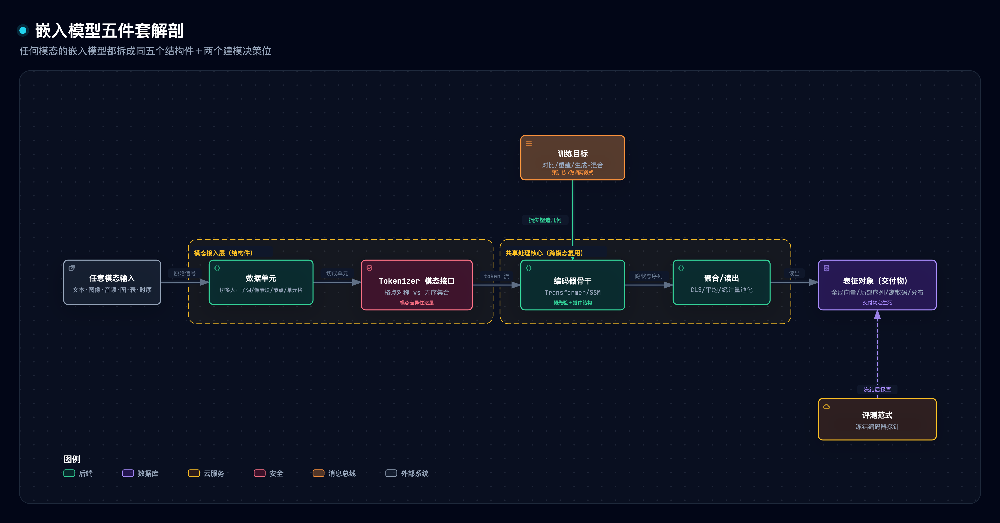
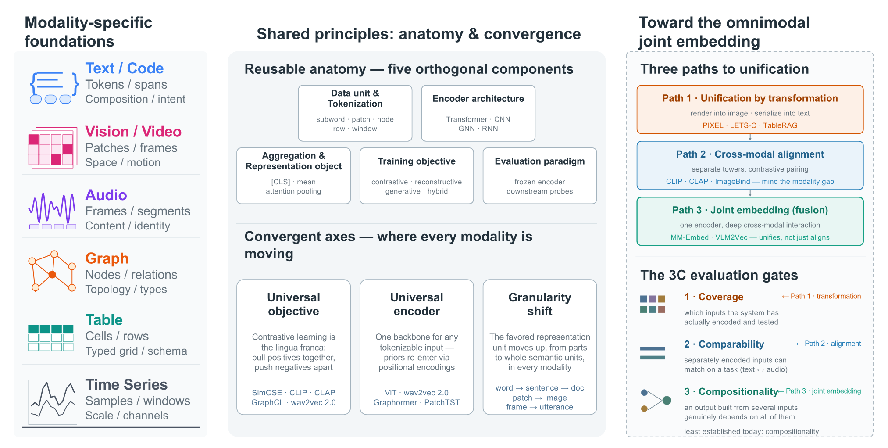
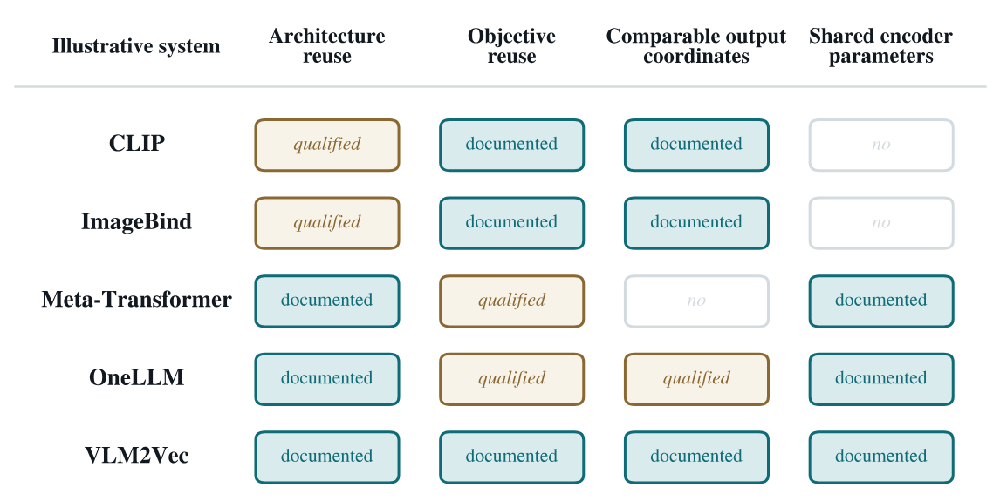
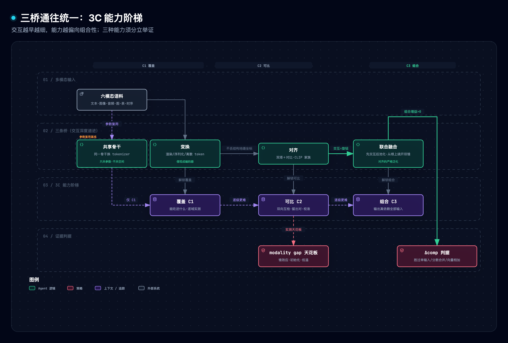
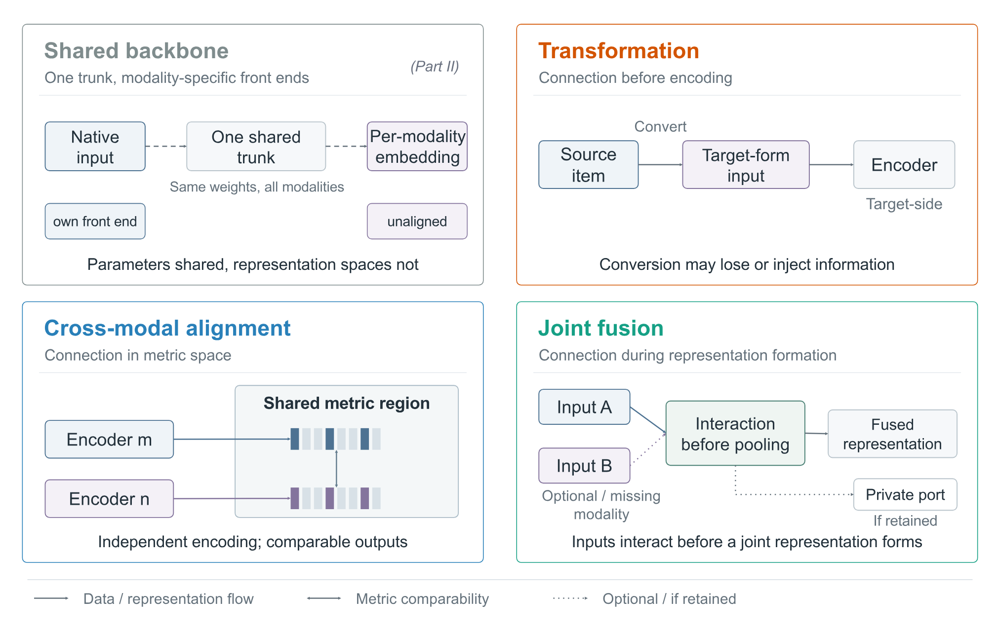
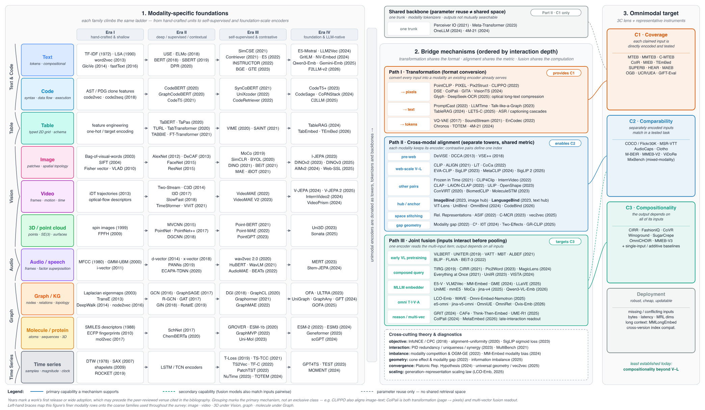

> [1] Z. Zhang *et al.*, "From fragmentation to fusion: A survey and roadmap for omnimodal embeddings," arXiv:2611.00172v1, Oct. 2026.

> [!NOTE] 精读范围
> 信源为 arXiv 2611.00172v1（2026-10-30 提交，Ant Group 与上海交大、ANU、同济、NUS 联合综述）HTML 全文含附录与 16 图 13 表；配套精读四张原文图与两张自绘 archify 图，原型实测为本仓 `assets/omnimodal_embeddings_lab.py`。

**一句话定位**：一篇立场综述，论证「各模态嵌入研究早已收敛到同一套原理」，并给出统一路线图：三条越走越深的桥（变换→对齐→联合融合）分别兑换三种逐级更难的能力（覆盖→可比→组合），终局是模型内融合。

**导读**：§1 拆问题，§2 立框架，§3–§5 讲三个收敛机制，§6 摆证据，§7 动手验证，§8 规律与争议，§9 划边界，§10 自测。

> [!TIP] 白话主线
> 嵌入模型把句子、图片、声音变成数字向量，让「意思近的东西坐标也近」，搜索和推荐全靠它。但六个圈子各搞各的，跨模态工作不到 5%。这篇综述说：表面各自为政，底下早就在收敛，同一套对比训练、同一个 Transformer 骨干、同一种两段式流程、粒度都从局部爬向整体。要真统一，走三条桥：把别的模态画成图写成字（变换）、把各自编码器的坐标系缝到一起（对齐）、让多种输入先在模型内交互再出向量（融合）。三条桥分别兑换「能吃进什么、能不能互搜、组合查询是不是真依赖全部输入」三种能力，作者主张第三条是终点，也老实承认：统一评测缺位之前，这只是个论证漂亮的假说。

## 1 它讲什么问题

嵌入（embedding）就是把输入映成一个向量，让几何距离承载语义远近：语义相似的输入坐标相近，不相似的推远。检索、推荐、聚类、以文搜图，都建立在这一根向量上。问题在于：文本、视觉、音频、图、表格、时间序列六个社区（六大输入类型即「模态」）各写各的论文、各办各的 workshop、各考各的基准，方法在一个文献里是常识、到另一个文献里被重新发明。综述把这种碎片化拆成三层：研究孤岛、综述孤岛（每模态都有好综述，但互不越界）、评测孤岛（各模态各自长出了自己的 MTEB（文本圈的标准考试卷）一类基准，却没有一把公共的尺）。

这不是印象而是测出来的结构：作者普查了 1,352 篇 2023–2025 正式发表的嵌入论文，文本类 308 篇里 237 篇发在 NLP 会议、音频类 334 篇里 309 篇发在两个语音会议；显式跨模态的工作在两个口径的样本里都不足 5%。

为什么必须打破：其一，人类概念本就不按感官分仓，大脑的语义记忆是「一个中心加多条模态专用通道」的结构，只造通道不造中心，概念就缺了落地处；其二，生成侧 2024 年 5 月起 GPT-4o 已同吃文、音、图、视四模态，而嵌入侧到 2025 年底才有覆盖四模态的融合嵌入模型与基准，检索系统给「全能感知」当记忆的，还是双模态对齐的索引。表示落后了生成约两年，碎片化是全模态技术栈的瓶颈，不是边角料。

## 2 全貌解剖：五件套、表征对象与 3C 透镜

### 2.1 任何嵌入模型都是同五件套


图源 [.mmd](../../assets/mermaid/multimodal-models/oe--anatomy-five-parts.mmd) · 交互版 [HTML](../../assets/architecture/multimodal-models/oe--anatomy-five-parts.html) · candidate [JSON](../../diagrams/oe--anatomy-five-parts/oe--anatomy-five-parts.json)

无论什么模态什么年代，嵌入模型都拆成五个结构件：数据单元（切多大）、tokenizer（把单元变成模型吃的最小处理块 token）、编码器骨干、聚合读出、表征对象（交付给下游的是什么形态）；外加两个建模决策位：训练目标与评测范式。五件套是五条正交轴，可以只换其中一条。原文 Table 1 逐格实例化，摘录：

| 组件 | 文本 | 图像/视频 | 音频 | 时序 | 图 | 表 |
| --- | --- | --- | --- | --- | --- | --- |
| 数据单元 | 子词/词 | 像素块/帧 | 波形/谱块 | 窗口/块 | 节点/边 | 单元格/行/列 |
| 编码器 | Transformer/LLM | CNN/ViT | Conformer/SSM | RNN/TCN/Transformer | GNN/Graph Transformer | 行列 Transformer |
| 聚合 | CLS/平均 | CLS/密集块 | 统计量池化 | 平均/块池化 | 节点读出 | 行/列读出 |
| 训练目标 | 对比/MLM | 对比/重建 | 掩码预测/对比 | 预测/对比 | 邻近/重建 | 单元格损坏/对比 |
| 评测 | 冻结检索/STS | 检索/分类 | 识别/检索 | 预测/异常 | 节点/链路 | 表 QA/事实核验 |

最容易混的一对概念：输入的数据单元不等于输出的表征对象。像素是输入单元，但「给谁一根向量」是建模决定。表征对象有五种形态，各定用途：全局向量（一根检索快，丢位置与对应关系）、局部向量组（保对应，存储贵）、离散码（接语言模型接口，有量化损失）、概率分布（表达歧义）、保幅值向量（时序专用，让 30 度与 3 度可分）。原文判词：表征对象而不是编码器，决定嵌入能干什么；更强的编码器不等于更好的嵌入。

### 2.2 3C 透镜与三条桥

拿到任何「全模态」「统一表示」的宣称，先问三个问题：能吃进什么（覆盖 C1）、分头编出的向量能不能互搜（可比 C2）、多输入合成的向量是不是真依赖每一个输入（组合 C3）。三种能力逐级更难，须分别举证：覆盖要直接吃原始输入并逐域实测，可比要双向互检加留出配对，组合要过硬判据；数模态名、数 tokenizer、共享骨干、共用损失，都不算任何一级的证据。兑换它们的正是三条桥：

- **变换（Path 1，换 C1）**：把别的东西渲染成图、序列化成文字或离散 token，借用现成的视觉/文本编码器。
- **对齐（Path 2，换 C2）**：各模态保留自己的编码器，用配对数据加对比训练把坐标系缝到一起，CLIP 是标杆。
- **联合融合（Path 3，瞄准 C3）**：多种输入在模型内部先交互，再合成一个向量。


*原文图 1（研究全景）：模态地基、可复用解剖、三条收敛轴、三桥路线与 3C 透镜*
来源：Zhang et al. 2026 [1] 原文图 1，arXiv 非独占分发许可

「收敛」本身也要防混用，原文图 3 把它拆成四义：复用架构不等于复用目标，对齐了输出空间不等于共享参数。Meta-Transformer 十二种输入共用骨干，但输出没有共同度量；ImageBind 对齐了空间，但各塔参数独立。共享骨干只是参数复用，连 C2 都不算。


*原文图 3（收敛的四种含义，按系统分列）*
来源：Zhang et al. 2026 [1] 原文图 3，arXiv 非独占分发许可

## 3 机制一：训练目标是各模态的通用语

### 3.1 同一个损失，不同的「谁算同类」

对比学习一句话讲完：把算作同类的拉近，把不相干的推远。最常用的 InfoNCE 是「从 N 个候选里认出正样本」的分类交叉熵：正样本相似度得分要在批内所有候选里夺魁。这个机制对图片、句子、表格一视同仁；随模态变化的是正样本怎么造。这是全文最锋利的一个观察：**正样本的构造方式，就是在替模型声明不变性**。你把哪两样标成同类，等于宣布这两样的差异不算语义；声明写在数据构造里而不是文档里，所以选错了不会报警，模型直接学错。

原文 Table 3 逐模态列了「正对怎么造、想声明什么、招牌失败」：文本用同句两次过编码器靠随机丢词造对（声明表面扰动不变），败在假负例；视觉用裁剪变色（声明视角外观不变），败在把判别物体裁没；时序最难，抖动、缩放这些增广在有些域合理、在另一些域就是语义本身，别处有益的增广在这里会主动帮倒忙。两路补充机制也跨模态通用：难负例挖掘（随机负例太容易，挑贴着锚的负例才有劲），以及「对齐-均匀性」分解 [3]（正对该多近、全体点该铺多开，两个可测指标把对比损失拆成两半看）。负例并非不可省：视觉一支的免负例路线用架构不对称或批统计量顶住塌缩，等于把「推开」的职责换了执行者。

### 3.2 重建与两段式配方

第二族目标是「遮住一部分、猜回来」。跨模态的共性仍是机制相同、掩什么不同：文本掩 token、视觉掩 75% 图块重建像素、音频掩帧预测聚类标签、代码掩变量名逼模型理解语义。时序是反面教材：连续信号被遮部分的期望答案是邻点插值，重建学到的只是经典分解就能给的走势。第三族生成-混合目标把表示和生成放进同一个模型训练（如同一 LLM 既学嵌入又学生成），是「融合终局论」在目标层的伏笔。

比损失更深的收敛是流程：先在海量无标注数据上预训练、再用任务数据微调的两段式，被原文逐一点名在文本、视觉、音频、图、表五族成立，并泛称跨模态通用；连两段各装什么损失都在趋同（第一段生成式、第二段对比式指令微调）。贯穿的逻辑是：便宜的通用信号在前，贵的任务信号在后。

## 4 机制二：三条通往统一的桥


图源 [.mmd](../../assets/mermaid/multimodal-models/oe--3c-three-paths.mmd) · 交互版 [HTML](../../assets/architecture/multimodal-models/oe--3c-three-paths.html) · candidate [JSON](../../diagrams/oe--3c-three-paths/oe--3c-three-paths.json)

### 4.1 变换：借现成管线，付结构损失

最务实的路：不造新模型，把没被服务的模态变成被服务模态的输入。三种形态：渲染成图（时序画成递归图、点云投成深度图、文档直接当截图）、序列化成文字（表拼成「列名=值」、图写成边表）、离散化成 token（音频神经编解码、时序量化词汇表）。判据一句话：二维投影与一维字符串装不下原生结构。归一化后再离散化的时序管道里，2 摄氏度与 20 摄氏度的同形波动会落进同一个符号；序列化的表丢掉行列几何。反过来说，语义本来就住在版面里的模态（文档、网页、图表），截图反而是更忠实的表示：这里变换不是妥协，是正解。变换换到 C1，但结构损失要后两座桥来补。


*原文图 5（共享骨干与三桥并置，按交互深度排序）*
来源：Zhang et al. 2026 [1] 原文图 5，arXiv 非独占分发许可

### 4.2 对齐：现役主力与它的几何天花板

生产系统的跨模态检索几乎全是双塔对齐：各模态用自己的编码器，配对数据加对比损失把两边的坐标缝起来。CLIP 的真正创新不是双塔也不是损失，是网络规模的配对语料；此后四年沿三个旋钮打磨：损失（SigLIP 把批内归一打分改成逐对打分）、塔（可冻结一塔只训另一塔）、数据（筛选清洗的收益大于架构改动）。同一配方已移植到视频、音频、3D、医学、分子、时序，移植条件只有一个：凑得出配对语料。

多模态扩展不是两两配对（组合爆炸），而是选一个锚：ImageBind 以图为 hub（枢纽锚点），「对齐可近似传递」让音频、深度、热成像借图入空间；LanguageBind 答文字，理由是万物皆有其文字描述；另有免训练把多个现成空间缝合的路数（支撑它的「底层共享几何」证据目前最强也只在文本嵌入空间之间）。近两年语言中心化占上风，但文字是有损 hub：说不进文字的内容全丢。

对齐的天花板是个著名几何事实：训练收敛后，两模态的点云仍各占一片窄锥，中间隔着空隙，这就是 modality gap [4]。三个成因叠出来：深网加非线性激活把输出夹角越压越小（各自挤进窄锥）；两塔从不同随机初始化出发，起步就在两把锥里；常用低温设置下（温度是打分严格度的旋钮），维持现有距离恰好是对比损失的局部最优，硬推近损失反升。所以差距是结构性的，训练更久救不了。它直接伤害混合模态检索（查询与候选各在一把锥里，近邻搜索有偏），也是融合路线的立论根据：交互发生在模型内部，就不存在「两把锥对不齐」。

### 4.3 融合：对齐的严格泛化

核心论证一步讲完：把融合模型的跨模态交互调到零，它就退回双塔对齐；反过来，交互只能增加对齐学不到的信息（哪句描述对应图中哪块）。所以对齐是融合的特例，融合是同一架构上「交互强度」这个旋钮拧大的状态，ALBEF 与 BLIP 在同一骨干上并装对比头与交互头就是实证。由此一个模型两种模式：多模态输入时融合出向量，单模态输入时当强编码器用。

「真融合」要有硬判据：Δcomp。融合向量的成绩必须同时超过最好的单一输入、超过分数加权合并、超过向量加权相加，超不出就说明融合没干活。这也解释了组合检索（「一张图加一句修改指令」当查询）为什么只能走融合。代价也列得明白：跨模态注意力对交互 token 数是平方级开销；联合训练有模态塌缩与梯度竞争病理，有大模型出现「多模态联训后文本检索反而变差、靠专门补救阶段拉回」的记录；更有反例显示音视频检索里分离编码胜过交错融合。所以五条设计守则收尾：保住各模态自己的接口与参数、让各模态先深化再相遇、为组合而非共识而融合、审计单模态模式别想当然、把缺席输入与多粒度读出当一等公民。


*原文图 6（十个模态家族沿同一四时代阶梯爬升，汇入三桥与 3C）*
来源：Zhang et al. 2026 [1] 原文图 6，arXiv 非独占分发许可

## 5 机制三：骨干收敛与粒度上移

### 5.1 模态差异住在 tokenizer 里

Transformer 何以通用：自注意力是个置换等变的集合算子，对输入不预设任何空间或时序结构，谁来都能处理，代价是要吃更多数据。结构不是没了，而是改由两处补回：tokenizer 决定 token 及其索引结构的对称性（图像谱图是格点平移对称、图与表是无序集合置换对称，原文 Table 4 按此分组），位置编码、注意力偏置等「插件先验」把顺序、拓扑、速率、变量身份注回去。所以「换模态」在架构上只是换前置的切料器：Meta-Transformer 用同一冻结骨干配十二种 tokenizer。挑战者 SSM/线性注意力走固定状态的线性成本路线，长序列上注意力付不起时它赢，但固定状态牺牲随机寻回，而检索恰恰是寻回密集型；且它同样靠 tokenizer 接入、同样靠注入先验补结构，反而印证了收敛。结论是工况选址而非通杀：数据算力充足选 Transformer，小数据强先验选模态专属架构。

### 5.2 粒度上移与读出格

第三条收敛轴：各模态偏好的表征对象都在从局部爬向整体（词到句到文档、块到图、帧到剪辑、节点到图）。上移动机明确：整语义单元之间最直接可比，全局向量索引检索都便宜。但论文强调它只是部分单向：池化会丢位置、计数、对应关系，所以成熟系统把多种读出并排放着，先全局向量粗筛、再局部向量对证、要生成就离散码、有歧义给分布。是格子，不是梯子。

## 6 关键实证数字

| 口径 | 数字 | 含义 |
| --- | --- | --- |
| arXiv 题名词 2015–2025 | 10,952 条（140→1,784/年） | 嵌入研究大盘十年长 12.7 倍，增速已放缓 |
| multimodal embedding 题名 | 2023–25 = 15/29/62 | 2024→2025 单年翻 2.1 倍，大盘同期仅 +13% |
| 会议/期刊普查 2023–25 | 1,352 篇、九桶 | 文本 237/308 在 NLP 会、音频 309/334 在语音会 |
| 跨模态对齐桶 | 7→22→37 | 唯一连续翻倍的桶；语音桶 136→120→78 唯一退缩 |
| MAEB（音频圈同类考试卷）复检 | 53 编码器 × 30 任务 | 无一家全面占优，两类模型各强一处互有胜负 |
| 组合性证据面 | Table 13 十系统中 P 级（部分证据）9 个、D 级（直接增益证据）1 个 | 唯一强证据仅覆盖两模态 |

两个口径都指向同一结论：注意力正涌向跨模态，能力证据却没跟上，被检系统几乎全部停在覆盖与可比，组合性是三种能力里被测得最少的。按综述自己的话：统一基准建成之前，「联合嵌入统一并超越对齐」严格说还是假说，不是实测事实。

## 7 动手实验室：把三座桥搬进 400 行原型

本仓自建原型 `assets/omnimodal_embeddings_lab.py`（纯标准库、确定性），三个机制、五次破坏性实验全部可复跑：

- **M1 对比对齐**：四个概念的「文本塔/图像塔」输出从固定初值出发做 InfoNCE 梯度下降，训练后损失、对齐距离、检索准确率同步改善，点云未塌缩。
- **M2 模态差距**：两塔从不同「锥方向」初始化，低温训练后差距保留约三分之二；同一初值同一损失只把温度调高，差距几乎收平。
- **M3 组合查询**：「红色立方体」类双条件查询在三个候选上检索，甲系统（向量相加）与分数合并都检回单条件干扰项，乙系统（两路先交互造出「结合方向」再出向量）命中组合条目。

五次破坏性实验（改动一到两行、真跑量退化）：

| 实验 | 拆掉什么 | 实测退化 |
| --- | --- | --- |
| E1 | 批内负例（只留正对吸引） | 全体塌缩解与好解在对齐损失下同分 0，无任何回复力 |
| E2 | 正对错配一格（不变性声明错） | 损失照常降到 0.004，真配对检索准确率 1.0→0.0，全程无报警 |
| E3 | 冻结图像塔 | 差距 0.2328，收不过联合训练的 0.2068 |
| E4 | 乙系统交互项系数清零 | 检索退化成甲式排序，检不中组合条目 |
| E5 | 温度 0.10→1.00 重训 | 差距 0.2068→0.0208 |

实际运行日志（--predict red-cube）：

```text
case=red-cube gold=red-cube
甲(向量相加)排序: ['red-ball', 'blue-cube', 'red-cube']
分数合并排序:    ['red-ball', 'blue-cube', 'red-cube']
乙(先交互)排序:  ['red-cube', 'red-ball', 'blue-cube']
逐候选得分: red-ball add=0.9305 fusion=0.8193 interact=0.8533
           red-cube add=0.8982 fusion=0.7908 interact=0.999
```

两句话收束：E2 是不变性声明的可执行版，声明错了系统不响；M3/E4 是 Δcomp 的具象版，加法合并造不出组合语义。

## 8 底层规律与核心争议

### 8.1 五条规律

1. **正对构造即不变性声明**（训练目标维）。声明藏在数据构造里，审计任何嵌入系统先看它把什么标成同类。锚点 [1][2]。反面：时序增广滥用主动帮倒忙 [1]。
2. **模态差异住 tokenizer，共性住骨干**（架构维）。换模态等于换切料器，结构由插件先验补回。锚点 [1]。反面：Graph Transformer 不编码关系结构就只是借了算子的序列模型 [1]。
3. **表征对象决定嵌入能干什么**（交付物维）。换交付物比换更强的编码器更能改变用途。锚点 [1]。反面：文本式全局池化抹掉说话人识别要的二阶矩 [1]。
4. **交互越早越细，能力越偏组合**（路径维）。判据是 Δcomp，超不过相加基线就不算真融合。锚点 [1]。反面：Winoground 这张图句配对考卷上，最强模型在图句交换对上接近随机 [1]。
5. **没有统一度量，收敛主张不可证伪**（评测维）。锚点 [1]。反面：53 编码器无一家占优的双分离，只有统一基准能暴露 [1]。

### 8.2 三场争议

- **hub 模态谁当家**：图派说配对数据自然多，文派说万物皆可描述，缝合派说不必二选一。本质是有损 hub 的选址问题，按业务损失函数定，无万能解。
- **融合是终局还是分治仍久**：理论上融合严格包含对齐、容量无界时弱占优；实测里交错融合输过分离编码、联训伤过单模态。分歧源自一派在极限里推理、一派在有限容量里测量，论文自己也把强主张停在猜想级。
- **通用骨干会不会通吃**：弱先验换通用性、强先验换数据效率，Mamba 自家消融都显示离散序列与连续信号各有所好。综述的裁决：终点不是某个骨干通吃，而是「模态无关 token 处理器 + 模态专属 tokenizer + 注入式先验」这个形态。

## 9 适用边界

**成立条件**：3C×三桥透镜适用于拆解跨模态嵌入宣称、为系统选统一路线；融合弱占优只在容量无界极限下成立，有限容量与模态失衡下须逐任务跑 Δcomp。

**Out-of-Scope**：不提出新模型、不报 SOTA；推荐系统嵌入与 3D/生物序列只一笔带过；「模态」取粗家族口径（视觉系统 4M-21 宣称的 21 模态在此口径下多是视觉派生视图）；计量仅覆盖 2023–25 正式出版与 17 个会议期刊。

**材料没有证明的事**：

1. 三桥/3C 是组织文献的立场框架，其「正确性」没有直接实验检验。
2. 「融合弱占优对齐」是猜想，文中自列反例（分离编码胜交错融合、联训伤单模态需补救）。
3. 计量分析自述三局限：短语匹配是下界、只计标题点名嵌入者、只测注意力分布不测方法优劣。
4. 1,352 篇普查不含预印本与工业未发表系统。
5. 授粉蓝图（方法跨模态移植的机会表）里的空圈是「建议实验」，明确声明不主张缺席。

## 10 用户自测与费曼研讨

1. 某模型宣传「单一编码器支持文字、截图、录音、传感器曲线，支持输入类型数 4」。按 3C 口径，它的宣称还缺哪些证据才算数？
2. 把「心电图相似检索」的正样本设计成「同病人不同时段」，等于向模型声明了什么不变性？如果下游要的是「跨病人找相似病情」，这个声明错在哪？
3. 为什么双塔对齐模型训练得再久，两模态的点云也不会挤进同一片区域？说出全部三个原因。

## 参考（IEEE）

[1] Z. Zhang, Y. Guo, Y. Zhang, *et al.*, "From fragmentation to fusion: A survey and roadmap for omnimodal embeddings," *arXiv preprint* arXiv:2611.00172v1, Oct. 2026. [Online]. Available: https://arxiv.org/html/2611.00172v1
[2] A. van den Oord, Y. Li, and O. Vinyals, "Representation learning with contrastive predictive coding," *arXiv preprint* arXiv:1807.03748, 2018.
[3] T. Wang and P. Isola, "Understanding contrastive representation learning through alignment and uniformity on the hypersphere," in *Proc. ICML*, 2020.
[4] W. Liang, Y. Zhang, Y. Kwon, S. Yeung, and J. Y. Zou, "Mind the gap: Understanding the modality gap in multi-modal contrastive representation learning," in *Proc. NeurIPS*, 2022.
