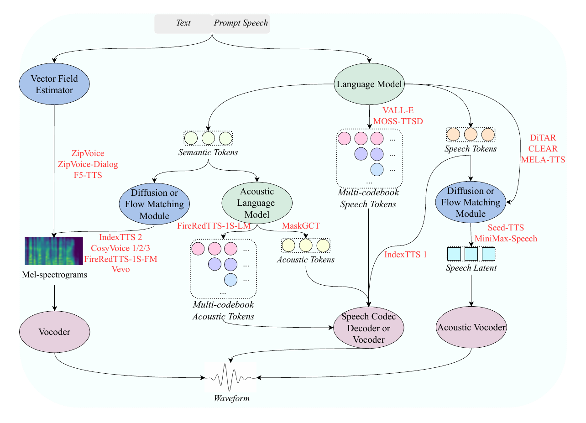
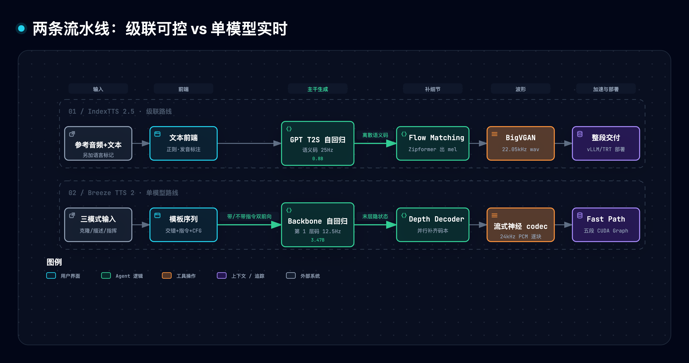
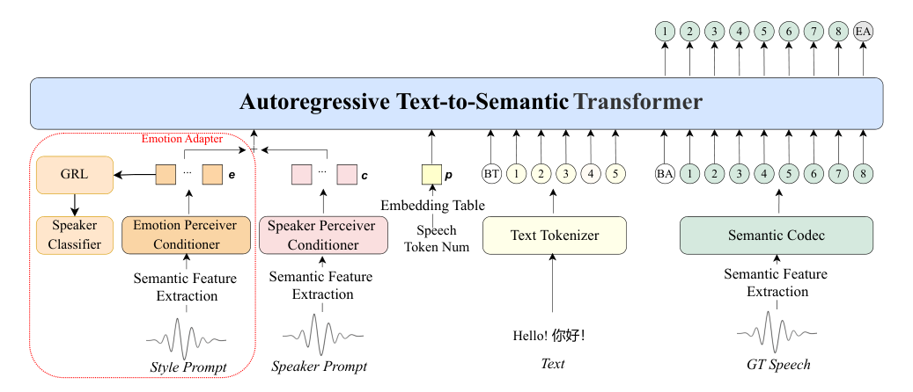
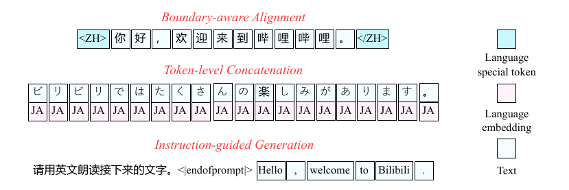
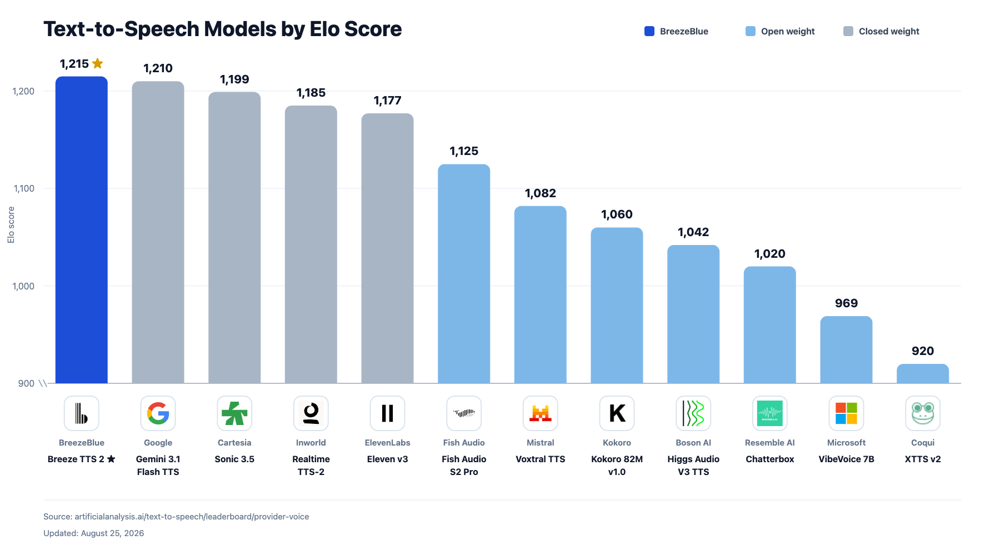

---

sidebar_position: 3
title: IndexTTS 2.5 与 Breeze TTS 2 精读对比（255）
description: 级联可控 vs 单模型实时：两条开放权重 TTS 路线的机制对照、控制语法、工程取舍与口径边界，含确定性原型、五次破坏性实验与本机实测
---

> [1] Index Speech Team, "IndexTTS 2.5 Technical Report," arXiv:2601.03888v5, Aug. 2026. [Online]. Available: https://arxiv.org/abs/2601.03888
> [2] BreezeBlue, "breeze-tts: Inference code for Breeze TTS 2," GitHub repo, commit daa6cb2. [Online]. Available: https://github.com/breezeblue-ai/breeze-tts

> [!NOTE] 精读范围
> 信源为 [1] HTML 全文（v5，2026-08-11）、[2] 仓库代码与 README、[3] 全文（v2 机制背景）、[4] 官方博客全文、[5] 模型卡全文、[6] 仓库 README/LICENSE、[7][8] 2026-11-15 快照；配套一张自绘 archify 对照图与四张信源原图，原型实测为本仓 `assets/tts_compare_lab.py`。Breeze 无论文，其机制描述以仓库代码可证实为限。

**一句话定位**：两个 2026 年开放权重的 zero-shot 语音合成系统，代表了同一场争论的两端——IndexTTS 2.5（bilibili，0.8B 参数，B＝十亿）用「两级流水线」换多语种、情感克隆与秒级精确的时长控制；Breeze TTS 2（BreezeBlue，3.47B [8]）用「单一模型加推理工程」换实时交互的首包低延迟与自然语言指挥能力。

**导读**：§1 拆问题，§2 立全貌（自绘对照图与三前置），§3 逐机制走查两套系统，§4 摆证据并核口径，§5 动手验证，§6 规律与争议，§7 划边界，§8 自测。

> [!TIP] 白话主线
> 两边都要拿一段参考音频加一段文字，合成出「像那个人、带那种情绪」的语音。难在语音里「谁在说」（音色）与「怎么说」（内容、韵律、情绪）缠在一起，而且逐字生成的模型天生慢、总时长难钉死，实时对话又要求第一个声音在几十毫秒内出来。IndexTTS 的解法是拆开分工：语言模型只写轻量「语义码」管内容与情绪，音色交给流匹配模块补齐，2.5 版再把码率砍半、换轻骨干、用强化学习压发音错误，五语种 0.8B 参数提速 2.28 倍。Breeze 的解法是收拢：一个模型直接出音频码，让「凭描述造声音、边克隆边指挥」都走自然语言指令加 CFG（同一句话带指令、不带指令各算一遍，取差放大），再用 CUDA Graph 把五段推理预录成可重放的计划，换到 H100 预热后首音频 40ms 内。验证各用各的尺：前者 WER/音色相似度/主观分，后者自建三基准加第三方 Elo 榜——两把尺不通用，这是读本文最重要的防身术。

## 1 它要解决什么问题

zero-shot TTS 的「zero-shot」指：只给一条没见过的参考音频，就要克隆出音色。这一步 2023 年起被 VALL-E 一类「把语音写成 token、让语言模型去写」的思路打通后 [1]，工业落地的矛盾转到三处：音色与情绪缠在一起，改情绪常带坏音色；自回归逐 token 生成自然但慢、总时长控制不住（配音要求这句正好 4 秒）；交互场景（游戏 NPC、语音代理）要求首声响应用时百毫秒级。两个系统各自认领了不同的一半：IndexTTS 2.5 押注「内容生产」（多语种、情感、时长精确、可部署），Breeze TTS 2 押注「实时交互」（低延迟、声音设计、演出指挥）[4]。

| 设计规格 | 通俗版 | 对应机制 |
| --- | --- | --- |
| 音色-情绪解耦 | 换情绪不换嗓子 | 梯度反转（GRL）对抗训练 + 独立情感向量 [3] |
| 精确时长 | 说多长能钉死 | 时长嵌入与位置嵌入共用对照表 [3] |
| 指令跟随 | 一句话指挥演出 | CFG 双前向外推 [2] |
| 首包低延迟 | 张嘴就出声 | 五段 CUDA Graph 预录重放 [2] |

*原文图 1：按中间表征（mel→离散声学码→语义/声学分家→连续 latent）与生成范式给主流系统分族；IndexTTS 一系走「语言模型出语义码 + 流匹配出 mel」一支 [1]。*
来源：Index Speech Team 2026 [1] 原文图 1，版权归原作者，仅作学习引用

## 2 全貌：两条流水线的同轴对照

前置三个词，首次用到处讲清。**token（离散化）**：像给每件产品贴条码——声波按固定时长切成小段，每段查一张对照表（码本）换成编号，模型就能像写字一样「写语音」；语义码只记「说了什么、什么韵律」，不记音色细节。**自回归与非自回归**：前者一个编号接一个编号顺次生成（会写故事但慢），后者一次并行算出整段（快但难保持连贯）。**梅尔谱（mel）**：把声音按时间与频率画成的声学底稿，人耳敏感的频段占更多格子，是波形前的最后一稿。

图源 [.mmd](../../assets/mermaid/multimodal-models/ib--two-pipelines.mmd) · 交互版 [HTML](../../assets/architecture/multimodal-models/ib--two-pipelines.html) · candidate [JSON](../../diagrams/ib--two-pipelines/ib--two-pipelines.json)

上图左路是 IndexTTS 2.5 的级联：文本前端 → GPT 主干自回归写语义码（25Hz，即每秒 25 个编号）→ 按目标时长上采样 → 流匹配模块（Zipformer 骨干）从噪声生成梅尔谱 → BigVGAN 声码器出 22.05kHz 波形，整段交付。右路是 Breeze TTS 2 的单模型：输入先被拼成一条「文本与音频编号交错」的模板序列 → 一个 Llama 式主干逐帧写第 1 层音频码（12.5Hz）→ 4 层深度解码器以主干末层隐状态为条件，一次并行补齐同帧其余码本 → 流式神经编解码器直接逐块吐 24kHz PCM，没有独立声码器与流匹配 [2]。两路的因果根子是同一个：中间表征选什么，同时决定了质量、速度与可控性的天花板。

学习焦点排序：①中间表征（语义码帧率、音频码、mel）如何同时决定质量速度可控性——全部差异由此长出；②「控制」的三种落地语法；③训练侧（GRPO）与部署侧（CUDA Graph）各自买回什么；④两套评测口径为何不可通约。

## 3 核心机制走查

### 3.1 IndexTTS 2.5：把「写内容」与「补音色」拆给两个模型

给一句中文「大家好……」与 10 秒参考音频，左路一步步走：①文本正则与发音标注（中文可写「银<行|XING2>里<行|HANG2>」钉死多音字 [6]）；②参考音频提音色向量（CAMPPlus，192 维），情感另走独立通道；③GPT 主干把「音色向量+情感向量、文本、语言标记」排成条件序列，逐个吐语义码，读到停止符为止；④语义码按目标时长上采样（时长系数 1.72 乘 duration_factor [6]）；⑤流匹配模块从一团随机噪声出发，按学到的方向场走 25 步把噪声掰成梅尔谱；⑥BigVGAN 出波形。语义码只装内容韵律情绪，音色细节全部由第⑤步从参考音频补。这就是砍帧率（50→25Hz）能把 T2S（文本转语义码这一级）推理减半而质量几乎无损的结构原因 [1]。

时长精确控制的技巧在嵌入表：训练时把「目标编号总数 T」编码成向量放进输入，并让这张「总数对照表」与「位置编号对照表」共用同一本字典，于是模型生成中随时知道「走到第几格、离终点还差几格」，从而在第 T 格停住；推理时不想要约束就置零，模型自由发挥 [3]。实测 token 数误差率 0.019%–0.067%（SeedTTS test-zh 口径）[3]。情感的解耦靠对抗：情感提取器后面挂 GRL（gradient reversal layer，梯度反转层），逼它学到的向量「认不出说话人是谁」，只留情绪与节奏 [3]。

*原文图 2：条件序列 [c+e, p, 文本, 语义码] 的排布，红色支路为情感适配器（2.5 沿用此结构并加语言标记）[3]。*
来源：S. Zhou et al. 2025 [3] 原文图 2，版权归原作者，仅作学习引用

2.5 相对 2 的四个升级 [1]：码率减半（上段已讲）；S2M（语义码转梅尔谱这一级）骨干从 U-DiT 换 Zipformer（主观偏好 56% vs 40%，该级 RTF 0.081→0.017）；五语种（中英日西阿）三种跨语策略；GRPO（group relative policy optimization，组相对策略优化）后训练：每个文本采样四个候选，用冻结的语音识别器算 WER、说话人验证模型算相似度当奖励，组内相对比较后更新，平均 WER 6.75→6.00 [1]。

*原文图 3：边界对齐（句级语言标签）、逐 token 拼接（每个字带语种嵌入）、指令引导（自然语言前缀）三种输入形态 [1]。*
来源：Index Speech Team 2026 [1] 原文图 3，版权归原作者，仅作学习引用

三种策略的对照实验结论 [1]：逐 token 拼接在中英西三语的相似度与 WER 综合最好（如中文 WER 1.119%），日文则指令引导更低（9.226%）：形态复杂的语言更需要上下文线索，死板的逐字拼接反而引入细微错位。

### 3.2 Breeze TTS 2：一个模型三种用法，指令靠「跑两遍取差」

同样一句话，右路走法：无指令时选克隆模板，序列是「参考音频的文字稿 + 音频编号 + 目标文本」交错；带指令时换成「指令段 + 目标文本」，或两者叠加成「边克隆边指挥」[2]。按官方说明，指令能调的对象包括语气、情绪、语速与演绎方式 [5]。让指令真正起作用的是 CFG（classifier-free guidance，无分类器引导）：像同一配方熬两锅汤，一锅按客人口味加料（带指令版）、一锅什么都不加，两锅的差就是「口味」本身的影响，把这份差放大若干倍叠回【没加料那锅】，其他味道不动，只有指令那一味变浓。仓库代码里的公式与之逐字对应：无指令 logits + 倍数×（有指令 − 无指令），官方推荐造声音与指挥场景倍数取 4 [2][5]；代价是每步双前向，更吃算力。

生成侧是「双自回归」分工 [2]：一个 Llama 式主干（仓库默认配置 hidden 2048、16 层，checkpoint 实测合计 3,466,363,713 参数 [8]）逐帧写第 1 层音频码，每个编号代表八十毫秒（帧率 12.5Hz）；深度解码器只有 4 层，拿主干末层隐状态当条件，一次并行补齐同帧其余码本；流式神经编解码器（音频 tokenizer 基于 Qwen3-TTS [5]）逐块把码变 24kHz PCM，首块一出就能播。笑声、咳嗽这类「声乐事件」在代码里零特殊处理：`(laugh)`、`[笑]` 只是内联文本，全靠模型在训练中学到 [2]。

低延迟的另一半在工程：五段 fast path（文本编码、主干预填充、主干解码、深度解码器、编解码器）各自用 CUDA Graph 按形状分桶预录执行计划，预热后整环重放，跳过每次重新规划的内核启动开销 [2]，类似先把舞步排熟，之后原样跳，输入数据在变、计划不变。预热版显存 14.4GiB，未预热 7.7GiB [5]。

### 3.3 本机实测：同一权重在不同硬件上的现实

实际运行日志（Apple M 系芯片 MPS，本机 ~/tools/index-tts，config version 2.5）：同一句 20 字中文，基线音频 4.27 秒、墙钟 RTF 39.19；duration_factor=0.5 输出 2.07 秒、=1.5 输出 6.34 秒，时长几乎严格按系数缩放，音色不变；输出 22050Hz 单声道。对照官方 RTF 0.2065（RTF＝生成耗时÷音频时长，越低越快；RTX 4090，2.5 bf16，kv_cache=True）[6]，同一份权重慢了近两百倍（39.19/0.2065≈190，推断），级联里每一段都在吃硬件差距，这既是部署现实，也解释了为什么两家都在 GPU 工程上重兵投入。

## 4 关键实证数据与口径核对

两套系统各自交出的成绩单如下，先看数字，再核口径。

| 证据 | 关键数字 | 条件·截至 | 一句话读法 |
| --- | --- | --- | --- |
| 五语 zero-shot [1] | 平均 WER（词错误率，低好）6.75 / SS（说话人相似度，高好）73.18；RL 后 6.00 / 73.63 | 0.8B，CV3-Eval 口径 | 0.8B 综合最平衡，Fish S2 Pro（4B）平均 WER 更低但相似度差得多 |
| 提速 [1] | T2S RTF 0.232→0.119，S2M 0.078→0.017（2→2.5；2.5 内部 U-DiT→Zipformer 为 0.081→0.017），整体 2.28× | A10 GPU | 减码率与换骨干各救一半 |
| 自建三基准 [4][9] | 声音设计 Role Fit 78.02 第一；导演 4.25 第一；托管 TTFA（首声到达时间）p50（一半请求快于此）127.2ms | 2026-08-07，参赛表由厂商发布、选取口径未说明 | 全第一，但尺子是自家发布的 |
| 延迟宣称 [5] | 本地 TTFA <40ms、RTF 0.32（3.1×实时） | H100 预热 fast path，厂商自述，截至 2026-11 无公开复现 | 仓库有机制无测量脚本，公开证据核不到 |

*仓库自嵌快照（SVG 标注 Updated: August 25, 2026）：Breeze 1,210 全榜第一，压过 Gemini 3.1 Flash TTS（1,199）等闭源系统 [2]；据 BreezeBlue 称出自 Artificial Analysis 榜。*
来源：BreezeBlue 2026 [2] 仓库 assets/tts-elo-leaderboard.svg（Apache 2.0），厂商自述口径

独立核对（2026-11-15 快照 [7]）：实时榜上 Breeze 1229 仍在前列，但 2026-10 上榜的 Fish Audio Drama 3（1275，开放权重）等已超过它——「开源第一、胜过闭源前沿」在发布时点成立，今天读 README 需自带时间戳；IndexTTS 系列不在该榜。生态侧 [8]：IndexTTS-2.5 近 30 天下载 30,152、衍生卡二十余张（GGUF/MLX/ComfyUI 三类量化与移植形态）；Breeze 3,466,363,713 参数、下载 25,474、衍生生态几乎空白，许可差异是最显见的解释（推断）。

## 5 动手实验：机制拆解与破坏性实测

机制讲完，现在亲手拆开验证。确定性原型 `assets/tts_compare_lab.py`（纯标准库，`python3 assets/tts_compare_lab.py --selftest` 复跑）：用查表与算术替代「模型」，只验证机制自洽。机制→行号：时长共享表 :22、GRPO 组基线 :42、CFG 外推 :69、帧率成本 :81、跨语策略 :89、破坏性实验 :118。

| 实验 | 改动 | 实测退化 | 教训 |
| --- | --- | --- | --- |
| 拆时长/位置共享表 | 共享改独立 | 停点 200→201，误差率 0→0.005 | 位置感知一坏，精确停长失准 |
| GRPO 去组基线 | 相对优势改绝对奖励 | 下一轮期望 WER 5.192→6.593 | 没有组内对照，更新被绝对分数带偏 |
| CFG 倍数 4→1 | scale=1 | 指令维占比 0.923→0.749 | 不放大差值就退回普通条件生成 |
| 帧率保持 50Hz | 不减码率 | AR 步数 250→500 | 序列长度直接吃掉提速空间 |
| 拔掉语言信号 | 无任何语种标记 | 同形字误读 0→1 处 | 跨语混读必须显式注入信号 |

原型只证明机制逻辑按描述运作，数字不是材料结果的复现；§3.3 的本机日志是真实系统实测。Breeze 侧本机不可复刻（需 Linux + NVIDIA GPU + 7.7GiB 显存 [5]），其宣称只能靠公开证据核对（§4）。

## 6 底层规律与核心争议

五个机制背后是五条可迁移的规律，两派路线也留下三处真实分歧。

**规律一：中间表征决定天花板与成本。** 语义码（轻、可控）与音频码、连续 latent（重、保真）各买一头：IndexTTS 用 25Hz 语义码换可控与速度，Breeze 用 12.5Hz 音频码换单模型端到端。没有它会坏在：想在一种表征上既要全部，就会两头不讨好（VALL-E 系声学码直接出波形的清晰度难题 [1]）。
**规律二：解耦是控制的货币。** 想独立调什么，就得先把它从纠缠里拆出来——GRL 拆音色与情绪 [3]、时长嵌入拆「说多长」与「说什么」[3]、CFG 把「指令的影响」从输出里单独提出来 [2]。反面证据：拆掉三阶段训练策略（先基础、再专门练情感解耦、最后全量收尾，含 GRL 解耦）后情感相似度 0.887→0.689 [3]。
**规律三：顺序生成与并行生成各管一段。** 自回归擅长连贯叙事但首包要等，非自回归一步全出但需条件充分——两系统都把必须顺序的部分压到最轻（25Hz/12.5Hz 的码），其余并行（流匹配整段、深度解码器补码本、流式编解码器逐块）。
**规律四：可计算的奖励能把「好」变成可优化目标。** GRPO 拿「识别器听不听得懂、听着像不像本人」当奖励，WER 一致下降 [1]。奖励不必完美，只需与目标强相关。
**规律五：部署工程与模型设计共同决定体验。** 同一权重本机 RTF 39、4090 上 0.21（§3.3）；Breeze 宣称的 40ms 离不开五段 CUDA Graph 的工程投入 [2]，「模型快」有相当一部分是「执行计划快」（推断）。

**争议一：自然度还是可控性？** 自回归一派（含 IndexTTS、Breeze 主干）押「逐 token 生成的表现力」，非自回归一派（F5-TTS 等）押「并行与时长控制」；IndexTTS 的答案是折中：顺序生成只管语义码，时长控制交给嵌入而非生成方式 [1][3]。分歧本质是权衡谱选址，随算力变化会移动。
**争议二：TTS 该测什么？** Breeze 直接主张传统口径（自然度中心）系统性忽略了声音设计、导演与延迟，为此连发三套基准 [4]；IndexTTS 沿用 WER/相似度/主观分 [1]。两派都对，测的是不同场景的价值。
**争议三：开放到什么程度？** IndexTTS 论文、权重、可商用三件套齐发（月活过亿或年收入过 10 亿元的主体需另签书面许可 [6]）；Breeze 无论文、权重非商用、连自托管输出也限商用，商业路径指向托管 API [5]。工程透明与商业保护两种哲学，没有对错，但选型时这是与技术参数同权重的变量。

## 7 使用边界

读到这里该选型了，先把边界画清。**成立条件**：两系统都面向「文本+（参考音频或指令）→ 单说话人语音」。IndexTTS 2.5 五语（中英日西阿）、单卡可跑、跨 CPU/MPS/CUDA；Breeze 仅中英双语、Linux+NVIDIA CUDA、单并发流式 [2][5]。选型速查：要时长秒级精确/多语种/离线批量/可商用 → IndexTTS；要首包百毫秒内/千姿百态的角色声/指令指挥演出 → Breeze（接受非商用与 24GB 卡）。超出本篇范围的还有：唱歌与训练复现；51 语种是 Breeze 托管 API 的能力，不在开源权重里；两家之外系统的横向评测。

**没有证明的事**：①两系统无任何同基准对拍：IndexTTS 论文基线表 [1] 不含 Breeze，Breeze 三基准参赛表 [4] 不含 IndexTTS，AA 榜 [7] 也无 IndexTTS，「谁更强」无证据；②Breeze「开源第一、胜闭源」是 2026-08 时点口径，2026-11 已被超越（§4），其本地 TTFA/RTF 数字无公开复现证据；③IndexTTS 2.5 TR 自述「约 100K 小时」与五个分项之和对不上（30+25+42+22.9+20，合计约十四万小时）[1]，未解释；④Breeze 参数量与训练细节只有 HF 元数据与代码可证（3.47B [8]），backbone 是否自训、codec 是否微调过均未披露；⑤两家速度数字口径互不可比（RTF@4090 整段 vs TTFA@H100 首包预热）。

## 8 用户自测与费曼研讨套件

1. 朋友问你「这两个 TTS 到底差在哪」，不许用比喻，五句话讲清（对答案：两级分工换可控 vs 单模型加指令换实时，验证口径不同）。
2. 两家都把逐 token 的帧率压得很低（25Hz 与 12.5Hz）。如果把帧率提上去，会同时改变哪几件事？哪些能靠别的手段补回来、哪些补不回来？
3. 费曼对练：向对方解释「为什么砍帧率能提速而音质几乎不掉」，对方追问「音色不就丢了吗」时你怎么接？

## 参考

- [1] Index Speech Team (bilibili), "IndexTTS 2.5 Technical Report," arXiv:2601.03888v5, Aug. 11, 2026. [Online]. Available: https://arxiv.org/abs/2601.03888 (accessed Nov. 15, 2026)
- [2] BreezeBlue, "breeze-tts," GitHub repository, commit daa6cb2, Nov. 2, 2026. [Online]. Available: https://github.com/breezeblue-ai/breeze-tts (accessed Nov. 15, 2026)
- [3] S. Zhou, Y. Zhou, Y. He, X. Zhou, J. Wang, W. Deng, and J. Shu, "IndexTTS2: A breakthrough in emotionally expressive and duration-controlled auto-regressive zero-shot text-to-speech," arXiv:2506.21619v2, Sep. 3, 2025. [Online]. Available: https://arxiv.org/abs/2506.21619 (accessed Nov. 15, 2026)
- [4] BreezeBlue, "Introducing Breeze TTS 2," breezeblue.ai, Aug. 7, 2026. [Online]. Available: https://breezeblue.ai/breeze-tts-2 (accessed Nov. 15, 2026)
- [5] BreezeBlue, "Breeze TTS 2 model card," Hugging Face, Aug. 25, 2026. [Online]. Available: https://huggingface.co/BreezeBlue/breeze-tts-2 (accessed Nov. 15, 2026)
- [6] Index Speech Team, "index-tts," GitHub repository, commit d9e41aa, Sep. 30, 2026. [Online]. Available: https://github.com/index-tts/index-tts (accessed Nov. 15, 2026)
- [7] Artificial Analysis, "Text-to-Speech Leaderboard (provider voice)," accessed Nov. 15, 2026. [Online]. Available: https://artificialanalysis.ai/text-to-speech/leaderboard
- [8] Hugging Face, "API model metadata: IndexTeam/IndexTTS-2.5, BreezeBlue/Breeze-TTS-2," accessed Nov. 15, 2026. [Online]. Available: https://huggingface.co/api/models/BreezeBlue/breeze-tts-2
- [9] BreezeBlue, "TTS-Latency-Benchmark," GitHub repository, commit fef9210, Aug. 7, 2026. [Online]. Available: https://github.com/breezeblue-ai/TTS-Latency-Benchmark (accessed Nov. 15, 2026)
