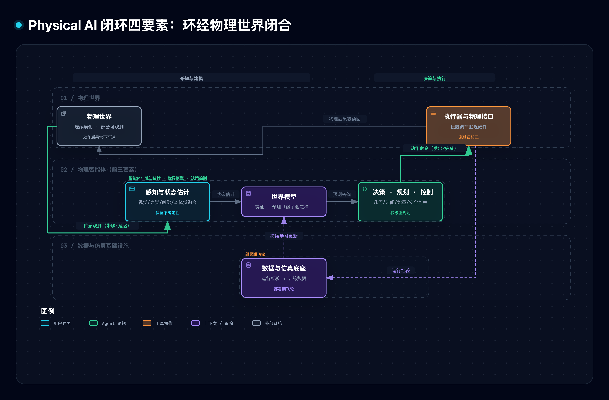
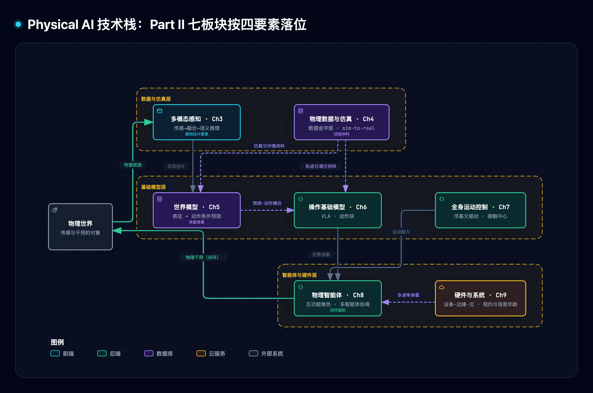

# Physical AI monograph 精读与通俗拆解（具身智能定名之作）

> [1] W. Zhang *et al.*, "Physical AI: Concepts, techniques, and challenges," arXiv:2610.27045v1, Oct. 19, 2026. [Online]. Available: https://arxiv.org/html/2610.27045v1 （访问 2026-11-05；v1 即最新版，CC BY 4.0）。

> [!NOTE] 精读范围
> 全书三 Part 十二章与术语表/记号表逐单元通读（快照 1.28 MB）；核心宣称经 1 个一手信源外核（[2]）；配套原型见 §7。

**一句话定位**：这是上海人工智能实验室系 52 位作者写的领域定名之作——给「让 AI 直接作用于物理世界」立统一定义，沿「感知-表征-干预-反馈」四要素闭环组织 12 章技术版图，并划清它与 Digital AI、Embodied AI、CPS、数字孪生的边界。

**导读**：过去几十年 AI 活在计算机里处理符号与像素；把智能接到物理世界后，「说得对」与「做得到」之间隔着一条鸿沟——机器能解释怎么拿起杯子，却估不出杯子的质量、稳不住抓力。本书回答三件事：Physical AI 是什么（§1）、它的技术版图怎么用四要素闭环串起来（§2–§5）、凭什么判断一个系统做到了没有（§6–§9）。

> [!TIP] 白话主线
> ① 物理世界不直接暴露状态，传感器只给局部、带噪、延迟的观测，而动作的后果常不可撤销；② 所以智能必须组成闭环：感知估计给状态，世界模型答「做了会怎样」，决策控制在约束里选动作，物理后果被读回来修正一切；③ 这个环穿过物理世界闭合——命令发出去不等于做成，只有传感器读回的物理结果才算数；④ 反馈按毫秒（运动控制）、秒（任务重规划）、部署期（数据飞轮）三个尺度嵌套；⑤ 评估只认完整交互 episode（从接到指令到物理结果落定的一整段）的闭环表现，孤立指标与演示视频都不算数。

## 1. 它讲什么问题

作者的立论前提很直接：这个领域「尚未就定义、技术版图与核心挑战达成共识」[1]。书的开篇给出一个判别式：Digital AI 的操作接口作用于数字表示——图像里画着物理场景，识别它并不需要真的与那个场景交互；Physical AI 则经物理接口直接干预物理过程。书里反复用一个对照敲打这一点：一个系统能正确解释怎么拿起玻璃杯，却可能估不出质量、建立不了稳定抓取、察觉不到即将打滑——语义上的懂、预测上的准与物理上的能做，是三种不同的性质[1]。

Definition 1.1 把正文定义钉死：Physical AI 是人工系统这样一种能力——感知物理环境状态、维持对物理关系与动作后果的任务相关表征、经物理接口选择并执行干预，并用反馈在物理、运行与算力三类约束下达成目标[1]。定义有四条可操作的推论：观测要接到世界里的真实量上（物理接地）、系统要有干预路径（执行器或受控设备）、反馈要能改变后续行为、能力主张要有推理/预测/规划/适应的证据——装了传感器执行器本身不算数。

四条近邻边界的划法[1]：

| 近邻概念 | 它强调什么 | 与 Physical AI 的关系 |
|:---|:---|:---|
| Embodied AI | 身体形态如何塑造感知与行动 | 物理部署的具身系统是 Physical AI 的主要实现；Physical AI 额外涵盖传感决策执行分布在基础设施里的形态 |
| CPS（信息物理系统） | 计算与物理过程的工程集成 | Physical AI 是 CPS 架构里的一层「能力」，不是同一层概念 |
| 数字孪生 | 与具体实体绑定、持续同步的数字表示 | 孪生不一定自主选动作；Physical AI 也不必维护完整孪生 |
| Digital AI | 操作数字表示 | Physical AI 建立在它之上而非取代它——语言模型能提出实验方案，成败取决于移液与温控 |

托卡马克（一种环形核聚变装置）等离子体的强化学习磁控是书里最锋利的例子：系统没有轮子没有手臂，但它经装置的测量与作动基础设施闭合了观测-决策-物理后果的环，按此定义就是 Physical AI[1]。

## 2. 全貌解剖

全书三 Part 就是「定义→展开→收束」：Part I（Ch1–2）立定义、划边界、铺数学/控制/认知/学习四支柱；Part II（Ch3–9）把四要素展开成七个方法论板块；Part III（Ch10–12）以 Physical AGI、评估安全治理与战略展望收束。落到应用上，部署系统收拢为五种原型：单一具身智能体、多智能体集群、环境级装置（传感与执行嵌在设施本身，可以没有移动本体）、能力增强工具（人保留决策权）、虚实交互系统[1]。四个要素把 Part II 的七章各就各位：

| 四要素（Ch1 §1.3） | 对应章节 | 一句话职责 |
|:---|:---|:---|
| 感知与状态估计 | Ch3 感知认知、Ch9 传感 | 把带噪观测折成「世界在什么状态」的估计，不确定性保留 |
| 世界模型 | Ch5、Ch4 数据与仿真 | 表征当前世界、预测动作后果 |
| 决策规划与控制 | Ch6 操作、Ch7 全身运动、Ch8 智能体 | 在几何/时间/能量/安全约束里选并执行动作 |
| 闭环反馈与多尺度适应 | Ch1 §1.3.4 定义；承载见 Ch9（Ch2 供理论基础、Ch11 供评估口径——笔记归纳） | 让物理后果修正估计、模型与计划 |

因果主线：世界不可全观测且动作不可逆 → 一次性开环执行无法发现并修正误差 → 智能必须组织成闭环，且环在物理世界闭合 → 四要素是闭环的功能分解，12 章是四要素的技术展开 → 证据以闭环物理结果计，不以说得对计。书里同时反复钉边界：每类保证都有失效点——负反馈不等于稳定（足够大的延迟与过高的放大倍数会失稳）、稳定性证明（李雅普诺夫证书）只在认证范围内有效、安全约束式（CBF）在输入受限或约束冲突时无解[1]。

## 3. 机制一：闭环四要素——环穿过物理世界

四要素里最容易被低估的是第四件。命令链路再可靠，也不担保物理执行：夹爪闭合不等于抓到、放置位姿不等于被支撑、关门指令不等于门已关——监控只认物理效果，不认命令回执[1]。所以书里说环「不在任何单一模块里，而在要素之间的连接上」，且「经物理世界而非智能体内部闭合」。

反馈还分三个嵌套尺度[1]：最快一圈是运动控制与实时校正（毫秒级，接触一变立即修）；中间一圈是任务层（秒级，随进展重规划）；最慢一圈穿过数据与仿真基础设施（部署期，把每天的运行经验变成明天的训练数据，即数据飞轮）。

工程上这是全书最重要的结构判断之一：高层计算低频、算力大、可以放得远，物理感知高频、算力小、必须贴着机体——接触调节留在硬件附近，慢推理放远端；命令权限用带截止时间的租约表达，到期前后（留检测与切换延迟的余量）即转本地预配置回退[1]。时间错配的代价可以很小也可以很大：20 ms 的时间对齐误差乘上 0.5 m/s 的工具速度就是 1 cm 位移；控制规律一字不改、观测晚 0.6 秒到手，闭环就能从收敛变成振荡（本篇原型 D5，§7）。

具体输入走查（用书里的家庭助手例子[1]）：命令「把杯子放进柜子」。感知估计给出杯子位姿与柜门状态的估计及不确定度；世界模型表征「杯子在桌上、柜门半开」，并预测「抓握倾斜 30 度会洒」；决策层把目标拆成技能序列并在可行性约束内下发；执行后摄像头与力觉读回物理结果——门没关上就重试或换策略。任何一环只信命令不信读回的物理结果，这个循环都会在第一次意外处断掉。

*图 1 · 四要素环经物理世界闭合，三条虚线反馈对应毫秒/秒/部署期三个尺度*

图源 [.mmd](../../assets/mermaid/physical-ai/pai--closed-loop-elements.mmd) · 交互版 [HTML](../../assets/architecture/physical-ai/pai--closed-loop-elements.html) · candidate [JSON](../../diagrams/pai--closed-loop-elements/pai--closed-loop-elements.json)

## 4. 机制二：世界模型——保留答案的状态

环转起来之后，被查询得最多的部件是世界模型。它的书内定义一句话：关于环境可以怎样变化的紧凑、可查询的描述[1]。判断内部状态好坏的标准不是复现了多少细节，而是有没有保留回答任务问题所需的区分——两个状态若导致不同的最优动作就必须分得开，对任何决策等价的压掉也无妨。这条「预测充分性」准则两面开刀：渲染得再逼真的视频生成器不等于世界模型（可能答不对「机器人推之后抽屉开不开」），很小的内部压缩表示（潜状态）只要保住决策所需区分就是合格预测器[1]。

部分可观测是这一切的底色：同一画面可对应不同速度、接触模式或温度，所以状态要用条件分布（信念）表示而非单点——而两个可能位置的平均值可能落在障碍物内部，备择必须分开保持[1]。这里有两个全书反复使用的界线。其一，观测条件化不等于干预：视频里学到的「人伸手之后抽屉通常被打开」是相关规律，机器人施加推力抽屉因此打开才是因果干预——被动视频的规模换不来后者，因为决定干预响应的指令力与接触态通常未被测量[1]。其二，想象必须经物理验证：模型误差沿长程预测累积，规划器可能专挑模型算错的区域下注换虚高回报，所以想象训练要配滚动时域执行（只执行序列首段、从新证据重规划），生成器与共享其假设的评估器互证不算世界知识的改进[1]。

验证因此分三轴分开报告：预报质量（单步/开环多步/反馈交错）、物理一致性（接触等事件按类型分区，总体平均会掩盖碰撞时机错误）、决策效用（有无模型调用的闭环对照，而非模型自报指标）[1]。

## 5. 机制三：从数据到基础模型

材料的第 4 章给出全书最有制衡力的一张图：数据金字塔。顶端是目标本体真机执行数据——最相关也最贵最稀缺；底座是网络级人类视频——便宜多样但不含可执行动作。据 Goldberg 估计（转引自 [1]），迄今最大的遥操作数据集约折合 1 年机器人经验，而训练视觉语言模型的图文语料要一个人看 10 万年。仿真不排进金字塔而单独画——它的有效位置取决于用真实数据校准的程度。

这条鸿沟上的三条硬结论[1]：数据按五级证据分层（观测/动作代理/执行/闭环经验/合成），看得见运动给不出力与指令，视频里的动作只是代理而非可执行命令；**多样性比体量重要**——机器人轨迹高度相关，静止帧与重复成功虚增体量不增经验，跨环境/物体/本体/来源的多样性才抬泛化上限；预训练的回报是新任务省 3–5 倍数据，而语言式 scaling law 的三假设（数据等价、算力唯一成本、loss 下降代表更好）在物理数据上逐条被拉紧——最低 loss 的检查点闭环表现可以显著更差。

操作与运动两侧的基础模型是 Part II 的主角。操作基础模型（Ch6）的定义式判据：可适配新任务的预训练模型——参数量与语言接口都不构成该性质[1]。谱系一句话：RT-1（13 台机器人 13 万条遥操作轨迹）→ RT-2/OpenVLA（语义迁移）→ π0 系（流匹配动作专家、约 10k 小时数据）→ π0.5（异构协同与经验改进）。两个工程要点：动作为了限制误差累积，一次按块预测一串动作（action chunk）；动作怎么表示有两条路线——切成离散记号像文字一样生成，或用连续模块直接输出动作量，π0.5 走「离散训练+连续执行」混合。

全身运动控制（Ch7）的物理出发点是浮基欠驱动——腿式机器人基座 6 个自由度上没有任何电机，内部关节力在质心平衡里相互抵消，改变姿态推不动自己，水平质心加速必须靠外部接触力——接触力是运动的中心；由此灵巧手的手内操作与全身控制同构：被握物体就是那个无驱动的「浮基」[1]。运动基础模型（HOVER/BFM/ScaleBFM）把「跟踪参考运动」当代理任务预训练可复用行为库，下游经掩码目标接口按任意身体部位调用[1]。

*图 2 · Part II 七板块在四要素上的落位与供料关系*

图源 [.mmd](../../assets/mermaid/physical-ai/pai--methodology-stack.mmd) · 交互版 [HTML](../../assets/architecture/physical-ai/pai--methodology-stack.html) · candidate [JSON](../../diagrams/pai--methodology-stack/pai--methodology-stack.json)

## 6. 关键实证数字

八组数字撑起全书的实证面：

| 实验/口径 | 关键数字 | 条件·截至 | 一句话读法 |
|:---|:---|:---|:---|
| 数据鸿沟（Goldberg，转引） | 最大遥操作语料 ≈1 年机器人经验 vs VLM 语料需人 10 万年阅读 | [1] · 2026-10 | 物理 «数字的数据量级差是全书立论基座 |
| 长链复利律 | 50 个各 98% 的独立步骤全程 ≈36%；加检测 0.9/恢复 0.8 后 ≈76% | 说明性计算[1] | 单步可靠性在长程上坍缩，检测恢复才是杠杆 |
| 协同训练 | 加仿真数据真机平均 +38%；SplatSim 纯渲染训练真机零样本 86.25% | 所引研究报告值 [1][2] · 2025–2026 | 校准好的仿真能换来真机收益，但收益会触顶，除非真数据也增长 |
| EgoScale 灵巧手 | 人类视频预训练 1,000→20,000 小时，任务得分 0.30→0.71 | 直训后训路径（无对齐中训）[1] · 2026 | 人类视频先验在灵巧手上确实随规模兑现 |
| UniDex 跨手共享 | 功能坐标预训练真机最终成功 76% vs π0 的 35%；零样本跨手仅 40% 任务进度 | 5 任务×每法 20 试聚合（Wuji+Inspire）[1] · 2026 | 任务结构可迁移，接触执行只能部分保留 |
| 舰队 scaling | 1/2/4 台机器人达 80% 成功需 174/127/72 分钟——4 倍机器人只换 2.4 倍加速 | SOP 舰队流式训练实验[1] | 并行收益被物理争用与协调开销侵蚀 |
| 文明尺度 | Kardashev 指数 K≈0.73（2019 年总能源供给口径，转引估计）；Type I 需约 501 倍功率 | [1]（推测性叙事） | 功率只说明支配多少能量，不说明能成就什么 |
| 零事件上界 | 20 次连续零失败只给失败率 ≈14% 的 95% 单侧上界（统计上仍排除不掉的最坏失败率） | 独立试验+固定协议前提[1] | 「跑了很多次没事」从来不是「已验证安全」 |

三条核心宣称的独立证据：数据鸿沟的一手未在 arXiv 定位到（按转引处理）；SplatSim 一手已核（[2]，摘要级）；长链复利与零事件上界是书内说明性计算、非实测。

## 7. 动手实验室

原型 [physical_ai_lab.py](./assets/physical_ai_lab.py) 纯标准库、确定性、无随机数：一维轨道车（带坡度偏差与固定阵风时刻表）+ 噪声观测 + 交错坑洼走廊，`demo / selftest / break D1..D5 / count` 四模式；`python3 docs/research/physical-ai/assets/physical_ai_lab.py selftest` 11/11 全绿（秒级）。原型只验证机制逻辑，不复制书中任何系统的数字。

| 机制 | 实现单元（行号） |
|:---|:---|
| 轨道物理与设计期序列 | plant_step:37 · design_ff:45 |
| 闭环回放与延迟通道 | run_track:61 · pi_ctrl:92 · open_ctrl_factory:97 |
| 噪声观测与滤波估计 | run_track_with_sensor:108 |
| 前瞻 vs 贪心（世界模型滚动搜索） | greedy_walk:151 · lookahead_walk:167 |

破坏实验（每次只拆一个组件，数字为实际运行日志）：

| 实验 | 改动 | 实测退化 | 教训 |
|:---|:---|:---|:---|
| D1 去反馈 | 开环回放设计期控制序列 | MAE 0.3575→1.7667 m，末段误差 0.0157→2.5654 m | 设计期算好的序列只对设计假设成立，扰动一来无人修正 |
| D2 去积分 | PI 降为 P | 末段误差 0.0157→0.0679 m（≈坡度/Kp） | 比例项对恒定偏差只能留固定偏差 |
| D3 裸观测当状态 | 绕过滤波器 | 控制抖动 21.06→89.80（4.3 倍），位置误差 0.0250→0.0157 m | 代价全打在执行器上——被控量未必变差，磨损与能耗先坏 |
| D4 贪心无前瞻 | 不展开世界模型 | 第 10 步掉坑，回报 −109 vs 前瞻 −22 且到达 | 不看「动作之后世界会怎样」，局部最优直通坑底 |
| D5 观测延迟 | 同一控制律，观测晚 0.6 s | 末段误差 ×14，误差变号 3→9 次（振荡不收敛） | 延迟让修正总落在情况变化之后（相位滞后）——规律没错也会失稳 |

## 8. 底层规律与核心争议

五条规律各管一维：**反馈的价值在模型不完整处**（控制论维——模型完美时预计算就够，反馈把某些形式的不确定性转成可观测误差，但足够大的延迟与过高的增益会使其失稳）；**环经物理世界闭合**（系统结构维——发出≠完成，评估单元因此是完整 episode）；**物理数据多样性压倒体量**（学习维——相关轨迹堆量不增经验，金字塔顶层稀缺是常态）；**表示按保留答案论足**（表示维——世界模型与感知表示都不按复现细节计，按决策所需区分计）；**时间尺度分层是硬结构**（工程维——毫秒/秒/部署期三圈嵌套，计算摆放跟着物理责任走，观测年龄比平均时延更决定响应性）。

三个争议都是真分歧：**要不要显式内部世界模型**——行为机器人学先驱 Brooks 一派的名言「世界就是它自己最好的模型」被引作全书方法论部分的卷首题记，世界模型派要内部预测器；本书的裁决是紧耦合可替代穷尽式重建，但长期规划与对不在场事件的推理仍需内部状态，且「完整模拟器不必要、任务够用即可」[1]。**大模型挂载能否直达具身智能**——scaling 乐观派指望把大模型接到机器人上；本书断言挂载不够，具身智能需要持续修正模型的物理反馈，VLM（视觉语言模型）只是感知认知系统的组件而非几何估计、物理传感、记忆与测量的替代品[1]。**物理数据有没有可预测 scaling law**——327 篇论文元分析称机器人性能按幂律提升且快于语言任务；本书以受控研究稀少、loss 与闭环成功脱钩回敬，只承认多样性增益与预训练收益、不承认普适指数[1]。

## 9. 适用边界

### 成立条件
定义域：作为概念框架与判据工具使用——判定系统归属、定位技术要素、设计评估口径。成立工况：其判据（四推论、五原型、capability boundary——固定资源下测「哪些条件仍达标」的口径）在声明范围内自洽；材料本身是立场性综述，适用于建立全局地图与边界意识，不适用于单点方法的实施细节。

### Out-of-Scope
任何单点方法的性能承诺；发展时间表（图 12.1 题注自认 indicative and conditional）；Physical AGI 的实现路径论证（目标态叙事）；文明尺度推演（推测性讨论）。

### 材料没有证明的事
1. 定义与四要素是作者方提出的组织框架，材料自认领域「尚未达成共识」、非文献已收敛的定论。
2. Physical AGI 四维×四路径无任何系统实现证据，材料原文明言「这些能力尚未被证明」。
3. 关键数字多为转引各论文自报结果：三只灵巧手规格「未经独立验证」、World Labs 系属「开发者自述系统」、Generalist 结果「未经同行评审」[1]。
4. 本快照参考文献列表被 LaTeXML 截断（至字母 B），相当部分转引无法从快照内完整溯源；已外核的仅 SplatSim 一条。
5. Ch12 星际尺度部分（Dyson swarm——环绕恒星布置巨型收集器的设想——等）作者自认是推测性研究场景、图 12.1 时间表自认 indicative and conditional，不能当工程结论读。

## 10. 用户自测与费曼研讨套件

（费曼研讨：把刚学的东西用最通俗的话讲给别人听，讲不出来就是还没懂。）

1. 不看正文，用 5 句话向同事讲清：为什么「环经物理世界闭合」不是工程细节而是定义核心？哪句话讲不动就回 §3。
2. D1–D5 之外再设计一个破坏实验：拆掉三尺度反馈里的一圈（比如让任务层不再重规划），预测真实系统会先在哪类任务上坏掉，并写出验证方法。
3. 把 §8 规律 5（时间尺度分层）用到你们自己的系统上：哪个反馈圈被放错了位置？怎么发现的？

延伸追问：如果 Brooks 一派是对的（不需要内部模型），§4 的三轴验证还剩哪一轴？

## 参考（IEEE）

[1] W. Zhang, C. Shen, T. Xue, B. Zhao, B. Zhou *et al.*, "Physical AI: Concepts, techniques, and challenges," arXiv:2610.27045v1, Oct. 2026. [Online]. Available: https://arxiv.org/html/2610.27045v1
[2] Q. Chen *et al.*, "SplatSim: Zero-shot sim2real transfer of RGB manipulation policies using Gaussian splatting," arXiv:2409.10161. [Online]. Available: https://arxiv.org/abs/2409.10161
